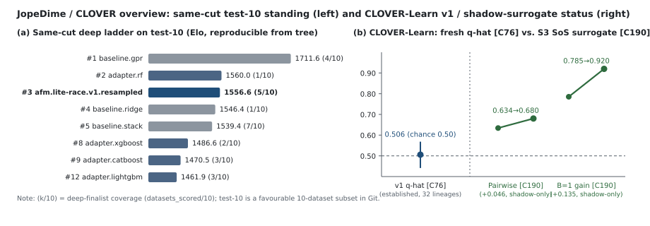

# JopeDime

Standalone JOPE-Dime: a typed program-synthesis engine for tabular models,
encoders (Hyperion and companions), and emitters that lower a program to Python,
Rust, C++17, and JavaScript. C++20 CI compiles the C++17 artifact; it is not a
second numeric dialect.

This is the product tree for [`neverhuman/JopeDime`](https://github.com/neverhuman/JopeDime),
the `repository` named in `Cargo.toml`. It is **not** the 8×A100 node workspace and **not** a
`jain-split` sibling. Training corpora and model weights live in S3. Git holds source, catalogs,
forty generated synthetic fixtures and ten tiny test datasets.

SOTArena **ASPFM** / `jope-dime` campaign wins are the feat-math program track. The
encodings→program neural policy will ship because the product needs a router; it is
**not** a held-out SOTA claim.

What changed in 0.3.0 and 0.2.0 is in [`CHANGELOG.md`](CHANGELOG.md). The current direction and the landing
record are in [`MASTER_PLAN.md`](MASTER_PLAN.md). How to verify a release is in
[`docs/release/README.md`](docs/release/README.md).

Contributors and agents should read [AGENTS.md](AGENTS.md) before changing this repository.

The [training observatory](docs/dashboard/README.md) provides live loss, fleet, storage, dataset,
program-library and checkpoint views with source identities, observation age and qualification scope.

## GP source WebSocket

Capture every GP candidate occurrence, including non-winners, duplicates and failed emissions,
and stream full Rust, Python, C++17 and JavaScript training-recipe source. Automatic capture
covers the materialized in-tree program paths in the [engine coverage table](docs/gp-source-stream.md#engine-and-language-coverage):

```sh
# Linux: rustc, python3, g++, node, GNU timeout and prlimit must be on PATH.
# Keep journals and generated source outside the Git checkout.
cargo run --release --locked -p jope-observatory --bin gp-source-stream -- \
  --journal-dir "$HOME/jope-stream/journals" \
  --state-dir "$HOME/jope-stream/state"

# In another terminal, enable capture before starting any GP producer:
JOPE_GP_SOURCE_DIR="$HOME/jope-stream/journals" \
  cargo run --release --locked --bin jope -- pipeline invent \
  --train /absolute/path/train.csv --target target \
  --work-dir /absolute/new/search-output --budget evaluations=100,seconds=120 --json
```

Connect to `ws://127.0.0.1:9876/api/v1/gp/source?after=0`; fetch metrics at
[http://127.0.0.1:9876/api/v1/gp/metrics](http://127.0.0.1:9876/api/v1/gp/metrics).
Each `source` event contains **all four language rows and complete source text**, followed by
`checked` events. Resume with `after=<last sequence>`; replay does not generate token credit.
For xbabe2, run the service there and use `ssh -N -L 9876:127.0.0.1:9876 xbabe2` locally.

Token totals sum actual lexical code tokens **plus documentation tokens across every language**,
including source that fails its compiler check. Metrics include per-language and aggregate
output tokens/sec, assembly tokens/sec, pending/passed/lost tokens, compiler errors and emission
errors. Token yield is `passed_tokens / emitted_tokens`; pending tokens cannot pass, and zero
output has undefined (`null`) yield. Artifact yield also charges unsupported emitters that
produce no tokens. A completed, error-free run reaches 100%; errors remain visible.

The existing C++17 and JavaScript emitters cover fewer heads than Rust/Python. Their refusals
are streamed as errors, never silently excluded or replaced with another program. This service
checks compilation without executing generated programs. See [protocol, capture coverage,
limits and client examples](docs/gp-source-stream.md).

## At a glance

| What | 0.3.0 |
| --- | --- |
| `jope` with no arguments | prints `jope 0.3.0` <sup>1</sup> |
| Workspace | 27 members: 20 crates at 0.3.0 and 7 vendored SmartCluster crates at 8.0.0; 8 are `default-members` <sup>2</sup> |
| `jope` subcommands | 17 in `jope --help` on Linux, plus the hidden `motifs` <sup>3</sup> |
| Emit targets | 6: `python`, `rust`, `cpp17`, `cpp17-recipe-v2`, `cpp20` (the C++17 source compiled as C++20) and `javascript` <sup>4</sup> |
| Rust tests | 5,705 listed in 27 packages, 74 of them ignored; a listing, not a run <sup>5</sup> |
| Python tests | 182, found by a static scan, not collected or run <sup>5</sup> |
| CI | 10 jobs per pull request in `ci.yml`; 11 `full-main-cpu` families on every push to `main` <sup>6</sup> |
| Coverage map | 785 items over 25 lanes <sup>7</sup> |
| Capability matrix | 831 rows: 353 moved, 68 new, 1 pending, 402 dropped, 7 lost <sup>8</sup> |
| Datasets in Git | 40 synthetic fixtures (10 each of binary, multiclass, regression and time series) and 10 test datasets <sup>9</sup> |
| Python still tracked | 1,185 `.py` files, 159 of them under `python/` <sup>10</sup> |
| Architecture decision records | 6 <sup>10</sup> |

1. `cargo run --locked --bin jope`
2. `cargo metadata --locked --no-deps --format-version 1 | jq '(.workspace_members, .workspace_default_members | length), ([.packages[].version] | group_by(.) | map({(.[0]): length}) | add)'`
3. `cargo run --locked --bin jope -- --help`; the hidden verb is the `#[command(hide = true)]` variant of `enum Command` in `crates/jope-cli/src/main.rs`
4. the single-language arms of `fn languages` in `crates/jope-cli/src/kernel.rs`
5. `jq '.rust.count, .rust.ignored, (.rust.packages | length), .python.count' docs/parity/test-inventory.json`
6. the top-level `jobs:` of `.github/workflows/ci.yml`; `jq '[.lanes | keys[] | select(startswith("full-"))] | length' deploy/ci/coverage.json` (the families `deploy/ci/full-main.py` runs)
7. `jq '.items, .lanes | length' deploy/ci/coverage.json`
8. the **total** row of the Counts table in `docs/parity/capability-matrix.md`
9. `jq '.datasets | length' datasets/synthetic/catalog.json`; `jq '.members | length' datasets/manifest.json`
10. `git ls-files '*.py' | wc -l`; `git ls-files 'python/*.py' | wc -l`; `git ls-files 'docs/adr/ADR-*.md' | wc -l`

## What this SHA actually does

| Surface | Status on this SHA |
| --- | --- |
| `jope` CLI | Fixtures (`verify-inputs`, `generate-fixtures`), CPU `encode` (fails closed without the Hyperion weights), `fit` / `search` / `emit`, `champions --local` (searches the supported regression fixtures and reports the rest as unsupported), `train-step --local` (fits a 128-d centroid router), `route`, `models`, `datasets`, `pipeline`, and the private ASM verbs `doctor`, `demo`, `benchmark`, `optimize` and `train` ([docs/asm.md](docs/asm.md)). `champions --pull/--push` and `train-step --env dev` or `--env prod` **fail closed**. |
| `jope pipeline run` | CPU spine only: dataset -> folds -> program search -> select -> emit -> `jope.pipeline-receipt/v3`, optionally seeded from a `jope.pipeline-seeds/v1` file (`--seed-genomes`) or a verified parent receipt (`--incumbent`); seeds are re-measured, never trusted. Every candidate is fitted with `feat_math::fit` on a cut's training rows and scored on that cut's held-out rows, and selection requires measurements on every requested cut before comparing mean held-out RMSE. Exploration and cross-cut comparison share the [total per-cut budget](docs/pipeline.md). `--threads` and `--islands` (parallel search groups over the same cuts that pass their best program to each other at a fixed interval) set the workers, which must fit the CPUs the process may use and `--cpu-ceiling`. It does **not** use the engine's own search, which cannot measure in a shipped binary (`eval_registry/authority.rs` blocks every capability outside `cfg(test)` and `fit_boundary.rs` fences fitting behind a service socket). The encode/propose stage is **skipped** and recorded (`--policy require` fails closed); nothing in it publishes to S3 or trains the router. |
| Targeted single-dataset search | `jope pipeline evolve` runs rounds of `run` on one dataset's fixed cuts, each seeded from the previous round's champion and runners-up, chained in a `lineage.json` that `jope pipeline lineage verify` re-derives; `--control` adds one unseeded run. `jope pipeline score --split test` scores a selected program on the sealed test split at most once per dataset and program in its registry (a local record, not access control), and lists every earlier look. High-water-mark ingest (`jope-learning hwm ingest --source pipeline`) and the append-only local champion bank (`jope-learning bank add`, `list`, `export`; an export seeds the next round) are separate steps. The rounds select on reused folds, so only the test split speaks to generalisation. |
| W7 native loop | `jope-native-loop`, a `jope-engine` binary: host census, run plans, signed participant grants, authenticated cross-host transport with pinned certificates and an absolute deadline on every read and write, controller recovery, and SmartCluster dispatch of bounded ranks that prove their job before any work. It is qualified on source and fixtures only: a same-host fixture with hermetic host identities, and a local one-rank dry run. The three-host proof ([runbook](docs/runbooks/w7-three-host-cpu-proof.md)) has **not** run and needs its own admission; live cross-host checkpoint exchange and continuation routing are deferred. |
| S3 | `jope datasets` and `jope models` read and write `s3://` stores through `object_store`, resolving `credential_process` profiles themselves; `jope-learning` mirrors its store and publishes W8 progress when `--store` or `JOPE_LEARNING_URL` names one. `champions --pull/--push` has no live route (issue #62). The CLOVER tools `jope_pools` and `jope_retention` read local files (frozen pools, a `GP_RESULTS_INDEX.json` built from the S3 results tree) and write local receipts; they fit offline shadow selectors and train no policy. No live S3 training run has been made, and the bound `jope-policy` checkpoint weights are **not** updated. |
| Encoders and policy | CPU Hyperion on Candle (`hyperion-cpu`) is the default; a CUDA feature exists but is not the CI default. `jope-policy` needs the bound step-60000 checkpoint to propose. |
| Git datasets | Forty synthetic fixtures in `datasets/synthetic/`, which CI regenerates and compares (`jope generate-fixtures --check`) and verifies (`jope verify-inputs`), and the ten licensed test datasets (`test-10`) in `datasets/test/`. Real tables stay in S3. |
| Release | A signed host release from `deploy/release/release.sh`, with no Python wheel; see [Releases](#releases). |

## Measured results

Generated by `jope-records readme-benchmarks` from committed evidence. Do not edit between the markers by hand.



*Overview of committed evidence: (a) same-cut deep ladder on `test-10` (`assets/same-cut/v2/leaderboard-jope-same-cut-v1-deep.csv`, where parenthetical `(k/10)` bar labels denote deep-finalist dataset coverage `datasets_scored/10` and `afm.lite-race.v1.resampled` ranks `#3` of `15` at `Elo 1556.6`, `5/10` finalist coverage, `2/10` dataset wins, and `2.2 s` mean / `1.0 s` median search wall time) and (b) CLOVER-Learn `v1` fresh-program `q`-hat pairwise accuracy (`0.506 [0.441, 0.568]`, chance `0.50`, established `C76`) alongside the offline S3 LOPO SoS-debiased contextual surrogate on `shadow-pool-v2` (`1,136` contexts, `255` parent clusters, pairwise accuracy `R0 0.634 -> R4 0.680`, `+0.046 [+0.040, +0.052]`, and `B=1` top-1 gain `0.785 -> 0.920`, `+0.135 [+0.067, +0.215]`, non-qualifying `ESTABLISHED_SHADOW`, `flywheel_established = false`, `C190`). Companion empirical plots in [`docs/paper/TECHNICAL_WRITEUP.md`](docs/paper/TECHNICAL_WRITEUP.md#1032-offline-s3-sos-debiased-contextual-surrogate-and-round-qualification-readiness) §10.3.2 trace (**Figure 2**) the `L6-1148` continuation probe-KL vs. loss-delta curve across `R25`, `R26`, and `EI-1`–`EI-4` (`C174, C186–C189`; no neural continuation objective has yet beaten frozen `v1` under qualified evaluation, `C142, C158`) and (**Figure 3**) the `1,554`-pair cross-language parity census (`41/342 = 12.0%` quantile-binning 1-ULP failure rate vs. `0/1,212` without binning, `C41–C43, C49`) alongside the `3/6 -> 6/6` `EXP-008` champion replay at `0.0` max delta under opt-in `EmitOptions::partition_point_quantile_bounds` (`C167, C191`; see [`docs/experiments/README.md`](docs/experiments/README.md)).*

<!-- arena:begin -->
### Golden45 — regression, 45 datasets

`tabular-regression-v2` · primary metric **RMSE** (minimize) · Elo by `regularized-bradley-terry-elo-scale` · test labels are **not public**; 3 datasets are restricted; excluded datasets: ZTS.

#### Benchmark-valid — the ladder this repository claims

**304 methods** · 8,718 rankable scores · 45 published rows excluded as test-selected (see the next block). Bold rows are this repository's entries. *Benchmark-valid* here means that no artefact in this repository contradicts the row's published flag; it is not a claim that every comparator's protocol was verified.

| rank | method | Elo | avg rank | dataset wins | coverage | protocol |
| ---: | --- | ---: | ---: | ---: | --- | --- |
| 1 | TabFM Ensemble | 1934.9 | 21.51 | 7 | 45/45 | `public-development` |
| 2 | TabPFN v3 | 1909.5 | 24.16 | 1 | 45/45 | `public-development` |
| 3 | TabPFN v3 Default | 1906.3 | 24.51 | 0 | 45/45 | `public-development` |
| 4 | Tabpfn V25 Regressor Default | 1893.3 | 25.98 | 5 | 45/45 | `public-development` |
| 5 | Tabicl | 1887.6 | 26.64 | 4 | 45/45 | `public-development` |
| … | | | | | | |
| **31** | **Jope Dime Regressor** | **1687.0** | 60.59 | 1 | 42/45 | `public-development` |

**Read the protocol column before the Elo column.** `leaderboard_policy.protocols_ranked_together` is `true`, so entries produced under different protocols share one ladder. `jope-dime-regressor` is one fixed-seed reproducible run of this repository's engine under `public-development`, the same protocol as every other comparator. The same-cut benchmark is what turns this into a like-for-like comparison.

#### Best known program per dataset — as published; test-selected, not a held-out result

The benchmark published `jope-dime` at rank 1, Elo 2259.8, 11 dataset wins, 45/45 coverage, every row `benchmark_valid: True`. This repository's own code says otherwise about every one of those rows, so the benchmark-valid ladder above carries none of them:

- **42 Golden42 rows** are each the per-dataset minimum RMSE over the ledger's test-scored candidate evaluations (63,108 across the 42 datasets), not the score of one program frozen before the test targets were opened. The red-team lane in this tree names that quantity the *best-test ASPFM envelope*, role `oracle_reference_only`, and keeps it out of its fair ladder (`8a55c4fef:python/src/jope/research/index_combined_regression_evolution.py:183`, `crates/jope-campaigns/src/commands/train_only_redteam.rs:402-407`).
- **3 Golden46 rows** come from run `golden46-new3-20260723-v4`, whose artefacts this repository's campaign code writes with `benchmark_valid: false, test_adaptive: true` (`crates/jope-campaigns/src/test_adaptive/aggressive.rs:732-748`); the acceptance manifest relabelled the replayed winners `true`.

Both are the best program found per dataset when candidates were scored on the test targets: reported here as best-known results, never as a held-out claim. The reproducible fixed-seed run of the same engine, `jope-dime-regressor`, is what stands on the ladder above. The same-cut benchmark replaces every row on this page with numbers this tree can reproduce.

| ladder | `jope-dime` | Elo | dataset wins | coverage |
| --- | ---: | ---: | ---: | --- |
| as published | rank 1 | 2259.8 | 11 | 45/45 |
| benchmark-valid | not ranked | — | — | 0/45 (every row test-selected) |

Sources: published `assets/regression/sotarena-tabular-regression-v2/results/tabular-regression-v2/leaderboard.csv` (sha256 `2d28ffbd8b5830c6…`), recomputed byte-for-byte from `scores.csv`; benchmark-valid `assets/regression/leaderboard-tabular-regression-v2.benchmark-valid.csv` (sha256 `4c39f51c2e269114…`), the same `scores.csv` with `assets/regression/protocol-corrections-tabular-regression-v2.json` (sha256 `6a831c4a97c2fc29…`) applied. Both are asserted by `crates/jope-arena/tests/elo_regression.rs`. Reproduce offline:

```sh
cargo run -p jope-arena --bin jope-arena -- elo \
  --track tabular-regression-v2 --root assets/regression/sotarena-tabular-regression-v2 --check
cargo run -p jope-arena --bin jope-arena -- elo \
  --track tabular-regression-v2 --root assets/regression/sotarena-tabular-regression-v2 \
  --ladder benchmark-valid --corrections assets/regression/protocol-corrections-tabular-regression-v2.json \
  --check --committed assets/regression/leaderboard-tabular-regression-v2.benchmark-valid.csv
```
<!-- arena:end -->

<!-- samecut:begin -->
### Same-cut — every method on identical held-out rows, reproducible from this tree

`jope-same-cut-v1-deep` · 10 regression datasets from `datasets/test` · primary metric **RMSE** (minimize) · fold plan k=5, seed 20260907, screen fold 0, top 5 deepened · search budget 32 programs × 8 rounds, re-run on every cut · recorded at `8c90a3279` with 16 workers on 128 cores.

Every row here is a number this tree produced and can reproduce: the ten single-head baselines, four external engines (XGBoost, LightGBM, CatBoost and a scikit-learn random forest, each run as a subprocess with its library defaults, a fixed seed and one thread, handed a cut's training rows and its held-out features only, and scored by this benchmark from the predictions it returns) and the program the search wrote for each dataset, all fitted on the same training rows and scored on the same held-out rows by one evaluator (`docs/same-cut-bench.md`). The search sees only a cut's training rows, and its deep row is the *procedure* re-run on every cut, not one program chosen with knowledge of the other cuts' held-out rows. Bold is the searched program.

**The datasets are a favourable selection.** They are the `test-10` collection, chosen from the published ladder where the historical engine ranked first (`docs/datasets.md`), and they are used here because they are the only committed regression data. Identical cuts make the comparison between methods fair on these ten; they say nothing about a broader panel. The frozen 30-dataset PMLB panel of the experiment contract (`docs/asm.md`) excludes them on purpose; a same-cut run over it is the next evidence step.

| rank | method | Elo | avg rank | dataset wins | coverage |
| ---: | --- | ---: | ---: | ---: | --- |
| 1 | baseline.gpr | 1711.6 | 1.00 | 4 | 4/10 |
| 2 | adapter.rf (scikit-learn 1.7.2 RandomForest) | 1560.0 | 2.00 | 0 | 1/10 |
| **3** | **afm.lite-race.v1.resampled** | **1556.6** | 2.60 | 2 | 5/10 |
| 4 | baseline.ridge | 1546.4 | 2.00 | 0 | 1/10 |
| 5 | baseline.stack | 1539.4 | 2.71 | 0 | 7/10 |
| 6 | baseline.ensemble | 1538.1 | 2.50 | 2 | 4/10 |
| 7 | baseline.krr | 1488.7 | 3.00 | 1 | 6/10 |
| 8 | adapter.xgboost (xgboost 2.1.4) | 1486.6 | 3.00 | 1 | 2/10 |
| 9 | adapter.catboost (catboost 1.2.10) | 1470.5 | 3.33 | 0 | 3/10 |
| 10 | baseline.histgbm | 1470.1 | 4.00 | 0 | 2/10 |
| 11 | baseline.ridge_gcv | 1465.9 | 3.33 | 0 | 3/10 |
| 12 | adapter.lightgbm (lightgbm 4.6.0) | 1461.9 | 3.33 | 0 | 3/10 |
| 13 | baseline.ksmooth | 1446.1 | 4.00 | 0 | 1/10 |
| 14 | baseline.elasticnet | 1424.1 | 4.00 | 0 | 2/10 |
| 15 | baseline.histgbm2 | 1333.7 | 4.33 | 0 | 6/10 |

**Where the search stands today:** rank 3 of 15 on the deep ladder, Elo 1556.6, lowest pooled RMSE on 2 of 10 datasets (the ladder's own rule), a finalist on 5; on the other 5 it did not make the top-5 screen. Against the four external engines it ranks above adapter.catboost (rank 9), above adapter.lightgbm (rank 12), below adapter.rf (rank 2), above adapter.xgboost (rank 8). Coverage counts datasets where a method reached the deep stage, so the ladder ranks finalists only. The screen ladder (every method, one cut) is committed beside it.

**Seconds per program.** Writing the program took the search 2.2 s per dataset on average (median 1.0 s, longest 8.3 s) on the screen cut's training rows, wall time under whatever else the host was running. The owner's stated reference point for a large language model writing a program for the same task, not measured here, is about 1 hour and 10,000,000 tokens; that comparison is one of cost, not of quality, and the quality standing is the ladder above.

| dataset | rows | features | lowest pooled RMSE | RMSE | search rank (penalised score) | search |
| --- | ---: | ---: | --- | ---: | ---: | ---: |
| `047e62b52a3f4ede` | 195 | 12 | **afm.lite-race.v1.resampled** | 0.0712 | 1 | 0.4 s |
| `1cb97b1d7314d43d` | 166 | 10 | baseline.gpr | 0.06635 | 2 | 8.3 s |
| `21fbfe8b53dbcd60` | 1000 | 21 | adapter.xgboost | 0.02428 | screen 10 | 1.4 s |
| `30ef3eaa6d2971a9` | 109 | 30 | **afm.lite-race.v1.resampled** | 0.071 | 1 | 1.3 s |
| `43b4cc3ab0ebbd97` | 482 | 39 | baseline.krr | 0.09057 | screen 6 | 1.3 s |
| `693890aae9dc860b` | 202 | 1 | baseline.gpr | 0.004291 | 4 | 6.6 s |
| `79e600bc5fcd5da7` | 180 | 3 | baseline.gpr | 0.1491 | screen 8 | 0.4 s |
| `b5beff4a53fa12c0` | 575 | 15 | baseline.ensemble | 0.05628 | screen 13 | 0.7 s |
| `c32fa09b48fb2f27` | 1000 | 9 | baseline.ensemble | 0.185 | screen 9 | 0.7 s |
| `c7d815714ca52bce` | 1000 | 7 | baseline.gpr | 0.1808 | 4 | 0.7 s |

Sources: `assets/same-cut/v2/leaderboard-jope-same-cut-v1-deep.csv` (sha256 `bf2c6dc0e8267492…`) recomputed byte-for-byte from `assets/same-cut/v2/track/results/jope-same-cut-v1-deep/scores.csv`, itself re-derived from the 10 reports under `assets/same-cut/v2/reports` by `crates/jope-bench/tests/committed_evidence.rs`, which also re-evaluates one dataset's baselines on the same cuts. Provenance and the exact commands: `assets/same-cut/v2/SOURCES.md`. Reproduce:

```sh
cargo run --release -p jope-bench -- run --datasets datasets/test --out target/same-cut/reports \
  --adapter "catboost=python3 crates/jope-bench/adapters/catboost_adapter.py" \
  --adapter "lightgbm=python3 crates/jope-bench/adapters/lightgbm_adapter.py" \
  --adapter "rf=python3 crates/jope-bench/adapters/sklearn_rf_adapter.py" \
  --adapter "xgboost=python3 crates/jope-bench/adapters/xgboost_adapter.py" \
  --top 5 --search --search-pop 32 --search-gens 8 --resample-search --workers 16
cargo run --release -p jope-bench -- ladder --reports target/same-cut/reports \
  --track-root target/same-cut/track --track jope-same-cut-v1
cargo run -p jope-arena -- elo --track jope-same-cut-v1-deep --root target/same-cut/track \
  --check --committed assets/same-cut/v2/leaderboard-jope-same-cut-v1-deep.csv
```
<!-- samecut:end -->

<!-- bench:begin -->
### Emit-path latency

`emit-champion-8944cbdf` — 200 runs of the release `emit` example on `crates/feat-math/assets/champions/8944cbdf.dsl`.

| min | median | mean | p95 |
| ---: | ---: | ---: | ---: |
| 3.61 ms | 20.59 ms | 48.40 ms | 222.33 ms |

**This is not an engine-speed number.** Its own `what` field says it measures "wall time of one `feat-math` release `emit` example run (process spawn included) on the committed champion; lower is better". The min-to-p95 spread is dominated by process spawn and scheduling, not by emission. Treat it as a regression tripwire (alert at 10% drift), not as a performance claim.

Recorded 2026-09-19T00:34:16Z on `xbabe2` (x86_64, 128 cores, kernel 6.8.0-139-generic) at `a53a1499d` with rustc 1.97.1 (8bab26f4f 2026-07-14). Baselines are host-pinned; `bash deploy/ci/regression-suite.sh bench` compares against this file.
<!-- bench:end -->

## Install and check

Linux x86_64. Rust from `rust-toolchain.toml`. `cargo build --locked` builds the
workspace `default-members`: the `jope` binary and the crates it depends on, CPU only
(no LibTorch, CUDA, or cluster runtime). `cargo build --workspace --locked` builds
every member.

```sh
cargo build --locked
cargo run --locked --bin jope
# jope 0.3.0
cargo run --locked --bin jope -- verify-inputs --offline --root datasets/synthetic
# Verified 40 synthetic datasets, … bytes, offline.
# Encode needs the Hyperion bundle (not in git):
# HYPERION_V7_WEIGHTS=… cargo run --locked --bin jope -- encode --input datasets/synthetic/binary/linear.json
cargo run --locked --bin jope -- fit --input datasets/synthetic/regression/linear.json --json
cargo run --locked --bin jope -- emit --lang all --output target/jope-emitted --json
cargo run --locked --bin jope -- search --input datasets/synthetic/regression/linear.json --json
cargo run --locked --bin jope -- champions --local --root datasets/synthetic --json
cargo run --locked --bin jope -- train-step --local --root datasets/synthetic --output target/jope-router --json
cargo run --locked --bin jope -- route --input datasets/synthetic/regression/linear.json --router target/jope-router --json
# A requested target whose emitter does not cover the selected program is reported as not
# emitted; the receipt lists the artifacts actually written (docs/emitters.md has the coverage).
cargo run --locked --bin jope -- pipeline run --dataset datasets/test/pmlb-229-pwlinear \
  --budget evaluations=8,seconds=120 --emit rust,python,cpp17,cpp20,js --policy skip --output target/e2e
cargo run --locked --bin jope -- pipeline verify-receipt --receipt target/e2e/receipt.json
```

Prove emitters on this SHA:

```sh
JOPE_PARITY_STRICT=1 cargo test --locked -p feat-math
```

Pull-request CI is `.github/workflows/ci.yml`: ten jobs on the self-hosted `jope-ci` runners.
Eight each run one lane of `deploy/ci/fast-lane.sh`, and `aggregate` validates their receipts
(`deploy/ci/aggregate.py`). The hygiene lane includes `deploy/ci/check.sh`
(formatting, the coverage map, the prose rule, the repository layout, the README's generated
blocks, and `jope-records paper-trace`, which checks the white paper's printed numbers against its
claim ledger and this README's version and "At a glance" counts against their files) and builds
and tests the standalone AWS Lambda workspaces under `deploy/lambda` (`deploy/ci/lambda.sh`). Every push to `main` runs `main-guard` and `full-main-cpu`. Locally,
`just ci-pr` (alias `just required`) runs `check.sh`, `cargo fmt --check`, clippy with
`-D warnings`, the pull-request nextest tier, and ruff and pytest over the remaining Python; each
tool must be installed.
`just lint-paths` runs only the absolute-home-path check.

### CLOVER self-play flywheel quick start

`jope-learning` holds the CLOVER self-play ratchet (`run_selfplay_ratchet`), surrogate-screened seed selection (`select_seeds_with_surrogate_funnel` under `surrogate_funnel_topb_v1`), non-parametric measured-tilt leaf proposal (`measured_tilt_leaf_log_probs` bounded by `decomposed_support_kl`), the `gp_distilled/v1` Parquet distillation bridge into `ContextualSurrogateQHat`, and the offline round-qualification verifier (`jope_pools qualify-rounds [--prereg <PATH>]`). All of it is offline and shadow-only: it fits selectors and surrogates on local files, trains no policy and writes nothing to S3. Steps 1 and 2 run from a clone:

```sh
# 1. Verify the multi-round self-play ratchet, surrogate funnel, and measured-tilt leaf policy:
cargo test --locked -p jope-learning --lib clover::expansion::tests::

# 2. Verify the gp_distilled/v1 S3 Parquet distillation bridge, ContextualSurrogateQHat loop, and round qualification:
cargo test --locked -p jope-learning --test retention --test retention_pack --test pools --test selfplay_round_qual
```

Steps 3 to 5 adapt R22 coverage, freeze candidate pools, evaluate selectors and run the flywheel. They read host inputs that are not in Git; [`docs/clover-host-steps.md`](docs/clover-host-steps.md) lists the inputs and the commands.

## Releases

A release is cut on xbabe2 by [`deploy/release/release.sh`](deploy/release/release.sh) from a merge
commit on `main`: a dry run first, then the same command with `--publish`, which creates the
annotated tag `vX.Y.Z` and the GitHub release and reads both back. A release holds the `jope` binary
(built in the digest-pinned `rust:1.97.1-bookworm` image, glibc 2.36 at most), a build receipt,
SPDX and CycloneDX SBOMs, the release notes, a release manifest and `SHA256SUMS`, signed with cosign
by a release key held on xbabe2. There is no Python wheel and no provenance attestation.
[`release.yml`](.github/workflows/release.yml) is dispatch-only and fails closed. This tree is the
source of v0.3.0; the release exists only once `release.sh --publish` has run.

To verify one, take `signing.pub` from the tag and check its fingerprint as
[docs/release/README.md](docs/release/README.md) describes, then check the signature and the sums:

```sh
TUF_ROOT="$D/.tuf" cosign verify-blob --key signing.pub --insecure-ignore-tlog=true \
  --signature "SHA256SUMS-$TAG.txt.sig" "SHA256SUMS-$TAG.txt"
sha256sum -c --strict "SHA256SUMS-$TAG.txt"
```

## Intended pipeline

```text
dataset cut
  → encoders (Hyperion + foundation + target)
  → encodings context
  → policy that proposes / routes programs
  → typed program kernel (feat-math)
  → emitters → working Python / Rust / C++17 / JS
  → S3: best programs per dataset
  → train the policy on those champions
```

The diagram is the design, not this SHA's state. The foundation and target encoders are
research-only: the learning lanes refuse them at load time (`deploy/dl-flywheel/docs/encoder-mask-plan.md:59`), and the foundation bundle
(`starlight_core_regressor`) prohibits redistribution and is not policy-eligible
(`crates/jope-encoders/artifacts/model-bundle.v1.json`). The policy in [`docs/paper/`](docs/paper/)
reads one pinned encoder, NVIDIA Kumo-Tabular Small (`deploy/dl-flywheel/docs/model.md`).

Do not open a stack of PRs. Merge or close the current one before starting the next.

## Layout (this SHA)

The 27 workspace members, by directory under `crates/`; the package name follows where it differs.
[docs/architecture.md](docs/architecture.md#crate-graph) describes each crate.

| Group | Crates | Role |
| --- | --- | --- |
| Default build | `jope-cli` (binary `jope`), `feat-math`, `jope-pipeline`, `jope-bench`, `jope-datasets`, `jope-models`, `jope-motifs`, `jope-policy` | The workspace `default-members`, what a bare `cargo build` selects: the `jope` binary and its direct workspace dependencies except `hyperion` and `jope-learning`, which it still builds as dependencies (`Cargo.toml` says why). Programs, fit and emitters; the pipeline; the same-cut benchmark; dataset and model stores; program fragments; the proposal policy. |
| Encoders | `jope-encoders` (`starforge`), `hyperion`, `numpy-pcg64` | Encoders, Hyperion v5/v7 on Candle, and a bit-exact numpy RNG. |
| Engine and campaigns | `jope-engine` (`jope-parallel`), `jope-campaigns` (`jope-dime-regressor`), `battle-gpu`, `jope-arena` | The engine and its binaries, `jope-native-loop` among them; benchmark campaigns; raw-CUDA screening (feature `gpu`); SOTArena scores and Elo. |
| Learning, records and CI | `jope-learning`, `jope-records`, `jope-ci`, `jope-paths` | The HWM ledger, champion bank and W8 progress, and the offline CLOVER tools (`jope_pools`, `jope_retention`, `jope_support`, `jope_custody`); record verifiers, the hygiene guards and the paper and README numbers trace; CI tooling; the ADR-0003 runtime roots. |
| Vendored | `smartcluster/*` (7 crates) | The jain-smartcluster scheduler, at its own version 8.0.0. |

| Path | Role |
| --- | --- |
| `datasets/synthetic` | The forty generated fixtures and `catalog.json` |
| `datasets/test` | The ten licensed test datasets (`test-10`) |
| `python/` | The Python that remains after [ADR-0006](docs/adr/ADR-0006-rust-only-stack.md) phase P1 (#117): the training stack (`policy`, `encoders`, `target_maker`, `data`, `dime_score`, `broad_shadow`), the research helpers that kept tests use, and the sha-pinned grammar sources; package `jope` 0.1.0, never released. Phases P2 and P3 port or retire it, with the CI helpers in `deploy/ci/*.py`. No new Python except the emitted model code and its harness. |
| `deploy/ci`, `deploy/release` | CI lane scripts and the coverage map (`check.sh` is the hygiene lane); the release script and its tests |
| `deploy/lambda` | Standalone AWS Lambda workers, an offline assessment tool for the regression worker's stored models, the host-side search engine of the teacher campaign and a terminal monitor, each its own Cargo workspace with its own lock; not part of the `jope` binary or its build. `SNAPSHOT.json` records every imported file's hash ([README](deploy/lambda/README.md)) |

## Further reading

- [`CHANGELOG.md`](CHANGELOG.md) — what changed in 0.3.0 and 0.2.0
- [`MASTER_PLAN.md`](MASTER_PLAN.md) — current direction and the landing record
- [`docs/release/README.md`](docs/release/README.md) — how a release is cut, signed and verified
- [`docs/pipeline.md`](docs/pipeline.md) — the pipeline's budget, selection, seeding, parallelism and test-split contracts
- [`docs/architecture.md`](docs/architecture.md) — crates, contracts and the intended pipeline
- [`docs/emitters.md`](docs/emitters.md) — per-target coverage of the emitters
- [`docs/datasets.md`](docs/datasets.md) — dataset store layout, licence rule and `datasets/test`
- [`docs/campaigns.md`](docs/campaigns.md) — benchmark campaigns
- [`docs/paper/TECHNICAL_WRITEUP.md`](docs/paper/TECHNICAL_WRITEUP.md) — the CLOVER technical write-up (a draft), its [claim ledger](docs/paper/claims.json) and [numbers trace](docs/paper/NUMBERS_TRACE.md)
- [`docs/experiments/README.md`](docs/experiments/README.md) — curated 18-record experiment digest ([`experiments.jsonl`](docs/experiments/experiments.jsonl), [`schema.v1.json`](docs/experiments/schema.v1.json) and [synthesis roadmap](docs/experiments/SYNTHESIS_AND_NEXT_EXPERIMENTS.md))
- [`docs/runbooks/`](docs/runbooks/) — operator runbooks, the W7 three-host proof among them
- [Private maintainer manual](docs/asm-maintainer-manual.md) — detailed PDF, section Markdown, current evidence, dataset inventories and acceptance checklist
- [`docs/quickstart.md`](docs/quickstart.md) — the ASM build and the feat-math quickstart (timings measured at `4235db6`, not this SHA)
- [`docs/adr/`](docs/adr/) — architecture decision records 0001–0006
- [`docs/archive/`](docs/archive/) — retired plans and the restore manifests of removed files
- [`CONTRIBUTING.md`](CONTRIBUTING.md), [`SECURITY.md`](SECURITY.md), [`CODE_OF_CONDUCT.md`](CODE_OF_CONDUCT.md)

## Licence

Apache-2.0. See [LICENSE](LICENSE).
