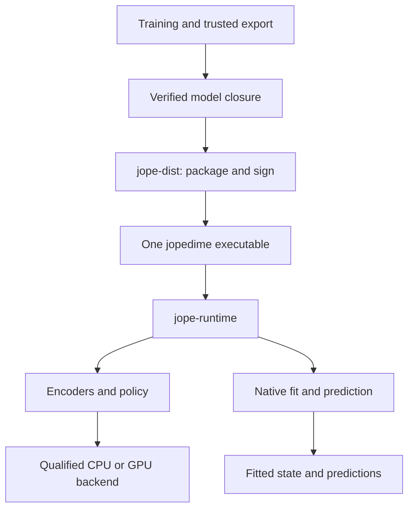
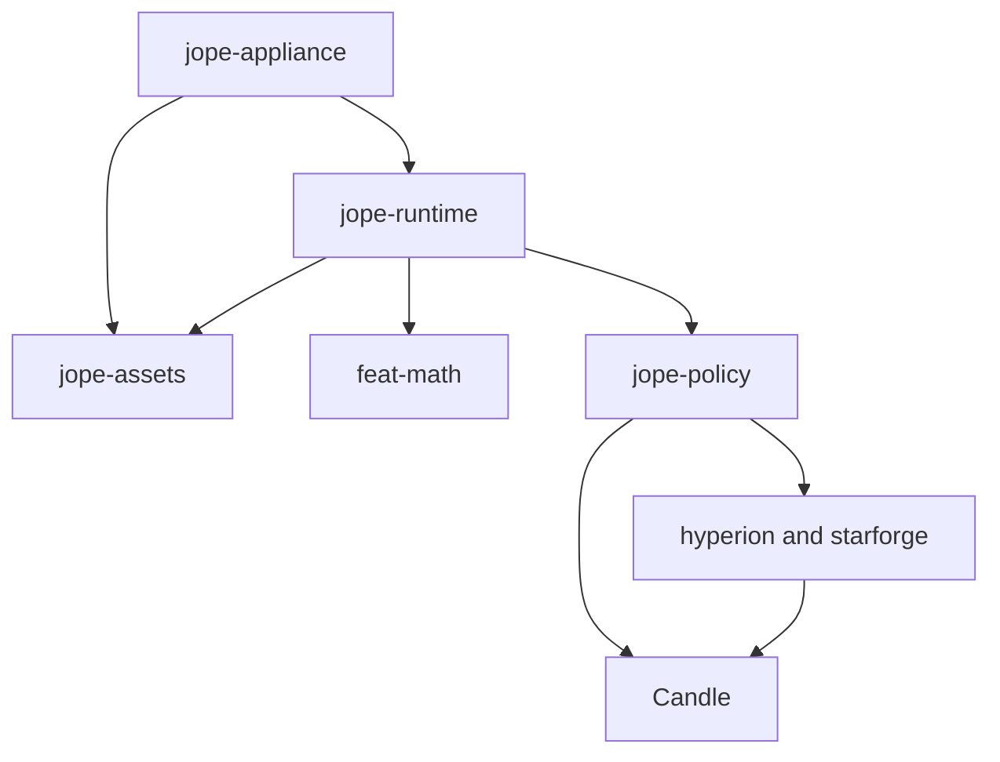
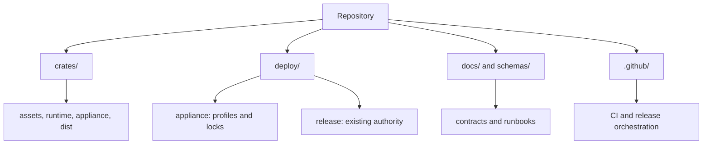
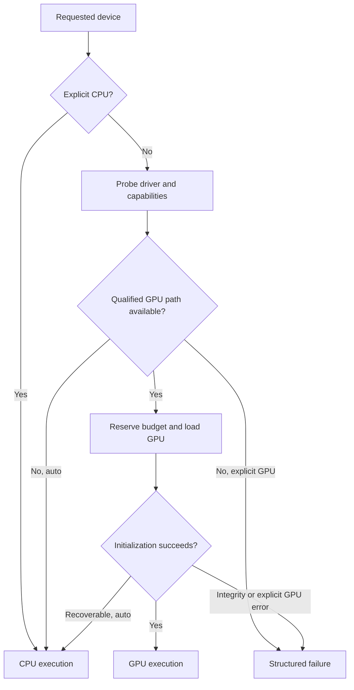
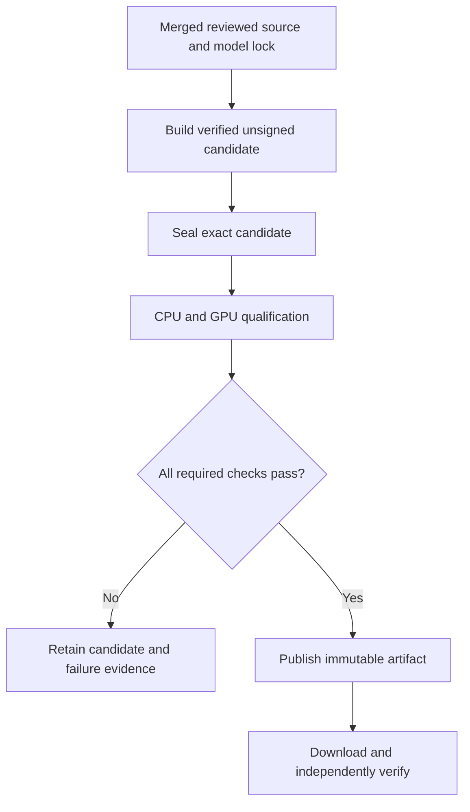

# JopeDime: single-file Rust deployment engineering specification

**Prepared:** October 20, 2026, America/Denver

**Repository:** [neverhuman/JopeDime](https://github.com/neverhuman/JopeDime)

**Reviewed source:** `95dcb0c0e44d95184607740aacd387bf5c007e89`

**Status:** implementation specification; no repository changes, release, GPU execution, checkpoint download, or model qualification was performed during this review.

**Proposed installed command:** `jopedime`

**Initial target for qualification:** Linux x86-64, glibc 2.36 or newer. Other platforms require their own artifact and qualification.

Navigation: [audit](#2-evidence-boundary-and-repository-audit) · [architecture](#4-architecture-and-ownership) · [model closure](#5-exact-model-dependency-closure) · [file layout](#7-repository-layout) · [single-file format](#10-one-file-package-and-signature-format) · [GPU/CPU](#11-gpucpu-deployment-engineering) · [CI](#15-ci-design) · [release](#16-release-and-deployment-lifecycle) · [acceptance](#17-acceptance-and-qualification) · [PR plan](#18-implementation-sequence-and-pr-plan).

## 1. Decision and intended outcome

Build a **single signed executable containing the Rust runtime, all selected pretrained model weights, their configurations and preprocessing assets, the native Rust alternatives, and the notices needed for the selected distribution scope**. The executable must work offline. A user must not install Python, PyTorch, LibTorch, a Rust compiler, model-download tools, or an auxiliary JopeDime worker to run it.

Keep training, experiments, checkpoint conversion, benchmark adapters, and release automation free to use their existing languages. The deployment boundary is the installed application and its inference/fit execution, not the language of every development tool.

Use the existing `deploy/` directory. Add a focused `deploy/appliance/` subtree, four small Rust crates with explicit responsibilities, and extend the existing release authority. Do not create a second competing release system or package the entire research CLI with every workspace feature enabled.

The principal design decisions are:

| Decision | Required implementation |
| --- | --- |
| Rust inference engine | Reuse the repository's Candle 0.11.0 implementations; preserve the pinned version initially. |
| Tensor interchange | Safetensors plus an explicit architecture/configuration/preprocessing contract. Safetensors alone is not a model implementation. |
| Single-file delivery | A stripped executable followed by an indexed asset payload, a canonical manifest, an embedded signature, and a fixed footer. The Linux implementation is specified in §10. |
| Model selection | A reviewed, content-addressed dependency graph rooted in each shipped method, not a recursive copy of `models/PINNED`. |
| GPU behavior | One Linux executable starts without CUDA installed. It uses a supported NVIDIA GPU when the complete selected execution path is qualified and available; otherwise `auto` chooses CPU with a recorded reason. |
| CUDA user libraries | The full GPU package includes the required approved redistributable user-space libraries. Only the operating system and installed GPU driver remain host prerequisites. A system-toolkit-dependent development build is not the full deployment deliverable. |
| Application language | All JopeDime runtime logic is Rust. CUDA vendor libraries, GPU machine code, libc, and drivers must be disclosed separately; their presence cannot truthfully be described as every instruction being written in Rust. |
| AutoML alternatives | Include the existing native `feat-math` methods and the already implemented neural alternatives whose asset closure is authorized and qualified. External Python benchmark adapters remain development comparators. |
| Signing | Preserve the current release key and reviewed signing process initially; extend it to sign a one-file envelope. Final release checksums bind the exact published executable. |
| Compression | Lossless asset compression first. Lower precision, quantization, head removal, or architecture changes are separate model variants requiring qualification. |
| CI | Fast PR checks without production weights; trusted full-weight CPU/GPU qualification; a protected release orchestration path that invokes the existing release script. |

**Completion means the full product runs from the delivered executable on a clean CPU machine and on a supported GPU machine, without an installed JopeDime tree, Python environment, model directory, CUDA toolkit, network access, or companion JopeDime executable.** Automatically generated caches and user-created fitted model data are permitted. They are not installation prerequisites.

### 1.1 Material findings that must shape the implementation

1. **Most numerical inference code is already in Rust.** `jope-policy`, `hyperion`, `starforge` (the package inside `crates/jope-encoders`), and `feat-math` are the starting point. Reimplementing these in another Rust framework would create unnecessary parity work.
2. **The current `jope` executable is a broader research/product front door.** It directly depends on `jope-bench`, `jope-datasets`, `jope-models`, and `jope-learning`. These are inappropriate mandatory dependencies for a small offline appliance.
3. **The accepted policy is not interchangeable with the other checkpoints.** Its semantic manifest defines 2,048 float32 context values, a 401-token vocabulary, a specific policy checkpoint, encoder assets, normalizations, seeds, and qualification rules.
4. **The accepted encoder closure uses the small `hyperion_v5_arm_b` artifact.** The separately pinned `hyperion-v7/model.safetensors` is not a substitute. A class named `V7Model` inside the producer is not authority to replace the pinned weights.
5. **GPU compilation and graceful fallback are different problems.** Candle 0.11.0 explicitly enables cudarc's `dynamic-linking` mode. Adding a Rust `Device::Cpu` fallback does not fix a binary that fails in the OS loader before `main`.
6. **Model distribution is currently constrained by explicit repository metadata.** The Starlight foundation and some TabICL files are marked `redistribution: prohibited`; the accepted policy and the separate Hyperion v7 bundle include internal-only entries. This is a concrete release blocker for public full-model distribution, not a speculative warning.
7. **A signed release process exists already.** `deploy/release/release.sh` builds a verified source export, signs checksums, publishes, and verifies a downloaded copy. `.github/workflows/release.yml` intentionally refuses execution. Do not simply remove that refusal and revive its obsolete wheel-based design.
8. **The existing release does not include model weights.** Moving to a complete executable is a new release format with new compatibility, size, qualification, and publication checks.

## 2. Evidence boundary and repository audit

The GitHub connector supplied repository metadata and current files. The source checkout reviewed locally was at the full commit above, which also matched the remote `HEAD` observed during this review. The connector reported the repository as **public**. Historical prose calling it private is not current publication authorization.

The audit examined source and configuration. A declared feature, a historical README result, a test marked ignored, or a committed model manifest is not evidence that a new packaged executable has passed qualification. Refresh the source SHA, open PR queue, and relevant records before implementation.

| Existing path | Verified observation | Consequence |
| --- | --- | --- |
| `Cargo.toml` | Workspace version 0.3.0; Rust MSRV declaration 1.96; release profile already uses optimization level 3, LTO, and one codegen unit. | Extend profiles narrowly; do not sell existing settings as new improvements. |
| `rust-toolchain.toml`, `deploy/release/release.sh` | Release documentation and script pin the 1.97.1 bookworm builder and glibc 2.36 ceiling. | Preserve this baseline for the first artifact; pin the actual builder digest in the release lock. |
| `crates/jope-cli/Cargo.toml` | Broad CLI dependencies; default `qualified-training-context`; CUDA feature forwards through `jope-bench`. | Introduce a deployment binary with a clean closure. Retain `jope` for current workflows. |
| `crates/jope-policy/Cargo.toml` | Candle 0.11.0; optional context producer; `testing` exposes untrained/unbound support; CUDA features are present. | Product builds must reject `testing`; connect deployment CUDA directly to inference crates. |
| `crates/jope-policy/src/model.rs` | `load_bound` validates checkpoint binding and then loads tensors from bytes. | Add a verified-buffer constructor with the same checks. Do not replace it with unbound `load_safetensors`. |
| `crates/jope-policy/src/model/cached.rs` | A KV-cache implementation already exists, including flattened one-token matrix multiplication. | Reuse and qualify it; do not specify KV caching as entirely missing. |
| `crates/jope-policy/src/semantic.rs`, `release/policy-step-60000.semantic-v1.json` | Immutable accepted model/encoder/vocabulary identity and context ABI. | Make it an input to release closure resolution; never edit its historical bytes to permit a new package. |
| `crates/jope-policy/src/context_producer.rs` | Hyperion, foundation, target, transforms, and assembly identities are explicit; CPU/device loading paths exist. | Package the whole compatible closure and preserve transformation order. |
| `crates/jope-policy/src/context_producer/worker.rs` | Existing worker invocations bind asset paths and executable identity. | Reuse validation semantics, but add an appliance execution identity; old host-specific receipts do not transfer automatically. |
| `crates/hyperion/Cargo.toml` | Default `batch-worker` introduces `jope-parallel`; library users can disable it. | Always use `default-features = false` in the appliance closure. |
| `crates/jope-encoders/src/model.rs` | Buffer-based safetensors loading, optional dtype selection, and `.zst` loading exist. | Generalize these paths instead of building another model loader. |
| `crates/jope-encoders/src/bundle.rs` | Governed bundle loading enforces identities, model metadata, notices, and licenses. | Introduce a verified asset-source seam without weakening these checks. |
| `crates/jope-encoders/src/bin/model_bundle_pack.rs` | Rust preprocessing-array conversion to `preprocessing.safetensors` already exists. | Reuse this conversion logic in packaging tooling. |
| `crates/jope-encoders/src/model/chimera.rs`, `model/tabicl_*` | Native Starlight, TabICL, and Chimera model paths exist. | Include the relevant methods only after their complete closure and per-task parity are qualified. |
| `crates/jope-bench/src/panel/methods.rs` | Raw-table native roster: 16 regression families/17 recipes, five binary families, four multiclass families. | Extract the executable roster into a shared runtime registry so deployment and benchmarks agree. |
| `crates/jope-bench/src/adapter.rs`, `adapters/`, `deploy/prepare-panel-runtime.py` | XGBoost, LightGBM, CatBoost, and sklearn comparators invoke external runtimes. | Do not label these adapters as native Rust ports or bundle them into the appliance. |
| `crates/feat-math/src/advanced_v3.rs` | Exposes schema-bound fit/predict and fitted portable functionality. | Use this typed API for in-process native execution. No runtime compiler is required. |
| `crates/jope-pipeline/src/execution.rs`, `supervisor.rs` | Some orchestration relies on systemd, sudo, Docker, or shell commands. | Extract pure computation; do not place host research orchestration inside the offline runtime. |
| `crates/jope-models/src/lib.rs` | Model fetch/publish uses `jope-datasets` storage and S3 configuration. | Use it in trusted build preparation, not as a normal appliance dependency. |
| `models/PINNED`, `models/manifest.json`, `models/bundles/*.json` | Three top-level bundles, totaling 1,461,921,570 declared bytes. | This is a catalog inventory, not the minimum inference closure or a measured final executable size. |
| `deploy/ci/ci-plan.py`, `aggregate.py`, `coverage.json` | CI uses explicit applicability plans, evidence receipts, and aggregate validation. | Add deployment lanes to the same accounting; do not create invisible extra checks. |
| `.github/actions/cargo-target/action.yml` | Job-scoped target selection recognizes `ci`, `ci2`, and `full` lanes. | Explicitly add any new deployment runner lane; do not assume it will already work. |
| `AGENTS.md` | Claims, one implementation PR at a time, independent exact-head review, custody rules. | Implementation must follow the existing contribution lifecycle. This review did not mutate the checkout. |

Some comments and README entries are historical. For example, the policy README still describes CUDA as build-unverified, while later code has additional inference paths. The implementation must resolve current qualification from current receipts, not either comment alone.

## 3. Product contract

### 3.1 What one binary means

The customer installs one platform-specific executable. It contains:

- Native fit, transform, search/proposal, selection, and prediction implementations.
- Every pretrained tensor required by the chosen full product profile.
- Architecture configuration, token vocabulary, grammar, operator registry, preprocessing, and model identity metadata.
- A manifest listing methods, task support, limits, assets, distribution scope, precision, and qualified backends.
- Model and third-party notices, accessible through `jopedime licenses`.
- Its embedded release signature.
- For the full NVIDIA profile, the approved user-space CUDA dependency closure and embedded GPU kernels.

It does not require a companion executable, a remote model download, a user-managed model directory, or an installed language runtime. The operating system loader, standard system libraries permitted by the target contract, and GPU driver are external system prerequisites. Those prerequisites must be listed accurately.

The application may create an optional verified cache of decoded tensors and GPU libraries. Deleting that cache must not destroy the ability to run the executable; the next invocation reconstructs it or uses the supported no-cache CPU path.

One executable is not one universal file for Linux, macOS, Windows, x86-64, and ARM. Each advertised target gets its own binary, signature, model/backend compatibility record, and tests. The initial implementation is Linux x86-64. macOS Metal and Windows are follow-on targets, not implied coverage.

### 3.2 What 100% Rust means

The strict deployable application boundary prohibits Python, subprocess calls to Python, LibTorch, `tch`, `torch-sys`, ONNX Runtime, external training engines, and a compiler invoked to execute a proposed program. JopeDime's data preparation, proposal logic, native alternatives, state handling, and inference orchestration are Rust.

Candle CUDA executes NVIDIA libraries and GPU kernels. A binary using those components is a Rust application, but is not composed exclusively of Rust-generated machine instructions. Specify this as **Rust application/runtime, with an explicitly inventoried OS/GPU ABI exception**. Do not describe cuBLAS as Rust merely because it is called through Rust.

If an absolutely Rust-only numerical dependency graph is a hard requirement, the CPU backend is the initial route. A new Rust-authored GPU-kernel stack would be a separate project, not a packaging switch. Do not change to an unproven GPU framework inside this PR just to make the language label stronger.

### 3.3 Runtime commands

| Command | Behavior |
| --- | --- |
| `jopedime --version --json` | Product version, source SHA, runtime ABI, asset manifest digest, build target, and feature profile; no weight decoding. |
| `jopedime doctor --json` | Package integrity, available devices, backend reasons, supported methods, cache availability, and documented resource limits. |
| `jopedime methods --json` | Every compiled method, task support, required asset closure, backend capability, and enabled/blocked state. |
| `jopedime fit --train train.csv --target y --output model.jope` | Fit a local model with native Rust methods and the selected proposal strategy. |
| `jopedime predict --model model.jope --input rows.csv --output predictions.csv` | Load complete fitted state and predict without refitting. |
| `jopedime fit-predict --train train.csv --target y --input rows.csv --output predictions.csv` | Bounded one-invocation fitting and prediction; no persistent fitted file is required. |
| `jopedime verify-self --json` | Validate the embedded envelope and assets; a diagnostic, not independent verification of a possibly malicious executable. |
| `jopedime licenses` | Print embedded license/notice inventory. |
| `jopedime cache inspect` / `cache prune` | Inspect/prune only this product's verified derived cache, respecting active use. |

Common explicit controls: `--device auto|cpu|cuda:N`, `--threads`, `--memory-limit-mib`, `--time-limit-seconds`, `--seed`, `--method`, `--precision`, `--cache-dir`, `--no-cache`, `--json`. Do not use global `JOPE_*` research environment variables as implicit model selectors.

`--device cuda:N` fails if that device cannot execute the requested method/profile. It does not silently become CPU. `--device auto` reports its selection and bounded fallback. An integrity failure never becomes a fallback-success result.

### 3.4 Training versus fitting

Offline pretrained encoders/policies are trained elsewhere and frozen before release. The deployed application may still fit a regression/classification model on the user's local training table. These are different activities. Native AutoML requires the latter.

The pretrained proposal policy emits a program/recipe; it is not, by itself, a fitted regressor for a previously unseen dataset. The runtime must validate that recipe, fit its parameters locally, preserve its preprocessing state, and predict. A generated source file alone is not the fitted deployment result.

User-created `model.jope` is application data, not a second runtime dependency. If a customer wants a separately signed predictor executable with a fitted model embedded, add that as a build-service output using `jope-dist`; do not require a compiler on the customer's inference host.

## 4. Architecture and ownership



### 4.1 Crate boundaries

| Crate | Responsibility | Mandatory exclusion |
| --- | --- | --- |
| `jope-assets` — new | Read-only asset abstraction, package parsing, bounds/hash/signature verification, lossless decoding, and verified cache objects. | No cloud clients, model training, arbitrary executable loading, or automatic fetch. |
| `jope-runtime` — new | Local table contract, method registry, pure computation extracted from existing paths, encoder/policy orchestration, fitting, prediction, budgets, fitted state, backend selection. | No benchmark controller, dataset catalog fetch, self-play, research systemd supervisor, or model publishing. |
| `jope-appliance` — new, binary `jopedime` | User CLI, process supervisor, same-binary worker entry points, input/output, package bootstrap. | No separate worker programs or shell wrapper required by the user. |
| `jope-dist` — new, build-time binary | Closure resolution, export validation, package construction, signing-message creation, embedded-signature assembly, independent verification, size/dependency reports. | It is not shipped inside the application and does not own signing credentials. |
| Existing `feat-math` | Numerical model implementations, typed recipes, validation, fitted model semantics. | No copied/reimplemented algorithms in `jope-runtime`. |
| Existing `jope-policy` | Bound policy load, grammar masking, decode, ranking, contexts. | No `testing` feature in a deployment build. |
| Existing `hyperion` / `starforge` | Existing encoder and neural alternative implementations. | No batch-worker or CLI-only conversion dependencies in the normal runtime closure. |

The intended normal dependency graph is:



`jope-dist` may depend on model catalogs and build tooling. It is outside this graph. `jope-bench` may call the shared runtime registry for comparisons; the dependency must never point back from the runtime to `jope-bench`.

### 4.2 Extraction policy

Move reusable pure functions into shared modules and retain adapters at their old public entry points. Preserve serialized behavior and numerical order during this move. Do not bulk-copy `jope-pipeline` into a new crate and let two pipelines drift.

Specifically:

1. Share the native method roster and schema-bound fit/predict adapter presently in `jope-bench/src/panel/methods.rs`.
2. Reuse the relevant prepare/search/select numerical functions through narrow modules; keep catalog resolution, experiment journals, benchmark scoring, and service supervision in their current research owners.
3. Keep `feat-math`'s immutable operator bodies unchanged. Packaging/extraction changes that alter evaluator/source identity must declare a successor identity and preserve historical evidence; do not relabel old evidence.
4. Introduce a runtime-local task enum, or reuse a suitable existing `feat-math` task contract. Map `jope_datasets::catalog::Task` to it in the benchmark adapter. Do not pull the storage crate into deployment for a three-variant enum.
5. Ensure old front doors compile and still exercise the shared implementation after extraction.

### 4.3 Same executable, bounded worker processes

One executable does not require every fit to run in one process. For hard deadlines and isolation from panics/allocator failures, the parent may re-execute the same verified binary using a private worker entry point and inherited IPC handles. It must not execute a shell, `sudo`, `systemctl`, Docker, `rustc`, or a separately installed worker.

Use cooperative cancellation within algorithms plus a parent-enforced wall deadline. On Linux, apply process resource limits and optional delegated cgroups where available; describe an address-space limit accurately rather than claiming it is an exact RSS limit. The worker budget record names actual enforcement. Private entry points require inherited one-shot request handles and reject ordinary unauthenticated CLI invocation. The executable identity is the same final artifact digest.

Do not fork a process after initializing CUDA state. Start a fresh same-binary child, then initialize its device. Use a resident child/session when repeated model loading would dominate latency.

## 5. Exact model dependency closure

### 5.1 Accepted policy baseline

The accepted manifest is `crates/jope-policy/release/policy-step-60000.semantic-v1.json`, SHA-256 `60f61cd8b58a1eaa72220a03e91af9be074793b60cd1a05df9c6cac1ac225935`.

It specifies:

| Property | Accepted value |
| --- | --- |
| Policy lineage | Lineage-B step 60,000 |
| Policy parameters / tensors | 27,796,494 / 136 |
| Configuration | `PolicyConfig::regression(401)`; width 512, six layers, four heads, FFN 2,048, maximum sequence setting 128 |
| Context | 2,048 little-endian float32 values, 8,192 bytes |
| Dataset context | 512 Hyperion signature values plus 1,024 projected foundation values |
| Target context | 512 values |
| Clip | 32, with the existing operation order |
| Vocabulary | 401 checkpoint tokens and the explicitly bound product restriction |
| Encoder qualification tolerance | Existing all-component/context maximum absolute error ≤ `3e-4` under the specified eight native cases and proof policy |

This baseline is distinct from Gen31, research Kumo encodings, other policy widths, and any reasoning-LLM research branch. A future trained model enters deployment through a new explicit model implementation/configuration and promoted release identity, not an automatic “latest checkpoint” lookup.

The five principal accepted tensor files are:

| Component | Existing artifact | Declared bytes | SHA-256 prefix |
| --- | --- | ---: | --- |
| Proposal policy | `policy-step-60000/policy.safetensors` | 111,199,088 | `4b4b5a40f03c9226` |
| Context transforms | `policy-step-60000/context_transforms.safetensors` | 8,413,808 | `1b779c6ff7a1a812` |
| Accepted Hyperion | `jope-prime-gen31-v2/model-bundle/hyperion_v5_arm_b.safetensors` | 6,650,692 | `88b9e8345e44d3ea` |
| Foundation | `jope-prime-gen31-v2/starforge/starlight_core_regressor.safetensors` | 233,183,532 | `f663ae49cc0f1504` |
| Target encoder | `jope-prime-gen31-v2/model-bundle/target_encoder_fused_v1.be96adc6549a478c6a1759e40ce8c403fa529694b54a74a7d93a6dd56d35a40f.safetensors` | 78,615,176 | `be96adc6549a478c` |
| **Tensor subtotal** | Excludes metadata, notices, references, code, and GPU libraries | **438,062,296 ≈ 417.77 MiB** | |

Full digests must be retained in machine-readable locks; prefixes are display-only. These sizes come from committed manifests, not downloaded weight inspection. The export receipt, config, vocabulary, accepted Hyperion manifest, target metadata, original governed component manifest, and notices must also be resolved. Some are enforced in source but are not separate entries in the top-level policy bundle, so a catalog-only copy is insufficient.

### 5.2 Reconcile the governed component bundle without overpacking

Today `LoadedModelBundle` authenticates a particular full bundle. A minimal accepted-policy pack cannot simply omit unrelated files and then disable that validator.

Implement a **projection manifest** that:

1. Retains the original governed manifest bytes and their digest.
2. Identifies which original entries are used by each runtime component.
3. Proves every selected entry has the exact original content hash, size, metadata, and notice obligations.
4. Lists additional policy/transform assets and binds them to the accepted semantic manifest.
5. Defines a new package/container identity while retaining all original model/semantic identities.
6. Validates only reachable required files through an explicit component-loader API. The existing full-directory validator stays strict and unchanged for its current callers.

The projection is a packaging contract, not new authority to promote a model. Any output-changing conversion requires a new semantic release and qualification.

### 5.3 Closure resolution algorithm

Root the graph in `deploy/appliance/profiles/full.toml`. Resolve method → architecture → encoder/weights/config → transforms/vocabulary/notices → backend libraries. Topologically traverse immutable IDs, reject cycles, conflicting logical names, unresolved roles, and incompatible context ABIs. Deduplicate identical **raw content hashes**, while retaining each logical role and its own provenance/rights records.

Build-time resolution may fetch content-addressed blobs using existing `jope-models` transport. Runtime resolution is entirely local. Never accept a mutable URL or `latest` as sufficient identity. Every file must have expected raw length and SHA-256 before packaging.

`models/PINNED` remains the research/nightly inventory. Add a separate deployment lock rather than redefining it.

### 5.4 Distribution scope is part of the lock

The committed catalog currently marks:

| Asset group | Observed distribution metadata | Required action |
| --- | --- | --- |
| Accepted policy and context transforms | `internal` | Resolve authorized release audience before shipping outside that scope. |
| Separate Hyperion v7 weights | `internal` | Same; it is also not part of the accepted encoder closure. |
| Starlight foundation regressor | `prohibited`, provenance pending | T0115 D3 acknowledges use in internal-restricted qualification and rehearsal candidates only. Public full-model distribution remains blocked until public rights are resolved or a separately trained/qualified replacement is selected. |
| Some TabICL originals | `prohibited` | Apply the same block for alternatives needing these files. |
| Shuffled TabICL regressor entry | No license object in its top-level entry | Resolve transitive provenance. Reordering weights does not supply rights. |
| Several internal/fused assets | `permitted` in their records | Still validate transitive expert dependencies and required notices. |

Add explicit scope values such as `internal` and `public`. Treat `prohibited`, unresolved, and absent required model rights as errors for public publication. An internal-use record must also be explicit; an `eligible` field alone does not override distribution restrictions.

The spec can be implemented and small fixtures can be exercised before this blocker is resolved. The full product cannot be declared publicly releasable by editing a license string or silently dropping a required encoder. A native-only package is a valid separate edition, but does not satisfy the full neural product milestone.

## 6. Native alternatives and method parity

### 6.1 Required existing numerical methods

Move the roster definition, not the algorithms, from `crates/jope-bench/src/panel/methods.rs` into `jope-runtime/src/methods/registry.rs`. Preserve stable IDs and configuration identities. The initial native roster is:

| Task | Required native method families/configurations |
| --- | --- |
| Regression | `ridge`, `ridge_gcv`, `elasticnet`, `histgbm`, `histgbm2`, `ksmooth`, `ensemble`, `krr`, `gpr`, `hurdle2`, `stack`, `tab_boost`, `extra_trees`, `gam_boost`, `pls`, `portfolio` with `preset=core`, plus the distinct `gpr kernel=rbf+linear` recipe. |
| Binary classification | `logit_ridge`, `tab_boost`, `extra_trees`, `gam_boost`, `portfolio`. |
| Multiclass classification | `multiclass_ridge`, `multiclass_ovr_logistic`, `multiclass_diagonal_lda`, `multiclass_nearest_centroid`. |

Aliases such as `gbm` and `ensemble_ridge_gbm` are names for existing entries, not additional benchmark candidates. Preserve the panel's input policy: `median-onehot256-indicator/v1`, including minimum category counts and feature limits. Neural encoders retain their own frozen preprocessing contract; do not force this native preprocessing onto them.

A native histogram boosting method is not automatically a complete LightGBM or XGBoost implementation. `extra_trees` is not sklearn's RandomForest. Keep product names faithful to the code that runs.

### 6.2 Neural alternatives

Expose adapters for existing implemented paths, with capability records generated from actual loaders:

| Proposed public method ID | Existing implementation owner | Packaging/qualification requirements |
| --- | --- | --- |
| `neural.starlight.regression` | `starforge::model::StarforgeModel` | Regressor weights, dtype behavior, preprocessing, context selection, chunking, support-state persistence. |
| `neural.starlight.classification` | Same model module, classifier configuration | Correct classifier checkpoint, class ordering and probability semantics, supported class count. |
| `neural.tabicl.regression` | `model/tabicl_regressor.rs` | Correct standalone expert weights and preprocessing; do not substitute the shuffled fusion checkpoint. |
| `neural.tabicl.classification` | `model/tabicl_classifier.rs` | Promote a narrow public library facade if currently private; no CLI subprocess adapter. |
| `neural.chimera.regression` | `ChimeraRegressor` | Starlight expert + exact shuffled TabICL expert + stack-fusion trunk + layout manifest. |
| `neural.chimera.binary` | `ChimeraClassifier` | Both classification experts + attention-fusion trunk; current fusion code uses a two-logit boundary, so do not advertise arbitrary multiclass support. |
| `proposal.step60000.regression` | `jope-policy` accepted semantic release | Encoders, transforms, policy, vocabulary, qualification, recipe fit, and native predictor. |

These IDs are proposed API names, not claims that current hosted CI qualifies every method. `methods --json` must report exact limits and distinguish compiled, assets-present, rights-authorized, numerically-qualified, and executable states. Full-profile release must fail if any method promised by that profile is not executable; it must not quietly downgrade the roster.

### 6.3 AutoML orchestration

Provide `--method auto` through a bounded runtime selection plan. Initially reuse an existing qualified portfolio/search strategy where available; adding a new selection policy is a separately identified behavior change.

The plan must define candidate roster, per-candidate limits, total wall/CPU/GPU budget, inner validation cuts, scoring metric, tie-breaking, cancellation, and final refit. All transformations fit on the relevant training partition only. Held-out prediction rows never contribute labels, hyperparameter decisions, normalization estimates, or target encodings.

The accepted policy is regression-specific. On classification tasks, `auto` selects the qualified native/classification alternatives unless a separate classification proposal policy has been promoted. It must not repurpose the accepted regression policy.

Persist enough state to reload without another fit: recipe, trained transforms, category vocabulary, schema and feature order, all fitted numerical parameters, class order, chosen method/version, random seeds, and any required in-context support rows/labels. The last category is especially important for neural tabular alternatives: frozen neural weights do not eliminate their dependency on training context. Report that retained context in model metadata and storage size.

## 7. Repository layout

The existing `deploy/` tree also owns runners, research services, CI, IAM candidates, and maintenance. Keep those paths intact. This change adds an appliance-specific area and extends existing release files.



### 7.1 New Rust files

Every crate below also gets `Cargo.toml`. Public types are documented; format/schema modules use explicit versions and reject unknown required versions.

| New path | Purpose |
| --- | --- |
| `crates/jope-assets/src/lib.rs` | Small public facade and `VerifiedAssetSource` interface. |
| `crates/jope-assets/src/manifest.rs` | Manifest/schema types; method-to-asset and role validation. |
| `crates/jope-assets/src/envelope.rs` | Fixed footer, executable offsets, signed range, and package reader. |
| `crates/jope-assets/src/verify.rs` | Streaming hashes, trusted key lookup, signature verification, and integrity errors. |
| `crates/jope-assets/src/source.rs` | Embedded and directory-backed verified sources for product/test use. |
| `crates/jope-assets/src/decode.rs` | Raw or bounded zstd decoding; raw content verification. |
| `crates/jope-assets/tests/envelope.rs` | Real envelope corruption, offset, truncation, and signature-negative cases. |
| `crates/jope-assets/tests/decode_bounds.rs` | Declared-size/window-limit/decompression-bomb and hash failures. |
| `crates/jope-runtime/src/lib.rs` | `Runtime`, model/session lifecycle, and public fit/predict API. |
| `crates/jope-runtime/src/config.rs` | Runtime limits and explicit configuration precedence. |
| `crates/jope-runtime/src/table.rs` | Local typed table ingress, task, feature schema, missing values. |
| `crates/jope-runtime/src/preprocess.rs` | Shared adapters to existing frozen transformations; no new numerical formulas. |
| `crates/jope-runtime/src/methods/mod.rs` | Method interface and capability types. |
| `crates/jope-runtime/src/methods/registry.rs` | Shared roster formerly owned by panel methods. |
| `crates/jope-runtime/src/methods/native.rs` | Adapter to `feat_math::advanced_v3` fit/predict state. |
| `crates/jope-runtime/src/methods/neural.rs` | Starlight/TabICL/Chimera adapters and context state. |
| `crates/jope-runtime/src/proposal.rs` | Bound encoder → policy → validated recipe path. |
| `crates/jope-runtime/src/automl.rs` | Bounded method selection, validation, and final refit. |
| `crates/jope-runtime/src/fitted.rs` | Versioned fitted model persistence and prediction-only reload. |
| `crates/jope-runtime/src/budget.rs` | Time, memory estimates, thread limits, and cooperative cancellation. |
| `crates/jope-runtime/src/receipt.rs` | Runtime provenance, device choice, actual costs, and outputs. |
| `crates/jope-runtime/src/backend/mod.rs` | Shared backend interface and capability negotiation. |
| `crates/jope-runtime/src/backend/cpu.rs` | CPU execution/dtype dispatch. |
| `crates/jope-runtime/src/backend/cuda.rs` | Narrow CUDA initialization and verified-library loading. |
| `crates/jope-runtime/tests/method_roster.rs` | Roster and task parity with benchmark adapters. |
| `crates/jope-runtime/tests/offline_fit_predict.rs` | Raw-table fit/save/reload/predict and no test-label exposure. |
| `crates/jope-runtime/tests/model_parity.rs` | Asset-bound component and end-to-end reference comparison. |
| `crates/jope-runtime/tests/device_selection.rs` | Explicit device failures and bounded auto fallback. |
| `crates/jope-runtime/tests/dependency_fence.rs` | Selected target/profile normal dependency closure. |
| `crates/jope-appliance/src/main.rs` | CLI dispatch; distinguish user commands from internal worker entry. |
| `crates/jope-appliance/src/cli.rs` | User-facing flags and structured output. |
| `crates/jope-appliance/src/bootstrap.rs` | Open own executable, verify package, select cache/session. |
| `crates/jope-appliance/src/worker.rs` | Same-executable isolated fit/device workers and IPC validation. |
| `crates/jope-appliance/src/io.rs` | Streaming CSV, bounded input, atomic outputs, exit statuses. |
| `crates/jope-appliance/tests/single_file.rs` | Clean-host execution using only the copied final binary and input data. |
| `crates/jope-dist/src/main.rs` | Build-time CLI: resolve, validate, pack, signing-message, seal, verify, report. |
| `crates/jope-dist/src/closure.rs` | Deterministic method/asset graph resolution and projection manifests. |
| `crates/jope-dist/src/export.rs` | Safetensors inventory and conversion-receipt validation. |
| `crates/jope-dist/src/pack.rs` | Deterministic asset framing, layout, alignment, and payload assembly. |
| `crates/jope-dist/src/signature.rs` | Signing-message construction and DER/fixed-width signature normalization; no private keys. |
| `crates/jope-dist/src/audit.rs` | Target-specific runtime dependency audit and method closure report. |
| `crates/jope-dist/src/qualify.rs` | Gather/validate reference parity, backend, and clean-host receipts. |
| `crates/jope-dist/src/report.rs` | Exact size, load cost, provenance, and publication manifest generation. |
| `crates/jope-dist/tests/reproducible_pack.rs` | Same inputs produce the same unsigned payload regardless of path/order. |
| `crates/jope-dist/tests/closure.rs` | Missing assets, rights conflicts, incompatible ABIs, and deduplication. |

Do not create one crate per neural method or one pack format per backend. Keep these boundaries stable and use modules for smaller implementation divisions.

### 7.2 New deployment files

| New path | Contents |
| --- | --- |
| `deploy/appliance/README.md` | Supported editions/targets, build flow, and exact completion criteria. |
| `deploy/appliance/profiles/full.toml` | Full method roster; selected accepted policy and neural alternatives; scope and backend requirements. |
| `deploy/appliance/profiles/native-only.toml` | Explicit separate native edition, with no claim to be the full neural product. |
| `deploy/appliance/profiles/fixture.toml` | Small deterministic CI assets; development-only keys and model IDs. |
| `deploy/appliance/models.lock.json` | Exact asset graph, source/converted hashes, architecture IDs, notices, scope, qualifications. |
| `deploy/appliance/toolchain.lock.json` | Builder/toolchain digests, target/linker, dependency patches, compressor, CUDA toolkit, supported driver floor. |
| `deploy/appliance/backends/linux-x86_64-cuda.json` | Required runtime libraries, SONAMEs, file hashes, kernel architectures, loader contract, and tests. |
| `deploy/appliance/limits.toml` | Package/header/asset/decode/cache/input/IPC size limits and resource defaults. |
| `deploy/appliance/qualification.toml` | Model/backend tolerances and required evidence, bound to profile IDs. |
| `deploy/appliance/dependencies-deny.toml` | Forbidden deployment dependencies/features and approved native ABI exceptions. |
| `deploy/appliance/size-budgets.toml` | Measured baseline and explicit regression budgets by section/profile. |
| `deploy/appliance/build.sh` | Thin build orchestration; delegates deterministic work to `jope-dist`, selects one Cargo target directory. |
| `deploy/appliance/qualify.sh` | Trusted weight/device qualification entry point and receipts. |
| `deploy/appliance/test-clean-host.sh` | Minimal host/container harness; no Python/model/toolkit directories. |
| `deploy/appliance/export/README.md` | Export contract, trust boundary, and checkpoint-to-runtime mapping. |
| `deploy/appliance/export/export_checkpoint.py` | Optional isolated PyTorch → safetensors export for supported checkpoints; build-time only. |
| `deploy/appliance/export/requirements.lock` | Hash-pinned export dependencies, separate from runtime Cargo graph. |
| `deploy/appliance/export/model_adapters/` | One reviewed adapter per source architecture requiring Python export. Do not use a universal key-renaming script. |
| `deploy/appliance/fixtures/manifest.json` | Tiny model/grammar/table/signature fixture inventory. No production weights. |
| `deploy/appliance/fixtures/` | Small redistributable fixture bytes and corrupted-input seeds. |
| `deploy/appliance/benchmarks/load.toml` | Cold/warm/cache/device-load scenarios. |
| `deploy/appliance/benchmarks/predict.toml` | Shape/batch/method cases and latency/memory outputs. |
| `deploy/appliance/benchmarks/selection.toml` | Fixed-budget full-fit comparisons and validation-panel identities. |
| `deploy/appliance/patches/candle-0.11-dynamic-loading.md` | Exact rationale, patch/commit checksum, upstream tracking, and removal criteria if a patch is needed. |

Patch implementation must be either a vendored, checksum-verified minimal source patch or an immutable upstream/fork commit permitted by repository dependency policy. The `.md` file documents it; it is not itself a functional dependency override. A vague branch name is insufficient.

### 7.3 Schemas and documentation

| New path | Purpose |
| --- | --- |
| `schemas/appliance-manifest-v1.schema.json` | Embedded package and per-asset metadata. |
| `schemas/appliance-model-lock-v1.schema.json` | Dependency closure, source identity, scope, and tensor inventory. |
| `schemas/appliance-conversion-v1.schema.json` | Source checkpoint → converted tensors/config receipt. |
| `schemas/appliance-qualification-v1.schema.json` | Exact artifact/backend/reference qualification evidence. |
| `schemas/appliance-run-v1.schema.json` | Runtime execution and fallback receipt. |
| `schemas/appliance-fitted-v1.schema.json` | Complete versioned fitted state header; binary arrays separately framed. |
| `docs/adr/ADR-NNNN-single-file-rust-appliance.md` | Allocate the next available ADR number at implementation time. |
| `docs/deployment/README.md` | Install, use, prerequisites, and limits. |
| `docs/deployment/format.md` | Byte-level package contract and compatibility rules. |
| `docs/deployment/model-contract.md` | Architecture, weights, preprocessing, lineage, and conversion. |
| `docs/deployment/gpu.md` | Driver floor, GPU support, bundled libraries, dtype/fallback rules. |
| `docs/deployment/methods.md` | Generated method roster, task limits, and native-versus-external distinction. |
| `docs/deployment/performance.md` | Reproducible size/speed/memory measurements and qualification results. |
| `docs/runbooks/appliance-release.md` | Candidate build, sign, verify, qualify, publish, install, rollback. |

### 7.4 Existing files to modify

| Existing path | Specific change |
| --- | --- |
| `Cargo.toml` / `Cargo.lock` | Register four crates, shared safetensors/crypto/decoder dependencies as needed, deployment profiles; retain the existing default-members initially. Update lock deliberately. |
| `crates/jope-policy/src/model.rs` | Add `load_bound_from_bytes` taking verified bytes and the existing binding. Factor the existing path constructor through it; preserve digest/tensor/config checks. |
| `crates/jope-policy/src/context_producer.rs` | Add a verified-source constructor accepting a device without temporary path rewriting; preserve the full `EncoderIdentity`. |
| `crates/jope-policy/src/jope_embed.rs` | Add buffer-based preprocessing load; isolate legacy NPZ/NPY import helpers behind a tooling feature if dependency reduction is useful. |
| `crates/jope-policy/src/context_producer/worker.rs` | Separate reusable request/identity validation from host/path execution; leave historical receipt verification intact. |
| `crates/jope-policy/Cargo.toml` | Deployment inference features must not enable testing; avoid connecting CUDA through benchmark or training features. |
| `crates/hyperion/src/hyperion_v7/weights.rs`, `hyperion_v7/backend.rs`, relevant v5 loader | Support verified tensor buffers while keeping exact architecture/config checks. |
| `crates/hyperion/Cargo.toml` | Maintain optional batch-worker boundary; forward the approved CUDA linkage feature only for explicit inference builds. |
| `crates/jope-encoders/src/bundle.rs` | Introduce component projection loading through `VerifiedAssetSource`; retain old complete-bundle validation. |
| `crates/jope-encoders/src/model.rs` and `model/chimera.rs` | Reuse current buffer constructor; add equivalent expert/trunk source constructors where only paths are accepted. |
| `crates/jope-encoders/src/model/tabicl_classifier.rs`, `tabicl_regressor.rs` | Add narrow public facades/source loaders and per-task capability metadata. |
| `crates/jope-encoders/src/foundation.rs`, `target_encoder.rs` | Load verified component bytes/metadata without changing seed, sampling, pooling, normalization, or dimensions. |
| `crates/jope-encoders/src/bin/model_bundle_pack.rs` | Extract reusable conversion into a tooling module; preserve its existing CLI behavior. |
| `crates/jope-encoders/Cargo.toml` | Isolate CLI/import-only dependencies where possible; keep `ruzstd` runtime decoding. Audit Candle's transitive feature graph too. |
| `crates/jope-bench/src/panel/methods.rs` / `Cargo.toml` | Consume runtime roster and numerical adapters; retain benchmark-only request/score/receipt ownership. |
| `crates/jope-pipeline/src/prepare.rs`, `search.rs`, `select.rs`, `prepared_data.rs`, `Cargo.toml` | Narrowly extract/share pure operations required by runtime; adapters preserve current callers. No host orchestration moves into runtime. |
| `crates/jope-pipeline/tests/dependency_fence.rs` | Keep the existing engine/learning-store fence and update positive controls if dependency placement changes. |
| `crates/jope-cli/src/main.rs` / `Cargo.toml` | Optional information/link to the appliance; avoid replacing current research commands in the same PR. |
| `deploy/release/release.sh` | Add appliance product selection, verified model inputs, final-envelope signing/verification, correct publication scope, and immutable candidate promotion. Retain host/path/source-export controls. |
| `deploy/release/test-release.sh` | Cover wrong SHA, wrong scope, corrupt payload, unsupported target, invalid signature, and prevention of accidental duplicate publication. |
| `deploy/release/bump.sh`, `deploy/ci/version-consistency.sh` | Include the new product crate versions and release manifest schema. |
| `docs/release/README.md` | Replace stale no-models/publication assumptions with actual edition-specific formats; explain one-file verification. |
| `.github/workflows/ci.yml` | Add deployment applicability, fixture CPU/package tests, and aggregate dependencies. |
| `.github/workflows/full-main.yml`, `weekly.yml` | Add scheduled/manual trusted qualification and performance tracking without starting unbudgeted campaigns. |
| `.github/workflows/release.yml` | Replace the intentionally disabled historical implementation only when the new lane is provisioned and qualified; orchestrate the same release script. |
| `.github/actions/cargo-target/action.yml` | Add explicit trusted deployment lane handling and cache trust-domain separation. |
| `deploy/ci/ci-plan.py`, `aggregate.py`, `coverage.json`, `coverage.md` | Account for deployment lanes, exact-head evidence, mandatory tests, and declared skips. |
| `deploy/ci/test-aggregate.py`, `test-inventory.sh`, `check-test-routing.sh`, `nextest-inventory.toml` | Add meaningful missing/zero/stale receipt negatives and route all new tests. |
| `deploy/ci/repo-layout-allow.txt`, `parity-matrix.sh` inputs | Register new layout/entry points through existing checks; do not disable hygiene. |
| `docs/parity/capability-matrix.md` | Add appliance/dist commands and real test evidence/status. |
| `README.md`, `CHANGELOG.md`, `MASTER_PLAN.md` | Clear deployment quick start, actual qualified targets, staged completion, and migration notes. |
| `justfile` | Add `appliance-check`, `appliance-build`, `appliance-qualify`, `appliance-release-dry-run` recipes. |
| `.gitignore` | Ignore local pack outputs/cache/weight staging where applicable; bulk weights remain outside the working tree. |

Treat this as a path-level plan. A referenced existing file must be reopened at the implementation SHA; equivalent functions may move before the PR starts. Do not invent a replacement file solely to make this table mechanically match.

## 8. Export and safetensors contract

### 8.1 Conversion pipeline

1. Resolve a checkpoint by immutable source identity and verify its provenance.
2. Use a supported architecture-specific exporter in an isolated build environment. Prefer safe tensor-only loading where the source format supports it; do not run arbitrary pickle constructors from untrusted checkpoints.
3. Select only explicitly listed inference tensors. Set reference execution to evaluation mode, disable autograd and training-time dropout, and freeze any running statistics. Preserve tied-parameter semantics, tensor names, dimensions, transpositions, layer normalization epsilon, activation implementation, attention scaling, positional encoding, masks, and output transforms.
4. Write deterministic contiguous tensor arrays in safetensors. Copy architecture/configuration metadata into a validated JSON contract.
5. Inventory every tensor: name, dtype, dimensions, element count, byte length, and hash. Record included and deliberately omitted tensors.
6. Compute Python/reference outputs at frozen boundary fixtures: preprocessing, each encoder, assembled context, fixed-prefix logits, ranking heads, and final predictions where applicable.
7. Load the exported result through the actual Rust constructor and compare to references.
8. Generate conversion and qualification receipts binding source checkpoint, exporter source, environment, result bytes, and references.
9. Admit the result to the deployment lock only through the same model-promotion authority used for that lineage.

Existing `.safetensors` files should be reused byte-for-byte when possible. Do not convert them again just to say that an export step occurred. The repository already has accepted exported bytes and strict hashes.

### 8.2 Two identity classes

**Packaging-only:** lossless compression and framing preserve the exact decompressed safetensors bytes. Existing model byte identities remain valid. The package and final executable get new identities.

**Model-changing:** dtype conversion, quantization, removing tensors, merging adapters, changing layer layout, or emitting a different numerical implementation creates a derived model identity. Even removing training-only heads changes the accepted file hash. Record an explicit source→derived relationship and qualify the derived runtime without rewriting the accepted historical manifest.

The semantic manifest distinguishes decode, ranking, and training-only heads. Keep all heads required by the chosen selection algorithm. Removing the reward/runtime heads because token generation still works would change the system's ranking behavior.

### 8.3 Required model metadata

Every runtime model record includes:

- `architecture_id` and `architecture_version` understood by a compiled Rust implementation.
- Full tensor inventory, expected tensors, dtype policy, and explicit extra-tensor policy.
- Exact config, vocabulary, grammar, operator registry, and preprocessing identities.
- Context ABI, dimensions, ordering, label normalization, clipping, and all sampling seeds.
- Input shape limits, supported tasks, class limits, missing-value rules, and output interpretation.
- Compatible backend/precision combinations and their qualification receipts.
- Source lineage, conversion receipt, distribution scope, notices, and dependencies.

Do not infer architecture from a filename. Do not permit a config to instantiate arbitrary code or load an arbitrary shared object. Model execution is selected from compiled implementations.

### 8.4 Safetensors and quantization

Safetensors stores tensors. It does not turn arbitrary PyTorch code into Rust, implement quantized kernels, compress floating-point values automatically, or supply preprocessing.

For later int8/int4 variants, define tensor packing, scales, zero points, group size, orientation, and accumulation dtype. A packed `U8` array can carry quantized weights, but the matching Rust/CUDA computation must exist and be qualified. Do not promise that Candle will execute a custom quantization merely because it can parse the file.

The first full release should preserve accepted float32 tensor bytes. Evaluate lower precision per component later: a smaller model can save storage but still require full float32 expansion on CPU, and may not be faster. Report disk bytes, host resident memory, VRAM, and latency separately.

## 9. Verified asset-source API

Define a small common abstraction in `jope-assets`; loaders consume verified logical assets rather than reconstructing paths:

```rust
// Interface sketch; names may be refined without weakening the contract.
pub trait VerifiedAssetSource: Send + Sync {
    fn manifest(&self) -> &VerifiedManifest;
    fn read_verified(&self, id: &AssetId) -> Result<VerifiedBytes, AssetError>;
}

pub struct VerifiedBytes {
    // Private: only the verified reader may construct this value.
    bytes: std::sync::Arc<[u8]>,
    identity: AssetIdentity,
}

impl PolicyModel {
    pub fn load_bound_from_bytes(
        bytes: &VerifiedBytes,
        binding: &CheckpointBinding,
        device: candle_core::Device,
    ) -> anyhow::Result<Self>;
}
```

The final Rust implementation must account for tensor lifetimes and actual Candle copying. An `Arc<[u8]>` is not evidence of zero-copy device loading. Expose a verified mapped/read-at source later if useful; do not introduce self-referential lifetime tricks merely for a hypothetical speedup.

The source implementation validates envelope integrity before returning assets, and validates both stored and decompressed hashes. Loaders additionally validate semantic identity, expected tensor set, dtype, shape, and architecture. These are different checks and neither replaces the other.

The development directory source must apply the same validation. Production release mode must not accept arbitrary directory overrides via environment variables. A deliberately exposed external-model mode would be a separate trust mode and must not claim the embedded release's authority.

## 10. One-file package and signature format

### 10.1 Linux format choice

For the initial Linux ELF artifact, append a data payload after the fully linked and stripped executable. This avoids feeding hundreds of megabytes of model bytes through Rust compilation/linking and allows reusing the runtime build for a new compatible asset package.

Appending data is an explicit product format, not a claim that every platform's native signing system accepts arbitrary overlays. Qualify ELF execution and file-copy/install behavior. Windows Authenticode and macOS code signing/notarization require platform-specific ordering and formats in their later implementation.

| File region, in order | Meaning |
| --- | --- |
| Base executable | Final linked/stripped ELF runtime, with release verification keys and format support compiled in. |
| Asset payload | Deterministically ordered, independently encoded asset frames; raw or zstd. |
| Canonical manifest | Exact asset ranges, raw/stored hashes, roles, architecture, provenance, methods, and target metadata. |
| Signature | 64-byte fixed-width P-256 ECDSA signature for format v1. |
| Footer | Fixed 128-byte versioned locator and signed metadata. |

Do not modify the ELF, compress it with UPX, strip it, append notices, or alter the payload after sealing. The final download hash and published signature must describe the exact same final file.

### 10.2 Footer definition

All integers use little-endian encoding. Define this layout explicitly, not by serializing a Rust struct with implementation-dependent padding.

| Offset | Length | Field |
| ---: | ---: | --- |
| 0 | 8 | Magic ASCII bytes `JOPEEXE1` |
| 8 | 2 | Envelope version = 1 |
| 10 | 2 | Flags = 0 for v1; reject unknown bits |
| 12 | 4 | Footer length = 128 |
| 16 | 8 | `signed_prefix_len` |
| 24 | 8 | `base_executable_len` |
| 32 | 8 | `manifest_offset` |
| 40 | 8 | `manifest_len` |
| 48 | 8 | `signature_offset` |
| 56 | 4 | `signature_len` = 64 |
| 60 | 4 | Signature algorithm ID = 1, P-256 ECDSA/SHA-256 |
| 64 | 32 | Key ID: SHA-256 of canonical DER SubjectPublicKeyInfo bytes |
| 96 | 32 | Reserved, all zero |

Required equations:

```text
signature_offset = signed_prefix_len
signed_prefix_len = manifest_offset + manifest_len
file_len = signed_prefix_len + 64 + 128
base_executable_len <= asset_offset
asset_offset + asset_stored_len <= manifest_offset
```

All additions/multiplications use checked arithmetic. Enforce maximum file/manifest/asset counts before allocation. Reject truncated prefixes, overlaps, duplicated logical IDs, unexplained nonzero padding, illegal codecs, unsupported versions, malformed tensor headers, and asset ranges outside the payload.

### 10.3 Signature construction without circular hashes

Let `prefix` be all bytes before the signature, and let `footer` be the exact 128 bytes above. Construct:

```text
signing_message = b"jope.singlefile.signature.v1\0"
                  || SHA256(prefix)
                  || footer
```

Use the existing approved signer to sign these exact message bytes with P-256 ECDSA/SHA-256. Cosign's normal blob signature output is converted by the build tool from its documented encoding into the fixed 64-byte `r || s` representation. Verify both the original signer result and the normalized result before assembling the final file. Use a maintained Rust crypto implementation; do not implement ECDSA arithmetic.

Key ID binds a key from the independently trusted keyring. An arbitrary public key carried inside an attacker-supplied manifest is not trusted. Keep the current `docs/release/signing.pub` fingerprint checks in the signing authority. PEM-file hash and DER-key ID are distinct values and must be named distinctly.

After sealing, compute the whole-file SHA-256 for release assets, execution receipts, and download verification. The embedded manifest cannot contain its own final executable hash. Similarly, qualification bound to the final executable cannot be embedded by modifying that executable afterward.

Required sequence:

1. Validate source, model closure, rights, and unsigned artifact.
2. Seal a release candidate; its internal descriptor makes no unearned “qualified” claim.
3. Run the actual final signed candidate through all required qualification tests.
4. Write external qualification/provenance records binding its whole-file hash.
5. Publish those exact immutable bytes if qualification succeeds.

The external records are evidence assets, not runtime installation dependencies. Shipping one executable is compatible with publishing checksums, SBOMs, and receipts alongside it.

### 10.4 Independent verification

`jopedime verify-self` catches corruption in a trusted implementation; it does not establish trust in an executable that may itself have been modified to lie.

Publish the verification protocol and provide `jope-dist verify --binary ... --key ...` through an independently trusted/source-built tool. Retain the existing signed `SHA256SUMS` verification path so users can authenticate the downloaded file before executing it. They need not keep those evidence files installed after verification.

Preserve the current cosign policy initially. Do not claim transparency-log inclusion, GitHub build attestation, or a SLSA level that has not been configured and evidenced. Keyless signing and platform-native signing are follow-on decisions, not silent replacements for the current authority.

### 10.5 Asset frames and canonical metadata

Each entry records:

- Logical ID, role, model implementation ID, and source content identity.
- Offset, stored length, decoded length, codec, and codec version/settings.
- SHA-256 of stored bytes and decoded bytes.
- Tensor inventory/config reference, model semantic ID, and required notices.
- Backend/task/precision applicability.
- Distribution scope and authoritative provenance reference.

Sort logical entries and deduplicate identical raw content. Choose one physical frame per unique content/encoding pair. Use deterministic zstd settings; exclude timestamps, host paths, usernames, and random UUIDs from canonical package bytes. Record environment details in separate build receipts.

Use JSON canonicalization consistent with an explicit versioned algorithm. Prefer integer/string fields for identities, lengths, and numerical tolerance strings; reject duplicate keys. Do not assume all JSON serializers produce identical float encodings.

### 10.6 Integrity and startup cost

For v1, stream-hash the signed prefix on process/session initialization before executing any packaged asset. This costs a sequential read of the full package. Measure it and document it; a checksum stored beside a mutable cache is not a safe replacement.

Hashing does not imply loading or decompressing every model. After package authentication, decode only the selected reachable assets. Reuse verified model instances within a session and inherited authenticated package handles in same-binary workers where the process protocol can prove the binding.

A future manifest-signature plus per-frame authenticated loading scheme could avoid full payload scans, but must be designed as a new version with a clear code-authentication story. Do not weaken v1 implicitly to achieve an attractive cold-start number.

### 10.7 Cache behavior

Default cache path: an application-owned directory below the user's standard cache directory, overridable by `--cache-dir`. Cache key includes raw digest, transformation/dtype ID, backend ABI, and pack format where relevant.

Required behavior:

- Create private directories; reject symlink substitution and unsafe ownership/permissions on executable-library cache paths.
- Write a temporary file in the destination directory, enforce decoded length, hash it, fsync where appropriate, then atomically rename.
- Concurrent processes coordinate on the same content identity; never consume partial output.
- Revalidate existing cached content before trusting it. A separate marker file is not authentication.
- Hold a file handle/lease while it is used. Cleanup cannot remove active library/model objects or arbitrary user files.
- Corrupt derived cache entries may be rebuilt from verified embedded bytes. Corrupt embedded bytes are fatal.
- `--no-cache` supports CPU operation using bounded memory decoding. GPU library extraction may require a writable executable-capable cache; report this and choose CPU in `auto` when unavailable.
- Never extract archives by trusting entry paths. The package uses known logical IDs and a restricted generated filename mapping, not arbitrary tar extraction.

Persistent cache is a speed option. First execution on an empty machine must work within documented RAM/disk limits without network access.

## 11. GPU/CPU deployment engineering

### 11.1 The existing linkage issue

The repository locks Candle 0.11.0 and cudarc 0.19.9 for its Candle path. Candle 0.11.0's workspace requests cudarc `dynamic-linking`, `cublas`, `cublaslt`, `curand`, `driver`, and `nvrtc`. Cudarc distinguishes **dynamic loading** from **dynamic linking**.

If the deployed executable has mandatory CUDA `DT_NEEDED` entries, a clean CPU machine can fail before Rust can select CPU. The release acceptance test must therefore execute the same GPU-capable binary on a host without CUDA libraries, not merely compile a separate CPU build.

Cargo features are additive. Adding `cudarc/dynamic-loading` in a downstream crate cannot be assumed to cancel upstream `dynamic-linking`. Inspect the complete target-specific resolved feature graph. If necessary, maintain a narrow pinned Candle patch that makes the linkage selection configurable, including dependent GPU crates. The patch must have its own upstream reference, checksum, and qualification matrix.

### 11.2 Recommended first GPU architecture

Keep the Candle model implementations. Make the Linux GPU backend explicitly optional at runtime, with no mandatory CUDA imports in the base ELF. Package the exact approved CUDA user-space dependency closure as authenticated payload assets. Load it only after package verification and device selection.

The driver remains installed by the host. The package does not install a kernel driver, reboot the machine, or contain a fake/stub `libcuda` in place of a real driver. A detected PCI device without a compatible driver is not an available compute backend.

The initial supported GPU set should be narrow and measured—for example the repository's RTX 3090/Ampere class first, if that runner is actually available—then expanded by explicit qualification. Do not infer all NVIDIA generations from one successful GPU run. Pin toolkit, emitted kernel targets, minimum driver, and tested device capabilities.

### 11.3 CUDA dependency closure

`deploy/appliance/backends/linux-x86_64-cuda.json` must be generated from the actual build and include each required library's SONAME, bytes, hash, license reference, and transitive `DT_NEEDED` entries. Likely categories include cuBLAS/cuBLASLt, cuRAND, and NVRTC where retained; the actual list comes from the selected Candle build and operation inventory.

Do not assume a CUDA driver installation includes the toolkit's math/runtime libraries. Conversely, do not bundle the full toolkit, compiler, samples, debugger, cuDNN, or NCCL when this inference graph does not need them.

NVIDIA's SDK terms distinguish redistributable components and conditions. Validate the exact toolkit version's list and retain the required notices; do not mark every file under `/usr/local/cuda` redistributable.

Where a path uses prebuilt kernels, bundle those kernels. If NVRTC is still reached, either bundle the exact allowed runtime compiler dependency and qualify it or eliminate that path in a reviewed implementation. Do not accidentally require `nvcc` at runtime. Build-time CUDA compilation is permitted.

### 11.4 Safe loading

Use absolute authenticated cache paths or a tightly controlled same-binary GPU worker environment. Do not search the current working directory for libraries. Prevent an untrusted `LD_LIBRARY_PATH` from silently replacing a packaged dependency in the declared packaged backend.

A practical first implementation may launch the same verified executable in a GPU-worker mode with a sanitized environment and the verified package-specific library directory prepared before loader initialization. This does not permit the base executable to have mandatory CUDA imports: the CPU parent must still start cleanly.

Test the loader end-to-end, including transitive library resolution, SONAME ordering, missing symbols, stale caches, unsupported drivers, and read-only/noexec cache locations. Merely calling `dlopen` once does not establish that cudarc will use the verified handle. If the selected cudarc path cannot accept an explicit safe library source, patch that seam or use the controlled worker mechanism and prove actual loaded mappings.

Use the repository's `unsafe_code = deny` as the default. Any small audited OS/FFI boundary must have a local documented exception and tests, rather than weakening the entire workspace lint. Prefer maintained Rust wrappers.

### 11.5 Selection state machine



Selection rules:

1. Respect user-selected visibility/device constraints; do not commandeer a hidden GPU.
2. Probe supported driver/device capabilities without initializing all devices or loading every model.
3. Match the entire requested method path and dtype against a qualification record.
4. Estimate model, activation, attention, workspace, KV-cache, and context memory; include headroom and concurrent sessions.
5. Initialize once, run a small deterministic operation check, and record actual device/library identities.
6. Use CPU for native CPU-only heads even when neural proposal inference uses GPU; report the split accurately.
7. A recoverable initialization/OOM failure in `auto` may trigger one bounded CPU retry after releasing GPU state. Charge all spent time to the same request budget.
8. Never retry indefinitely or silently increase memory/time limits. A corrupt model, failed signature, or incompatible ABI fails outright.

For an error after partially producing output, discard the partial result and restart the deterministic work unit if safe; never mix CPU and GPU partial outputs without a defined contract. A near-exhausted deadline may return a structured failure rather than start a retry that cannot finish.

### 11.6 Dtypes and reproducibility

Keep a strict CPU FP32 reference path. GPU FP32 is the first comparison path; BF16/FP16 is a separate qualified profile. Test unsupported BF16 hardware and avoid CPU-half paths that are slower or unsupported.

Backend differences may alter floating-point results, token ties, and stochastic choices. Require exact tensor/metadata identity and deterministic repeatability within a qualified backend configuration. Use fixed-prefix logit/component comparisons and recorded random draws to diagnose numerical differences. Do not demand universal bit identity across CPU and GPU, nor accept changed model behavior solely because logits are “close.”

Preserve grammar masks, token IDs, EOS/padding behavior, canonical program validation, and rank tie-breaking exactly. Compare final recipe validity, ranking, fitted predictions, and fixed-budget quality in addition to tensor error.

### 11.7 Other platforms

| Target | Status in this plan | Required before advertising |
| --- | --- | --- |
| Linux x86-64 CPU | Initial mandatory target | Clean-host FP32 qualification and system-library floor audit. |
| Linux x86-64 CUDA with CPU fallback | Initial full-product completion target | Same artifact tested without CUDA and with a driver-only GPU host; bundled-library proof. |
| Linux ARM64 CPU | Follow-on | Native build, numerical parity, performance, and dependency audit. |
| macOS ARM64 CPU/Metal | Follow-on | Candle Metal operator coverage, library features, signed resource format, codesign/notarization lifecycle. |
| Windows x86-64 CPU/CUDA | Follow-on | Portable loader/cache/process handling, Authenticode ordering, dependency and antivirus compatibility checks. |

Do not block Linux delivery by promising all targets at once. Do not call Linux delivery cross-platform completion.

## 12. Size and speed optimization

### 12.1 Optimize the actual cost centers

The weights dominate the initial package. Stripping a few megabytes of CLI symbols cannot reduce a 1.36 GiB model catalog into a tiny executable. The most valuable first reductions are exact dependency closure, deduplication, excluding unused model alternatives from explicitly smaller editions, and avoiding duplicated source/runtime/training assets.

For the full edition, reducing scope is not a valid optimization. Keep all promised methods and their required tensors. Measure per-component bytes before considering lossy transformations.

| Technique | First-release policy | Verification |
| --- | --- | --- |
| Remove training/cloud/benchmark code from dependency closure | Required | Selected target-specific normal dependency graph plus runtime tracing. |
| Deduplicate identical weights/metadata | Required | All roles resolve to original hashes; one physical frame per identical content. |
| Lossless zstd per asset | Required candidate, selected by measurement | Exact reconstructed byte identity; compare levels 3, 9, and 19 for bytes/load time. |
| Leave incompressible assets raw | Supported | Avoid expanding size or wasting decompression time. |
| Strip symbols/debug data | Required for release after retaining needed diagnostics separately | Exact final artifact is what gets signed/tested. |
| LTO and one codegen unit | Preserve existing behavior; compare deployment settings | Size and representative latency measurements. |
| Blanket `opt-level = "z"` | Do not use as the default | It disables loop vectorization; poor default for numerical kernels. |
| FP16/BF16/INT8/INT4 weights | Later qualified variants | Identity, numerical, quality, memory, and speed gates. |
| Remove inactive training heads | Later derived artifact if valuable | Explicit inventory and unchanged active outputs; new artifact identity. |
| UPX/executable packing | Excluded from v1 | Additional startup/loading/signing complexity offers no demonstrated benefit here. |
| GPU library pruning | Required closure audit | Actual symbol/operation coverage; no driver-only-host missing-library failures. |

### 12.2 Cargo profiles

Add a deployment profile without changing the current research release profile:

```toml
[profile.dist]
inherits = "release"
opt-level = 3
lto = "fat"
codegen-units = 1
debug = 0
strip = "symbols"
incremental = false
panic = "unwind"

[profile.dist.package.jope-appliance]
opt-level = "s"
```

Keep numerical crates at optimization level 3 initially. Benchmark thin LTO versus fat LTO and `s` for glue code. `panic = "abort"` may reduce size, but is a separate measured option after proving that process boundaries and cleanup semantics handle abrupt termination. It must not invalidate panic-based error recovery or crash the whole resident service unexpectedly.

Do not compile distribution binaries with `target-cpu=native` on the build host. Declare a portable CPU baseline and use qualified runtime dispatch for faster instructions. Record target CPU/features in the build receipt. Do not introduce `fast-math` or relaxed reductions in the packaging PR.

Build diagnostic/symbol artifacts separately if needed; do not ship them inside the executable or mutate the sealed binary to add them later. PGO is a later option with a frozen representative non-test training workload and pinned profile data; never use sealed evaluation data to optimize the build.

### 12.3 Startup and memory

- Separate package verification, decompression, tensor parsing, device transfer, first execution, and steady-state execution timings.
- Keep an indexed pack and lazy method loading. Listing methods must not decode all neural weights.
- Avoid simultaneously retaining compressed buffers, decompressed bytes, FP32 tensor copies, and GPU copies beyond their required lifetime.
- Decode one model/component at a time with a bounded buffer. File cache may reduce anonymous memory but must be accounted separately from disk/page-cache cost.
- Reuse the existing policy KV cache and warm encoder/model objects in a bounded session cache.
- Batch only where it improves end-to-end latency/throughput; include memory growth from attention and context length.
- Retain the trained support set for in-context models once per session rather than copying it per query batch.
- Avoid repeated CSV parse/format cycles except where the accepted frozen preprocessing explicitly depends on the exact roundtrip. Preserve those semantics until a separately qualified successor removes them.
- Use one coordinated thread budget across Rayon, tensor math, and concurrent fits. Do not multiply a full Rayon pool by every candidate/worker.
- Use CPU when GPU transfer/setup dominates small requests only under an explicit, qualified `auto` cost policy; report the choice.

### 12.4 Size budgets

The initial baseline report must include:

```text
base_executable_bytes
raw_model_bytes
stored_model_bytes
gpu_library_bytes
stored_gpu_library_bytes
manifest_notice_bytes
signature_footer_bytes
final_executable_bytes
cold_cache_disk_bytes
peak_host_rss_bytes
peak_gpu_allocated_bytes
```

Set checked-in budgets after the first honest build, with proposed default regression limits of +5% code bytes and +5% total bytes for the same model/profile. Model additions require a reviewed updated budget and attribution. No arbitrary “under 100 MB” claim is justified by the current tensor inventory.

GitHub currently requires each release asset to be under 2 GiB. Check the final signed executable against the current provider limit before publication. The full model catalog plus CUDA libraries may exceed it. If it does, either obtain an authorized single-file distribution endpoint with the necessary capacity or publish a separately named smaller edition that meets its own full declared scope. Do not split the required full executable into several downloads while claiming the one-file requirement is met.

Compression ratios, startup latency, CPU speedup, and GPU speedup are unknown until measured. Store measured reports; do not put estimated performance into a release badge.

## 13. Local fitting, model persistence, and output contracts

### 13.1 Table ingress

Use a small CSV reader and the existing typed raw-table representation. Do not introduce Arrow/Polars as a mandatory deployment dependency merely to read training tables. Add those formats behind a separate feature only if there is a concrete requirement.

The input contract must define header handling, duplicate names, feature order, explicit target name, numeric conversion, empty strings, missing markers, categorical values, class vocabulary, constant columns, all-missing columns, unseen categories, row/column limits, and finite-output policy. Validate before large allocations and before launching a worker.

Predictions may reorder input columns only through an explicit matching schema rule. Missing/duplicated required columns must fail clearly. Do not silently infer a different target or reuse a target column as a predictor.

Fit/predict preprocessing must be identical to the selected method's reference path. Any accepted legacy cleaning, decimal roundtrip, or subsampling behavior must be preserved and identified; do not replace it with a superficially cleaner formula inside deployment.

### 13.2 Fitted state format

`model.jope` is a bounded, versioned data container, not a pickle or executable archive. Use a typed header and deterministic length-prefixed binary payloads. Reuse the existing `BoundModel` representation where it already preserves full state; wrap it with a stable explicit envelope instead of blindly exposing a future internal Rust struct layout as the public ABI.

Required header fields:

| Field | Meaning |
| --- | --- |
| `schema` / `minimum_reader_version` | Fitted-state wire compatibility. |
| `runtime_method_id` / `implementation_version` | Exact native or neural method. |
| `source_release_id` / `semantic_model_id` | Origin of the pretrained implementation/assets. |
| `required_asset_hashes` | Embedded pretrained dependencies required on reload. |
| `task` / `metric` / `class_order` | Prediction semantics. |
| `input_schema` / `preprocessing_version` | Feature contract and trained transformations. |
| `recipe` / `recipe_hash` | Canonical program where applicable. |
| `fitted_sections` | Named arrays/trees/coefficients/category maps/support state, types, dimensions, lengths, hashes. |
| `training_procedure` | Seed, selection strategy, inner-fold identities, budgets, final-refit identity. |
| `retained_training_context` | Whether rows/labels are retained for in-context methods, with shape/size; never an unannounced omission. |
| `created_by_artifact_sha256` | Final executable that performed the fit. |

Preserve native f64 fitted parameters where the reference implementation uses f64. Safetensors is appropriate for dense tensor blocks, but does not require encoding tree topology, schemas, or all classical model metadata as tensors. The pretrained neural deployment contract remains safetensors.

Reload must not access training data outside this fitted file, refit a model, run a compiler, or fetch missing weights. If the installed release lacks a required pretrained dependency, return an actionable compatibility error. Never substitute a newer encoder because its name matches.

### 13.3 Atomic outputs and error taxonomy

Write predictions and fitted models to fresh temporary files under the output directory, then atomically rename only after successful validation/completion. Refuse input/output aliasing. Preserve the last valid model on failure.

Proposed stable exit statuses:

| Exit | Category |
| ---: | --- |
| 0 | Successful requested result |
| 2 | Invalid CLI/input/schema |
| 3 | Package/model integrity or compatibility failure |
| 4 | Requested backend unavailable/unsupported |
| 5 | Resource/deadline exhaustion |
| 6 | Numerical execution failure |
| 7 | Output/cache/permission failure |

An `auto` fallback that produces the requested valid result exits 0 and records the fallback reason. A missing required neural method cannot silently produce a different algorithm under the same method ID. Do not convert unsupported or timed-out methods into fabricated metrics.

Runtime receipts include source/release IDs, whole executable hash, asset/semantic identities, method/task, actual backend/device/dtype, selected input schema, seed, requested and consumed budgets, timing phases, thread count, peak memory where measured, fallback events, and output hashes. Dataset values and targets are not printed in logs by default.

## 14. Dependency and supply-chain checks specific to this product

### 14.1 Deployment dependency fence

Check the **selected package, target, feature set, and profile**, not the entire research workspace. The workspace intentionally includes training code; its presence in `Cargo.lock` alone is not a deployed dependency.

Forbidden normal-runtime closure entries include:

- `tch`, `torch-sys`, LibTorch, `pyo3`, embedded Python, ONNX Runtime, and dynamic Python invocation.
- `jope-parallel`, `jope-learning`, `jope-campaigns`, `jope-bench`, SmartCluster services, and training-only CUDA/NCCL paths.
- `jope-datasets`/`jope-models` cloud fetch/publish paths, AWS clients, HTTP clients introduced solely for model download, and research credential helpers.
- `jope-policy/testing`, `hyperion/batch-worker`, and placeholder/fixture authority in production.
- External ML runtimes or compilers used to execute methods at runtime.

Audit host build dependencies separately. A build-time compressor, Python exporter, or CUDA compiler does not violate the installed runtime contract. A C/C++ library actually linked into the CPU numerical runtime does, unless explicitly included in the stated ABI exception.

Candle 0.11.0 also declares a non-WASM tokenizer dependency with the `onig` feature. This deserves a concrete reachability/link audit even though these tabular models do not need a tokenizer. If it contaminates the CPU product closure with unused native code, feature-gate/remove that unused path in the same narrowly maintained dependency patch. Do not assume that disabling the application's default features disables features explicitly requested upstream.

Use both Cargo graph checks and final artifact inspection. `ldd` alone misses statically linked code and lazily loaded libraries. Inspect ELF imports/needed libraries, the linker map where available, packaged `.so` dependencies, and actual loaded mappings during CPU/GPU qualification.

### 14.2 Runtime negative proof

In a minimal qualification environment:

1. Copy the final binary and tiny input fixtures into an otherwise empty working directory.
2. Disable network access; remove the source checkout and model directories from mounts.
3. Provide no Python, Rust compiler, shell tools used by the application, or CUDA toolkit.
4. Trace process creation, file access, network operations, and loaded libraries using external test tooling.
5. Run every advertised command class and method smoke case.
6. Permit only the same verified executable for child execution; reject attempts to launch another program.
7. Assert no external pretrained file reads or model-download attempts.

The harness may use shell/container/debug tools outside the application. The application may not depend on those tools. A `--help` success alone is not this proof.

## 15. CI design

### 15.1 Keep the repository's evidence model

Extend the existing `ci-plan.py` → lane receipts → aggregate flow. Every new test binary and command must appear in the test inventory and capability matrix. Missing evidence, zero collected tests, cancelled runs, stale source SHAs, wrong run attempts, and unavailable mandatory hardware must not appear as passed coverage.

Use exact full source SHA, checkout SHA where different, run ID, attempt, target, profile/features, fixture/weight IDs, and artifact hash in each receipt. A result for a PR synthetic merge checkout is distinct from a result for the reviewed PR head. The final merged candidate is requalified before publication.

### 15.2 Proposed lane matrix

| Lane | Trigger / trust domain | Required work | Evidence |
| --- | --- | --- | --- |
| `appliance-contracts` | PR/manual; no release secrets or production weights | Schema validation, closure logic, feature fence, format parser/signature/cache tests, config consistency. | Test inventory, schema results, feature/dependency graph. |
| `appliance-cpu-fixture` | PR/manual on isolated CPU runner | Build fixture binary, pack with development-only key, native method fit/predict, tiny model conversion/parity, cold/empty cache, offline tracing. | Exact fixture artifact hash, methods, runtime receipts, negative tests. |
| `appliance-cuda-build` | Relevant reviewed changes on isolated CUDA builder | Compile GPU-capable fixture, inspect dynamic linkage and embedded kernels; execute it without CUDA user libraries. | Toolchain/kernel/library inventory, no-GPU boot/fit proof. |
| `appliance-cpu-full` | Trusted protected-main or approved exact candidate | Resolve approved model closure, run accepted full-weight CPU parity and complete offline fit/save/reload path. | Private model-bound qualification, public redacted status only. |
| `appliance-gpu-full` | Trusted dedicated GPU lane with explicit budget | Driver-only host, full package, GPU methods, CPU fallback, OOM/unsupported-device tests, numerical and load/memory metrics. | Actual GPU/device/library identity and full artifact-bound results. |
| `appliance-performance` | Nightly/weekly/manual under approved budget | Same hardware/profile reference comparison for code/pack size, load, prediction, fit, and memory. | Raw measurements and baseline comparison. |
| `appliance-release` | Protected dispatch at a merged immutable source | Source/export verification, candidate assembly/signing, required qualifications, publish/readback. | Release manifest, checksums, signature, SBOMs, qualification receipts. |

These labels are proposed additions. Current runner provisioning does not establish their availability. Register them in runner configuration and target-cache selection before marking the workflow operational. A missing GPU runner leaves GPU qualification pending/blocked, never green by omission.

### 15.3 Path applicability

Deployment lanes must run for changes under:

- `crates/jope-assets/`, `jope-runtime/`, `jope-appliance/`, `jope-dist/`.
- Shared numerical/model owners: `feat-math`, `jope-policy`, `hyperion`, `jope-encoders`, and extracted shared modules.
- `deploy/appliance/`, `deploy/release/`, deployment schemas/docs that affect contracts, and `models/` manifests/pins used by the release lock.
- Root Cargo manifests/lock/toolchain, dependency patches, CI/runner actions, and the release workflow.

Pure prose changes may be declared `skipped-by-path` for expensive inference lanes. Changes to model identities, qualification tolerances, distribution scope, method roster, loader, footer/signature format, backend libraries, or dependency features are never documentation-only skips.

Update `FILTERS`, `GATES`, the planned lane list, aggregate `needs`, receipt requirements, and tests together. A workflow job that is absent from the aggregate is not a reliable merge gate.

### 15.4 Trust separation

PR code must never execute with signing keys or unrestricted model/storage credentials. Use fixture assets in untrusted PR jobs. Trusted full-model jobs receive only the approved content-addressed assets needed for that candidate and must not upload restricted weights to public workflow artifacts.

Retain the current separation of PR and trusted-main caches. Do not let a release restore a build output cache populated by an untrusted PR. Cache keys include toolchain, target, Cargo lock, patch digest, and features, but key names alone do not create a trust boundary.

Use least permissions by job. Default to `contents: read`. Publication gets only the needed write permission in the publication authority. If OIDC/provenance is added, explicitly scope its permissions and identity policy. Do not add a static signing key to GitHub secrets just to simplify YAML.

The current release documentation acknowledges that the host's operator account is root-equivalent. Preserve that fact in the threat model. A new runner label or GitHub environment does not magically isolate a signer on the same root-equivalent host. Automated release admission must either keep that trusted-host boundary explicit or provision a genuinely separate signing service/host before claiming stronger isolation.

### 15.5 Local command recipes

The following are **proposed acceptance commands after implementation**, not commands that currently exist or were run during this review. CI wrappers supply the job-scoped target directory and evidence destination.

```bash
export CARGO_INCREMENTAL=0
export CARGO_PROFILE_DEV_DEBUG=line-tables-only

cargo test --locked -p jope-assets -p jope-runtime -p jope-dist
cargo test --locked -p jope-appliance --test single_file

cargo build --locked --profile dist -p jope-appliance --bin jopedime \
  --no-default-features --features embedded,cuda-runtime

cargo run --locked -p jope-dist -- resolve \
  --profile deploy/appliance/profiles/full.toml \
  --lock deploy/appliance/models.lock.json --check

cargo run --locked -p jope-dist -- audit \
  --package jope-appliance --target x86_64-unknown-linux-gnu \
  --features embedded,cuda-runtime \
  --policy deploy/appliance/dependencies-deny.toml
```

`embedded` means the loader requires a sealed payload; it need not mean weights are included during Rust compilation. `cuda-runtime` is a proposed feature forwarding only inference backend support. Define these names explicitly in the new manifest.

Build scripts must select binaries from Cargo JSON artifact messages, using the existing `jope-ci` facility where appropriate. Do not assume `target/release/jopedime` when the job uses a custom profile/target directory. Never use `--all-features` as the production build recipe.

## 16. Release and deployment lifecycle

### 16.1 Preserve one release authority

`deploy/release/release.sh` remains the lifecycle authority. Add an explicit appliance product selector or delegate to `deploy/appliance/build.sh` while retaining the existing verified `git archive`, tool pins, clean source, signing, and readback protections.

The new workflow is an orchestrator for this authority. It is not a second implementation of packaging/signing rules. Retain the old workflow's refusal until the replacement is operational; then remove obsolete unreachable wheel/hosted-release steps in the reviewed migration.

Do not enable both an automatic tag-trigger release and a dispatch workflow whose script pushes that tag. Choose protected dispatch initially. It accepts version, full source SHA, product profile, model-lock digest, and publication scope. A single concurrency group per version prevents overlapping release attempts.

### 16.2 Build, sign, qualify, publish



Detailed release steps:

1. Check version consistency, source equality to the authorized merged main commit, tag nonexistence or exact existing-candidate identity, and independent exact-head review/CI records.
2. Export only the committed source tree. Verify its paths, blob IDs, and modes as the existing script does. Ignored/untracked files cannot become runtime assets.
3. Resolve the checked-in deployment lock. Retrieve exact authorized model/toolkit blobs into custody outside the working tree. Verify every raw hash and size; retain object/version identifiers where available.
4. Validate distribution scope, complete method roster, architecture/context compatibility, export receipts, notices, and qualifications needed to admit source assets.
5. Build the runtime in a digest-pinned environment. Separate dependency retrieval from the reproducible build where practical. Record compiler, linker, target, features, lock, patch, and native library inventory.
6. Produce the deterministic payload and unsigned descriptor. Check size limits, duplicate/unused assets, permitted runtime dependencies, and reproducibility of unsigned assembly.
7. Produce the signing message. The trusted signer authenticates the source/profile/scope request and signs only the validated candidate. No private key enters a build container, Cargo build script, or exporter.
8. Seal and independently verify the signed file. Compute its final SHA-256.
9. Qualify that final file on clean CPU and supported GPU environments. No repacking after qualification. If a code/asset change is needed, create a new candidate and repeat.
10. Generate release evidence/SBOMs naming the final digest. Distinguish Rust packages, bundled model components, bundled GPU libraries, and host prerequisites.
11. Sign release checksums with the existing authority. Publish only to a destination compatible with the profile's scope.
12. Download the published file into a fresh directory, verify the signature/hash/manifest and run a safe smoke test. Retain readback evidence and mark publication complete only after success.

The existing host script rebuilds on dry-run/publish. For the appliance, add a candidate-promote mode that validates and publishes the already-qualified bytes. If a publish invocation rebuilds anything, its new artifact must repeat qualification; it cannot inherit a previous binary's results just because the source SHA matches.

### 16.3 Publication scope and destination

The reviewed repository is public. A public GitHub release would disclose every embedded model. Therefore:

- `scope=public` requires an all-publicly-distributable dependency closure and may use GitHub Releases subject to size limits.
- `scope=internal` requires an explicitly authorized private artifact destination and appropriate access controls. It must not flow to this repository's public release assets.
- Candidate, cache, failure, and qualification outputs containing restricted weights must not be uploaded publicly by `if: always()` evidence steps.
- A redacted status/provenance summary may be public only when its contents are intended for that audience; source data and private weight bytes stay out.

This is a routing requirement in the release code, not merely a README warning. Tests must prove that an internal/prohibited closure cannot reach public publication.

### 16.4 Release evidence assets

Alongside the single executable, retain:

| Evidence asset | Purpose |
| --- | --- |
| `release-manifest-<version>.json` | Final executable digest, source, target, profile, model lock, method roster, and qualification IDs. |
| `SHA256SUMS-<version>.txt` and signature | Existing independent download-verification route. |
| `jopedime-<version>.spdx.json` / `.cdx.json` | Code, model, and native-library inventory with scope/notices. |
| `build-receipt.json` | Actual builder, artifact, flags, dependency/import bounds. |
| `qualification-summary.json` | Required checks, statuses, exact subjects; public/private detail split as needed. |
| `size-report.json` / `performance-report.json` | Measured profile results and baseline deltas. |
| Release notes | Actual supported methods/platforms and known limits; no speculative benchmarks. |

These files may remain on the release service; none is required next to the installed executable to run inference. Preserve independently trusted verification material for audit/installation workflows.

### 16.5 Installation and rollback

Default deployment is download, independent verification, executable permission, and placement in a user/admin-selected directory. Do not require an installer, package manager, Python, or root for ordinary user-local operation.

For managed installations, retain immutable versioned binary names/directories and atomically switch a stable launcher symlink after a health check. Keep the previous verified version until rollback policy permits removal. A running process continues using its open artifact; new processes use the selected version.

Model cache keys include content hashes so different versions can coexist without confusion. Never overwrite a shared model cache entry in place. Check fitted-state compatibility before replacing a production runtime. Do not silently migrate a fitted model to a different pretrained encoder.

There is no automatic in-process self-update in v1. CI may publish new versions, but production rollouts follow the owner's deployment policy. This avoids introducing networking/updater code into the minimal runtime.

## 17. Acceptance and qualification

### 17.1 Release-blocking tests

| ID | Acceptance test | Pass condition |
| --- | --- | --- |
| A01 | One-file cold CPU operation | Copy only the final binary plus input data into a clean environment with no model cache; fit/predict succeeds offline. |
| A02 | CPU boot of GPU-capable artifact | The same CUDA-capable final file starts and runs CPU inference without CUDA libraries installed. |
| A03 | GPU driver-only operation | Supported driver/GPU host, no toolkit; bundled user libraries suffice and actual GPU execution is observed. |
| A04 | No foreign runtime | Tracing and dependency audit find no Python/LibTorch/ONNX Runtime/external ML engine or runtime compiler. |
| A05 | No external helper executable | Every spawned child is the same authenticated final executable; no shell/systemd/sudo dependency. |
| A06 | Complete accepted neural closure | Model/config/vocabulary/encoder/transforms match the selected immutable semantic release; all roles resolve. |
| A07 | Model conversion fidelity | Every converted tensor inventory and boundary reference is checked; unexpected keys/shapes/dtypes fail. |
| A08 | Native alternative coverage | All 17 regression recipes, five binary families, and four multiclass families have fit/save/reload/predict cases or an explicit reviewed change to the promised roster. |
| A09 | Neural alternative coverage | Every full-profile neural method executes with its complete authorized closure and advertised task limits. |
| A10 | Fitted-state reload | Predictions after reload match the corresponding in-memory predictor under the declared numerical tolerance; zero refits occur. |
| A11 | Preprocessing parity | Missing/all-missing columns, unseen categories, feature order, constants, target normalization, seeds, and boundary shapes match references. |
| A12 | CPU/GPU numerical parity | Component/logit/prediction and full-path qualification meet each versioned backend threshold. |
| A13 | Explicit-device behavior | Unavailable explicit GPU returns the documented error; `auto` fallback is bounded and recorded. |
| A14 | Resource behavior | Deadline, memory exhaustion, cancellation, and worker failure produce no partial “success” artifact or orphan worker. |
| A15 | Tamper detection | Changes to code, payload, manifest, footer, signature, or selected cached files are rejected by the appropriate verifier. |
| A16 | Bounded decode | Truncation, malicious offsets, excessive decoded length/window, malformed tensors, and duplicate IDs fail before unbounded allocation. |
| A17 | Cache correctness | Empty/corrupt/concurrent/read-only cache cases behave as specified; active files are not removed. |
| A18 | Distribution routing | Internal/prohibited/unresolved model closures cannot publish to public GitHub assets. |
| A19 | Reproducible unsigned build/pack | Same declared inputs and environment produce the same unsigned runtime/payload identity, or any remaining nondeterminism is diagnosed and blocks a reproducibility claim. |
| A20 | Artifact size/provider bounds | Exact final bytes meet the selected endpoint's bound and the reviewed profile size budget. |
| A21 | Exact-artifact CI binding | Required qualification receipts identify this final file, source, model lock, target, run, and attempt; none is stale/missing/zero-test. |
| A22 | Published readback | Independently downloaded executable hash/signature/metadata match the sealed qualified candidate. |

Not every expensive case belongs in every PR. The final full-product release must satisfy every applicable gate. Fixture success proves software behavior on fixtures, not full-weight model quality.

### 17.2 Reference suite

Reuse and extend the existing references instead of generating self-agreeing expected outputs from the new implementation:

- `crates/jope-policy/tests/jope_dime.rs`: accepted receipt, policy forward/decode, ranking, and generation replay.
- `crates/jope-policy/tests/decode_outcomes.rs`, `grammar_differential.rs`: grammar/EOS/outcome handling.
- `crates/jope-encoders/tests/golden_parity.rs`, `foundation_parity.rs`, `target_encoder_parity.rs`, `jope_policy_parity.rs`, `novel_input_differential.rs`: component and novel-input comparisons.
- `crates/hyperion/tests/weights_smoke.rs` and existing v5/v7 component tests: correct weight/config pairing.
- `crates/jope-pipeline/tests/` dependency, numeric routing, artifact binding, and resource cases.
- `crates/jope-bench/src/panel/inference_contract_tests.rs`: raw-input and fitted prediction edge cases.
- Existing `feat-math` frozen algorithm, generator, evaluator, and fitted-runtime fixtures.

Real-weight tests that are currently ignored require explicit execution with their exact assets. Do not enable test-only unbound constructors to get a green product qualification. Missing approved assets leave qualification blocked.

### 17.3 Numerical gates

Preserve the existing accepted CPU context policy, including the `3e-4` maximum absolute error and all its source/asset/reference/execution bindings. The appliance is a new execution substrate: qualify it rather than fabricating the old systemd or host receipts.

For other model boundaries, put tolerances in `qualification.toml` per component, dtype, backend, and reference version. Require finite outputs, exact dimensions/classes, and both absolute and relative error summaries. Choose thresholds from existing oracle precision and measured reference variability, before evaluating a candidate optimization.

Proposed policy for the initial lossless FP32 package:

- Decoded tensor bytes: exact hash equality.
- Config/vocabulary/grammar/preprocessing: exact identity.
- Native same-backend reload: preserve existing bitwise or numerical contract; do not loosen frozen tolerances.
- Encoders/policy: existing component thresholds, including full assembled context, fixed-prefix logits, and ranking heads.
- Stochastic generation: record seeds and RNG implementation; preserve repeatability within a backend. Examine margin-sensitive token/rank differences rather than declaring CPU/GPU universal bit parity.
- Final predictions: compare against the independently retained method-specific references and existing fitted predictor.

Quantized/lower-precision variants require extra downstream quality gates. A useful **proposed** starting noninferiority budget is no more than 0.5% median paired RMSE deterioration and 2% deterioration at the 95th percentile across the fixed validation panel, plus a preregistered paired Elo noninferiority margin. Choose the Elo margin and sample count using the project's actual panel variance/power; do not assert statistical equivalence from a small smoke suite. These are proposed thresholds for owner review, not existing project policy or observed results.

Never tune precision choices, compression variants, or backend kernels on the sealed final evaluation panel. Use fixed development/reference inputs and an authorized validation panel. Packaging-only lossless compression can be proven by byte equality and existing regression tests without inventing a new large research campaign.

### 17.4 Performance gates

Report cold empty-cache, cold populated-cache, warm-session, single-row, medium-batch, large-batch, and full fit/search measurements separately. Include p50/p95, multiple repetitions, peak RSS/VRAM, and the exact hardware/load conditions. Account for first-use integrity verification, decoding, GPU initialization, and transfer in cold timings.

Proposed initial regression limits for an unchanged method/profile/hardware are +10% median warm inference latency, +15% p95 warm latency, and +10% peak memory, with explicit reviewed exceptions for beneficial total-product tradeoffs. These thresholds are engineering defaults to be calibrated, not measured guarantees. A change that saves package size but doubles cold load time must present both results.

Full AutoML comparison uses equal total wall/evaluation budgets, the same dataset cuts, and actual native/learned method coverage. A faster neural forward pass that worsens total fit quality or spends the remaining budget repeatedly retrying GPU initialization is not a performance win.

## 18. Implementation sequence and PR plan

The repository calls for one implementation PR at a time and independent exact-head review. Use that lifecycle. This can be one tracked feature delivered through a sequence of focused PRs, or one larger PR with the same ordered commits if the owners require a single merge. Do not run overlapping implementation lanes to compress the schedule.

### 18.1 Ordered work packages

| Stage | Deliverable and exact primary files | Exit gate |
| --- | --- | --- |
| P0: inventory and contracts | `deploy/appliance/README.md`, profiles/locks/limits/qualification, deployment ADR, initial schema files, current asset/rights closure report. | Every promised method maps to source and exact assets; unknowns are explicit; current source/PR claims recorded. |
| P1: linkage and one-file feasibility | New minimal `jope-appliance`, `jope-assets` envelope/verify, fixture profile; pinned Candle loader patch if required; GPU backend manifest. | Same tiny GPU-capable binary runs on a no-CUDA CPU host and a driver-only GPU host; package seal/tamper tests pass. |
| P2: shared native runtime | `jope-runtime` table/methods/fitted/budget, panel-method adapters, narrow pipeline extraction. | All native methods fit/save/reload/predict; no research/cloud dependency closure; historical behavior tests stay intact. |
| P3: full model closure | Existing policy/encoder buffer seams, component projection manifest, `jope-dist` closure/export, exact model lock. | Accepted CPU encoder→policy→fit path loads from the payload with strict original identity checks and independent references. |
| P4: all native neural alternatives | `methods/neural.rs`, TabICL/Chimera loader facades, complete closure and persisted support state. | Every promised neural alternative passes per-task parity; unresolved rights block the corresponding distribution scope. |
| P5: package performance and GPU | Lazy decode/cache, backend selection, worker isolation, bounded CUDA loader, lossless compression, profile settings. | CPU/GPU full-path qualification, resource/fallback cases, measured size/load/speed report. |
| P6: CI and release integration | `ci.yml`, full-main/weekly, ci-plan/aggregate/coverage, cargo-target action, `release.sh` and tests, release workflow. | Full exact-candidate dry run and download/readback drill; no duplicate release path or secret/weight exposure. |
| P7: product documentation and promotion | README quick start, release/deployment docs, capability matrix, changelog, version bump and exact-head evidence. | Independent review plus required CI at final head; merged candidate qualified and published only within authorized scope. |

P1 is deliberately early: if the CUDA library/size/linkage path cannot satisfy the single-file contract, learn that before migrating every CLI. CPU-only scaffolding may merge as partial capability with accurate status, but it is not the user's completed full-product request.

### 18.2 Focused first PR contents

The first executable PR should deliver P0–P1, not pretend that placeholder full-model paths are complete. Include:

1. The deployment ADR and exact profiles/lock/schema shape.
2. `jope-assets` package parser/verification with meaningful tamper/bounds tests.
3. A minimal `jopedime doctor`, `methods`, and fixture prediction path.
4. `jope-dist` pack/seal/verify using a test key restricted to fixture builds.
5. The resolved CUDA linkage proof and required narrow dependency patch, or an explicit failed feasibility result.
6. CI routing/aggregate changes for these tests and a clean-host proof artifact.

Do not add empty module trees, TODO-only methods advertised as supported, random weights accepted under production IDs, or a release job that always succeeds while qualification is skipped.

If implementing the entire specification in one PR, use these stages as reviewable commits, keep the feature unadvertised until all required gates pass, and provide one final evidence index mapping each acceptance ID to its result at the final full SHA.

### 18.3 Merge discipline

Before editing repository files, follow `AGENTS.md`: inspect the open queue, claim the relevant paths under the established lock, use the registered worktree location, preserve other writers' work, and reuse one target directory per lane. Do not create source clones/build output in `/tmp`.

At handoff, provide the frozen full PR SHA, exact changed paths, source/model identity transitions, acceptance commands, collected/executed/skipped tests, artifact hashes, evidence locations, and remaining blockers. An independent eligible reviewer must review and approve that exact head under the repository's current procedure. Any source change after review repeats the necessary checks/review. Preserve evidence before lane cleanup.

This specification does not authorize changing model rights, bypassing qualification holds, provisioning credentials, consuming a new large training budget, or publishing restricted models. Implementation and fixture testing can progress without those actions; release gates make their prerequisites explicit.

## 19. Machine-readable contract examples

The examples below describe proposed shapes. Angle-bracket strings are explanatory placeholders; committed locks and release candidates must reject them and contain concrete values. No placeholder hash is acceptable in a release.

### 19.1 Deployment profile

```toml
schema = "jope.appliance-profile/v1"
id = "full-linux-x86_64-v1"
scope = "internal"
target = "x86_64-unknown-linux-gnu"
required_backends = ["cpu-f32", "cuda-f32"]
device_default = "auto"
single_file = true
network_required = false

[models]
lock = "deploy/appliance/models.lock.json"
proposal_semantics = "60f61cd8b58a1eaa72220a03e91af9be074793b60cd1a05df9c6cac1ac225935"

[methods]
native_roster = "panel-native-v1"
neural = [
  "neural.starlight.regression",
  "neural.starlight.classification",
  "neural.tabicl.regression",
  "neural.tabicl.classification",
  "neural.chimera.regression",
  "neural.chimera.binary",
  "proposal.step60000.regression",
]

[compression]
codec = "zstd-or-raw"
level = 9
preserve_decoded_bytes = true

[runtime]
pretrained_updates = false
automatic_downloads = false
external_helpers = false
same_binary_workers = true
```

`scope = internal` is not a grant of rights. It tells the resolver which recorded use/distribution authorization must be satisfied. The compiler must not embed the literal profile alone and assume that makes its methods available.

### 19.2 Asset record

```json
{
  "schema": "jope.appliance-asset/v1",
  "id": "accepted-policy/weights",
  "role": "proposal-policy",
  "architecture_id": "jope-policy-step60000-v1",
  "source_sha256": "4b4b5a40f03c9226b4b15856fd35b90127c8b6a4d1435b815484cdd050744f1e",
  "raw_sha256": "4b4b5a40f03c9226b4b15856fd35b90127c8b6a4d1435b815484cdd050744f1e",
  "raw_bytes": 111199088,
  "stored_sha256": "<generated-from-exact-frame>",
  "stored_bytes": "<generated-integer>",
  "offset": "<generated-integer>",
  "codec": "zstd",
  "tensor_inventory": "<verified-inventory-id>",
  "semantic_manifest_sha256": "60f61cd8b58a1eaa72220a03e91af9be074793b60cd1a05df9c6cac1ac225935",
  "required_assets": ["accepted-policy/config", "accepted-policy/vocabulary"],
  "distribution_scope": "internal",
  "license_record": "<verified-record-id>",
  "conversion_receipt": "<accepted-export-receipt-id>"
}
```

The weight node's dependencies are illustrative; the method root must additionally resolve encoder/transform/grammar/ranking requirements. Validate reachability at the method level, not just this one record.

### 19.3 Runtime receipt

```json
{
  "schema": "jope.appliance-run/v1",
  "artifact_sha256": "<whole-final-executable-hash>",
  "source_sha": "<full-build-source-sha>",
  "profile_id": "full-linux-x86_64-v1",
  "model_lock_sha256": "<model-lock-hash>",
  "method": "proposal.step60000.regression",
  "task": "regression",
  "requested_device": "auto",
  "actual_neural_device": "cpu",
  "actual_fit_device": "cpu",
  "precision": "f32",
  "fallbacks": [{"phase": "device-selection", "reason": "no-compatible-driver"}],
  "seed": 17,
  "threads": 4,
  "status": "succeeded",
  "timings_seconds": {
    "verify_package": "<measured-number>",
    "decode_weights": "<measured-number>",
    "encode": "<measured-number>",
    "propose": "<measured-number>",
    "fit": "<measured-number>",
    "predict": "<measured-number>"
  },
  "predictions_sha256": "<output-hash>"
}
```

Actual schema types for sizes/timings are integers/numbers, not the explanatory strings above. In the real schema, unavailable measurements are explicit `null` plus a reason, not zero.

### 19.4 Qualification subject

```json
{
  "schema": "jope.appliance-qualification/v1",
  "subject": {
    "artifact_sha256": "<whole-final-executable-hash>",
    "source_sha": "<full-source-sha>",
    "model_lock_sha256": "<model-lock-hash>",
    "target": "x86_64-unknown-linux-gnu",
    "profile": "full-linux-x86_64-v1"
  },
  "execution": {
    "run_id": "<actual-run>",
    "attempt": 1,
    "backend": "cuda-f32",
    "driver_version": "<observed>",
    "device_model": "<observed>",
    "gpu_library_inventory_sha256": "<observed-inventory-hash>"
  },
  "references_sha256": "<frozen-reference-index-hash>",
  "tests": {"collected": 1, "executed": 1, "passed": 1, "failed": 0, "skipped": 0},
  "status": "passed",
  "evidence_sha256": "<full-evidence-index-hash>"
}
```

The count of one is illustrative, not the actual required suite. The aggregator compares the receipt against the planned inventory and refuses a truncated suite even when every executed test passed.

## 20. Decisions resolved here and remaining evidence

| Question | Decision / remaining evidence |
| --- | --- |
| Create a new top-level `deploy/`? | No; it exists. Add `deploy/appliance/` and extend the current release flow. |
| Use another Rust inference framework? | No for v1. Reuse Candle and existing ports, with a narrow linkage patch if necessary. |
| Package the existing `jope` CLI wholesale? | No. Introduce `jopedime` with a closed runtime graph and preserve existing CLI workflows. |
| Need all three `models/PINNED` bundles? | Not necessarily. Resolve exact method closures; the accepted policy uses the pinned Hyperion v5 arm, not the separate Hyperion v7 catalog entry. |
| Is safetensors conversion sufficient? | No. Runtime architecture/config/transforms/vocabulary and parity are equally required. |
| Can weights be compressed without retraining? | Lossless packaging can preserve exact bytes. Lower precision is a separate qualified model variant. |
| Can the installed file require the full CUDA toolkit? | No for the full package. Bundle the permitted user-space closure; the driver remains a host prerequisite. |
| Can it execute with no CUDA installed? | Required for the same GPU-capable Linux file; verify with a clean CPU test. |
| Are all GPU vendors supported? | No such claim. NVIDIA first; other backends require implementations and qualification. |
| Can public release happen with current catalog rights? | Not for the full currently specified model closure; resolve the explicit prohibited/internal/unresolved records. |
| Can CI replace the existing signer by default? | No. First orchestrate the existing authority; document any later authority/isolation migration explicitly. |
| Is one artifact guaranteed to fit GitHub Releases? | Unknown. Models alone are substantial; measure the final compressed file plus CUDA closure and enforce the endpoint limit. |
| Has this review proven a working deployment? | No. It provides source-grounded implementation and acceptance requirements. |

The highest-priority risks to retire are **CUDA linkage and driver-only execution**, **complete compatible model closure**, **distribution rights for that closure**, and **final artifact size**. They should be answered in P0–P1 with concrete inventories and a small executable proof, before broad frontend refactoring.

## 21. Source index

### 21.1 Repository sources

Repository observations above are pinned to [`95dcb0c0e44d95184607740aacd387bf5c007e89`](https://github.com/neverhuman/JopeDime/commit/95dcb0c0e44d95184607740aacd387bf5c007e89). Use the pinned paths for this review; re-audit the current merge base during implementation.

| ID | Source | Supports |
| --- | --- | --- |
| R01 | [Workspace Cargo.toml](https://github.com/neverhuman/JopeDime/blob/95dcb0c0e44d95184607740aacd387bf5c007e89/Cargo.toml), [Cargo.lock](https://github.com/neverhuman/JopeDime/blob/95dcb0c0e44d95184607740aacd387bf5c007e89/Cargo.lock) | Crate layout, versions, profiles, resolved tensor/CUDA packages. |
| R02 | [CLI manifest](https://github.com/neverhuman/JopeDime/blob/95dcb0c0e44d95184607740aacd387bf5c007e89/crates/jope-cli/Cargo.toml), [pipeline manifest](https://github.com/neverhuman/JopeDime/blob/95dcb0c0e44d95184607740aacd387bf5c007e89/crates/jope-pipeline/Cargo.toml) | Current broad CLI and feature routing. |
| R03 | [Policy semantic manifest](https://github.com/neverhuman/JopeDime/blob/95dcb0c0e44d95184607740aacd387bf5c007e89/crates/jope-policy/release/policy-step-60000.semantic-v1.json), [semantic loader](https://github.com/neverhuman/JopeDime/blob/95dcb0c0e44d95184607740aacd387bf5c007e89/crates/jope-policy/src/semantic.rs) | Accepted checkpoint, dimensions, tensors, vocabulary, and qualification. |
| R04 | [Context producer](https://github.com/neverhuman/JopeDime/blob/95dcb0c0e44d95184607740aacd387bf5c007e89/crates/jope-policy/src/context_producer.rs), [worker](https://github.com/neverhuman/JopeDime/blob/95dcb0c0e44d95184607740aacd387bf5c007e89/crates/jope-policy/src/context_producer/worker.rs) | Actual encoder dependency closure and execution binding. |
| R05 | [Policy model](https://github.com/neverhuman/JopeDime/blob/95dcb0c0e44d95184607740aacd387bf5c007e89/crates/jope-policy/src/model.rs), [KV cache](https://github.com/neverhuman/JopeDime/blob/95dcb0c0e44d95184607740aacd387bf5c007e89/crates/jope-policy/src/model/cached.rs) | Bound loading and existing optimized decode. |
| R06 | [Encoder manifest](https://github.com/neverhuman/JopeDime/blob/95dcb0c0e44d95184607740aacd387bf5c007e89/crates/jope-encoders/Cargo.toml), [bundle validator](https://github.com/neverhuman/JopeDime/blob/95dcb0c0e44d95184607740aacd387bf5c007e89/crates/jope-encoders/src/bundle.rs), [model loaders](https://github.com/neverhuman/JopeDime/blob/95dcb0c0e44d95184607740aacd387bf5c007e89/crates/jope-encoders/src/model.rs) | Native safetensors/zstd support and strict bundle validation. |
| R07 | [Chimera](https://github.com/neverhuman/JopeDime/blob/95dcb0c0e44d95184607740aacd387bf5c007e89/crates/jope-encoders/src/model/chimera.rs), [foundation](https://github.com/neverhuman/JopeDime/blob/95dcb0c0e44d95184607740aacd387bf5c007e89/crates/jope-encoders/src/foundation.rs) | Expert dependencies, binary fusion boundary, frozen preprocessing/support semantics. |
| R08 | [Native roster](https://github.com/neverhuman/JopeDime/blob/95dcb0c0e44d95184607740aacd387bf5c007e89/crates/jope-bench/src/panel/methods.rs), [external adapter preparation](https://github.com/neverhuman/JopeDime/blob/95dcb0c0e44d95184607740aacd387bf5c007e89/deploy/prepare-panel-runtime.py) | Existing native alternatives versus external library comparators. |
| R09 | [Model index](https://github.com/neverhuman/JopeDime/blob/95dcb0c0e44d95184607740aacd387bf5c007e89/models/manifest.json), [Gen31 catalog](https://github.com/neverhuman/JopeDime/blob/95dcb0c0e44d95184607740aacd387bf5c007e89/models/bundles/jope-prime-gen31-v2.json), [policy catalog](https://github.com/neverhuman/JopeDime/blob/95dcb0c0e44d95184607740aacd387bf5c007e89/models/bundles/policy-step-60000.json), [Hyperion v7 catalog](https://github.com/neverhuman/JopeDime/blob/95dcb0c0e44d95184607740aacd387bf5c007e89/models/bundles/hyperion-v7.json) | Declared sizes, raw hashes, and distribution restrictions. |
| R10 | [Release script](https://github.com/neverhuman/JopeDime/blob/95dcb0c0e44d95184607740aacd387bf5c007e89/deploy/release/release.sh), [release docs](https://github.com/neverhuman/JopeDime/blob/95dcb0c0e44d95184607740aacd387bf5c007e89/docs/release/README.md), [disabled release workflow](https://github.com/neverhuman/JopeDime/blob/95dcb0c0e44d95184607740aacd387bf5c007e89/.github/workflows/release.yml) | Current release authority, signatures, publication, and historical workflow status. |
| R11 | [CI workflow](https://github.com/neverhuman/JopeDime/blob/95dcb0c0e44d95184607740aacd387bf5c007e89/.github/workflows/ci.yml), [CI plan](https://github.com/neverhuman/JopeDime/blob/95dcb0c0e44d95184607740aacd387bf5c007e89/deploy/ci/ci-plan.py), [target action](https://github.com/neverhuman/JopeDime/blob/95dcb0c0e44d95184607740aacd387bf5c007e89/.github/actions/cargo-target/action.yml) | Applicability, receipts, aggregate, and runner-cache constraints. |
| R12 | [Agent contract](https://github.com/neverhuman/JopeDime/blob/95dcb0c0e44d95184607740aacd387bf5c007e89/AGENTS.md), [capability matrix](https://github.com/neverhuman/JopeDime/blob/95dcb0c0e44d95184607740aacd387bf5c007e89/docs/parity/capability-matrix.md) | Contribution lifecycle and evidence/status discipline. |

### 21.2 Upstream primary references

Reviewed during this task. Deployment details above are engineering recommendations based on these interfaces and the repository; the upstream sources do not claim this JopeDime package already exists.

| ID | Primary source | Relevant constraint |
| --- | --- | --- |
| U01 | [Candle 0.11.0 workspace manifest](https://github.com/huggingface/candle/blob/0.11.0/Cargo.toml), [core manifest](https://github.com/huggingface/candle/blob/0.11.0/candle-core/Cargo.toml) | Exact upstream GPU/linkage features and tokenizer dependency; fetched with the GitHub connector. |
| U02 | [cudarc 0.19.9 documentation](https://docs.rs/cudarc/0.19.9/cudarc/) | Distinguishes dynamic loading/linking and driver/user-library capabilities. |
| U03 | [Safetensors project](https://github.com/safetensors/safetensors), [documentation](https://huggingface.co/docs/safetensors/) | Safe tensor storage and loading; architecture and execution remain separate. |
| U04 | [Cargo profiles](https://doc.rust-lang.org/cargo/reference/profiles.html) | LTO, stripping, optimization, and the vectorization consequence of `z`. |
| U05 | [Cosign blob signing](https://docs.sigstore.dev/cosign/signing/signing_with_blobs/) | Signing/verification primitive; the new envelope is a JopeDime-specific format requiring tests. |
| U06 | [GitHub release limits](https://docs.github.com/en/repositories/releasing-projects-on-github/about-releases) | Each release asset must be under 2 GiB at review time. |
| U07 | [NVIDIA CUDA EULA and supplement](https://docs.nvidia.com/cuda/eula/index.html) | Distribution applies to identified components under their terms; validate the pinned toolkit version. |
| U08 | [GitHub Actions secure-use reference](https://docs.github.com/en/actions/reference/security/secure-use) | Permission separation and untrusted-code handling for CI/release design. |

## 22. Definition of done

The feature is complete when a reviewer can obtain **one signed final executable**, independently verify it, copy it to a clean supported host, disable networking, and run the promised native and neural methods on local data without installing anything from the JopeDime development stack.

The same Linux GPU-capable file must run successfully without CUDA, use a supported GPU on a driver-only host, save/reload complete fitted state, remain within documented resource/size limits, and carry evidence bound to its exact bytes. The release must include the entire declared method/model dependency graph under the correct distribution scope, with all required CI and independent review at the final source head. Partial CPU scaffolding, unbound test models, omitted encoders, unavailable GPU lanes, or a public release containing prohibited weights do not satisfy completion.
