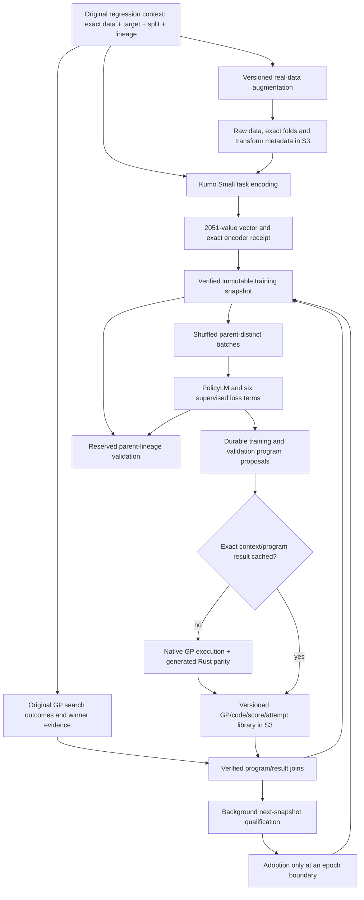

# JopeDime: end-to-end GP learning and data flywheel

Technical review packet — current continuous PolicyLM research candidate, 2026-10-09 UTC.

This document describes the running implementation and identifies concrete improvements for review. It separates existing behavior, measured evidence, and proposed changes. The older DL_wave4 outcome critic and the 13-context qualification are historical experiments; neither describes the current model. The current source release candidate is PR #277, source commit `ca53b564cd9df0bb355d53d71b3b9473cc675eec`. Running artifacts retain their own immutable source/config identities.

## Reader's map

1. [Data identity, coverage and statistical boundaries](#1-data-identity-coverage-and-statistical-boundaries)
2. [Exact encoder input and representation](#2-exact-encoder-input-and-representation)
3. [Policy input, candidate records and normalized targets](#3-policy-input-candidate-records-and-normalized-targets)
4. [Network and generation](#4-network-generation-and-what-predict-a-gp-currently-means)
5. [Supported multi-task loss](#5-exact-supported-multi-task-loss)
6. [Batching, continuous training and validation](#6-batching-continuous-training-and-validation)
7. [GP execution, Rust parity, S3 and high-water marks](#7-gp-execution-rust-parity-s3-library-and-high-water-marks)
8. [Real-data augmentation and growth](#8-real-data-augmentation-and-growth)
9. [Throughput and logging](#9-throughput-resource-use-and-paper-grade-logging)
10. [RL and model-improvement review agenda](#10-reinforcement-learning-and-model-improvement-review-agenda)
11. [Reproduction, source map and evidence](#11-reproduction-source-map-and-evidence)

## What the system currently does

The model consumes a fixed-length representation of a labeled regression task and learns to emit a GP program for that exact dataset version and split. Original successful GP searches provide program imitation targets and, where available, measured candidate outcomes for quality/ranking/feasibility/runtime supervision. Model proposals are durably queued, evaluated on the exact context, checked against emitted Rust, and stored in S3. Verified results can enter a later training snapshot.

This is currently **conditional program imitation plus outcome modeling**, with asynchronous measured feedback. There is no deployed PPO, DPO, GRPO, actor–critic, policy-gradient reward update or learned reinforcement-learning controller. Auxiliary quality/ranking gradients influence the shared representation, but do not themselves implement an explicit reward-weighted gradient of the generated program's probability. That distinction matters when assessing why lower loss may or may not improve executed GP quality.

The decoder's current finite program trie also matters: it selects/samples from programs already present in the original training teacher catalog. A program can be new for a dataset/split without being a new global DSL string. Unrestricted synthesis of new GP topology is not currently deployed.



The qualification-to-adoption arrow is implemented, but large synchronous admission is currently held because its artifact readback stalls the GPU loop. Raw publication, encoder completion, measured GP completion, qualified snapshot, admitted snapshot and optimizer exposure are six different states. The dashboard does not equate them.

## Dated operational evidence

The following is a reproducible snapshot, not a promise that live counters remain unchanged. At **2026-10-09 05:20:32 UTC**, the current model had completed 915 optimizer batches, two complete epochs and 14,628 training-context presentations. It had consumed 6,859 distinct training contexts. The first full pass covered 6,857; the continuous run has actually consumed two newly admitted augmented training contexts. One additional augmented context remains in validation.

The same fixed development panel measured training loss 4.453104→1.068668 and validation loss 4.394558→1.022831 at update 877. The boundary at update 429 was independently reproduced exactly before joining the original and continued curves. These are development losses, not independent test results or GP win rates. Full-validation passes use all 263 original validation contexts with the fixed epoch-0 candidate window; they cover every context, not every historical program. Expanded validation is reported separately.

The original inventory is 14,987 context identities; current eligible original inventory 12,581; usable published winner contexts 7,120. The difference 5,461 comprises 4,581 published `g0_not_ready` terminal outcomes and 880 contexts without published winner evidence at the inventory cutoff. Terminal completion is not a usable winner label. This model has not trained on every eligible original context.

The larger 128-variant extension has separately passed actual qualification: 7,248 total contexts, 6,982 training/266 validation, 1,027 measured augmented program rows, zero augmented CE imitation teachers. It is **not admitted** to the active optimizer. Its 6,053 exact-version objects total 4,714,394,119 bytes; qualification took 584 seconds, including 440 seconds of four-reader prefetch. This is a significant systems bottleneck, discussed below.

The continuous encoder reached 650 verified augmented Kumo vectors at its 05:17:36 observation; raw augmentation and GP queues have independent counts. The new native consumers have successfully published proposals from both the original and continuous outboxes. Fixed native/Rust parity failures receive nonnumeric custody and do not become negative quality labels or optimizer rewards.


## 1. Data identity, coverage and statistical boundaries

### 1.1 What a data_run means

A **data_run** is an exact dataset version and outer split/cut, bound to its prepared features, target, inner-fold membership and protocol. It is not an individual row, program, file, optimizer batch, or independent data family. Multiple folds count as separate data_runs but remain correlated observations from the same parent. A perturbed variant has a new task identity while retaining its original lineage.

Native descriptors retain the original 64-hex context SHA, native view ID, 16-hex dataset version, cut, outer fold, parent lineage and source references. Augmented descriptors are a separate discriminated type with full variant identity. Augmented executable contexts bind dataset/target/split/evaluator/vocabulary/protocol digests, metric, units and direction. Native model descriptors retain their native context/view/dataset16/cut/fold/lineage/source fields; the native evaluator resolves and verifies the executable raw-input/protocol closure separately. A new hash is never substituted for an old native identity merely to fit a schema.

| Denominator | Observed population | What it permits us to claim |
|---|---:|---|
| Original inventory | 14,987 data_runs; 3,003 dataset versions | Available catalog identities, not independent families |
| Eligible native target | 12,581 data_runs; 2,573 versions | Current role/exclusion clearance |
| Excluded original inventory | 2,406 data_runs | Remains outside this pipeline |
| Verified native model join | 7,120 contexts | Kumo vector + selected GP + context/cut/lineage/current-role closure; detailed input/baseline closure for the 2,366 archived contexts |
| Native train/development | 6,857 / 263 | Original optimizer/validation partitions |
| Native detailed-program archives | 2,366 contexts; 2,952,763 declared rows | Candidate history exists; only a rotating window is trained per visit |
| Native winner-only contexts | 4,754 | Imitation and completed feasibility support; no invented quality target |
| Eligible native join pending | 5,461 | 4,581 `g0_not_ready` terminals + 880 without published main HWM |
| Active measured variants | 3: 2 train / 1 development | Actually admitted; current total 7,123 |
| Qualified but held extension | 128: 125 train / 3 development; 1,027 records | Includes the active three; would raise total to 7,248 |
| Assembled later candidate | 138 variants; 1,107 records | Not fully accepted or admitted |

Original Kumo coverage for all 14,987 is reported by the authoritative inventory metadata. This audit does not claim a new exact-version download of all those vectors. The active loader verifies its selected 7,120-vector bundle and member pins. The measured-128 acceptance separately read all 6,053 exact artifact versions.

`g0_not_ready` is a search terminal without usable winner evidence. It is neither a measured zero reward nor necessarily a failed GP. The present native loader starts from the selected 7,120-context bundle. Bootstrapping the remaining eligible contexts through model inference and actual GP evaluation is a valuable next integration; those 5,461 contexts are not already in the optimizer.

### 1.2 Lineage-based development assignment

The retained native registry contains **1,068 parent lineages**: 1,014 training and 54 development. The deterministic partition is:

```text
h = SHA256(canonical({
    schema: "jope.flywheel-lineage-split/v1",
    parent_lineage_sha256,
    namespace_sha256
}))
development = int(h, 16) * 20 < 2**256
```

This is a 5% probability per **lineage**, not an exact 5% context quota. Consequently 263/7,120 original contexts is 3.69%. All folds and augmented children inherit their parent's partition; adding children does not reroll it. A batch contains at most one member of any parent lineage, which is stricter than merely excluding two splits with the same dataset ID.

Current protected roles override this research partition. The eligibility arithmetic is:

```text
14,987 - 293 sealed-production - 1 invalid
       - 1,565 rights-pending G3 - 547 copy/screen exclusions = 12,581
```

Another 470 sealed-catalog contexts were already outside the initial gate and must not be subtracted twice. The current authoritative role map, exclusion manifest and eligible target are separately hash-pinned and rechecked at publication/admission boundaries.

An older document reported 7,087 instead of 7,120 after removing 33 entries labelled “sealed” by an old builder. Identity-level reconciliation found these were stale `unknown_role` entries. Later r3c authority explicitly resolves the exact 33 to `train_nonpool`/`stays_in_training`. All 33 restored IDs are present in the current join and research-training partition; all 7,120 current native members have zero intersections with current protected context and view IDs. This is a correction of those exact identities, not a general release of exclusions.

This is **development validation**. It is repeatedly monitored and used for model decisions. Historical dataset preparation, encoder pretraining overlap, related datasets outside the retained crosswalk, and previous source-role exposure are not all ruled out by the new hash split. A white-paper claim of unseen-family generalization needs a separately frozen family-held-out evaluation, not a relabelling of these curves as untouched test results.

### 1.3 Four different split boundaries

| Boundary | Purpose | Label access |
|---|---|---|
| Dataset outer split/cut | Defines the regression task's fitting rows | Outer-test targets excluded from this training path |
| Native GP inner folds 0 and 1 | Executes/scales/scores each candidate on opposite-fold train/score assignments | GP scaler fits only its inner training fold |
| Kumo context/query rows | Produces a labeled-task representation and query diagnostics | Context labels enter Kumo; query labels affect diagnostics and upstream selection |
| Parent-lineage train/development partition | Measures transfer to other task families in this research cohort | Development tasks excluded from PolicyLM gradient updates |

The Kumo query subset is not the GP scoring fold and not the downstream development partition. This distinction is essential to interpreting label exposure.

## 2. Exact encoder input and representation

### 2.1 Roster and input bytes

The active model uses **only `kumo_tabular_s`**, roster `kumo-s-only-v1`, producing 2,051 float32 values. It does not concatenate the earlier eight-encoder research vectors, A0/landmarks, Kumo Large, Dope, Hyperion, Mitra, TabDPT, TabICL or PriorLabs output. Production encoding computes only this required component. Historical metadata mentioning `pending8encoders` is immutable history, superseded for this pipeline by the current roster receipt.

The encoder consumes a prepared, labeled regression table, not a column-name embedding or a GP program. Its variant input is an uncompressed `JTT1` byte payload:

```text
magic:          4 bytes ASCII "JTT1"
header:         little-endian <IIIB
                n_train:uint32, n_test:uint32, p:uint32, inner_folds:uint8
inner labels:   n_train uint8 values
table:          row-major little-endian float64, (n_train+n_test) × (p+1)
                p numeric features followed by target
byte length:    17 + n_train + 8*(n_train+n_test)*(p+1)
```

Live variants require `50 <= n_train < 2000`, `n_test == 0`, `1 <= p <= 512`, two inner folds with at least 25 rows each, finite features/targets, and target range greater than `1e-12`. Invalid inputs are refused. The outer-training prefix is sliced before parsing; protected outer-row payload is absent from these stripped variants. Prepared numeric units may reflect upstream preprocessing: this is not a claim that every raw-source transform was newly nested inside GP folds.

### 2.2 Filtering and supervised feature selection

The exact preparation path matters because it is part of the learned task representation:

1. The core has a nonfinite-target filter; current worker input validation already requires finite values, so it normally removes no rows.
2. Remove features that are effectively affine copies of the target. With centered target `c`, compute `a = c·(v-mean(v))/(c·c)` and `b = mean(v)-a*mean(y)`. Drop when `abs(a)>1e-12` and `max(abs(v-(a*y+b))) <= 1e-10*max(1,max(abs(v)))`. No retained feature/target table is silently imputed by this step.
3. Shuffle with `default_rng(int(context_sha256[:16],16) ^ 20261007)`, retaining at most 2,048 rows. All current rolling variants have fewer than 2,000 rows, so this shuffles without row truncation.
4. For more than 64 remaining features, rank using XGBoost gain, then variance, then original index, retaining at most 256 in the intermediate table. For widths above 50 without that reduction, an importance order is also computed.
5. XGBoost selection uses all stored task-training rows and targets: 60 rounds, depth 4, learning rate 0.1, row/column subsampling 0.8, seed 20261007, CPU histogram method, max_bin 64, two threads.
6. Convert the intermediate table to float32. Later scaling converts back to float64; the float32 round trip is part of the transform.
7. Kumo Small uses at most **100 features**. Widths at or below 100 retain stored order; wider tables take the first 100 ranked columns. Some 65–100-column tables are reordered by supervised importance without being narrowed by this final cap.

Selected original indices, widths, fit-row count and deterministic selection rule are retained in receipts, bound to the source-input identity. A separate explicit fit-row-ID list/hash is not recorded. A later context-specific constant-column filter is described below; its keep-mask is not separately enumerated in the existing selection receipt.

**Exposure boundary:** supervised feature ranking sees labels from both native inner folds and rows later used as Kumo queries. Therefore the representation is task-supervised, not an inner-fold-fit-only encoder. Outer-test exclusion does not make its internal query diagnostic a pristine GP validation metric.

### 2.3 Kumo context/query construction and normalization

After the context-specific initial shuffle, a second deterministic permutation is applied:

```python
perm = numpy.random.default_rng(20260707).permutation(n)
n_context = min(768, max(1, 3*n//4), n-1)
n_query = min(256, n-n_context)
context = perm[:n_context]
query = perm[n_context:n_context+n_query]
```

The transformer sees at most **768 context + 256 query rows**. Additional rows affect feature selection and table-level feature min/max but do not directly enter the transformer. “All admitted data_runs” does not imply that every row in each task enters Kumo attention.

For every selected feature, first fit min/max on **all stored task-training rows**; nonfinite minima become zero and nonfinite or at-most-`1e-12` spans become one. Set `V=(X-lo)/span` without clipping. Target standardization uses **context targets only**:

```text
mu_y = mean(y[context])
s_y  = population_std(y[context]) + 1e-8
y_z  = (y - mu_y) / s_y
```

Then fit feature mean/population standard deviation on `V[context]`. Retain columns with finite standard deviation above `1e-9`; if none qualify, retain every column with scale one. Apply those context statistics to context and query, clip to `[-100,100]`, then soft-clip:

```text
softclip(z) = z                              if |z| <= 4
              sign(z)*(4 + log1p(|z|-4))     otherwise
```

The model receives float32 `[1,n_context+n_query,p_native]` features and `[1,n_context]` targets. It is not passed query targets. All categorical indicators are false because this path uses prepared numerical columns; it does not reconstruct original categorical semantics or discarded missingness.

### 2.4 Frozen Kumo computation

Weights are `nvidia/Kumo-Tabular`, revision `3c3e10bbdb590ace29e7026847f92db3c603096d`, `small/regressor.pt`, SHA `fc672f536501d64356036050ac2acea7e46927f7b9ad38366abe048f88e7d423`. The producer identifies OpenMDW-1.1 weights and Apache-2.0 code; source/weight/license files are pinned. This does not establish pretraining non-overlap with every source dataset.

The adapter directly calls `_KumoTabular` and approximates SDM default recipe member 0. It does not run the full vendor estimator ensemble, feature permutations or sign-flip ensemble.

| Kumo Small component | Actual configuration |
|---|---|
| Cell width / embedding layers / embedding heads | 128 / 4 / 4 |
| Inducing points | 128 |
| Feature group size / Fourier frequencies | 3 / 32 |
| Learned readouts | Four × 128, concatenated to 512 |
| ICL width / layers / attention heads | 512 / 12 / 8 |
| Context conditioning | Regression targets projected into context row/cell states and ICL row states |
| Attention support | Column-wise and ICL attention use context-row keys/values; within-row attention mixes feature/readout tokens; final ICL layer returns query representations |
| Inference | Frozen weights, eval, `inference_mode`, CUDA float16 autocast, TF32 off |

Feature groups use `(column+[0,1,3]) % p_native` with learned Fourier sin/cos projections. The vendor missingness path imputes with context means and embeds a missingness mask; current finite-input validation means original missing values are not entering this worker.

A **pre-hook on `icl_block.norm`** captures query states immediately before final RMSNorm/output head: `H` has shape `[n_query,512]`. Thus the pooled representation is pre-final-normalization hidden state, not quantile output and not a post-normalization embedding.

### 2.5 The complete 2,051-value layout

Hidden values are cast to float64 for pooling and the final vector to little-endian float32:

| Indices, half-open | Component |
|---|---|
| `[0,512)` | Mean of each hidden channel across query rows |
| `[512,1024)` | Population standard deviation, `ddof=0` |
| `[1024,1536)` | 10th percentile, linear interpolation |
| `[1536,2048)` | 90th percentile, linear interpolation |
| `2048` | Kumo query prediction skill relative to context target mean |
| `2049` | Mean predicted quantile spread |
| `2050` | Natural log of spread plus `1e-6` |

The regression head produces 999 quantile outputs per query, which the wrapper sorts. `p_i` is their mean; `s_i` is their sample standard deviation (`correction=1`). With standardized query target `z_i`:

```text
skill       = max(-10, 1 - sum((z_i-p_i)^2)/(sum(z_i^2)+1e-12))
spread_mean = mean(s_i)
spread_log  = log(spread_mean+1e-6)
```

The source's `query_r2` label is **not conventional query-mean-centered R²**: its baseline is the Kumo context target mean. This scalar uses query labels. Spread is dispersion across predicted quantiles, not an ensemble uncertainty estimate. The hidden block is also target-dependent through context labels and upstream supervised selection.

The NPY is shape `(2051,)`, finite float32, observed size 8,332 bytes including its 128-byte header. No other encoder diagnostics are appended. A 1,600-row observed variant used 768 context and 256 query rows; the other 576 affected table preprocessing but were absent from transformer input.

### 2.6 Qualification and publication

A fully audited baseline contains 32 variants. Production normally executes one encoding call per variant. A deterministic approximately 1% hash sample performs four calls: original, exact repeat, artificial protected-byte control, and target permutation. Qualification requires bitwise equality for original/repeat/protected vectors and a changed full/hidden vector under target permutation. A one-call production receipt does not claim those expensive controls were repeated for that variant.

The publisher verifies source/runtime/weights/input/target/lineage/partition joins, writes a vector and completion receipt create-only to S3, reads both exact VersionIds back, then commits `kumo_small_s3_verified` under a fresh role check. Encoder stage completion does not imply a GP label or training exposure.

## 3. Policy input, candidate records and normalized targets

### 3.1 Frozen neural normalization

The **6,857 original training contexts only**, sorted by context ID, fit per-coordinate mean and population variance using deterministic float64 Welford accumulation. Scales at or below `1e-12` become one:

```text
PolicyLM input = float32(clip((Kumo_vector - training_mean)/training_scale, -10, 10))
```

Development contexts do not fit these statistics. Continuation and new variants reuse the exact preprocessor, SHA `4f093f59af6cb4522c8fda77cce357ecd72d0561e3816ac261ec1c91808ca62d`. No online normalizer drift or encoder fine-tuning occurs.

### 3.2 Imitation support versus measured outcome support

Selected native HWM programs supply CE imitation and known completed feasibility. The historical HWM `fitness` field is **not** converted into quality `q`. Winner-only contexts have no fabricated q or runtime target.

For detailed native archives, the loader validates context/view/fold/protocol/vocabulary, unique program IDs and declared record count. It decodes the registered task-training prefix, checks its targets against the shard, reconstructs opposite-fold mean baselines, and requires baseline agreement within `rel_tol=1e-10, abs_tol=1e-12`.

Labels are computed over the full context record set before selecting a bounded training window. Program IDs are deterministically hash-sorted. For displayed absolute epoch `E` starting at one, the zero-based loader cursor is `e=E-1`; eight circular entries starting at `(8*e) mod N` are selected; the HWM winner is retained additionally if absent. Thus a context contributes at most nine selected programs. A 1,248-record archive needs 156 eight-record visits to traverse its base window; token/syntax refusals are counted. One exhaustive context epoch is not exhaustive program exposure.

The current new variants have **CE disabled**. A single newly scored program supplies q, feasibility and runtime but cannot supply a pairwise or listwise comparison. The three admitted variants each have one measured program. The qualified 128-extension has multiple programs per context and 1,027 completed records, so it would add real ranking support when admitted; it is still not an imitation-teacher promotion.

### 3.3 Exact quality normalization

For task c, derive robust target scale from its task-training targets:

```text
scale_c = 1.4826 * median(abs(y-median(y)))
          fallback: (Q75-Q25)/1.349 using linear percentiles
          fallback: population_std(y)
epsilon_c = max(1e-12*max(1,abs(mean(y))), 1e-6*scale_c)
```

For each native inner scoring fold j, let `r_cj` be measured GP RMSE and `b_cj` the RMSE of the **opposite fitting fold's target mean** on j. For the two folds:

```text
q_c   = -(1/2) * sum_j log(max(r_cj,epsilon_c)/max(b_cj,epsilon_c))
q_opt = clip(q_c, -log(1000), +log(1000))
q_grid = round(q_c*1_000_000)       # unclipped q; half-to-even rounding
```

Positive q means beating the mean baseline. Halving RMSE on both folds gives `q≈log(2)`. It is a dimensionless relative-error score, not raw RMSE or historical engine fitness. A baseline strictly below epsilon is degenerate and quality is masked. Unsupported values remain unavailable, never synthetic zero.

A detail-less stored `cv_mean_log_ratio` is usable only under the loader's verified baseline/protocol contract and exact-fit floor handling; arbitrary HWM fitness is not a fallback. Under that fallback, `q=min(-cv_mean_log_ratio,q_cap)`, with `q_cap=-0.5*sum_j(log(epsilon/max(b_j,epsilon)))`; this bounds the unattainable exact-fit ratio at the registered floor. Completed/failed/timeout outcome support and runtime support have separate gates. Abandoned/missing/unknown infrastructure outcomes do not become ordinary bad-program labels.

### 3.4 Why the current baseline is not CatBoost

The deployed quality-target normalization uses an exact, cheap, reproducible **fold-local mean baseline**. It removes target units, makes large improvements bounded for optimization, and is available without another expensive search. It does not remove task difficulty: beating a weak mean baseline on a simple task can still be much easier than improving a strong model on a hard task.

A frozen CatBoost baseline would make `q_CB = -mean(log(RMSE_GP/RMSE_CB))` directly express competitive lift and may improve cross-task reward comparability. Costs are one qualified fold-local baseline per new task, versioned hyperparameters/runtime, categorical/preparation equivalence, and a difficult denominator when CatBoost approaches the noise floor. A changing baseline would move the learning target even when GP performance is unchanged.

**Recommendation:** keep current q as the stable training target while adding a separately versioned, measured CatBoost-relative evaluation field. First test whether it improves candidate ordering/calibration on parent-held development tasks. Change the training target only in a new experiment with fixed baseline versions and epsilon rules; do not silently rewrite historical rewards. Pairwise within-context supervision already avoids comparing different tasks' absolute RMSEs.

## 4. Network, generation and what “predict a GP” currently means

### 4.1 PolicyLM architecture

This is the current conditional sequence model, not the historical Wave4 outcome-only MLP.

| Component | Active value |
|---|---|
| Input / context projection | 2,051 → 128 → 128; GELU and LayerNorm after each linear |
| Program vocabulary | 282 tokens, including PAD/BOS/EOS |
| Transformer | Two pre-LayerNorm causal blocks, width 128 |
| Attention | Four heads, 32 dimensions each |
| Feed-forward | 128 → 512 → 128 with GELU |
| Sequence cap | 640 program tokens including BOS/EOS |
| Learned positions | 641, including the context prefix |
| Dropout | 0.1 embedding/residual during updates; off in readouts/decoding |
| Attention probability dropout | Zero |
| Language head | Tied to token embedding matrix |
| Trainable parameters | 893,957, tied weights counted once |
| Precision / attention kernel | float32, explicit PyTorch MATH SDPA; no AMP/BF16/TF32 |

The projected task encoding is position zero. Program token embeddings plus learned positions follow it. Each block applies residual attention to LayerNorm(x), then residual `Linear(GELU(Linear(LayerNorm(x))))`. A final LayerNorm feeds token prediction.

The EOS hidden state and context embedding concatenate to 256 features. Three separate `256 → 128 → output` GELU MLPs predict quality q, three feasibility logits, and log-runtime. The optional context-free head is disabled. During training, these heads see a complete candidate program and context, while the LM predicts its next tokens causally.

The original selected-program inventory has 6,899 distinct DSL strings with maximum observed token length 533, so the 640-token cap preserves these teachers. Unsupported syntax/RAW form or excess length in other archive candidates is recorded, not silently truncated.

### 4.2 Finite-trie conditional generation

The deployed decoder uses a trie of **6,640 unique original training-context teacher programs**. Development-only teachers are excluded. At each position, only child tokens of the current trie node are eligible. Selected logits are converted to float64 on CPU, divided by temperature **1.0**, and sampled with a per-row seeded generator.

There is no active top-k/top-p, beam search, quality-head reranking, or best-of-N policy. EOS must close an exact registered canonical DSL and SHA. Full traces retain allowed tokens, selected token and selected probability. The quality head does not currently select among completed programs. Training CE normalizes over all SYNTAX-legal tokens, whereas deployed sampling renormalizes over the narrower current trie children. These are different probability distributions; teacher CE must not be reused unmodified as the deployed behavior-policy likelihood.

Each logical optimizer batch emits **one training-context proposal and one development-context proposal**, using the pre-update checkpoint. The training context rotates within the batch; development contexts rotate through their role-preserving list. This is two proposals per update, not one for every context in the batch. Both are committed to the outbox before optimization.

A GP can be new **for this exact data_run** while already being a known DSL globally. The finite trie cannot invent an unseen AST/program string. This is a learned task-conditioned selection policy over known valid programs. Grammar-wide new-program synthesis remains a proposed experiment.

The two active proposal rows are decoded together; finished rows are removed. Prefixes are recomputed at every token step: there is no incremental KV cache. This contributes materially to throughput cost.

### 4.3 Where improvement currently comes from

CE makes task-conditioned known winners more probable. Quality/ranking heads train shared representations to distinguish measured candidates; feasibility/runtime provide additional supervision. Repeated epochs expose more teacher windows and refine weights. Verified fresh outcomes can add supervised support in a later snapshot.

However, a high measured reward for a newly proposed GP does **not** currently produce an explicit reward-weighted gradient of that GP's token probability. Nor does every better candidate automatically replace its HWM teacher. The feedback path is real but incomplete as a direct policy-improvement algorithm; this is the central opportunity for reinforcement-learning review.

## 5. Exact supported multi-task loss

The active objective is `native-support-mask-v1`:

```text
L = 1.00*L_CE + 0.25*L_BT + 0.10*L_list
  + 0.25*L_q  + 0.10*L_feas + 0.05*L_rt
```

For **each term separately**, average eligible programs/pairs within a context, then average across contexts supporting that term. Unsupported contexts do not dilute the denominator. Missing terms produce graph-connected zero and support count zero. This gives context-balanced supervision rather than weighting a dataset proportionally to archive size.

| Term | Exact behavior |
|---|---|
| CE | Mean next-token NLL per CE-eligible teacher, excluding padding and including EOS, with illegal logits masked by pinned SYNTAX grammar; then context-balanced means; no label smoothing |
| Quality | Huber(delta=1) between predicted q and measured `q_opt` |
| Pairwise BT | Same-context ordered quality pairs, weighted `softplus(qhat_loser-qhat_winner)` |
| Listwise | Cross entropy from `softmax(midrank/0.25)` to `softmax(qhat)` for contexts with at least three eligible measured candidates |
| Feasibility | Three-class CE: completed=0, failed=1, timeout=2, actual supported outcomes only |
| Runtime | Huber(delta=1) on `log1p(seconds)`; right-censored records use `ReLU(lower_bound_target-rthat)^2` |

For a non-tied pair `q_grid_i > q_grid_k`:

```text
w_ik = min(abs(q_opt_i-q_opt_k), 1)
       * (2 if max(midrank_i,midrank_k) >= 0.9 else 1)
L_BT(context) = sum(w_ik * softplus(qhat_k-qhat_i)) / sum(w_ik)
```

Ranking ties use the **unclipped** millionth grid; pair weights use **clipped** qualities. Distinct unclipped qualities can therefore receive zero weight after clipping to the same bound. Only contexts with positive total pair weight contribute.

The collator recomputes midrank percentiles **within the selected program window**, with singleton percentile 0.5. The “top decile” boost and listwise target are window-relative, not full-archive rank. An all-tied group can produce a uniform list target but no non-tied BT pairs. The predicted list softmax has no matching 0.25 temperature division.

Runtime uses qualified backend execution evidence, not total S3 publication or GPU utilization. Timeouts carry an observed lower bound (90 seconds under the registered backend contract). Native/Rust disagreement and infrastructure uncertainty are not feasibility labels or rewards.

Lower total loss means improvement of this particular weighted objective and support mixture. It does not directly mean lower executed regression RMSE. Reviewers should inspect every term, support count, predicted-quality calibration and actual same-context GP comparisons. Grammar positions with one legal next token can have zero CE; changing grammar support changes CE's meaning.

### 5.1 Observed term support, not just a total-loss curve

At update 1,133 (2026-10-09 05:32:36 UTC), the fixed panels had the following **unweighted term means**. Multiplying by the registered coefficients produces total train loss 1.011235 and development loss 0.973505.

| Term | Train mean | Train supported contexts | Development mean | Development supported contexts |
|---|---:|---:|---:|---:|
| CE | 0.672665 | 16 | 0.636341 | 16 |
| BT | 0.383559 | 6 | 0.446271 | 4 |
| Listwise | 1.949294 | 6 | 1.944463 | 4 |
| q Huber | 0.170766 | 6 | 0.114209 | 4 |
| Feasibility | 0.00007365 | 16 | 0.00003621 | 16 |
| Runtime | 0.101039 | 6 | 0.051875 | 4 |

This makes the unequal ranking/quality support visible. The latest development total at that read was above the best since continuation (0.965607); one nonimproving read had occurred, with learning rate still 0.0003. Improvement is not monotonic. At the separate 05:35:14 UTC publication check, the service was active and had committed 1,188 updates, 18,996 context presentations and 6,859 unique training contexts; epoch 3 was in progress. Receipt: `DL_TECH_REVIEW_PUBLICATION_LIVE_CHECK.json`.

## 6. Batching, continuous training and validation

### 6.1 Epoch membership and reshuffling

At epoch opening, all admitted training contexts enter the epoch membership table exactly once. Validation contexts never enter it. A logical batch has up to **16 contexts from 16 distinct parent lineages**. Hash-based seed/absolute-epoch/attempt choices produce a fresh deterministic order, prioritizing larger remaining lineages to avoid stranded tails. This is stratified deterministic reshuffling, not a claim of IID uniform sampling.

Individual contexts recur on later epochs. Exact whole-batch membership does not: fingerprints hash sorted data_run IDs, and both current and inherited fingerprints are banned. Reordering the same members is not a new batch. All 429 original first-pass fingerprints remain in ancestry. Smaller unique tail batches are allowed; bounded failure to find a new combination enters `waiting_for_unique_batch` instead of silently replaying it.

A flat unique-exposure counter after a full corpus pass is expected. Continuous updates increase presentations/epochs until more contexts are admitted:

| Dashboard counter | Meaning |
|---|---|
| Unique data_runs seen | Cardinality of actually consumed training IDs across ancestry |
| Context presentations | Every training-context visit, including later epochs |
| Optimizer batches | Committed logical gradient updates |
| Epochs | Completed exhaustive admitted-context passes |
| Program-window exposure | Candidate rows actually selected for training, separate from archive inventory |
| Proposed GPs | Durably emitted proposals, not necessarily measured or unique DSLs |

The old 6,857 plateau was the completed original unique-context population. Continuation now reshuffles it; two newly admitted train variants raised unique exposure to 6,859. Filling the encoder queue alone does not increase this number.

### 6.2 Microbatching and optimizer

Every context's full selected program window remains together. Microbatches are packed to at most **8,192 padded program tokens**. Programs are not truncated; an oversized single context fails explicitly. For every loss term, the support denominator is computed across the entire logical batch before microbatch execution. Each microbatch backpropagates its numerator over that global denominator, preserving the logical context-balanced objective.

```text
zero gradients once
for context-complete microbatch:
    forward; compute supported loss numerators
    backward(sum(weight * numerator / logical_term_denominator))
check finite gradients
clip global gradient norm to 1.0
one AdamW step
```

AdamW begins at learning rate `3e-4`, weight decay `0.01` on ordinary weights and zero on biases/LayerNorm parameters; betas `(0.9,0.999)`, epsilon `1e-8`, no AMSGrad. No active warmup/cosine schedule is implied by generic utilities elsewhere in the repository.

Deterministic algorithms are enabled, MATH SDPA selected, TF32 and cuDNN benchmarking disabled, and `CUBLAS_WORKSPACE_CONFIG=:4096:8` set before CUDA initialization. Actual CUDA preflight verifies finite forward/backward behavior and restores RNG state. This prioritizes reproducibility; faster mixed-precision/kernels require a separate measured equivalence/quality test.

### 6.3 Loss streams and checkpoint selection

`optimizer-history.jsonl` records actual changing update batches with dropout enabled. It is not directly comparable with a different validation population.

`loss-history.jsonl` uses fixed **16 native training + 16 native development contexts**, fixed epoch-0 program windows, the same objective and dropout off. These are the comparable train/development curves. Readouts occur every 64 new updates and at epoch boundaries.

At each completed epoch, all **263 original development contexts** are evaluated using the fixed epoch-0 program selection, aggregating every term by its own supported-context numerator/denominator. This covers all contexts, not every archived validation program. Expanded measured-variant validation is reported separately; its support mixture differs and it does not replace the original monitor. In particular, a tiny loss on a one-program, CE-disabled variant is not comparable to full native CE-plus-ranking loss.

After five nonimproving fixed-panel validations, learning rate halves, down to `1e-6`. Best checkpoints are retained **since continuation**. The user-requested continuous mode does not early-stop at a plateau; finite safety/resource/deadline conditions can still stop or wait. More epochs are not guaranteed to improve validation.

The observed fixed-panel reduction is encouraging evidence of learning the development objective. It is not yet evidence that the selected policy beats random or HWM GPs in measured games. A validation loss below training loss can reflect task and support composition; that ordering alone neither proves leakage nor proves transfer.

### 6.4 Exact continuation and crash consistency

The initial full-native model was freshly initialized and completed 429 updates. Continuation restores its physical parameters, AdamW moments, CPU/CUDA RNG and frozen normalizer, preserving the planner's fingerprints/exposures. Independent tests compare the exact next dropout-enabled update with uninterrupted execution. Heads without support can have fewer AdamW steps than shared parameters; that is validated rather than overwritten.

Per-update order is:

```text
reserve exact batch
→ prepare verified measured tensors
→ decode train/development proposals
→ durable outbox ACK
→ optimizer update
→ durable physical checkpoint
→ immutable batch proof
→ planner commit
→ retire obsolete own recovery slot
```

SQLite transactions, unique constraints, WAL/FULL synchronization and chained events bind membership to exposures. Uncertain updates become `needs_reconcile`; they are not redrawn or blindly retried. Cleanup failure after a committed update does not relabel it as uncommitted.

Retention keeps two rolling physical checkpoints, current/previous best, and completed-epoch checkpoints. Historical proof hashes remain even when old tensor files are retired; a digest does not mean every old tensor file is physically retained. `optimizer-control.json` binds post-validation learning rates/plateau state to the checkpoint, so a bare tensor file is insufficient for full resume.

The current process has a 24 GiB output cap, 32,768 unresolved-outbox bound, 50,000-new-update ceiling and inherited absolute deadline `1791592146.380285` (2026-10-10 about 00:29 UTC), with closure reserve. Continuous service requires explicit bounded renewal; this run is not an unbounded daemon with hidden deadline resets.

### 6.5 Admission while training continues

New data follows these distinct gates:

```text
raw variant published
→ required encoder exact-version verified
→ input-ready for inference
→ proposal measured and result closure verified
→ supervised supports assembled
→ immutable candidate snapshot accepted
→ epoch-boundary adoption
→ context actually consumed by optimizer
```

Encoded/no-label variants can be inference-ready without being optimizer members. Measured variants add only supported targets, with CE false. Snapshot adoption requires a fully consumed epoch and no unresolved reservation, unchanged native base/normalizer, retention of all previous context roles/result references, fresh authority, and verified artifact closure. It is append-only for existing identity/role contracts.

**Current limitation:** the live adoption loader revalidates S3 artifacts synchronously. The accepted 128-extension reads 4.714 GB across 6,053 objects. Its four-reader CPU qualification took 584 seconds, including 440 seconds prefetch and 37 seconds verified local rereads. The active serial path would pause the GPU substantially; its ready pointer is deliberately held. No claim of 128 new optimizer members is made.

The next engineering change should prepare/hash-verify the candidate in a bounded CPU worker/cache while training continues, then hand off a verified immutable snapshot at an epoch boundary. Fresh authority and identity checks remain mandatory. An accepted offline cache alone is not evidence that this asynchronous handoff is deployed.

## 7. GP execution, Rust parity, S3 library and high-water marks

### 7.1 Proposal-to-result transaction

The model's pre-update proposal is committed to a SQLite outbox with exact context, canonical program/token trace, phase, checkpoint and seed identities. The current eight-worker native pool consumes original-context descriptors from both the initial and continuous outboxes. Each worker claims an owned 600-second lease. Unsupported augmented descriptors remain recorded and counted for their separately qualified adapter; this pool does not drain every descriptor type.

For a native-original proposal:

1. Recheck current role/protected exclusions and registered input bytes. Canonicalize DSL with the pinned native canonicalizer.
2. Derive evaluation identity from exact context, canonical program SHA and two-fold protocol. Look up the exact-result namespace; a hit requires full artifact closure, not merely an object with a matching filename.
3. On a miss, invoke local `bootstrap.s1main --fit-s1 input.jtt1 candidate.json evaluation.json`. “Local lambda” here is execution on the local Lambda cloud nodes, not an AWS Lambda request.
4. Verify `jope.s1-evaluation/v1`, `jope.s1-two-fold/v1`, `input_semantics=unscaled_fit_rows_v1`, exact memberships/targets/scaler digests and `serialized_prediction_replay_exact=true`.
5. Fit feature and target min/max on the opposite **inner training fold only**. Constant spans become one. Apply those statistics to scoring rows without refitting and convert predictions back to prepared target units.
6. Emit Rust through the pinned GP emitter; verify `battle-artifact-v1` source/program identity. Compile using Rust 1.97.1, `--edition=2021 -O`; execute separately for each inner fold.
7. Compare every Rust/native prediction using `abs(rust-native) <= 1e-9*max(1,abs(native))`. Reconstruct RMSE from predictions and targets and verify native reported metrics.
8. Publish the seven artifact bodies create-only, then the result wrapper last. Exact VersionId GETs verify bytes and SHA256. Recheck authority before resolving the outbox result.

Original native inputs preserve their registered shape, including at least ten outer-test rows; the bridge hashes outer bytes opaquely and zeroes outer targets without decoding their values. Only training rows are evaluated. The stripped augmented protocol has `n_test=0` and a separately qualified binary/context route; it is not substituted for original native execution.

Pinned native binary SHA is `e3be938644722d14a1c1a0e82168518838c4d174cfe031076a339745c48870a8`, from source commit `6bf65b12e9f0e5ec2697720a6119f13ea27d4835`. Native canonicalizer SHA is `69975947982bcffb0a55fde96f85b68f043e107e0d946eadffcdac7311f026c1`. These are part of result identity, not interchangeable executables.

### 7.2 S3 object and score contracts

Research result prefix:

```text
s3://veox-jopedime-learning-use2/
  experiments/gp-policy-dl/v2-trainonly/program-results/flywheel/v1/
    objects/<sha256>/<artifact_role>
    <evaluation_key>/record.json
```

The seven artifact roles are:

```text
input, program, evaluation, rust_source,
rust_executable, rust_parity, score_records
```

The native-original wrapper is `jope.native-original-program-result/v1`. It contains exact object versions and hashes binding the closure. All writes use create-only `IfNoneMatch=*`. Cache reuse still requires semantic/protocol verification. Historical HWM/library records are not automatically equivalent to this seven-artifact closure; the current lookup is not an exhaustive search over every older S3 namespace. A future historical-library bridge must prove equivalence before declaring those older records cache hits.

`score_records` contains exactly two native-canonical `jope.score/v1` rows, one per inner fold. Required bindings include dataset hash, derived inner cut, `method_id=gp:<program_sha>`, evaluator SHA, protocol `jope.flywheel-s1-inner-rmse/v1`, metric `rmse`, finite value, direction `lower`, receipt hash, run ID, source commit and execution timestamp.

`benchmark_valid=false` is intentional. `row_sha256` is computed with the `row_sha256` field itself blank using the pinned native serde_json canonicalizer. Python JSON/float formatting is not a substitute for this identity contract.

A published score is **measured research evidence**. It is not automatically a benchmark-valid row, GP HWM promotion, production model release, or optimizer admission.

### 7.3 Correct handling of failures

Program outcomes, implementation verification failures and infrastructure failures have different semantics:

| Outcome | Numeric quality / feasibility teaching |
|---|---|
| Qualified completed GP with verified metrics | Supported q, completed feasibility and measured runtime |
| Qualified backend program failure/timeout | Only its supported feasibility/runtime information; no fabricated successful RMSE |
| Native/Rust prediction mismatch | Nonnumeric failure custody; no GP-quality or feasibility label |
| Missing data, auth/network/integrity issue, unknown write | Pause/unknown state; no synthetic reward |
| No prior HWM winner | Inference opportunity, not a negative program label |

The first cached-native packet left six parity failures as `unknown_attempt`. Their original SQL states remain unchanged. A historical-only recovery archived exact diagnostic sidecars without reexecuting or rewriting those attempts. Newly typed parity discrepancies can resolve to `failure_custody_verified` after nonnumeric S3 custody, allowing unrelated candidates to proceed.

The six reconstructed normalized maximum errors ranged approximately `0.0001206`–`0.2622`, far above the fixed `1e-9` tolerance. This warrants native/emitted implementation investigation; widening the threshold or training on these as bad programs would hide the issue.

Failure objects live under `program-attempts/flywheel/v1/native/{snapshots,receipts}/<sha>.json`. They retain native/Rust predictions, disagreement indices, input/program/compiler identities and timing, explicitly `numeric_score=null`, empty canonical score rows, and teaching/reward eligibility false. Unknown attempts are not automatically reclaimed as fresh work.

### 7.4 HWM and fair comparisons: implemented versus missing

Original HWM selections currently anchor imitation and candidate windows. A generated verified GP expands the context/program measurement library. It does **not** automatically replace the native HWM or become a CE teacher. Current permits set native HWM promotion and production admission false.

The current full model reports random/winner win rate and Elo as **unavailable**, with zero qualified comparison games. Earlier 13-context qualification metrics must not be shown as this model's outcomes. Two measured scores only form a fair game if context, fold/protocol, preparation and comparator-selection rules match.

A reviewable promotion/evaluation protocol should freeze, before scoring:

- A context-weighted random comparator drawn from the exact eligible known-program pool, with seed and selection probability.
- The versioned HWM comparator and its actual comparable score; no substitution of an incompatible engine fitness.
- A tie margin based on the metric's precision/noise, treatment of valid failures, and exclusion of infrastructure/parity errors.
- Macro averages over parent lineages, counts of contexts/games, and uncertainty intervals resampled at the lineage level.
- Best valid quality after a fixed inference/evaluation budget, regret to known HWM, cost per gain and failure rate.
- An Elo definition whose entities are explicit. Programs are highly task-dependent; one global program Elo can mix task difficulty and opponent selection. Policy/checkpoint comparisons on matched task games are more interpretable.

These are proposed next protocol fields, not existing verified win-rate claims.

## 8. Real-data augmentation and growth

### 8.1 Implemented variant recipe

A deterministic recipe is keyed by original parent lineage and ordinal (v1 ordinals 0–255). It changes a real prepared task and records its ancestry rather than claiming a new independent family.

| Transform | Actual deployed rule |
|---|---|
| Drop features | Fraction cycles `[0.05,0.10,0,0.10]`; seeded choice without replacement; count `min(p-1,floor(p*fraction))` |
| Add nuisance columns | `min(8,floor(0.1*p),512-(p-drop_count))`; zero when ordinal modulo 4 is 1; independent standard Gaussian per registered row |
| Perturb existing feature values | Disabled; original feature types are not available to justify arbitrary perturbation |
| Target noise | Fractions `[0,0.01,0.03,0.05]` of original inner-fold-0 population target standard deviation |
| Target draw | Deterministic per-row Gaussian; unbounded, no clipping; zero calibration variance with requested noise fails |
| No-op prevention | If no dropped/nuisance columns and zero noise, use 0.01 target noise |
| Row resampling / new inner splits | Disabled; original row order and inner labels preserved |

Thus “0–5% target noise” means Gaussian standard deviation relative to a registered scale, not a hard ±5% bound. Changed targets define a new synthetic task and invalidate inherited GP scores. This is not ordinary label noise applied on the fly during optimizer training.

The current generator does **not** implement a new-fold factory. New variants have distinct task identities but retain their parent's inner-fold labels. More independently sampled folds could be added in a versioned protocol; they must retain lineage partition and get fresh encoder/evaluation receipts.

### 8.2 Metadata and reproducibility

Identity binds parent-record digest, complete recipe and raw variant bytes. Metadata retains parent context/cut/lineage, source feature and target hashes, transformed target hash, dropped columns, output-to-source column mapping, nuisance type, noise calibration receipt, row/fold membership hash and counts, RNG/runtime and source/prepared rights declarations.

The current metadata explicitly records:

```text
prepared=true
raw_units=false
rights=research
new_independent_family=false
inherited_gp_rewards=false
gp_measurements=0
teaching_eligible=false
```

The concrete S3 layout is:

```text
s3://veox-jopedime-learning-use2/experiments/gp-policy-dl/v2-trainonly/
  datasets/flywheel/v1/<variant_identity>/
    encoder.jtt1.gz
    metadata.json
    generation.json
    encodings/kumo_tabular_s.npy
  receipts/flywheel-datasets/v1/<variant_identity>/<receipt_sha256>.json
```

Data, generation, encoder and result receipts have distinct states and bind exact VersionIds, byte lengths and hashes. Changed inputs/targets get a new variant identity; no old GP score is inherited merely because the parent has one.

Those initial fields describe publication-time state; later GP/encoding/admission receipts are additive rather than rewriting original provenance. A model input is not declared trainable until its required evidence exists.

This organization supports 100,000 derivative data_runs, but that number is not 100,000 independent real-world problems. With 1,068 retained parents, uncontrolled descendant growth can reduce effective diversity and overweight a few families. At-most-one-parent-per-batch helps local correlation; it does not by itself give equal total weight to families with many more variants across an epoch.

### 8.3 Growth priorities

The recommended growth order is:

1. Bootstrap eligible original tasks without usable winners through verified inference and measured scoring. This can add more independent source coverage than many siblings of an already represented task.
2. Produce/encode variants under the current required Kumo-only roster, balancing admission by parent and transform severity.
3. Collect several distinct measured candidates per new task to enable ranking losses; a single candidate gives regression support but no preference pair.
4. Admit frozen verified snapshots asynchronously at boundaries, keeping train/development roles stable.
5. Expand source families and genuinely new splits with full provenance. Track family count separately from data_run count.

Inference-first bootstrapping avoids waiting for a large conventional GP search before a new task can collect any label. It still requires executing/verifying the proposed GP; a model's predicted q or program string is not a measured training target.

## 9. Throughput, resource use and paper-grade logging

### 9.1 Active allocation and what GPU memory means

At the documented cutoff, xbabe2 runs the main continuous PolicyLM with one GPU, CPU quota 8, RAM cap 8 GiB and swap zero. xbabe1 runs required Kumo encoding with one GPU, CPU quota 8, RAM cap 12 GiB and swap zero. Encoder publication/input helpers have smaller separate quotas. Native GP workers use bounded CPU allocations; cluster host telemetry covers xbabe1/2/3. Other coordinated workloads remain visible and are not displaced by an unqualified claim to every core.

These are configured bounds, not measured utilization. The current ~0.9M-parameter PolicyLM does not need all GPU memory; simply filling VRAM or spawning duplicate trainers will not remove Python, decoding, exact-artifact or compilation bottlenecks. This document does not claim three GPUs are training three replicas or all 384 CPU cores are occupied by this pipeline.

The Kumo controller currently handles packets of up to 32 variants and loads one model per packet. It is not yet a resident cross-packet GPU service. A persistent model with bounded double-buffered CPU preparation/publication is proposed, not deployed.

### 9.2 Measured bottlenecks

| Measurement | Result | Interpretation |
|---|---|---|
| Initial full pass | 844.302 s: input 309.412 s; decode 252.637 s; optimizer 29.029 s; other 253.225 s | Input/decode dominate; “other” was not fully separated in that older trace |
| Later continuous observation | Input 156.598 s / 143.059 CPU s over 237 spans; decode 140.022 / 134.607 over 237; optimizer 76.103 / 25.812 over 236; checkpoint 43.496 / 37.200 over 236 | Different observation window, not an apples-to-apples speedup; nested intervals must not be summed |
| Kumo 32-task packet median | 86.628 → 51.530 s, about 1.68× | Both versions already used one-call production encoding; gain followed four-way intake/publication/commit I/O, not raw model-only speedup |
| Kumo publication component | 27.613 → 6.893 s | Four-way bounded S3 I/O materially helped |
| Warm exact-native verification | 2.644 s / 18 GETs → 0.149 s / 0 GETs | About 17.7× for this warm verification stage only; cold cache was slower at 3.184 s |
| Qualified 128-extension | 584.019 s, 6,053 objects, 4.714 GB; prefetch 440.121 s | Synchronous full-artifact admission can stall otherwise continuous optimization |

The first-pass “other” bucket is 29.99% of wall time, not an identified single culprit. The detailed continuous observation recorded no CPU quota throttling in its measured interval; that does not imply all future runs are unthrottled. GPU-event durations, wall spans and process CPU seconds answer different questions.

### 9.3 Timing and provenance contract

Training stage logs record UTC nanoseconds, monotonic nanoseconds, host/PID, run/config/checkpoint/context/program identity where available, process user/system CPU, child user/system CPU, cgroup CPU/memory/I/O deltas and named stage durations. CUDA events bracket actual model forward intervals; GPU utilization is not relabelled as elapsed kernel time.

Host traces sample every two seconds: CPU/user/system/throttling, memory/swap/pressure, I/O/network and GPU utilization/memory/power. Hash-chained segments seal at a minute or 8 MiB and are create-only archived with exact readback under:

```text
s3://veox-jopedime-learning-use2/experiments/gp-policy-dl/v2-trainonly/
  paper-evidence/20261009/hpc-trace-v1/<host>/<part>/<sha>/
    events.jsonl
    seal.json
```

Stage spans should be joined by identity, not merely overlapping wall time. Report inclusive/exclusive duration explicitly; CPU seconds can exceed wall seconds for parallel work. CUDA allocator peak is not whole-process host RAM, and sampled utilization is not integrated GPU time. Past experiments do not gain fabricated retrospective timing.

Detailed inference/encoder scientific logs are hash-bound locally, but **not every individual scientific log file has been archived to S3**. Host-trace archival alone does not prove complete experiment archival. This gap belongs in the paper evidence checklist before publication.

### 9.4 Focused efficiency work, in order

1. **Asynchronous verified snapshot preparation:** remove large S3 joins from the GPU loop while preserving exact artifacts and boundary adoption.
2. **Context/target preparation cache:** cache immutable decoded arrays, reconstructed baselines and canonicalized program targets, keyed by all source/protocol hashes. Do not refetch/recompute unchanged evidence for every visit.
3. **Decoder prefix reuse:** incremental KV cache, shared trie-prefix work and bounded larger inference batches. Preserve allowed-token probabilities/seeds and compare actual policy outputs or explicitly version changed sampling semantics.
4. **Persistent Kumo:** keep weights resident across packets; overlap bounded CPU selection/input and S3 publication. Preserve four-call audits on the designated sample.
5. **Native artifact/compile reuse:** cache exact input/evaluator closure and compiler outputs bound to source/compiler/sysroot/flags; rerun fresh inputs and required parity. Keep failures visible.
6. **Concurrency from measurements:** increase CPU evaluation workers only after recording stage throughput, queue delay, peak memory and interference. More workers can worsen network/compile/cache contention.
7. **GPU kernel/precision experiments:** compare BF16/AMP or faster SDPA against current deterministic baseline on fixed panels and executed outcomes. A faster kernel with altered optimization needs an experiment identity, not a silent runtime replacement.

Increasing DDP replicas before these serial stages are fixed could multiply queues and I/O without improving useful measured programs per second.

## 10. Reinforcement-learning and model-improvement review agenda

Everything in this section is a **proposal** unless explicitly described as current. These are prioritized experiments, not claims that a named algorithm is best for this dataset.

### 10.1 Establish the policy objective and evaluation unit

The natural initial formulation is a contextual bandit: task encoding is context, a complete valid GP is the action, and qualified same-context relative error is reward. There is no necessary multi-step environment after every token. The current autoregressive policy parameterizes a finite action library; token sequence length should not be confused with environment horizon.

Before changing loss, freeze a matched development evaluation: same task set, comparator pools, execution budget, failure accounting and checkpoint sampling. Measure actual GP quality/win rate, known-HWM regret and best quality after B evaluations, not just CE. Log support coverage and missingness: HWM-selected teachers and successfully verified new results are selected samples, not unbiased programs.

### 10.2 Highest-value near-term model tests

| Test | Concrete change | Decision metric / risk |
|---|---|---|
| Quality-guided best-of-K | Sample K distinct trie programs; rank with existing q head; execute under a fixed total budget | Measured lift at equal execution budget; checks whether auxiliary heads are useful |
| Cross-context candidate retrieval/ranking | Retrieve a bounded known-program shortlist and score context/program pairs | Candidate recall and quality per CPU/GPU second; avoids long decoder work if ranking suffices |
| Reward-weighted imitation | Add only verified strong measured candidates with bounded weight and explicit promotion criteria | Actual policy improvement; avoid copying its own unmeasured predictions |
| Pairwise policy preference objective | Train policy probabilities on measured winner/loser programs from the same task | Fair paired execution quality; compare with existing q-head BT, which is a different objective |
| Feature diagnostic ablation | Remove coordinates 2048–2050; separately test split-clean feature selection | Sensitivity to supervised diagnostics, generalization versus encoding cost |
| Parent-balanced admission/weighting | Bound sibling influence while increasing original-family coverage | Macro-family quality, not apparent gain from many correlated variants |

The current q head sees full candidate tokens and can support a reranking baseline without immediately implementing a new RL optimizer. This is a testable bridge between improving a surrogate and improving selected programs.

### 10.3 DPO-style measured preferences

DPO trains a policy against preferences relative to a fixed reference policy, without a separately fitted reward model in its original formulation. Here, a candidate adaptation would compare **two measured programs on the same exact context**, using a minimum quality gap and excluding unsupported/parity-error outcomes. Existing q-head BT is not DPO because it optimizes a scalar outcome predictor rather than policy log-probability ratios. [Primary reference: Direct Preference Optimization](https://arxiv.org/abs/2305.18290).

Proposed controls: retain a frozen reference checkpoint; calculate policy and reference probabilities under the same trie-conditioned distribution as deployment (or explicitly register a changed action support); use identical tokenizer/trie/grammar versions; log summed full-sequence token log-probabilities including EOS (not the current per-sequence mean-token CE); examine length effects; cap influence of near-tie/noisy pairs; keep both absolute q and preference accuracy. Train on existing measured pairs first so algorithm comparison is not confounded by unequal execution budgets. This application is an engineering hypothesis, not a demonstrated benefit here.

### 10.4 Group-relative policy updates

DeepSeekMath introduces GRPO using grouped sampled outputs and relative advantages without the usual separately trained value model. For this system, groups would be multiple executed GPs for the **same context**, never a mix of tasks with different difficulty. A possible advantage is `A=(q-mean(q_group))/max(std(q_group),floor)`, with bounded updates and a KL/reference constraint. [Primary reference: DeepSeekMath](https://arxiv.org/abs/2402.03300).

The std floor prevents unstable advantages from tiny differences. All-identical/tied groups need explicit treatment. Group normalization discards absolute progress information, so continue reporting absolute q and HWM regret. Delayed rewards must bind to the exact behavior checkpoint; current pre-update proposal traces and later outcomes cannot be assumed on-policy forever. Cost-aware exploration and stale-policy rejection/correction must be designed before deployment.

### 10.5 Off-policy evaluation and retained behavior probabilities

Current token traces store the allowed set, chosen token and probability under the finite trie. These are useful ingredients, but a complete behavior-policy evaluation record also needs action support, checkpoint, temperature, context-selection probability, any dedup/rejection/resampling, outcome availability and policy version. A summed token log-probability alone does not recover an unknown context-selection or downstream filtering policy.

Doubly robust contextual-bandit evaluation combines a reward model with propensity correction and can remain consistent under specified conditions when one nuisance model is correct. Applying it requires logged behavior support and controlled missing outcomes; it cannot manufacture coverage for actions never sampled or fix unknown propensities. [Primary reference: Doubly Robust Policy Evaluation and Learning](https://arxiv.org/abs/1103.4601).

Recommendation: define a complete decision record now, including refused/unknown attempts. Use simple matched randomized policy comparisons first. Add off-policy estimators only after verifying their support/propensity assumptions against these actual logs.

### 10.6 Broadening beyond the finite program library

The current trie is a useful valid-program baseline but caps structural discovery. A later grammar-wide decoder could emit novel ASTs under the syntax engine, with strict size/depth/cost bounds, type/semantic checks and an explicit invalid-attempt budget. Evaluate it against the same trie policy at equal total compute, including failures and compilation. Preserve all attempts and never score native/Rust mismatches as poor programs.

A staged approach is safer scientifically: known-library ranking → measured preference policy → bounded grammar exploration. It separates reward learning from compiler/grammar support expansion, making causes of lift or failure identifiable.

### 10.7 Evolved feature dropping / binary gates

There is **no deployed PSO/CMA-ES/binary gate optimizer** in front of this PolicyLM. Kumo supervised selection and constant filtering are the current upstream filters. Adding all historical encoders or arbitrary masks would change the input contract.

A promising controlled test is a binary gate over fixed representation coordinates or coherent blocks, with gate corruption during training and an explicit mask indicator so a zeroed signal is distinguishable from a genuine standardized zero. Train the downstream model to tolerate that distribution before switching masks; frozen downstream weights are not automatically robust to arbitrary evolved masks.

Use disjoint inner research folds for aggressive mask search, cheap surrogate screening, then evaluate shortlisted masks with the actual downstream training/evaluation budget. Optimize quality with a sparsity/latency penalty and stability across parent folds. Final selection must use a reserved outer family set: thousands of surrogate evaluations can overfit a reused development panel just as gradient training can. Hidden dimensions are contextual features, so channel deletion need not correspond to dropping an original data column.

First compare three simple controls: all 2,051 features, hidden 2,048 without the diagnostics, and stochastic block/channel masking. Add evolutionary search only if these establish useful headroom beyond ordinary regularization. Do not recompute disallowed/unneeded commercial encoders to support this test.

### 10.8 Questions for technical reviewers

1. Does the present task-supervised Kumo representation match the intended deployment label-access boundary? Should GP-inner-fold-clean encodings or diagnostic-free inputs be required for the claimed evaluation?
2. Is a small autoregressive policy the right compute tradeoff for 6,640 known programs, or would shortlist retrieval plus a context/program ranker converge faster?
3. Which objective most directly turns verified new outcomes into policy improvement: calibrated q reranking, bounded reward-weighted CE, DPO-style pairs, or grouped on-policy updates?
4. Should program windows stratify by measured quality/diversity rather than rotate hash order? How should ties, failures and selected-window rank targets be handled without biasing comparisons?
5. How should family weighting scale as augmentation grows: per-context epochs, capped sibling quotas, or explicit inverse-family weighting?
6. Which baseline normalization best predicts meaningful competitive lift while remaining stable for millions of future tasks?
7. What minimum independent-family holdout and executed-GP sample size support the intended white-paper claim?
8. Which staged engineering change gives the largest improvement in **verified useful programs per wall-clock second**, rather than raw GPU utilization?

## 11. Reproduction, source map and evidence

### 11.1 Source release versus live immutable runs

This document describes source commit `ca53b564cd9df0bb355d53d71b3b9473cc675eec` on [PR #277](https://github.com/neverhuman/JopeDime/pull/277), plus explicitly identified frozen live artifacts. A subsequent documentation-only commit may contain this file; it does not change the referenced executable behavior. The PR is a release candidate, not a claim that it has been merged or tagged v1.0.0.

343 offline tests passed with zero skips: 226 base, 74 native, 26 HPC and 17 continuation. This covers the source release, including exact-next-update continuation, state corruption/failure boundaries and runtime contract tests. It is distinct from hosted CI, live performance measurement and independent scientific model evaluation. Documentation-only publication does not require repeating GPU training.

All `continuous/` paths below are relative to `deploy/dl-flywheel/pipelines/` at that immutable commit:

| Concern | Read-first source |
|---|---|
| Network | [continuous/consumer/dltrain/model.py](https://github.com/neverhuman/JopeDime/blob/ca53b564cd9df0bb355d53d71b3b9473cc675eec/deploy/dl-flywheel/pipelines/continuous/consumer/dltrain/model.py) — `PolicyLM`, `CausalSelfAttention`, `Block` |
| Loss and collator | [continuous/neural_native_batch.py](https://github.com/neverhuman/JopeDime/blob/ca53b564cd9df0bb355d53d71b3b9473cc675eec/deploy/dl-flywheel/pipelines/continuous/neural_native_batch.py) — `collate`, `objective`; `consumer/dltrain/{labels,objective}.py` |
| Native join and rotating windows | [continuous/runtime/jope_flywheel/training_snapshot_native.py](https://github.com/neverhuman/JopeDime/blob/ca53b564cd9df0bb355d53d71b3b9473cc675eec/deploy/dl-flywheel/pipelines/continuous/runtime/jope_flywheel/training_snapshot_native.py) — `NativeContextLoader`, `get`, `load_snapshot` |
| Measured variants | `continuous/runtime/jope_flywheel/native_variant_snapshot.py` — exact publication/role/normalizer closure |
| Planner | [continuous/neural_native_stream.py](https://github.com/neverhuman/JopeDime/blob/ca53b564cd9df0bb355d53d71b3b9473cc675eec/deploy/dl-flywheel/pipelines/continuous/neural_native_stream.py) — `fingerprint`, `_epoch`, `_choose`, `reserve`, `commit` |
| Continuous optimizer/adoption | [continuous/continuous_runner.py](https://github.com/neverhuman/JopeDime/blob/ca53b564cd9df0bb355d53d71b3b9473cc675eec/deploy/dl-flywheel/pipelines/continuous/continuous_runner.py), `continuous_cli.py`, `continuous_state.py` |
| Decode/outbox | `continuous/neural_decode.py` — `BatchedTrie`, `decode_many`; `continuous/neural_outbox.py` |
| Full validation | `continuous/neural_native_train.py` — `evaluate_full_validation`; active runner explicitly passes `epoch=0` |

The full-validation JSON's `epoch=1` labels fixed window selection; `actual_epoch` records when the measurement ran. Consumers should not mistake that selector for training progress.

The numerical Kumo implementation is pinned on xbabe1 under `/home/ubuntu/jopedime_probe_exp/ofm-20261008`:

| File | SHA256 |
|---|---|
| `code/ofm_core.py` | `fcfd6e80e5f2b376c2304836a6320f946eb32824fc9b74f226996c2c2ca00d70` |
| `code/ofm_models.py` | `4a877f66231fdfd558a51421f1589511b80a09afda99291d6de8e52a1f8926f8` |
| `code/ta_code/ta_common.py` | `0907934bde679ab33b7922cd59d398800ca27b23b6fb17dee3b2f6c0efd7b6e5` |
| Rolling `evergreen_kumos_packet.py` | `cedc828f0bb4b677ed6f4cd5bcba3f217397699c11c170ecb32beafcc174c5ea` |
| Kumo runtime inventory | `82d91f0090cec0ffdf636d7bee3e0417f355681411dae370b34de5f8f64e631e` |

Recorded encoder runtime: Python 3.12.3, NumPy 1.26.4, PyTorch 2.7.0/CUDA 12.8, XGBoost 2.1.4, sklearn 1.9.1. Runtime checks bind actual import origins as well as versions; the worker's venv name alone does not identify its external package imports.

Native drainage source lives in frozen `native-original-drain-v2/{native_inputs,native_evaluate,native_dispatch,native_failure}.py` artifacts. Its packet SHA is `3fa777e7e4cd459073ff4b60efcd5b3047976513d7380e2f3e4c08409441694b`. `NativeEvaluator.execute`/`verify_bodies` implement evaluation closure; `claim_native` preserves descriptor boundaries. Historical failure recovery uses a separately pinned read-only snapshot adapter; it does not mutate the original outbox.

### 11.2 Current run identities

| Item | Identity |
|---|---|
| Active xbabe2 root | `/home/ubuntu/jopedime_probe_exp/ofm-20261008/dl_final/flywheel_neural_continuous_20261009_v1` |
| Service | `jopedime-neural-continuous-20261009-v1` |
| Continuous config SHA | `fec184217e7c50a3fc3bc1cc7e33edafdbd218d1fafa1bd0d68debf626dcd4ed` |
| Parent checkpoint parameter SHA | `b888b5d66fda926c3609fa068a42a022a079e2d4bbc8db3b5badec8f51acaf20` |
| Original native snapshot SHA | `05dc9558e36461068832b449cedff46123376e3567b9c011e7d74f9b8a8018ee` |
| Initial three-variant extension SHA | `f6c6e65fc2452ce09f5e92f4cb598ba1ed68e3d9525f53bbd6794075edce3581` |
| Kumo production2a config SHA | `54e99903d5a905962a6a45f9d2c5de575031cac14ff35cb9c62c5f46782649e7` |
| Current role map SHA | `3b9caf36a3cde3f12d0337ebfc633b55a1e989a3f53410df578f6fc9a7aa0109` |
| Exclusion manifest SHA | `53989656b455446353f6854bee48cc870f44a1fddb8697445c6ddc9db296abe4` |
| Eligible target SHA | `8732a29403a84edd3e77d0243a1ff768c068405fba5960500f289a46b1a3e960` |

### 11.3 Evidence packet index

The companion receipt filenames below refer to the archived task `outputs/` evidence collection, not invented results. They permit a reviewer to request the exact proof relevant to a claim rather than relying on a screenshot.

| Claim | Evidence file |
|---|---|
| Dated live training/held-admission snapshot | `DL_TECH_REVIEW_OBSERVED_STATE.json` |
| Full source inventory and loader coverage | `DL_FLYWHEEL_FULL_CORPUS_INVENTORY.json`, `DL_FLYWHEEL_NATIVE_CORPUS_ACCEPTANCE.json` |
| Initial complete native pass | `DL_FLYWHEEL_NATIVE_NEURAL_FINAL_VERIFICATION.json` |
| Exact continuation/source tests | `DL_FLYWHEEL_CONTINUOUS_INDEPENDENT_REVIEW.json`, `DL_FLYWHEEL_CONTINUOUS_ACTUAL_RESUME.json` |
| Source integration/push | `DL_FLYWHEEL_CONTINUOUS_SOURCE_ROOT_REVIEW.json`, `DL_FLYWHEEL_CONTINUOUS_SOURCE_PUSH.json` |
| Held 128-extension | `DL_FLYWHEEL_MEASURED128_ACCEPTANCE_COMPLETE.json` |
| Later 138 assembly only | `DL_FLYWHEEL_MEASURED138_ASSEMBLY.json` |
| Encoder production/throughput/recovery | `DL_FLYWHEEL_KUMO_PRODUCTION2A_CURRENT.json`, `DL_FLYWHEEL_KUMO_THROUGHPUT_COMPARISON.json`, `DL_FLYWHEEL_KUMO_FAILED9_RECOVERY_COMPLETE.json` |
| Native execution review/live closures | `DL_FLYWHEEL_NATIVE_DRAIN_V2_VALIDATION.json`, `DL_FLYWHEEL_NATIVE_DRAIN_INDEPENDENT_REVIEW.json`, `DL_FLYWHEEL_NATIVE_DRAIN_V2_LIVE_VERIFICATION.json` |
| Parity failures, preserved uncertainty | `DL_FLYWHEEL_NATIVE_FAILURE_DIAGNOSTICS.json`, `DL_FLYWHEEL_NATIVE_HISTORICAL_RECOVERY1_LAUNCH.json` |
| Throughput observations | `DL_FLYWHEEL_HPC_BOTTLENECK_PROFILE.json`, `DL_FLYWHEEL_CONTINUOUS_TIMING_OBSERVATION.json`, `DL_FLYWHEEL_HPC_CACHE_MATCHED_AB.json` |

Operational coordination is recorded on xbabe2 at `/home/ubuntu/jopedime_probe_exp/ofm-20261008/dl_final/DL_TRAINING_DASHBOARD_HANDOFF.md`. The source/data references `S3_ENCODINGS_GPHWM_REFERENCE.md` and `ENCODER_RESEARCH_MASTER_SUMMARY.md` under the same experiment root provide historical context; their older counts and eight-encoder experiments must not override the exact current run identities documented here.

### 11.4 Minimum review/reproduction checks

A reviewer reproducing this result should obtain the exact config/source pins, normalizer, tokenizer/grammar/trie, original and admitted manifests, role/exclusion proofs, checkpoint plus optimizer/RNG/control files, fixed panel identity, term supports, and verified result/attempt closures. Verify hashes before running anything.

Read-only source and status checks on xbabe2 can inspect the PR branch and frozen runtime without checking out over another agent's work:

```sh
git -C /home/ubuntu/JopeDime show ca53b564cd9df0bb355d53d71b3b9473cc675eec:deploy/dl-flywheel/pipelines/continuous/continuous_runner.py
systemctl --user is-active jopedime-neural-continuous-20261009-v1
cat /home/ubuntu/jopedime_probe_exp/ofm-20261008/dl_final/flywheel_neural_continuous_20261009_v1/training/progress.json
```

Use `run_offline.py`, `run_native_offline.py`, `run_hpc_offline.py` and `run_continuous_offline.py` from the pinned `deploy/dl-flywheel/` tree for their respective source test suites in an isolated CPU environment. Exact command/runtime receipts, rather than a different dependency installation, define the reported 343-test result. GPU training, new evaluation and S3 publication are separate operational actions; none are needed merely to read this packet.

For scientific conclusions, retain the distinction between **source verified**, **executed**, **result published**, **optimizer consumed**, and **independent quality improved**. The current evidence establishes the first four for their explicitly bounded populations. It does not yet establish a current-model HWM win rate, unbiased global Elo, pristine-holdout lift or production promotion.
