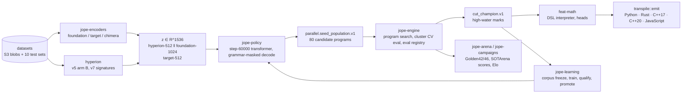
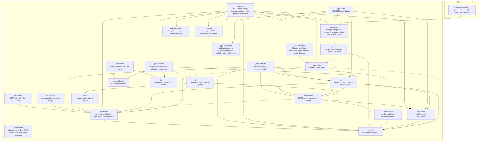

# Architecture

For the dated current source boundaries and evidence limits, see the
[runtime ownership map (2026-10-21)](coordination/runtime-ownership-20261021.md).

> **Status on `main`:** this page describes the target design from the port plan. Run `jope --help` on `main` for the verbs that exist today. There is no `jope learn`, `jope hwm` or `jope scores`; the learning store is the separate `jope-learning` binary, with `hwm` and `scores` subcommands. See the README's "What this SHA actually does".

JopeDime is one repository that holds the whole pipeline
**dataset → encoders → policy → program → emitted source code**. Rust owns search, evaluation,
the emitters, the CLI and every contract validator. Owner decision 2 of the plan gave encoder
inference/training and the deep-learning models to a `uv`-managed Python package;
[ADR-0006](adr/ADR-0006-rust-only-stack.md) (owner ruling 2026-09-26) supersedes it. The stack
is Rust-only apart from the Python the emitters generate and its harness, and the Python that
still holds the training stack and some operational tools stays only until phases P2/P3 port or
retire it. This page is the map; the numbers were verified on the tree at the commit that
introduced it (2026-09-18).

## Data flow

Every arrow is a file with a named schema (see [Contracts](#contracts-and-schemas)); nothing is
passed by shared memory between stages, which is what makes each stage replayable from S3.

## Crate graph

Edges follow normal (non-dev) workspace path dependencies, from dependency to consumer;
dotted edges are optional, feature-gated dependencies. Regenerate the list with `cargo metadata --format-version 1 --no-deps` when a
crate's `[dependencies]` change. No crate depends on `jope-campaigns`, `jope-engine` (except
`hyperion`'s optional feature) or `numpy-pcg64`; the self-play control plane lives in
`jope-campaigns` binaries, not in a separate `jope-selfplay` crate.

| Crate (directory) | Package name | Status on `main` today | What it owns |
|---|---|---|---|
| `crates/feat-math` | `feat-math` | landed (WP2) | Program DSL (`dsl.rs`, `genome.rs`, `spec.rs`), interpreter (`model.rs`, `heads.rs`, `gpr.rs`, `krr.rs`, `boost2.rs`, `portfolio.rs`), in-process search (`evolve.rs`), the op authority `registry.rs`, all emitters (`emit_py.rs`, `emit_rs.rs`, `emit_cpp.rs`, `emit_js.rs`, `transpile.rs`), the Rust fitted-model host runtime (`advanced_v3/`), and a test-only frozen C++ parity oracle (`tests/fixtures/fitted_runtime_oracle.cpp`). Crate-local `assets/champions/8944cbdf.dsl` (`include_str!`). |
| `crates/numpy-pcg64` | `numpy-pcg64` | landed (WP3) | Bit-exact numpy 1.26.4 `SeedSequence`/PCG64/`Generator` integer sampling and the frozen sampling recipes. |
| `crates/jope-encoders` | `starforge` (lib name kept so no source edit was needed) | landed (WP3) | Foundation encoder (Starlight / TabPFN-v3-reg, TabICL), target encoder, chimera fusion, hash-verified bundle loader. Weight-bound tests are env-gated. |
| `crates/battle-gpu` | `battle-gpu` | landed | Raw `dlopen("libcuda.so.1")` GPU screening for rung-0 ridge; feature `gpu`. No cudarc, so it never conflicts with candle. |
| `crates/jope-engine` | `jope-parallel` | landed (WP1) | The engine: program search (`gp.rs`, `grammar.rs`, `proposals*.rs`, `champions.rs`, `corpus*.rs`, `tournament.rs`), eval registry authority (`eval_registry/`), the `jope-parallel` binary with its **92 clap subcommands and global `--root`** (the jain-core consumer contract; 88 carried over from the pre-port tree and 4 new, per the capability matrix), 12 more binaries in `src/bin` incl. `jope-build-receipt` and `jope-native-loop` (the matrix's other 12 engine-subcommand rows are that binary's); crate-local `assets/grammar/` (4 JSON, the committed `featmath-jain-v1.json` bakes the literal key `parallel/assets/grammar/featmath.json` — plan blocker B4) and `manifests/`. Feature `neural` = tch/LibTorch (self-hosted only). The smartcluster dependency is unconditional; the planned WP11 `cluster` feature does not exist in `Cargo.toml`. |
| `crates/jope-campaigns` | `jope-dime-regressor` | landed (WP1); tests compile since B6 | Benchmark campaigns: Golden42/46 panels, exact-CV, test-adaptive, DL best5, generalized search, search v3, hyperion gate/router, plus today the 55 `src/bin` programs (the self-play control plane among them; no separate `jope-selfplay` crate exists). Crate-local `manifests/`, `seeds/`, `fixtures/` (`include_str!`/`include_bytes!` inputs, B1/B7/B8), `known-evaluator-identities.json` (ADR-0004). |
| `crates/hyperion` | `hyperion` | landed (WP3) | Hyperion v5 arm B / v7 inference (candle 0.11), router, `.hvc2` cache, GPU lease; bins `hyperion-v5-reference`, `hyperion-batch-worker`. `HYPERION_V7_WEIGHTS` replaces the historical absolute path. |
| `crates/jope-policy` | `jope-policy` | landed (WP3) | The step-60000 policy port: grammar/automaton, model, decode, ranking, seeds. |
| `crates/jope-paths` | `jope-paths` | landed (WP4) | The runtime roots of [ADR-0003](adr/ADR-0003-runtime-roots.md); zero dependencies; re-exported as `jope_parallel::paths`. |
| `crates/jope-datasets` | `jope-datasets` | landed (WP-D1/D5) | Catalog and collection types, `ingest` (de-dup), `fetch`/`verify`/`link` over `object_store`; the `datasets/test` verifier in hygiene. [docs/datasets.md](datasets.md). |
| `crates/jope-models` | `jope-models` | landed (WP7) | `jope models fetch / verify / publish / path` over the content-addressed models bucket. [docs/models.md](models.md). |
| `crates/jope-learning` | `jope-learning` | landed (WP11) | The S3-facing half of the learning loop of [ADR-0005](adr/ADR-0005-canonical-learning-loop.md): HWM ledger, corpus snapshots, checkpoint lineage, wave pointers; the separate `jope-learning` binary. [docs/learning.md](learning.md). |
| `crates/jope-arena` | `jope-arena` | landed (WP12) | SOTArena fetch, score emission, family Elo. There is no `docs/arena.md` yet. |
| `crates/jope-automl` | `jope-automl` | native candidate integration | Immutable original regressor sources and the native AutoML registry; `fit_rows`/`predict_rows`, plus the standalone challenge API. [Native regressors](../crates/jope-automl/README.md). |
| `crates/jope-bench` | `jope-bench` | landed | Same-cut benchmark: tier-1 baselines and a searched program scored on identical cuts, screen then deepen; the `jope demo`, `jope benchmark` and `jope optimize` verbs. [docs/same-cut-bench.md](same-cut-bench.md). |
| `crates/jope-pipeline` | `jope-pipeline` | landed | The product pipeline behind `jope pipeline`: dataset → prepared cuts → program search → emitted code, with a receipt; bin `jope-context-proof`. [docs/pipeline.md](pipeline.md). |
| `crates/jope-motifs` | `jope-motifs` | landed | Reusable program fragments: private tables, exact expansion and compatibility checks; `jope motifs`, hidden from the default help until the capability is published (owner decision, 2026-09-24). |
| `crates/jope-records` | `jope-records` | landed | Verifiers and renderers of the committed records (core-IP findings, dispositions, claims, test inventory, task status, progress view, historical Elo replay) and the repository hygiene guards `coverage`, `rust-scope-check`, `parity-check`, `readme-benchmarks` and `repo-layout`; Rust ports of the retired Python verifiers ([ADR-0006](adr/ADR-0006-rust-only-stack.md)). |
| `crates/jope-ci` | `jope-ci` | landed | CI and host-maintenance tooling: `cargo-artifact` (Cargo artifact selection) and the build-directory report; Rust ports of `deploy/ci` and `deploy/maintenance` Python helpers ([ADR-0006](adr/ADR-0006-rust-only-stack.md)). |
| `crates/jope-runtime` | `jope-runtime` | landed | The appliance runtime: the native method roster, raw-cell encoding and bound prediction shared with `jope-bench` and `jope-pipeline` (which re-export them), CSV ingress, bounded automatic selection (`jope.runtime-select/v1` defaults; opt-in v2 regression objectives, forward validation and cross-fitted output calibration), JSON-RPC/MCP adapters, the `model.jope` fitted-state file and run receipts. Depends on `feat-math` without its fitted-C++ feature. |
| `crates/jope-assets` | `jope-assets` | landed | The signed single-file package: 128-byte footer, canonical manifest, P-256 signature over the footer, per-asset authentication before decompression, bounded decoding; the writer behind feature `pack`. |
| `crates/jope-appliance` | `jope-appliance` (binary `jopedime`) | landed; not published | The signed single-file executable: `version`, `doctor`, `methods`, `fit`, `predict`, `fit-predict`, `fitness`, `mcp`, `api`, `verify-self`, `licenses`. [deploy/appliance](../deploy/appliance/README.md). |
| `crates/jope-dist` | `jope-dist` | landed | Build-time only: model lock with rights blockers, deterministic pack, release stage and seal, independent verify, dependency audit, notices, size, SBOM and provenance. |
| `crates/jope-cli` | `jope-cli` (binary `jope`) | landed | The `jope` binary. Verbs today: `doctor`, `demo`, `benchmark`, `train` (Linux), `optimize`, `verify-inputs`, `generate-fixtures`, `encode`, `fit`, `emit`, `search`, `champions`, `train-step`, `route`, `models`, `datasets`, `pipeline`, and the hidden `motifs`. The target design's `propose`, `learn`, `hwm`, `scores`, `arena`, `campaign` and `selfplay` verbs do not exist (see the status note at the top). |
| `crates/jope-observatory` | `jope-observatory` | landed | The training observatory: an axum read-only JSON API (`/api/v1/snapshot`, `/api/v1/gp`, …) and the `collect-datasets`, `collect-fleet`, `collect-storage` and `gp-source-stream` collector binaries. |
| `crates/smartcluster/*` | `jain-smartcluster{,-core,-fabric,-daemon}`, `jain-worker`, `jainnode`, `scq` | landed (vendored at 715128f8, versions 8.0.0) | The scheduler the engine's native loop, smartcluster worker and native graph bind to; crates.io dependencies only. Not covered by `deploy/ci/version-consistency.sh`. |

`xtools/registry-dump-legacy` is a standalone dev-only package with its own `[workspace]`.
The reviewed dependency sources under `vendor/security/*` are excluded from the product
workspace and retain upstream versions; `vendor/security/PROVENANCE.json` and
`deploy/ci/verify-vendor-security.py` bind their exact source inventory. The frozen kernel-v1 evaluator lineage (`deploy/kernel-v1/source`)
was retired from the tree on 2026-09-28; `docs/archive/clean-base-manifest.json` gives its
restore command.

## The Python package (`python/`)

**Status: being retired ([ADR-0006](adr/ADR-0006-rust-only-stack.md)).** Phase P1 removed the
Python with no live consumer (694 files, plus 9 unit templates that only ran it), among them all
of `zyal`, `fitness_corrector` and
`genome_perf`, all but one file of `chimera`, most of `tools` and `research`, and the kernel-v1
Python. [`docs/archive/python-archive-manifest.json`](archive/python-archive-manifest.json) lists
each with its restore command. What remains is the training stack (`policy`, `encoders`,
`target_maker`, `data`, `dime_score`, `broad_shadow` and the `jope-py` console script), the
research drivers and helpers that kept tests still use, the sha-pinned grammar sources and the
files that records digest-check; phases P2 and P3 port or retire them. New Python is not accepted
except the emitted model code and its harness.

One `uv` project, package `jope`, src layout `python/src/jope/` so the grammar pins keyed by
`jope/grammars/…` stay valid. Sub-packages by function as ported (WP6, PR
[#8](https://github.com/veox-ai/JopeDime/pull/8)): `encoders`, `policy`, `chimera`,
`target_maker`, `zyal`, `dime_score`, `fitness_corrector`, `grammars`, `tools`, `research` (the
former `scripts/` drivers, import-checked only), `tests/` with a `conftest.py` replacing the
historical `sys.path` hacks. Extras: `dev`, `cpu`, `cu130` (torch index per extra), `foundry`,
`research`. Tests that need the xbabe2 host carry the `xbabe2` marker and never run on hosted
runners.

## Contracts and schemas

Every record that crosses a stage boundary has a schema id in its `schema` field. The single
source per contract is `schemas/<name>.schema.json` (landing with WP10, crate `jope-contracts`);
Rust types round-trip through `schemars`; the remaining Python validates with `jsonschema` until
ADR-0006 retires it. Today's ids, by stage:

| Stage | Contract | Producer → consumer |
|---|---|---|
| datasets | `jope.dataset-catalog/v1`, `jope.dataset-collection/v1` | `jope datasets ingest` → `fetch`/`verify`, `deploy/ci/check.sh` |
| models | `jope.model-bundle/v2` (+ `jain.model-license/v1` blocks), `jope.model-index/v1` | `jope models publish` → `fetch`/`verify`, `deploy/ci/manifests.sh` |
| policy | `parallel.seed_population.v1`, `jope.checkpoint_export.v1` | `jope-policy` (export receipts are written by jain-datasets `tools/ot-export`) → `jope-engine search` |
| engine | `jain.jope-search-receipt/v1` (the jain-core consumer contract, `tests/cli_contract.rs`), `parallel.cut_champion.v1`, `parallel.teaching_shards.v1`, `parallel.checkpoint.v1`, `parallel.cycle.v1`, `parallel.gp_jobs.v1`, `parallel.clean_completion.v3` | `jope-parallel` subcommands → each other, `jope-learning` |
| evaluation | `JopeDimeEvaluatorIdentity.v1` + `known-evaluator-identities.json` (ADR-0004), `JopeDimeSemanticEvaluationReceipt.v2` | `jope-campaigns` `evaluation_v2.rs` |
| learning | `jope.hwm/v1`, `jope.score/v1`, `parallel.promotion_evidence.v2`, `parallel.promotion_decision.v2`, `RatchetArtifactPointerV1`, `LearningWaveManifest.v1`, `jope.learn-pull/v1` | `jope-learning hwm` / `jope-learning scores` |
| builds | `jope.product_evaluator_build.v1` (`jope-build-receipt`), `jope.sdk-receipt/v1` (`deploy/receipts/libtorch.json`, landed by PR [#25](https://github.com/veox-ai/JopeDime/pull/25)), `jope.cuda-qualification/v1`, `jope.release-manifest/v1` (`deploy/release/release.sh`) | CI lanes → artefacts / S3 `ci-receipts/` |
| parity | `jope.test-timings/v1` (`docs/parity/test-timings.json`, landed by PR [#29](https://github.com/veox-ai/JopeDime/pull/29)), the capability matrix and test inventory (landed by PR [#28](https://github.com/veox-ai/JopeDime/pull/28)) | WP1/WP10 → `deploy/ci/{parity-matrix,test-inventory}.sh` |

## Where state lives

- **Git:** source, grammars, manifests, seeds, fixtures, the 10 test datasets, model *manifests*,
  parity records. Nothing over 5 MiB (hygiene size cap), no weights, no evidence.
- **S3 (us-east-2, account-private):** `s3://veox-jopedime-models-use2` (`blobs/sha256/<sha>` +
  `bundles/<id>/manifest.json`; bundles `policy-step-60000`, `hyperion-v7`,
  `jope-prime-gen31-v2`), `s3://veox-jopedime-datasets-use2` (blobs, catalog, collections),
  `s3://veox-jopedime-learning-use2` (the `jope-learning` layout — HWM ledger, scores — once a
  `--store` mirror is configured; on 2026-09-23 it held only `staging/` second copies, see
  [docs/learning.md](learning.md)), `s3://veox-jopedime-archive-use2` (git bundles
  `git/20260916-…`, `git/20260918-jope-dime-all-refs.bundle` and `git-bundles/20260921/`, plus
  the `staging/node-high-value/` second copy; no `evidence/` batches in the 2026-09-23
  current-object inventory). Prefix status, sizes
  and replicas: [catalogs/s3.json](../catalogs/s3.json). CI reaches them only through the
  OIDC roles `JopeDimeCiRead`, `JopeDimeTrainer`, `JopeDimeRelease`.
- **Local:** the five roots of [ADR-0003](adr/ADR-0003-runtime-roots.md) — `JOPE_HOME` (the
  checkout), `JOPE_STATE` (mutable state, the restored `parallel/` tree), `JOPE_REGISTRY`
  (dataset cache by id), `SOTARENA_ROOT`, `SOTARENA_REPORTER_ROOT`.

## Determinism invariants

1. Emitted sources are byte-identical across runs and hosts (`deploy/ci/emitters.sh` pins their
   sha256).
2. Predictions of the interpreter and of every emitted program agree bit for bit
   (IEEE-754 pattern compare), across `g++`/`clang++` × C++17/C++20 and across `-march` values
   because every C++ build carries `-ffp-contract=off -fno-fast-math` ([docs/emitters.md](emitters.md)).
3. Numerical libraries run single-threaded in tests (`OMP/RAYON/OPENBLAS/MKL_NUM_THREADS=1`).
4. Every random choice takes an explicit seed; numpy streams are reproduced bit-exactly by
   `numpy-pcg64`.
5. Receipts bind outputs to inputs by sha256 (evaluator identity, bundle id, git sha), so a score
   can be replayed under the evaluator that produced it.

## Related

[docs/emitters.md](emitters.md) · [docs/datasets.md](datasets.md) ·
[docs/campaigns.md](campaigns.md) · [docs/adr/](adr/) ·
[docs/models.md](models.md) · [docs/runbooks/runner.md](runbooks/runner.md) ·
[docs/learning.md](learning.md) · [docs/pipeline.md](pipeline.md) · `docs/arena.md` (not written yet) ·
the pre-port documents, kept verbatim under `docs/legacy/root-docs/` until 2026-09-28, restore
from the commands in [docs/archive/clean-base-manifest.json](archive/clean-base-manifest.json).
