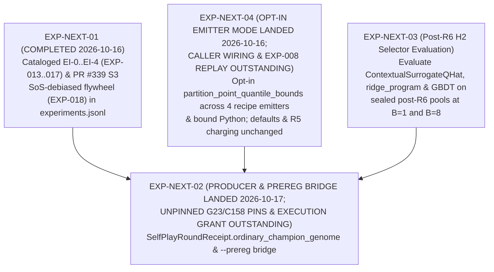

# Cross-Experiment Working Hypotheses & Next-Experiment Roadmap

This document summarizes **five scope-bounded working hypotheses (non-qualifying)** drawn from [`experiments.jsonl`](experiments.jsonl) (`EXP-001`–`EXP-018`) and outlines a prioritized sequence of next steps (`EXP-NEXT-01`–`EXP-NEXT-04`) with their exact blocking gates.

---

## 1. Five Working Hypotheses (Non-Qualifying / Scope-Bounded)

### Working Hypothesis 1 — Static-Catalog `v1` Continuation Plateaued After Epoch 10; Syntactic Support Expansion Occurs in Offline GP Search (`ESTABLISHED` lookup `C25–C27` + `NON_QUALIFYING` `C166–C168`)
- **Recorded Observations**:
  - In `EXP-001` (`ESTABLISHED` `C25–C27`), full validation `L6` (`263` contexts, dropout off) moved from `1.0055212` at epoch 2 to a best of `0.8968201` at epoch 28 and `0.8974925` at epoch 40, remaining inside `[0.8968201, 0.8978393]` across all `31` closed epochs from epoch `10` to epoch `40`, while the learning rate halved `9` times to the `1e-6` floor at step `5,677` and stayed there for the remaining `12,096` updates.
  - In `EXP-008` (`NON_QUALIFYING` `C167`, [`gp-h1-readout.20261013.json`](../internal/clover/gp-h1-readout.20261013.json)), `40` of the `51` selected GP champions across the `17` complete-case training contexts were **syntactically** outside the frozen `6,640`-program `v1` catalog (`behavioral_novelty_vs_full_catalog: "unknown; no full6640 finite-probe replay"`).
- **Scope & Limitations**: `EXP-008` is a non-qualifying, selection-biased complete-case summary on training inner folds (`17/24` contexts, unequal attempt counts, `3` parity failures), and `EXP-009`'s host-command smoke run on `R22` scratch inputs is not a scientific result ([`NUMBERS_TRACE.md`](../paper/NUMBERS_TRACE.md#fresh-clone-run)). Whether multi-round vocabulary expansion improves held-out test RMSE remains an open hypothesis (`H1` / `H4`).

### Working Hypothesis 2 — Retrieval Seeding Outperformed Unstarted and Frozen-`v1` Policy-Seeded GP on Complete-Case Training Inner Folds (`NON_QUALIFYING` `C166, C168`)
- **Recorded Observations**:
  - In `EXP-008` (`NON_QUALIFYING` `C166`, [`gp-h1-readout.20261013.json`](../internal/clover/gp-h1-readout.20261013.json)), across the `17` complete-case training contexts on the same training inner folds (lower loss is better):
    - `retrieval_seeded / ordinary`: `16` lower / `1` equal / `0` higher (`median_log_loss_ratio = -0.035361252`).
    - `policy_seeded / ordinary`: `10` lower / `2` equal / `5` higher (`median_log_loss_ratio = -0.000349264`).
    - `policy_seeded / retrieval_seeded`: `2` lower / `0` equal / `15` higher (`median_log_loss_ratio = +0.017235560`).
  - `ordinary`, `policy_seeded`, and `retrieval_seeded` beat the remeasured incumbent in `8`, `10`, and `11` of the `17` contexts, with total search attempts `1,913`, `1,714`, and `2,082` (`actual_equal_attempt_counts: false`).
- **Scope & Limitations**: Non-qualifying training inner-fold comparison with `6` interrupted contexts (`18` arms at `~900 s`) and unequal search attempt counts. Any retrieval-seeded or hybrid-seeded multi-round self-play design requires equal resource/attempt accounting and a dedicated pre-registration amendment.

### Working Hypothesis 3 — Continuation Fine-Tunes Excluding the `885` Training Contexts Showed KL/Weight Trade-Offs Across `R22` (`EXP-006`/`EXP-007`) and `EI-0..EI-4` (`EXP-013`–`EXP-017`) (`NON_QUALIFYING` `C137, C163, C174, C175, C177, C185-C189`)
- **Recorded Observations**:
  - In `EXP-006` (`NON_QUALIFYING` `C136–C137`), pure `L6 + 0.2*KL` kept mean probe KL at or below `0.014` across complete epochs in sweeps `4a`, `5`, and `6` (whereas `L6` alone reached `0.052–0.053` by epoch 2 at `3.75e-5`, and `L_PI + 0.2*KL` arms reached `0.020–0.057` and `0.102`).
  - In `EXP-007` (`NON_QUALIFYING` `C174`), on `L6-1148` (`1,148` contexts, `221` parent clusters = `54` validation + `167` held-out training clusters, `K = 3` Holm), all three judged checkpoints raised a non-qualifying **`REGRESSION ALERT`** against frozen `v1`: `R25` epoch 1 `+0.00511 [+0.00413, +0.00611]`, `L6 + 0.2*KL` epoch 4 (`r25control`) `+0.00310 [+0.00195, +0.00434]`, and `R26` epoch 4 `+0.00333 [+0.00214, +0.00461]`, with directional degradation concentrated on the `885` held-out training contexts (`+0.00628`, `+0.00423`, `+0.00463` in `C177`).
  - In `EXP-013` (`EI-0`, `C185`, `24` paired runs / `96` checkpoint slots, `0` unresolved), `P_EI0` ($\lambda_{\text{PI}}=0.01, \lambda_{\text{KL}}=3.0$, seeds `26–27` E4) was `INCONCLUSIVE` vs. its matched `L6 + 3.0*KL` control (`Stratum H -0.000096`, `pooled +0.000004`), replication `P_EI0r` (seeds `28–29` E4) degraded on Stratum H (`+0.000596 [+0.000115, +0.001087]`, `p=0.0105`), and descriptive higher doses ($\lambda_{\text{PI}}=0.03, 0.10$ on seeds `28–29` E4) had negative pooled differences (`-0.000416 [-0.000780, -0.000082]` and `-0.000377 [-0.000723, -0.000024]`).
  - In `EXP-014` (`EI-1`, `C186`) and `EXP-016` (`EI-3` 3-host panel, `C188`), archive-CE oversampling at $\lambda_{\text{ar}}=0.10, \lambda_{\text{KL}}=3.0$ (`m=4` or `m=8` with $\lambda_{\pi}=0.05$) triggered epoch-2 KL alarms (`0.038850` in `EI-1`, `0.039816` on `xbabe2` in `EI-3`) and froze at epoch 3 (`1,056` updates, `kl_stop`, `kl_mean = 0.079634` and `0.080342` `> 0.05`), with equal-exposure epoch-3 `L6-1148` deltas of `+0.004297` weighted mean in the bounded in-run `receipt.json` (`+0.003565` Stratum H / `+0.006758` Stratum A; `+0.003854` in the standalone `>512 KiB` `paired-rows.jsonl`, while G-JUDGE ruled the formal primary `PRIMARY_NOT_COMPUTED`) for `EI-1` and `+0.003962 [+0.003222, +0.004744]` for the `EI-3` 3-seed panel mean.
  - Lowering $\lambda_{\text{ar}}$ and/or raising $\lambda_{\text{KL}}$ eliminated KL stops across all `4` epochs (`1,408` updates) in `EXP-015` (`EI-2`/`EI-2X`, `C187`, $\lambda_{\text{ar}}=0.03, \lambda_{\text{KL}}=3.0, m=4$, 3-host panel mean pooled delta `+0.000378 [+0.000021, +0.000744]`) and `EXP-017` (`EI-4`, `C189`, $\lambda_{\text{ar}}=0.025, \lambda_{\text{KL}}=5.0, m=8$, `xbabe2` bounded in-run `receipt.json` weighted mean delta `+0.000720` at ep 3 [`+0.000378` H / `+0.001870` A] and `+0.000082` at ep 4 [`+0.000051` H / `+0.000187` A]; standalone `>512 KiB` `.jsonl` cost deltas `+0.000518` ep 3, `+0.000106` ep 4), without achieving a negative `L6-1148` reduction vs. matched control.
- **Scope & Limitations**: All `R22` and `EI-0..EI-4` continuation runs are non-qualifying; strata breakdowns (`C177`) are directional and not decisive.

### Working Hypothesis 4 — Frozen `v1` `q-hat` Ranked Fresh Programs at Chance on `D5b` (`EXP-002`), Whereas Unclamped LOPO Context-Debiased (`SoS`) S3 Distillation Achieved `ESTABLISHED_SHADOW` Top-1 Gain Lifts Over `program_prior` and `ridge_program` (`EXP-018`, `C190`)
- **Recorded Observations**:
  - In `EXP-001` (`C28`), the `v1` `q` regression validation term was `0.1804` at epoch 2 and `0.1809` at epoch 40. In `EXP-002` (`C75–C76`, pre-`R6` `D5b` `32` kept contexts), `q`-head pairwise ranking accuracy on freshly executed programs was `0.506 [0.441, 0.568]` (chance is `0.5`), and `32 -> 8` reranking minus plain policy sampling was `INCONCLUSIVE` (`dScore = 0.031 [-0.0625, 0.125]`). In `C78` / `C178` (`7,120`-view pool), an earlier separate DL outcome ensemble trailed LightGBM on raw LV4 features in equal-lineage $R^2$ (`0.690235` vs. `0.784889`).
  - In `EXP-018` (`NON_QUALIFYING` offline shadow-pool study, `C190`, `PR #339`, `d222807a9f...`), distilling all `8,908` scored S3 `GP_RESULTS_INDEX.json` rows (from `18,380` total index runs; `9,383` unscored and `89` incomplete-provenance skipped; `13` program hashes across `1,579` contexts) with unclamped leave-one-parent-cluster-out (`LOPO`) Strength-of-Schedule (`SoS`) target debiasing (`bt + ctx_offset`) and 5-fold parent-grouped inner-CV ridge regularization over `93` features (`13` summary + `8` linear context + `8` linear program + `64` bilinear cross-terms) in `ContextualSurrogateQHat` yielded across `5` rounds (`9,088 -> 45,064` distilled rows) on teacher-excluded `shadow-pool-v2` (`1,136` contexts, `255` parent clusters, `all_rounds_kl_admissible: true`):
    - `R0 -> R4` `B=1` top-1 gain lift **`+0.134751 [+0.067497, +0.215110]` (`GREATER`)** (`0.785168 -> 0.919919`; `B=4` `+0.048424 [+0.020387, +0.076841]` `GREATER`; `B=8` `+0.022078 [+0.011148, +0.035404]` `GREATER`) and pairwise accuracy lift **`+0.046025 [+0.039928, +0.051692]` (`GREATER`)** (`0.634318 -> 0.680342`).
    - Active vs. passive discovery HWM lift **`+0.035792 [+0.018341, +0.057848]` (`GREATER`)** and `R4` Active vs. Passive `B=1` gain **`+0.034743 [+0.000512, +0.075291]` (`GREATER`)** (`0.919919` vs. `0.885176`).
    - **`ESTABLISHED_SHADOW`** at `R4` against both `program_prior` (`B=1` `+0.043596 [+0.010236, +0.082032]` `GREATER`, pairwise `+0.007620 [+0.003907, +0.011430]` `GREATER`) and `ridge_program` (`B=1` `+0.066919 [+0.030060, +0.105549]` `GREATER`, pairwise `+0.029398 [+0.023834, +0.035189]` `GREATER`), replicated on teacher-included `shadow-pool-v1` (`1,222` contexts, `258` parent clusters: `R0 -> R4` `B=1` gain `+0.118753 [+0.068081, +0.175087]` `GREATER`, `1.344010 -> 1.462763`; pairwise `+0.033363 [+0.028599, +0.038003]` `GREATER`, `0.688796 -> 0.722159`).
- **Scope & Limitations**: On `shadow-pool-v2`, `R4` Active vs. Passive pairwise accuracy (`+0.001880 [-0.000696, +0.004405]`), `B=4` gain (`-0.001835 [-0.018085, +0.009953]`), and `B=8` gain (`-0.001355 [-0.003403, +0.000407]`) remained `INCONCLUSIVE`, so `flywheel_established = false` under the joint 5-gate shadow criterion (`4` of `5` gates passed); and in standalone full-pool `evaluate`, `ContextualSurrogateQHat` achieved `ESTABLISHED_SHADOW` on `shadow-pool-v2` at `B=1` (`+0.033773` vs. `program_prior`, `+0.057258` vs. `ridge_program`) while remaining `NOT_ESTABLISHED` at `B=8` and on `shadow-pool-v1`.

### Working Hypothesis 5 — `EXP-004` (`41 / 1,554`) Established the One-ULP Tie-Plateau `quantile_edges` + `slice::partition_point` vs. `(lo, hi)` Mechanism, Which Is Consistent With the Three `EXP-008` Context `14` & `18` Parity Failures (`C41–C45, C47, C49, C149, C167`)
- **Recorded Observations**:
  - In `EXP-004` (`ESTABLISHED` `C41–C45, C47, C49`, [`TECHNICAL_WRITEUP.md` §5.5](../paper/TECHNICAL_WRITEUP.md#55-case-study-a-one-ulp-disagreement-between-two-binary-searches)), `41 / 1,554` (`2.6%`) evaluated pairs failed parity deterministically (`41 / 342 = 12.0%` with quantile binning; `0 / 1,212` without binning). The documented mechanism is a one-ulp non-monotone inversion in interior quantile edges computed as `s_lo*(1-f) + s_hi*f` (`sorted[lo] * (1.0 - frac) + sorted[hi] * frac` in `crates/feat-math/src/ops.rs:220` and `crates/feat-math/src/emit_rs.rs:502`; on a tie plateau `s_lo == s_hi == a`, the two-product form can land one ulp below or above `a`, `C47`) paired with two different binary searches: the standard-library `slice::partition_point` search (`while size > 1 { half = size / 2; mid = base + half; base = if pred(mid) { mid } else { base }; size -= half }`, returning `base + usize::from(pred(base))` in the pinned `rustc 1.97.1` toolchain, `crates/feat-math/src/ops.rs:224-230`), versus the legacy `(lo, hi)` `mid + 1` loop (`C49`).
  - In `EXP-008` (`NON_QUALIFYING` `C167`, [`gp-h1-readout.20261013.json`](../internal/clover/gp-h1-readout.20261013.json)), `48 / 51` selected GP champions matched bitwise on both training probes, while `3 / 51` failed parity with readout deltas:
    1. Context `14` (`dataset 51d5e3d9bca34669`, `retrieval_seeded`, `program_sha256: d217704734d7d9ace5ff39a73de79e01c7b21bdc8e43b0cc3b09fe3e7b5bf70a`, cut 1 `max_absolute_delta = 0.0021133743`).
    2. Context `18` (`dataset 72c1bdcbd2d62359`, `ordinary`, `program_sha256: 14882a744768ece2e34abc1c410c772181394b140d93a0c2e3623d03dd10dedb`, cut 0 `max_absolute_delta = 0.0321004556`).
    3. Context `18` (`dataset 72c1bdcbd2d62359`, `policy_seeded`, `program_sha256: 6165e86c7d7641a9e73135cf74e9d331c6f14ffc76b440a9bcd5d2e48d8fa76b`, cut 0 `max_absolute_delta = 0.1367213160`).
  - **Opt-In Emitter Mode & Synthetic Parity Verification (`EXP-NEXT-04`)**: Versioned opt-in emission (`EmitOptions::partition_point_quantile_bounds: true`, setting recipe `Manifest::emitter_version` to `"feat-math-quantile-partition-point-v1"` or unambiguous combined labels with `roll-width-guard-v1` / `clip-safety-v2`, and setting `BoundManifest::emitter_version` to `"feat-math-quantile-partition-point-v1"`) across all four recipe emitters (`emit_rs.rs`, `emit_py.rs`, `emit_cpp.rs`, `emit_js.rs`) and bound Python (`advanced_v3/emit/mod.rs`) transcribes the exact `(base, size)` `slice::partition_point` loop while preserving 100% of default `EmitOptions::default()` recipe and bound-Python artifact bytes, default `emitter_version` labels, and native `v1` training scores (`C149`; note that the ADR-0004 evaluator identity moves via `transitions/exp_next_04_identity_rebaseline.v1.json` because `transpile.rs`, `emit_py.rs`, and `emit_rs.rs` are hashed identity inputs, and `historical_v1.rs` appends that identity-only transition while keeping all behavior pins unchanged). No production CLI (`jope emit`), pipeline (`jope-pipeline`), motif validator (`jope-motifs`), or campaign caller currently enables `partition_point_quantile_bounds: true`, so default emissions retain the legacy search and existing `R5` parity charging remains in force. Representative pipelines exercising the `quantile_bins`, `bin_onehot`, and `target_bin_encode` operator families on synthetic 1-ULP tie-plateau fixtures (`bins=27`, `bins=16`, `bins=13`) in `crates/feat-math/tests/clover_quantile.rs` verify that the default legacy helpers diverge numerically while opt-in `partition_point_quantile_bounds: true` matches native Rust bit-for-bit across Rust, Python, C++17, JavaScript, and `advanced_v3::emit_bound`. Whether those three `EXP-008` `program_sha256` champions are completely explained by this mechanism on their original context datasets remains a working hypothesis consistent with `EXP-004` (`original EXP-008 context replay outstanding`).

---

## 2. Prioritized Next-Step Roadmap (`EXP-NEXT-01` – `EXP-NEXT-04`)

> **Governance Gate**: `EXP-NEXT-01` is completed (`2026-10-16`). For `EXP-NEXT-04`, the opt-in emitter `partition_point` mode and synthetic 4-language + bound-model regression are landed (`2026-10-16`), while production callers keep `EmitOptions::default()` (legacy search and `R5` parity charging unchanged) and replaying the original `EXP-008` context `14` & `18` training probes remains outstanding (`no execution grant`). For `EXP-NEXT-02`, the `SPQ-1` producer (`SelfPlayRoundReceipt::ordinary_champion_genome`) and pre-registration / provenance verifier bridge (`SelfPlayPrereg`, `qualify_rounds_with_prereg`, `jope_pools qualify-rounds --prereg`, and `Endpoint::RatchetVsOrdinaryFinalRound`) are landed (`2026-10-17`), while [`selfplay-round1-prereg.v1.json`](../internal/clover/selfplay-round1-prereg.v1.json) remains `PRE_REGISTERED_UNPINNED_NO_EXECUTION_GRANT` (`execution_grant.authorized: false`). Remaining items (pinning the `UNPINNED` `G23`/`C158`/admission fields in `selfplay-round1-prereg.v1.json` and executing confirmatory Round-1, `EXP-NEXT-03`, wiring `partition_point_quantile_bounds` into production callers, and the `EXP-008` original-context replay) are **roadmap proposals only (`no execution grant`)** and require explicit owner admission before any source change, benchmark execution, or compute run.

### Priority 1: `EXP-NEXT-01` — Audit and Catalog the Executed `2026-10-14/15` `EI-0..EI-4` `1,148`-Context Studies & `PR #339` S3 Flywheel (**COMPLETED `2026-10-16`**)
- **Status**: **DONE (`2026-10-16`)** — Recorded in [`experiments.jsonl`](experiments.jsonl) and [`README.md`](README.md) as `EXP-013` (`EI-0`), `EXP-014` (`EI-1`), `EXP-015` (`EI-2`/`EI-2X`), `EXP-016` (`EI-3`), `EXP-017` (`EI-4`), and `EXP-018` (`PR #339` S3 `8,908`-row SoS-debiased surrogate flywheel).
- **Delivered Scope**:
  1. Verified SHA-256 pins, commit SHAs, KL trajectories, and paired `L6-1148` cluster-bootstrap verdicts across `/home/ubuntu/jope-evidence/{rlfw-g-abl,jopedime-flywheel-ei0,jopedime-flywheel-ei1,jopedime-flywheel-ei2,ei3-study-20261015,ei4-study-20261015,selfplay-s3-sos-debiased-flywheel-20261016}`.
  2. Appended schema-valid `EXP-013`–`EXP-018` records to [`experiments.jsonl`](experiments.jsonl) and updated Working Hypotheses 3 and 4 above.

### Priority 2: `EXP-NEXT-04` — Quantile Binary-Search Opt-In Emitter Mode and Synthetic Parity Regression (**OPT-IN EMITTER MODE LANDED `2026-10-16`; PRODUCTION CALLER WIRING & `EXP-008` REPLAY OUTSTANDING**)
- **Status**: **OPT-IN EMITTER MODE & SYNTHETIC REGRESSION LANDED (`2026-10-16`); PRODUCTION CALLERS RETAIN DEFAULT LEGACY SEARCH & `R5` CHARGING; ORIGINAL `EXP-008` CONTEXT REPLAY OUTSTANDING (`no execution grant`)** — Implemented across `crates/feat-math/src/{transpile.rs,emit_rs.rs,emit_py.rs,emit_cpp.rs,emit_js.rs}` and `crates/feat-math/src/advanced_v3/emit/mod.rs` with regression test `exp_next_04_tie_plateau_and_representative_pipelines_match_native_partition_point` in `crates/feat-math/tests/clover_quantile.rs`.
- **Delivered Scope & Remaining Proposal**:
  1. **Delivered**: Added versioned opt-in emission (`EmitOptions::partition_point_quantile_bounds: true`, recorded in `transitions/exp_next_04_emitted_quantile_partition_point.v1.json`; note that adding a `pub` field on `EmitOptions` is a semver-minor change for external struct-literal callers while all in-workspace callers use `..Default::default()`) so all 4 recipe emitters (Rust `emit_rs.rs`, Python `emit_py.rs`, C++17 `emit_cpp.rs`, JavaScript `emit_js.rs`, with an explicit `CORE.matches(needle).count() == 1` guard in `emit_js.rs`) and bound Python (`advanced_v3/emit/mod.rs`, setting `BoundManifest::emitter_version = "feat-math-quantile-partition-point-v1"`) emit the exact `(base, size)` `slice::partition_point` probe loop (`while size > 1 { half = size / 2; mid = base + half; base = if pred(mid) { mid } else { base }; size -= half }`, returning `base + usize::from(pred(base))`). Recipe `Manifest::emitter_version` encodes all active features unambiguously when opted in (`"feat-math-quantile-partition-point-v1"`, `"feat-math-roll-width-guard-v1+quantile-partition-point-v1"`, `"feat-math-quantile-partition-point-v1+clip-safety-v2"`, `"feat-math-roll-width-guard-v1+quantile-partition-point-v1+clip-safety-v2"`), while `EmitOptions::default()` preserves 100% of frozen v1/v2 recipe and bound-Python bytes and default `emitter_version` labels (`legacy_v2_freeze`, `compat_freeze`). No production CLI, pipeline, motif validator, or campaign caller currently enables `partition_point_quantile_bounds: true`, so default emissions keep the legacy search and `R5` parity charging remains in force. Native `v1` evaluation scores are unchanged (`C149`); the ADR-0004 evaluator identity moves (`transitions/exp_next_04_identity_rebaseline.v1.json`, appended to the identity-only chain in `crates/feat-math/tests/historical_v1.rs` with behavior pins unchanged) because `transpile.rs`, `emit_py.rs`, and `emit_rs.rs` are hashed identity inputs.
  2. **Delivered**: Added regression test `exp_next_04_tie_plateau_and_representative_pipelines_match_native_partition_point` in `crates/feat-math/tests/clover_quantile.rs` verifying on a synthetic 24x3 1-ULP tie-plateau fixture (`bins=27`, `bins=16`, `bins=13`), a fitted `BoundModel` whose `TargetBinEncode(bins=13)` edges exhibit the 1-ULP dip, and 5 representative pipelines covering the `quantile_bins`, `bin_onehot`, and `target_bin_encode` operator families that (a) default `EmitOptions::default()` diverges with a numeric value/bit mismatch across every covered language (Python, Rust, C++17, JavaScript) and bound Python, and (b) `EmitOptions { partition_point_quantile_bounds: true, ..EmitOptions::default() }` and opt-in `advanced_v3::emit_bound` match native Rust (`ops.rs:224-230`) pointwise/bitwise across Rust, Python, C++17, and JavaScript under a `NaN`-safe oracle.
  3. **Outstanding (`no execution grant`)**: Wiring `partition_point_quantile_bounds: true` into production CLI/pipeline/campaign callers and replaying the three pinned `EXP-008` `program_sha256` champions (`d217704734d7d9ace5ff39a73de79e01c7b21bdc8e43b0cc3b09fe3e7b5bf70a`, `14882a744768ece2e34abc1c410c772181394b140d93a0c2e3623d03dd10dedb`, `6165e86c7d7641a9e73135cf74e9d331c6f14ffc76b440a9bcd5d2e48d8fa76b` from `docs/internal/clover/gp-h1-readout.20261013.json`) on their original context `14` and `18` datasets (`51d5e3d9bca34669`, `72c1bdcbd2d62359`) require explicit owner admission.

### Priority 3: `EXP-NEXT-02` — Producer & Pre-Registration Bridge for `SPQ-1` Round-1 Confirmatory Self-Play (`H1` / `H4`) (**PRODUCER & PREREG BRIDGE LANDED `2026-10-17`; `UNPINNED` `G23`/`C158` PINS & EXECUTION GRANT OUTSTANDING**)
- **Status**: **PRODUCER & PREREG VERIFIER BRIDGE LANDED (`2026-10-17`); [`selfplay-round1-prereg.v1.json`](../internal/clover/selfplay-round1-prereg.v1.json) REMAINS `PRE_REGISTERED_UNPINNED_NO_EXECUTION_GRANT` (`execution_grant.authorized: false`); `RoundQualReport` RETAINS `qualified_claim: false`, `promotion: false`, `l6_claim: false` (`no execution grant`)** — Implemented across `crates/jope-learning/src/clover/{expansion.rs,round_qual.rs}`, `crates/jope-learning/src/bin/jope_pools.rs`, and `crates/jope-learning/tests/selfplay_round_qual.rs`.
- **Delivered Scope & Remaining Prerequisites ([`SELFPLAY_ROUND1_PREREG.md` §3](../internal/clover/SELFPLAY_ROUND1_PREREG.md))**:
  1. **Delivered**: `SelfPlayRoundReceipt` (`crates/jope-learning/src/clover/expansion.rs`) now emits canonical `ordinary_champion_genome` on every round in `run_selfplay_ratchet` alongside top-level `max_conditional_base_kl`, `max_new_support_mass`, and `measured_tilt_policy`, and `qualify_rounds` / `qualify_rounds_with_prereg` (`crates/jope-learning/src/clover/round_qual.rs`) supports `Endpoint::RatchetVsOrdinaryFinalRound` (resolving each context's final-round `ordinary_champion_genome` against `test_scores` (`QualTestScore`) and failing closed when missing). Because `run_selfplay_ratchet` emits `"qualification": "scratch_only"` and `"equal_resource_comparison": false` and a single `pinned_test_score_registry` cannot simultaneously record two distinct reference programs under `B1` `earlier_looks`, `endpoints.secondary_status` is set to `"DIAGNOSTIC_VERIFIER_ONLY_PRODUCER_SCRATCH_UNEQUAL_RESOURCES_SINGLE_ENDPOINT_ALPHA_0_025"`.
  2. **Delivered**: Added `SelfPlayPrereg` (`jope.selfplay-round1-prereg/v1`), `UnpinnedOr<T>` (with strict duplicate-key and whole-trimmed-value placeholder-sentinel rejection), `qualify_rounds_with_prereg`, and `jope_pools qualify-rounds --prereg <PATH>` (`1 MiB` regular-file bound) so `RoundQualReport` binds the pre-registration manifest (`plan.prereg_sha256` against raw or canonical SHA-256, `provenance_binding_status`), cross-checks producer `seed_cap_b`, `rounds.len()`, `max_conditional_base_kl`, `max_new_support_mass`, `measured_tilt_policy`, and per-round `kl_source == "measured_tilt_leaf_policy"` (while legacy no-`--prereg` diagnostics continue to accept both `"measured_tilt_leaf_policy"` and `"caller_evaluated_leaf_log_probs"`), checks 64-hex syntax on every round receipt's `ordinary_search_sha256`, `ordinary_observations_sha256`, `ratchet_search_sha256`, and `ratchet_observations_sha256`, enforces pinned roster/cluster/KL/judge/identity/admission invariants when bound, and cleanly separates unpinned pre-registration (`provenance_binding_status: "prereg_contract_fields_checked_unpinned_no_execution_grant"` -> `"prereg_unpinned_or_no_execution_grant"`) from fully pinned pre-registration (`provenance_binding_status: "prereg_contract_fields_checked_receipts_and_grant_caller_asserted_unverified"`), while appending `"prereg_receipts_and_execution_grant_caller_asserted_unverified"` and `"qualified_execution_mode_disabled_offline_verifier_only"` on both `--prereg` branches and keeping `qualified_claim: false`, `promotion: false`, and `l6_claim: false` unconditionally.
  3. **Outstanding (`no execution grant`)**: Pinning the `UNPINNED` fields in [`selfplay-round1-prereg.v1.json`](../internal/clover/selfplay-round1-prereg.v1.json) (`sealed_roster_sha256`, `parent_cluster_map_sha256`, `g23_sealed_boundary_ruling`, `min_parent_clusters`, `practical_margin_log_ratio`, `c158_g_judge_binding_receipt`, `pinned_test_score_registry`, `experiment_identity_sha256`, `owner_admission_locator`, `hosts`, `cpu_ceiling_percent`, `deadline_utc`, `execution_grant.authorized: true`), closing `J12` equal-resource accounting, and any optional retrieval/policy seeding amendment require explicit owner admission.

### Priority 4: `EXP-NEXT-03` — Qualified Post-`R6` Frozen-Pool Selector Study (`H2`)
- **Admission Gate**: Proposal only (`no execution grant`) — requires explicit owner admission before any source change, benchmark execution, or compute run.
- **Why fourth**: While `EXP-018` (`C190`) demonstrated `ESTABLISHED_SHADOW` top-1 (`B=1`) and pairwise gains for `ContextualSurrogateQHat` with unclamped LOPO SoS debiasing over `program_prior` and `ridge_program` at `R4` on `shadow-pool-v2` (`255` clusters) and `shadow-pool-v1` (`258` clusters), `R4` Active vs. Passive pairwise accuracy (`+0.001880 [-0.000696, +0.004405]`), `R4` Active vs. Passive at `B=8` (`-0.001355 [-0.003403, +0.000407]`), and standalone full-pool `evaluate` at `B=8` remained `INCONCLUSIVE` / `NOT_ESTABLISHED`.
- **Actionable Scope**:
  - Evaluate `ContextualSurrogateQHat` (with SoS debiasing and `z_norm` interaction features), `ridge_program`, and candidate GBDT/linear selectors on a lineage-sealed post-`R6` pool with broader multi-program GP coverage per context (`> 13` distinct programs) across `B=1` and `B=8`.
