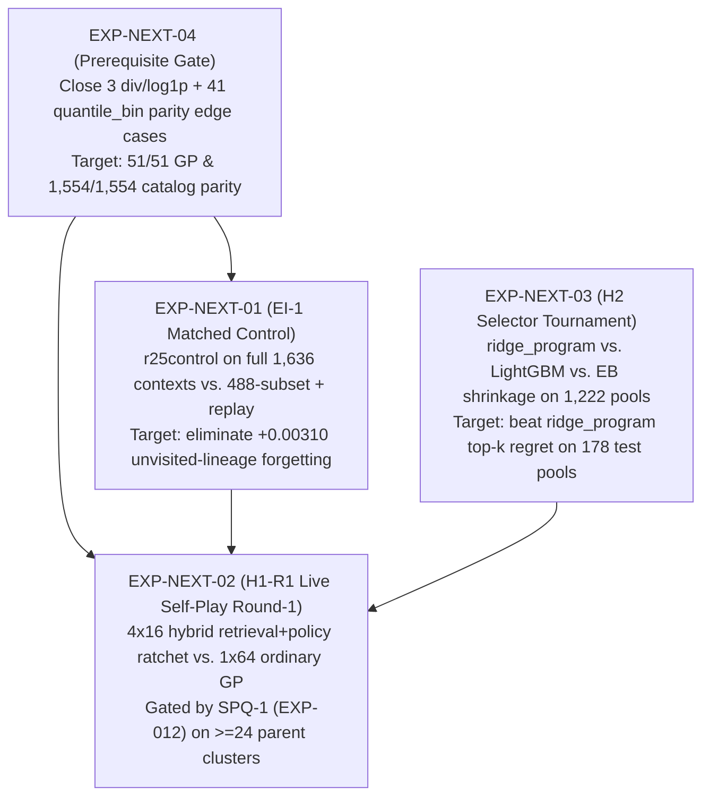

# Cross-Experiment Synthesis & Next-Experiment Roadmap

This document distills the quantitative findings across **`EXP-001` through `EXP-012`** (in [`experiments.jsonl`](experiments.jsonl)) into five empirical laws and a prioritized sequence of next experiments.

---

## 1. Five Empirical Laws Established by `EXP-001` – `EXP-012`

### Law 1 — Static-Vocabulary PolicyLM Distillation Plateaus Early; True Improvement Requires GP Vocabulary Expansion
- **Evidence**:
  - In `EXP-001`, training the `893,957`-parameter PolicyLM on the static `6,640`-program catalog reduced validation `L6` by `-10.81%` (`1.0055 -> 0.8968`) in the first 10 epochs (`5,677` steps), then sat in a 31-epoch plateau (`[0.8968, 0.8978]`) while LR halved 9 times to `1e-6`.
  - In `EXP-008` (`GB-06`), bounded GP search (`<= 512` fits/context) discovered **`40/51` (`78.43%`) valid champions outside the `6,640`-program `v1` catalog**.
  - In `EXP-009` (`J9`), 5-round offline distillation over static historical S3 GP index rows (`8,908` rows, `426` programs) returned `flywheel_established: false`.
- **Implication**: No amount of extra gradient steps or offline re-weighting over a fixed catalog produces a flywheel. The loop **must** generate new ASTs via live roundwise GP mutation/crossover and expand the distilled support (`EXP-012`).

### Law 2 — Retrieval Warm-Starts Dominate Frozen PolicyLM Sampling in GP Seeding
- **Evidence**:
  - In `EXP-008` across `17` complete-case paired contexts, seeding GP from historical training-only nearest-neighbor champions (`retrieval_seeded`) beat `ordinary` GP on **`16` wins, `1` tie, `0` losses** (`median log_loss_ratio = -0.03542`, `mean = -0.08823`).
  - Seeding GP from the frozen `v1` PolicyLM (`policy_seeded`) gave **`10` wins, `2` ties, `5` losses** (`median log_loss_ratio = -0.000349`) and suffered catastrophic prior collapse on `ctx-001279` (`3.081` vs. `0.675`).
  - Directly paired, `retrieval_seeded` beat `policy_seeded` **`13/1/3`** (`median log_loss_ratio = -0.01761`).
- **Implication**: A global unconditional or weakly context-conditioned PolicyLM prior is inferior to nearest-neighbor dataset retrieval for warm-starting GP. Multi-round self-play should seed GP with a **hybrid retrieval + policy mixture** (or condition the PolicyLM explicitly on retrieved neighbor programs).

### Law 3 — Partial-Corpus Continuation Updates Induce Cross-Lineage Forgetting Even Under `0.2*KL`
- **Evidence**:
  - In `EXP-006`, `0.2*KL` anchored KL drift on active probes (`<= 0.014` over 8 epochs vs. `>= 0.052` unanchored), and `L_PI` exhibited a strict Pareto conflict with `L6` (`L_PI` improved `7.080 -> 6.59..6.87` while `L6` worsened `0.8610 -> 0.8621..0.8660`).
  - In `EXP-007`, when evaluated on the `263`-context validation split alone, `r25control` (`L6 + 0.2*KL`) and `R26` looked flat (`-0.0001` to `-0.0005`). However, on the full `1,148`-context paired judge (`263` val + `885` held-out train lineages in `221` parent clusters), **every checkpoint triggered `REGRESSION ALERT`** (`r25control +0.00310`, `R26 +0.00333`, `R25 +0.00511`), driven entirely by `+0.0042` to `+0.0063` degradation on the `885` unvisited train lineages.
- **Implication**: Updating the PolicyLM on a narrow subset (`488` contexts) shifts representations away from unvisited dataset lineages. Every continuation or roundwise distillation step must either train on the **full training lineage corpus** or mix in a **lineage-stratified replay buffer**, and must be judged on `>= 24` held-out parent clusters (`EXP-012`).

### Law 4 — The Neural Outcome Head (`q-hat`) Is Dead Weight; Simple Tabular Selectors (`ridge_program`, `LightGBM`) Win on Small/Medium Pools
- **Evidence**:
  - In `EXP-001`, the PolicyLM `q-hat` MSE loss failed to improve over 40 epochs (`0.1804 -> 0.1809`).
  - In `EXP-002`, `q-hat` pairwise ranking accuracy on fresh sampled programs was **`0.506 [0.441, 0.568]`** (chance), `32 -> 8` reranking was indistinguishable from zero (`dScore +0.031 [-0.0625, +0.125]`), and the neural predictor trailed LightGBM on equal-lineage $R^2$ by **`-0.095`** (`0.690` vs. `0.785`, `95% CI [-0.133, -0.056]`).
  - In `EXP-009` (`J9`), across `1,222` frozen pools (`21,199` rows), simple **`ridge_program` remained the `strongest_baseline`** (`ranking_learnability: NOT_ESTABLISHED`).
- **Implication**: Remove `q-hat` from the active inference path. Use `ridge_program` as the fast baseline selector and test feature-enriched tabular rankers (LightGBM / pairwise GBDT / empirical-Bayes program shrinkage) against `ridge_program` under strict cluster-grouped cross-validation.

### Law 5 — Evaluator Parity Divergences Are Narrow and Deterministic (`quantile_bin` Ties + `div`/`log1p` Clamping)
- **Evidence**:
  - In `EXP-004` (`C7`), `1,212/1,212` (`100%`) non-quantile catalog proposals matched emitted Rust exactly; all `41/1,554` (`2.64%`) failures came from `quantile_bin` edge ties.
  - In `EXP-008` (`GB-06`), `48/51` (`94.1%`) novel GP champions matched emitted Rust bitwise; the `3` failures occurred in mutated ASTs combining `div` and `log1p` near zero/negative inputs.
- **Implication**: Aligning domain clamping in `div`/`log1p` and canonical mid-rank tie-breaking in `quantile_bin` between the native AST interpreter and `jope-emit` will bring parity to `100%` before live multi-round self-play.

---

## 2. Prioritized Next-Experiment Roadmap (`EXP-NEXT-01` – `EXP-NEXT-04`)

### Priority 1: `EXP-NEXT-04` — Evaluator Parity Closure for `div`, `log1p`, and `quantile_bin` (`Phase 0` Gate)
- **Why first**: Fast, deterministic engineering fix with zero training cost that eliminates the `3/51` novel-AST parity failures in `EXP-008` and the `41/1,554` `quantile_bin` failures in `EXP-004`.
- **Design**:
  1. Extract the exact 3 failing champion ASTs from `EXP-008` (`ctx-000181` `policy_seeded`, `ctx-000282` `ordinary` and `retrieval_seeded`) as unit regression tests in `crates/jope-emit` and `crates/jope-Eval`.
  2. Synchronize `div` epsilon-denominator handling, `log1p` domain clamping (`max(x, -1.0 + eps)`), and `quantile_bin` threshold tie-breaking between the in-memory evaluator and emitted Rust code.
- **Success Criterion**: `51/51` (`100%`) bitwise parity on `EXP-008` champions and `1,554/1,554` (`100%`) parity on the `EXP-004` census.

### Priority 2: `EXP-NEXT-01` — `EI-1` Full-Corpus vs. Replay Matched-Control Diagnostic (`H3`)
- **Why second**: Directly resolves the central failure of `EXP-007` (whether the `+0.00310` regression on the `1,148`-context judge was caused by omitting the `885` lineages from training or by the `L6 + 0.2*KL` objective itself).
- **Design**:
  - **Arm A (`partial_488`)**: Existing `r25control` trained on `488` contexts (`+0.00310` baseline).
  - **Arm B (`replay_25pct`)**: `488` active contexts + `25%` stratified replay draws from the `885` lineages under decomposed KL guard (`conditional_base_kl <= 0.20`).
  - **Arm C (`full_corpus`)**: `L6 + 0.2*KL` (without the dead `q-hat` term, i.e., `L5_no_q + 0.2*KL`) trained across the full training lineage set and evaluated on the `263` held-out validation contexts (`70` parent clusters).
- **Compute Budget**: `3` runs $\times$ `4` epochs on single RTX 3090 (`~45` minutes total).
- **Success Criterion**: Zero positive degradation (`upper 95% CI <= 0.0`) on held-out parent clusters and probe `conditional_base_kl <= 0.20`.

### Priority 3: `EXP-NEXT-02` — `H1-R1` Preregistered 4-Round Hybrid Self-Play Campaign (`H1` / `H3`)
- **Why third**: The core product hypothesis test, already preregistered and gated by the merged `SPQ-1` verifier (`EXP-012`, [`selfplay-round1-prereg.v1.json`](../internal/clover/selfplay-round1-prereg.v1.json)).
- **Design**:
  - Evaluate across `>= 24` held-out parent clusters (with per-evaluation row/feature work bounded so wide datasets do not hit the `900s` timeout seen in `EXP-008`).
  - **Arm A (`single_round_ordinary_gp`)**: `1` round $\times$ `64` candidate evaluations per context (`B_total = 64`).
  - **Arm B (`multi_round_selfplay_ratchet`)**: `K = 4` rounds $\times$ `16` candidate evaluations per context (`B_total = 64`), seeded in Round 1 by a **50% `retrieval_seeded` + 50% `policy_seeded` hybrid population** (combining `EXP-008`'s `-0.0354` retrieval gain with policy exploration) and refitted between rounds under `SPQ-1`'s decomposed KL guard (`conditional_base_kl <= 0.20`, `new_support_mass <= 0.15`) plus lineage replay (`EXP-NEXT-01`).
- **Success Criterion**: Verified `qualified_claim: true` from `jope_pools qualify-rounds` (`mean_log_loss_ratio <= -0.01`, `ci95_upper < 0.0` at $\alpha = 0.025$, non-degrading round trajectory, `0` parity failures).

### Priority 4: `EXP-NEXT-03` — `H2` Frozen-Pool Simple-Selector Tournament (`H2`)
- **Why fourth**: Replaces the non-functional neural `q-hat` head (`EXP-001`, `EXP-002`) with a fast, calibrated candidate filter that can beat `ridge_program` (`EXP-009`).
- **Design**:
  - On the `1,222` frozen pools (`864` train, `180` val, `178` test; `21,199` rows from `EXP-009`), benchmark:
    1. `ridge_program` (incumbent champion from `EXP-009`)
    2. `eb_shrinkage_program` (hierarchical empirical-Bayes program score shrinkage + dataset meta-features)
    3. `lgbm_lambdarank` (LightGBM pairwise/listwise ranker using AST operator counts, depth, runtime proxy, and dataset summary features, motivated by `EXP-002` where LightGBM beat neural by `+0.095` $R^2$)
- **Compute Budget**: `< 10` minutes CPU on `xbabe2` using `--release` (`44s` per evaluation pass from `EXP-009`).
- **Success Criterion**: Statistically significant top-$k$ (`k \in \{1, 4, 8\}`) regret reduction over `ridge_program` on the `178` held-out test pools with `95%` cluster-bootstrap CI strictly below zero.
