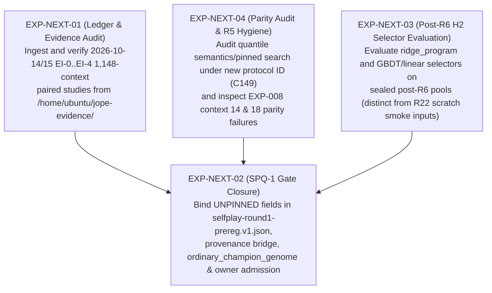

# Cross-Experiment Working Hypotheses & Next-Experiment Roadmap

This document summarizes **five scope-bounded working hypotheses (non-qualifying)** drawn from [`experiments.jsonl`](experiments.jsonl) (`EXP-001`–`EXP-012`) and outlines a prioritized sequence of next steps (`EXP-NEXT-01`–`EXP-NEXT-04`) with their exact blocking gates.

---

## 1. Five Working Hypotheses (Non-Qualifying / Scope-Bounded)

### Working Hypothesis 1 — Static-Catalog `v1` Continuation Plateaued After Epoch 10; Syntactic Support Expansion Occurs in Offline GP Search (`ESTABLISHED` lookup `C25–C27` + `NON_QUALIFYING` `C166–C168`)
- **Recorded Observations**:
  - In `EXP-001` (`ESTABLISHED` `C25–C27`), full validation `L6` (`263` contexts, dropout off) moved from `1.0055212` at epoch 2 to a best of `0.8968201` at epoch 28 and `0.8974925` at epoch 40, remaining inside `[0.8968201, 0.8978393]` across all `31` closed epochs from epoch `10` to epoch `40`, while the learning rate halved `9` times to the `1e-6` floor at step `5,677` and stayed there for the remaining `12,096` updates.
  - In `EXP-008` (`NON_QUALIFYING` `C167`, [`gp-h1-readout.20261013.json`](../internal/clover/gp-h1-readout.20261013.json)), `40` of the `51` selected GP champions across the `17` complete-case training contexts were **syntactically** outside the frozen `6,640`-program `v1` catalog (`behavioral_novelty_vs_full_catalog: "unknown; no full6640 finite-probe replay"`).
- **Scope & Limitations**: `EXP-008` is a non-qualifying, selection-biased complete-case summary on training inner folds (`17/24` contexts, unequal attempt counts, `3` parity failures), and `EXP-009`'s host-command smoke run on `R22` scratch inputs is not a scientific result ([`NUMBERS_TRACE.md`](../paper/NUMBERS_TRACE.md#fresh-clone-run)). Whether multi-round vocabulary expansion improves held-out test RMSE remains an open hypothesis (`H1` / `H4`).

### Working Hypothesis 2 — Retrieval Seeding Outperformed Unstarted and Frozen-`v1` Policy-Seeded GP on Complete-Case Training Inner Folds (`NON_QUALIFYING` `C166, C168`)
- **Recorded Observations**:
  - In `EXP-008` (`NON_QUALIFYING` `C166`, [`gp-h1-readout.20261013.json`](../internal/clover/gp-h1-readout.20261013.json)), across the `17` complete-case training contexts on the same training inner folds (lower loss is better):
    - `retrieval_seeded / ordinary`: `16` lower / `1` equal / `0` higher (`median_log_loss_ratio = -0.035361252`).
    - `policy_seeded / ordinary`: `10` lower / `2` equal / `5` higher (`median_log_loss_ratio = -0.000349264`).
    - `policy_seeded / retrieval_seeded`: `2` lower / `0` equal / `15` higher (`median_log_loss_ratio = +0.017235560`).
  - `ordinary`, `policy_seeded`, and `retrieval_seeded` beat the remeasured incumbent in `8`, `10`, and `11` of the `17` contexts, with total search attempts `1,913`, `1,714`, and `2,082` (`actual_equal_attempt_counts: false`).
- **Scope & Limitations**: Non-qualifying training inner-fold comparison with `6` interrupted contexts (`18` arms at `~900 s`) and unequal search attempt counts. Any retrieval-seeded or hybrid-seeded multi-round self-play design requires equal resource/attempt accounting and a dedicated pre-registration amendment.

### Working Hypothesis 3 — Anchored Fine-Tunes Excluding the `885` Training Contexts Raised a `REGRESSION ALERT` on `L6-1148`, with Directional Degradation on the Excluded Stratum (`NON_QUALIFYING` `C137, C174, C177`)
- **Recorded Observations**:
  - In `EXP-006` (`NON_QUALIFYING` `C136–C137`), pure `L6 + 0.2*KL` kept mean probe KL at or below `0.014` across complete epochs in sweeps `4a`, `5`, and `6` (whereas `L6` alone reached `0.052–0.053` by epoch 2 at `3.75e-5`, and `L_PI + 0.2*KL` arms reached `0.020–0.057` and `0.102`).
  - In `EXP-007` (`NON_QUALIFYING` `C174`), on the `L6-1148` paired judge (`1,148` contexts, `221` parent clusters = `54` validation + `167` held-out training clusters, `K = 3` Holm), all three judged checkpoints raised a non-qualifying **`REGRESSION ALERT`** against frozen `v1`: `R25` epoch 1 `+0.00511 [+0.00413, +0.00611]`, `L6 + 0.2*KL` epoch 4 (`r25control`) `+0.00310 [+0.00195, +0.00434]`, and `R26` epoch 4 `+0.00333 [+0.00214, +0.00461]`.
  - In the strata breakdown (`C177`, **explicitly marked reported and not decisive / directional** per [`NUMBERS_TRACE.md`](../paper/NUMBERS_TRACE.md#findings-and-corrections) correction #7), differences on the `263` validation contexts (`54` clusters) had intervals including zero (`+0.00119`, `-0.00070`, `-0.00108`), whereas on the `885` held-out-lineage training contexts (`167` clusters, which `v1` trained on and all three fine-tunes excluded) differences were `+0.00628`, `+0.00423`, and `+0.00463`.
- **Scope & Limitations**: Both strata in `C177` are directional and not decisive (`C158` notes that a qualified, pre-registered paired comparison of any `v2` objective with frozen `v1` remains pending as of `2026-10-13`, and the `2026-10-14/15` host-local `EI-0..EI-4` studies must be audited first).

### Working Hypothesis 4 — The `v1` Neural Outcome Head (`q-hat`) Ranked Fresh Programs at Chance on `D5b`, While Separate LV4 Outcome Prediction Favored LightGBM on Equal-Lineage $R^2$ (`ESTABLISHED` lookup `C28, C75–C78, C178` / `PRELIMINARY` `D5b` panel scope)
- **Recorded Observations**:
  - In `EXP-001` (`C28`), the `v1` `q` regression validation term was `0.1804` at epoch 2 and `0.1809` at epoch 40.
  - In `EXP-002` (`C75–C76`, pre-`R6` `D5b` `32` kept contexts), `q`-head pairwise ranking accuracy on freshly executed programs was `0.506 [0.441, 0.568]` (chance is `0.5`), and `32 -> 8` reranking minus plain policy sampling was `INCONCLUSIVE` (`dScore = 0.031 [-0.0625, 0.125]`, `dBestQ = 0.0187 [-0.0320, 0.0811]`, censoring bounds `[-0.353, 0.392]` over `53` roster contexts).
  - In `C78` / `C178` (`7,120`-view pool, `1,068` lineages, `3x5` lineage-grouped folds), an earlier separate DL outcome-prediction ensemble trailed LightGBM on raw LV4 features in equal-lineage $R^2$ (`0.690235` vs. `0.784889`, paired difference `[-0.132907, -0.056273]`) and row-weighted $R^2$ (`0.651858` vs. `0.751845`), with similar `beat10` AUC (`0.900874` vs. `0.903092`, difference `-0.002217 [-0.010492, +0.006826]`).
- **Scope & Limitations**: `D5b` predates the `R6` split seal (`PRELIMINARY` match scope), `C78/C178` evaluates a separate outcome-prediction model rather than the `v1` PolicyLM `q`-head, and `EXP-009`'s `ridge_program` printout is an `R22` scratch command-verification output rather than a qualified `H2` benchmark result.

### Working Hypothesis 5 — Recorded Native/Emitted Parity Failures Fall into Two Distinct Categories: `v1` Catalog Quantile-Binning One-ULP Binary-Search Disagreements (`C41–C45, C47, C49`) and Three Out-of-Catalog `GB-06` Champion Discrepancies (`C167`)
- **Recorded Observations**:
  - In `EXP-004` (`ESTABLISHED` `C41–C45, C47, C49`, [`TECHNICAL_WRITEUP.md` §5.5](../paper/TECHNICAL_WRITEUP.md#55-case-study-a-one-ulp-disagreement-between-two-binary-searches)), `41 / 1,554` (`2.6%`) evaluated pairs failed parity deterministically (`41 / 342 = 12.0%` with quantile binning; `0 / 1,212` without binning). The documented mechanism is a one-ulp non-monotone inversion in interior quantile edges computed as `s_lo*(1-f) + s_hi*f` (`sorted[lo] * (1.0 - frac) + sorted[hi] * frac` in `crates/feat-math/src/gpr.rs:68` and `crates/feat-math/src/emit_rs.rs:502`; on a tie plateau `s_lo == s_hi == a`, the two-product form can land one ulp below or above `a`, `C47`) paired with two different binary searches: the standard-library partition search whose probe sequence changed in Rust 1.82.0, while all four emitters keep the classic midpoint loop (`C49`, `crates/feat-math/src/emit_rs.rs` and `crates/feat-math/src/emit_py.rs`).
  - In `EXP-008` (`NON_QUALIFYING` `C167`, [`gp-h1-readout.20261013.json`](../internal/clover/gp-h1-readout.20261013.json)), `48 / 51` selected GP champions matched bitwise on both training probes, while `3 / 51` failed parity: context `14` (`dataset 51d5e3d9bca34669`, `retrieval_seeded`, cut 1 max abs delta `0.0021133743`) and context `18` (`dataset 72c1bdcbd2d62359`, `ordinary` cut 0 max abs delta `0.0321004556` and `policy_seeded` cut 0 max abs delta `0.1367213160`).
- **Scope & Limitations**: The root cause of the `3` `EXP-008` parity failures is not diagnosed in `gp-h1-readout.20261013.json` or `GP_EXPANSION_STUDY.md`; under `R5` (`SELFPLAY_ROUND1_PREREG.md`), any parity failure remains visible and is charged as a program failure (`charge_as_program_failure_never_drop`).

---

## 2. Prioritized Next-Step Roadmap (`EXP-NEXT-01` – `EXP-NEXT-04`)

> **Governance Gate**: All items below (`EXP-NEXT-01`–`EXP-NEXT-04`) are **roadmap proposals only (`no execution grant`)** and require explicit owner admission before any source change, benchmark execution, or compute run.

### Priority 1: `EXP-NEXT-01` — Audit and Catalog the Executed `2026-10-14/15` `EI-0..EI-4` `1,148`-Context Studies (`H3` Evidence Closure)
- **Admission Gate**: Proposal only (`no execution grant`) — requires explicit owner admission before any source change, benchmark execution, or compute run.
- **Why first**: Before proposing any new continuation training run, the catalog must incorporate the already-executed `2026-10-14/15` `EI-0`, `EI-1`, `EI-2`, `EI-2X`, `EI-3`, and `EI-4` `1,148`-context paired studies stored under `/home/ubuntu/jope-evidence/{jopedime-flywheel-ei0,jopedime-flywheel-ei1,jopedime-flywheel-ei2,ei3-study-20261015,ei4-study-20261015}` (as noted in [`README.md`](README.md#known-omissions-not-yet-indexed-as-standalone-rows-in-experimentsjsonl), `C175`'s `"EI-1 planned only"` entry in `claims.json` is scope-dated `2026-10-13`).
- **Actionable Scope**:
  1. Read and verify the SHA-256 pins, commit SHAs, and paired `L6-1148` cluster-bootstrap verdicts of `EI-0..EI-4` from `/home/ubuntu/jope-evidence/` (read-only, zero GPU/CPU training cost).
  2. Append verified `EXP-013+` records to [`experiments.jsonl`](experiments.jsonl) so all executed expert-iteration rounds are represented alongside `EXP-006` and `EXP-007`.

### Priority 2: `EXP-NEXT-04` — Quantile Binary-Search Audit and Investigation of `EXP-008` Context `14` & `18` Parity Failures (`Phase 0` / `R5`)
- **Admission Gate**: Proposal only (`no execution grant`) — requires explicit owner admission before any source change, benchmark execution, or compute run.
- **Why second**: Directly addresses the two documented parity failure modes (`EXP-004` and `EXP-008`) while respecting `v1` score-cache comparability (`C149`).
- **Actionable Scope**:
  1. **Quantile binning (`EXP-004`, `TECHNICAL_WRITEUP.md` §5.5, `C47`, `C49`, `C149`)**: Audit evaluator quantile semantics (`s_lo*(1-f) + s_hi*f` in `crates/feat-math/src/gpr.rs:68` and `crates/feat-math/src/emit_rs.rs:502`, `C47`) and a single pinned search emitted identically everywhere (versus the standard-library partition search whose probe sequence changed in Rust 1.82.0 while all four emitters keep the classic midpoint loop, `C49`). Because changing the native search would alter the training score of affected programs and invalidate stored score caches (`C149`), any change must be gated under a new evaluator protocol identity rather than mutating historical `v1` comparability.
  2. **Out-of-catalog GP champions (`EXP-008`, `gp-h1-readout.20261013.json`)**: Inspect the three failing champion ASTs from context `14` (`retrieval_seeded`, program `d2177047...`) and context `18` (`ordinary` program `14882a74...` and `policy_seeded` program `6165e86c...`), add reproducing regression fixtures in `crates/feat-math`, and keep `R5` parity charging (`charge_as_program_failure_never_drop`) enforced in `jope-learning`.

### Priority 3: `EXP-NEXT-02` — Close `UNPINNED` Prerequisites for `SPQ-1` Round-1 Confirmatory Self-Play (`H1` / `H4`)
- **Admission Gate**: Proposal only (`no execution grant`) — requires explicit owner admission before any source change, benchmark execution, or compute run.
- **Why third**: `EXP-012` merged the offline diagnostic verifier (`jope-pools qualify-rounds`, `crates/jope-learning/src/clover/round_qual.rs`) and [`selfplay-round1-prereg.v1.json`](../internal/clover/selfplay-round1-prereg.v1.json) (`status: PRE_REGISTERED_UNPINNED_NO_EXECUTION_GRANT`), where `RoundQualReport` currently sets `qualified_claim: false`, `promotion: false`, and `l6_claim: false` unconditionally.
- **Required Prerequisites Before Any Execution Grant ([`SELFPLAY_ROUND1_PREREG.md` §3](../internal/clover/SELFPLAY_ROUND1_PREREG.md))**:
  1. **Bind all `UNPINNED` fields in `selfplay-round1-prereg.v1.json`**: `sealed_roster_sha256`, `parent_cluster_map_sha256`, and `g23_sealed_boundary_ruling` (`G23`); `min_parent_clusters` and `practical_margin_log_ratio` (`G-JUDGE` `C158`); `pinned_test_score_registry`; `experiment_identity_sha256`; and `owner_admission_locator` (`execution_grant.authorized: true`).
  2. **Implement producer & provenance bridges in `crates/jope-learning`**:
     - Close the cryptographic provenance and pre-registration binding check in `round_qual.rs` (removing `provenance_and_prereg_binding_unimplemented` once verified).
     - Emit `ordinary_champion_genome` in `SelfPlayRoundReceipt` (`crates/jope-learning/src/clover/expansion.rs`) if the secondary endpoint (`Endpoint::RatchetVsOrdinaryFinalRound`) is to be evaluated alongside the primary endpoint (`Endpoint::FinalVsRound0Incumbent`, `rounds = 4`, `seed_cap_b = 8`).
  3. **Optional Seeding Amendment (Requires Separate Preregistration & Owner Admission)**: If a retrieval-warm-started or hybrid retrieval+policy seeding arm (motivated by `EXP-008`) is added, register it as an explicit pre-registration amendment with matched per-round attempt and wall-clock caps (`J12`).

### Priority 4: `EXP-NEXT-03` — Qualified Post-`R6` Frozen-Pool Selector Study (`H2`)
- **Admission Gate**: Proposal only (`no execution grant`) — requires explicit owner admission before any source change, benchmark execution, or compute run.
- **Why fourth**: While `EXP-009` verified that `jope_pools evaluate` runs in `44–51 s` with `--release`, its inputs were non-qualifying `R22` scratch data (`NUMBERS_TRACE.md#fresh-clone-run`). A genuine `H2` test requires evaluating `ridge_program` and candidate tabular/linear selectors on a lineage-sealed post-`R6` pool with pinned non-scratch provenance.
- **Actionable Scope**:
  - Export a pinned post-`R6` candidate pool with parent-cluster split provenance, run `jope_pools evaluate` in `--release` mode across pre-registered `eval_budgets`, and record whether any learned selector beats `ridge_program` under parent-cluster bootstrap CIs.
