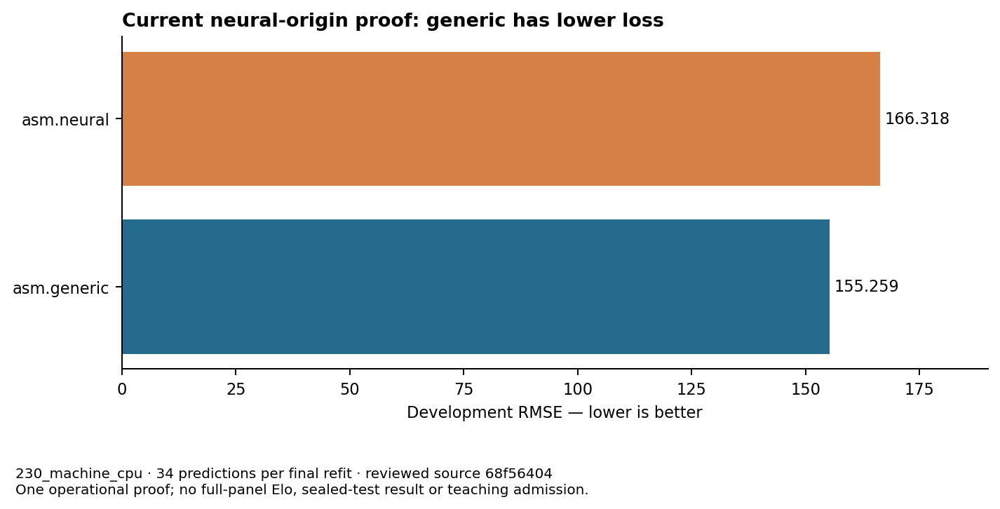
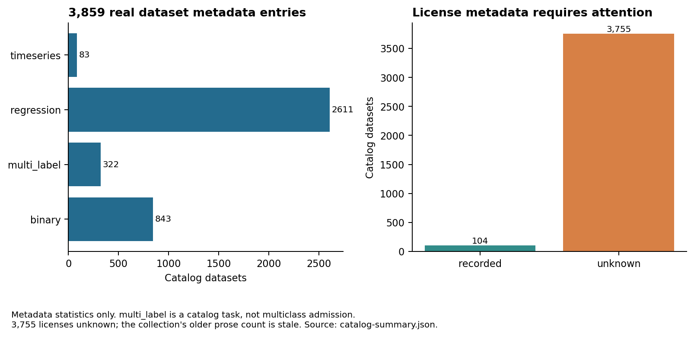

# ASM maintainer and user manual

Private edition · 23 September 2026

<a id="chapter-01"></a>

# Reading the system and its current status

## Purpose and audience

An **Algorithm Synthesis Model (ASM) learns to generate and optimize executable algorithms from data.** JopeDime turns that objective into a bounded, inspectable workflow: validate original data and row assignments, encode a fitting-only context, propose executable recipes, fit them, measure them under a fixed protocol, evolve measured recipes, retain fitted artifacts, and eventually admit qualified examples into another round of model training.

This manual serves operators, scientists, implementation maintainers and reviewers. Operators need installation, preparation, execution, reporting and recovery procedures. Scientists need dataset identities, split boundaries, metrics, model lineage, comparison budgets and limits of the evidence. Maintainers need the workspace map, command contracts, fitted-state formats, feature boundaries and tests. Reviewers need to distinguish code that exists, behavior that has been demonstrated, changes that have merged, and claims still requiring evidence.

The implementation snapshot is **68f56404c3e199e06413bfd645d3fe0803d7b96f**, dated 23 September 2026. The lifecycle appendix records the separately refreshed reviewed-main state. A rebase merge can produce a different commit with the same reviewed tree. Older plans and historical PASS entries do not establish current capability.

This is a maintainer document for the private product repository. Its explicitly requested GP examples and internal operational paths explain the implementation; they do not expand the allowlist for public inference bundles.

## North star: better algorithms from accumulated experience

The product target is a repeatable learning cycle: verified dataset-and-split inputs become contexts; the policy proposes executable programs; bounded GP fits and improves them; eligible measured programs become teachers; training produces a new checkpoint; and that checkpoint improves a subsequent bounded search. The north star is **better predictive algorithms on previously unseen dataset families at the same declared compute budget**, with reproducible fitted artifacts. More optimizer steps, a larger corpus, lower training loss or a higher historical Elo are supporting observations; each answers a different question.

Measure progress against both the generic search control and the previous accepted checkpoint, using the same data identities, folds, method set and resource envelope. Report task-specific loss, wins/ties/losses, failure and unavailable rates, and cost per unique fitted predictor. A trained checkpoint earns a promotion claim only through its bound qualification procedure. The frozen thirty-dataset panel is a development comparison; it cannot establish unseen-family performance when prior checkpoint exposure is unknown. Sealed evaluation remains untouched.

There **has been real historical policy training**. The accepted model is the recovered lineage-B step-60000 checkpoint, and retained historical records describe substantial optimizer work and multiple teaching-corpus versions. The newer ASM training/teaching integration has not yet completed its own real bounded acceptance. Its zero newly admitted teachers must not be read as an empty historical corpus or as evidence that JopeDime never trained. The training-history and extension chapters separate those timelines, show the actual available losses, and explain which version each result belongs to.

## How to read a completion claim

| Evidence level | Establishes | Does not establish |
| --- | --- | --- |
| Source implemented | The named source and command path exist at that revision | Successful execution on this host |
| Static or fixture verification | Parsing, linting, schema checks or named synthetic tests passed | Real corpus behavior, GPU execution or competitive performance |
| Bounded local qualification | Named real processes, artifacts, limits and receipts were observed | Other datasets, backends, checkpoints or protocols |
| Exact-head CI | Required current-attempt jobs and aggregate passed | Skipped tests, all optional features, GPU qualification or promotion |
| Reviewed merge | Eligible independent native review and guarded merge were verified | Installation qualification or serving promotion |
| Measured campaign | Admitted and unadmitted outcomes are accounted for under one window | Promised win rate or unbiased sealed-test performance |
| Release qualification | Exact installation, artifact and backend passed acceptance | Other runtimes, artifacts or numerical policies |

A checkpoint file, a nonempty journal, a successful exit and a genuine optimizer update are different observations. A skipped test is not a pass. A missing measurement is unknown, not zero. Cancelled, failed and unavailable fits remain outcomes rather than scores.

## Working implementation

The frozen benchmark foundation consumes actual row assignments, original labels, declared categorical columns, missing values, groups and class order. It uses regression RMSE, binary AUROC and multiclass log loss from a complete probability matrix. The method chapter inventories executable native recipes and the four external adapter families.

The shared execution layer has twenty bounded fit slots, resource accounting, independent deadline enforcement, process-tree cleanup, durable journals and original-window resume. Its ten real Linux process/cgroup tests use synthetic workloads to exercise completion, stalled controllers, cancellation, forced process death, memory failure, concurrency and setup failure.

The regression neural path has a qualified native context bridge and a measured proposal-to-fit-to-evolution proof. Policy-origin metadata is checked against pinned producer output, completed inner-fold measurements and measured ancestry. A candidate labelled neural without those links is insufficient. Canonical duplicates retain proposal slots and origins but do not justify fitting the same executable twice.

Observed generations survive cancellation at the arm cutoff and interruption before the final receipt. Resume reauthenticates completed folds, including completed work inside a partially failed candidate. Only jobs positively proven never admitted can acquire a different expiry status. That exception cannot create a new fit, replace fitted state or extend the clock.

Legacy fit, emit and pipeline surfaces also exist. Their recipe emitters can train a recipe again. That is distinct from the pending portable fitted-state export work; consult the language matrix before assuming an emitted artifact needs no refitting.

## Latest measured operational proof

This is **one preselected regression-dataset operational qualification**, not the unchanged thirty-dataset demonstration. Its scores are development scores.

| Item | Observation |
| --- | --- |
| Dataset | `230_machine_cpu` |
| Initial neural arm | 64 actual `neural_policy` slots, zero fallback slots, plus 16 `random_exploration` slots in this proof |
| Initial generic arm | 80 generic slots |
| Arm / fit allowance | 120 seconds per arm; 30 seconds per worker fit |
| Global proof window | 600 seconds, including 30 seconds for reporting |
| Host limits | 20 CPUs/workers, 64 GiB, zero swap, no GPU tasks |
| Started and finished worker commands | 964 |
| Completed / failed commands | 834 / 130 |
| Unique fitted predictors / reusable recipes | 832 / 164 |
| Final refits / predictions per refit | 2 / 34 |
| Run-command wall time | 239.143121970 seconds |
| Independent report replay | 18.718997325 seconds |
| Neural development RMSE | 166.3181717454848 |
| Generic development RMSE | 155.25909998168862 |
| Score ordering | Generic has lower RMSE in this comparison |
| Genuine neural initial fits and fitted descendants | Verified |
| Teachers admitted from this proof | None |
| Full frozen-panel conclusion | Not established |

The recovered report SHA256 is `6e0c20720256b0735a6969c45032f44082c92abacadf2c4eb21ef5c390f249dd`. The experiment identity is `646095badab6706168c7e869118d62fddd399faa2a9d6bc7f484c95a021a3944`; its original start/deadline are Unix milliseconds `1790180210613` and `1790180810613`. Plan identity: `a7befb386344bd0cbffa866ad8793077dead185f64e2ae0fb4035a4ed3dcfcc2`.

This proves execution and evidence continuity. It does not prove ASM superiority, ten wins per category, learned improvement after training, an under-sixty-second warm demo, installation speed or portable inference for every winner.

## Cost: interpret the units first

Exact supervisor CPU was **270.889403 CPU-seconds**; summed worker CPU was **181.220773 CPU-seconds**. The supervisor aggregate contains worker use: **do not add them**. Summed worker wall durations were **202.266164543 seconds**; concurrent durations are not elapsed campaign time.

Amortized over 832 unique predictors, these observations yield approximately 0.217813 worker CPU-seconds, 0.325588 aggregate CPU-seconds and 0.287432 run wall-seconds per predictor. Over 164 recipes, they yield approximately 1.105005, 1.651765 and 1.458190 seconds. These are campaign accounting ratios, not isolated latency predictions for arbitrary models.

GPU work, tokens, money, isolated controller CPU, downloads and installation were not measured by this proof. The supplied one-hour/ten-million-token scenario provides a 3,600-second contextual reference: this proof's run wall time is approximately 6.64% of that duration. This is not a matched-workload speedup. No scenario hardware allocation, predictor count, token trace or cost ledger exists here, so ten million tokens cannot be converted into a measured productivity or currency comparison.

## Pending acceptance

| Workstream | Current boundary | Remaining acceptance |
| --- | --- | --- |
| Regression neural consumption | Qualified contexts, proposals, actual fits and descendants | Full panel and newly trained checkpoint consumption |
| Classification neural consumption | Experimental context/invariance support; follow-on producer prepared | Task-correct live consumption and clearly labelled fixture scope |
| HWM and teaching eligibility | Follow-on source prepared | Full identity, finite OOF improvement, four-of-five-fold gate and no-signal refusal |
| New ASM training path | Historical trained model exists; new guarded source and test plans prepared | Positive updates, changed parameters, reload, continuation, resume compatibility and bounded GPU proof for this new path |
| Trained regression export use | Explicit experimental consumer prepared | Compile and execute exported-checkpoint-driven fits |
| Portable fitted inference | Native fitted artifacts; export packet prepared | Full state parity and actual selected-winner backend qualification |
| Installation and warm demo | Source packets prepared | Checksum install, CLI-only build, preparation, fitted artifact/predictions and separate cold/warm timing |
| Thirty-dataset comparison | Frozen panel and protocol | Unchanged two-hour campaign, every loss/refusal/failure and gap |
| Motifs | Separate typed library branch | Eligible-state reader, mine command, umbrella wiring and validated reuse |
| Broad full-main tests | Historical failures inventoried | Reproduce and repair; fast CI is not full qualification |
| New serving promotion | Recovered accepted step-60000 remains the model binding | Exact release/backend/model acceptance and reviewed promotion for a new checkpoint |

The detailed checklist and property-list expand these rows into actionable items. A prepared patch or planned command is not an installed or executed capability.

## Failure records are retained

Two failed cancellation/crash reproductions preceded the resume correction. A partial-fold fixture initially failed on a noncanonical path, then passed after fixing the fixture without weakening verification. A live run at `d0f5748b7db1ac419110289f912c7eface0022bc` completed its worker inventory but failed report verification because live and recovered scoring populated different fold-evidence fields. Its journal remains unchanged. The shared scorer correction and successful new-head proof are separate evidence.

Final local suites at the snapshot passed **53 benchmark and 106 pipeline tests**. One privileged test was ignored in that invocation and qualified separately through **ten actual host cases**. The numerical encoder proof passed **eight fixed cases** under unchanged tolerances and thirty-second per-job limits. The lifecycle appendix records CI and merge state independently.


---

<a id="chapter-02"></a>

# ASM architecture, encodings and neural models

## Scope and reading rules

**Algorithm Synthesis Model (ASM) learns to generate and optimize executable algorithms from data.** The implementation combines a learned proposal policy with actual fitted evaluation and genetic variation. A generated program is a candidate recipe; a fitted predictor is that recipe plus the state learned from a specific training partition. A checkpoint is the proposal model. Those three artifacts have different identities and different evidence requirements.

This chapter describes source commit `68f56404c3e199e06413bfd645d3fe0803d7b96f`, the frozen PR83 candidate on 2026-09-23. Changes described as **pending training overlay** refer to the stopped 64-file custody patch `595824ef6eb8e15872be058668503cedad1dd9a5ff98ac4700c6f713251d384c`. That patch includes experimental regression consumption; it is not in this source commit. Current-source references below are repository paths with source line numbers. Overlay references are explicitly marked and use the stopped overlay's line numbers.

This is a maintainer document containing internal model and discovery design. The user's request authorizes this explanation and the companion private GP examples. It does not enlarge the allowlist for distributed inference artifacts or authorize publishing private weights, discovery histories, vocabulary assets or training corpora. Hashes identify dependencies; they are not the dependencies themselves.

The most recent bounded origin proof at this source completed its run command in 239.143 seconds; independent report replay took 18.719 seconds. It demonstrated neural-origin fitting and evolution on one regression dataset. Its neural result lost to the matched generic result. It did not execute the complete thirty-dataset demonstration, create current eligible teachers, train a new policy, or qualify a newly trained policy for serving. The performance chapter gives its exact receipts and denominators.

## System at a glance


The solid path has bounded regression execution evidence. Dashed stages require the named runtime acceptance; this diagram does not claim an already qualified self-improving training loop.

## Component map

| Component | Main responsibility | Durable boundary |
|---|---|---|
| `jope-datasets` | Frozen dataset metadata, source and split identity | Content-addressed manifests, source hashes and exact row assignments |
| `jope-bench::panel` | Development-data preparation, methods, metrics, screen/freeze/confirm protocol, ASM orchestration | Campaign plan, prepared data, fits, frozen selections and reports |
| `jope-pipeline` | Search identity, bounded execution, original deadlines, process and output authentication | Started/finished records, arm windows, observations and receipts |
| `jope-policy` | Accepted regression checkpoint binding, CPU context producer, grammar-constrained proposals and learned ranking | Checkpoint receipt, vocabulary, qualified context and proposal evidence |
| `feat-math` | Executable recipe representation, variation and fitting | Canonical recipe identity, fitted state and prediction output |
| `jope-learning` | HWM and score ledgers; pending stricter teaching admission | Comparison identity, immutable blobs, hash-chained events and frozen teaching manifests |
| Python policy package | Existing trainable policy model; pending bounded training campaign and experimental proposal consumer | Model/optimizer checkpoints, architecture, task/vocabulary binding and training proof |
| Native CLI | Current planning/execution front doors; pending `train` orchestration | Pinned requests, source/runtime inventories and supervised execution |

The ordinary CLI and `asm` feature graphs in the stopped follow-on were inspected as manifest text: they have no edge to the engine, Torch, CUDA bindings or a local dependency cycle. That is a source graph check, not a compilation result. Python training runs as a supervised external process; native orchestration does not require linking Torch into the CLI.

## The complete proposed learning cycle

1. Preserve the frozen data schema, original target strings, category strings, missingness and row/group assignments.
2. Derive the proposal context using only the allowed fitting rows. Record preprocessing and encoder identities, then verify actual context production and the numerical qualification required by that context lineage.
3. Use the chosen checkpoint to generate valid executable recipes, and rank the neural pool using learned reward predictions. This stage has no access to held-out scoring labels or fitted GP scores.
4. Place a 64-slot policy pool plus 16 exploration candidates into the neural arm's generation zero; preserve any policy-pool shortfall as `neural_rejection_fallback`, never as a genuine neural sample. Compare with an 80-candidate generic arm under the same declared budgets and executable grammar policy.
5. Actually fit candidates on inner training folds and score their out-of-fold predictions. The measured outcomes, not model-predicted quality, determine the search's parents and winner.
6. Generate mutation and crossover descendants with explicit parent identities. Preserve duplicate/cache handling, rejected variations, unavailable methods and every fit failure.
7. Freeze a recipe and evaluate the unchanged development protocol. Its fitted fold artifacts are separate from its reusable recipe.
8. In the pending teaching path, admit a recipe only after its independently preregistered train-side OOF evidence beats a trivial baseline under the frozen numerical rule.
9. Freeze the eligible corpus, train an explicitly experimental policy, prove real updates and continuation, and export a pinned checkpoint.
10. Consume that exact new checkpoint in a subsequent bounded experiment. A successful export alone is insufficient evidence for this final step.

Steps 1–7 have current bounded regression evidence at the scope described above. The stricter teaching/training/experimental consumption integration is stopped source work awaiting the next reviewed lifecycle and actual runtime acceptance.

## Accepted regression model

The accepted lineage is the recovered lineage-B step-60000 checkpoint. The binding verifies the state, original model, exported tensors, configuration, parameter digest and vocabulary. The rejected step-69000 identity is explicitly refused. A self-consistent receipt around unrelated weights cannot impersonate the accepted model. The model loader rejects missing, extra, incorrectly shaped or non-FP32 tensors.

| Accepted-model property | Value or behavior |
|---|---|
| Dataset context | 1536 FP32 values |
| Target context | 512 FP32 values; all 512 retained |
| Combined context | 2048 FP32 values; 8192 bytes in little-endian vector form |
| Decoder width | 512 |
| Decoder depth | 6 layers |
| Attention heads | 4 |
| Feed-forward width | 2048 |
| Token vocabulary | 401 output tokens |
| Embedding rows | 657, including the configuration's 256 extra rows |
| Maximum configured sequence | 128 tokens; positional table includes the context position |
| Training dropout field | 0.1; disabled for inference |
| Reward ensemble | 4 heads |
| Tensor inventory | 136 tensors for this configuration, including unused inference heads and scalar loss weights |
| Current Rust arithmetic | Candle CPU FP32 |
| Native CUDA BF16 policy parity | Not established by the current CPU inference implementation |

Sources: `crates/jope-policy/src/config.rs:21`, `config.rs:39`, `crates/jope-policy/src/model.rs:1`, `model.rs:41`, `crates/jope-policy/src/lib.rs:133`.

The decoder and reward paths each encode context with a two-layer MLP: 2048→512, GELU, LayerNorm, 512→512, GELU, LayerNorm. The decoder prepends a projected context token to the token embeddings, adds positional embeddings, applies causal self-attention with padding-key masking through pre-normalized layers, normalizes the result and projects through the tied token embedding table narrowed to the output vocabulary.

The reward path pools program-token embeddings, combines them with a separately encoded context, and evaluates four reward MLPs. The combined representation contains the program embedding, its elementwise interaction with a context gate, and an absolute-difference block. A separate runtime head emits a positive runtime estimate through softplus. Learned reward is a proposal-ranking signal; it is not a measured dataset loss.

The source records these accepted identities:

| Identity | SHA256 |
|---|---|
| State | `8ac80c269cc47c253b6f53fa3bc1eb75bb2fcda0bdace3ff8554be0175c400d6` |
| Original model | `053df4f53b84d2ebe7c14fbf907a149760af3d11de4a57b5ff89be8c2d3e8129` |
| Canonical parameter values | `9c7057e7f6a9e348f030da73f03522977b8c08915d3a221d7d5ab2e4213fcd92` |
| Configuration | `2508fc8b8268ea000141c9b119ba3da4e777c506c366168912a88d03482939bf` |
| Original checkpoint vocabulary | `8d55fee4366acd2c175cf55bfd769cebc904770f5227a6fd50a613723dc85787` |
| Executable product restriction | `570b2e5e8d859a73b888f5d0bee27f59da0e2376536babce24c241604f818e81` |

The product restriction preserves the 401-token table while limiting executable heads. A token-compatible restriction is different from inventing a new vocabulary or silently snapping parameters to nearby bins.

## Regression context production

### Original data and preprocessing

The context input binds prepared-data hash, exact training-content hash, ordered fitting-row hash, cut identity and preprocessing hash. It requires at least eight training rows and a nonempty declared feature schema. Numeric versus categorical kinds come from the schema rather than guesses based on strings. Numeric nulls are imputed using training-only medians, with a zero fallback for an entirely missing column; the recorded training transform contains its fitted location/scale. For categories, every present string is a value, including empty text or strings spelling `NA` or `null`. Only an absent value is missing. Original target strings remain separately authenticated before numerical regression parsing.

This context preprocessing is for the proposal encoder. It does not authorize discarding the original schema or replacing a fitted predictor's own training-only preprocessing. Source: `crates/jope-policy/src/context_producer/input.rs:84`.

### Component dimensions and assembly

The current CPU producer uses three components with fixed pretrained assets and fixed transforms:

| Component | Production | Raw output | Contribution to policy context |
|---|---|---:|---:|
| Hyperion | Training features quantized from fitted quantile bounds, three embedding sweeps, scales 4/7/11/15, batch 1024, one target chunk per sweep | 128 values per row | Mean, population standard deviation, 10th and 90th percentile per coordinate: 512 |
| Foundation | Feature/target table prepared with the native deterministic recipe; target normalization computed in f64 after the native f32 cast | 2048 | Frozen mean-centering, learned 2048→1024 projection, then frozen normalization: 1024 |
| Target | Training target values scaled into the training range, two native target windows with seed 17 | 512 | Frozen normalization: 512 |

Assembly concatenates normalized Hyperion512 + projected Foundation1024 + Target512 and clips the full 2048-vector to [-32,32]. It checks all component dimensions and finite values. The source explicitly checks that the Hyperion row width is 128; confusing row width with pooled512 changes the model input meaning. Sources: `crates/jope-policy/src/context_producer.rs:188`, `:278`, `:356`, `:399`, `:422`.

The deterministic foundation preparation selects at most 768 context rows and 256 query rows before `encode_standardized`; that encoder adds no further cap. Hyperion receives every supplied training row and feature column, with no row/column subsampling in this producer. The serialized input is capped at 128 MiB and every context job remains subject to the fixed 30-second worker deadline. On the final 68 reference jobs, Hyperion-stage elapsed time ranged from 6.143 to 14.287 seconds; whole-job wall time ranged from 11.731 to 20.755 seconds. These small-case measurements do not establish coverage for wider or larger cuts. A timeout leaves the context unavailable; it does not permit a new deadline or silent subsampling.

The frozen numerical qualification contract is unchanged, but the implementation includes both execution and numerical corrections. Hyperion uses an embeddings-only sweep that skips the unused confidence head. Foundation uses the separate `encode_standardized` path: train-side feature moments accumulate in f64 before the retained f32 transform, and p10/p90 use Torch 2.7 FP32 rank and stable-lerp arithmetic. Ordinary `encode` retains its legacy feature-moment and percentile arithmetic. The standardized route consumes all rows supplied by the preceding deterministic foundation preparation without additional caps. Cached-decoder fixtures separately check small random-model operations/full-prefix agreement within 1e-4, row/padding behavior and sampling-token/RNG agreement. They do not establish accepted-checkpoint bitwise logits or native CUDA policy parity. Sources: `crates/jope-policy/src/context_producer.rs:238`; `crates/jope-encoders/src/foundation.rs:345`; `crates/jope-encoders/src/foundation/support.rs:123`; `crates/jope-encoders/src/model/tensor_ops.rs:114`; `crates/jope-policy/src/model/cached.rs:270`; `crates/jope-policy/src/decode.rs:485`.

### Qualification and admission

The CPU regression encoder has a stronger boundary than “the vector has 2048 values.” Eight fixed native-reference cases span two families and cuts 0–3. Qualification checks finite FP32 component and final-context values with maximum absolute difference at most 0.0003, exact asset/source/program identities, and actual bounded executions. Consumption binds those eight jobs plus the actual dataset context job: nine independently authenticated process proofs. The reference registry/index and transform hashes are pinned in source.

The retained 68 outputs have final-context maximum absolute differences from 5.3644180e-5 to 2.8765202e-4. The worst case is `cardata-blackmore`, dataset `55e9dfc7a86361d7`, cut 0: 95.884% of the unchanged 3e-4 tolerance. Across all eight cases, maximum component differences are 4.127622e-6 for Hyperion, 2.908707e-5 for foundation and 3.911555e-7 for target. The frozen projection and projected-scale division can amplify small component differences in the assembled vector. Coverage is limited to two numeric meta-train families: blackmore, 629–630 training rows with 4 features, and `cardata-ces11`, 800 rows with 8 features, each at cuts 0–3. Changes to arithmetic, libraries, build/ISA flags or summation order require requalification; this gate is not evidence for wide or category-heavy contexts. Never relax its tolerance to make a build pass.

`VerifiedCpuContext` has private fields and can only be constructed by the verification path outside explicit test support. A syntactically valid JSON vector cannot create admission authority. Sources: `crates/jope-policy/src/context_producer/admission.rs:4`, `:115`, `:234`, `:297`; `crates/jope-pipeline/src/cpu_context_bridge.rs`.

## Stored model assets and the active encoder distinction

The metadata-only S3 audit on 2026-09-23 fetched the three bundle manifests below and pinned their returned bytes, ETags and lengths. No model bodies were downloaded for this chapter. These are declared object sizes from the retrieved manifests; they do not measure resident memory, compute cost or a new numerical qualification.

| Bundle asset | Bytes | Role in this chapter |
|---|---:|---|
| `policy-step-60000/policy.safetensors` | 111,199,088 | Accepted policy export identity, consumed only with its checkpoint binding |
| `policy-step-60000/context_transforms.safetensors` | 8,413,808 | Accepted fixed context assembly transforms |
| `jope-prime-gen31-v2/model-bundle/hyperion_v5_arm_b.safetensors` | 6,650,692 | Exact Hyperion weights pinned by the current CPU context producer |
| `jope-prime-gen31-v2/starforge/starlight_core_regressor.safetensors` | 233,183,532 | Foundation component; manifest describes512 hidden features pooled into2048 |
| `jope-prime-gen31-v2/model-bundle/target_encoder_fused_v1…safetensors` | 78,615,176 | Target component; manifest describes normalized64+64+384 fused representation |
| `hyperion-v7/model.safetensors` | 246,456,988 | Separate stored bundle, not the accepted context producer's pinned weights |
| `jope-prime-gen31-v2/model-bundle/jope_policy.safetensors` | 108,846,812 | Separate gen31 policy artifact; not step-60000 |

The storage name `hyperion-v7` must not be confused with the CPU implementation's `V7Model` Rust type. The actual current producer pins weight hash `88b9e834…`, which matches the v5 arm-B asset, with row width 128. The separate stored v7 manifest describes dimension512, eight heads,12 layers and six bands. Replacing the pinned asset based on its newer-looking name changes the encoder identity and invalidates compatibility.

Two identity pitfalls matter when maintaining this boundary. Hyperion `load_settings` reports a legacy 16-hex identifier, not a SHA-256 digest. The producer therefore authenticates manifest bytes before and after the path-based settings load, authenticates weights before and after `V7Model::load_cpu`, and requires embedding width 128. A legacy identifier must never be compared with or substituted for a cryptographic admission pin. Separately, ordinary `jope encode` resolves `HYPERION_V7_WEIGHTS` as a **bundle directory**, else `$JOPE_HOME/models/bundles/hyperion-v7` (relative to the working directory when unset). The default stored bundle is 512-dimensional and differs from the pinned v5-arm-B producer; both manifests use the loader string `version: v7`, so that string cannot establish checkpoint identity. `jope encode` is not the qualified 2048-value ASM context interface. Current documentation drift remains at `docs/models.md:105`, which supplies a file instead of the expected directory, and the default-v5 comment in `crates/hyperion/src/hyperion.rs:28`. Use exact asset hashes and the qualified context-worker flow.

The retrieved manifests also contain internal/redistribution/provenance declarations that vary by artifact. They are retained evidence about the bundle metadata, not proof that every object is approved for every distribution. The active private run's exact release/input inventory remains the authority for which files it used; S3 presence alone does not establish serving eligibility. Sources: `crates/jope-policy/src/context_producer.rs:41`; custody `metadata-receipts/veox-jopedime-models-use2--bundles--policy-step-60000--manifest.json`, `…--hyperion-v7--manifest.json`, and `…--jope-prime-gen31-v2--manifest.json`.

## Experimental classification context

Current source contains the pure class-partition context representation. The pending training overlay adds the bounded feature producer, process admission and operational proposal wiring. Classification does not parse class names as numbers or reuse the regression target encoder by ordinal coding.

The feature blocks remain Hyperion512 and projected Foundation1024. The pending producer explicitly conditions the foundation path on neutral zero targets and labels this an experimental feature-only probe. Each class gets a centroid over the 128-dimensional training row encodings. The target block contains, per coordinate, the mean, standard deviation, minimum and maximum across class centroids, totaling512. Classes are visited in first-row order, so a bijective renaming preserves even floating-point summation order. Original labels still appear in authenticated input identity, even though their spelling cannot influence numerical pooling.

The resulting lineage is `asm.experimental-class-partition-pool/v1`; `policy_compatible` is false. The false marker means it cannot enter the accepted regression policy loader. A declared binary input must have exactly two classes; multiclass requires at least three, and the fitting data must contain the declared classes. Missing classes are an explicit refusal. Sources: `crates/jope-pipeline/src/search_context.rs:278`; pending `crates/jope-policy/src/context_producer/classification.rs:1`.

At source 68, classification has no neural arm: planning records the accepted regression-only policy as unavailable for binary/multiclass data. The available `asm.generic` classification sampler uses `logit_ridge` for binary or `multiclass_ridge` for multiclass, with l2 in [1e-4, 10], preceded by no transform, `standardize`, `winsor_clip`, or both. Advanced-v3 mutation/crossover preserve that head family and allow at most 4 transforms. A classification ASM result at this source would therefore be a ridge-head transform search; the pending experimental neural consumer is a separate capability.

## Proposal generation, ranking and evolution

Accepted proposals are generated under grammar constraints. Ranking orders the neural pool by the mean of four reward heads, descending; exact ties use program SHA256 then text. Runtime estimates are reported without subtracting an undocumented runtime penalty. Ranking binds the checkpoint, context and vocabulary and records that scoring labels and fitted GP scores were not read. Source: `crates/jope-policy/src/ranking.rs:22`.

Each ranked policy-pool program carries `rank_log_weight`, the log-softmax of its four-head mean predicted reward over that pool. Historical files called this `policy_logprob`. It is a within-context ranking weight, not a sampling/selection probability or propensity; do not use it for importance weighting or off-policy correction. Exploration candidates carry no rank weight.

Each arm starts with 80 generation-zero slots. In the neural arm, slots 0–63 form the ranked policy pool: distinct valid checkpoint samples are labelled `neural_policy`; any shortfall after the bounded sampling rounds is filled by distinct grammar-uniform programs labelled `neural_rejection_fallback`. Slots 64–79 are `random_exploration`. Only `neural_policy` roots and completed descendants with verified neural ancestry count as genuine neural evidence; fallback and exploration roots do not. In the accepted proof at source 68 all 64 pool slots were `neural_policy`,48 completed all five inner folds, and no fallback slots were needed. Receipts retain initial-slot origin and descendant ancestry. Actual completed inner OOF losses select the best four parents. New generations alternate mutation and crossover attempts, canonicalize recipes, reject duplicate executable identities, and retain variation attempts in the journal. Source: `crates/jope-pipeline/src/neural_search.rs:27`, `:1380`.

A recipe may be evaluated on multiple folds or re-used in later fits. Therefore proposal count, recipe count, unique fitted predictors, launched commands and physical fit starts are different denominators. A cache hit does not become another new predictor; a partial/unknown attempt does not become a zero-cost fit. The performance chapter explains the report accounting.

## Experimental trained models and compatibility

The pending training campaign uses the existing Python `JopePolicyModelV3` with task-routed reward/stability behavior. Real admitted training uses width256, two layers, four heads and feed-forward1024; synthetic qualification fixtures use width8, one layer, two heads and feed-forward16. Both consume the explicit context schema. Training uses one-epoch passes, learning rate5e-4, batch256 for admitted rows or2 for fixtures, AMP disabled and automatic batch-size tuning disabled. These are the bounded campaign's settings, not the accepted step-60000 model's architecture.

The export records the complete architecture, vocabulary, task, source, input identities, model state and training proof. The pending experimental consumer requires all architecture fields explicitly; the general-purpose Python loader's backward-compatible defaults cannot reinterpret a saved experimental checkpoint. It compares the reconstructed model's architecture and full state to the export. Sources: pending `python/src/jope/policy/training_campaign.py:780`, `python/src/jope/policy/experimental_proposal.py`, `crates/jope-pipeline/src/experimental_producer.rs`.

The final regression follow-on closes a specific gap: `Configuration.experimental.regression` can explicitly select a newly trained regression export. Omission keeps the accepted baseline. This operational regression route requires **real admitted** training, the same source commit and the exact native encoder identity used by training. It first admits the qualified native2048 regression context, then wraps those exact values in the separate `asm.experimental-regression-context/v1` lineage with zero classes and `policy_compatible:false`. It does not promote the new checkpoint to accepted serving or weaken the accepted hard pins.

Binary and multiclass use their separate experimental context path; a synthetic classifier fixture can qualify mechanical training/consumption behavior only when explicitly reported as synthetic. Synthetic regression training is permitted as a CPU test but cannot be substituted into the operational real-regression consumer. There is no silent accepted-policy fallback after an explicitly chosen experimental checkpoint fails compatibility.

## Development exposure and limitations

The frozen protocol screens methods on development fold0, freezes the top five recipes, and confirms those recipes on the same five development folds; ASM is additionally confirmed if it missed the top five. The synthesized recipe was learned from the outer fold0 fitting set, containing development folds1–4. Thus those later confirmation folds are exposed to recipe learning. Every frozen recipe's fold0 labels influenced screen selection. The report derives row intersections and records them per recipe/fold; it labels the selected five-fold summary adaptive development and leaves sealed evaluation unopened. This is the chosen protocol, not an unbiased outer generalization estimate. Source: `crates/jope-bench/src/panel/selection_exposure.rs:1`.

Remaining architectural acceptance includes real eligible-teacher collection, actual new-parameter training/reload/continuation, subsequent fitted use of that newly trained checkpoint, classification operational qualification, complete fitted-state parity across supported deployment backends, the unchanged full30 panel, and measured warm/cold installation demonstrations. Reusable motif mining must retain full comparison identity and eligibility; new operators need ablation and compatibility tests. GPU inference portability and a broad claim of CPU/native-policy numerical equivalence remain future work.


---

<a id="chapter-03"></a>

# Product operations and maintainer runbook

## Scope and evidence status

Algorithm Synthesis Model (ASM) means **“learns to generate and optimize executable algorithms from data.”** The product is the private `veox-ai/JopeDime` repository. On this host its canonical checkout is `/home/ubuntu/JopeDime`; the similarly named research repository at `~/jain-split/jope-dime` is a different upstream.

This chapter is pinned to source `68f56404c3e199e06413bfd645d3fe0803d7b96f`. Sixteen actual version/help invocations against its immutable CLI completed successfully. The executable reports `jope 0.1.0`; its SHA256 is `eab2d5b1b05629020aab3d540d51eb24ba0db18ff0917da188f89a34b6dc5e2b`. The machine-readable evidence is `agent-maintainer-manual/cli-help-68.json`. A version string alone cannot distinguish later builds; use the full source, executable digest and build receipt.

The source inventory, a help page, an executed fixture, exact-head CI and a live operational qualification establish different things. This chapter records interfaces and operational requirements. It does not turn an unexecuted command example into measured capability. The maintainer-private examples were subsequently executed: all fourteen commands passed. Their separate receipt and scope limits appear in the language chapter and `data/example-acceptance/`.

| Surface | Present in the immutable 68 CLI | Remaining distinction |
|---|---|---|
| `doctor` | Yes | Static capability inventory; it does not inspect every runtime dependency or qualify a live campaign. |
| `benchmark verify-manifest`, `verify-inputs`, `methods`, `plan`, `run`, `report` | Yes | Planning performs zero fits. Run/report require exact admitted resources, inputs and journal identities. |
| `optimize capabilities`, `proof-plan`, `plan`, `run`, `report` | Yes, execution feature-gated | A compiled ASM feature is separate from qualified encoding, genuine neural-origin fits and successful evolution. |
| `fit`, `emit`, `search`, `pipeline run` | Yes | Legacy numerical regression/recipe paths; their outputs are not complete frozen-panel fitted inference exports. |
| `encode`, `champions`, `train-step`, `route` | Yes | `train-step` trains a local centroid router, not the bounded neural policy campaign. |
| `datasets`, `models` | Yes | Existing catalog/model tools; a fetchable file is not automatically admitted as an ASM input. |
| `train prepare-inputs`, `plan`, `run`, `resume`, `export`, `verify` | Pending combined training overlay | Includes native admission, actual updates/reload/continuation checks and experimental exports. See the training chapter. |
| `demo` and private CLI installer | Pending product overlay | Includes generic fitted demos and authenticated paired ASM demos; actual speed and parity must be measured. |
| `benchmark export-winner`, `qualify-export` | Pending winner add-on | Preserves the selected native state and ranking; backend qualification needs actual supervised execution. |
| `motifs mine`, `validate` under the umbrella CLI | Not present at 68 | Separate preparation exists; production eligible-State reading, mine command and umbrella integration were identified as remaining work. |

The stopped integration order is combined **training64** (including regression consumption, accounting and coverage), then **product28**, then unchanged **warm-target** and **winner-export** add-ons. The add-on refresh is pinned under `agent-delivery-refresh-68f56404`; two strict replays produced identical nine-file postimages, with 95 canonical guards. These are custody patches, not installed behavior. Never apply the training coverage/accounting constituents a second time or copy an older loose installer postimage over its corrected form.

### Context worker contract

In the bounded ASM flow, encoder weights are loaded inside `jope-context-worker` (`jope-policy`, feature `context-producer`). `--version` prints `jope-context-worker/1`. Its exact eight named arguments are:

```text
jope-context-worker --mode produce|qualify-case --input ABSOLUTE_PATH --input-sha256 HEX64 --assets ABSOLUTE_ENCODER_FILES_JSON --assets-sha256 HEX64 --source-sha40 HEX40 --producer-sha256 HEX64 --output ABSOLUTE_PATH
```

Extra arguments such as `--dataset-root` are refused. The child requires OMP, OPENBLAS, MKL, BLIS, NUMEXPR and RAYON thread limits of 1, `VECLIB_MAXIMUM_THREADS=1` and `CUDA_VISIBLE_DEVICES=-1`; it authenticates its own executable and the component closure before model loading. The pinned bundle manifest begins `5e7884ec…`; each inventoried file/notice is verified with a 512 MiB per-file limit. Outputs are create-new, mode 0600 and fsynced. Stdout records `jope-context-worker/1 <output_sha256>`. A failed `qualify-case` comparison retains `<stem>.unqualified.json`, exits nonzero and does not create the requested successful output.

For current `jope optimize`, input derives from `dataset.cut(0)` fitting rows and is retained at `<journal>/asm-context-inputs/<input_sha256>.json`. Admitted output is `<journal>/asm-contexts/<neural-arm-id>/context.f32` plus `bundle.json`; the vector contains 2,048 little-endian float32 values. Invoke this through the supervised planner/controller contract, not as an unsupervised shortcut.

### Policy producer contract

`jope-policy-producer` is a separate pinned bounded job. Its `asm.private-policy-producer/v1` request binds worker source, prepared/training/context hashes, cut, accepted checkpoint state, policy/vocabulary hashes, three RNG seeds and sampling shape. It accepts only the pinned step-60000 weights (`4b4b5a40…44f1e`) and state, rounds 1–8, batch 1–128 and a finite positive temperature. Context input is exactly 8,192 bytes, finite and clipped within [-32,32]. It requires either a qualified CPU context bundle or an authenticated original `parallel.encoding.v1` receipt with the original LibTorch lineage, train-side partition and `final_test_targets_used:false`. Frozen transforms are pinned to `1b779c6f…6e22`.

Its output must be an absolute physical-parent path outside `/tmp`, created new with mode 0600. The final stdout JSON declares `numerical_backend:candle_cpu_float32` and `native_cuda_parity_qualified:false`. Reading the envelope proves consistency, not execution: consumption also requires the completed pinned worker/output receipts. Replacing accepted weights, transforms or vocabulary is not a free configuration substitution.

The producer shares the 30-second worker cap and original 120-second neural allowance; the accepted proof used a 3 GiB worker allocation. The pre-cache 55e9 proof was killed at 30.004805335 seconds, before neural fits. With cached decoding, later measured producer wall times were 20.832133058 seconds at 3fd7, 20.651920435 at c5d1 and 20.486968041 at 68f5. These leave about 9.5 seconds of per-job headroom in the last measurement, not a portability guarantee. Sampling-shape or host changes need another bounded proof, with fixture-only decoder-equivalence limits retained in the architecture chapter.

Sources: `crates/jope-policy/src/context_producer/worker.rs:28`, `:188`, `:255`; `crates/jope-policy/src/producer.rs:16`, `:91`; `crates/jope-policy/src/bin/jope-policy-producer.rs:13`, `:78`, `:121`, `:172`; `crates/jope-bench/src/panel/optimize.rs:454`, `:705`; retained `proposal-execution.json` receipts.

## Physical layout and identities

Keep source, bulk inputs and evidence in separate locations. The examples below use these names; resolve them from actual receipts before execution:

```sh
R=/home/ubuntu/JopeDime
C=/home/ubuntu/jope-rescue-20260921/asm-integration-20260923
D=/home/ubuntu/.cache/jope/asm-private-30-v1
M="$R/benchmarks/panel.json"
# S: full reviewed source SHA; J: physical immutable CLI path.
# A: new durable private acceptance directory, outside Git and /tmp.
```

`JOPE_HOME` chooses the source/assets root; `JOPE_STATE` chooses mutable local state; `JOPE_REGISTRY` chooses the dataset registry. Those roots are resolved at call time. Pass explicit paths when producing reproducible evidence. Do not repurpose `HOME` or globally override `CARGO_TARGET_DIR`. A managed installation symlink is convenient for interactive use; a campaign pins the physical executable path and checksum so changing the symlink cannot silently replace its worker.

There are two different hashes in the CLI contracts. An artifact SHA256 hashes exact file bytes. A campaign's `plan_sha256` is its validated semantic identity, printed by planning. Do not substitute `sha256sum plan.json` for that semantic ID. Worker/build/source inventories have their own schemas and pins; preserve each rather than renaming one receipt into another type.

Campaign journals require absolute durable paths outside Git working trees and `/tmp`. Private directories are restricted by the front doors. Do not publish entire run directories: they can include raw development features, labels, recipes, private context, model state and provenance.

## Build and install

The current development build path builds the Rust CLI from the existing checkout:

```sh
cd "$R"
CARGO_INCREMENTAL=0 CARGO_PROFILE_DEV_DEBUG=line-tables-only \
  cargo build --locked --release -p jope-cli --features asm --bin jope
```

Allocate build/test resources through the repository's existing coordination before executing it. Use one reused `target/` per claimed checkout. The CLI's `asm` feature exposes the private Linux execution path; a default-feature build may show the command while reporting ASM execution unavailable. The ordinary CLI should not require the monolithic engine, Torch or CUDA. Separate context and policy workers and their authenticated model inputs are still necessary for a live neural run.

After the pending installer is integrated, prefer its measured source-build and checksum-install front doors:

```sh
python3 "$R/deploy/install-private.py" source \
  --checkout "$R" --source-sha "$S" --output "$A/cli-build" --jobs 4
python3 "$R/deploy/install-private.py" binary \
  --binary "$PRIVATE_BINARY" --sha256 "$BINARY_SHA256" \
  --source-sha "$S" --prefix "$A/install"
```

Read the binary path and digest from the actual source-build receipt. The source command checks the checkout before and after compilation, uses the same `asm` selection for dependency inventory and build, rejects unwanted engine/Torch/CUDA dependencies, and selects the executable from Cargo artifact messages. Its receipt includes the toolchain, dependency graph, features, source identity, compiler output, executable digest and measured cold duration. Compilation failures retain failure receipts.

The binary installer requires Linux x86_64, Python 3.10 or later and `readelf`. It validates the supplied checksum before executing the binary, checks architecture/glibc/dynamic dependencies, probes version and command help, and activates a digest-addressed private binary through a managed symlink. It does not download models or datasets. A caller-supplied checksum proves byte identity; retain independent source/review/build provenance as well. Cold build time, cold installation time, data preparation and warm demonstration time are separate measurements.

The installer's `jope.private-cli-source-build/v1` receipt does not replace a `jope.asm-cargo-build/v1` worker receipt or `jope.asm-worker-build-inventory/v1`. Build and retain the context/policy workers, source manifest, accepted assets and native context qualification through their owning workflow. The native canonicalizer used by experimental proposal admission must match the final source/build and physical executable bytes.

## Prepare the panel and external runtimes

The approved panel contains ten regression, ten binary and ten multiclass datasets. Its exact manifest SHA256 is `ba7dace4cd535687002cc95538dbc7f7aaf77ec973177c7159b3c6d22471eee0`. Reformatting the JSON changes its bytes and is refused even when its apparent meaning is unchanged. Do not replace a failed dataset with an easier fixture.

```sh
uv run --project "$R/python" --extra benchmark python "$R/benchmarks/prepare.py" \
  --manifest "$M" --output "$D"
"$J" benchmark verify-manifest --manifest "$M"
"$J" benchmark verify-inputs --manifest "$M" --datasets "$D"
"$J" benchmark methods
```

Preparation must preserve actual frozen row assignments, original labels, category strings, nulls and groups. `verify-inputs` verifies development bytes and schema, not just file existence. The benchmark does not open the sealed evaluation partition. An operational proof of one regression family retains the original thirty-dataset manifest but selects a separately declared proof scope; it does not modify the official panel.

The native roster has 17 regression recipes, five binary recipes and four multiclass recipes. Aliases do not create extra screening slots. The second GPR configuration is distinct because it has a distinct fitted implementation. Every task also includes XGBoost, LightGBM, CatBoost and scikit-learn default adapters. External library versions, entry points, environment and package bytes must be authenticated before admission.

```sh
python3 "$R/deploy/prepare-panel-runtime.py" \
  --binary "$J" --native-command benchmark \
  --build-receipt "$CLI_BUILD_RECEIPT" --source-sha "$S" \
  --python "$EXTERNAL_PYTHON" --site-packages "$EXTERNAL_SITE_PACKAGES" \
  --adapters "$R/crates/jope-bench/adapters" --output "$A/runtimes.json"
"$J" benchmark plan --manifest "$M" --datasets "$D" --source-sha "$S" \
  --runtimes "$A/runtimes.json" --output "$A/base.json"
```

The preparation helper checks actual dependencies/constructors and pins the runtime. It is not a completed fit comparison. Retain unavailable-dependency reasons rather than dropping methods. Prior inventories observed XGBoost 3.4.1, LightGBM 4.7.0, CatBoost 1.2.10 and scikit-learn 1.7.2 on this host; these historical metadata observations do not authenticate a later environment. A new package installation invalidates old package-byte inventory. Keep the external CPU environment separate from the dedicated CUDA training environment.

Omitting `--runtimes` from `benchmark plan` produces a verified Rust screening inventory with zero fits; it is not the complete admitted ASM/comparator campaign. The runtime-aware plan is the base for `optimize plan`.

## Plan, execute, resume and report

Prepare the qualified configuration before opening an execution window. It binds the actual context producer, source/worker/model inputs, numerical qualification and policy configuration. The standard comparison preregisters a 64-slot policy pool plus 16 exploration candidates against 80 generic candidates, with equal declared arm allowances. Policy-pool shortfalls carry `neural_rejection_fallback`; only `neural_policy` slots count as genuine checkpoint proposals. Generation-zero neural slots must actually fit; a proposal file or generic-only result cannot demonstrate neural consumption.

```sh
"$J" optimize plan \
  --base-plan "$A/base.json" --base-plan-sha256 "$BASE_PLAN_ID" \
  --configuration "$ASM_CONFIGURATION" \
  --configuration-sha256 "$ASM_CONFIGURATION_FILE_SHA256" \
  --output "$A/panel.json"

"$J" benchmark run --plan "$A/panel.json" --plan-sha256 "$PANEL_PLAN_ID" \
  --manifest "$M" --datasets "$D" --journal "$A/panel-journal"

"$J" benchmark report --plan "$A/panel.json" --plan-sha256 "$PANEL_PLAN_ID" \
  --manifest "$M" --datasets "$D" --journal "$A/panel-journal"
```

`optimize run` and `optimize report` delegate to the same campaign contracts. Repeating run with the same plan and journal resumes the original authenticated state and absolute deadline. A restart does not grant another two hours. Do not repair journals by editing receipt fields or copying successes from another experiment. Read-only report recovery authenticates retained artifacts and recomputes scores; it does not fit another predictor.

| Constraint | Official panel policy |
|---|---|
| Worker/CPU count | Twenty isolated workers shared by search and benchmarking; at most twenty CPUs. |
| Thread count | One thread per worker, including external libraries. |
| Memory and swap | 64 GiB total; zero swap. The shared policy reserves 4 GiB for the controller and caps each fit at 3 GiB. |
| GPU capacity | At most one GPU task; the approved training hardware is one RTX 3090. GPU training has its own separate total hour. |
| Fit and search time | At most 30 seconds per fit, normally 120 seconds per search arm. |
| Panel wall time | 7,200 seconds total, including 300 seconds reserved for reporting. No new fit/qualification starts after the original execution cutoff at 6,900 seconds. |
| Coexistence | Do not overlap the experiment with exclusive full-CPU CI. |

The CLI uses the shared Linux systemd/cgroup-v2 supervisor and process-group cleanup. Missing host capability is unavailable execution. Do not put an additional outer allocation lock around a command that already acquires the shared allocation. A child crash, timeout, cancellation, launch failure and unavailable dependency have different recorded states; unknown work/cost is not zero.

For each dataset, applicable methods screen on development fold zero. The top five recipes freeze before confirmation across all five development folds. ASM is also confirmed when it misses that top five. Report every original outcome. Selection can use adaptive development folds; these are not untouched external generalization estimates. Preserve the explicit selection-exposure metadata, and keep sealed evaluation untouched.

Regression is scored by RMSE. Binary classification uses AUROC, with the frozen second class as positive and loss `1 − AUROC`. Multiclass uses the full probability matrix and original class order for log loss. Predictions must be finite; class order and row count must match; probability rows are validated without silently renormalizing. The pinned log-loss epsilon is `1e-15`, and probability row-sum tolerance is `1e-6`.

### Reading stop reasons and resuming

Final search reasons include `evaluation_limit`, `original_deadline`, `search_space_exhausted` and `no_measured_parent`. `admission_pending_original_window` and `cancelled_original_window` are non-final: no winner may be frozen while either holds. The proof front door can return `ok:false, state:pending_original_window`. Resume the same plan and journal, preserving its original arm and campaign deadlines; resume never creates another allowance. Before cutoff, unresolved never-admitted inventory may be retried; at/after cutoff it can only be finalized under the existing evidence rules.

A setup failure before gate release becomes terminal `budget_exhausted` if its original job cutoff has been reached; setup consumption stays unknown. Before cutoff, ordinary pre-gate failure is `unavailable` and cancellation is `cancelled`, subject to the retryable-inventory rules. Interrupted started-only attempts are excluded from that category, as described in the training chapter. The older 3fd7 proof retained exit 1 after 245.93 seconds because an expired pre-gate attempt incorrectly remained retryable; its unchanged journal is evidence of the failure, not permission to reset the clock. Sources: `crates/jope-pipeline/src/neural_search.rs:1308`, `:1380`, `:1457`, `:845`; `crates/jope-pipeline/src/execution.rs:1209`; `crates/jope-bench/src/panel/origin_proof.rs:194`.

## Warm fitted demonstration after integration

The pending generic demo fits one task-compatible registered recipe, saves complete private state, reloads it, verifies unchanged predictions and compares against a train-mean or train-prior baseline. It uses one CPU/worker, 2 GiB total, zero swap/GPU, 30 seconds per fit and 60 seconds total with five seconds reserved for reporting. Its synthetic mode is explicitly labelled; it is not evidence from a real panel dataset.

```sh
"$J" demo --dataset "$DATASET_ID" --manifest "$M" --datasets "$D" \
  --source-sha "$S" --output "$A/demo-real"
"$J" demo --synthetic multiclass --source-sha "$S" \
  --output "$A/demo-synthetic" --export python
```

The authenticated ASM route consumes a separately prepared single-regression proof plan:

```sh
"$J" demo --asm-plan "$WARM_PLAN" --asm-plan-sha256 "$WARM_PLAN_ID" \
  --manifest "$M" --datasets "$D" --output "$A/demo-asm" \
  --export python --export rust
```

The warm-target add-on treats under 60 seconds as a measured target, rather than a cap that prevents a required real fitted demonstration. Both complete equal arm allowances must fit within the declared original execution window. Unequal, missing or globally clipped arms fail the matched-comparison condition. An explicitly admitted longer allowance can produce a successful complete execution with `target_met: false`; it cannot claim under-60 acceptance. It does not change the official panel's 120-second arm defaults.

The previously retained source-3fd proof started the policy about 22.1 seconds into its original window, spent about 20.8 seconds in policy production and started the first fit around 50.4 seconds. Those are historical measurements, not a forecast or a proof that equal 20-second warm arms work. A suggested longer configuration is a sizing proposal until explicitly admitted. Neither a generic substitute nor clipping the second arm solves this requirement.

## Artifact inventory, cost and privacy

| Evidence | What to retain and inspect |
|---|---|
| Source/build/install | Full commit, source manifest, Cargo messages, exact features/toolchain, dependency graph, binary and worker hashes, physical paths, cold timings and exits. |
| Plan and configuration | Frozen panel identity, all runtime/model/encoder pins, resource limits, semantic plan ID, seeds, numerical policy and original window. |
| Worker execution | Started/finished union, exact job/input identity, output inventory, exits/signals, timeouts, process-group drainage, memory/CPU counters where known. |
| Scientific results | All screen/confirmation losses, frozen recipe set, original row/class order, baseline, selection exposure and unsupported/unavailable outcomes. |
| Fitted predictor | Complete private state, fitted preprocessing, recipe, native reload proof, prediction hashes and exact artifact identity. |
| Export qualification | Exact winner/fold/state, public bundle, toolchain/input/class/policy hashes, actual commands and parity result. See the language chapter. |

Count a unique fitted predictor by authenticated complete fitted-artifact identity, and a reusable recipe by the declared recipe identity. This does not establish behavioral uniqueness. Fit failures, policy/context work and preparation still incur cost. A worker CPU subtotal is not automatically total creation CPU. Validated systemd unit CPU can include setup, controller and children; it overlaps worker CPU and must not be added to it. Unknown counters stay null with a reason.

In the pending ASM export accounting, `fitted_export_commands` is a subset of global worker commands. Comparator-only accounting requires its separate export cost to be added. Export preparation is measured separately; final receipt publication and other unmeasured overhead remain explicit. Retain the original panel cutoff: backend qualification after a campaign expires is unattempted through the existing front door. A distinct post-panel bounded validation stage is not implemented and cannot be claimed inside the two-hour panel allowance.

Allowlisted public fitted bundles contain inference code, necessary fitted input dictionaries, class/schema metadata and their hashes. They exclude the private recipe, discovery history and scoring references. The private prepared plan and worker directory remain private. Canary/text-policy checks supplement the explicit file allowlist; passing static checks does not replace actual complete-prediction parity.

## Troubleshooting and safe recovery

| Symptom | Meaning and next action |
|---|---|
| `compiled: false` or ASM feature unavailable | Use the reviewed Linux CLI built with `asm`; then separately qualify its model inputs and workers. |
| Running binary differs from pinned native runtime | Resolve the installed physical binary, verify its hash and prepare a new pre-execution inventory/plan; do not alter a running plan. |
| Frozen manifest or development checksum differs | Stop admission, preserve both files and find the preparation/source mismatch. Do not regenerate folds or substitute datasets to make a check pass. |
| Missing external dependency/compiler | Retain unavailable status and inventory. Install/qualify before opening a new authorized experiment; never drop the method or replace a winner. |
| Context/reference/worker identity mismatch | Rebuild or requalify through the owning source-bound workflow; a copied success flag is insufficient. |
| Deadline expired | Recover/report the original window. A repeated command cannot renew it. Any new experiment needs its own explicit scope and resource declaration. |
| Started job lacks a finished receipt | Treat execution cost/status as unknown; let the shared pool perform terminal recovery/drainage. Do not blindly retry the child or delete its artifacts. |
| No complete five-fold winner | Keep incomplete/failed confirmations visible. Do not select a different recipe merely because it has an emitter. |
| Warm result exceeds 60 seconds | Preserve fitted artifacts, comparisons and measured target miss. Do not relabel elapsed time or omit preparation performed inside the warm invocation. |
| S3 access stalls at instance metadata | On the host, select the configured credential-process profile such as `AWS_PROFILE=veox-jepson-prod`; never source the bare-token credential note files. Runners have no AWS credentials. |
| No eligible training families/no-signal admission | Preserve refusal; obtain real eligible data under the declared protocol before GPU training. Do not use development/test gain as a substitute for the train-side OOF admission rule. |

Repository operation remains serialized: read the current queue/ledger, claim paths under `AGENT_CHAT.md.lock`, keep one writer per checkout, and preserve pending work. Changes require exact-head CI, independent eligible review/native approval, guarded rebase merge and verification of remote `main` plus `main-guard`. A changed head invalidates an earlier head's approval. Preserve evidence before deleting closed lanes or build directories; `target/` can contain irreplaceable receipts.

## Source anchors

Current interface/semantics: `crates/jope-cli/src/main.rs`, `crates/jope-cli/src/kernel.rs`, `crates/jope-pipeline/src/cli.rs`, `crates/jope-pipeline/src/front_door.rs`, `crates/jope-paths/src/lib.rs`, `crates/jope-bench/src/panel/{cli,campaign_cli,campaign,optimize_cli,methods,score,receipt_timing}.rs`, `crates/jope-pipeline/src/{experiment,execution,supervisor,neural_search}.rs`, `deploy/prepare-panel-runtime.py`, `benchmarks/{panel.json,prepare.py}` and `AGENTS.md`.

Pending interfaces: final product postimages of `deploy/install-private.py`, `docs/private-install-demo.md` and panel `{demo,demo_asm,inference}.rs`; stopped add-on postimages of panel `{fitted_export,fitted_export_run}.rs` and `docs/{private-warm-target,private-fitted-qualification}.md`. Exact source and receipt hashes accompany this chapter's custody handoff.


---

<a id="chapter-04"></a>

# Training operations, eligibility and checkpoint consumption

## What can be claimed now

At source `68f56404c3e199e06413bfd645d3fe0803d7b96f`, the latest bounded regression origin proof has actual neural proposals, fitted generation-zero candidates, fitted descendants and a successfully authenticated recovered report. The newly authored training path is still a stopped follow-on. Its guarded 64-file patch is `595824ef6eb8e15872be058668503cedad1dd9a5ff98ac4700c6f713251d384c`; manifest `b86b550d7ee39fd93d5202accd5f77c975b7bcb4fd8f8e7706c69c5f279294a2` binds every original packet, overlap resolution and current source/API guard.

The follow-on passed custody replay guards, source syntax, pure metadata checks and feature-graph inspection. That evidence does not establish Rust type checking, a GPU optimizer run, a real newly trained checkpoint, or a successful live trained-checkpoint consumption loop. The newly demonstrated teacher count under this pending ASM admission contract remains zero in the inspected evidence. Historical lineage-B teaching corpora and its accepted trained checkpoint are separate retained assets, described in the training-history chapter; they have not been retroactively certified under the new admission contract. Source support, fixture tests, exact-head CI, live qualification and serving promotion must remain separate status fields.

All commands below involving `jope train` or experimental consumer configuration describe the **pending overlay's implemented interface**. They are a maintainer runbook for integration and authorized acceptance, not claims that these commands were executed at the current PR83 source. Preserve this status notice when extracting examples.

## Evidence and identity before execution

A training run has at least four separate identities:

| Identity | What it binds | Why it is separate |
|---|---|---|
| Learning state | Eligible HWM records and teaching evidence | Accumulated data authority is distinct from a single training attempt |
| Training plan | Task/category inputs, source, runtime, numerics, seed, passes and resource policy | Changing it invalidates an existing run's compatibility |
| Execution window | Actual first admission and immutable deadline | Resume must use elapsed budget rather than restart the clock |
| Checkpoint/export | Parameters, architecture, vocabulary, task, optimizer ancestry and completed proof | A file's existence is not evidence of an update or eligibility |

Use durable directories outside Git working trees and outside `/tmp`. Keep corpus and model assets out of Git. The native front door inventories the actual Python interpreter, preserves its virtual-environment invocation path, captures environment and installed runtime identity, and supervises workers rather than treating a bare Python subprocess as resource isolation.

The training runtime inventory hashes installed dependency bytes, excluding generated bytecode, and records all installed distributions rather than only a short library allowlist. Version strings alone do not protect against modified installed files. The full source commit and source-package hashes are part of compatibility. An incompatible environment should be rebuilt/replanned before admission, not silently accepted during resume.

Sources: pending `crates/jope-cli/src/train.rs:1`; `python/src/jope/policy/training_campaign.py:120`.

## Resource policy and clocks

| Operation | Required policy |
|---|---|
| Official frozen30 panel | 20 workers/CPUs, 64GiB, zero swap, at most one GPU task, 30 seconds per fit, 7200 seconds total including300-second reporting reserve |
| Paired search | 64 policy-pool slots (true neural or explicit fallback)+16 exploration versus 80 generic; default 120 seconds per arm; same declared allowance and grammar/variation identity |
| Separate origin/teacher qualification | Explicitly preregistered resource manifest and separate journal; no inferred extra allowance and no reset of another campaign |
| Training | One visible RTX3090, one campaign of at most3600 seconds, at most1200 seconds per category, one active category worker, CPU allowance20,64GiB,zero swap |
| Training numerical runtime | One Torch thread, FP32 storage, CUDA TF32 enabled by declared policy, AMP disabled; explicit experimental lineage |
| CPU training | Explicit synthetic qualification only; never an automatic fallback from requested CUDA |
| Full-CPU CI | Exclusive; no overlapping campaign/training resource allocation |

The training device check requires exactly one visible CUDA device, an RTX3090 name and a usable GPU UUID. It records requested/resolved device identity. Resume requires the same identity. A missing GPU is an explicit failure; it must not become a successful CPU run under a CUDA claim.

Native planning does not open the training clock. First supervised admission creates the global window. Each category receives at most20 minutes, capped by the remaining global deadline minus its five-second reporting reserve. All passes, validation, reloads and checkpoint work must fit the original window. Two passes are required for continuation evidence; they do not receive two category budgets. A fresh directory or modified plan is a new campaign, not a legitimate way to finish an expired approved campaign.

Sources: current `crates/jope-bench/src/panel/campaign_cli.rs:51`; pending `python/src/jope/policy/training_campaign.py:164`, `:704`, `:720`, `:1043`; `crates/jope-cli/src/train.rs:31`.

## How a fitted recipe becomes an eligible teacher

The pending eligibility path freezes independent facts before optimization: original dataset and prepared-data identity, ordered rows and groups, target role, exact inner-fold assignment, evaluator and vocabulary identities, numerical policy, baseline and worker/resource pins. This freeze cannot be created retrospectively from a winning candidate's own output. A historical successful fit is not equivalent to preregistered teaching evidence.

The train-side inner split uses five whole-group folds. Groups are assigned deterministically by largest size first, with lexical tie-breaking and balancing. No group's rows are split simply to fill a fold. The outer development hold rows remain outside the search's inner fitting/selection closure.

Each candidate must produce complete authenticated OOF predictions for all five inner folds. Scores are recomputed from retained predictions, exact targets and ordered class probabilities. The trivial baseline is fitted from each fold's training rows: target mean for regression, class frequencies for classification. The guard uses mean fold loss and admits only if:

- all five fold losses and baseline losses are finite;
- mean candidate loss improves over mean baseline loss;
- at least four of five fold losses improve;
- each counted improvement exceeds `1e-12 + 1e-6 * abs(baseline_loss)`;
- actual worker requests, process outcomes, output hashes, fitted artifacts, seeds, source, resources and deadlines match the original freeze.

The criteria are intentionally stronger than “a run completed” or “the score field is positive.” Constant/no-signal predictors, missing folds, reordered rows, changed class order, stale scores, unauthenticated prediction blobs and unknown execution accounting cannot provide teaching authority. A failed admission is retained as evidence rather than discarded.

Optimization-visible labels initially called `test` become development labels, with a durable record of that exposure. `sealed` and `meta_test` inputs are refused for optimization/teaching. The HWM identity includes the full comparison context, so an improvement under a different evaluator, split, vocabulary, preprocessing or numerical protocol cannot displace an unrelated incumbent. These details belong to the pending eligibility/HWM correction, not a claim that every historical HWM record already meets this rule.

Sources: pending `crates/jope-learning/src/eligibility.rs:170`, `:253`, `:277`, `:427`, `:700`, `:1023`; `crates/jope-learning/src/eligibility/inner.rs`; `crates/jope-learning/src/record.rs`; `crates/jope-pipeline/src/search_plan.rs`.

## Present teacher readiness and the smallest real path

The metadata readiness audit verified 28 source-family evidence files and the retained original process/context receipts. The inspected historical 55e9 and 3fd origin runs had no preregistered teaching freeze or vocabulary pins; they cannot be upgraded after the fact. The new 68 operational origin proof also was not a teaching campaign. There is therefore no currently demonstrated eligible real corpus for the new ASM admission-and-training proof. This does not negate the historical training corpus or the optimizer work that produced the retained model.

The prospective small pair selected from frozen provenance/size, before observing losses, is:

| Dataset | Evidenced family | Fold0 fitting rows |
|---|---|---:|
| `230_machine_cpu` | UCI computer-hardware relative-performance source | 135 |
| `712_chscase_geyser1` | Chatterjee casebook geyser source | 140 |

Both must independently produce eligible recipes. The minimum of ten completed inner fits is only the five-fold×two-family floor for one successful recipe per family. It is not a replacement for the specified matched search and does not promise that either family will improve.

If exactly these two families qualify, seed7 assigns machineCPU to development and geyser to training under the current partition rule. If more families qualify, use the entire admitted set and let the native family partition determine membership. Do not omit inconvenient eligible comparisons, force the two-family allocation, or reuse the official30 panel's deadline for a separate trial. Historical checkpoint exposure remains a separately reported unknown; family provenance alone does not prove zero prior exposure.

Source evidence: custody `agent-training-readiness/readiness-v3.json`, SHA256 `9197900d4b696811909c4ba4e779e6c5d488569dd9c360165cc55fd43bf8c735`. Its metadata inspection does not itself admit training or re-run numerical qualification.

## Prepare a teaching campaign before it starts

The final reviewed build must supply its CLI, worker inventory, source manifest, runtime manifests, component assets and qualification receipts. Record the actual built source SHA; do not substitute the latest checkout hash for the binary's source. Recheck that no exclusive CPU CI is running before opening an authorized CPU campaign.

The `teaching` member of the complete ASM configuration has this shape:

```json
{
  "state_root": "/durable/private/learning-state",
  "prepared_root": "/durable/private/prepared-panel",
  "panel": {"path": "/source/benchmarks/panel.json", "sha256": "EXACT_PANEL_FILE_SHA256"},
  "original_label_role": "development"
}
```

The capitalized value is a placeholder, not a valid digest. The complete configuration also requires exact source/build/runtime/checkpoint/vocabulary/context fields; the small object above cannot be passed as the whole configuration. Planning preregisters the teaching freezes before final experiment identity, so worker evidence can bind them.

The following shell variables must already name authenticated artifacts. Commands are interface examples and allocate no budget merely by appearing here:

```sh
"$JOPE_FINAL_CLI" benchmark plan \
  --manifest "$JOPE_PANEL" --datasets "$JOPE_PREPARED" \
  --source-sha "$JOPE_FINAL_SOURCE" --runtimes "$JOPE_RUNTIMES" \
  --output "$JOPE_CAMPAIGN/comparator-plan.json"

"$JOPE_FINAL_CLI" optimize plan \
  --base-plan "$JOPE_CAMPAIGN/comparator-plan.json" \
  --base-plan-sha256 "$JOPE_BASE_PLAN_ID" \
  --configuration "$JOPE_TEACHING_CONFIGURATION" \
  --configuration-sha256 "$JOPE_CONFIGURATION_FILE_SHA" \
  --output "$JOPE_CAMPAIGN/asm-plan.json"
```

Use the semantic plan identity emitted by native planning for `--base-plan-sha256` and `--plan-sha256`. A JSON file's byte hash and its semantic identity need not match. Configuration/resource arguments explicitly refer to their required file hashes.

For a separately admitted small proof, substitute this planning command. `proof-plan` selects one regression dataset from the verified frozen base panel, replaces the resources with the explicitly pinned proof resource manifest, and preregisters teaching only for that selected dataset:

```sh
"$JOPE_FINAL_CLI" optimize proof-plan \
  --base-plan "$JOPE_CAMPAIGN/comparator-plan.json" \
  --base-plan-sha256 "$JOPE_BASE_PLAN_ID" \
  --configuration "$JOPE_TEACHING_CONFIGURATION" \
  --configuration-sha256 "$JOPE_CONFIGURATION_FILE_SHA" \
  --dataset "$JOPE_SELECTED_DATASET" \
  --resources "$JOPE_PROOF_RESOURCES" \
  --resources-sha256 "$JOPE_PROOF_RESOURCES_SHA" \
  --output "$JOPE_CAMPAIGN/asm-plan.json"
```

A second family requires its own actual preregistered proof plan and journal, with its separately declared approved resource allocation. Both may point at the same learning state and frozen30 metadata. Neither proof changes or spends an unstarted official panel's immutable window. Proposed example durations in earlier queue documents were not resource admissions.

Run and recover using the same immutable plan and original journal:

```sh
"$JOPE_FINAL_CLI" optimize run \
  --plan "$JOPE_CAMPAIGN/asm-plan.json" --plan-sha256 "$JOPE_ASM_PLAN_ID" \
  --manifest "$JOPE_PANEL" --datasets "$JOPE_PREPARED" \
  --journal "$JOPE_CAMPAIGN/journal"

"$JOPE_FINAL_CLI" optimize report \
  --plan "$JOPE_CAMPAIGN/asm-plan.json" --plan-sha256 "$JOPE_ASM_PLAN_ID" \
  --manifest "$JOPE_PANEL" --datasets "$JOPE_PREPARED" \
  --journal "$JOPE_CAMPAIGN/journal"
```

Sources: pending `crates/jope-bench/src/panel/optimize_cli.rs:13`, `crates/jope-bench/src/panel/origin_proof.rs`; current `crates/jope-bench/src/panel/campaign_cli.rs:18`.

## Build the real corpus from admitted evidence

`train prepare-inputs` takes a request, not hand-written training examples. The request schema binds requested tasks, seed, family registry, vocabulary, encoder and optional initialization checkpoint. Its `contexts` map has one independently pinned proof for every eligible comparison. Each proof includes producer/source, original input, qualification/reference manifest, vector/artifact, frozen transforms, component bundle, actual context execution and eight case executions.

The exporter reopens the original exact fitting input, verifies feature schema/values/labels and row order, verifies complete context admission, and checks each recipe against exact executable vocabulary bins. It refuses parameter snapping, wrong-task heads and fabricated vectors. It then writes corpus rows with 1536 dataset plus 512 target dimensions, family-disjoint train/development metadata and retained source/context identities.

```sh
"$JOPE_FINAL_CLI" train prepare-inputs \
  --learning-state "$JOPE_LEARNING_STATE" \
  --request "$JOPE_CORPUS_REQUEST" --request-sha256 "$JOPE_CORPUS_REQUEST_SHA" \
  --output "$JOPE_CORPUS_OUTPUT"
```

Do not author a request using invented eligible comparison IDs: these must come from actual successful admission. The exported request requires all eligible requested comparisons. At least two independent families are necessary for a real train/development partition. Source: pending `crates/jope-cli/src/train/corpus.rs:43`, `:195`, `:362`, `:485`.

## Plan, run, resume, verify and export

The intended real all-category path preserves real admitted regression while allowing explicitly labeled synthetic fallback only for classification categories whose real admission fails:

```sh
"$JOPE_FINAL_CLI" train plan \
  --state "$JOPE_TRAINING_STATE" --python "$JOPE_TRAINING_PYTHON" \
  --inputs "$JOPE_CORPUS_OUTPUT/inputs.json" \
  --task all-admitted --device cuda:0 --source-sha "$JOPE_FINAL_SOURCE" \
  --learning-state "$JOPE_LEARNING_STATE" --seed 7 --passes 2

"$JOPE_FINAL_CLI" train run --state "$JOPE_TRAINING_STATE"
"$JOPE_FINAL_CLI" train verify --state "$JOPE_TRAINING_STATE"
"$JOPE_FINAL_CLI" train export \
  --state "$JOPE_TRAINING_STATE" --output "$JOPE_TRAINING_EXPORT"
```

If interrupted before the original deadlines and while all plan/runtime/input pins still agree, continue with:

```sh
"$JOPE_FINAL_CLI" train resume --state "$JOPE_TRAINING_STATE"
```

Do not use the top-level `--synthetic-fixture` switch in place of missing real regression evidence. For deliberately small mechanical CPU qualification only, the explicit interface is `train plan --synthetic-fixture --device cpu`, with the same source/runtime/state requirements. Such a result stays synthetic and does not satisfy the real-data task.

The planner records requested, admitted, unavailable and fallback categories. With `all-admitted`, a missing real regression category can remain explicitly unavailable while classifier fixtures proceed; that is partial coverage and cannot be reported as completed real-regression training. Current real-classification corpus admission is not qualified. Binary/multiclass fixture fallback retains its own synthetic provenance and task labels.

Verification must establish positive optimizer updates, changed parameter digests, exact reload, an actual resumed optimizer state and increasing step counters, at least two committed passes, complete planned category coverage where claimed, and compatible device/source/runtime/vocabulary/input identities. The worker reloads both `policy.pt` and `resume.pt` and requires equal parameter proof. Each pass belongs to the original category/global windows and contributes an immutable execution/receipt chain. A zero-update checkpoint or interrupted partial output cannot become a successful pass.

Export first performs verification, then writes the exact plan, verification and category artifacts into a private output bundle with a file inventory. It creates experimental training artifacts; it does not update the accepted serving pointer. Sources: pending `python/src/jope/policy/training_campaign.py:744`, `:780`, `:1043`, `:1203`, `:1303`.

## Consume the new trained checkpoint

The pending final regression consumer is selected by the `experimental.regression` entry of the complete `jope.asm-configuration/v1` object. This entry is an object with:

| Field | Required meaning |
|---|---|
| `schema` | `jope.experimental-python-configuration/v1` |
| `task` | `regression`, `binary`, or `multiclass`, matching its configuration key |
| `runtime` | Full pinned PythonRuntime object, including program, manifest, source/package files and runtime digest |
| `export_manifest` | Exact exported training manifest artifact |
| `checkpoint` | Exact task's exported `policy.pt` artifact |
| `vocabulary` | Exact frozen action vocabulary artifact |
| `canonicalizer` / `canonicalizer_build` | Native executable and actual successful build evidence |
| `canonicalizer_features` | Exact feature set from Cargo artifact messages |
| `sampling` | Bounded count, temperature, top-p and maximum sequence length |
| `generic_draws` | Declared bounded generic bank allowance |

Artifacts use `{path, sha256}` with absolute paths and real file hashes. Runtime is not merely a Python executable/version: source files and installed package files must be inventoried. The native canonicalizer must have a successful build receipt whose source and source-manifest pins agree with the consumer. Do not copy an accepted checkpoint receipt into this export field.

Regression additionally requires the export to identify real admitted regression training, the same source commit, and the exact native encoder identity. The consumer admits the complete native context and independently verifies architecture, task, vocabulary, checkpoint and proof. Classification uses its separate context lineage. Missing architecture fields, missing/extra model state, altered vocabulary, source changes, changed encoder assets or a different training task fail closed. No explicit experimental selection silently falls back to the accepted model.

After building a new configuration around the verified export, preregister a separately authorized operational proof using the same `optimize proof-plan` front door. Its report must bind the new checkpoint hash to actual generation-zero neural fits, retain fitted artifacts/predictions and, when evolution is claimed, show completed descendants with neural ancestry. Recover the report from the same original journal and deadline. Only after those facts are demonstrated should the final official panel configuration be frozen around that checkpoint.

Source: pending `crates/jope-bench/src/panel/experimental_proposal.rs:36`, `crates/jope-pipeline/src/experimental_producer.rs:36`, `python/src/jope/policy/experimental_proposal.py`; overlay documentation `docs/experimental-regression-consumption.md`.

## Resume, failures and proof interpretation

An attempt with a `started/` record and no `finished/` record is never rerun, and the pool does not recover its original result or final counters. After its process group is safely drained, the pool persists terminal `cancelled` with reason `controller_interrupted: original attempt not retried`; CPU, wall time and exit accounting remain unknown. If recovery cannot drain the group, no recovered terminal record is persisted and further admission is blocked (`recovery_not_drained`). Such attempts are excluded from retryable never-admitted inventory. Separately, a normally watched attempt persists its observed terminal outcome before potentially slow cleanup; that rule does not reconstruct interrupted accounting. The search uses immutable observed journals and refuses changed completed evidence. At cutoff, only proven never-admitted inventory may normalize; the per-fold replay digest preserves ordered real attempts and output identities. Both live PoolBackend feedback and recovered FitAdapter scoring compute the same shared digest.

A regression caught during acceptance illustrates the distinction: the d0 source completed964 commands, but its recovered report failed because the two feedback constructors disagreed about replay evidence. Those fit counts did not justify declaring the report passed. The68 correction restored one shared digest computation, followed by a fresh bounded proof and recovered report. The d0 records were retained unchanged.

Never extend an expired original deadline, mutate a failed result into a success, reinterpret an unknown cost as zero, or cite syntax parsing as model execution. A report can honestly say “source implementation prepared; CPU fixture passed; live training pending.” That is more useful than collapsing all three into one completion flag.

## Remaining acceptance queue and maintenance risks

The required next integration/acceptance work is sequential: apply guarded training64 after PR83 lifecycle completion; compile and run all required tests at the final head; admit fresh genuine teachers; materialize and verify the corpus; execute the one approved GPU hour; verify/export; consume the new checkpoint in actual fits; qualify fitted portability and warm/cold delivery; execute the unchanged30 panel and report all outcomes. The product chapters cover the remaining deployment stages in detail.

Maintain explicit checks for changed dependency bytes, an unsupported GPU/device, absent families, zero updates, wrong task heads, changed vocabulary bins, missing continuation, missing native component receipts, stale code hashes, counterfeit fitted outputs, incomplete process-group cleanup and partially written journals. The experimental route is intentionally separate from accepted serving. Any future promotion mechanism must add its own independent evaluation and pointer discipline rather than rename an experimental export.

The current source-only regression follow-on has an independent review with no confirmed production/API blocker. Seven pure Python checks passed; the three actual-model regression/binary/multiclass cases were explicitly deselected because custody work was barred from model execution. The next required CI/runtime acceptance must execute those cases and verify their collected inventory. This chapter records the gap rather than claiming it closed.


---

<a id="chapter-05"></a>

# Executable algorithms, language support and private GP examples

## Four different artifacts

The private program `(pipe X (standardize) (ridge))` is a small executable algorithm description. It takes a feature table, fits standardization from training rows, then fits a ridge-regression head. It is an ordered typed recipe, rather than an already fitted set of coefficients. A different transform or head changes the algorithm. GP search works within its admitted grammar and task constraints; the presence of a code emitter does not grant arbitrary-language or arbitrary-operator coverage.

Keep these artifact types distinct:

1. **Private recipe:** the lossless canonical program and its configuration. It can be fitted again on new training data and can carry private discovery provenance.
2. **Native fitted predictor:** preprocessing state, category dictionaries, imputation statistics, transforms, calibration and head parameters learned from one exact fit. It predicts without training again.
3. **Emitted recipe:** a program in another language with `fit` and `predict` behavior. Running it on training data fits a new instance of the algorithm. Agreement between these refits tests recipe/runtime equivalence.
4. **Fitted inference bundle:** an allowlisted implementation of one exact already fitted predictor. It contains the selected inference state and an input boundary; qualification compares its predictions against the original saved native artifact.

At source `68f56404c3e199e06413bfd645d3fe0803d7b96f`, the legacy `jope emit` and `jope pipeline run --emit` paths produce type 3. `jope fit` computes a fit and reports scores but does not provide a saved fitted-artifact output flag. The pending product/winner packets expose type 4 from complete benchmark/demo fitted state. Do not advertise a legacy recipe file as the exact fitted winner.

This chapter and the supplied tiny fixture are **maintainer-private**. The DSL, private recipe manifest, discovery metadata and qualification references do not belong in a public inference bundle. The public allowlist described below is deliberately narrower than the manual's working directory.

## Language interfaces at the frozen source

| Interface | Input and output | Coverage and operational meaning |
|---|---|---|
| Native Rust `feat_math`/advanced-v3 | Typed recipe or authenticated `BoundModel`; numeric or raw-table prediction boundary | The benchmark uses the raw-table boundary and preserves complete private fitted state. The native roster is task-specific. |
| Legacy Python emitter | Generated single-file Python with `Model` fit/predict and CSV CLI | Numerical recipe execution; host `libm`. Supports the emitter's legacy program set, not every advanced-v3 state. |
| Legacy Rust emitter | Generated standard-library Rust with fit/predict and CSV CLI | Numerical recipe execution; source emitted with Python as a pair. Compiler/runtime and fixture qualification remain required. |
| Legacy C++ emitter | One C++ source, C ABI, numeric input, fit/predict; external CSV driver for examples | Ridge/ElasticNet heads and the emitter's admitted transform subset. C++17 and C++20 use this same source with different standard flags. |
| Legacy JavaScript emitter | ES2020 numeric fit/predict API; external CSV driver | Ridge/ElasticNet heads and its admitted transform subset. `Math` may differ from native platform libm. |
| Existing private fitted C++ library | `supports_fitted_cpp17`, `emit_fitted_cpp17` over `BoundModel` | Broader scalar-state emitter exists at 68. Its source gate is not the pending public bundle gate or proof of winner parity. Multiclass probability matrices are refused by its scalar ABI. |
| Pending public fitted Python/Rust | `predict_raw` over ordered raw rows with string/null cells | Complete selected-state lowering for the supported subset below; no model refit. |
| Pending public fitted C++17/C++20 | Same generated C++ inference core plus `codec.json` and Python `ctypes` raw-table boundary | Public gate currently restricts this broader emitter to regression ridge and binary logit ridge. It is not a self-contained C++ raw-table parser. |
| Pending public fitted JavaScript | `predictRaw(rows)` over raw rows; Node/CommonJS qualification harness | Linear and multiclass subset below; a declared ECMAScript numerical policy and tolerance are used. |
| CUDA | No qualified public fitted-export route in this delivery sequence | Deferred until Python/Rust, the one C++ emitter under both standards and JavaScript are qualified. A training GPU does not establish CUDA inference parity. |

Source anchors: `crates/jope-cli/src/kernel.rs`, `crates/jope-pipeline/src/emit.rs`, `crates/feat-math/src/{transpile,emit_py,emit_rs,emit_cpp,emit_js}.rs`, `crates/feat-math/src/advanced_v3/fitted_cpp.rs`, and pending `advanced_v3/fitted_portable.rs` plus `crates/jope-bench/src/panel/inference.rs`.

## Complete registered-recipe matrix

The table covers all 26 task-compatible native benchmark recipes. **Yes means the source admits the recipe/head under the additional state restrictions; it is not a measured parity result.** Every row has native Rust fit/save/reload support in the benchmark contract. Public fitted columns are pending source packets and require actual selected-state qualification. The private C++ column describes its existing library head gate only. External adapters follow the next subsection.

| Task | Registered method ID | Private C++ scalar head gate | Public Python/Rust fitted | Public C++17/20 fitted | Public JavaScript fitted |
|---|---|---|---|---|---|
| Regression | `rust.ridge` | Yes | Yes | Yes | Yes |
| Regression | `rust.ridge_gcv` | Yes | Unsupported | Unsupported | Unsupported |
| Regression | `rust.elasticnet` | Yes | Unsupported | Unsupported | Unsupported |
| Regression | `rust.histgbm` | Yes | Unsupported | Unsupported | Unsupported |
| Regression | `rust.histgbm2` | Yes | Unsupported | Unsupported | Unsupported |
| Regression | `rust.ksmooth` | Yes | Unsupported | Unsupported | Unsupported |
| Regression | `rust.ensemble` | Yes | Unsupported | Unsupported | Unsupported |
| Regression | `rust.krr` | Yes | Unsupported | Unsupported | Unsupported |
| Regression | `rust.gpr` | Yes | Unsupported | Unsupported | Unsupported |
| Regression | `rust.hurdle2` | Yes | Unsupported | Unsupported | Unsupported |
| Regression | `rust.stack` | Yes | Unsupported | Unsupported | Unsupported |
| Regression | `rust.tab_boost` | Yes | Yes | Unsupported | Unsupported |
| Regression | `rust.extra_trees` | Yes | Yes | Unsupported | Unsupported |
| Regression | `rust.gam_boost` | Yes | Yes | Unsupported | Unsupported |
| Regression | `rust.pls` | Yes | Yes | Unsupported | Unsupported |
| Regression | `rust.portfolio` (`core_v1`, `preset=core`) | Yes, members checked | Unsupported | Unsupported | Unsupported |
| Regression | `rust.gpr.rbf_linear` | Yes | Unsupported | Unsupported | Unsupported |
| Binary | `rust.logit_ridge` | Yes | Yes | Yes | Yes |
| Binary | `rust.tab_boost` | Yes | Yes | Unsupported | Unsupported |
| Binary | `rust.extra_trees` | Yes | Yes | Unsupported | Unsupported |
| Binary | `rust.gam_boost` | Yes | Yes | Unsupported | Unsupported |
| Binary | `rust.portfolio` | Yes, members checked | Yes | Unsupported | Unsupported |
| Multiclass | `rust.multiclass_ridge` | Unsupported matrix ABI | Yes | Unsupported | Yes |
| Multiclass | `rust.multiclass_ovr_logistic` | Unsupported matrix ABI | Yes | Unsupported | Yes |
| Multiclass | `rust.multiclass_diagonal_lda` | Unsupported matrix ABI | Yes | Unsupported | Yes |
| Multiclass | `rust.multiclass_nearest_centroid` | Unsupported matrix ABI | Yes | Unsupported | Yes |

This yields static public coverage of 14/26 recipes for Python/Rust, 2/26 for each C++ standard and 6/26 for JavaScript. Those counts are not percentages of datasets, winners or actual successful parity runs. Python/Rust's twelve unsupported registered recipes are legacy regression heads outside the public fitted lowering. Generated programs can introduce additional unsupported state even when their final head appears in a supported row.

The registry records aliases separately: regression ridge has the historical alias `logistic`, histogram boosting has `gbm`, the ensemble has `ensemble_ridge_gbm`, and binary logit ridge has `logistic`. Aliases do not consume extra fit slots. `gpr.rbf_linear` remains a distinct configuration. Do not infer task compatibility from an ambiguous alias; use task plus exact registered recipe identity.

Source anchors: `crates/jope-bench/src/panel/methods.rs::rust_methods`, `advanced_v3/fitted_cpp.rs::{supports_fitted_cpp17,check_head}`, pending `advanced_v3/fitted_portable.rs::{fitted_portable_unsupported,fitted_javascript_unsupported,fitted_public_cpp_unsupported}` and `advanced_v3/fitted_portable/scalar.rs::supports`.

### State restrictions beyond the head table

The pending public lowering validates the full model binding and fitted input dimensions. It admits IID rows and fitted IID row order only. Historical state, other model forms, target mappings, nonempty general transform lists and calibration are currently unsupported. Categorical encoding must be the admitted fitted one-hot mode. Missing-aware state is limited to the supported tabular-boosting and extra-tree implementations. Invalid coefficients, schema bindings or dimensions are errors, not legitimate unsupported fallbacks.

The benchmark's registered recipes use numeric median imputation, categorical one-hot encoding, missing indicators, `min_count=1` and `max_onehot=256`. Their fitted dictionaries and imputation statistics are part of the state. A deployment must submit columns in the recorded order and use the recorded raw string/null representation. An unseen category must follow the fitted input policy; neither the host nor caller should invent a new category mapping. Binary probability outputs include the two original class names and order; multiclass outputs include every original class column.

The existing private C++ library has broader checks for target mappings, transforms, calibration and ordered/raw input than the public fitted gate. Its broader admission must not be used to skip public privacy, raw-boundary or numerical qualification. The selected public subset is a deliberate current boundary, not evidence that every other native model is intrinsically unexportable.

### External winners

XGBoost, LightGBM, CatBoost and scikit-learn are executable benchmark adapters for the admitted tasks. Their native fitted artifact retains the estimator pickle and preprocessing/reload evidence. The pending public winner-export helper reports standalone Python, Rust, C++17, C++20 and JavaScript export of that external library state as **typed unsupported**. It preserves the external winner, all losses and native fitted artifact. Installing a library in Python does not make its pickle a dependency-free Python inference bundle.

## Example A: a tiny private recipe, fit and predictions

The supplied `examples/gp-synthetic.json` contains 24 explicitly synthetic rows with two integer, non-null features and target `3*x0 − 2*x1 + 5`: 16 training rows, four validation rows and four test rows. It is a maintainer example, not one of the frozen thirty datasets or the official ten generated fixtures. `train.csv` contains the same sixteen training rows as headerless `x0,x1,target`; `predict.csv` contains the eight validation/test feature rows with targets removed.

One training row is `-12,-5,-21`; the corresponding typed JSON row is:

```json
{"id":0,"features":[-12,-5],"target":-21,"split":"train","group":null,"timestamp":null,"series":null}
```

Set `R` to the repository root, `E` to `$R/docs/internal/asm-manual/examples`, `J` to a checksum-verified immutable CLI and `A` to a new durable private output directory. Execute numerical work only after its allocation is available. The following commands are reproducible instructions. The separate measured execution below records all fourteen commands passing; the commands themselves are not receipts:

```sh
mkdir "$A"
"$J" fit --input "$E/gp-synthetic.json" \
  --genome '(pipe X (standardize) (ridge))' --json > "$A/fit-report.json"
"$J" emit --genome '(pipe X (standardize) (ridge))' \
  --lang all --output "$A/recipe" --json > "$A/emit-report.json"
```

`fit-report.json` records training/holdout R² for this numeric legacy path. The holdout prefers validation rows; the fallback is test rows if validation cannot be loaded. Do not use this convenience path to establish the frozen-panel leakage or classification protocol. It does not persist a complete fitted artifact. `emit-report.json` lists language source sizes, paths and hashes, and each emitted program below fits its own model from `train.csv`.

```sh
python3 "$A/recipe/model.py" "$E/train.csv" "$E/predict.csv" "$A/recipe/pred-python.txt"
rustc -O "$A/recipe/model.rs" -o "$A/recipe/model-rs"
"$A/recipe/model-rs" "$E/train.csv" "$E/predict.csv" "$A/recipe/pred-rust.txt"

cat "$A/recipe/model.cpp" "$R/deploy/ci/emitters/driver.cpp" > "$A/recipe/program.cpp"
g++ -std=c++17 -O3 -ffp-contract=off -fno-fast-math \
  "$A/recipe/program.cpp" -o "$A/recipe/model-cpp17"
"$A/recipe/model-cpp17" "$E/train.csv" "$E/predict.csv" "$A/recipe/pred-cpp17.txt"
g++ -std=c++20 -O3 -ffp-contract=off -fno-fast-math \
  "$A/recipe/program.cpp" -o "$A/recipe/model-cpp20"
"$A/recipe/model-cpp20" "$E/train.csv" "$E/predict.csv" "$A/recipe/pred-cpp20.txt"

cat "$A/recipe/model.js" "$R/deploy/ci/emitters/driver.js" > "$A/recipe/program.js"
node "$A/recipe/program.js" "$E/train.csv" "$E/predict.csv" "$A/recipe/pred-js.txt"
python3 "$R/deploy/ci/emitters/compare-bits.py" "$A/recipe" > "$A/predictions.bits"
python3 "$E/validate-outputs.py" --recipe-output "$A/recipe" > "$A/recipe-parity.json"
```

The supplied `validate-outputs.py` requires all five prediction files to exist, each with eight finite values, and checks their complete bit patterns before producing a success receipt. The helper compares every existing `pred-*.txt`; by itself it does not enforce that the required five files were produced. Record each command's nonzero exit as failure and retain its stderr. A comparison of only one surviving file cannot qualify the language matrix. The observed exact bit agreement on this ridge fixture does not imply exact JavaScript agreement for arbitrary transcendental operations.

`examples/commands.json` supplies the exact argument arrays and placeholders for a maintainer runner. Compiler and interpreter versions, source hashes, fixture hashes, commands, exit codes and wall/CPU measurements belong in the execution receipt. Preparation and execution receipts are retained separately. The measured execution below supersedes the original static-only status.

## Example B: actual legacy pipeline/search shape

The existing pipeline takes a locally cached catalog dataset directory with `metadata.json` or `manifest.json` and verified files. A bare CSV and the synthetic JSON above are not that catalog format. Use the committed regression fixture for a reproducible offline command:

```sh
"$J" pipeline run \
  --dataset "$R/datasets/test/pmlb-229-pwlinear" \
  --budget evaluations=4,seconds=60 --seed 7 --rng-seed 7 --cuts 1 \
  --emit rust,python,cpp17,cpp20,js --policy skip \
  --output "$A/pipeline" --json > "$A/pipeline-result.json"
"$J" pipeline verify-receipt --receipt "$A/pipeline/receipt.json" --json
```

This performs numerical GP candidate measurements, selects a recipe, emits supported recipe sources and writes a pipeline receipt. `--policy skip` explicitly records the absent neural proposal stage; `auto` also records a skip and `require` fails closed in this legacy route. It is not the qualified neural ASM arm.

The legacy budget is per cut, combines exploration/comparison attempts and active seconds, and is nonpreemptive for an in-flight fit. Multiple cuts can consume multiple per-cut allowances. It is not the twenty-worker panel's hard isolated 30-second fit and original global deadline contract. Preserve the recorded `deadline_overrun` and stage counts rather than applying official panel claims to this command.

The emitted winner may not be covered by C++ or JavaScript. The receipt retains exclusions and their reasons; it never replaces the selected recipe solely to make all requested languages emit. Reusing the same C++ source under `-std=c++17` and `-std=c++20` establishes the intended single-emitter structure. The maintained `deploy/ci/emitters.sh` and `deploy/ci/e2e-smoke.sh` provide larger qualification workflows; running them builds and executes models and requires its own resource allocation.

## Example C: exact fitted winner export after pending integration

Use the final integrated installed CLI, original admitted plan and journal, unchanged panel/development inputs and exact selected recipe. The pending front door accepts a dataset and an existing fitted fold, rather than a replacement recipe:

```sh
"$J" benchmark export-winner \
  --plan "$PLAN" --plan-sha256 "$PLAN_ID" --manifest "$M" --datasets "$D" \
  --journal "$JOURNAL" --dataset "$DATASET_ID" --fold 0
"$J" benchmark qualify-export \
  --prepared "$PREPARED_EXPORT" --prepared-sha256 "$PREPARED_EXPORT_ID" \
  --tools "$TOOLS" --tools-sha256 "$TOOLS_FILE_SHA256"
"$J" benchmark report \
  --plan "$PLAN" --plan-sha256 "$PLAN_ID" --manifest "$M" --datasets "$D" \
  --journal "$JOURNAL"
```

The first command returns the semantic prepared identity, private `prepared.json` and public bundle root. It chooses the smallest complete five-fold mean loss, breaking ties by method identity. Incomplete confirmation has no final winner. Choose another existing fold only when that exact fitted state is the intended qualification target; fold-zero parity does not prove the other four states.

The tools file uses the existing private `Runtime` schema keyed by command name, normally `python3`, `rustc`, `g++` and `node`. Each entry pins the physical executable and SHA256, exact version, empty argument prefix, required toolchain/package artifacts, admitted environment and unavailable reason or null. Use the real compiler executable, not an unpinned selector such as a mutable rustup shim. Tool inventory must be prepared from actual installed bytes; an illustrative JSON snippet with invented digests is not admissible.

Qualification order is Python, Rust, the same C++ emitter under C++17 then C++20, then JavaScript. Unsupported settles that backend's inventory without replacing the winner. A compiler absence, crash, timeout or parity failure prevents silently proceeding as though that backend qualified. The complete probability matrix, row order and class order are compared, not just the winning class or a rounded score.

The child receives generated inference files and unlabeled raw prediction rows. Expected predictions, original scoring labels and dataset-root access stay with the controller. Each job uses the existing bounded worker supervisor. Report recovery checks source/tool/input/artifact/command/receipt identities and runs no compiler or predictor. Started work without a finished receipt remains unknown until shared terminal recovery; it is not a successful retry.

| Backend | Public files | Pinned numerical comparison |
|---|---|---|
| Python | `model.py` | Exact IEEE-754 bits, host platform libm. |
| Rust | `model.rs` | Exact IEEE-754 bits, host platform libm. |
| C++17 / C++20 | `model.cpp`, `codec.json`, `boundary.py` | Exact IEEE-754 bits through the typed Python/ctypes boundary; no fast-math/FMA contraction drift. |
| JavaScript | `model.js` | Absolute/relative `1e-12` policy with explicit ECMAScript Math identity. |

Necessary public metadata records the task, ordered columns/classes, fitted raw-cell/input policy, emitter/template hashes, runtime, numerical policy and file checksums. The initial bundle is `emitted-unqualified`. `all_backends_qualified` becomes true only after five actual successful qualifications. An operation can complete with explicit unsupported outcomes while that all-backends flag remains false.

These jobs use the original campaign's remaining execution allowance; they do not open a new export clock. For the official two-hour panel, no new export job may start after original `t0 + 6900 seconds`, and the last five minutes remain reporting reserve. If confirmation consumes the window, preserve unattempted export statuses. A future separately bounded post-panel validation stage would need its own explicit identity and cost accounting; the current front door does not implement one.

## Future work and acceptance boundaries

Priority gaps are actual full-state parity for supported winners, broader fitted-state lowering, a typed multiclass C++ boundary, qualified external-library export where feasible, and only later CUDA. Each extension needs exact native-state replay, missing/unknown-category tests, numerical policy fixed before scoring, stale-evidence refusal and public-bundle canaries. New operators additionally need ablation and compatibility evidence; adding an emitter branch alone does not establish reusable learning value.

Retain native winners even when every requested language is unsupported. Report the full loss/ranking and export gap together. Performance claims need measured creation/prediction time on the actual artifact and hardware; binary size, source-line count, emission throughput or a passed static support function cannot substitute for those measurements.

## Measured execution of the private examples

On 23 September 2026, all **14 unchanged example commands passed**, with zero failed, unavailable, timed-out or unstarted commands. This supersedes the examples' earlier “prepared, not executed” status. The original command packet and static-only preparation receipts remain unchanged as historical inputs; this execution is separate evidence.

The immutable CLI came from reviewed source `68f56404c3e199e06413bfd645d3fe0803d7b96f`; merged main `a75e543d2166017cb0139e0a251d51d9a0c98e08` has the identical source tree `176b75bc36d76c7ce4eaeb7234677ec013468889`. The executable SHA256 was `eab2d5b1b05629020aab3d540d51eb24ba0db18ff0917da188f89a34b6dc5e2b`. The original fourteen-command packet SHA256 was `f34771938934d1360cbe054689393198a53929479ba119f5a0faf2b0da7a170a`.

The private synthetic fixture contains **24 rows: 16 training, four validation and four test**. The recipe `(pipe X (standardize) (ridge))` achieved training R² **0.9995230651** and validation R² **0.9918641493**. Its emitted Python, Rust, C++17, C++20 and JavaScript programs each fitted from the same training CSV and produced **eight finite predictions with identical IEEE-754 bits**. A separate validator required all five output files and all eight rows, so a missing backend could not pass by omission.

The packet also ran the separately identified committed **PMLB 229 pwlinear** legacy pipeline fixture (`1cb97b1d7314d43d`). It completed four successful candidate measurements with no failed measurements, selected `(pipe X (ridge))`, reported validation RMSE **0.0775685574** and R² **0.8151398564**, and passed receipt verification. Its policy stage was explicitly skipped. This fixture is not the synthetic twenty-four-row example and this invocation is not the official thirty-dataset campaign.

| Measurement | Recorded value |
|---|---|
| Controller elapsed time | 10.407138 seconds |
| Launcher elapsed time | 10.506140 seconds |
| Exact systemd unit CPU | 9.382049 CPU-seconds |
| Fourteen-command child CPU subtotal | 2.952963 CPU-seconds |
| Python | 3.12.3 |
| Rust | 1.97.1 |
| G++ | 13.3.0 |
| Node.js | 26.1.0 |

The unit CPU includes overlapping command/controller work; **do not add it to those subtotals**. The separately granted allocation declared one CPU, 4 GiB memory, zero swap/GPU, network denial and 300 seconds total, with 30-second numerical-command and 60-second compiler limits. The shared exclusive CPU lock was held and released; all command process groups drained. CPU affinity `[0]` and the dedicated unit cgroup were observed. A live property readback raced unit collection and returned unloaded defaults, so independent readback of memory/swap/quota/network/device limits is **not established**. The unit reported 5,332,992 bytes peak memory and zero swap, while cumulative reaped-child maximum RSS was 168,808 KiB; retain these different accounting domains without claiming a reconciled total peak.

This result qualifies the documented **recipe refits and legacy pipeline example**. It does not qualify exact saved-fitted-state export, neural ASM consumption, an ASM under-sixty-second warm demonstration, GPU training or the full panel. No Cargo build or download ran. Full command outputs, tool/input/source/output hashes and the original unit journal are retained in the private `agent-maintainer-manual/examples-run/` evidence directory.

Evidence pins: `HANDOFF.json` SHA256 `a05e8a0e9f9430b0c71ff23c57e5e29532a61bbe118daac3fe358b45f2423346`; `audit.json` SHA256 `363fbe62a706b44030205da78411243ba206ad2366d546a277babe966b802c91`; `result.json` SHA256 `71395a038feeef768bd6c69bb43dcabbfced20333d989cd1161c07213f4f68d6`.


---

<a id="chapter-06"></a>

# Benchmark protocol, rankings and interpretation

## Three evidence collections with different purposes

The frozen ASM panel, the historical same-cut benchmark and the imported SOTArena ladders have different inputs and protocols. Keep their figures and identities separate. A strong historical Elo is not a result for the current thirty-dataset ASM campaign. A rank computed on development labels is not a sealed-test estimate.

| Collection | Inputs and purpose | Current interpretation |
| --- | --- | --- |
| Frozen `asm-private-30-v1` | Ten regression, ten binary and ten multiclass datasets; original frozen row assignments | Current implementation target; one regression operational proof, full panel unrun |
| Historical same-cut v1/v2 | Ten committed regression datasets; all methods share each cut; screening and deepening | Reproducible historical comparisons; v1 and v2 are separate snapshots |
| Historical tabular-regression-v2 | Imported score inventory and corrected benchmark-valid/public-development views | Historical ladder with its own coverage and validity rules; not a current ASM qualification |

The plot source tables retain method, dataset, snapshot, coverage and source hashes. Missing cells stay missing. The book does not manufacture thirty current outcomes from the historical collections. Historical method names are identifiers; the word “jope” in an identifier does not prove the method is this exact product checkpoint or executable.

## Frozen-panel execution contract

The panel is immutable once comparison begins. Its identity covers dataset metadata, original labels and types, row IDs, group membership, original development folds, sealed membership and prepared data hashes. Do not replace difficult datasets, reshuffle rows, map categories to arbitrary numeric order, drop missing rows or substitute a different target to make a task executable. Missing source subject or time identifiers remain limitations even when duplicate-feature groups are protected.

For each dataset, screen every applicable native method, configured external adapter and admitted search arm on development fold zero. Freeze the top five recipe identities and confirm those recipes across all five original development folds. Additionally confirm ASM if it missed the top five. A configuration such as `gpr.rbf_linear` is distinct; a spelling alias does not justify an extra independent fit. The recipe is frozen, while the fitted state for each fold is learned from that fold's permitted training rows.

ASM compares a 64-slot policy pool plus 16 exploration generation-zero slots with 80 generic slots. The pool retains `neural_policy` versus `neural_rejection_fallback` origins explicitly. Both arms receive the same declared search and fit allowances, but encoding and proposal work consume the neural arm's own clock; fitting time can differ. A producer refusal, duplicate or failed candidate is an outcome to record. It cannot silently become another neural success or a free replacement arm. Actual inner-fold fits determine selection and offspring ancestry. A model's predicted reward never substitutes for measured loss.

This screen/freeze/confirm design uses development data adaptively. The selected recipe can already have learned from rows that occur in a later confirmation fold. Fold-zero labels influence screening. The implementation records these intersections; the five-fold summary remains adaptive development evidence. Sealed rows and sealed meta-test families stay outside learning, optimization and this documentation audit. The word “test” in an optimization-visible file does not make it a valid test set.

## Metrics and class order

| Task | Primary reported metric | Smaller-is-better search loss | Required prediction shape |
| --- | --- | --- | --- |
| Regression | RMSE | RMSE | One finite real prediction per row |
| Binary classification | AUROC | `1 − AUROC` | Probabilities with original two-class order |
| Multiclass classification | Log loss | Log loss | One probability for every original class on every row |

RMSE is the square root of the mean squared prediction error. It has the target's units, so a raw RMSE on machine CPU cannot be averaged meaningfully with an unrelated dataset's RMSE without an explicitly declared normalization. AUROC measures score ordering between positive and negative examples; the positive class and class order must be fixed by the task contract. A one-class evaluation fold cannot produce a meaningful AUROC. Multiclass log loss averages the negative logarithm of the probability assigned to the true class. Integer class predictions alone cannot supply that probability-matrix metric.

Probability shape, finiteness, class names and order belong to the authenticated prediction boundary. A backend that produces the same numbers in a different class order has failed parity. A backend with only scalar output cannot be advertised as supporting a multiclass winner. Any numerical clipping, normalization, accumulation, tie or tolerance rule must be fixed before scoring and recorded with the evaluator; changing the rule afterward changes comparison identity.

The historical same-cut command has an older contract. It constructs its own hashed cuts, uses regression R², binary AUROC and multiclass macro-F1 for screening, and applies its recorded robust-fitness summary during deepening. Its regression ladder uses RMSE; its classification ladder can maximize AUROC or macro-F1. Those historical definitions must not be silently copied into the frozen ASM panel's multiclass log-loss contract. Source: `docs/same-cut-bench.md` and `crates/jope-bench/src/eval.rs`; current panel code lives under `crates/jope-bench/src/panel/`.

## What Elo means here

The arena implementation fits a regularized Bradley–Terry model on an Elo scale. For two ratings A and B, its modeled pairwise probability is:

`P(A beats B) = 1 / (1 + 10 ** ((rating_B − rating_A) / 400))`.

Each dataset with both eligible scores supplies one equally weighted comparison for that method pair. The observed outcome is 1 for a win, 0 for a loss and 0.5 for a tie. Metric direction is explicit. The relative tie condition is `abs(a − b) <= 1e-12 * max(abs(a), abs(b), 1)`. A missing or ineligible score supplies no invented numerical loss.

The default implementation starts and recenters ratings at 1500, runs at most 250 diagonal-Newton iterations, applies L2 regularization of `1e-4`, clips each iteration's update to ±40 Elo points and stops when the largest update is below `1e-8`. The ±40 setting is an iteration clamp, not an online match-by-match chess update. Source: `crates/jope-arena/src/elo.rs`.

Two source paths preserve historical arithmetic: one accumulates individual sorted dataset/pair matches in the original Python order, and the reporter aggregates each pair's sufficient statistics. They are equivalent in exact arithmetic but can differ slightly in floating-point accumulation. Reproduction must identify the path and snapshot, not merely say “Elo.”

The rating is relative to the included method universe, evidence eligibility and overlap graph. A high rating on a handful of datasets has different coverage from the same rating on every dataset. Report dataset coverage, full-coverage rank, average rank, wins, pending cells and protocol beside Elo. Adding methods, removing invalid rows or changing overlap can change ratings without any predictor changing. Elo does not measure the magnitude of an RMSE improvement, runtime, memory, statistical certainty or future unseen-data performance. No confidence interval or significance claim is implied by a plotted point.

## Reading the performance figures

Historical ladders retain their original snapshot names. Benchmark-valid and public-development views are separated. Same-cut screening includes all admitted methods; deepening includes only finalists, so empty cells have a deliberate meaning. A rank heatmap compares methods within a dataset and stage; it is not a plot of absolute loss across datasets. Any chart with only the top methods states that limit, while its CSV preserves the full underlying inventory.

The current operational figure contains only the two development RMSE values from the preselected `230_machine_cpu` proof: neural 166.3181717454848 and generic 155.25909998168862. Lower is better. Generic wins that comparison. It would be misleading to compute a new thirty-dataset Elo from these two values or describe the 832 fitted predictors as 832 independent datasets.

The corpus-size figures are metadata/development statistics, not performance. The language coverage figure counts admitted source recipes under additional state restrictions; it is not a backend success rate. The architecture diagram is explanatory, and the completion matrix is an evidence inventory; neither is an experimental result.

The arm order is fixed: neural first, then generic. Fresh context encoding and policy production run inside the neural arm clock, and each arm is clipped to the original execution cutoff. In the accepted 68 proof the producer gate opened 21.094 seconds after the campaign start and its exit was observed at 41.581 seconds; its measured wall time was 20.486968041 seconds. The neural cutoff then lay 78.613 seconds ahead, before allowing for post-exit verification/setup, so this is remaining arm time rather than guaranteed fit execution time. The neural arm stopped at `original_deadline`. The generic arm began 0.553 seconds after that cutoff, retained its full declared 120-second allowance and stopped at `evaluation_limit`. Equal declared allowances are not equal fit-only time. Sources: `crates/jope-pipeline/src/neural_search.rs:654`, `:701`, `:729`, `:772`; `crates/jope-pipeline/src/execution.rs:592`; the accepted proposal execution and recovered report.

## Resource limits and accounting

The default admitted panel allocation is twenty CPUs/workers, 64 GiB memory, zero swap, one RTX 3090 when GPU work is explicitly allocated, thirty seconds per fit and 120 seconds per search arm. The full panel receives two hours total, including a five-minute reporting reserve. Training receives one GPU-hour total and twenty minutes per category. Do not overlap numerical campaigns with exclusive full-CPU CI. Resume continues the original campaign deadline and resource envelope.

Report elapsed wall time, summed worker wall time, worker CPU time, aggregate supervisor CPU, GPU time if measured, launched commands, successful fits, failures, unique fitted predictors and unique reusable recipes separately. Aggregate supervisor CPU contains worker CPU; adding them double-counts. Parallel worker durations do not equal elapsed wall time. Deduplicated/cache reuse is useful but is not another physical fitted predictor.

The current one-dataset proof completed 964 worker commands: 834 completed and 130 failed. It counted 832 unique fitted predictors and 164 recipes, plus two final refits with 34 development predictions each. Its run took 239.143121970 seconds; independent report recovery took 18.718997325 seconds. These values are measured at the qualified source and protocol, not projected full-panel throughput. The status chapter gives CPU totals and amortized denominators.

Every one of those 130 failed commands exited 1 with a verified stderr message `generated dense width N exceeds 512`. They represent 26 distinct candidate recipes with five failed folds each. Generation zero included 16 of 64 genuine neural-policy candidates failing this way (25%), compared with 4 of 80 generic candidates (5%); the remaining failures came from exploration or offspring. These jobs reached their process gates, but the failed candidates lack complete physical-fit counters, so the corresponding per-origin total remains unknown rather than inferred as zero or five. The 512-column check occurs inside fit execution; a verified prelaunch width rejection remains an optimization opportunity. Sources: `crates/feat-math/src/advanced_v3/feature_block.rs:109`, `crates/feat-math/src/grammar.rs:2300`; retained 130 finished/stderr hashes and report origin counts.

The supplied one-hour/ten-million-token scenario is a contextual scenario only. Its workload, model, hardware, predictor inventory and token/cost traces are unavailable. This proof used approximately 6.64% of an hour for its run, but that fraction is not a matched speedup or token-efficiency result. Dollar cost and token usage remain unmeasured.

## From optimization to reusable knowledge

The pending strict HWM key includes task, dataset hash, cut identity, evaluator, vocabulary and protocol. Scores from different identities cannot overwrite each other or supply training feedback. A recipe must show finite train-side out-of-fold improvement over a trivial baseline and improve on four of five folds before teaching admission. No-signal data should be refused by this gate. An optimization-visible test label is development evidence even if its filename says otherwise.

Typed motifs can reuse eligible program fragments and macros while retaining provenance. The prepared motif library does not yet establish the production eligible-state reader, `motifs mine` integration or operational reuse. A new operator requires compatibility tests and an ablation under the unchanged comparison protocol. Repeatedly selecting the best development result can improve development performance without proving improved sealed generalization.

## Minimum complete future campaign report

For every one of the thirty immutable datasets, retain the input and cut identities; applicable, skipped and unavailable methods with reasons; screen outcomes; frozen finalists; all confirmation-fold outcomes; ASM's extra confirmation when needed; original and fitted recipe identities; class order; selected loss and exposure labels; resource limits and original deadlines; failures and cancellations; actual fit/predict counts; and retained winner/backend outcomes. Report all losses and gaps, not only wins. A deadline-exhausted dataset remains in the denominator with an explicit incomplete outcome.

Ten wins per category is a measured target. The current evidence does not promise that result. The full-panel report, newly trained policy consumption, selected fitted-winner parity and serving promotion remain separate acceptance milestones.


---

<a id="chapter-07"></a>

# Data estate, statistics and measured evidence

Observation date: 2026-09-23T16:41:48.371336+00:00. Frozen source: `68f56404c3e199e06413bfd645d3fe0803d7b96f`. These are observations at that source and time. They do not turn stored metadata, a source packet, or historical results into a current operational qualification.

## What is measured and what remains pending

The current source has a successful operational proof on `230_machine_cpu`: the verified encoder produced context; the neural producer supplied actual generation-zero fits; a fitted descendant followed; two fitted refits each returned 34 development predictions. The neural refit did not beat the matched generic arm. This proof uses the accepted checkpoint, not a newly trained experimental export. Training, final installed warm demonstrations, and the unchanged thirty-dataset panel remain unstarted at this observation. No current thirty-dataset ranking or Elo exists.

Every number in this chapter comes from a pinned manifest, prepared development table, immutable report, committed historical snapshot, filesystem metadata, or authenticated AWS metadata request. The audit did not run a fit, load a model, open sealed target bodies, or execute a report command.

The machine-readable companions are `dataset-inventory.json` (all thirty datasets, 522 feature records, complete available upstream metadata and detailed development statistics), `performance-evidence.json.gz` (measured current origin plus historical score cells, timing and ladders), `catalog-summary.json`, `local-estate.json`, `s3-estate.json`, and `metadata-receipts/`. The catalog JSONL retains every available per-dataset catalog field for all 3,859 corpus datasets. No claim is made to enumerate every mathematically possible statistic.

## Frozen thirty-dataset panel

Panel `asm-private-30-v1` uses ten regression, ten binary, and ten multiclass datasets from PMLB revision `7c1f4bdc00136dc2e55c87fa6b8ba6e8af6d1a68`. Manifest SHA-256: `ba7dace4cd535687002cc95538dbc7f7aaf77ec973177c7159b3c6d22471eee0`. It was selected before measuring ASM outcomes, excludes the historical favorable test-10 collection, and cannot replace a dataset because a method failed or lost.

Local preparation: `/home/ubuntu/.cache/jope/asm-private-30-v1/`. `development/` contains the permitted development tables; `splits/` contains original row/group/fold assignments; `metadata/` contains pinned upstream YAML; `downloads/` contains the original compressed archives; `sealed/` contains withheld partitions. The audit opened development, assignment, and metadata files only. It inspected sizes and expected hashes of raw and sealed files without opening their bodies.

There are **55,029 total rows**, **44,048 development rows**, and **10,981 sealed rows** according to the frozen assignments. Feature counts sum to 522 across datasets; this is not a union of unique semantic variables. Development data contains 1,612 missing feature cells in 302 rows. All thirty development, split-assignment and metadata file SHA-256 values match the frozen manifest. Every row ID is unique within its dataset, and every group stays wholly within one original development fold or sealed partition.

| Dataset | Task | Total rows | Development | Sealed metadata | Numeric features | Categorical features | Missing development cells | Fold sizes |
|---|---|---:|---:|---:|---:|---:|---:|---|
| 197_cpu_act | regression | 8192 | 6553 | 1639 | 21 | 0 | 0 | 1311,1311,1311,1310,1310 |
| 225_puma8NH | regression | 8192 | 6553 | 1639 | 8 | 0 | 0 | 1311,1311,1311,1310,1310 |
| 230_machine_cpu | regression | 209 | 169 | 40 | 6 | 0 | 0 | 34,32,37,33,33 |
| 522_pm10 | regression | 500 | 402 | 98 | 7 | 0 | 0 | 81,81,91,67,82 |
| 529_pollen | regression | 3848 | 3078 | 770 | 4 | 0 | 0 | 616,616,616,615,615 |
| 579_fri_c0_250_5 | regression | 250 | 200 | 50 | 5 | 0 | 0 | 40,40,40,40,40 |
| auto_insurance_price | regression | 201 | 162 | 39 | 13 | 10 | 10 | 35,32,31,31,33 |
| 690_visualizing_galaxy | regression | 323 | 258 | 65 | 4 | 0 | 0 | 52,52,52,51,51 |
| 712_chscase_geyser1 | regression | 222 | 172 | 50 | 2 | 0 | 0 | 32,34,38,35,33 |
| 503_wind | regression | 6574 | 5238 | 1336 | 14 | 0 | 0 | 1066,1074,1030,1032,1036 |
| breast_cancer_wisconsin_diagnostic | binary | 569 | 455 | 114 | 30 | 0 | 0 | 91,91,91,91,91 |
| credit_approval_germany | binary | 1000 | 800 | 200 | 3 | 17 | 0 | 160,160,160,160,160 |
| congressional_voting_records | binary | 435 | 347 | 88 | 0 | 16 | 0 | 77,57,64,84,65 |
| haberman | binary | 306 | 245 | 61 | 3 | 0 | 0 | 49,49,46,50,51 |
| ionosphere | binary | 351 | 281 | 70 | 32 | 2 | 0 | 55,57,56,57,56 |
| sonar | binary | 208 | 166 | 42 | 60 | 0 | 0 | 34,33,33,33,33 |
| spambase | binary | 4601 | 3723 | 878 | 57 | 0 | 0 | 696,781,710,789,747 |
| phoneme | binary | 5404 | 4330 | 1074 | 5 | 0 | 0 | 866,867,866,870,861 |
| tic_tac_toe | binary | 958 | 766 | 192 | 0 | 9 | 0 | 154,153,153,153,153 |
| horse_colic_surgery | binary | 368 | 292 | 76 | 7 | 13 | 1583 | 58,61,58,58,57 |
| iris | multiclass | 150 | 122 | 28 | 4 | 0 | 0 | 25,23,25,25,24 |
| wine_recognition | multiclass | 178 | 142 | 36 | 13 | 0 | 0 | 29,29,28,28,28 |
| car_evaluation | multiclass | 1728 | 1382 | 346 | 0 | 6 | 0 | 277,277,276,276,276 |
| balance_scale | multiclass | 625 | 500 | 125 | 0 | 4 | 0 | 100,100,100,100,100 |
| dermatology | multiclass | 366 | 292 | 74 | 1 | 33 | 0 | 59,59,58,58,58 |
| segmentation | multiclass | 2310 | 1848 | 462 | 18 | 1 | 0 | 364,372,369,373,370 |
| vehicle | multiclass | 846 | 677 | 169 | 18 | 0 | 0 | 135,136,135,136,135 |
| optdigits | multiclass | 5620 | 4496 | 1124 | 51 | 13 | 0 | 900,899,899,899,899 |
| penguins | multiclass | 344 | 275 | 69 | 5 | 2 | 19 | 55,55,55,55,55 |
| tae | multiclass | 151 | 124 | 27 | 3 | 2 | 0 | 20,25,27,30,22 |

Regression uses RMSE; binary uses AUROC with minimization loss `1−AUROC`; multiclass uses probability-matrix log loss with the frozen class ordering. Features retain numeric/categorical type and missing cells; original labels are not converted to manufacture a task. Screen all applicable methods on original fold zero, freeze five recipes, confirm across all five development folds, and confirm ASM additionally if it missed the five. These optimization-visible folds remain development evidence. Sealed evaluation is separate.

Known date columns and identical-feature groups are retained by the prepared split. Missing original subject/time identifiers remain a limitation. A grouped split cannot establish independence when the source never supplied those identifiers. Checkpoint exposure is unknown for these datasets; an unseen-family generalization claim is not supported.

### Panel storage

| File class | Logical bytes | Content read in this audit |
|---|---:|---|
| development | 17,923,164 | Yes; metadata/development statistics and SHA-256 |
| metadata | 82,681 | Yes; metadata/development statistics and SHA-256 |
| sealed | 4,518,613 | No; size and expected identity only |
| source_archive | 2,075,982 | No; size and expected identity only |
| split_assignments | 9,812,165 | Yes; metadata/development statistics and SHA-256 |

File sizes are logical bytes, not compressed-memory use or total disk allocation. The raw archive sizes sum to 2,075,982 B, matching the frozen declared download byte counts; content hashes of those raw archives were not revalidated here because the archives also contain sealed targets. The prepared sealed file hashes are declared frozen identities, not freshly verified content checks in this audit.

## Configured product stores and local roots

AWS metadata access used profile `veox-jepson-prod` and verified account `714044927654` with STS. No credentials are included in the receipts. Current-object listings exclude object versions and deleted objects. ETags are retained as concurrency guards for metadata downloads; they are not assumed to be SHA-256 content hashes. Catalog/collection/bundle manifest downloads use the exact listed ETag and verify size; their bytes receive local SHA-256 pins. No S3 dataset blobs, sealed tables, or model weight bodies were fetched.

`jope-datasets` defaults to `s3://veox-jopedime-datasets-use2`; `jope-models` defaults to `s3://veox-jopedime-models-use2`. The known learning store is `s3://veox-jopedime-learning-use2`; the current `jope-learning` mirror resolver uses `--store`, then `JOPE_LEARNING_URL`, and otherwise no remote mirror. It must not be described as an automatic remote default. No JOPE path/store overrides were set in this audit process.

There are two source-level path conventions to name explicitly: dataset cache resolution defaults to `${XDG_CACHE_HOME:-~/.cache}/jope`, while general `jope_paths::jope_home()` resolves a marked checkout. General mutable state defaults to `${XDG_STATE_HOME:-~/.local/state}/jope`. Use an explicit root or the owning command’s resolver; do not assume the shared variable name makes the defaults identical.

| S3 bucket / prefix | Current listed objects | Current listed logical bytes |
|---|---:|---:|
| `veox-jopedime-datasets-use2` | 15,442 | 3,234,922,515 |
| ↳ `blobs/` | 11,577 | 3,224,104,137 |
| ↳ `catalog/` | 2 | 5,363,942 |
| ↳ `collections/` | 4 | 94,356 |
| ↳ `datasets/` | 3,859 | 5,360,080 |
| `veox-jopedime-learning-use2` | 645,281 | 430,645,459,168 |
| ↳ `staging/` | 645,281 | 430,645,459,168 |
| `veox-jopedime-models-use2` | 967 | 3,929,105,273 |
| ↳ `blobs/` | 21 | 1,461,921,570 |
| ↳ `bundles/` | 3 | 32,045 |
| ↳ `staging/` | 943 | 2,467,151,658 |

The original three bucket listings completed with zero payload-body reads. The learning bucket contains current `staging/lineage-a/`, `staging/lineage-b/` and `staging/mirror-weights/` prefixes; the later DATA-01 extension below supplies measured and explicitly derived prefix counts. Current listed learning bytes are 430,645,459,168. A separate CloudWatch daily statistic at 2026-09-23T00:00:00Z reports 645,281 objects and 430,732,116,688 StandardStorage bytes. It is a dated metric with a different scope/capture time; no exact reconciliation with the current listing is claimed. Paginated S3 listing is an observation over an interval, not an atomic bucket snapshot.

### Additional archive, replica and custody metadata

A separate DATA-01 metadata capture at 2026-09-23T17:37:54Z extends the earlier three-store observation. It used the same verified AWS account and read current-object listings and bucket configuration only. The frozen panel and its row counts are unchanged. The author stopped the packet at 19:30 UTC. This edition imports only `data-estate-extension-summary.json` and its exact source/scope pointer, `data-estate-extension-release.json`. Raw inventories, the full packet and the separate DOCFIX-01 patch remain in custody. This is an aggregate subset, not a claim that the whole packet passed its release gates.

| Additional or reconciled S3 bucket | Current objects | Current logical bytes |
|---|---:|---:|
| `veox-jopedime-archive-use2` | 180,547 | 33,078,118,944 |
| `veox-jopedime-learning-usw2` | 0 | 0 |
| `veox-jopedime-models-usw2` | 967 | 3,929,105,273 |
| `veox-jopedime-models-use2` | 967 | 3,929,105,273 |
| `jopedime-714044927654-us-east-2-dev` | 186,305 | 118,116,270,003 |
| `jopedime-714044927654-us-east-2-prod` | 186,304 | 117,847,288,926 |
| `jopedime-714044927654-us-east-2-sealed` | 8,679 | 246,060,447,894 |

The models buckets agree in total and reported prefix counts and bytes; this does not prove key-by-key or payload identity. The learning replica is empty at this capture. Its source's four enabled replication filters are `hwm/`, `waves/`, `checkpoints/serving/` and the prefix `training-head`; none covers the current `staging/` objects. This is an observed configuration/coverage gap, not evidence that a matching replication rule failed. A `HeadBucket` probe for `veox-jopedime-datasets-usw2` returned HTTP 404 in this account/context; no dataset replica listing was obtained.

| Learning-store prefix | Objects | Logical bytes | Basis |
|---|---:|---:|---|
| `staging/lineage-b/accepted60000-restored/` | 225,207 | 110,918,425,513 | measured |
| `staging/lineage-a/encodings/` | 419,644 | 149,840,032,105 | derived |
| `staging/lineage-a/preserved-archives-20260908-F-D-E/` | 34 | 141,775,927,725 | measured |
| `staging/lineage-a/genebank/` | 5 | 1,809,949,972 | measured |
| `staging/mirror-weights/` | 391 | 26,301,123,853 | measured |

The encodings row is a residual: the earlier full-bucket total minus four later measured sibling prefixes. It was not independently re-listed in full, and the sum closes by construction across capture times. Keep this distinction when comparing inventories. The accepted-60000 restored prefix's 225,207 objects and 110,918,425,513 B also match the retained local upload inventory by file count and size; that comparison is not a fresh content restore test.

All nine inspected buckets report versioning enabled. The six `veox-jopedime-*` buckets report Object Lock enabled with no default retention; the separate dev/prod/sealed family returned no Object Lock configuration. Neither result establishes retention for each object or preservation of every prior version. This listing excludes old versions and delete markers. Sealed storage contributes aggregate counts and bytes only; no sealed object body was fetched. Object/file counts are not counts of unique datasets, admitted teachers or recoverable checkpoints.

| Local root | Present | Regular files | Logical bytes | Unique-inode logical bytes |
|---|---|---:|---:|---:|
| `/home/ubuntu/.cache/jope` | True | 170 | 36,754,881 | 35,585,244 |
| `/home/ubuntu/.local/state/jope` | False | 0 | 0 | 0 |
| `/home/ubuntu/JopeDime/datasets/test` | True | 40 | 1,096,413 | 1,096,413 |
| `/home/ubuntu/JopeDime/datasets/by-id` | False | 0 | 0 | 0 |
| `/home/ubuntu/JopeDime/models` | True | 5 | 33,687 | 33,687 |
| `/home/ubuntu/JopeDime/state` | False | 0 | 0 | 0 |

The local inventory uses `lstat`, does not follow symlinks, and counts hardlinked payload bytes once in the unique-inode column. It covers the named product roots, not every archive, research checkout or build directory on the host. The standard local state roots were absent. That does not imply the host has no learning evidence: campaign and recovery receipts live in explicit custody paths outside those defaults.

### Additional host data roots

The DATA-01 report generated at 2026-09-23T18:54:01Z summarizes metadata scans starting at 17:30–17:33 UTC across twelve named roots with `find -xdev` metadata only. Its following apparent-byte totals count each regular-file path, including hardlinks. They are not additive with the earlier product-root table or the S3 copies, and do not measure memory needed to train.

| Local root | Regular-file paths | Apparent bytes | Allocated bytes, including directories | Scan |
|---|---:|---:|---:|---|
| `/home/ubuntu/remote_super/quant` | 6,127,909 | 740,214,173,579 | 755,552,710,656 | completed |
| `/home/ubuntu/jope-flywheel` | 465,739 | 161,547,128,345 | 162,954,956,800 | completed |
| `/home/ubuntu/preserved-archives` | 23 | 141,775,926,746 | 141,776,224,256 | completed |
| `/home/ubuntu/jope-preservation` | 390,889 | 250,487,278,093 | 250,592,124,928 | completed |
| `/home/ubuntu/jope-evidence` | 236,213 | 123,899,684,744 | 125,110,591,488 | completed |
| `/home/ubuntu/jope-migration-evidence` | 234,158 | 33,597,305,065 | 35,018,276,864 | partial: 15 unreadable directories |
| `/home/ubuntu/jope-dime-mirror` | 201,251 | 23,067,601,488 | 23,633,518,592 | completed |
| `/home/ubuntu/jope-rescue-20260921` | 70,442 | 12,508,351,289 | 12,767,522,816 | completed |
| `/home/ubuntu/golden42` | 37,612 | 1,749,309,751 | 1,849,475,072 | completed |
| `/home/ubuntu/sotarena` | 22,602 | 705,696,476 | 776,736,768 | completed |
| `/home/ubuntu/hyperion/weights` | 4 | 253,108,234 | 253,132,800 | completed |
| `/home/ubuntu/.cache/jope` | 170 | 36,754,881 | 37,158,912 | completed |

Across these roots the scan observed 7,787,012 regular-file paths, 1,489,842,318,691 apparent bytes and 1,510,322,429,952 allocated bytes. Removing the recorded within-root and cross-root hardlink overcount gives 1,472,779,971,117 apparent bytes; content-identical copies on different inodes remain counted. Fifteen permission-denied directories under `jope-migration-evidence` are missing from these totals. Several roots were changing during the scan, including the custody directory holding the inventory itself.

All twelve roots resolve to the same filesystem. Its contemporaneous readback was 7,936,183,619,584 B total, 6,815,282,892,800 B used and 1,040,879,616,000 B available (969.395 GiB); these are dated observations, not current capacity guarantees. Multiple local paths on that filesystem do not provide independent failure-domain copies. Count/size matches with upload receipts identify recovery candidates; they do not authorize deletion or replace exact-content restore verification.

The `remote_super/quant` scan found 2,322 top-level 16-hex-ID directories with all three `train.csv`, `test.csv` and `meta.json` markers. The corrected `synth*` classification contains 25,197 `synth_<16hex>` dataset directories with those direct markers, plus two containers named `synthetic` and `synthetic_packed`. The dataset-directory class contains 86,923 files and 21,494,046,579 B; it includes more than the three payload markers per dataset. These are name/shape observations, not proof of unique, valid or train-admitted datasets. No rows, feature distributions or label bodies were opened. A pathname containing `sealed` is only a naming statistic and cannot identify every sealed/test-label payload.

### Recorded copy and retention gaps

The author reconciled the surveyed product/custody listings, upload receipts and local indexes. The following sizes describe material for which that reconciliation did not establish a remote copy. They do not prove absence from every bucket, machine or archive. Counts overlap other tables and risk classes; never sum them as unique at-risk bytes.

| Material | Recorded files | Logical bytes | Evidence basis |
|---|---:|---:|---|
| T3 synthetic-regression train/meta/test payload | 75,591 | 21,471,473,310 | September 20 census; 25,197 dataset groups |
| T3 synthetic-binary payload | 305,284 | 135,798,140,876 | September 20 census |
| Synthetic source data | 101,687 | 126,856,964,874 | September 20 census |
| Binary generator script | 1 | 102,068 | September 23 file metadata |
| Node-archive mirror classes without a recorded S3 match | 394,460 | 75,989,854,135 | September 23 sizes joined to retained SHA-256 indexes |
| Quant model tree | 650,015 | 78,566,865,846 | September 23 file metadata; includes potentially replaceable cache |
| Migration evidence outside the uploaded node-high-value subtree | 53,638 | 22,715,493,488 | September 23 metadata; 15 unreadable directories excluded |

Payload sizes above include aggregate withheld/test-file sizes from historical metadata; this audit did not open those bodies. Documentation records the T3 regression generator as lost; this is a retained provenance claim, not a fresh exhaustive search. The binary generator has no second copy established in the surveyed records. The 21,471,473,310 B payload figure is the older three-file census, whereas the 21,494,046,579 B current directory class also includes other files: these are different scopes. Model, research, journal, evidence and other retained-root risks are summarized by all 19 source risk IDs in the companion JSON; missing counts remain null. Seven retained roots were not rescanned.

The empty surveyed learning replica and uncovered `staging/` prefix leave cross-region protection unestablished for the current learning objects. Counts matching between model buckets do not establish a successful content restore. Bucket Object Lock without default retention does not prove any object's retention or legal hold; custody buckets have no Object Lock configuration. The retained custody status also records a packer stop for exhausted disk reserve. At the dated local readback, `df` reported 87% used; capacity must be rechecked before admitting later workloads. These findings call for verified preservation and owner decisions about replication/retention. They authorize neither deletion nor new cloud writes, and they do not change the original training or panel budgets.


The local dataset cache has two cataloged regression datasets, `0014b9dad5725a1e` (2,000 rows, 16 features) and `006bca140f93e411` (2,000 rows, 32 features), each with 1,000 declared training and 1,000 declared test rows. Their payloads were not reopened for this inventory. The committed historical `datasets/test/` collection is 10 datasets/40 files/1,096,413 B; it is distinct from the frozen thirty-dataset cache.

### S3 corpus catalog

The pinned current catalog is `ab9fda8d2dea46067b70a42812e9d3c1d9dc6ba025780100df34377e81aa1120`: 3,859 distinct dataset hashes, all marked real, 6,208,051 declared rows. Shape metadata sums to 265,105 features and 4,628 categorical features; sums across datasets are not deduplicated semantic quantities. The catalog contains no task explicitly named multiclass; 322 entries are multi-label, which is a different task and must not be silently relabeled.

| Catalog task | Datasets | Total declared rows | Training rows | Test rows metadata only | Feature-count range | Row-count range |
|---|---:|---:|---:|---:|---|---|
| binary | 843 | 1,490,965 | 892,307 | 598,658 | [1, 2000] | [10, 69624] |
| multi_label | 322 | 786,436 | 555,756 | 230,680 | [1, 20531] | [23, 50000] |
| regression | 2,611 | 3,025,922 | 1,898,974 | 1,126,948 | [0, 1688] | [10, 50000] |
| timeseries | 83 | 904,728 | 775,519 | 129,209 | [2, 86] | [81, 49999] |

**Catalog discrepancy:** the stored registry collection description says 1,416 unknown licenses. Counting the current catalog’s actual license-status fields gives **3,755 unknown and 104 recorded**. This chapter uses the counted fields and retains the stale description as provenance. All 2 collections remain private: `registry-real-v1` has 3,859 members and `test-10` has 10; every listed member occurs in the catalog. No payload or training eligibility validation was performed simply by counting them.

Seven regression catalog entries declare zero features. These are retained anomalies, not automatically usable supervised tasks: `5ffbe1543f683e4d`, `66fea7ec7dffa02a`, `72235646c52be632`, `7d1497edfe70495d`, `d12486ba35015a09`, `e1c1ff8cdf4ee36f`, `f773853db5b3dc9c`. Corpus metadata lacks feature distributions, missingness, actual class balance and row-level dependence evidence for many entries; those statistics remain unknown here.

The three current model bundle manifests are `hyperion-v7`, `jope-prime-gen31-v2`, and `policy-step-60000`. Their existence and object sizes do not establish new training, inference parity or serving promotion. The model/training chapter describes their roles and acceptance boundaries. Historical lineage-A material in learning storage cannot replace its missing canonical training-state chain.

## Measured current-source operational proof

| Quantity | Measured result |
|---|---|
| Source | `68f56404c3e199e06413bfd645d3fe0803d7b96f` |
| Dataset | `230_machine_cpu`, regression |
| Immutable build wall seconds (preparation; not a cold-install measurement) |170.4488760890672|
| Eight-case native context qualification wall seconds (separate preparation) |29.248627813067287|
| Run wall seconds |239.14312197000254|
| Commands started / finished |964 /964|
| Completed / failed command outcomes |834 /130|
| Train OOF / diagnostic / refit-screen commands |960 /2 /2|
| Unique complete fitted predictor artifacts |832|
| Unique reusable recipes |164|
| Successful final refits |2, each 34 predictions|
| Neural development RMSE |166.3181717454848|
| Generic development RMSE |155.25909998168862|
| Generic minus neural loss |−11.059071763796169; neural did not win|
| Known worker CPU seconds |181.220773|
| Sum of worker wall seconds |202.266164543|
| Exact supervisor aggregate CPU seconds |270.889403|
| Unknown worker CPU / wall counters |0 /0|
| Teachers admitted from this proof |0|

The supervisor figure is the exact `CPU_USAGE_NSEC=270889403000` event from local PID 1 systemd, linked to the precise supervisor unit, source, launch receipt and original experiment window. It includes controller/setup threads and child workers and excludes the outer launcher, immutable build and external preparation. It overlaps the worker CPU total; **never add them**. The rounded systemd stderr message is only diagnostic. No exact controller/setup overhead is derived by subtracting a rounded total. Isolated controller CPU, GPU seconds, token usage and currency cost remain unknown in the report.

| Denominator | Worker CPU seconds | Supervisor aggregate CPU seconds | Amortized run wall seconds |
|---|---:|---:|---:|
| One unique fitted predictor |0.2178134291|0.3255882248|0.2874316370|
| One unique recipe |1.1050047134|1.6517646524|1.4581897681|

These are accounting ratios for one retained run, not extrapolated throughput or equal-quality claims. A recipe and a fitted predictor differ: the same recipe can create distinct fitted artifacts on separate folds. Unique artifact bytes do not prove behavioral uniqueness. Every failed fit remains in the inventory; failed or unavailable commands are not silently counted as zero cost.

The supplied one-hour/ten-million-token scenario has 3,600 seconds and 10,000,000 tokens by stipulation. This run used 239.143 seconds of wall time but has no measured token or monetary receipt. A dollar comparison, token savings claim, or one-hour quality extrapolation would require actual token usage, contemporaneous input/output/cache rates and an equivalent task/quality protocol. None is invented here.

The preceding d0 source run failed after 194.789382994 seconds at scorer replay. All 964 commands had terminal receipts, with 834 completed and 130 failed. Its exact supervisor CPU was 252.614611 seconds and worker CPU 181.863951 seconds. It remains a failed reproducer; the old journal and deadline were not repaired or reopened.

## Existing historical rankings and Elo

Six committed snapshots are available and their ladder and score SHA-256 values were verified against retained bytes. No new Elo computation occurred in this audit. The snapshots use their own method pools and dataset protocols, so their Elo numbers cannot be compared across snapshots as a universal score.

| Snapshot | Rankable rows | Methods | Datasets | Interpretation |
|---|---:|---:|---:|---|
| same-cut-v1-screen |110|11|10|historical_same_cut_reproducible_snapshot_not_current_ASM 30|
| same-cut-v1-deep |50|11|10|historical_same_cut_reproducible_snapshot_not_current_ASM 30|
| same-cut-v2-screen |150|15|10|historical_same_cut_reproducible_snapshot_not_current_ASM 30|
| same-cut-v2-deep |50|15|10|historical_same_cut_reproducible_snapshot_not_current_ASM 30|
| historical-sotarena-published |8763|305|45|historical_published_best_known_test_selected_not_benchmark_valid|
| historical-sotarena-benchmark-valid |8718|304|45|historical_corrected_public_development|

Same-cut v1 covers native heads plus resampled search; v2 adds XGBoost 2.1.4, LightGBM 4.6.0, CatBoost 1.2.10 and scikit-learn 1.7.2 random forest under Python 3.12.3. Both use the favorable historical test-10 regression selection, seed 20260907, five folds, top-five deepening and 32×8 search. Deep rows include only screened finalists; coverage must be printed with rankings. Their timing fields are then-recorded wall times under uncontrolled host load, not the present isolated-worker timing protocol.

The published SOTArena snapshot puts historical `jope-dime` at rank 1/Elo 2259.8 with 11 wins and 45/45 coverage. All 45 rows are test-selected: 42 best-test evolution-envelope rows plus 3 test-adaptive accepted replays. The corrected benchmark-valid snapshot excludes those 45; **that rank 1 is not a held-out ASM claim**. The corrected snapshot has 304 methods/8,718 rankable rows. Its fixed-seed historical `jope-dime-regressor` entry is rank 31/Elo 1687.0, 1 win, 42/45 coverage; TabFM Ensemble is rank 1/Elo 1934.9. It remains historical public-development evidence.

For plots, use `performance-evidence.json.gz`: 6 complete ladder row sets; 520 same-cut score cells, including missing/rejected statuses; 20 per-dataset reports with exact cut identities, source heads and screen/deep timings; 8,763 historical SOTArena score rows; and the 2 current-origin refit loss rows. Do not blend these into one chart without explicit separate protocol panels. The current frozen 30 matrix has no completed cells yet; represent it as pending, not a fabricated ranking.

### How the retained Elo scale is constructed

`crates/jope-arena/src/elo.rs` fits regularized Bradley–Terry ratings. Each dataset contributes one equal-weight comparison for each pair of methods with available scores. The preferred direction is taken from the metric; RMSE comparisons minimize. A tie has outcome 0.5 when `|a−b| ≤ 1e−12 × max(|a|,|b|,1)`; otherwise the better score receives 1 and the other 0. Missing cells create no comparison and must not become invented defeats.

The expected pairwise outcome is `P(A beats B)=1/(1+10^((rating_B−rating_A)/400))`. The committed implementation centers at 1500, uses an L2 regularization coefficient of 1e−4, caps diagonal-Newton iterations at 250, clamps each iteration's rating update to ±40, and stops when the largest update falls below 1e−8. It preserves sorted dataset/method-pair accumulation and the historical numerical summation policy for reproduction. This describes the source algorithm; the audit did not rerun it or infer convergence where the snapshot does not report it.

A rating difference summarizes outcomes within one comparison pool. It does not encode an absolute RMSE difference, probability of unseen-dataset superiority, confidence interval, or universal ranking across tasks. A method observed only on its screened favorable subset needs its coverage displayed beside its rating. The historical `afm.lite-race.v1.resampled` row describes that search procedure; it does not prove the current neural ASM model.


---

<a id="chapter-08"></a>

# Visual evidence: data, measured performance and historical rankings

## Current measured ASM outcome

This is the current bounded operational proof, with one preselected regression dataset and matched search-arm allowances. It demonstrates authenticated neural-origin fits and fitted descendants. The generic arm has lower development RMSE. The complete thirty-dataset ASM panel has not run, so this figure cannot establish its wins, ranking or Elo.



The two underlying records are in `data/plot-current-origin.csv`; exact evidence and denominators are in `data/performance-evidence.json.gz`. There are 34 predictions per final refit. The proof's run wall time is 239.143 seconds; its independent recovered report takes another 18.719 seconds. Numerical measurements, worker counts and costs are detailed in the status and benchmark chapters.

## Frozen dataset coverage

The following chart covers all thirty immutable datasets in task order: regression, binary, multiclass. It preserves the original feature-type metadata and row assignments. Sealed counts come from membership metadata; sealed target bodies were not opened. The complete statistics appendix gives readable numeric tables, class/category frequencies and every feature record.


Totals are 55,029 rows, 44,048 development rows, 10,981 sealed membership records and 522 summed feature records. Feature counts are not a union of semantic variables across datasets. The chart and the detailed tables share the same pinned inventory.

## Broader corpus and metadata concerns

The broader catalog has 3,859 real datasets and 6,208,051 metadata-reported rows. It is a different collection from the frozen panel. Its `multi_label` task is not interchangeable with admitted multiclass classification. Per-payload statistics for the entire corpus were not recomputed.



The catalog has 3,755 entries with unknown license metadata and 104 with a recorded license. The collection's older prose count of 1,416 unknown licenses is inconsistent with this current pinned catalog. This is a metadata quality gap; neither the chart nor a repository-level license resolves each dataset's provenance. See the estate chapter for exact storage bytes, prefixes and observation scope.

## Ranking figures: interpretation contract

The historical ranking plots that follow use their separately pinned snapshots. They are not new model runs and are not the current ASM30 campaign. Benchmark-valid and public-development views retain their original eligibility distinctions. Same-cut deep-stage coverage varies because only finalists were deepened; absent cells are not zero losses. Refer to the benchmark-methodology chapter for the exact Elo model, tie rule, coverage limits and adaptive-development interpretation.

All machine-readable rows are retained in `data/performance-evidence.json.gz` and `data/plot-historical-elo.csv`. A displayed top-method subset does not remove the other methods from those inventories. Dataset selection and historical protocol caveats travel with each figure.

## Historical benchmark-valid Elo

This view retains 304 methods and the historical corrected eligibility filter. The historical `jope-dime-regressor` entrant is rank 31 with Elo 1687.0 in this snapshot. “Benchmark-valid” means no retained artifact contradicts a row's flag; comparator protocols were not independently verified. It does not certify that every comparator obeyed today's frozen ASM protocol.


The top-method view is paired with the distribution of the full method universe. Dataset coverage and the identity of the historical entrant remain visible. These numbers describe the retained historical ladder, not the current accepted step-60000 model's thirty-dataset performance.

## Why the two historical ladders differ

The published view includes development-selected rows; the corrected benchmark-valid view removes 45 test-selected rows. The historical `jope-dime` rank-one Elo of 2259.8 belongs to the former view. It is a best-known development result, not a held-out claim. An eligibility change alters the overlap graph and the fitted ladder, so these ratings must not be combined into a single current score.


## Historical same-cut screening and deepening

Same-cut v2 compares all fifteen methods during screening on ten regression datasets. Only the five finalists per dataset are deepened across all five cuts, so the deep-stage denominator differs by method. Hollow markers preserve the earlier v1 snapshot; they are a separate run, not confidence intervals. The historical searched program is distinct from the current qualified neural proposal path.


The ten historical datasets were a favorable selection for the earlier engine. Their ranking cannot establish performance on a broader corpus or substitute for the unchanged frozen thirty. External engine versions printed in these plots are the historical run versions, not a claim about currently installed adapter versions.

## Historical relative loss and per-dataset rank

Each heatmap cell is a method's screen RMSE divided by the best screen RMSE on the same dataset. A ratio of one is best; the color saturates at three while displayed values are rounded. This normalization supports within-dataset visual comparison without averaging incompatible raw target units. Outlines show which cells reached the deep stage.


The rank-distribution plot shows all ten per-dataset screening ranks for each method, with mean and median. It reveals variability hidden by a single aggregate ladder. A rank difference conveys ordering, not the magnitude of a loss improvement or a confidence interval.


## Historical production time and the supplied reference scenario

The retained same-cut reports record mean program-production wall time 2.1837062093 seconds, median 0.9870389355 seconds and maximum 8.299870126 seconds across ten datasets. These are recorded timings under the host's contemporary load, not isolated controlled latency measurements and not the current paired ASM proof's elapsed time.


The one-hour/ten-million-token marker is the user's contextual scenario. Workload, hardware, token trace, currency and result quality were not measured under matching conditions. The chart therefore establishes no matched speedup, cost saving, token-efficiency ratio or quality equivalence. The measured current proof and its per-predictor/per-recipe accounting remain separately reported.


---

<a id="chapter-09"></a>

# Maintaining, reviewing and recovering the product

## Repository authority

The canonical product checkout is `/home/ubuntu/JopeDime`, upstream `veox-ai/JopeDime`. `/home/ubuntu/jain-split/jope-dime` is a different research repository; `/home/ubuntu/jope-dime` may be its symlink. Similar names are not interchangeable source, checkpoint or promotion authorities.

Before source changes, inspect the open PR queue, worktrees, branch/full HEAD, dirty state and latest `AGENT_CHAT.md`. Under `flock` on `AGENT_CHAT.md.lock`, reread overlapping claims and append checkout, branch, full HEAD, owner, paths and verification. The append lock does not permit two writers in one checkout. An idle session or old claim is not a stopped-head handoff.

Keep one writer per checkout and one implementation PR queue. Preserve pending work and authorship. A resumed campaign retains its resource limits and deadline.

## Worktrees and builds

Extra copies belong under `<repo>/.agent/worktrees/`, at most four lanes. `.claude/worktrees` stays a symlink into that shared root. Verify it before worktree operations and keep `.agent/` locally excluded from Git status.

Each lane reuses its own `target/`. Before Cargo:

```sh
export CARGO_INCREMENTAL=0
export CARGO_PROFILE_DEV_DEBUG=line-tables-only
export CARGO_BUILD_JOBS=4
```

Do not set `CARGO_TARGET_DIR` globally or create a new target per task. CI selects persistent PR and trusted-main storage separately. Resolve binaries from Cargo artifact messages: guessing a hashed test executable can select an old binary built with different features.

Never put source, worktrees or builds in `/tmp`. A target directory can contain evidence. Cargo markers do not prove that every descendant is disposable.

## Evidence checklist

Retain source revision and input manifest; exact command, directory, exit and timestamps; executable/runtime/features/environment; data/split/evaluator/vocabulary/protocol identities; original limits/start/deadline/cutoff; collected/executed/failed/skipped/excluded/unavailable inventories; artifact hashes and worker receipts; report replay; limitations and next owner.

Verify a source manifest against the committed blobs it claims. The current bytes at `target/release/jope` need not be the bytes used by an earlier result. Preserve immutable executable copies with their build receipts before another build replaces the usual path.

Current ASM custody is outside Git at `/home/ubuntu/jope-rescue-20260921/asm-integration-20260923/`. This host location is not a portable runtime default.

## Coverage and reviewed lifecycle

Read `deploy/ci/coverage.md`, mapping and generated inventory together. Discovery counts packages, features and families; execution receipts count what one invocation actually collected and ran. Invocations overlap. Path exclusions, ignored tests and unavailable dependencies do not become passing tests.

Fast CI has eight lanes plus aggregate. Full-main diagnostics cover additional families and have recorded failures/unavailable capabilities. A fast gate does not establish all-feature, GPU or live-S3 qualification. Regenerate inventories and scores through their owning proof scripts; never hand-edit generated evidence.

The established writer is `jepsontaylor`; the designated independent Claude reviewer uses `neverhuman`. Verify them for every PR. The reviewer must differ from the opener and every associated commit author and committer. Use the full paginated inventory and record unassociated commits.

```sh
/home/ubuntu/.local/bin/gh-role writer api user --jq .login
/home/ubuntu/.local/bin/gh-role eligible reviewer veox-ai/JopeDime PR_NUMBER
```

The helper prevents identity mistakes but cannot prove independence. Changing credentials does not turn a writer into a reviewer. Never print tokens or credential-bearing environments.

Freeze the full head; dispatch fresh manual CI; retain source SHA, run ID, attempt and dispatch time. Verify current-attempt jobs/aggregate and nonzero meaningful coverage. Supply the independent reviewer with diff, acceptance commands and evidence. A native approval must explicitly bind the final head and remain undismissed. Changed source repeats checks and review.

```sh
/home/ubuntu/.local/bin/gh-role writer pr merge PR_NUMBER \
  --rebase --match-head-commit FULL_REVIEWED_SHA
```

Immediately recheck head, eligibility, CI and approval before merging. Afterwards verify `merged_at`, fetch remote main, compare the reviewed tree and verify main-guard. Preserve any ledger tail or other dirty work before restoring clean verified main. Protection enforcement has been procedural; a protection API 403 does not prove a preventive branch lock. Main-guard detects unreviewed pushes after they occur.

Main-guard and the full-main diagnostic share the single xbabe2 `jope-full-cpu` slot and run serially. A main push queues both; full-main has a 120-minute timeout, so main-guard can wait behind it. Read back job/run states and retain the exact source/run/attempt before changing the queue. In the PR83 lifecycle the owner-authorized full-main diagnostic was cancelled while still queued, before any job started, and the owned full timer was restored to allow main-guard to run. That is a recorded unexecuted diagnostic, not passing coverage or general permission to cancel running work. Follow the current allocation owner and runner runbook; never stop another running job to accelerate a merge. Sources: `.github/workflows/main-guard.yml:17`, `.github/workflows/full-main.yml:24`, `docs/runbooks/runner.md:15`, `:131`; the PR83 lifecycle cancellation receipt.

## Shared compute

Fast CI runs on xbabe1. The canonical Ubuntu machine is local xbabe2 for full CPU work. The user's SSH alias `xbabe2` points elsewhere; use the runbook's local form for this machine.

The exclusive full runner and numerical campaigns share a host lock. Drain owned listeners and verify no active full job before numerical allocation. Do not seize the host by stopping another job. Record allocation ownership and restore the runner after numerical work releases it. Keep full CPU CI separate from the one-GPU-hour training campaign and the frozen panel.

Missing cgroups or dependencies cause explicit failures/unavailable outcomes; they do not authorize an unbounded fallback. Worker control readbacks, not prose, establish the limits actually enforced.

## Recovery phases

Identify whether failure occurred before admission, in setup, after the gate, during cleanup, in controller scoring or during report generation.

- A pre-admission dependency refusal may be retried only inside the original window.
- Setup can consume CPU without starting a fit. Unknown setup cost stays unknown.
- A started identity is durable. Controller death does not authorize silently repeating it.
- Completed folds inside a failed candidate still require artifact authentication.
- Original-cutoff inventory settles without extending the clock.
- A report can fail after successful fits. Retain both; do not call the whole operation successful.
- Saving a terminal outcome does not release cleanup authority before descendants drain.

Resume with the same plan and journal. A changed source, dataset, budget or protocol requires a separately identified experiment with the old evidence retained, not a relabelled continuation.

## Preservation and lane closure

Before deletion inspect `git status`, `git stash list`, `git log --all --not --remotes`, and local versus remote tags. A branch-only log misses commits elsewhere.

Preserve unique source/evidence for the tree being removed, restore independently into the reusable bare verification directory without alternates, and verify the exact commit, tree and connectivity. A valid bundle checksum does not prove the desired detached HEAD was included.

After preservation and a fresh consumer check, remove a closed lane with `git worktree remove`. Indefinite redundant copies are not an alternative to the required reclamation step. Unknown contents remain protected. Follow `deploy/maintenance/README.md`; its reporting timer proposes candidates and never authorizes deletion.

## Updating the book

Refresh inventories and receipts, then section Markdown, figures, checklist and PDF. Keep a rendering input manifest. A checkpoint does not update performance figures by implication; merged training source does not prove actual learning. Historical Elo remains historical after regeneration.

Before delivery check local links, source identities, totals, metric directions, captions, capability status and rendered pages. Extract PDF text and inspect dense tables, examples and figures. Preserve unavailable statistics and measurements explicitly rather than filling them with zero.


---

<a id="chapter-10"></a>

# Prioritized acceptance checklist and roadmap

## Purpose and scope

This checklist is the requested property-list of remaining work. `roadmap.json` is its machine-readable source, with stable IDs, priorities, evidence levels, dependencies, commands, required receipts, budgets and source references. It describes source 68f56404 and the stopped training64/product28/warm/winner follow-ons. PR83 is merged: remote main `a75e543d2166017cb0139e0a251d51d9a0c98e08` has the reviewed source tree, and main-guard 35889731910 attempt 1 succeeded. Clean canonical main was verified before the documentation branch. LIFE-01 records the completed readback; later source work still needs its own lifecycle.

P0 blocks the specified downstream proof or integration; it does not mean every item is a newly discovered defect. P1 is required for the full requested demonstration or manual. P2 is explicit subsequent work. Commands are unexecuted acceptance templates unless their named evidence says otherwise. Variables must resolve to actual final-source artifacts and emitted identities. An empty command list records a missing truthful interface rather than inventing one.

## Critical order

Verified reviewed main → guarded source integration → actual tests, host qualification and final packaging → fresh qualified contexts and preregistered real teachers → all-eligible family-disjoint corpus → one GPU-hour training with continuation → explicit new-checkpoint consumption → real fitted warm demonstration → unchanged thirty-dataset campaign, selected-state backend qualification inside its remaining window, and report → eligible motif reuse.

Library parity fixtures precede the full panel. Actual selected-winner exports require complete confirmations and must still fit the original execution window. They cannot consume its reporting reserve or silently run after expiry. Documentation can proceed alongside source preparation; actual numerical examples need an allocated execution window.

Do not spend the GPU hour until the regression consumer and its actual fixture tests are ready. Do not freeze the final official panel configuration until its checkpoint is chosen and consumed. Separate proof allowances suggested in older plans are proposals, not new budget authorization.

## Compact task index

| ID | Priority | Stage | Workstream | Current state | Dependencies |
|---|---|---:|---|---|---|
| LIFE-01 | P0 | 0 | coordination | complete with retained readback | None |
| DOC-01 | P1 | 0 | manual | canonical private manual assembled | LIFE-01 |
| DOC-02 | P1 | 0 | manual examples | complete at named recipe/refit scope | DOC-01 |
| DOC-03 | P1 | 0 | manual figures | figures rendered; final PDF inspection pending | DOC-01 |
| DOC-04 | P1 | 0 | manual quality | rendered; final publication gates pending | DOC-01, DOC-02, DOC-03 |
| INT-01 | P0 | 0 | serial integration | stopped unmerged packets | LIFE-01 |
| INT-02 | P0 | 0 | integration qualification | pending | INT-01 |
| BENCH-01 | P1 | 1 | frozen benchmark foundation | implemented; retain during integration | INT-02 |
| BENCH-02 | P1 | 1 | external comparators | refresh at final environment | INT-02 |
| EXEC-01 | P1 | 2 | bounded workers | implemented; CI coverage gap retained | INT-02 |
| EXEC-02 | P1 | 2 | fault regression tests | test gap: drain-and-fixtures-F2 | INT-01 |
| EXEC-03 | P1 | 2 | receipt replay regression tests | test gap: resume-fix-F2 | INT-01 |
| EXEC-04 | P1 | 2 | cutoff semantics regression | test gap: regressions-F2 | INT-01 |
| EXEC-05 | P1 | 2 | accounting and unknown outcomes | pending execution | INT-02 |
| NEURAL-01 | P0 | 3 | context qualification | requires final-source binding | INT-02 |
| TEACH-01 | P0 | 6 | HWM comparison identity | not runtime qualified | INT-02 |
| TEACH-02 | P0 | 6 | label exposure readers | residual eligibility-B6 | TEACH-01 |
| TEACH-03 | P0 | 3 | real teacher collection | blocked on fresh admitted evidence | BENCH-01, BENCH-02, NEURAL-01, TEACH-01, TEACH-02 |
| TEACH-04 | P0 | 3 | real corpus materialization | blocked on two real families | TEACH-03 |
| TRAIN-01 | P0 | 3 | actual trainer tests | residual training-F3 | INT-02 |
| TRAIN-02 | P0 | 3 | native supervised training | host proof pending | TRAIN-01 |
| TRAIN-03 | P0 | 3 | bounded real GPU training | blocked on admitted data and consumption readiness | TEACH-04, TRAIN-02, NEURAL-02 |
| TRAIN-04 | P0 | 3 | checkpoint continuation and export | requires actual campaign | TRAIN-03 |
| NEURAL-02 | P0 | 3 | trained-checkpoint consumer readiness | compile/runtime fixture pending | INT-02, TRAIN-01 |
| NEURAL-03 | P0 | 3 | live newly trained consumption | newly trained consumption pending | TRAIN-04, NEURAL-01 |
| INFER-01 | P0 | 4 | fitted state and privacy | qualification pending | INT-02 |
| INFER-02 | P1 | 4 | exact selected-winner portability | actual export/parity unrun | INFER-01, PANEL-01 |
| INSTALL-01 | P1 | 5 | private installation | cold/live path pending | INT-02 |
| INSTALL-02 | P1 | 5 | final input/runtime preparation | pending final source | INSTALL-01, BENCH-01, BENCH-02 |
| DEMO-01 | P1 | 5 | measured warm fitted demonstration | real trained warm proof pending | NEURAL-03, INSTALL-02 |
| PANEL-01 | P1 | 5 | unchanged thirty-dataset campaign | pending final trained configuration | BENCH-01, BENCH-02, NEURAL-03, DEMO-01, INFER-01, INSTALL-02 |
| REPORT-01 | P1 | 5 | complete measured report | full campaign report pending | PANEL-01, EXEC-05 |
| MOTIF-01 | P1 | 6 | eligible reusable fragments | mining front door incomplete | TEACH-01, TEACH-02, TEACH-03 |
| MOTIF-02 | P1 | 6 | reuse validation | live reuse pending | MOTIF-01 |
| MOTIF-03 | P2 | 6 | new operators | future conditional work | MOTIF-02 |
| IP-01 | P1 | 0 | public privacy boundaries | residual D-IP4 and future PR text work | INT-01 |
| MAINT-01 | P2 | 0 | broad diagnostic qualification | not closed by fast CI | LIFE-01 |
| FUTURE-01 | P2 | 4 | CUDA inference and serving promotion | deferred | INFER-02, REPORT-01 |
| DOC-05 | P1 | 0 | real training and target history | Original training and target values verified; final composed-document inspection required | DOC-01 |
| DOC-06 | P1 | 0 | versions, KPIs and continuation runbook | Current and pending interfaces source-audited; independent chapter review complete | DOC-01 |
| PACK-01 | P2 | 3 | packed training consumer and incremental loading | Legacy binary store exists; pending Python category route still materializes JSONL | TEACH-04, TRAIN-01 |
| FOCUS-01 | P2 | 6 | sustained single-dataset improvement | Current bounded proof exists; no incumbent-seeded attack front door | TEACH-01, TEACH-02, TEACH-03 |
| LOOP-01 | P2 | 3 | repeatable measured learning flywheel | New complete improved-target-to-improved-search cycle not yet qualified | NEURAL-03, TEACH-04, TRAIN-04 |

## Detailed acceptance


### LIFE-01 — coordination

**Priority:** P0. **Current evidence:** reviewed merge, exact-tree remote main and successful main-guard. **Status:** complete with retained readback.

**Action:** Retain the verified lifecycle receipt; future source changes repeat exact-head CI and eligible independent native review.

**Dependencies:** None.

**Acceptance commands:**

```sh
/home/ubuntu/.local/bin/gh-role writer pr view 83 --json mergedAt,mergeCommit,headRefOid,state
/home/ubuntu/.local/bin/gh-role writer run view 35889731910 --json headSha,attempt,status,conclusion,jobs
```

**Required evidence:** PR83 merged 2026-09-23T16:34:47Z; remote main a75e543d2166017cb0139e0a251d51d9a0c98e08 has tree 176b75bc36d76c7ce4eaeb7234677ec013468889, equal to reviewed 68. Main-guard 35889731910 attempt 1 succeeded; job 107278860508 finished 16:40:11Z. Clean canonical main verified before docs/asm-maintainer-manual branch claim.

**Resources:** Read-only/static custody work; no fitting, models, GPU or campaign admission.

**Source/evidence references:** `AGENTS.md:Pull requests`, `status.md:Scope`, `maintenance.md:Coverage and reviewed lifecycle`, `neural-integration/lifecycle-68f56404c3e199e06413bfd645d3fe0803d7b96f/remote-main-verification.json`.

**Qualification limit:** This task is complete; subsequent implementation remains pending. Keep the measured 68 source identity distinct from the rebase-merge commit identity.


### DOC-01 — manual

**Priority:** P1. **Current evidence:** assembled seventeen chapters with source-audited training and target histories. **Status:** canonical private manual assembled.

**Action:** Maintain the dated evidence inventory and current source/pending distinctions.

**Dependencies:** LIFE-01.

**Acceptance commands:**

```sh
python3 docs/internal/asm-manual/tools/build_manual.py
```

**Required evidence:** Input manifest pins every chapter, figure dataset, source receipt and render tool; duplicates resolved; current/pending/historical/unknown labels retained.

**Resources:** Read-only/static custody work; no fitting, models, GPU or campaign admission.

**Source/evidence references:** `architecture-training-evidence.json`, `product-language-source-pins.json`, `dataset-inventory.json`, `performance-evidence.json.gz`.

**Qualification limit:** Root integrated the book and renderer. Claude historical plot inputs were copied under stable before/after hashes; no stopped external renderer handoff is required.


### DOC-02 — manual examples

**Priority:** P1. **Current evidence:** fourteen actual commands passed; five backend predictions bit-identical. **Status:** complete at named recipe/refit scope.

**Action:** Retain the completed fourteen-command receipt and rerun after meaningful recipe/runtime changes; qualify saved fitted winners separately.

**Dependencies:** DOC-01.

**Acceptance commands:**

```sh
python3 "$EXAMPLES/validate-outputs.py" --recipe-output "$EXAMPLE_RUN/recipe"
"$J" pipeline verify-receipt --receipt "$EXAMPLE_RUN/pipeline/receipt.json" --json
```

**Required evidence:** examples/commands.json instantiated with actual paths and pinned source/tool versions; five outputs with 8 finite values and complete-bit comparison; pipeline receipt verification. Stopped audit SHA256 363fbe62a706b44030205da78411243ba206ad2366d546a277babe966b802c91.

**Resources:** Completed separate 300-second allocation: one CPU, 4 GiB, zero swap/GPU, network denial declared; 30-second numerical and 60-second compiler caps. Actual receipt retained; independent live property readback limitation is disclosed. No Cargo or frozen-panel campaign; no deadline reset.

**Source/evidence references:** `examples/commands.json`, `examples/validate-outputs.py`, `languages-examples.md:Example A`, `languages-examples.md:Example B`.

**Qualification limit:** Actual acceptance: data/example-acceptance/audit.json. Five recipe refits each predict eight synthetic rows; separate legacy pmlb229 pipeline has four successful measurements. No fitted-export, ASM demo, training or full-panel qualification. Resource-readback race retained.


### DOC-03 — manual figures

**Priority:** P1. **Current evidence:** twenty-one local figure artifacts; original metrics, complete recovered per-step series and generation points retained. **Status:** figures rendered; final PDF inspection pending.

**Action:** Retain historical/current labels, complete source CSVs and final PDF visual checks.

**Dependencies:** DOC-01.

**Acceptance commands:**

```sh
OPENBLAS_NUM_THREADS=1 OMP_NUM_THREADS=1 python3 docs/internal/asm-manual/tools/make_inventory_figures.py
OPENBLAS_NUM_THREADS=1 OMP_NUM_THREADS=1 python3 docs/internal/asm-manual/tools/make_figures.py
OPENBLAS_NUM_THREADS=1 OMP_NUM_THREADS=1 python3 docs/internal/asm-manual/tools/make_training_figures.py
OPENBLAS_NUM_THREADS=1 OMP_NUM_THREADS=1 python3 docs/internal/asm-manual/tools/make_target_figures.py
OPENBLAS_NUM_THREADS=1 OMP_NUM_THREADS=1 python3 docs/internal/asm-manual/tools/make_legacy_training_figure.py
OPENBLAS_NUM_THREADS=1 OMP_NUM_THREADS=1 python3 docs/internal/asm-manual/tools/make_per_step_figure.py
```

**Required evidence:** Plot source CSV/JSON, tool source, plot hash, precise captions, missing-stat flags and historical-vs-current labels; no invented sealed statistics or causal speedup.

**Resources:** Read-only/static custody work; no fitting, models, GPU or campaign admission.

**Source/evidence references:** `data-evidence.md`, `dataset-inventory.json`, `performance-evidence.json.gz`.

**Qualification limit:** Historical Elo belongs to its original ladder/pool/protocol; the current one-dataset proof is not a new Elo ladder. Source and figure checks are retained; authored architecture SVG is a repository source artifact.


### DOC-04 — manual quality

**Priority:** P1. **Current evidence:** first edition rendered; expanded seventeen-chapter final checks required. **Status:** rendered; final publication gates pending.

**Action:** Render docs/*.pdf, extract PDF text, inspect all dense tables/code/figures, verify local links and filenames, and produce a readback checklist.

**Dependencies:** DOC-01, DOC-02, DOC-03.

**Acceptance commands:**

```sh
pdftotext -layout "$MANUAL_PDF" "$MANUAL_TEXT"
```

**Required evidence:** PDF SHA/page count; extracted-text receipt; visual inspections of title/contents, widest tables, commands, plots and final checklist; no clipping/omitted rows; Markdown counterparts present.

**Resources:** Read-only/static custody work; no fitting, models, GPU or campaign admission.

**Source/evidence references:** `maintenance.md:Updating the book`.

**Qualification limit:** A successful renderer exit is insufficient: the PDF must remain readable and complete.


### INT-01 — serial integration

**Priority:** P0. **Current evidence:** two exact custody replays + guarded hashes. **Status:** stopped unmerged packets.

**Action:** Refresh guards only after verified main; integrate training64 then product28 then warm/winner add-ons without replacing newer source corrections.

**Dependencies:** LIFE-01.

**Acceptance commands:**

```sh
python3 "$TRAINING_PACKET/replay.py" --expect-head "$SOURCE_SHA" --manifest-sha256 "$TRAINING_MANIFEST_SHA" --output "$TRAINING_PACKET/replay-NEW"
python3 "$PRODUCT_PACKET/replay.py" --expect-head "$SOURCE_SHA" --manifest-sha256 "$PRODUCT_MANIFEST_SHA" --output "$PRODUCT_PACKET/replay-NEW"
```

**Required evidence:** Exact-source guard receipts; unchanged original packet hashes/skips/resolutions; new applied diff; root scorer digest/cutoff/terminal persistence and current ledger hooks preserved.

**Resources:** Read-only/static custody work; no fitting, models, GPU or campaign admission.

**Source/evidence references:** `agent-training-integration/refresh-68f56404/HANDOFF.json`, `agent-product-final-68f56404/HANDOFF.json`, `agent-delivery-refresh-68f56404/HANDOFF.json`.

**Qualification limit:** NEW is an unused custody directory name. Add-on replay invocation must follow its own pinned helper. Never force stale guards or apply constituent accounting/coverage twice.


### INT-02 — integration qualification

**Priority:** P0. **Current evidence:** static syntax/feature checks; no integrated compilation yet. **Status:** pending.

**Action:** Compile/type-check the actual combined source, format, run meaningful suites and strict Clippy, regenerate coverage/inventories through owners, then obtain exact-head CI/native approval.

**Dependencies:** INT-01.

**Acceptance commands:**

```sh
CARGO_INCREMENTAL=0 CARGO_PROFILE_DEV_DEBUG=line-tables-only cargo test --locked -p jope-bench --features asm
CARGO_INCREMENTAL=0 CARGO_PROFILE_DEV_DEBUG=line-tables-only cargo test --locked -p jope-cli --features asm
CARGO_INCREMENTAL=0 CARGO_PROFILE_DEV_DEBUG=line-tables-only cargo test --locked -p jope-pipeline --features qualified-context
cargo fmt --all --check
python3 deploy/ci/coverage.py discover
python3 deploy/ci/coverage.py validate
python3 deploy/ci/test-training-proof.py
TMPDIR="$ACCEPTANCE/tmp" JOPE_BUILD_JOBS=4 bash deploy/ci/test-inventory.sh --update
```

**Required evidence:** Collection/exit logs, actual tests passed/failed/ignored/deselected, refreshed inventory diff, feature/dependency graph, build executable hashes, current-attemptCI and independent exact-head approval.

**Resources:** Existing exclusive CPU CI allocation; one reused lane target, jobs4 unless lane policy sets otherwise; no concurrent numerical campaign.

**Source/evidence references:** `deploy/ci/coverage.json`, `deploy/ci/training-proof.py (pending)`, `deploy/ci/fast-lane.sh`, `deploy/ci/full-lane.sh`.

**Qualification limit:** Custody syntax tests are not this gate. Required 18 Python / 27 Rust / 10 policy names are proof minima, not total coverage. New code needs actual test collection.


### BENCH-01 — frozen benchmark foundation

**Priority:** P1. **Current evidence:** current source + local/exact-head tests. **Status:** implemented; retain during integration.

**Action:** Reverify unchanged manifest and all prepared inputs, actual row/group assignments, original category/missing/label semantics, loss directions, full class probability ordering and task method inventory.

**Dependencies:** INT-02.

**Acceptance commands:**

```sh
"$J" benchmark verify-manifest --manifest "$M"
"$J" benchmark verify-inputs --manifest "$M" --datasets "$D"
"$J" benchmark methods
```

**Required evidence:** Original panel SHA ba7dace4…, 30 datasets, 10 per task, exact input-byte verification, native 17/5/4 recipes and 4 external families; alias/configuration inventory and unavailable reasons.

**Resources:** Read-only/static custody work; no fitting, models, GPU or campaign admission.

**Source/evidence references:** `crates/jope-bench/src/panel/data.rs`, `crates/jope-bench/src/panel/methods.rs`, `crates/jope-bench/src/panel/score.rs`, `benchmarks/panel.json`.

**Qualification limit:** Verification is metadata/data validation, no new fits. Do not replace a failed panel dataset.


### BENCH-02 — external comparators

**Priority:** P1. **Current evidence:** four adapters implemented; earlier runtime inventories. **Status:** refresh at final environment.

**Action:** Pin all runtime/package/adapter bytes and actual constructors; execute relevant adapter contract tests and preserve unavailable dependencies.

**Dependencies:** INT-02.

**Acceptance commands:**

```sh
python3 deploy/prepare-panel-runtime.py --binary "$J" --native-command benchmark --build-receipt "$CLI_BUILD_RECEIPT" --source-sha "$SOURCE_SHA" --python "$EXTERNAL_PYTHON" --site-packages "$EXTERNAL_SITE_PACKAGES" --adapters crates/jope-bench/adapters --output "$ACCEPTANCE/runtimes.json"
"$EXTERNAL_PYTHON" -m pytest crates/jope-bench/adapters/test_panel.py -q
```

**Required evidence:** Current 4 engine version/source/package hashes, constructors for 3 tasks, actual contract-test receipt and explicit unavailability inventory.

**Resources:** Preparation owns sharedCPUallocation; tests use allocatedCPU; no panel/training window begins.

**Source/evidence references:** `deploy/prepare-panel-runtime.py`, `crates/jope-bench/adapters/_panel.py`, `crates/jope-bench/adapters/test_panel.py`.

**Qualification limit:** Do not nest an outer allocation lock around a front door already taking it. Environment mutation invalidates old inventory.


### EXEC-01 — bounded workers

**Priority:** P1. **Current evidence:** ten real synthetic host cases passed at 68. **Status:** implemented; CI coverage gap retained.

**Action:** Requalify final worker/controller bytes through ten current host cases and make required-lane coverage of critical async cleanup paths explicit.

**Dependencies:** INT-02.

**Acceptance commands:**

```sh
python3 deploy/ci/qualify-execution.py --test-binary "$PIPELINE_TEST_BINARY" --output "$ACCEPTANCE/host-execution"
```

**Required evidence:** Ten nonzero actual cases,20concurrentworkers,limit readbacks, process-group drainage, setup failures/cancel gates, original-window equality and fixture code reachability.

**Resources:** Existing exclusive CPU CI allocation; one reused lane target, jobs4 unless lane policy sets otherwise; no concurrent numerical campaign.

**Source/evidence references:** `deploy/ci/qualify-execution.py`, `crates/jope-pipeline/src/execution.rs`.

**Qualification limit:** Current host qualification is not automatically covered by the ordinary required unit lane; missing privileges fail, not skip.


### EXEC-02 — fault regression tests

**Priority:** P1. **Current evidence:** production terminal-persistence fix qualified indirectly. **Status:** test gap: drain-and-fixtures-F2.

**Action:** Add a real async-reap fixture with pre-gate BudgetExhausted and an undrained group. Prove terminal record survives before cleanup and admission remains blocked until drain.

**Dependencies:** INT-01.

**Acceptance commands:**

```sh
CARGO_INCREMENTAL=0 CARGO_PROFILE_DEV_DEBUG=line-tables-only cargo test --locked -p jope-pipeline --features qualified-context execution::tests
```

**Required evidence:** Reproduction fails when persist is moved back under drained branch or admission_blocked handling is removed; corrected actual test passes with cleanup ordering evidence.

**Resources:** Existing exclusive CPU CI allocation; one reused lane target, jobs4 unless lane policy sets otherwise; no concurrent numerical campaign.

**Source/evidence references:** `crates/jope-pipeline/src/execution.rs:812`, `AGENT_CHAT.md:2026-09-23T16:17 delta review`.

**Qualification limit:** Exact new test name is not present yet; existing module command is the truthful current gate. Ten old host cases do not refute this coverage gap.


### EXEC-03 — receipt replay regression tests

**Priority:** P1. **Current evidence:** shared per-fold helper fixed and real 68 recovered report passed. **Status:** test gap: resume-fix-F2.

**Action:** Add PoolBackend-shaped candidate receipt roundtrip asserting live Feedback equals recovered FitAdapter Feedback, including digest and partial completed-fold evidence.

**Dependencies:** INT-01.

**Acceptance commands:**

```sh
CARGO_INCREMENTAL=0 CARGO_PROFILE_DEV_DEBUG=line-tables-only cargo test --locked -p jope-bench --features asm
CARGO_INCREMENTAL=0 CARGO_PROFILE_DEV_DEBUG=line-tables-only cargo test --locked -p jope-pipeline --features qualified-context neural_search::tests
```

**Required evidence:** Regression reproduces d0 mismatch; exercises Some(shared fold digest), changed completed outputs refuse, never-admitted normalization cannot gain evidence.

**Resources:** Existing exclusive CPU CI allocation; one reused lane target, jobs4 unless lane policy sets otherwise; no concurrent numerical campaign.

**Source/evidence references:** `crates/jope-pipeline/src/neural_search.rs:1735`, `crates/jope-bench/src/panel/optimize_fit.rs`, `AGENT_CHAT.md:resume-fix-F2`.

**Qualification limit:** The two original FixtureBackend reproductions use absent digests and do not cover the same_folds path.


### EXEC-04 — cutoff semantics regression

**Priority:** P1. **Current evidence:** production cutoff ordering corrected; existing test too weak. **Status:** test gap: regressions-F2.

**Action:** Strengthen cancellation-at-cutoff test to assert original_deadline stop reason and persisted receipt, not only is_ok.

**Dependencies:** INT-01.

**Acceptance commands:**

```sh
CARGO_INCREMENTAL=0 CARGO_PROFILE_DEV_DEBUG=line-tables-only cargo test --locked -p jope-pipeline --features qualified-context cancellation_at_cutoff_preserves_observed_generation_on_resume
```

**Required evidence:** Test fails if cancellation check moves before deadline check; successful resume emits no new fit and leaves observed bytes unchanged.

**Resources:** Existing exclusive CPU CI allocation; one reused lane target, jobs4 unless lane policy sets otherwise; no concurrent numerical campaign.

**Source/evidence references:** `crates/jope-pipeline/src/neural_search.rs:1380`, `AGENT_CHAT.md:regressions-F2`.


### EXEC-05 — accounting and unknown outcomes

**Priority:** P1. **Current evidence:** additive accounting union source + four authored Rust cases. **Status:** pending execution.

**Action:** Execute started/finished-union accounting tests; retain started-only unknowns separately from terminal refusals and qualify report replay without child retries.

**Dependencies:** INT-02.

**Acceptance commands:**

```sh
CARGO_INCREMENTAL=0 CARGO_PROFILE_DEV_DEBUG=line-tables-only cargo test --locked -p jope-bench --features asm asm_campaign
```

**Required evidence:** Actual four new accounting tests collected; started-only attempts counted unknown, no inferredzero, exports counted once inASMworker totals, recovered reporting no launch.

**Resources:** Existing exclusive CPU CI allocation; one reused lane target, jobs4 unless lane policy sets otherwise; no concurrent numerical campaign.

**Source/evidence references:** `agent-accounting-union/training-bridge/HANDOFF.json`, `crates/jope-bench/src/panel/asm_campaign.rs (pending)`.


### NEURAL-01 — context qualification

**Priority:** P0. **Current evidence:** eight fixed native cases passed at 68. **Status:** requires final-source binding.

**Action:** Build exact context/policy/proof workers; qualify unchanged native references for final source and preserve eight fixed-case plus actual dataset process evidence.

**Dependencies:** INT-02.

**Acceptance commands:**

```sh
"$CONTEXT_PROOF" prepare --sources "$REFERENCE_SOURCES" --sources-sha256 "$REFERENCE_SOURCES_SHA" --encoder-files "$ENCODER_FILES" --encoder-files-sha256 "$ENCODER_FILES_SHA" --worker "$CONTEXT_WORKER" --worker-sha256 "$CONTEXT_WORKER_SHA" --source-sha40 "$SOURCE_SHA" --resources "$CONTEXT_RESOURCES" --resources-sha256 "$CONTEXT_RESOURCES_SHA" --output "$ACCEPTANCE/context-proof"
"$CONTEXT_PROOF" run --plan "$CONTEXT_PLAN" --plan-sha256 "$CONTEXT_PLAN_SHA"
```

**Required evidence:** All eight fixed cases pass the unchanged component/context maximum absolute difference of 0.0003; source, assets and program identities match. Preserve actual bounded execution receipts and the qualified construction token, original labels and row order.

**Resources:** Separate explicit resource manifest and approved allowance required before admission;20 CPUs/workers maximum,64 GiB maximum,zero swap,one thread,30 seconds per fit,120 seconds per arm maximum. No new allowance granted by this checklist.

**Source/evidence references:** `crates/jope-policy/src/context_producer/admission.rs:4`, `crates/jope-pipeline/src/cpu_context_bridge.rs`.

**Qualification limit:** Metadata/path equality or checksum alone is not numerical qualification; no changed tolerance or checkpoint substitution.


### TEACH-01 — HWM comparison identity

**Priority:** P0. **Current evidence:** pending full-identity source + test plan. **Status:** not runtime qualified.

**Action:** Apply and execute full comparison identity enforcement before feedback; ensure stale evaluator/vocab/preprocessing/protocol/class order cannot collide with an incumbent.

**Dependencies:** INT-02.

**Acceptance commands:**

```sh
CARGO_INCREMENTAL=0 CARGO_PROFILE_DEV_DEBUG=line-tables-only cargo test --locked -p jope-learning
```

**Required evidence:** Changed identity negative cases, old record migration/refusal behavior, hash-chain integrity and ties/strict improvement semantics.

**Resources:** Existing exclusive CPU CI allocation; one reused lane target, jobs4 unless lane policy sets otherwise; no concurrent numerical campaign.

**Source/evidence references:** `crates/jope-learning/src/record.rs (pending)`, `crates/jope-learning/src/hwm.rs (pending)`, `crates/jope-learning/src/eligibility.rs (pending)`.


### TEACH-02 — label exposure readers

**Priority:** P0. **Current evidence:** burn writer and effective-role mapping prepared. **Status:** residual eligibility-B6.

**Action:** Wire durable label-burn checks into every path that may claim an untouched test score, including HWM ingest/freeze and report publication, or explicitly prohibit that claim.

**Dependencies:** TEACH-01.

**Acceptance commands:**

```sh
CARGO_INCREMENTAL=0 CARGO_PROFILE_DEV_DEBUG=line-tables-only cargo test --locked -p jope-learning
CARGO_INCREMENTAL=0 CARGO_PROFILE_DEV_DEBUG=line-tables-only cargo test --locked -p jope-bench --features asm
```

**Required evidence:** Production caller inventory for require_unburned_test_partition; an integration test proving a burned partition is refused by test-valid readers; attempted sealed teaching refused; adaptive development reporting remains truthful.

**Resources:** Existing exclusive CPU CI allocation; one reused lane target, jobs4 unless lane policy sets otherwise; no concurrent numerical campaign.

**Source/evidence references:** `crates/jope-learning/src/eligibility.rs:253 (pending)`, `AGENT_CHAT.md:eligibility-B6`, `crates/jope-bench/src/panel/selection_exposure.rs`.

**Qualification limit:** The source 68 panel has no benchmark-valid producer. Separate historical closure questions remain: indexed meta-test contexts and externally reported exposed high-water marks do not by themselves establish training-label leakage. A burn writer alone is not downstream enforcement.


### TEACH-03 — real teacher collection

**Priority:** P0. **Current evidence:** zero eligible current teachers; two prospective evidenced families. **Status:** blocked on fresh admitted evidence.

**Action:** Preregister teaching before two separately bounded proof plans for machineCPU and geyser. Obtain actual finite OOF improvement and improvements on four of five folds, or retain the rejection.

**Dependencies:** BENCH-01, BENCH-02, NEURAL-01, TEACH-01, TEACH-02.

**Acceptance commands:**

```sh
"$J" optimize proof-plan --base-plan "$BASE_PLAN" --base-plan-sha256 "$BASE_ID" --configuration "$TEACHING_CONFIGURATION" --configuration-sha256 "$TEACHING_CONFIGURATION_SHA" --dataset "$FAMILY_DATASET" --resources "$TEACHING_RESOURCES" --resources-sha256 "$TEACHING_RESOURCES_SHA" --output "$FAMILY_PLAN"
"$J" optimize run --plan "$FAMILY_PLAN" --plan-sha256 "$FAMILY_PLAN_ID" --manifest "$M" --datasets "$D" --journal "$FAMILY_JOURNAL"
"$J" optimize report --plan "$FAMILY_PLAN" --plan-sha256 "$FAMILY_PLAN_ID" --manifest "$M" --datasets "$D" --journal "$FAMILY_JOURNAL"
```

**Required evidence:** Before-fit freeze, vocabulary and source pins; two independent families and original windows; nine context proofs per dataset; complete five-fold predictions and trivial baselines. Apply the 1e-12 absolute plus 1e-6 relative gain margin and four-of-five rule. Retain no-signal refusals.

**Resources:** Separate explicit resource manifest and approved allowance required before admission;20 CPUs/workers maximum,64 GiB maximum,zero swap,one thread,30 seconds per fit,120 seconds per arm maximum. No new allowance granted by this checklist.

**Source/evidence references:** `agent-training-readiness/readiness-v3.json`, `operations-training.md:Present teacher readiness`, `crates/jope-bench/src/panel/teaching.rs (pending)`.

**Qualification limit:** Execute separately for 230_machine_cpu and 712_chscase_geyser1; the prospective choice predates losses. Old 55e9, 3fd and 68 operational receipts cannot be retrofitted. The older queue suggested 300 seconds per family without admitting that allowance.


### TEACH-04 — real corpus materialization

**Priority:** P0. **Current evidence:** native exporter prepared. **Status:** blocked on two real families.

**Action:** Build the request from every eligible requested comparison and its original native-context proof; freeze a family-disjoint corpus and the exact vocabulary.

**Dependencies:** TEACH-03.

**Acceptance commands:**

```sh
"$J" train prepare-inputs --learning-state "$LEARNING_STATE" --request "$CORPUS_REQUEST" --request-sha256 "$CORPUS_REQUEST_SHA" --output "$CORPUS_OUTPUT"
```

**Required evidence:** At least two real families; every eligible requested comparison included; seed 7 partition derived from source families; exact 1536 + 512 context values. No invented context, parameter-bin snapping, label remapping or omission of difficult examples.

**Resources:** Read-only/static custody work; no fitting, models, GPU or campaign admission.

**Source/evidence references:** `crates/jope-cli/src/train/corpus.rs (pending)`, `operations-training.md:Build the real corpus`.

**Qualification limit:** Only if exactly two families qualify does the recorded machineCPU-development/geyser-training assignment apply. More eligible families must all remain admitted.


### TRAIN-01 — actual trainer tests

**Priority:** P0. **Current evidence:** seven pure input tests passed; actual model cases deselected. **Status:** residual training-F3.

**Action:** Execute actual optimizer, reload and continuation tests across regression, binary and multiclass, plus task, vocabulary and runtime compatibility negatives.

**Dependencies:** INT-02.

**Acceptance commands:**

```sh
python/.venv/bin/python -m pytest python/tests/test_policy_training_contract.py python/tests/test_training_campaign.py python/tests/test_training_corpus_contract.py python/tests/test_experimental_proposal.py python/tests/test_experimental_runtime.py -q --junitxml="$ACCEPTANCE/training-fixtures.xml"
python3 deploy/ci/test-training-proof.py
```

**Required evidence:** Collected test IDs include all three parameters of test_actual_trained_classifier_reload_sampling_uses_task_head. Prove positive updates, changed parameters, task reward routing, reload and continuation; reject zero updates and missing architecture. The proof gate must see actual execution.

**Resources:** Existing exclusive CPU CI allocation; one reused lane target, jobs4 unless lane policy sets otherwise; no concurrent numerical campaign.

**Source/evidence references:** `python/tests/test_experimental_proposal.py (pending)`, `python/src/jope/policy/train_v3.py (pending)`, `deploy/ci/training-proof.py (pending)`.

**Qualification limit:** Required-name inventories and deselected tests do not count as execution. A synthetic CPU checkpoint remains fixture evidence.


### TRAIN-02 — native supervised training

**Priority:** P0. **Current evidence:** supervisor/cgroup orchestration prepared. **Status:** host proof pending.

**Action:** Exercise the native training front door with bounded synthetic normal and cancellation cases: subgroup entry, release, gate refusal, cleanup and original-window resume.

**Dependencies:** TRAIN-01.

**Acceptance commands:**

```sh
"$J" train plan --state "$FIXTURE_TRAIN_STATE" --python "$TRAINING_PYTHON" --synthetic-fixture --task all-admitted --device cpu --source-sha "$SOURCE_SHA" --seed 7 --passes 2
"$J" train run --state "$FIXTURE_TRAIN_STATE"
"$J" train verify --state "$FIXTURE_TRAIN_STATE"
```

**Required evidence:** Actual normal and interrupted CPU workers; controller-owned subgroup joined before execution; original deadline, device and runtime unchanged; children drained and resumed state compatible. The native wrapper must enforce admission.

**Resources:** Explicitbounded CPU fixture allocation; same planned 3600 seconds/1200scaps are maxima, not authorization to spend them twice; no GPU.

**Source/evidence references:** `crates/jope-cli/src/train.rs (pending)`, `python/src/jope/policy/training_campaign.py (pending)`.

**Qualification limit:** Author the cancellation harness against the actual front door and target only its owned processes. CPU mode requires explicit fixture provenance.


### TRAIN-03 — bounded real GPU training

**Priority:** P0. **Current evidence:** implemented follow-on; no GPU campaign started. **Status:** blocked on admitted data and consumption readiness.

**Action:** Run one all-admitted CUDA campaign with real regression and two passes. Retain synthetic classifier fallback separately and report every unavailable category.

**Dependencies:** TEACH-04, TRAIN-02, NEURAL-02.

**Acceptance commands:**

```sh
"$J" train plan --state "$TRAIN_STATE" --python "$TRAINING_PYTHON" --inputs "$CORPUS_OUTPUT/inputs.json" --task all-admitted --device cuda:0 --source-sha "$SOURCE_SHA" --learning-state "$LEARNING_STATE" --seed 7 --passes 2
"$J" train run --state "$TRAIN_STATE"
```

**Required evidence:** Original global/category windows; one RTX3090 UUID; positive updates, changed parameter hashes and task coverage with data_kind/fallback reasons. Save and reload model plus optimizer; record CPU/GPU cost where measured. Requested CUDA must not silently fall back to CPU.

**Resources:** One original 3600 seconds total window;≤1200 seconds per category including both passes;one RTX 3090,20CPU,64 GiB,zero swap,1Torch thread;no exclusiveCPU CI overlap. Resume never resets.

**Source/evidence references:** `python/src/jope/policy/training_campaign.py:780 (pending)`, `operations-training.md:Plan, run, resume, verify and export`.

**Qualification limit:** NEURAL-02 gates source and fixture readiness before the GPU hour. It does not depend on a newly trained live export, avoiding a circular prerequisite.


### TRAIN-04 — checkpoint continuation and export

**Priority:** P0. **Current evidence:** verification/export source prepared. **Status:** requires actual campaign.

**Action:** Verify two committed passes, optimizer counters and the immutable receipt chain; export complete architecture, vocabulary, task, source, encoder and runtime bindings.

**Dependencies:** TRAIN-03.

**Acceptance commands:**

```sh
"$J" train resume --state "$TRAIN_STATE"
"$J" train verify --state "$TRAIN_STATE"
"$J" train export --state "$TRAIN_STATE" --output "$TRAIN_EXPORT"
```

**Required evidence:** Resume only when needed inside the original window. Prove increased optimizer steps, identical parameters after reload, changed parameters relative to the prior checkpoint, matching export/resume proof and completed task coverage. Keep experimental non-serving status.

**Resources:** One original 3600 seconds total window;≤1200 seconds per category including both passes;one RTX 3090,20CPU,64 GiB,zero swap,1Torch thread;no exclusiveCPU CI overlap. Resume never resets.

**Source/evidence references:** `python/src/jope/policy/training_campaign.py:1203 (pending)`, `python/src/jope/policy/training_campaign.py:1303 (pending)`.

**Qualification limit:** Resume is conditional, not an instruction to start a third pass after completing the plan. A new state or plan cannot extend the approved hour.


### NEURAL-02 — trained-checkpoint consumer readiness

**Priority:** P0. **Current evidence:** independent source review + purechecks; regression packet appended. **Status:** compile/runtime fixture pending.

**Action:** Qualify the explicit experimental regression consumer before GPU use. Preserve accepted-baseline hard pins and strict architecture, task, vocabulary, source and encoder compatibility.

**Dependencies:** INT-02, TRAIN-01.

**Acceptance commands:**

```sh
CARGO_INCREMENTAL=0 CARGO_PROFILE_DEV_DEBUG=line-tables-only cargo test --locked -p jope-pipeline --features qualified-context experimental_regression_requires_matching_task_and_executable_head
python/.venv/bin/python -m pytest python/tests/test_experimental_proposal.py -q
```

**Required evidence:** Execute all three actual task-model cases. Test accepted-versus-experimental decoding and refusal of incomplete architecture, missing state, changed vocabulary, source or encoder. The operational regression route requires a real admitted export.

**Resources:** Existing exclusive CPU CI allocation; one reused lane target, jobs4 unless lane policy sets otherwise; no concurrent numerical campaign.

**Source/evidence references:** `agent-experimental-regression/HANDOFF.json`, `crates/jope-pipeline/src/experimental_producer.rs (pending)`, `python/src/jope/policy/experimental_proposal.py (pending)`.

**Qualification limit:** The new regression consumer is not serving promotion. Synthetic regression may test mechanics but cannot enter the real operational route.


### NEURAL-03 — live newly trained consumption

**Priority:** P0. **Current evidence:** current accepted checkpoint origin/evolution proved onone dataset. **Status:** newly trained consumption pending.

**Action:** Pin the actual exported checkpoints and runtime/canonicalizer into the final configuration. Prove new-checkpoint proposals reach real generation-zero fits and completed descendants.

**Dependencies:** TRAIN-04, NEURAL-01.

**Acceptance commands:**

```sh
"$J" optimize proof-plan --base-plan "$BASE_PLAN" --base-plan-sha256 "$BASE_ID" --configuration "$TRAINED_CONFIGURATION" --configuration-sha256 "$TRAINED_CONFIGURATION_SHA" --dataset 230_machine_cpu --resources "$CONSUMPTION_RESOURCES" --resources-sha256 "$CONSUMPTION_RESOURCES_SHA" --output "$CONSUMPTION_PLAN"
"$J" optimize run --plan "$CONSUMPTION_PLAN" --plan-sha256 "$CONSUMPTION_PLAN_ID" --manifest "$M" --datasets "$D" --journal "$CONSUMPTION_JOURNAL"
"$J" optimize report --plan "$CONSUMPTION_PLAN" --plan-sha256 "$CONSUMPTION_PLAN_ID" --manifest "$M" --datasets "$D" --journal "$CONSUMPTION_JOURNAL"
```

**Required evidence:** The exported checkpoint hash appears in actual proposal and fit evidence;64+16 versus 80 origins remain authenticated. Retain completed descendants where claimed, predictions and fitted states. Regression must be admitted and classifier fixture limits explicit; replay the original window successfully.

**Resources:** Separate explicit resource manifest and approved allowance required before admission;20 CPUs/workers maximum,64 GiB maximum,zero swap,one thread,30 seconds per fit,120 seconds per arm maximum. No new allowance granted by this checklist.

**Source/evidence references:** `crates/jope-bench/src/panel/experimental_proposal.rs (pending)`, `crates/jope-bench/src/panel/origin_proof.rs (pending)`.

**Qualification limit:** The current proof-plan scopes one regression dataset. Classification needs its implemented campaign/configuration route; this command alone cannot prove binary or multiclass live consumption.


### INFER-01 — fitted state and privacy

**Priority:** P0. **Current evidence:** native fitted state exists; product28 source prepared. **Status:** qualification pending.

**Action:** Execute the lossless private codec, complete fitted preprocessing/state reload, and public allowlist/canary tests before export. Unsupported states remain explicit.

**Dependencies:** INT-02.

**Acceptance commands:**

```sh
CARGO_INCREMENTAL=0 CARGO_PROFILE_DEV_DEBUG=line-tables-only cargo test --locked -p feat-math fitted_portable
CARGO_INCREMENTAL=0 CARGO_PROFILE_DEV_DEBUG=line-tables-only cargo test --locked -p jope-bench --features asm inference
bash deploy/ci/ip-scrub.sh
```

**Required evidence:** Complete prediction parity after reload; missing/unseen category, class order and full probability-matrix cases. Preserve the private codec identity; public bundles must omit recipe, discovery and provenance canaries.

**Resources:** Existing exclusive CPU CI allocation; one reused lane target, jobs4 unless lane policy sets otherwise; no concurrent numerical campaign.

**Source/evidence references:** `crates/feat-math/src/advanced_v3/fitted_portable.rs (pending)`, `crates/jope-bench/src/panel/inference.rs (pending)`, `languages-examples.md:State restrictions`.

**Qualification limit:** The private C++ head gate is broader than the public gate. Python/Rust 14 of 26, C++ 2 of 26 and JavaScript 6 of 26 are static head counts, not runtime qualification rates.


### INFER-02 — exact selected-winner portability

**Priority:** P1. **Current evidence:** winner/add-on source + statictests. **Status:** actual export/parity unrun.

**Action:** Qualify the selected existing fold state in order: Python, Rust, the same C++ emitter under C++17 and C++20, then JavaScript. Preserve unsupported external winners and the complete ranking.

**Dependencies:** INFER-01, PANEL-01.

**Acceptance commands:**

```sh
"$J" benchmark export-winner --plan "$PLAN" --plan-sha256 "$PLAN_ID" --manifest "$M" --datasets "$D" --journal "$JOURNAL" --dataset "$DATASET_ID" --fold "$FOLD"
"$J" benchmark qualify-export --prepared "$PREPARED_EXPORT" --prepared-sha256 "$PREPARED_EXPORT_ID" --tools "$TOOLS" --tools-sha256 "$TOOLS_SHA"
"$J" benchmark report --plan "$PLAN" --plan-sha256 "$PLAN_ID" --manifest "$M" --datasets "$D" --journal "$JOURNAL"
```

**Required evidence:** Exact state, artifact, input, class, toolchain and numerical-policy hashes; actual five-backend outcomes. Python/Rust/C++ use bitwise comparison; JavaScript uses 1e-12 absolute and relative tolerance. Recover interrupted work without retrying its child; read-only reports launch nothing. Unsupported never replaces the winner.

**Resources:** Same original campaign execution window and worker caps; no new job after t0 + 6900 seconds for official panel. No post-panel allowance is implemented.

**Source/evidence references:** `crates/jope-bench/src/panel/fitted_export.rs (pending)`, `crates/jope-bench/src/panel/fitted_export_run.rs (pending)`, `languages-examples.md:Example C`.

**Qualification limit:** Library fixtures precede the panel. Actual selected winners require complete confirmations from PANEL-01 and qualification before the original execution cutoff. No separately bounded post-panel qualification front door exists. One fitted fold does not qualify the other four states.


### INSTALL-01 — private installation

**Priority:** P1. **Current evidence:** installer source and 15 metadata tests passed. **Status:** cold/live path pending.

**Action:** Build the CLI from final source, measure cold build separately, checksum-install the exact Linux binary, and verify actual command help plus dependency/ELF boundaries.

**Dependencies:** INT-02.

**Acceptance commands:**

```sh
python3 deploy/install-private.py source --checkout "$R" --source-sha "$SOURCE_SHA" --output "$ACCEPTANCE/cli-build" --jobs 4
python3 deploy/install-private.py binary --binary "$PRIVATE_BINARY" --sha256 "$BINARY_SHA" --source-sha "$SOURCE_SHA" --prefix "$ACCEPTANCE/install"
"$J" doctor
```

**Required evidence:** Cold build/install durations, cache and already_present flags; Cargo executable messages, features, toolchain, dependency graph and ELF checks. Retain checksum/help readbacks and failure receipts. CLI dependencies exclude the engine, Torch and CUDA.

**Resources:** Existing exclusive CPU CI allocation; one reused lane target, jobs4 unless lane policy sets otherwise; no concurrent numerical campaign.

**Source/evidence references:** `deploy/install-private.py (pending)`, `product.md:Build and install`.

**Qualification limit:** An installer receipt is not policy/context-worker build authority. Do not include training credentials or model bodies in the public inference bundle.


### INSTALL-02 — final input/runtime preparation

**Priority:** P1. **Current evidence:** prepared panel existing; runtime refresh required. **Status:** pending final source.

**Action:** Install the pinned final Python wheel without changing CUDA dependencies; build worker inventories and verify prepared datasets before campaign planning.

**Dependencies:** INSTALL-01, BENCH-01, BENCH-02.

**Acceptance commands:**

```sh
"$J" benchmark verify-inputs --manifest "$M" --datasets "$D"
"$J" benchmark plan --manifest "$M" --datasets "$D" --source-sha "$SOURCE_SHA" --runtimes "$RUNTIMES" --output "$BASE_PLAN"
```

**Required evidence:** Wheel, source, runtime and dependency inventory; context/policy workers identified from actual Cargo messages; semantic base-plan identity; zero fits and no execution clock started.

**Resources:** Read-only/static custody work; no fitting, models, GPU or campaign admission.

**Source/evidence references:** `product.md:Prepare the panel`, `agent-acceptance-queue/QUEUE.md`.

**Qualification limit:** Packaging commands depend on final reviewed artifacts and the actual virtual environment. Preserve versions and file identities; changing the environment invalidates a pinned campaign.


### DEMO-01 — measured warm fitted demonstration

**Priority:** P1. **Current evidence:** warmtargetadd-onprepared;historicalfirstfit≈50.4s. **Status:** real trained warm proof pending.

**Action:** Produce actual trained-neural and generic fitted artifacts, reloaded predictions, baseline/comparison and truthful target_met. Do not clip arm budgets to pass sixty seconds.

**Dependencies:** NEURAL-03, INSTALL-02.

**Acceptance commands:**

```sh
"$J" demo --asm-plan "$WARM_PLAN" --asm-plan-sha256 "$WARM_PLAN_ID" --manifest "$M" --datasets "$D" --output "$WARM_OUTPUT" --export python --export rust
python3 deploy/ci/qualify-demo.py --binary "$J" --sha256 "$J_SHA" --source-sha "$SOURCE_SHA" --output "$ACCEPTANCE/generic-three-task" --require-under-60
```

**Required evidence:** Actual fitted state, predictions and baseline; both full paired allowances; start/end, warm elapsed, execution_complete and target_met. Keep generic synthetic qualification separate from trained-neural proof.

**Resources:** Separate explicit resource manifest and approved allowance required before admission;20 CPUs/workers maximum,64 GiB maximum,zero swap,one thread,30 seconds per fit,120 seconds per arm maximum. No new allowance granted by this checklist.

**Source/evidence references:** `crates/jope-bench/src/panel/demo_asm.rs (pending)`, `docs/private-warm-target.md (pending)`, `product.md:Warm fitted demonstration`.

**Qualification limit:** Under sixty seconds is a measured target. The existing twenty-second-arm example is unqualified. An explicitly admitted longer proof may satisfy execution while missing the target. This checklist grants no implicit 300-second allowance.


### PANEL-01 — unchanged thirty-dataset campaign

**Priority:** P1. **Current evidence:** protocol/currentfoundation qualified;full panel unstarted. **Status:** pending final trained configuration.

**Action:** Freeze the final roster/configuration and run the unchanged thirty datasets once. Screen fold0, freeze the top five, confirm five development folds, and add asm.neural diagnostically when absent. Retain every failure.

**Dependencies:** BENCH-01, BENCH-02, NEURAL-03, DEMO-01, INFER-01, INSTALL-02.

**Acceptance commands:**

```sh
"$J" optimize plan --base-plan "$BASE_PLAN" --base-plan-sha256 "$BASE_ID" --configuration "$TRAINED_CONFIGURATION" --configuration-sha256 "$TRAINED_CONFIGURATION_SHA" --output "$PANEL_PLAN"
"$J" benchmark run --plan "$PANEL_PLAN" --plan-sha256 "$PANEL_PLAN_ID" --manifest "$M" --datasets "$D" --journal "$PANEL_JOURNAL"
"$J" benchmark report --plan "$PANEL_PLAN" --plan-sha256 "$PANEL_PLAN_ID" --manifest "$M" --datasets "$D" --journal "$PANEL_JOURNAL"
```

**Required evidence:** All thirty dataset identities, ten per task; every applicable method slot; screen/frozen/confirmation losses; selection-exposure row intersection hashes; no sealed reads; winner backend outcomes and actual win counts.

**Resources:** Exactly 7200 seconds including 300 seconds reporting reserve;20 CPUs/workers,64 GiB,zero swap,one thread per fit,30 seconds per fit,120 seconds per search arm; sealed labels unopened; existing window never reset.

**Source/evidence references:** `benchmarks/panel.json`, `crates/jope-bench/src/panel/protocol.rs`, `crates/jope-bench/src/panel/selection_exposure.rs`.

**Qualification limit:** Current code forces asm.neural into extra confirmation, not asm.generic. Selected five-fold summaries are adaptive development, and ten wins per category are not promised. Qualify exports before the original 6900-second cutoff or preserve unattempted status.


### REPORT-01 — complete measured report

**Priority:** P1. **Current evidence:** one-dataset, 832 predictor/164recipe operational audit. **Status:** full campaign report pending.

**Action:** Publish all thirty losses/gaps, outcomes, time/cost per unique artifact and recipe, coverage and failure inventories. Compare the supplied one-hour/ten-million-token scenario only using supported quantities.

**Dependencies:** PANEL-01, EXEC-05.

**Acceptance commands:**

```sh
"$J" benchmark report --plan "$PANEL_PLAN" --plan-sha256 "$PANEL_PLAN_ID" --manifest "$M" --datasets "$D" --journal "$PANEL_JOURNAL"
```

**Required evidence:** Report recovery without fits; union of started/finished records; worker CPU distinguished from overlapping service CPU; known and unknown costs; training, installation, preparation and export accounted separately. Tokens and money stay unknown unless measured; retain win/loss/gap tables.

**Resources:** Original 300 secondsreportingreserve forpanel; laterreadonlyauditopensnofitbudget.

**Source/evidence references:** `status.md:Cost`, `data-evidence.md`, `crates/jope-bench/src/panel/asm_campaign.rs (pending)`.

**Qualification limit:** The one-hour comparison supplies wall-duration context, not a matched speedup. Unique artifact hashes do not establish behavioral uniqueness. Never add aggregate service CPU to worker CPU already included in it.


### MOTIF-01 — eligible reusable fragments

**Priority:** P1. **Current evidence:** separate typed library branch exists. **Status:** mining front door incomplete.

**Action:** Integrate the production eligible-State reader, typed fragment/macro miner and umbrella CLI. Preserve full comparison identity, provenance and private/public separation.

**Dependencies:** TEACH-01, TEACH-02, TEACH-03.

**Acceptance commands:**

```sh
"$J" motifs mine --help
"$J" motifs validate --help
```

**Required evidence:** Actual mine CLI contract/help; eligible-input identity inventory; deterministic typed fragment output. Exclude rejected, no-signal, unbound and sealed examples.

**Resources:** Read-only/static custody work; no fitting, models, GPU or campaign admission.

**Source/evidence references:** `status.md:Pending acceptance`, `agent-acceptance-queue/QUEUE.md:motifs`.

**Qualification limit:** These help commands are currently unavailable at 68 and are acceptance targets. No truthful exact mine invocation exists yet; record it after implementation.


### MOTIF-02 — reuse validation

**Priority:** P1. **Current evidence:** validationlibrary/preparation only. **Status:** live reuse pending.

**Action:** Validate fragments/macros on independent host contexts, lossless roundtrips, deterministic fit compatibility and privacy. Measure reuse benefit under the full comparison identity.

**Dependencies:** MOTIF-01.

**Command boundary:** no truthful executable acceptance command yet; implement or obtain missing interface first.

**Required evidence:** Exact implemented validate command and input table; at least three hosts per fragment where its existing contract requires that count; roundtrip and actual fit receipts, independent context identity and canary absence. Support frequency is separate from measured uplift.

**Resources:** Explicitnewboundedreusequalification allocation required; noresetofpanelortrainingwindows.

**Source/evidence references:** `agent-acceptance-queue/QUEUE.md:motifs`, `docs/adr/ADR-0005-canonical-learning-loop.md`.

**Qualification limit:** Do not invent mine flags. The historical validate argument shape alone does not establish umbrella wiring or production State admission.


### MOTIF-03 — new operators

**Priority:** P2. **Current evidence:** useracceptance requirement. **Status:** future conditional work.

**Action:** Admit new operators only after measured ablation and grammar, checkpoint and backend compatibility tests. Preserve the old vocabulary identity.

**Dependencies:** MOTIF-02.

**Command boundary:** no truthful executable acceptance command yet; implement or obtain missing interface first.

**Required evidence:** Preregistered ablation recipes, budget and contexts; measured marginal gain; task/type/codec/emitter/vocabulary compatibility; new identity and migration policy.

**Resources:** Separatelypreregistered ablationbudget; noneadmitted here.

**Source/evidence references:** `user approval plan:Eligible optimization and reuse`, `languages-examples.md:Future work`.

**Qualification limit:** Typed reusable macros may stay within existing operators. Fragment frequency alone does not justify adding an operator.


### IP-01 — public privacy boundaries

**Priority:** P1. **Current evidence:** allowlists/canaries prepared; historicallintblindspots. **Status:** residual D-IP4 and future PR text work.

**Action:** Resolve the approved public vocabulary/naming scope and test actual CLI help, receipts and NOTICE. Preserve the explicitly requested internal manual and the strict public inference allowlist.

**Dependencies:** INT-01.

**Acceptance commands:**

```sh
bash deploy/ci/ip-scrub.sh
```

**Required evidence:** Actual shipped-file inventory and help/receipt/NOTICE canaries; private provenance absent; allowlist negative cases. Keep the internal requested manual distinct from public bundles.

**Resources:** Existing exclusive CPU CI allocation; one reused lane target, jobs4 unless lane policy sets otherwise; no concurrent numerical campaign.

**Source/evidence references:** `AGENT_CHAT.md:D-IP4`, `deploy/ci/ip-scrub.sh`, `crates/feat-math/src/advanced_v3/fitted_portable.rs (pending)`.

**Qualification limit:** Current lint success does not prove unscanned surfaces clean. The user explicitly requested the private GP explanation, so ordinary creation of this manual needs no additional approval.


### MAINT-01 — broad diagnostic qualification

**Priority:** P2. **Current evidence:** historicalfull-default failures inventoried. **Status:** not closed by fast CI.

**Action:** Reproduce and repair recorded full-default, scratch, policy and neural families through their owning full lanes. Retain unavailable capabilities and resource limits.

**Dependencies:** LIFE-01.

**Acceptance commands:**

```sh
bash deploy/ci/full-lane.sh full-default
bash deploy/ci/full-lane.sh full-scratch
bash deploy/ci/full-lane.sh full-policy
bash deploy/ci/full-lane.sh full-neural
```

**Required evidence:** Source-bound full-suite collection and failures, reproductions and corrected receipts. Keep fast-CI and full-diagnostic totals separate; zero tests or skips cannot count as passes.

**Resources:** Existing exclusive CPU CI allocation; one reused lane target, jobs4 unless lane policy sets otherwise; no concurrent numerical campaign.

**Source/evidence references:** `deploy/ci/full-lane.sh`, `maintenance.md:Coverage and reviewed lifecycle`, `AGENT_CHAT.md:full-default failures`.

**Qualification limit:** Check lane environment requirements before invocation. The owning qualification supplies allocation and budget; this manual does not admit them.


### FUTURE-01 — CUDA inference and serving promotion

**Priority:** P2. **Current evidence:** not qualified in this delivery. **Status:** deferred.

**Action:** After portable CPU backends, design CUDA fitted-inference qualification and independent experimental-to-serving promotion. Preserve the accepted baseline until promotion passes.

**Dependencies:** INFER-02, REPORT-01.

**Command boundary:** no truthful executable acceptance command yet; implement or obtain missing interface first.

**Required evidence:** New backend contract, fixed numerical policy, exact device/toolchain/state parity and promotion evaluation; reviewed pointer compare-and-swap and rollback where used.

**Resources:** NoCUDAinference/promotionbudgetadmitted bythisroadmap.

**Source/evidence references:** `docs/adr/ADR-0005-canonical-learning-loop.md`, `architecture.md:Experimental trained models`.

**Qualification limit:** Training GPU availability does not prove CUDA inference parity. Export is not serving promotion.


## Stopping and completion rules

An unsuccessful prerequisite remains a recorded refusal or failure. Do not substitute synthetic real-data teachers, another winner, easier datasets or a new deadline. Source completion does not close a runtime task. A plan, help output or checkpoint file is not the corresponding live receipt.

Full delivery requires all thirty outcomes, losses and gaps, backend limitations, measured unique-predictor/recipe costs, honest training category scope and actual newly trained consumption. Ten wins per category and an under-sixty-second warm result remain measured targets. The one-hour/ten-million-token comparison must retain unknown hardware, workload, token and currency quantities.

The document gate requires one readable PDF plus matching section Markdown, reproducible figure inputs, source/lifecycle references and this maintained checklist. The maintainer-private examples are authorized documentation; their existence does not expand public inference bundle contents.


## Training-history expansion and follow-on acceptance

The user’s training-history, continuation, focused-search and packing questions add five primary items. There are now 43 primary items. Documentation work starts immediately; implementation and numerical follow-ons preserve the original budgets and frozen protocol.

### DOC-05 — real training and target history

**Priority:** P1. **Status:** Original training and target values verified; final composed-document inspection required.

**Action:** Publish exact observed optimizer/corpus/encoding/target history, component-loss curves, checkpoint lineage, source hashes and explicit comparability/missing-history limits.

**Dependencies:** DOC-01.

**Required evidence:** Audited original JSON-pointer-to-CSV equality; every curve bound to model/corpus/monitor/objective; original failed/inconclusive observations retained.

**Commands:**

```sh
python3 docs/internal/asm-manual/tools/make_training_figures.py
python3 docs/internal/asm-manual/tools/make_target_figures.py
python3 docs/internal/asm-manual/tools/make_legacy_training_figure.py
python3 docs/internal/asm-manual/tools/make_per_step_figure.py
```

The recovered series preserves 63,000 rows and 378,000 exact metric tokens. Keep all 21 corpus blocks, 20 intervening boundaries and the legacy internal-ladder limitations explicit.

**Resources:** No new fits, training or model loads; plotting retained metrics only.

**Sources:** `sections/14-training-history.md`, `sections/15-target-history-packing.md`.

### DOC-06 — versions, KPIs and continuation runbook

**Priority:** P1. **Status:** Current and pending interfaces source-audited; independent chapter review complete.

**Action:** Publish the product/model/encoding/vocabulary/corpus/protocol version tuple, north-star and KPI definitions, real continuation evidence, and exact current-versus-pending commands and code.

**Dependencies:** DOC-01.

**Required evidence:** Source-bound command/flag/API audit; held native grant path disclosed; warm-start distinct from optimizer resume; full input closure and 64 GiB budget compatibility stated.

**Commands:** No complete executable front door is claimed; use the linked chapter’s current/pending interface map.

**Resources:** Documentation and metadata validation only; commands do not admit a new training window.

**Sources:** `sections/16-version-kpis-continuation.md`, `sections/17-flywheel-focused-search.md`.

### PACK-01 — packed training consumer and incremental loading

**Priority:** P2. **Status:** Legacy binary store exists; pending Python category route still materializes JSONL.

**Action:** Design and qualify a lossless packed reader for the bounded trainer, sharing repeated contexts and immutable shards while excluding sealed-family context vectors; measure host/device loading and fresh-example exposure.

**Dependencies:** TEACH-04, TRAIN-01.

**Required evidence:** JSONL-versus-packed token/context/label/sampler equivalence; corruption/schema tests; finite complete labels; startup/RSS/I/O/padding measurements; incremental shard reuse and actual optimizer input counts.

**Commands:** No complete executable front door is claimed; use the linked chapter’s current/pending interface map.

**Resources:** Source/fixture planning first; any measured training remains inside a separately declared remaining authorized window.

**Sources:** `sections/15-target-history-packing.md`, `python/src/jope/policy/train_v3.py`, `crates/jope-engine/src/teaching_store.rs`.

### FOCUS-01 — sustained single-dataset improvement

**Priority:** P2. **Status:** Current bounded proof exists; no incumbent-seeded attack front door.

**Action:** Add an authenticated incumbent-aware multi-wave request using full comparison identity, retained original deadline, bounded workers and durable improvement events. Preserve exploration and all non-improvement outcomes.

**Dependencies:** TEACH-01, TEACH-02, TEACH-03.

**Required evidence:** Improving, tied, worse, stale and concurrent incumbents; full OOF/baseline admission; no deadline reset or sealed input; successful no-improvement completion; actual cost per eligible improvement.

**Commands:** No complete executable front door is claimed; use the linked chapter’s current/pending interface map.

**Resources:** No indefinite loop or additional allowance implied; whole focused experiment has one predeclared finite budget.

**Sources:** `sections/17-flywheel-focused-search.md`, `crates/jope-bench/src/panel/origin_proof.rs`, `crates/jope-pipeline/src/neural_search.rs`.

### LOOP-01 — repeatable measured learning flywheel

**Priority:** P2. **Status:** New complete improved-target-to-improved-search cycle not yet qualified.

**Action:** Demonstrate linked cycles in which newly eligible target improvements are actually sampled, change parameters, and yield measured next-search benefit against both parent checkpoint and generic search.

**Dependencies:** NEURAL-03, TEACH-04, TRAIN-04.

**Required evidence:** Per-cycle target deltas, actual fresh exposures, component losses on fixed monitors, optimizer/parent/checkpoint hashes, full failures/cost and matched fitted-program outcomes; promotion separately decided.

**Commands:** No complete executable front door is claimed; use the linked chapter’s current/pending interface map.

**Resources:** Original one GPU-hour cap remains binding. Further campaigns require their own explicit allocation; this item grants none.

**Sources:** `sections/14-training-history.md`, `sections/16-version-kpis-continuation.md`, `sections/17-flywheel-focused-search.md`.

## Coordinated future backlog: 24 proposals

These are Claude’s coordinated follow-on proposals, retained alongside their overlap with the primary checklist. They are not 24 additional completed features, new budgets, or modifications to the frozen panel. Proposed `OD-*` decisions have not been silently adopted. No sealed evaluation is authorized by this list. The JSON/property list retains each proposed owner and original acceptance description.

### Proposal HANDOFF-01

**Proposed owner:** Claude. **Priority:** P1. **Primary overlap:** DOC-01, DOC-05.

**Proposed acceptance:** track-a-20260922/manual-20260923/release/SHA256SUMS verifies; FINDINGS.json posted; sections 06/07/09/11 and figures/tools/data handed off

**Disposition:** Track with the overlapping primary item; exact implementation and acceptance remain pending.

### Proposal HYG-01

**Proposed owner:** Claude. **Priority:** P1. **Primary overlap:** INT-02.

**Proposed acceptance:** cargo metadata shows workspace default members; offline_cli cpp20 test passes; jope-bench run defaults to min(20, cores)

**Disposition:** Track with the overlapping primary item; exact implementation and acceptance remain pending.

### Proposal HELLO-01

**Proposed owner:** Claude docs, Codex verbs. **Priority:** P1. **Primary overlap:** DEMO-01.

**Proposed acceptance:** a quickstart of at most 5 commands routing to jope demo runs top to bottom from a clean checkout; transcript retained

**Disposition:** Track with the overlapping primary item; exact implementation and acceptance remain pending.

### Proposal B6-01

**Proposed owner:** Claude. **Priority:** P2. **Primary overlap:** MAINT-01.

**Proposed acceptance:** A2 seed diagnostic and retained-evidence asserts; spec_drift repointed (3 ids); sotarena repoint; scratch budget 900/1500 s; neural-env.sh resolves CUDA_HOME; 13 ids added to known-broken-tests.txt

**Disposition:** Track with the overlapping primary item; exact implementation and acceptance remain pending.

### Proposal IP-Q1

**Proposed owner:** Claude. **Priority:** P1. **Primary overlap:** IP-01.

**Proposed acceptance:** CLI help/doctor/README/NOTICE/docs/Cargo descriptions clean; ip-scrub covers NOTICE and schemas; new lint tests fail on old main and pass after

**Disposition:** Track with the overlapping primary item; exact implementation and acceptance remain pending.

### Proposal IP-Q2

**Proposed owner:** Claude. **Priority:** P1. **Primary overlap:** IP-01.

**Proposed acceptance:** emitter text 2.3.0 with re-pinned fixtures; manifest key reader switch; codec serde aliases

**Disposition:** Track with the overlapping primary item; exact implementation and acceptance remain pending.

### Proposal IP-Q3

**Proposed owner:** Claude. **Priority:** P2. **Primary overlap:** IP-01.

**Proposed acceptance:** receipts v3 and PR 83 ids renamed with a dual-name journal loader

**Disposition:** Track with the overlapping primary item; exact implementation and acceptance remain pending.

### Proposal IP-Q4

**Proposed owner:** Claude. **Priority:** P2. **Primary overlap:** IP-01, PANEL-01.

**Proposed acceptance:** same-cut v3 evidence; afm.* method id renamed

**Disposition:** Track with the overlapping primary item; exact implementation and acceptance remain pending.

### Proposal IP-Q5

**Proposed owner:** Claude. **Priority:** P2. **Primary overlap:** IP-01.

**Proposed acceptance:** publication boundary: private-path rule for docs/internal/** and docs/asm.md plus a packaging exclusion check

**Disposition:** Track with the overlapping primary item; exact implementation and acceptance remain pending.

### Proposal NAME-01

**Proposed owner:** Claude. **Priority:** P1. **Primary overlap:** IP-01.

**Proposed acceptance:** no public AFM/ASPFM/Prime/Lime text; lint enforces

**Disposition:** Track with the overlapping primary item; exact implementation and acceptance remain pending.

### Proposal DATA-01

**Proposed owner:** Claude. **Priority:** P1. **Primary overlap:** DOC-01, DOC-05.

**Proposed acceptance:** metadata-only inventory of archive-use2, usw2 replicas, custody dev/prod (sealed: counts only, after Codex agrees), bucket configuration, learning per-prefix reconciliation, replica parity, local roots, single-copy risk list, disk headroom; JSON in the s3-estate schema; zero body reads

**Disposition:** Author stopped the inventory at 19:30 UTC; this manual includes only the independently checked aggregate subset and 19 qualified risk summaries. The raw packet retains a failed sealed-name gate and is excluded. DOCFIX-01 remains pending; no object-body or numerical access.

### Proposal DOCFIX-01

**Proposed owner:** Claude patch, Codex integrates. **Priority:** P1. **Primary overlap:** DOC-01.

**Proposed acceptance:** learning.md, architecture.md, quickstart.md and datasets.md corrected; AGENTS bucket table with sizes; catalogs/s3.json generated from DATA-01

**Disposition:** Track with the overlapping primary item; exact implementation and acceptance remain pending.

### Proposal DATA-02

**Proposed owner:** Claude design, Codex prepares. **Priority:** P1. **Primary overlap:** TEACH-04.

**Proposed acceptance:** frozen teaching manifest: seeded, selected before outcomes, families disjoint from all 30 panel families

**Disposition:** Track with the overlapping primary item; exact implementation and acceptance remain pending.

### Proposal DATA-03

**Proposed owner:** Owner, Claude. **Priority:** P2. **Primary overlap:** TEACH-03.

**Proposed acceptance:** licence-known multiclass corpus with family registry and frozen splits

**Disposition:** Track with the overlapping primary item; exact implementation and acceptance remain pending.

### Proposal TEACH-05

**Proposed owner:** Codex runs, Claude audits. **Priority:** P1. **Primary overlap:** TEACH-03.

**Proposed acceptance:** per-wave admission and refusal receipts; every admitted family counted

**Disposition:** Track with the overlapping primary item; exact implementation and acceptance remain pending.

### Proposal TRAIN-05

**Proposed owner:** Codex. **Priority:** P2. **Primary overlap:** TRAIN-03, LOOP-01.

**Proposed acceptance:** second GPU campaign; consumption reproven

**Disposition:** Second campaign is outside the existing one-GPU-hour allowance; no additional budget or deadline is granted.

### Proposal HWM-01

**Proposed owner:** Codex implements, Claude designs and tests. **Priority:** P2. **Primary overlap:** FOCUS-01.

**Proposed acceptance:** incumbent-seeded single-dataset attack; replacement only when the candidate beats the incumbent on at least 4 of 5 folds by the margin; negative tests for stale identity, tie, test-high/OOF-flat and burned partition

**Disposition:** FOCUS-01 covers the user’s focused-search need. Extra incumbent four-of-five-fold rule is a proposed policy, separate from required baseline admission.

### Proposal SEALED-01

**Proposed owner:** Codex runs, owner authorizes. **Priority:** P1. **Primary overlap:** REPORT-01.

**Proposed acceptance:** preregistered one-shot sealed evaluation; burn receipts; no reselection

**Disposition:** Outside current execution scope: frozen sealed evaluation remains untouched. This proposal does not authorize opening it.

### Proposal EMIT-01

**Proposed owner:** Claude. **Priority:** P1. **Primary overlap:** INFER-02.

**Proposed acceptance:** fitted C++17/20 and JS coverage for winning families with library parity fixtures

**Disposition:** Track with the overlapping primary item; exact implementation and acceptance remain pending.

### Proposal INFER-03

**Proposed owner:** Codex. **Priority:** P2. **Primary overlap:** INFER-02.

**Proposed acceptance:** post-panel export qualification in its own admitted window

**Disposition:** Track with the overlapping primary item; exact implementation and acceptance remain pending.

### Proposal EMIT-03

**Proposed owner:** Claude. **Priority:** P2. **Primary overlap:** INFER-01.

**Proposed acceptance:** language-neutral DSL semantics spec, golden corpus, numeric-policy conformance harness

**Disposition:** Track with the overlapping primary item; exact implementation and acceptance remain pending.

### Proposal MOTIF-00

**Proposed owner:** Claude. **Priority:** P1. **Primary overlap:** MOTIF-01.

**Proposed acceptance:** jope motifs mine|validate --help exit 0; deterministic fixture output; --locked build and tests

**Disposition:** Track with the overlapping primary item; exact implementation and acceptance remain pending.

### Proposal COST-01

**Proposed owner:** Owner constants, Claude table. **Priority:** P1. **Primary overlap:** REPORT-01.

**Proposed acceptance:** labelled scenario table separate from the measured table; no quality-parity claim

**Disposition:** Track with the overlapping primary item; exact implementation and acceptance remain pending.

### Proposal LAYOUT-01

**Proposed owner:** Claude. **Priority:** P2. **Primary overlap:** INT-02.

**Proposed acceptance:** crate package names equal directories; jope-contracts shared types; fewer duplicate Task enums/fold planners

**Disposition:** Track with the overlapping primary item; exact implementation and acceptance remain pending.

## External proposal dependencies and their disposition

The property list is self-contained: every proposed dependency now resolves to a primary item, a coordinated proposal, or the registry below. The original contributor proposal is preserved as `data/coordinated-roadmap-proposal.json`, SHA256 `334ae97446ef29963bce47582f1550c7d369f0b329ef143c128685991422ffd4`. Its recommendations are contributor suggestions, not fresh user instructions. Already explicit user decisions require no reconfirmation.

| Reference | Meaning | Current disposition |
| --- | --- | --- |
| OD-1 | Confirm the name ASM in writing (reported by Codex 16:07Z) | ASM naming is already explicit user direction; no reconfirmation needed. Any protocol rename remains a separately versioned change. |
| OD-2 | Confirm HWM train-side OOF admission and the test-to-development relabel with burn receipts (audit D3) | Train-side OOF admission and exposed-test-as-development treatment are already explicit user direction; no reconfirmation needed. |
| OD-3 | D-IP1: ban 'tree' in emitted code | Unresolved contributor proposal; not a newly imposed approval prerequisite and not execution authorization. |
| OD-4 | D-IP2: extra_trees naming | Unresolved contributor proposal; not a newly imposed approval prerequisite and not execution authorization. |
| OD-5 | D-IP3: publication boundary | This private manual is explicitly requested and authorized. Broader public-release boundary changes remain separate; this item does not block the manual. |
| OD-6 | D-IP4: PR 83 identifiers | Unresolved contributor proposal; not a newly imposed approval prerequisite and not execution authorization. |
| OD-7 | B6 fit fence and data rows | Unresolved contributor proposal; not a newly imposed approval prerequisite and not execution authorization. |
| OD-8 | Teachers from panel families 230_machine_cpu and 712_chscase_geyser1 | Prospective small families already selected from provenance; exposure labels require actual evidence. Unknown must not become known-seen solely from this recommendation. |
| OD-9 | W2 scale-out CPU (about 4 h) | Proposed additional compute outside the current allocation; no new hours or deadline are granted. |
| OD-10 | 3,755 unknown-licence catalog datasets | Unresolved data-use proposal. Unknown license metadata does not establish permission for any proposed use. |
| OD-11 | Lineage-B corpora | Unresolved contributor proposal; not a newly imposed approval prerequisite and not execution authorization. |
| OD-12 | Multiclass data (the catalog has none) | Unresolved contributor proposal; not a newly imposed approval prerequisite and not execution authorization. |
| OD-13 | Sealed one-shot evaluation | Outside current execution scope: sealed evaluation remains untouched. |
| OD-14 | Cost scenario constants | Unresolved contributor proposal; not a newly imposed approval prerequisite and not execution authorization. |
| OD-15 | CUDA timing | Unresolved contributor proposal; not a newly imposed approval prerequisite and not execution authorization. |
| OD-16 | Second GPU hour | Proposed additional compute outside the current allocation; no new hours or deadline are granted. |
| OD-17 | The proposed 300 s proof windows | Per-proof resource files must identify actual admission and remaining allowance; an example duration does not create a new budget. |
| product28 merged | Product28 stopped overlay has completed its own reviewed merge; part of INT-01, currently pending. | External prerequisite, explicitly unresolved unless a separate retained receipt closes it. |
| product28 on main | Same product28 reviewed-main prerequisite; currently pending. | External prerequisite, explicitly unresolved unless a separate retained receipt closes it. |
| training64 merged (eligibility API) | Training64 eligibility interface has completed its own reviewed merge; part of INT-01, currently pending. | External prerequisite, explicitly unresolved unless a separate retained receipt closes it. |
| freeze passed | Final implementation/runtime configuration and required acceptance are frozen; documentation freeze alone does not satisfy this. | External prerequisite, explicitly unresolved unless a separate retained receipt closes it. |
| compute window | A concrete finite resource allocation is admitted; no new allowance is implied. | External prerequisite, explicitly unresolved unless a separate retained receipt closes it. |
| DATA-01 for part b | The metadata inventory proposal DATA-01 is complete for the catalog-generation part of DOCFIX-01. | External prerequisite, explicitly unresolved unless a separate retained receipt closes it. |

## Planned execution and review ownership

Codex owns canonical integration and numerical admission. Claude contributes source and evidence work in the serial queue. A contributor does not become the independent native reviewer of that same change; the final review is assigned to a separate eligible process. The original proposal is retained as history, while the table below reflects this correction.

| Item | Execution | Claude contribution / review scope |
| --- | --- | --- |
| LIFE-01 | Completed PR83 lifecycle | Independent native review retained in lifecycle evidence. |
| DOC-01 | Codex canonical integration | Contribution/source findings only; exact-head native review uses a separate non-contributor Claude process. |
| DOC-02 | Codex (done 16:46Z) | none |
| DOC-03 | Codex | Fresh non-contributing independent native reviewer |
| DOC-04 | Codex | Fresh non-contributing independent native reviewer |
| INT-01 | Codex | pre-review of each refreshed replay; native review at exact head |
| INT-02 | Codex | pre-review; native review |
| BENCH-01 | Codex | read-only receipt audit |
| BENCH-02 | Codex | read-only receipt audit |
| EXEC-01 | Codex | review |
| EXEC-02 | Claude writes the tests; Codex runs them under the CPU lock | custody patch (drain-and-fixtures-F2: async reap, pre-gate BudgetExhausted, undrained group) |
| EXEC-03 | Claude writes the tests; Codex runs them | custody patch (resume-fix-F2: PoolBackend receipt through verify_receipt, Some(shared fold digest)) |
| EXEC-04 | Claude writes the tests; Codex runs them | custody patch (regressions-F2: assert original_deadline stop reason and persisted search receipt) |
| EXEC-05 | Codex | review |
| NEURAL-01 | Codex | receipt audit |
| TEACH-01 | Codex | review |
| TEACH-02 | Codex | optional custody patch: production caller wiring for require_unburned_test_partition plus an integration test |
| TEACH-03 | Codex | audit that freeze/vocabulary pins precede fits; independently recompute per-fold gains and the 4-of-5 rule |
| TEACH-04 | Codex | audit that every eligible comparison is included |
| TRAIN-01 | Codex | review |
| TRAIN-02 | Codex | review |
| TRAIN-03 | Codex | review |
| TRAIN-04 | Codex | review |
| NEURAL-02 | Codex | receipt audit |
| NEURAL-03 | Codex | audit that the new checkpoint hash appears in proposal and fit evidence |
| INFER-01 | Codex | review of emitter/parity parts |
| INFER-02 | Codex | review of emitter/parity parts |
| INSTALL-01 | Codex | new-user walkthrough of quickstart and doctor output |
| INSTALL-02 | Codex | new-user walkthrough |
| DEMO-01 | Codex | wins/cost table spec; independent recomputation |
| PANEL-01 | Codex | independent read-only recomputation from the journal |
| REPORT-01 | Codex | independent wins/losses and cost recomputation; every loss published |
| MOTIF-01 | Claude code, Codex live run | via MOTIF-00 |
| MOTIF-02 | Claude design, Codex windows | preregistered ablation design |
| MOTIF-03 | Claude design, Codex windows | two-stage promotion design |
| IP-01 | Claude | IP-Q1..Q5 |
| MAINT-01 | Claude (B6-01); Codex runs full lanes | author |
| FUTURE-01 | deferred | CUDA design after EMIT-01 |
| DOC-05 | Codex integration | Independent source/data cross-check |
| DOC-06 | Codex integration | Independent source/data cross-check |
| PACK-01 | Codex integration | Independent source/data cross-check |
| FOCUS-01 | Codex integration | Independent source/data cross-check |
| LOOP-01 | Codex integration | Independent source/data cross-check |


---

<a id="chapter-11"></a>

# Evidence index, reviewed delivery and glossary

## Source and lifecycle identity

This edition describes the implementation reviewed at `68f56404c3e199e06413bfd645d3fe0803d7b96f`. PR83 merged on 23 September 2026 at 16:34:47 UTC. The resulting remote main is `a75e543d2166017cb0139e0a251d51d9a0c98e08`. Both revisions have Git tree `176b75bc36d76c7ce4eaeb7234677ec013468889`. Rebase merge changed commit identity; it did not change the reviewed source tree.

The manual itself is a later documentation change. Its publication identity must be read from its own Git history and CI receipt, not confused with the implementation snapshot. Follow-on patches described as pending are outside the implementation snapshot even if they are preserved on this host.

| Gate | Exact observation |
| --- | --- |
| PR | `veox-ai/JopeDime#83`, merged |
| Manual CI dispatch | Run 35887284772, attempt 1, source `68f56404…`, success |
| PR CI | Run 35887255898, attempt 1, source `68f56404…`, success |
| Required CI jobs | Eight lanes and aggregate succeeded in both runs |
| CI test inventory | 937 Rust passed, 14 skipped; 221 Python passed per run |
| First independent native review | 5293748183, `neverhuman`, APPROVED, exact full reviewed head, 16:29:01 UTC |
| Second independent native review | 5293788772, same eligible account, APPROVED, same head, 16:32:43 UTC; includes residual disclosures |
| Author eligibility | All twelve commits associated with `jepsontaylor` as author and committer; reviewer differs |
| Merge | Guarded rebase with `--match-head-commit` at the reviewed head |
| Remote-main verification | Fetched main and compared complete Git tree; canonical clean main observed before documentation branch |
| Main guard | Run 35889731910, attempt 1, success at resulting main; guard job 107278860508 |

Two review processes overlapped during coordination. Both were independent of the source writer and both approvals are retained; they are not two different human reviewers. One process's supplementary disclosures identify outstanding work rather than silently treating it as fixed. The writer did not select another credential to approve its own source.

The new full-main diagnostic run 35889732032 was cancelled while queued to preserve the admitted local allocation and let main-guard run. It did not pass or execute. Earlier full-main run 35852022466 failed and remains historical diagnostic evidence requiring repair. Passing fast CI does not replace that outstanding broad qualification.

## Important local receipts

The durable custody root is `/home/ubuntu/jope-rescue-20260921/asm-integration-20260923/`. These are host-local receipt locations, not promises that every reader has the same files. The structured documentation evidence identifies the source observations copied into this edition. Weight bodies, source dataset bodies and sealed labels are not embedded in the manual.

| Relative custody path | Meaning |
| --- | --- |
| `neural-integration/lifecycle-68f56404c3e199e06413bfd645d3fe0803d7b96f/` | Full author/committer inventory, CI, native reviews, merge and main-guard readbacks |
| `neural-integration/pr83-final-review-68f56404c3e199e06413bfd645d3fe0803d7b96f/` | Independent review prompt, source/proof inspection and native approval receipt |
| `neural-integration/source-match-68f56404c3e199e06413bfd645d3fe0803d7b96f.json` | All 2,855 Git blobs match the immutable build input inventory |
| `neural-integration/native-context-68f56404c3e199e06413bfd645d3fe0803d7b96f/` | Eight native encoder qualification cases under unchanged numerical policy |
| `neural-integration/origin-run-68f56404.json` | Final operational run command, timing and exit status |
| `neural-integration/origin-report-68f56404.json` | Independent recovered-report command and timing |
| `agent-final-acceptance/measured-origin-68f56404/audit.json` | Source/report/worker inventory and independently bound supervisor accounting |
| `neural-integration/final-head-pipeline-bench-68f56404.json` | Local 53 benchmark and 106 pipeline test results |
| `neural-integration/final-head-host-ten-68f56404.json` | Ten actual privileged host cases and binary identity |
| `agent-final-acceptance/failed-origin-d0f5748b/audit.json` | Preserved failed prior run; not an accepted current score |
| `agent-maintainer-manual/` | Section drafts, structured data inventory, example preparation and documentation observations |

Treat a receipt's command, source SHA, input hashes, runtime and original deadline as one evidence unit. Copying a number out of that unit can lose its scope. A local path alone proves neither continued availability nor integrity: verify the retained hash and the contents required for the claim.

## Reproduction boundaries

Rendering this manual uses its committed section Markdown, structured data, figure inputs and Python rendering tools. It should not fetch a corpus, load a model, run a fit or contact the sealed store. Plotting historical evidence is distinct from rerunning historical experiments. The included figure data keeps missingness, eligibility and snapshot identities.

The private toy example has its own synthetic input and output receipt. Even a successful five-language recipe/refit comparison cannot qualify a different selected fitted predictor. The pending fitted-inference acceptance must authenticate the retained winner and compare complete saved-state predictions with its original numerical policy.

Operational replay needs more than the document: the exact source/build, immutable workers, model/checkpoint/vocabulary, runtime dependencies, allowed data inputs, original plan and journals, and an available resource allocation. Reproduction that resumes an expired campaign cannot start fresh jobs by assigning a new deadline. A new experiment needs a separately recorded plan; it does not repair the old receipt.

ASM is the current product name, settled by the user plan. Historical method IDs such as `afm.lite-race.v1` and `afm.lite-race.v1.resampled` remain exact evidence identifiers in committed same-cut results and the current legacy registry. Use ASM in new prose, but do not rename old identifiers or rewrite frozen reports in place. A method-identity change requires an explicitly versioned new comparison/evidence record. Sources: `crates/jope-bench/src/methods.rs:165`, `:168`; the 2026-09-23 16:07 coordination record.

## Glossary

| Term | Meaning in this repository |
| --- | --- |
| ASM | Algorithm Synthesis Model: learns to generate and optimize executable algorithms from data |
| Algorithm / recipe / program | Executable typed procedure and configuration; reusable across fits |
| GP | Genetic programming: search over executable programs using variation and measured selection |
| Fitted predictor | One recipe plus preprocessing and model state learned from exact training inputs |
| Checkpoint | Serialized neural proposal-model parameters and compatibility metadata; distinct from a fitted tabular predictor |
| Context | Authenticated numerical dataset/target representation supplied to the proposal policy |
| Dataset encoder | Learned or specified mapping from permitted dataset structure/rows to context features |
| Target encoder | Representation of allowed target information; task-specific and restricted to permitted fitting rows |
| Vocabulary | Token identities, grammar and executable restrictions associated with a checkpoint |
| Generation zero | Initial candidate slots before evolutionary descendants |
| Exploration candidate | An admitted generic candidate in the neural arm; not falsely labelled neural-origin |
| Offspring | Mutation or crossover descendant with authenticated parent identities and actual fit evidence |
| OOF | Out-of-fold: predict rows using a fit that excluded those rows; adaptive recipe selection can still expose them at another stage |
| Cut identity | Frozen identity of the training/scoring row assignment and evaluator context |
| Development data | Data visible to optimization or recipe/model selection, regardless of a file's name |
| Sealed evaluation | Separately protected evaluation outside the learning and optimization closure |
| HWM | High-water mark: best retained result under a complete comparison identity |
| Teaching admission | Eligibility decision permitting a measured example into policy training |
| Motif / macro | Typed reusable program fragment with eligible provenance; not automatically a new primitive operator |
| Numerical policy | Declared arithmetic, probability, ordering, tolerance and runtime assumptions fixed before scoring |
| Alias | Alternate spelling of an existing recipe; not another independent method fit |
| Unsupported | A backend or task deliberately refuses a capability outside its admitted contract |
| Unavailable | A dependency or required runtime is missing; different from a model failure |
| Failed | An attempted operation ended unsuccessfully; retain its reason and measured/unknown costs |
| Skipped | A known test or operation did not execute; not passing coverage |
| Journal | Incremental durable started/finished/observation records for audit and original-window recovery |
| Receipt | Evidence binding command, source, inputs, runtime, resources, times, status and artifacts |
| Provenance | The chain of source, data, model, recipe and execution identities supporting an artifact |
| Elo | Relative Bradley–Terry rating on the arena's declared method universe and eligible pairwise scores |
| Warm demo | Demonstration after verified preparation; report separately from cold installation |
| Promotion | Explicit qualification of an exact artifact/model/backend for its intended serving use; a merge alone is insufficient |

## Questions that should remain answerable after a maintainer handoff

Which reviewed source and runtime produced this artifact? Which exact rows and original labels were available? Was this a recipe, a checkpoint or a saved fitted predictor? Which score selected it, under what comparison identity? Which failures, missing dependencies and cancelled jobs were retained? Did any nominal test labels influence selection? Did resume preserve the original deadline? Does the export predict from saved state, and which backend actually passed? Did training perform positive updates and change parameters? Can another maintainer locate and authenticate the receipt without reading credentials or sealed data?

The roadmap translates the unanswered parts into named acceptance items. Unknowns stay explicit until the corresponding evidence exists.


---

<a id="chapter-12"></a>

# Dataset statistics appendix


All statistics below use development rows only. Numeric values use finite observations; missing cells are counted separately. Standard deviation is the population statistic. Medians and the additional 1%, 5%, 25%, 75%, 95%, 99% quantiles in JSON linearly interpolate sorted values at `(n−1)p`. Category counts retain exact stored strings. Original class ordering and fold class counts are preserved. Upstream metadata, provenance URLs, source byte/hash pins, group-size histograms and all file identities remain in JSON.

## 197_cpu_act

Task `regression`; metric `rmse`; 6553 development rows; 1639 sealed rows counted from assignments; 21 numeric and 0 categorical features. Development groups: 6553; all groups: 8192; largest group: 1. Original fold sizes:[1311, 1311, 1311, 1310, 1310]; other-four-fold fit sizes:[5242, 5242, 5242, 5243, 5243]. Declared grouping columns: none.

Development file SHA-256: `c987b431681784b87f12f3c98e660fd0aa76f08d01fe005695f41470b3750019`. Assignment SHA-256: `624d44ee0a5e2214e8edf256f8d9c028ca3f3765237401e3c84cf9c232a60bc7`. Original source SHA-256: `d00fd6bac2eda0821a04ff10277663d211127745a19a474c0feee41a16914fdc`. Original license: unknown; repository license: MIT.

Development target: min 0, median 89, max 99, mean 84.01938, population SD 18.290468; missing 0.

| Feature | Type | Missing | Distinct nonmissing | Minimum | Median | Maximum | Mean | Population SD |
|---|---|---:|---:|---:|---:|---:|---:|---:|
| lread | numeric | 0 | 207 | 0 | 7 | 1845 | 19.349306 | 53.733421 |
| lwrite | numeric | 0 | 177 | 0 | 1 | 575 | 12.922173 | 29.496482 |
| scall | numeric | 0 | 3696 | 109 | 2053 | 12493 | 2307.3473 | 1631.4764 |
| sread | numeric | 0 | 752 | 6 | 166 | 5318 | 209.85686 | 199.84585 |
| swrite | numeric | 0 | 601 | 7 | 117 | 5456 | 149.81505 | 162.43571 |
| fork | numeric | 0 | 207 | 0 | 0.80000001 | 20.120001 | 1.8901007 | 2.4752517 |
| exec | numeric | 0 | 349 | 0 | 1.2 | 59.560001 | 2.7978773 | 5.2634111 |
| rchar | numeric | 0 | 6414 | 278 | 122879 | 2526649 | 195586.22 | 238487.78 |
| wchar | numeric | 0 | 6397 | 1498 | 46082 | 1801623 | 95334.943 | 140638.4 |
| pgout | numeric | 0 | 362 | 0 | 0 | 81.440002 | 2.2342881 | 5.2216254 |
| ppgout | numeric | 0 | 670 | 0 | 0 | 168.06 | 5.8141904 | 14.712169 |
| pgfree | numeric | 0 | 927 | 0 | 0 | 523 | 11.634935 | 31.594236 |
| pgscan | numeric | 0 | 1004 | 0 | 0 | 1237 | 21.142667 | 69.957532 |
| atch | numeric | 0 | 219 | 0 | 0 | 211.58 | 1.0821486 | 5.4985106 |
| pgin | numeric | 0 | 745 | 0 | 2.8 | 126.45 | 8.2493835 | 13.75562 |
| ppgin | numeric | 0 | 955 | 0 | 3.8099999 | 292.60999 | 12.334296 | 22.180491 |
| pflt | numeric | 0 | 2626 | 0 | 64.199997 | 899.79999 | 110.20706 | 114.35173 |
| vflt | numeric | 0 | 3310 | 0.2 | 121.56 | 1365 | 185.84375 | 190.4443 |
| runqsz | numeric | 0 | 253 | 1 | 2 | 2823 | 19.619182 | 128.21611 |
| freemem | numeric | 0 | 2757 | 55 | 579 | 12027 | 1768.3189 | 2497.6881 |
| freeswap | numeric | 0 | 6154 | 2 | 1137126 | 2042280 | 1328586 | 421591.38 |

## 225_puma8NH

Task `regression`; metric `rmse`; 6553 development rows; 1639 sealed rows counted from assignments; 8 numeric and 0 categorical features. Development groups: 6553; all groups: 8192; largest group: 1. Original fold sizes:[1311, 1311, 1311, 1310, 1310]; other-four-fold fit sizes:[5242, 5242, 5242, 5243, 5243]. Declared grouping columns: none.

Development file SHA-256: `31a4ce74a20613e192cab948518ab391feb0b70b0863fbe263d288d4a5df9c6e`. Assignment SHA-256: `f901eda7d22c08a8e7d6b8eb8455f21de4fc58eb4cb497657d2a56bd035cc8e1`. Original source SHA-256: `0be6203e167cc5e7b038368dbfe0a7790d5dc423c9d7e42887907c5c03f81c27`. Original license: unknown; repository license: MIT.

Development target: min-12.415322, median 1.054127, max 11.87619, mean 1.1382282, population SD 5.6448802; missing 0.

| Feature | Type | Missing | Distinct nonmissing | Minimum | Median | Maximum | Mean | Population SD |
|---|---|---:|---:|---:|---:|---:|---:|---:|
| theta 1 | numeric | 0 | 6547 | -1.884729 | 0.0060899998 | 1.884735 | -0.0022002574 | 1.0823712 |
| theta 2 | numeric | 0 | 6543 | -1.8834831 | 0.016564 | 1.883306 | 0.010064784 | 1.0937572 |
| theta 3 | numeric | 0 | 6548 | -1.884449 | 0.023234 | 1.884046 | 0.0076206044 | 1.0832023 |
| thetad 1 | numeric | 0 | 6548 | -1.884632 | -0.013532 | 1.884923 | -0.007727921 | 1.0913692 |
| thetad 2 | numeric | 0 | 6549 | -1.8847851 | -0.030689999 | 1.884077 | -0.013800457 | 1.09539 |
| thetad 3 | numeric | 0 | 6546 | -1.884558 | 0.020455999 | 1.884746 | 0.0078690332 | 1.0864734 |
| tau 1 | numeric | 0 | 6534 | -0.59999502 | 0.0047479998 | 0.599011 | 0.00079091185 | 0.34369033 |
| tau 2 | numeric | 0 | 6533 | -0.59987199 | 0.0048799999 | 0.59991199 | 0.0012599463 | 0.34712905 |

## 230_machine_cpu

Task `regression`; metric `rmse`; 169 development rows; 40 sealed rows counted from assignments; 6 numeric and 0 categorical features. Development groups: 152; all groups: 190; largest group: 5. Original fold sizes:[34, 32, 37, 33, 33]; other-four-fold fit sizes:[135,137,132,136,136]. Declared grouping columns: none.

Development file SHA-256: `07c9b448d18c0479cb817235efff5ec242fd3723329dcd69582d39043d150c87`. Assignment SHA-256: `68d86fbc518c72ee20dc5feefac8ad2e5a2f7c36ea9613b2755c7177f6f1bf82`. Original source SHA-256: `937b0a23076f948343b8b7ac005bc70ea7080c391218fb4896462699b8cb59c4`. Original license: unknown; repository license: MIT.

Development target: min 6, median 50, max 1150, mean 111.53254, population SD 169.51452; missing 0.

| Feature | Type | Missing | Distinct nonmissing | Minimum | Median | Maximum | Mean | Population SD |
|---|---|---:|---:|---:|---:|---:|---:|---:|
| MYCT | numeric | 0 | 56 | 17 | 110 | 1500 | 196.59172 | 248.93309 |
| MMIN | numeric | 0 | 20 | 64 | 2000 | 32000 | 2901.7751 | 3928.1762 |
| MMAX | numeric | 0 | 21 | 64 | 8000 | 64000 | 12481.811 | 12389.434 |
| CACH | numeric | 0 | 22 | 0 | 8 | 256 | 24.633136 | 38.093256 |
| CHMIN | numeric | 0 | 15 | 0 | 3 | 52 | 4.9940828 | 7.2483396 |
| CHMAX | numeric | 0 | 28 | 0 | 8 | 176 | 19.100592 | 27.884089 |

## 522_pm10

Task `regression`; metric `rmse`; 402 development rows; 98 sealed rows counted from assignments; 7 numeric and 0 categorical features. Development groups: 218; all groups: 273; largest group: 6. Original fold sizes:[81, 81, 91, 67, 82]; other-four-fold fit sizes:[321,321,311,335,320]. Declared grouping columns:['day'].

Development file SHA-256: `a33090c6e33323c48afd74338f72b1caa12376b6af4af00f7a48f6c03168df4c`. Assignment SHA-256: `13a00e1a058422110f6ff4caabdac7f648e5da976e10ed0a27be077534e469dd`. Original source SHA-256: `ecbabaa5a989a8c11f5a57e874c135f386da5379d6689ae6d5d4264a652fa5e0`. Original license: unknown; repository license: MIT.

Development target: min 0.69314998, median 3.3322001, max 5.3845, mean 3.3171902, population SD 0.85366052; missing 0.

| Feature | Type | Missing | Distinct nonmissing | Minimum | Median | Maximum | Mean | Population SD |
|---|---|---:|---:|---:|---:|---:|---:|---:|
| cars_per_hour | numeric | 0 | 374 | 3.8066599 | 7.4974751 | 8.3520803 | 7.0094372 | 1.0713765 |
| temperature_at_2 m | numeric | 0 | 197 | -19 | 0.80000001 | 19.799999 | 0.51965173 | 6.3551238 |
| wind_speed | numeric | 0 | 71 | 0.40000001 | 2.8 | 9.3999996 | 3.1445274 | 1.7968553 |
| temperature_diff_2 m_25 m | numeric | 0 | 56 | -5 | 0 | 4 | 0.11666667 | 0.97697158 |
| wind_direction | numeric | 0 | 288 | 5 | 103.2 | 358 | 140.67065 | 84.378122 |
| hour_of_day | numeric | 0 | 24 | 1 | 12 | 24 | 12.266169 | 6.8120686 |
| day | numeric | 0 | 218 | 32 | 206.5 | 605 | 303.22139 | 197.99917 |

## 529_pollen

Task `regression`; metric `rmse`; 3078 development rows; 770 sealed rows counted from assignments; 4 numeric and 0 categorical features. Development groups: 3078; all groups: 3848; largest group: 1. Original fold sizes:[616,616,616,615,615]; other-four-fold fit sizes:[2462, 2462, 2462, 2463, 2463]. Declared grouping columns: none.

Development file SHA-256: `4afdc668b7c7bdde004b651e639ee62542518fa9629a4b9a9d18f42d2bfe5cf5`. Assignment SHA-256: `225ab47f4b84b8b29f808751a567dc06e49af57f77d918402dc98929494b9aad`. Original source SHA-256: `2e9414f0216e75296ba4211c567dd8a60d269273b38f8e00bd8fea3a37d2e654`. Original license: unknown; repository license: MIT.

Development target: min-12.0391, median-0.0282, max 10.4934, mean 0.013061306, population SD 3.1652511; missing 0.

| Feature | Type | Missing | Distinct nonmissing | Minimum | Median | Maximum | Mean | Population SD |
|---|---|---:|---:|---:|---:|---:|---:|---:|
| RIDGE | numeric | 0 | 3052 | -23.283899 | -0.1736 | 21.406601 | -0.040160139 | 6.4118802 |
| NUB | numeric | 0 | 3047 | -16.393499 | -0.26875 | 17.258301 | -0.017482649 | 5.1239751 |
| CRACK | numeric | 0 | 3057 | -26.4652 | -0.12075 | 25.6434 | -0.07717969 | 7.9651552 |
| WEIGHT | numeric | 0 | 3067 | -34.035198 | -0.1534 | 35.802799 | 0.062779366 | 10.099992 |

## 579_fri_c0_250_5

Task `regression`; metric `rmse`; 200 development rows; 50 sealed rows counted from assignments; 5 numeric and 0 categorical features. Development groups: 200; all groups: 250; largest group: 1. Original fold sizes:[40, 40, 40, 40, 40]; other-four-fold fit sizes:[160,160,160,160,160]. Declared grouping columns: none.

Development file SHA-256: `9c2608cc2a14cb52e26f174518606fbc4bb7ed48b04aa4c62d840a7dc6cbd365`. Assignment SHA-256: `fa08e1237360b16d98c581d6c62695cb6c8631cca9940ba1671a6b8678e60790`. Original source SHA-256: `d32597bb1043df296ac3be1fff926646b26f268f89185310ea898e59b5fff896`. Original license: unknown; repository license: MIT.

Development target: min-2.2208376, median-0.050367098, max 2.1689749, mean-0.045378203, population SD 1.0368873; missing 0.

| Feature | Type | Missing | Distinct nonmissing | Minimum | Median | Maximum | Mean | Population SD |
|---|---|---:|---:|---:|---:|---:|---:|---:|
| oz 1 | numeric | 0 | 200 | -1.7117687 | -0.040313881 | 1.7466414 | -0.0097722925 | 0.99221231 |
| oz 2 | numeric | 0 | 200 | -1.7675385 | 0.11001987 | 1.7166964 | 0.017360429 | 1.0225496 |
| oz 3 | numeric | 0 | 200 | -1.798439 | -0.013159709 | 1.6682318 | 0.024478181 | 0.97661234 |
| oz 4 | numeric | 0 | 200 | -1.7556303 | 0.029955601 | 1.6519692 | -0.027132471 | 0.97989126 |
| oz 5 | numeric | 0 | 200 | -1.8355519 | 0.022033866 | 1.7011706 | -0.017172821 | 1.0096145 |

## auto_insurance_price

Task `regression`; metric `rmse`; 162 development rows; 39 sealed rows counted from assignments; 13 numeric and 10 categorical features. Development groups: 154; all groups: 193; largest group: 2. Original fold sizes:[35, 32, 31, 31, 33]; other-four-fold fit sizes:[127,130,131,131,129]. Declared grouping columns: none.

Development file SHA-256: `6c0719a5e4433e653e8997fc1f19842fd3aae044531e7639484d24d879d7f971`. Assignment SHA-256: `9769b5f1510b1048afe81125f8f7dbb1272ab81825305af5414c8da6c52c7b1f`. Original source SHA-256: `244c05ca33384bcdd519ff88fad036ae7140a5438b76a8248401cdc065582ac7`. Original license: CC BY 4.0; repository license: MIT.

Development target: min 5118, median 10096.5, max 45400, mean 13127.222, population SD 8034.0417; missing 0.

| Feature | Type | Missing | Distinct nonmissing | Minimum | Median | Maximum | Mean | Population SD |
|---|---|---:|---:|---:|---:|---:|---:|---:|
| make | categorical | 0 | 21 | n/a | n/a | n/a | n/a | n/a |
| fuel_type | categorical | 0 | 2 | n/a | n/a | n/a | n/a | n/a |
| aspiration | categorical | 0 | 2 | n/a | n/a | n/a | n/a | n/a |
| number_of_doors | categorical | 0 | 2 | n/a | n/a | n/a | n/a | n/a |
| body_style | categorical | 0 | 5 | n/a | n/a | n/a | n/a | n/a |
| drive_wheels | categorical | 0 | 3 | n/a | n/a | n/a | n/a | n/a |
| engine_location | categorical | 0 | 2 | n/a | n/a | n/a | n/a | n/a |
| wheel_base | numeric | 0 | 49 | 86.6 | 96.9 | 120.9 | 98.664815 | 6.1873474 |
| length | numeric | 0 | 67 | 141.1 | 172.5 | 208.1 | 174.10123 | 12.321366 |
| width | numeric | 0 | 40 | 60.3 | 65.4 | 72 | 65.856173 | 2.1333027 |
| height | numeric | 0 | 46 | 47.8 | 54.1 | 59.8 | 53.730247 | 2.5110641 |
| curb_weight | numeric | 0 | 140 | 1488 | 2407.5 | 4066 | 2548.8457 | 518.36907 |
| engine_type | categorical | 0 | 6 | n/a | n/a | n/a | n/a | n/a |
| number_of_cylinders | categorical | 0 | 7 | n/a | n/a | n/a | n/a | n/a |
| engine_size | numeric | 0 | 40 | 61 | 110 | 326 | 126.39506 | 42.981816 |
| fuel_system | categorical | 0 | 7 | n/a | n/a | n/a | n/a | n/a |
| bore | numeric | 4 | 35 | 2.54 | 3.31 | 3.94 | 3.3218987 | 0.26890813 |
| stroke | numeric | 4 | 33 | 2.07 | 3.29 | 4.17 | 3.2515823 | 0.31914744 |
| compression_ratio | numeric | 0 | 28 | 7 | 9 | 23 | 10.003148 | 3.7645327 |
| horsepower | numeric | 1 | 52 | 48 | 95 | 262 | 103.68323 | 38.08872 |
| peak_rpm | numeric | 1 | 21 | 4150 | 5200 | 6600 | 5129.8137 | 480.66268 |
| city_mpg | numeric | 0 | 26 | 13 | 24.5 | 49 | 25.024691 | 6.2370365 |
| highway_mpg | numeric | 0 | 29 | 16 | 30 | 54 | 30.518519 | 6.6640942 |

Exact development category frequencies:

- `make`: `{"0": 3, "1": 6, "11": 11, "12": 16, "13": 9, "14": 5, "15": 4, "16": 1, "17": 3, "18": 12, "19": 25, "2": 5, "20": 11, "21": 8, "3": 2, "4": 6, "5": 11, "6": 2, "7": 3, "8": 13, "9": 6}`. Categories absent from the other four folds: `{"0": ["16"], "1": [], "2": [], "3": [], "4": []}`.
- `fuel_type`: `{"0": 14, "1": 148}`. Categories absent from the other four folds: `{"0": [], "1": [], "2": [], "3": [], "4": []}`.
- `aspiration`: `{"0": 134, "1": 28}`. Categories absent from the other four folds: `{"0": [], "1": [], "2": [], "3": [], "4": []}`.
- `number_of_doors`: `{"0": 93, "1": 69}`. Categories absent from the other four folds: `{"0": [], "1": [], "2": [], "3": [], "4": []}`.
- `body_style`: `{"0": 7, "1": 22, "2": 75, "3": 54, "4": 4}`. Categories absent from the other four folds: `{"0": [], "1": [], "2": [], "3": [], "4": []}`.
- `drive_wheels`: `{"0": 8, "1": 96, "2": 58}`. Categories absent from the other four folds: `{"0": [], "1": [], "2": [], "3": [], "4": []}`.
- `engine_location`: `{"0": 159, "1": 3}`. Categories absent from the other four folds: `{"0": [], "1": [], "2": [], "3": [], "4": []}`.
- `engine_type`: `{"0": 11, "1": 10, "2": 112, "3": 15, "4": 10, "5": 4}`. Categories absent from the other four folds: `{"0": [], "1": [], "2": [], "3": [], "4": []}`.
- `number_of_cylinders`: `{"0": 4, "1": 1, "2": 124, "3": 9, "4": 20, "5": 3, "6": 1}`. Categories absent from the other four folds: `{"0": [], "1": [], "2": ["6"], "3": ["1"], "4": []}`.
- `fuel_system`: `{"0": 9, "1": 55, "2": 3, "3": 14, "5": 72, "6": 8, "7": 1}`. Categories absent from the other four folds: `{"0": [], "1": [], "2": [], "3": ["7"], "4": []}`.

## 690_visualizing_galaxy

Task `regression`; metric `rmse`; 258 development rows; 65 sealed rows counted from assignments; 4 numeric and 0 categorical features. Development groups: 258; all groups: 323; largest group: 1. Original fold sizes:[52, 52, 52, 51, 51]; other-four-fold fit sizes:[206,206,206,207,207]. Declared grouping columns: none.

Development file SHA-256: `5c060a8e2459df5e8a533003febab98755a531f3bce0426ac1b617edf2445659`. Assignment SHA-256: `d3f63cf22ce07441cdb3e01d77160d3c36a6630c99c5e7533f9b5563e06db892`. Original source SHA-256: `5fe909e08a622224135a2dcfd409bbe10abab4919f917a07b771c3fb00580852`. Original license: unknown; repository license: MIT.

Development target: min 1409, median 1581, max 1769, mean 1588.6085, population SD 91.295658; missing 0.

| Feature | Type | Missing | Distinct nonmissing | Minimum | Median | Maximum | Mean | Population SD |
|---|---|---:|---:|---:|---:|---:|---:|---:|
| eastwest | numeric | 0 | 258 | -29.666929 | -0.42766218 | 29.48414 | -0.60256838 | 12.015002 |
| northsouth | numeric | 0 | 258 | -49.107689 | 1.8613807 | 49.888725 | 2.4837183 | 22.042518 |
| angle | numeric | 0 | 7 | 12.5 | 102.5 | 133 | 81.486434 | 38.60098 |
| radialposition | numeric | 0 | 245 | -51.099998 | -1.8 | 55.700001 | -1.5406977 | 25.187122 |

## 712_chscase_geyser1

Task `regression`; metric `rmse`; 172 development rows; 50 sealed rows counted from assignments; 2 numeric and 0 categorical features. Development groups: 135; all groups: 169; largest group: 4. Original fold sizes:[32, 34, 38, 35, 33]; other-four-fold fit sizes:[140,138,134,137,139]. Declared grouping columns: none.

Development file SHA-256: `a00344615df0ba8b22227753d6931e72c039bed451500c74c794a91038f63459`. Assignment SHA-256: `161ae799380a7919870d5ae493d2c026c6f36fda9fc2dae192ad5f9009fb205b`. Original source SHA-256: `9231e5c6bb08d6a7fab8509e4a8330063a5e3da77b75ff3b9dc412557ed3e334`. Original license: unknown; repository license: MIT.

Development target: min 43, median 75, max 95, mean 71.098837, population SD 12.668703; missing 0.

| Feature | Type | Missing | Distinct nonmissing | Minimum | Median | Maximum | Mean | Population SD |
|---|---|---:|---:|---:|---:|---:|---:|---:|
| col_1 | numeric | 0 | 16 | 1 | 16 | 23 | 12.209302 | 7.6502261 |
| col_2 | numeric | 0 | 33 | 1.7 | 4.05 | 5.1999998 | 3.5883721 | 1.0771861 |

## 503_wind

Task `regression`; metric `rmse`; 5238 development rows; 1336 sealed rows counted from assignments; 14 numeric and 0 categorical features. Development groups: 172; all groups: 216; largest group: 31. Original fold sizes:[1066, 1074, 1030, 1032, 1036]; other-four-fold fit sizes:[4172, 4164, 4208, 4206, 4202]. Declared grouping columns:['year', 'month'].

Development file SHA-256: `3bb9b2400ba47561c0df144b7a0d2b8583ad589425d3ada4d0c6313c331d4fd2`. Assignment SHA-256: `1cc0ecb4f63ebddab23f309899171f350164ff1b91b81c144e32ad57640cf281`. Original source SHA-256: `2cc1e040bdc20737674a00039cd80e16758c511e697e524ed17e4335ec93e9a6`. Original license: unknown; repository license: MIT.

Development target: min 1.75, median 14.88, max 42.540001, mean 15.517566, population SD 6.6603293; missing 0.

| Feature | Type | Missing | Distinct nonmissing | Minimum | Median | Maximum | Mean | Population SD |
|---|---|---:|---:|---:|---:|---:|---:|---:|
| year | numeric | 0 | 18 | 61 | 70 | 78 | 69.660939 | 5.171068 |
| month | numeric | 0 | 12 | 1 | 6 | 12 | 6.358152 | 3.3938973 |
| day | numeric | 0 | 31 | 1 | 16 | 31 | 15.737686 | 8.8047809 |
| RPT | numeric | 0 | 644 | 0.67000002 | 11.63 | 35.799999 | 12.284956 | 5.5789555 |
| VAL | numeric | 0 | 594 | 0.37 | 10.08 | 33.369999 | 10.579704 | 5.2260336 |
| ROS | numeric | 0 | 589 | 1.5 | 10.83 | 33.84 | 11.576588 | 4.9764516 |
| KIL | numeric | 0 | 439 | 0 | 5.71 | 28.459999 | 6.2592974 | 3.5713878 |
| SHA | numeric | 0 | 575 | 0.13 | 9.9200001 | 33.630001 | 10.369643 | 4.8910479 |
| BIR | numeric | 0 | 446 | 0 | 6.79 | 26.040001 | 7.0677301 | 3.9515225 |
| DUB | numeric | 0 | 565 | 0 | 9.0799999 | 30.370001 | 9.6849523 | 4.9379271 |
| CLA | numeric | 0 | 520 | 0 | 8.04 | 31.08 | 8.4148511 | 4.4694644 |
| MUL | numeric | 0 | 490 | 0 | 8.1199999 | 25.799999 | 8.4560596 | 4.1545162 |
| CLO | numeric | 0 | 520 | 0.039999999 | 8.21 | 28.209999 | 8.6498683 | 4.5013668 |
| BEL | numeric | 0 | 664 | 0.57999998 | 12.42 | 42.380001 | 13.044351 | 5.8033753 |

## breast_cancer_wisconsin_diagnostic

Task `binary`; metric `auroc`; 455 development rows; 114 sealed rows counted from assignments; 30 numeric and 0 categorical features. Development groups: 455; all groups: 569; largest group: 1. Original fold sizes:[91, 91, 91, 91, 91]; other-four-fold fit sizes:[364,364,364,364,364]. Declared grouping columns: none.

Development file SHA-256: `cc8bdc81b49bef92ae2aee74a4e919ea5d2515465adef12b7ebae53733e33fc6`. Assignment SHA-256: `41c454f412740e2996d3b7894af2e6d7c75042bdae9db222d14427e1ca7fb64c`. Original source SHA-256: `b3845ddf3afff808cd6449daa546caf4d8b18f109b7ebb2344990e4c37fea291`. Original license: CC BY 4.0; repository license: MIT.

Frozen class order: `["0", "1"]`. Development counts: `{"0": 284, "1": 171}`. Counts by original fold: `{"0": {"0": 55, "1": 36}, "1": {"0": 58, "1": 33}, "2": {"0": 61, "1": 30}, "3": {"0": 57, "1": 34}, "4": {"0": 53, "1": 38}}`.

| Feature | Type | Missing | Distinct nonmissing | Minimum | Median | Maximum | Mean | Population SD |
|---|---|---:|---:|---:|---:|---:|---:|---:|
| radius_mean | numeric | 0 | 379 | 6.981 | 13.37 | 28.11 | 14.128822 | 3.5074831 |
| texture_mean | numeric | 0 | 395 | 9.71 | 18.83 | 39.28 | 19.337451 | 4.3409678 |
| perimeter_mean | numeric | 0 | 423 | 43.79 | 86.18 | 188.5 | 91.964747 | 24.188136 |
| area_mean | numeric | 0 | 437 | 143.5 | 551.1 | 2501 | 654.93604 | 347.93468 |
| smoothness_mean | numeric | 0 | 386 | 0.05263 | 0.09578 | 0.1634 | 0.096036352 | 0.014378444 |
| compactness_mean | numeric | 0 | 433 | 0.01938 | 0.09263 | 0.3454 | 0.10405275 | 0.053448375 |
| concavity_mean | numeric | 0 | 432 | 0 | 0.06154 | 0.4268 | 0.088762678 | 0.080580341 |
| n_concave_mean | numeric | 0 | 432 | 0 | 0.03326 | 0.2012 | 0.048554477 | 0.038664424 |
| symmetry_mean | numeric | 0 | 358 | 0.106 | 0.1784 | 0.304 | 0.18096022 | 0.028034982 |
| fractal_dimension_mean | numeric | 0 | 412 | 0.04996 | 0.06161 | 0.09744 | 0.062755077 | 0.00713061 |
| radius_se | numeric | 0 | 438 | 0.1144 | 0.3186 | 2.873 | 0.40416242 | 0.28494741 |
| texture_se | numeric | 0 | 421 | 0.3602 | 1.127 | 4.885 | 1.2224974 | 0.56657768 |
| perimeter_se | numeric | 0 | 432 | 0.757 | 2.244 | 21.98 | 2.8611211 | 2.0984043 |
| area_se | numeric | 0 | 428 | 6.802 | 24.25 | 542.2 | 40.441947 | 47.366591 |
| smoothness_se | numeric | 0 | 442 | 0.001713 | 0.006471 | 0.03113 | 0.0070618176 | 0.0030840353 |
| compactness_se | numeric | 0 | 438 | 0.002252 | 0.02048 | 0.1354 | 0.025522848 | 0.017892893 |
| concavity_se | numeric | 0 | 431 | 0 | 0.02586 | 0.396 | 0.03220903 | 0.031603666 |
| n_concave_se | numeric | 0 | 409 | 0 | 0.01083 | 0.05279 | 0.011810613 | 0.0063615603 |
| symmetry_se | numeric | 0 | 407 | 0.007882 | 0.01868 | 0.07895 | 0.020614919 | 0.0087221018 |
| fractal_dimension_se | numeric | 0 | 437 | 0.0008948 | 0.003224 | 0.02984 | 0.0037881501 | 0.0024496254 |
| radius_worst | numeric | 0 | 387 | 7.93 | 14.98 | 36.04 | 16.256743 | 4.7838454 |
| texture_worst | numeric | 0 | 420 | 12.02 | 25.4 | 49.54 | 25.688879 | 6.1068704 |
| perimeter_worst | numeric | 0 | 419 | 50.41 | 97.96 | 251.2 | 107.09422 | 33.240634 |
| area_worst | numeric | 0 | 440 | 185.2 | 688.6 | 4254 | 878.64 | 556.25614 |
| smoothness_worst | numeric | 0 | 352 | 0.07117 | 0.1312 | 0.2226 | 0.13195897 | 0.023257748 |
| compactness_worst | numeric | 0 | 429 | 0.02729 | 0.2113 | 1.058 | 0.25405004 | 0.15864571 |
| concavity_worst | numeric | 0 | 432 | 0 | 0.2267 | 1.252 | 0.27054573 | 0.20677617 |
| n_concave_worst | numeric | 0 | 396 | 0 | 0.09861 | 0.291 | 0.11400506 | 0.065796181 |
| symmetry_worst | numeric | 0 | 408 | 0.1565 | 0.281 | 0.6638 | 0.2903422 | 0.064265468 |
| fractal_dimension_worst | numeric | 0 | 430 | 0.05504 | 0.07999 | 0.2075 | 0.084133473 | 0.018414541 |

## credit_approval_germany

Task `binary`; metric `auroc`; 800 development rows; 200 sealed rows counted from assignments; 3 numeric and 17 categorical features. Development groups: 800; all groups: 1000; largest group: 1. Original fold sizes:[160,160,160,160,160]; other-four-fold fit sizes:[640,640,640,640,640]. Declared grouping columns: none.

Development file SHA-256: `34ffaac6a51ea0ac2e153ba828ce6b2437f685f6d181bb175356a1285c36ef7d`. Assignment SHA-256: `42532d431f177698ca65270388a542d6a687c9634648d523d601ea7763e5a7c4`. Original source SHA-256: `93e819f4b2d26df1cd5eb9805bd2fe15767941c6c8d66c58eba86d9249cb8ce1`. Original license: CC BY 4.0; repository license: MIT.

Frozen class order: `["0", "1"]`. Development counts: `{"0": 552, "1": 248}`. Counts by original fold: `{"0": {"0": 109, "1": 51}, "1": {"0": 107, "1": 53}, "2": {"0": 118, "1": 42}, "3": {"0": 115, "1": 45}, "4": {"0": 103, "1": 57}}`.

| Feature | Type | Missing | Distinct nonmissing | Minimum | Median | Maximum | Mean | Population SD |
|---|---|---:|---:|---:|---:|---:|---:|---:|
| credit_height | numeric | 0 | 752 | 276 | 2330 | 18424 | 3317.4475 | 2867.9399 |
| credit_duration | numeric | 0 | 30 | 4 | 18 | 72 | 20.98125 | 12.204237 |
| purpose | categorical | 0 | 10 | n/a | n/a | n/a | n/a | n/a |
| credit_guarantee | categorical | 0 | 3 | n/a | n/a | n/a | n/a | n/a |
| rate_fraction_income | categorical | 0 | 4 | n/a | n/a | n/a | n/a | n/a |
| credit_history | categorical | 0 | 5 | n/a | n/a | n/a | n/a | n/a |
| existing_credits_at_bank | categorical | 0 | 4 | n/a | n/a | n/a | n/a | n/a |
| other_credits | categorical | 0 | 3 | n/a | n/a | n/a | n/a | n/a |
| age | numeric | 0 | 53 | 19 | 34 | 75 | 35.77375 | 11.346919 |
| personal_status | categorical | 0 | 4 | n/a | n/a | n/a | n/a | n/a |
| dependents | categorical | 0 | 2 | n/a | n/a | n/a | n/a | n/a |
| employment_type | categorical | 0 | 4 | n/a | n/a | n/a | n/a | n/a |
| employment_length | categorical | 0 | 5 | n/a | n/a | n/a | n/a | n/a |
| foreign_worker | categorical | 0 | 2 | n/a | n/a | n/a | n/a | n/a |
| housing_status | categorical | 0 | 3 | n/a | n/a | n/a | n/a | n/a |
| residence_duration | categorical | 0 | 4 | n/a | n/a | n/a | n/a | n/a |
| checking_account_status | categorical | 0 | 4 | n/a | n/a | n/a | n/a | n/a |
| savings_account_status | categorical | 0 | 5 | n/a | n/a | n/a | n/a | n/a |
| assets | categorical | 0 | 4 | n/a | n/a | n/a | n/a | n/a |
| telephone | categorical | 0 | 2 | n/a | n/a | n/a | n/a | n/a |

Exact development category frequencies:

- `purpose`: `{"0": 181, "1": 78, "2": 151, "3": 226, "4": 9, "5": 15, "6": 41, "7": 8, "8": 81, "9": 10}`. Categories absent from the other four folds: `{"0": [], "1": [], "2": [], "3": [], "4": []}`.
- `credit_guarantee`: `{"0": 726, "1": 37, "2": 37}`. Categories absent from the other four folds: `{"0": [], "1": [], "2": [], "3": [], "4": []}`.
- `rate_fraction_income`: `{"0": 108, "1": 177, "2": 131, "3": 384}`. Categories absent from the other four folds: `{"0": [], "1": [], "2": [], "3": [], "4": []}`.
- `credit_history`: `{"0": 31, "1": 38, "2": 424, "3": 72, "4": 235}`. Categories absent from the other four folds: `{"0": [], "1": [], "2": [], "3": [], "4": []}`.
- `existing_credits_at_bank`: `{"0": 499, "1": 274, "2": 23, "3": 4}`. Categories absent from the other four folds: `{"0": [], "1": [], "2": [], "3": [], "4": []}`.
- `other_credits`: `{"0": 112, "1": 38, "2": 650}`. Categories absent from the other four folds: `{"0": [], "1": [], "2": [], "3": [], "4": []}`.
- `personal_status`: `{"0": 41, "1": 240, "2": 447, "3": 72}`. Categories absent from the other four folds: `{"0": [], "1": [], "2": [], "3": [], "4": []}`.
- `dependents`: `{"0": 671, "1": 129}`. Categories absent from the other four folds: `{"0": [], "1": [], "2": [], "3": [], "4": []}`.
- `employment_type`: `{"0": 16, "1": 166, "2": 492, "3": 126}`. Categories absent from the other four folds: `{"0": [], "1": [], "2": [], "3": [], "4": []}`.
- `employment_length`: `{"0": 51, "1": 131, "2": 261, "3": 145, "4": 212}`. Categories absent from the other four folds: `{"0": [], "1": [], "2": [], "3": [], "4": []}`.
- `foreign_worker`: `{"0": 768, "1": 32}`. Categories absent from the other four folds: `{"0": [], "1": [], "2": [], "3": [], "4": []}`.
- `housing_status`: `{"0": 144, "1": 571, "2": 85}`. Categories absent from the other four folds: `{"0": [], "1": [], "2": [], "3": [], "4": []}`.
- `residence_duration`: `{"0": 104, "1": 243, "2": 113, "3": 340}`. Categories absent from the other four folds: `{"0": [], "1": [], "2": [], "3": [], "4": []}`.
- `checking_account_status`: `{"0": 212, "1": 211, "2": 58, "3": 319}`. Categories absent from the other four folds: `{"0": [], "1": [], "2": [], "3": [], "4": []}`.
- `savings_account_status`: `{"0": 485, "1": 84, "2": 54, "3": 33, "4": 144}`. Categories absent from the other four folds: `{"0": [], "1": [], "2": [], "3": [], "4": []}`.
- `assets`: `{"0": 226, "1": 187, "2": 264, "3": 123}`. Categories absent from the other four folds: `{"0": [], "1": [], "2": [], "3": [], "4": []}`.
- `telephone`: `{"0": 477, "1": 323}`. Categories absent from the other four folds: `{"0": [], "1": [], "2": [], "3": [], "4": []}`.

## congressional_voting_records

Task `binary`; metric `auroc`; 347 development rows; 88 sealed rows counted from assignments; 0 numeric and 16 categorical features. Development groups: 274; all groups: 342; largest group: 8. Original fold sizes:[77, 57, 64, 84, 65]; other-four-fold fit sizes:[270,290,283,263,282]. Declared grouping columns: none.

Development file SHA-256: `77382af6acc208516bcf44d9ff2911848b90c9893eca5499353e79dd7aa98c0c`. Assignment SHA-256: `3a38db7f711af084a16a69625d5ac782b2591fd2aa0682f0074afaa39bdc45c1`. Original source SHA-256: `fbee2fea90f1e1ce3251869a84b87723e37ab6a512c515a4fb6b9f9d72e5ee0c`. Original license: CC BY 4.0; repository license: MIT.

Frozen class order: `["0", "1"]`. Development counts: `{"0": 209, "1": 138}`. Counts by original fold: `{"0": {"0": 58, "1": 19}, "1": {"0": 33, "1": 24}, "2": {"0": 36, "1": 28}, "3": {"0": 44, "1": 40}, "4": {"0": 38, "1": 27}}`.

| Feature | Type | Missing | Distinct nonmissing | Minimum | Median | Maximum | Mean | Population SD |
|---|---|---:|---:|---:|---:|---:|---:|---:|
| handicapped_infants | categorical | 0 | 3 | n/a | n/a | n/a | n/a | n/a |
| water_project_cost_sharing | categorical | 0 | 3 | n/a | n/a | n/a | n/a | n/a |
| adoption_of_the_budget_resolution | categorical | 0 | 3 | n/a | n/a | n/a | n/a | n/a |
| physician_fee_freeze | categorical | 0 | 3 | n/a | n/a | n/a | n/a | n/a |
| el_salvador_aid | categorical | 0 | 3 | n/a | n/a | n/a | n/a | n/a |
| religious_groups_in_schools | categorical | 0 | 3 | n/a | n/a | n/a | n/a | n/a |
| anti_satellite_test_ban | categorical | 0 | 3 | n/a | n/a | n/a | n/a | n/a |
| aid_to_nicaraguan_contras | categorical | 0 | 3 | n/a | n/a | n/a | n/a | n/a |
| mx_missile | categorical | 0 | 3 | n/a | n/a | n/a | n/a | n/a |
| immigration | categorical | 0 | 3 | n/a | n/a | n/a | n/a | n/a |
| synfuels_corporation_cutback | categorical | 0 | 3 | n/a | n/a | n/a | n/a | n/a |
| education_spending | categorical | 0 | 3 | n/a | n/a | n/a | n/a | n/a |
| superfund_right_to_sue | categorical | 0 | 3 | n/a | n/a | n/a | n/a | n/a |
| crime | categorical | 0 | 3 | n/a | n/a | n/a | n/a | n/a |
| duty_free_exports | categorical | 0 | 3 | n/a | n/a | n/a | n/a | n/a |
| export_administation_act_south_africa | categorical | 0 | 3 | n/a | n/a | n/a | n/a | n/a |

Exact development category frequencies:

- `handicapped_infants`: `{"0": 142, "1": 194, "2": 11}`. Categories absent from the other four folds: `{"0": [], "1": [], "2": [], "3": [], "4": []}`.
- `water_project_cost_sharing`: `{"0": 157, "1": 160, "2": 30}`. Categories absent from the other four folds: `{"0": [], "1": [], "2": [], "3": [], "4": []}`.
- `adoption_of_the_budget_resolution`: `{"0": 200, "1": 138, "2": 9}`. Categories absent from the other four folds: `{"0": [], "1": [], "2": [], "3": [], "4": []}`.
- `physician_fee_freeze`: `{"0": 147, "1": 191, "2": 9}`. Categories absent from the other four folds: `{"0": [], "1": [], "2": [], "3": [], "4": []}`.
- `el_salvador_aid`: `{"0": 177, "1": 157, "2": 13}`. Categories absent from the other four folds: `{"0": [], "1": [], "2": [], "3": [], "4": []}`.
- `religious_groups_in_schools`: `{"0": 224, "1": 113, "2": 10}`. Categories absent from the other four folds: `{"0": [], "1": [], "2": [], "3": [], "4": []}`.
- `anti_satellite_test_ban`: `{"0": 185, "1": 151, "2": 11}`. Categories absent from the other four folds: `{"0": [], "1": [], "2": [], "3": [], "4": []}`.
- `aid_to_nicaraguan_contras`: `{"0": 192, "1": 144, "2": 11}`. Categories absent from the other four folds: `{"0": [], "1": [], "2": [], "3": [], "4": []}`.
- `mx_missile`: `{"0": 164, "1": 168, "2": 15}`. Categories absent from the other four folds: `{"0": [], "1": [], "2": [], "3": [], "4": []}`.
- `immigration`: `{"0": 176, "1": 166, "2": 5}`. Categories absent from the other four folds: `{"0": [], "1": [], "2": [], "3": [], "4": []}`.
- `synfuels_corporation_cutback`: `{"0": 123, "1": 211, "2": 13}`. Categories absent from the other four folds: `{"0": [], "1": [], "2": [], "3": [], "4": []}`.
- `education_spending`: `{"0": 142, "1": 182, "2": 23}`. Categories absent from the other four folds: `{"0": [], "1": [], "2": [], "3": [], "4": []}`.
- `superfund_right_to_sue`: `{"0": 169, "1": 159, "2": 19}`. Categories absent from the other four folds: `{"0": [], "1": [], "2": [], "3": [], "4": []}`.
- `crime`: `{"0": 207, "1": 127, "2": 13}`. Categories absent from the other four folds: `{"0": [], "1": [], "2": [], "3": [], "4": []}`.
- `duty_free_exports`: `{"0": 132, "1": 195, "2": 20}`. Categories absent from the other four folds: `{"0": [], "1": [], "2": [], "3": [], "4": []}`.
- `export_administation_act_south_africa`: `{"0": 219, "1": 53, "2": 75}`. Categories absent from the other four folds: `{"0": [], "1": [], "2": [], "3": [], "4": []}`.

## haberman

Task `binary`; metric `auroc`; 245 development rows; 61 sealed rows counted from assignments; 3 numeric and 0 categorical features. Development groups: 226; all groups: 283; largest group: 3. Original fold sizes:[49, 49, 46, 50, 51]; other-four-fold fit sizes:[196,196,199,195,194]. Declared grouping columns: none.

Development file SHA-256: `6261779f619ecbdf9184c49da9fae7bb4f8bbcf1ffadffd51637db2673407b3a`. Assignment SHA-256: `705d871416d7b284d96331ead05b1bf138ba0669923cbe7e28668cbc63c6d56e`. Original source SHA-256: `2f44ac12e09d2fd09d9ac70231cecbfbc333356339dec0509ad1ed96e36e94c0`. Original license: unknown; repository license: MIT.

Frozen class order: `["1", "2"]`. Development counts: `{"1": 181, "2": 64}`. Counts by original fold: `{"0": {"1": 36, "2": 13}, "1": {"1": 36, "2": 13}, "2": {"1": 33, "2": 13}, "3": {"1": 38, "2": 12}, "4": {"1": 38, "2": 13}}`.

| Feature | Type | Missing | Distinct nonmissing | Minimum | Median | Maximum | Mean | Population SD |
|---|---|---:|---:|---:|---:|---:|---:|---:|
| Age_of_patient_at_time_of_operation | numeric | 0 | 47 | 30 | 52 | 83 | 52.665306 | 10.685973 |
| Patients_year_of_operation | numeric | 0 | 12 | 58 | 63 | 69 | 62.857143 | 3.3036776 |
| Number_of_positive_axillary_nodes_detected | numeric | 0 | 28 | 0 | 1 | 46 | 3.9346939 | 6.6807537 |

## ionosphere

Task `binary`; metric `auroc`; 281 development rows; 70 sealed rows counted from assignments; 32 numeric and 2 categorical features. Development groups: 280; all groups: 350; largest group: 2. Original fold sizes:[55, 57, 56, 57, 56]; other-four-fold fit sizes:[226,224,225,224,225]. Declared grouping columns: none.

Development file SHA-256: `9dffeb4dac21ce8104c8bb98f1f96968b1d6262c0c47bd2676293a615ef4bf16`. Assignment SHA-256: `73798005d06153b5109154cc728c53e95fe027f65fd548079e364750c38e7f50`. Original source SHA-256: `adb6fc877404f2b55f6d59fc7322265c733f5cf0ae6d7c2e52c3468733630023`. Original license: unknown; repository license: MIT.

Frozen class order: `["0", "1"]`. Development counts: `{"0": 102, "1": 179}`. Counts by original fold: `{"0": {"0": 21, "1": 34}, "1": {"0": 26, "1": 31}, "2": {"0": 18, "1": 38}, "3": {"0": 19, "1": 38}, "4": {"0": 18, "1": 38}}`.

| Feature | Type | Missing | Distinct nonmissing | Minimum | Median | Maximum | Mean | Population SD |
|---|---|---:|---:|---:|---:|---:|---:|---:|
| 0 | categorical | 0 | 2 | n/a | n/a | n/a | n/a | n/a |
| 1 | categorical | 0 | 1 | n/a | n/a | n/a | n/a | n/a |
| 2 | numeric | 0 | 174 | -1 | 0.88103 | 1 | 0.66155744 | 0.47010906 |
| 3 | numeric | 0 | 215 | -1 | 0.00892 | 1 | 0.028568683 | 0.44112987 |
| 4 | numeric | 0 | 160 | -1 | 0.82683 | 1 | 0.60080947 | 0.53074655 |
| 5 | numeric | 0 | 206 | -1 | 0.0127 | 1 | 0.089482954 | 0.46367215 |
| 6 | numeric | 0 | 180 | -1 | 0.76001 | 1 | 0.55640886 | 0.49881365 |
| 7 | numeric | 0 | 204 | -1 | 0.01128 | 1 | 0.099825658 | 0.52851044 |
| 8 | numeric | 0 | 194 | -1 | 0.71875 | 1 | 0.54520381 | 0.48753108 |
| 9 | numeric | 0 | 211 | -1 | 0.01681 | 1 | 0.17432249 | 0.47797457 |
| 10 | numeric | 0 | 197 | -1 | 0.68627 | 1 | 0.49457996 | 0.55173223 |
| 11 | numeric | 0 | 212 | -1 | 0.02825 | 1 | 0.16022107 | 0.49491547 |
| 12 | numeric | 0 | 193 | -1 | 0.67028 | 1 | 0.4104532 | 0.61450019 |
| 13 | numeric | 0 | 215 | -1 | 0.02105 | 1 | 0.080409858 | 0.50169559 |
| 14 | numeric | 0 | 188 | -1 | 0.62936 | 1 | 0.35983819 | 0.64793776 |
| 15 | numeric | 0 | 214 | -1 | 0 | 1 | 0.077333772 | 0.47171614 |
| 16 | numeric | 0 | 203 | -1 | 0.62121 | 1 | 0.39399758 | 0.61580948 |
| 17 | numeric | 0 | 226 | -1 | 0 | 1 | 0.0025851957 | 0.49900626 |
| 18 | numeric | 0 | 203 | -1 | 0.61996 | 1 | 0.39353537 | 0.61746332 |
| 19 | numeric | 0 | 213 | -1 | 0 | 1 | -0.020650036 | 0.52258519 |
| 20 | numeric | 0 | 198 | -1 | 0.52494 | 1 | 0.3334358 | 0.61650624 |
| 21 | numeric | 0 | 211 | -1 | 0 | 1 | 0.014242954 | 0.51554817 |
| 22 | numeric | 0 | 200 | -1 | 0.53246 | 1 | 0.35669872 | 0.61030843 |
| 23 | numeric | 0 | 209 | -1 | 0 | 1 | -0.036835658 | 0.53328823 |
| 24 | numeric | 0 | 206 | -1 | 0.55389 | 1 | 0.39690103 | 0.57383195 |
| 25 | numeric | 0 | 218 | -1 | -0.01664 | 1 | -0.065681388 | 0.50686043 |
| 26 | numeric | 0 | 206 | -1 | 0.69811 | 1 | 0.53114655 | 0.51992115 |
| 27 | numeric | 0 | 227 | -1 | -0.02294 | 1 | -0.051712669 | 0.5482146 |
| 28 | numeric | 0 | 196 | -1 | 0.48348 | 1 | 0.36189975 | 0.58595804 |
| 29 | numeric | 0 | 212 | -1 | 0 | 1 | -0.03398274 | 0.51497855 |
| 30 | numeric | 0 | 199 | -1 | 0.45114 | 1 | 0.34863491 | 0.56760128 |
| 31 | numeric | 0 | 209 | -1 | 0 | 1 | -0.014466975 | 0.51454688 |
| 32 | numeric | 0 | 198 | -1 | 0.40445 | 1 | 0.33919872 | 0.52562623 |
| 33 | numeric | 0 | 210 | -1 | 0 | 1 | 0.0074272242 | 0.4767589 |

Exact development category frequencies:

- `0`: `{"0": 30, "1": 251}`. Categories absent from the other four folds: `{"0": [], "1": [], "2": [], "3": [], "4": []}`.
- `1`: `{"0": 281}`. Categories absent from the other four folds: `{"0": [], "1": [], "2": [], "3": [], "4": []}`.

## sonar

Task `binary`; metric `auroc`; 166 development rows; 42 sealed rows counted from assignments; 60 numeric and 0 categorical features. Development groups: 166; all groups: 208; largest group: 1. Original fold sizes:[34, 33, 33, 33, 33]; other-four-fold fit sizes:[132,133,133,133,133]. Declared grouping columns: none.

Development file SHA-256: `413956c1d626d6671e4b2e99f06ef3c9dbeab52cb947aa2dda52c5eb4d590ec4`. Assignment SHA-256: `dce5e4eb3541c056cab75d72b0be5212d4788bfec249a54a6ffe6160e82853f9`. Original source SHA-256: `64378cabaecdb50e2e1e644c1d6bc359f0627ebe313870ad09e1e41ed972529b`. Original license: unknown; repository license: MIT.

Frozen class order: `["0", "1"]`. Development counts: `{"0": 88, "1": 78}`. Counts by original fold: `{"0": {"0": 19, "1": 15}, "1": {"0": 20, "1": 13}, "2": {"0": 16, "1": 17}, "3": {"0": 15, "1": 18}, "4": {"0": 18, "1": 15}}`.

| Feature | Type | Missing | Distinct nonmissing | Minimum | Median | Maximum | Mean | Population SD |
|---|---|---:|---:|---:|---:|---:|---:|---:|
| A1 | numeric | 0 | 141 | 0.0015 | 0.0217 | 0.1371 | 0.028841566 | 0.023686115 |
| A2 | numeric | 0 | 151 | 0.0006 | 0.0286 | 0.2339 | 0.037833735 | 0.034101163 |
| A3 | numeric | 0 | 157 | 0.0015 | 0.0321 | 0.3059 | 0.042960843 | 0.037819594 |
| A4 | numeric | 0 | 152 | 0.0058 | 0.04405 | 0.4264 | 0.053654217 | 0.046923156 |
| A5 | numeric | 0 | 157 | 0.0067 | 0.0625 | 0.401 | 0.075328916 | 0.055578143 |
| A6 | numeric | 0 | 159 | 0.0102 | 0.0898 | 0.3823 | 0.10617169 | 0.061505341 |
| A7 | numeric | 0 | 159 | 0.0033 | 0.11245 | 0.3729 | 0.12627711 | 0.064775691 |
| A8 | numeric | 0 | 162 | 0.0055 | 0.1117 | 0.459 | 0.13576145 | 0.088328103 |
| A9 | numeric | 0 | 164 | 0.0075 | 0.15375 | 0.6828 | 0.18029096 | 0.12123601 |
| A10 | numeric | 0 | 166 | 0.0113 | 0.1809 | 0.7106 | 0.2100741 | 0.138032 |
| A11 | numeric | 0 | 162 | 0.0289 | 0.2273 | 0.7342 | 0.23626867 | 0.13285597 |
| A12 | numeric | 0 | 165 | 0.0259 | 0.24905 | 0.706 | 0.24793976 | 0.13719085 |
| A13 | numeric | 0 | 161 | 0.0184 | 0.25735 | 0.7131 | 0.27112349 | 0.13802798 |
| A14 | numeric | 0 | 165 | 0.0273 | 0.2811 | 0.997 | 0.29665482 | 0.16533271 |
| A15 | numeric | 0 | 163 | 0.0031 | 0.27805 | 0.9137 | 0.32257771 | 0.20514931 |
| A16 | numeric | 0 | 162 | 0.0162 | 0.31505 | 0.9751 | 0.38494157 | 0.23299201 |
| A17 | numeric | 0 | 161 | 0.0349 | 0.3242 | 1 | 0.42208735 | 0.26767643 |
| A18 | numeric | 0 | 163 | 0.0375 | 0.3712 | 1 | 0.45387711 | 0.26423326 |
| A19 | numeric | 0 | 164 | 0.0746 | 0.42215 | 1 | 0.49631566 | 0.25898032 |
| A20 | numeric | 0 | 162 | 0.0656 | 0.4977 | 1 | 0.54843916 | 0.26497105 |
| A21 | numeric | 0 | 162 | 0.0512 | 0.58605 | 1 | 0.59400783 | 0.25705453 |
| A22 | numeric | 0 | 162 | 0.0219 | 0.65335 | 1 | 0.61085241 | 0.2582013 |
| A23 | numeric | 0 | 157 | 0.0563 | 0.66805 | 1 | 0.63666627 | 0.24875836 |
| A24 | numeric | 0 | 159 | 0.0239 | 0.68315 | 1 | 0.6634747 | 0.23756303 |
| A25 | numeric | 0 | 159 | 0.024 | 0.7211 | 1 | 0.6719988 | 0.24365831 |
| A26 | numeric | 0 | 155 | 0.0921 | 0.7545 | 1 | 0.69583916 | 0.23788158 |
| A27 | numeric | 0 | 155 | 0.0481 | 0.7211 | 1 | 0.7011488 | 0.24248268 |
| A28 | numeric | 0 | 155 | 0.0284 | 0.7337 | 1 | 0.69982289 | 0.2339089 |
| A29 | numeric | 0 | 158 | 0.0144 | 0.6808 | 1 | 0.64515843 | 0.23642261 |
| A30 | numeric | 0 | 162 | 0.1354 | 0.61945 | 1 | 0.58621928 | 0.21518403 |
| A31 | numeric | 0 | 166 | 0.0482 | 0.5037 | 0.9657 | 0.51252169 | 0.21079284 |
| A32 | numeric | 0 | 164 | 0.0404 | 0.44535 | 0.9306 | 0.44586867 | 0.20698438 |
| A33 | numeric | 0 | 163 | 0.0477 | 0.39375 | 0.9708 | 0.42063614 | 0.19916545 |
| A34 | numeric | 0 | 165 | 0.0212 | 0.3682 | 0.9647 | 0.40769639 | 0.23003905 |
| A35 | numeric | 0 | 163 | 0.0223 | 0.3369 | 1 | 0.40306205 | 0.2611019 |
| A36 | numeric | 0 | 164 | 0.0185 | 0.32115 | 1 | 0.3937 | 0.27059015 |
| A37 | numeric | 0 | 166 | 0.0379 | 0.3103 | 0.9497 | 0.37263133 | 0.24345705 |
| A38 | numeric | 0 | 164 | 0.0383 | 0.3153 | 1 | 0.34736988 | 0.21649059 |
| A39 | numeric | 0 | 163 | 0.0407 | 0.28345 | 0.9857 | 0.33274458 | 0.20047974 |
| A40 | numeric | 0 | 164 | 0.0202 | 0.28225 | 0.9297 | 0.32078976 | 0.17907208 |
| A41 | numeric | 0 | 164 | 0.0438 | 0.26305 | 0.8995 | 0.29696867 | 0.17064681 |
| A42 | numeric | 0 | 166 | 0.0056 | 0.2534 | 0.8246 | 0.27926265 | 0.17015944 |
| A43 | numeric | 0 | 163 | 0.0159 | 0.2162 | 0.7733 | 0.24302651 | 0.14246534 |
| A44 | numeric | 0 | 157 | 0.0255 | 0.1751 | 0.7762 | 0.21003795 | 0.13362077 |
| A45 | numeric | 0 | 165 | 0.0046 | 0.148 | 0.7034 | 0.19582169 | 0.1514589 |
| A46 | numeric | 0 | 161 | 0.008 | 0.1179 | 0.7292 | 0.16208976 | 0.13726397 |
| A47 | numeric | 0 | 163 | 0.0073 | 0.10385 | 0.5522 | 0.12454398 | 0.089007856 |
| A48 | numeric | 0 | 162 | 0.0052 | 0.0803 | 0.3339 | 0.09448494 | 0.063893903 |
| A49 | numeric | 0 | 154 | 0.0073 | 0.0451 | 0.1981 | 0.053189157 | 0.035846172 |
| A50 | numeric | 0 | 132 | 0.0006 | 0.0179 | 0.0825 | 0.020369277 | 0.013156943 |
| A51 | numeric | 0 | 134 | 0.0009 | 0.014 | 0.1004 | 0.015896386 | 0.01129344 |
| A52 | numeric | 0 | 127 | 0.0008 | 0.01125 | 0.0709 | 0.013522289 | 0.0099364813 |
| A53 | numeric | 0 | 117 | 0.0005 | 0.00955 | 0.039 | 0.010813855 | 0.0070422897 |
| A54 | numeric | 0 | 114 | 0.0011 | 0.0094 | 0.0352 | 0.010825904 | 0.0070825505 |
| A55 | numeric | 0 | 113 | 0.0006 | 0.0076 | 0.0447 | 0.0095614458 | 0.0071552547 |
| A56 | numeric | 0 | 108 | 0.0004 | 0.00705 | 0.0394 | 0.0082789157 | 0.0057867194 |
| A57 | numeric | 0 | 105 | 0.0003 | 0.00575 | 0.0355 | 0.007623494 | 0.0057258021 |
| A58 | numeric | 0 | 115 | 0.0003 | 0.0059 | 0.044 | 0.0080210843 | 0.0065779644 |
| A59 | numeric | 0 | 103 | 0.0001 | 0.0061 | 0.0332 | 0.0079795181 | 0.0061732079 |
| A60 | numeric | 0 | 98 | 0.0007 | 0.0053 | 0.0439 | 0.0065289157 | 0.0052317043 |

## spambase

Task `binary`; metric `auroc`; 3723 development rows; 878 sealed rows counted from assignments; 57 numeric and 0 categorical features. Development groups: 3381; all groups: 4207; largest group: 69. Original fold sizes:[696,781,710,789,747]; other-four-fold fit sizes:[3027, 2942, 3013, 2934, 2976]. Declared grouping columns: none.

Development file SHA-256: `f02d0bf948106d71bdc4dd57a1acad05e36935396d3ce2450aa326e863d93748`. Assignment SHA-256: `d740e152f7c9942115e88fe36274779a4187bc3cdafa050d75d75ca207804991`. Original source SHA-256: `735e8d43f7ee78ac54ca17404510e95f4c8b364a721e4d9532a1b3221ed70961`. Original license: unknown; repository license: MIT.

Frozen class order: `["0", "1"]`. Development counts: `{"0": 2261, "1": 1462}`. Counts by original fold: `{"0": {"0": 413, "1": 283}, "1": {"0": 486, "1": 295}, "2": {"0": 422, "1": 288}, "3": {"0": 489, "1": 300}, "4": {"0": 451, "1": 296}}`.

| Feature | Type | Missing | Distinct nonmissing | Minimum | Median | Maximum | Mean | Population SD |
|---|---|---:|---:|---:|---:|---:|---:|---:|
| 0 | numeric | 0 | 136 | 0 | 0 | 4.34 | 0.10836691 | 0.31447626 |
| 1 | numeric | 0 | 158 | 0 | 0 | 14.28 | 0.23424926 | 1.4140581 |
| 2 | numeric | 0 | 208 | 0 | 0 | 5.1 | 0.28450175 | 0.50613967 |
| 3 | numeric | 0 | 39 | 0 | 0 | 42.81 | 0.076145582 | 1.53401 |
| 4 | numeric | 0 | 238 | 0 | 0 | 8.33 | 0.30181574 | 0.63247696 |
| 5 | numeric | 0 | 134 | 0 | 0 | 5.88 | 0.099076014 | 0.28457055 |
| 6 | numeric | 0 | 159 | 0 | 0 | 7.27 | 0.1084448 | 0.37299389 |
| 7 | numeric | 0 | 154 | 0 | 0 | 11.11 | 0.10242815 | 0.40766094 |
| 8 | numeric | 0 | 136 | 0 | 0 | 5.26 | 0.090405587 | 0.28227639 |
| 9 | numeric | 0 | 233 | 0 | 0 | 18.18 | 0.24231534 | 0.66893504 |
| 10 | numeric | 0 | 106 | 0 | 0 | 2.61 | 0.057700779 | 0.19908542 |
| 11 | numeric | 0 | 301 | 0 | 0.12 | 9.67 | 0.53767123 | 0.85542489 |
| 12 | numeric | 0 | 147 | 0 | 0 | 5.55 | 0.094139135 | 0.29447118 |
| 13 | numeric | 0 | 119 | 0 | 0 | 10 | 0.057160892 | 0.3424115 |
| 14 | numeric | 0 | 105 | 0 | 0 | 4.41 | 0.050021488 | 0.26409551 |
| 15 | numeric | 0 | 238 | 0 | 0 | 20 | 0.25256245 | 0.86568242 |
| 16 | numeric | 0 | 178 | 0 | 0 | 7.14 | 0.14358313 | 0.44016113 |
| 17 | numeric | 0 | 209 | 0 | 0 | 7.69 | 0.17846092 | 0.49965964 |
| 18 | numeric | 0 | 549 | 0 | 1.3 | 18.75 | 1.6304647 | 1.7444236 |
| 19 | numeric | 0 | 133 | 0 | 0 | 18.18 | 0.087045393 | 0.51437355 |
| 20 | numeric | 0 | 388 | 0 | 0.23 | 11.11 | 0.82221595 | 1.2353801 |
| 21 | numeric | 0 | 81 | 0 | 0 | 17.1 | 0.12898469 | 1.0758037 |
| 22 | numeric | 0 | 157 | 0 | 0 | 5.45 | 0.10662369 | 0.36628547 |
| 23 | numeric | 0 | 133 | 0 | 0 | 12.5 | 0.088568359 | 0.37568098 |
| 24 | numeric | 0 | 355 | 0 | 0 | 20.83 | 0.53969917 | 1.6402831 |
| 25 | numeric | 0 | 251 | 0 | 0 | 16.66 | 0.2710744 | 0.91077722 |
| 26 | numeric | 0 | 221 | 0 | 0 | 33.33 | 0.87795326 | 3.6989178 |
| 27 | numeric | 0 | 179 | 0 | 0 | 5.88 | 0.12094547 | 0.51186153 |
| 28 | numeric | 0 | 140 | 0 | 0 | 14.28 | 0.09994628 | 0.61141527 |
| 29 | numeric | 0 | 167 | 0 | 0 | 5.88 | 0.10789954 | 0.47740186 |
| 30 | numeric | 0 | 113 | 0 | 0 | 12.5 | 0.068775181 | 0.4277239 |
| 31 | numeric | 0 | 90 | 0 | 0 | 4.76 | 0.049648133 | 0.34482243 |
| 32 | numeric | 0 | 167 | 0 | 0 | 8.33 | 0.091326887 | 0.48361691 |
| 33 | numeric | 0 | 97 | 0 | 0 | 4.76 | 0.050577491 | 0.34585255 |
| 34 | numeric | 0 | 161 | 0 | 0 | 20 | 0.10762557 | 0.5614855 |
| 35 | numeric | 0 | 151 | 0 | 0 | 4.76 | 0.099151222 | 0.40425707 |
| 36 | numeric | 0 | 182 | 0 | 0 | 6.89 | 0.13856299 | 0.43320226 |
| 37 | numeric | 0 | 46 | 0 | 0 | 8.33 | 0.014488316 | 0.24219157 |
| 38 | numeric | 0 | 143 | 0 | 0 | 11.11 | 0.07558152 | 0.42405656 |
| 39 | numeric | 0 | 116 | 0 | 0 | 4.76 | 0.067894171 | 0.36984345 |
| 40 | numeric | 0 | 89 | 0 | 0 | 7.14 | 0.045412302 | 0.37629292 |
| 41 | numeric | 0 | 166 | 0 | 0 | 14.28 | 0.12858716 | 0.77234937 |
| 42 | numeric | 0 | 127 | 0 | 0 | 3.57 | 0.045417674 | 0.21994189 |
| 43 | numeric | 0 | 143 | 0 | 0 | 20 | 0.080515713 | 0.65927373 |
| 44 | numeric | 0 | 220 | 0 | 0 | 21.42 | 0.29374161 | 0.99304581 |
| 45 | numeric | 0 | 202 | 0 | 0 | 22.05 | 0.18154714 | 0.94847185 |
| 46 | numeric | 0 | 34 | 0 | 0 | 2.17 | 0.0059629331 | 0.082484296 |
| 47 | numeric | 0 | 93 | 0 | 0 | 5 | 0.025753425 | 0.19009714 |
| 48 | numeric | 0 | 280 | 0 | 0 | 4.385 | 0.03976014 | 0.24401967 |
| 49 | numeric | 0 | 594 | 0 | 0.065 | 9.752 | 0.14165941 | 0.28547001 |
| 50 | numeric | 0 | 203 | 0 | 0 | 4.081 | 0.017885039 | 0.11686678 |
| 51 | numeric | 0 | 867 | 0 | 0 | 32.478 | 0.26717996 | 0.80078459 |
| 52 | numeric | 0 | 456 | 0 | 0 | 6.003 | 0.07593285 | 0.24670478 |
| 53 | numeric | 0 | 279 | 0 | 0 | 19.829 | 0.046236637 | 0.46825088 |
| 54 | numeric | 0 | 1867 | 1 | 2.285 | 1102.5 | 5.2333 | 32.564591 |
| 55 | numeric | 0 | 244 | 1 | 15 | 9989 | 53.011281 | 208.61383 |
| 56 | numeric | 0 | 827 | 1 | 97 | 15841 | 282.47059 | 604.67923 |

## phoneme

Task `binary`; metric `auroc`; 4330 development rows; 1074 sealed rows counted from assignments; 5 numeric and 0 categorical features. Development groups: 4279; all groups: 5349; largest group: 2. Original fold sizes:[866,867,866,870,861]; other-four-fold fit sizes:[3464, 3463, 3464, 3460, 3469]. Declared grouping columns: none.

Development file SHA-256: `bbb0adca013fc84e710901a2a7ad7523000c351e38c9e041cbd9bef125315c3e`. Assignment SHA-256: `0b377d73783b9e26995fe4a821dfefc745d84316f7f457bcecf4985bb832e0f2`. Original source SHA-256: `2e1c31a2c560f3539be5bda1084939765c80ddd814bd6919fd8a3465f9b8aee6`. Original license: unknown; repository license: MIT.

Frozen class order: `["0", "1"]`. Development counts: `{"0": 3048, "1": 1282}`. Counts by original fold: `{"0": {"0": 610, "1": 256}, "1": {"0": 623, "1": 244}, "2": {"0": 583, "1": 283}, "3": {"0": 623, "1": 247}, "4": {"0": 609, "1": 252}}`.

| Feature | Type | Missing | Distinct nonmissing | Minimum | Median | Maximum | Mean | Population SD |
|---|---|---:|---:|---:|---:|---:|---:|---:|
| Aa | numeric | 0 | 1851 | -1.7 | 0.4865 | 4.107 | 0.82364804 | 0.86789971 |
| Ao | numeric | 0 | 2210 | -1.327 | 1.068 | 4.378 | 1.2516467 | 0.85489827 |
| Dcl | numeric | 0 | 2277 | -1.641 | 0.716 | 3.155 | 0.76292702 | 0.92614533 |
| Iy | numeric | 0 | 2152 | -1.494 | 0.286 | 2.785 | 0.40085681 | 0.79622039 |
| Sh | numeric | 0 | 1607 | -1.246 | -0.044 | 2.719 | 0.079781524 | 0.57446239 |

## tic_tac_toe

Task `binary`; metric `auroc`; 766 development rows; 192 sealed rows counted from assignments; 0 numeric and 9 categorical features. Development groups: 766; all groups: 958; largest group: 1. Original fold sizes:[154,153,153,153,153]; other-four-fold fit sizes:[612,613,613,613,613]. Declared grouping columns: none.

Development file SHA-256: `3d2766839ac876c2c3342d3340b2b10d78aae59d0663ec4ced605836f86fc643`. Assignment SHA-256: `5f25ffba77126e2c010512008c353731e2c65de4d33d7b47d2cad20a9366cf1b`. Original source SHA-256: `d00d1522a06b5b67a0aea355c268ffe575e4a28651fa4fbf0e204705be3ce47b`. Original license: unknown; repository license: MIT.

Frozen class order: `["0", "1"]`. Development counts: `{"0": 252, "1": 514}`. Counts by original fold: `{"0": {"0": 54, "1": 100}, "1": {"0": 53, "1": 100}, "2": {"0": 51, "1": 102}, "3": {"0": 47, "1": 106}, "4": {"0": 47, "1": 106}}`.

| Feature | Type | Missing | Distinct nonmissing | Minimum | Median | Maximum | Mean | Population SD |
|---|---|---:|---:|---:|---:|---:|---:|---:|
| t1 | categorical | 0 | 3 | n/a | n/a | n/a | n/a | n/a |
| t2 | categorical | 0 | 3 | n/a | n/a | n/a | n/a | n/a |
| t3 | categorical | 0 | 3 | n/a | n/a | n/a | n/a | n/a |
| t4 | categorical | 0 | 3 | n/a | n/a | n/a | n/a | n/a |
| t5 | categorical | 0 | 3 | n/a | n/a | n/a | n/a | n/a |
| t6 | categorical | 0 | 3 | n/a | n/a | n/a | n/a | n/a |
| t7 | categorical | 0 | 3 | n/a | n/a | n/a | n/a | n/a |
| t8 | categorical | 0 | 3 | n/a | n/a | n/a | n/a | n/a |
| t9 | categorical | 0 | 3 | n/a | n/a | n/a | n/a | n/a |

Exact development category frequencies:

- `t1`: `{"0": 178, "1": 260, "2": 328}`. Categories absent from the other four folds: `{"0": [], "1": [], "2": [], "3": [], "4": []}`.
- `t2`: `{"0": 201, "1": 266, "2": 299}`. Categories absent from the other four folds: `{"0": [], "1": [], "2": [], "3": [], "4": []}`.
- `t3`: `{"0": 168, "1": 268, "2": 330}`. Categories absent from the other four folds: `{"0": [], "1": [], "2": [], "3": [], "4": []}`.
- `t4`: `{"0": 204, "1": 262, "2": 300}`. Categories absent from the other four folds: `{"0": [], "1": [], "2": [], "3": [], "4": []}`.
- `t5`: `{"0": 119, "1": 273, "2": 374}`. Categories absent from the other four folds: `{"0": [], "1": [], "2": [], "3": [], "4": []}`.
- `t6`: `{"0": 196, "1": 261, "2": 309}`. Categories absent from the other four folds: `{"0": [], "1": [], "2": [], "3": [], "4": []}`.
- `t7`: `{"0": 160, "1": 263, "2": 343}`. Categories absent from the other four folds: `{"0": [], "1": [], "2": [], "3": [], "4": []}`.
- `t8`: `{"0": 214, "1": 262, "2": 290}`. Categories absent from the other four folds: `{"0": [], "1": [], "2": [], "3": [], "4": []}`.
- `t9`: `{"0": 167, "1": 265, "2": 334}`. Categories absent from the other four folds: `{"0": [], "1": [], "2": [], "3": [], "4": []}`.

## horse_colic_surgery

Task `binary`; metric `auroc`; 292 development rows; 76 sealed rows counted from assignments; 7 numeric and 13 categorical features. Development groups: 283; all groups: 354; largest group: 4. Original fold sizes:[58, 61, 58, 58, 57]; other-four-fold fit sizes:[234,231,234,234,235]. Declared grouping columns: none.

Development file SHA-256: `4b92b18271d7a289565d1845df42b8d903b22c321954cc78dd9fba90800f92ff`. Assignment SHA-256: `1cd242e37b4b64ebc39ba83e834f7822ebe1bc19746b8970c74574deb99f3539`. Original source SHA-256: `5079ad94ed5d03057e754b97692f1675603d515ebd663fcf34b87c45103e449c`. Original license: CC BY 4.0; repository license: MIT.

Frozen class order: `["0", "1"]`. Development counts: `{"0": 180, "1": 112}`. Counts by original fold: `{"0": {"0": 38, "1": 20}, "1": {"0": 35, "1": 26}, "2": {"0": 31, "1": 27}, "3": {"0": 38, "1": 20}, "4": {"0": 38, "1": 19}}`.

| Feature | Type | Missing | Distinct nonmissing | Minimum | Median | Maximum | Mean | Population SD |
|---|---|---:|---:|---:|---:|---:|---:|---:|
| age_category | categorical | 25 | 1 | n/a | n/a | n/a | n/a | n/a |
| rectal_temperature | numeric | 59 | 38 | 35.4 | 38.1 | 40.8 | 38.139056 | 0.73254976 |
| heart_rate | numeric | 20 | 53 | 30 | 62 | 184 | 71.330882 | 29.13295 |
| respiratory_rate | numeric | 62 | 38 | 8 | 28 | 96 | 31.617391 | 18.790878 |
| extremity_temperature | categorical | 53 | 4 | n/a | n/a | n/a | n/a | n/a |
| peripheral_pulse | categorical | 67 | 4 | n/a | n/a | n/a | n/a | n/a |
| mucous_membrane_appearance | categorical | 39 | 6 | n/a | n/a | n/a | n/a | n/a |
| capillary_refill_time | categorical | 36 | 2 | n/a | n/a | n/a | n/a | n/a |
| pain | categorical | 47 | 5 | n/a | n/a | n/a | n/a | n/a |
| peristalsis | categorical | 41 | 4 | n/a | n/a | n/a | n/a | n/a |
| abdominal_distension | categorical | 53 | 4 | n/a | n/a | n/a | n/a | n/a |
| nasogastric_tube_stomach_gas | categorical | 115 | 3 | n/a | n/a | n/a | n/a | n/a |
| nasogastric_tube_reflux_volume | categorical | 112 | 3 | n/a | n/a | n/a | n/a | n/a |
| nasogastric_tube_reflux_ph | numeric | 237 | 22 | 1 | 5 | 8 | 4.6490909 | 1.9697598 |
| rectal_feces_presence | categorical | 100 | 4 | n/a | n/a | n/a | n/a | n/a |
| rectal_examination | categorical | 112 | 5 | n/a | n/a | n/a | n/a | n/a |
| red_blood_cell_count | numeric | 31 | 50 | 4 | 44 | 75 | 44.961303 | 10.838738 |
| blood_protein | numeric | 37 | 78 | 3.3 | 7.5 | 86 | 25.715294 | 27.945219 |
| abdominocentesis_appearance | categorical | 154 | 3 | n/a | n/a | n/a | n/a | n/a |
| abdominocentesis_protein | numeric | 183 | 38 | 0.1 | 2 | 10.1 | 2.8963303 | 1.841366 |

Exact development category frequencies:

- `age_category`: `{"0": 267}`. Categories absent from the other four folds: `{"0": [], "1": [], "2": [], "3": [], "4": []}`.
- `extremity_temperature`: `{"0": 74, "1": 33, "2": 107, "3": 25}`. Categories absent from the other four folds: `{"0": [], "1": [], "2": [], "3": [], "4": []}`.
- `peripheral_pulse`: `{"0": 5, "1": 118, "2": 91, "3": 11}`. Categories absent from the other four folds: `{"0": [], "1": [], "2": [], "3": [], "4": []}`.
- `mucous_membrane_appearance`: `{"0": 87, "1": 25, "2": 61, "3": 41, "4": 20, "5": 19}`. Categories absent from the other four folds: `{"0": [], "1": [], "2": [], "3": [], "4": []}`.
- `capillary_refill_time`: `{"0": 180, "1": 76}`. Categories absent from the other four folds: `{"0": [], "1": [], "2": [], "3": [], "4": []}`.
- `pain`: `{"0": 44, "1": 62, "2": 65, "3": 37, "4": 37}`. Categories absent from the other four folds: `{"0": [], "1": [], "2": [], "3": [], "4": []}`.
- `peristalsis`: `{"0": 41, "1": 16, "2": 123, "3": 71}`. Categories absent from the other four folds: `{"0": [], "1": [], "2": [], "3": [], "4": []}`.
- `abdominal_distension`: `{"0": 82, "1": 60, "2": 64, "3": 33}`. Categories absent from the other four folds: `{"0": [], "1": [], "2": [], "3": [], "4": []}`.
- `nasogastric_tube_stomach_gas`: `{"0": 61, "1": 92, "2": 24}`. Categories absent from the other four folds: `{"0": [], "1": [], "2": [], "3": [], "4": []}`.
- `nasogastric_tube_reflux_volume`: `{"0": 109, "1": 37, "2": 34}`. Categories absent from the other four folds: `{"0": [], "1": [], "2": [], "3": [], "4": []}`.
- `rectal_feces_presence`: `{"0": 11, "1": 56, "2": 50, "3": 75}`. Categories absent from the other four folds: `{"0": [], "1": [], "2": [], "3": [], "4": []}`.
- `rectal_examination`: `{"0": 27, "1": 17, "2": 18, "3": 40, "4": 78}`. Categories absent from the other four folds: `{"0": [], "1": [], "2": [], "3": [], "4": []}`.
- `abdominocentesis_appearance`: `{"0": 43, "1": 43, "2": 52}`. Categories absent from the other four folds: `{"0": [], "1": [], "2": [], "3": [], "4": []}`.

## iris

Task `multiclass`; metric `log_loss`; 122 development rows; 28 sealed rows counted from assignments; 4 numeric and 0 categorical features. Development groups: 119; all groups: 147; largest group: 3. Original fold sizes:[25, 23, 25, 25, 24]; other-four-fold fit sizes:[97, 99, 97, 97, 98]. Declared grouping columns: none.

Development file SHA-256: `86b4b47bc14f4513838072b130aed1b9c4f5bd9056cc110215a8c66be3d9dcc3`. Assignment SHA-256: `4322393c97bb172340ad840055cbc0edb09b8321ece9d7ce5b0aed1934aadfad`. Original source SHA-256: `ce4982cba30bd5aaa352e51d55e1cf56c56ae6d573d644f36257de1177717228`. Original license: unknown; repository license: MIT.

Frozen class order: `["0", "1", "2"]`. Development counts: `{"0": 37, "1": 40, "2": 45}`. Counts by original fold: `{"0": {"0": 10, "1": 10, "2": 5}, "1": {"0": 5, "1": 11, "2": 7}, "2": {"0": 8, "1": 7, "2": 10}, "3": {"0": 7, "1": 8, "2": 10}, "4": {"0": 7, "1": 4, "2": 13}}`.

| Feature | Type | Missing | Distinct nonmissing | Minimum | Median | Maximum | Mean | Population SD |
|---|---|---:|---:|---:|---:|---:|---:|---:|
| sepal-length | numeric | 0 | 34 | 4.3 | 5.8 | 7.9 | 5.9008197 | 0.8357284 |
| sepal-width | numeric | 0 | 23 | 2 | 3 | 4.4 | 3.0491803 | 0.4435782 |
| petal-length | numeric | 0 | 40 | 1 | 4.5 | 6.9 | 3.8901639 | 1.7489767 |
| petal-width | numeric | 0 | 21 | 0.1 | 1.4 | 2.5 | 1.2540984 | 0.76170081 |

## wine_recognition

Task `multiclass`; metric `log_loss`; 142 development rows; 36 sealed rows counted from assignments; 13 numeric and 0 categorical features. Development groups: 142; all groups: 178; largest group: 1. Original fold sizes:[29, 29, 28, 28, 28]; other-four-fold fit sizes:[113,113,114,114,114]. Declared grouping columns: none.

Development file SHA-256: `ff8de7ed12ef935c0d42be31c08bae6ca18ae909e60dee1d9c1887ce333e253f`. Assignment SHA-256: `0a5a84bbb63803ef0b31e7fde40c3fcd2d0e2246b62033cc820be3c907917614`. Original source SHA-256: `56f5ba3f3ba78f6e522a13e5a97e03ff28cf9fa4107021b22b932f6d4064c145`. Original license: unknown; repository license: MIT.

Frozen class order: `["1", "2", "3"]`. Development counts: `{"1": 47, "2": 57, "3": 38}`. Counts by original fold: `{"0": {"1": 10, "2": 11, "3": 8}, "1": {"1": 9, "2": 12, "3": 8}, "2": {"1": 10, "2": 11, "3": 7}, "3": {"1": 9, "2": 12, "3": 7}, "4": {"1": 9, "2": 11, "3": 8}}`.

| Feature | Type | Missing | Distinct nonmissing | Minimum | Median | Maximum | Mean | Population SD |
|---|---|---:|---:|---:|---:|---:|---:|---:|
| 1 | numeric | 0 | 106 | 11.45 | 13.05 | 14.83 | 13.017746 | 0.78176704 |
| 2 | numeric | 0 | 114 | 0.89 | 1.88 | 5.8 | 2.3453521 | 1.140337 |
| 3 | numeric | 0 | 74 | 1.36 | 2.36 | 3.23 | 2.3671831 | 0.27320313 |
| 4 | numeric | 0 | 55 | 10.6 | 19.25 | 30 | 19.509859 | 3.3591227 |
| 5 | numeric | 0 | 48 | 70 | 98 | 162 | 99.43662 | 14.362247 |
| 6 | numeric | 0 | 80 | 0.98 | 2.38 | 3.88 | 2.3109155 | 0.62909045 |
| 7 | numeric | 0 | 111 | 0.34 | 2.135 | 5.08 | 2.0360563 | 1.0064125 |
| 8 | numeric | 0 | 39 | 0.13 | 0.335 | 0.66 | 0.36577465 | 0.12517213 |
| 9 | numeric | 0 | 89 | 0.42 | 1.545 | 3.58 | 1.6009859 | 0.58075874 |
| 10 | numeric | 0 | 111 | 1.28 | 4.69 | 13 | 5.0982394 | 2.3589459 |
| 11 | numeric | 0 | 71 | 0.48 | 0.96 | 1.45 | 0.94574648 | 0.21709943 |
| 12 | numeric | 0 | 106 | 1.27 | 2.78 | 3.82 | 2.6256338 | 0.69527932 |
| 13 | numeric | 0 | 106 | 278 | 673.5 | 1680 | 751.73239 | 317.35709 |

## car_evaluation

Task `multiclass`; metric `log_loss`; 1382 development rows; 346 sealed rows counted from assignments; 0 numeric and 6 categorical features. Development groups: 1382; all groups: 1728; largest group: 1. Original fold sizes:[277,277,276,276,276]; other-four-fold fit sizes:[1105, 1105, 1106, 1106, 1106]. Declared grouping columns: none.

Development file SHA-256: `014c5c81b356e617cac7daa8901914c12837f5458c221882466f2536f047fc46`. Assignment SHA-256: `c36e08e3b50f2c560f4a0d06cf8d719da1a1352870246ad04f12ec7b7a855fab`. Original source SHA-256: `9c18fe91ba5401cab754456a9bfbfe54a6c307b0d4b880259fb4218edef77998`. Original license: CC BY 4.0; repository license: MIT.

Frozen class order: `["0", "1", "2", "3"]`. Development counts: `{"0": 967, "1": 310, "2": 49, "3": 56}`. Counts by original fold: `{"0": {"0": 194, "1": 64, "2": 10, "3": 9}, "1": {"0": 195, "1": 59, "2": 12, "3": 11}, "2": {"0": 200, "1": 53, "2": 9, "3": 14}, "3": {"0": 186, "1": 69, "2": 10, "3": 11}, "4": {"0": 192, "1": 65, "2": 8, "3": 11}}`.

| Feature | Type | Missing | Distinct nonmissing | Minimum | Median | Maximum | Mean | Population SD |
|---|---|---:|---:|---:|---:|---:|---:|---:|
| buying_price | categorical | 0 | 4 | n/a | n/a | n/a | n/a | n/a |
| maintenance_costs | categorical | 0 | 4 | n/a | n/a | n/a | n/a | n/a |
| doors | categorical | 0 | 4 | n/a | n/a | n/a | n/a | n/a |
| seats | categorical | 0 | 3 | n/a | n/a | n/a | n/a | n/a |
| luggage_boot | categorical | 0 | 3 | n/a | n/a | n/a | n/a | n/a |
| safety | categorical | 0 | 3 | n/a | n/a | n/a | n/a | n/a |

Exact development category frequencies:

- `buying_price`: `{"0": 345, "1": 346, "2": 346, "3": 345}`. Categories absent from the other four folds: `{"0": [], "1": [], "2": [], "3": [], "4": []}`.
- `maintenance_costs`: `{"0": 345, "1": 346, "2": 346, "3": 345}`. Categories absent from the other four folds: `{"0": [], "1": [], "2": [], "3": [], "4": []}`.
- `doors`: `{"0": 341, "1": 351, "2": 346, "3": 344}`. Categories absent from the other four folds: `{"0": [], "1": [], "2": [], "3": [], "4": []}`.
- `seats`: `{"0": 454, "1": 466, "2": 462}`. Categories absent from the other four folds: `{"0": [], "1": [], "2": [], "3": [], "4": []}`.
- `luggage_boot`: `{"0": 448, "1": 468, "2": 466}`. Categories absent from the other four folds: `{"0": [], "1": [], "2": [], "3": [], "4": []}`.
- `safety`: `{"0": 467, "1": 468, "2": 447}`. Categories absent from the other four folds: `{"0": [], "1": [], "2": [], "3": [], "4": []}`.

## balance_scale

Task `multiclass`; metric `log_loss`; 500 development rows; 125 sealed rows counted from assignments; 0 numeric and 4 categorical features. Development groups: 500; all groups: 625; largest group: 1. Original fold sizes:[100,100,100,100,100]; other-four-fold fit sizes:[400,400,400,400,400]. Declared grouping columns: none.

Development file SHA-256: `9267117d816d008803477a791ca9cf346fefc17aba62afc9a9b5d444e9530329`. Assignment SHA-256: `40efdd8487cb7076e85a00d07e1d42d4902a84e1e9aef740d291e341b2509764`. Original source SHA-256: `8c87be0e86f362154b34bd608caf8c5804e357e437b7db91b14974b6afaffe32`. Original license: unknown; repository license: MIT.

Frozen class order: `["0", "1", "2"]`. Development counts: `{"0": 40, "1": 211, "2": 249}`. Counts by original fold: `{"0": {"0": 4, "1": 49, "2": 47}, "1": {"0": 11, "1": 42, "2": 47}, "2": {"0": 8, "1": 39, "2": 53}, "3": {"0": 11, "1": 43, "2": 46}, "4": {"0": 6, "1": 38, "2": 56}}`.

| Feature | Type | Missing | Distinct nonmissing | Minimum | Median | Maximum | Mean | Population SD |
|---|---|---:|---:|---:|---:|---:|---:|---:|
| Left-Weight | categorical | 0 | 5 | n/a | n/a | n/a | n/a | n/a |
| Left-Distance | categorical | 0 | 5 | n/a | n/a | n/a | n/a | n/a |
| Right-Weight | categorical | 0 | 5 | n/a | n/a | n/a | n/a | n/a |
| Right-Distance | categorical | 0 | 5 | n/a | n/a | n/a | n/a | n/a |

Exact development category frequencies:

- `Left-Weight`: `{"1": 100, "2": 100, "3": 100, "4": 100, "5": 100}`. Categories absent from the other four folds: `{"0": [], "1": [], "2": [], "3": [], "4": []}`.
- `Left-Distance`: `{"1": 100, "2": 100, "3": 100, "4": 98, "5": 102}`. Categories absent from the other four folds: `{"0": [], "1": [], "2": [], "3": [], "4": []}`.
- `Right-Weight`: `{"1": 101, "2": 101, "3": 99, "4": 99, "5": 100}`. Categories absent from the other four folds: `{"0": [], "1": [], "2": [], "3": [], "4": []}`.
- `Right-Distance`: `{"1": 70, "2": 86, "3": 106, "4": 118, "5": 120}`. Categories absent from the other four folds: `{"0": [], "1": [], "2": [], "3": [], "4": []}`.

## dermatology

Task `multiclass`; metric `log_loss`; 292 development rows; 74 sealed rows counted from assignments; 1 numeric and 33 categorical features. Development groups: 292; all groups: 366; largest group: 1. Original fold sizes:[59, 59, 58, 58, 58]; other-four-fold fit sizes:[233,233,234,234,234]. Declared grouping columns: none.

Development file SHA-256: `a447d3a279d1f4c11f3b330935d362e3d8ca4c5e99afe5276f01e411a8e0795e`. Assignment SHA-256: `88ce0ea91c15e418c566d1a455a7b01b6cbc4335be5fbfca3efcf4549267a379`. Original source SHA-256: `c8852ba546e92249debecd9a897cda3f94fd10872fa13c62eb14ab40e279166e`. Original license: unknown; repository license: MIT.

Frozen class order: `["1", "2", "3", "4", "5", "6"]`. Development counts: `{"1": 89, "2": 48, "3": 61, "4": 39, "5": 40, "6": 15}`. Counts by original fold: `{"0": {"1": 16, "2": 9, "3": 11, "4": 10, "5": 8, "6": 5}, "1": {"1": 16, "2": 13, "3": 13, "4": 9, "5": 6, "6": 2}, "2": {"1": 15, "2": 9, "3": 16, "4": 8, "5": 7, "6": 3}, "3": {"1": 22, "2": 9, "3": 10, "4": 6, "5": 10, "6": 1}, "4": {"1": 20, "2": 8, "3": 11, "4": 6, "5": 9, "6": 4}}`.

| Feature | Type | Missing | Distinct nonmissing | Minimum | Median | Maximum | Mean | Population SD |
|---|---|---:|---:|---:|---:|---:|---:|---:|
| erythema | categorical | 0 | 4 | n/a | n/a | n/a | n/a | n/a |
| scaling | categorical | 0 | 4 | n/a | n/a | n/a | n/a | n/a |
| definite_borders | categorical | 0 | 4 | n/a | n/a | n/a | n/a | n/a |
| itching | categorical | 0 | 4 | n/a | n/a | n/a | n/a | n/a |
| koebner_phenomenon | categorical | 0 | 4 | n/a | n/a | n/a | n/a | n/a |
| polygonal_papules | categorical | 0 | 4 | n/a | n/a | n/a | n/a | n/a |
| follicular_papules | categorical | 0 | 4 | n/a | n/a | n/a | n/a | n/a |
| oral_mucosal_involvement | categorical | 0 | 4 | n/a | n/a | n/a | n/a | n/a |
| knee_and_elbow_involvement | categorical | 0 | 4 | n/a | n/a | n/a | n/a | n/a |
| scalp_involvement | categorical | 0 | 4 | n/a | n/a | n/a | n/a | n/a |
| family_history | categorical | 0 | 2 | n/a | n/a | n/a | n/a | n/a |
| melanin_incontinence | categorical | 0 | 4 | n/a | n/a | n/a | n/a | n/a |
| eosinophils_in_the_infiltrate | categorical | 0 | 3 | n/a | n/a | n/a | n/a | n/a |
| PNL_infiltrate | categorical | 0 | 4 | n/a | n/a | n/a | n/a | n/a |
| fibrosis_of_the_papillary_dermis | categorical | 0 | 4 | n/a | n/a | n/a | n/a | n/a |
| exocytosis | categorical | 0 | 4 | n/a | n/a | n/a | n/a | n/a |
| acanthosis | categorical | 0 | 4 | n/a | n/a | n/a | n/a | n/a |
| hyperkeratosis | categorical | 0 | 4 | n/a | n/a | n/a | n/a | n/a |
| parakeratosis | categorical | 0 | 4 | n/a | n/a | n/a | n/a | n/a |
| clubbing_of_the_rete_ridges | categorical | 0 | 4 | n/a | n/a | n/a | n/a | n/a |
| elongation_of_the_rete_ridges | categorical | 0 | 4 | n/a | n/a | n/a | n/a | n/a |
| thinning_of_the_suprapapillary_epidermis | categorical | 0 | 4 | n/a | n/a | n/a | n/a | n/a |
| spongiform_pustule | categorical | 0 | 4 | n/a | n/a | n/a | n/a | n/a |
| munro_microabcess | categorical | 0 | 4 | n/a | n/a | n/a | n/a | n/a |
| focal_hypergranulosis | categorical | 0 | 4 | n/a | n/a | n/a | n/a | n/a |
| disappearance_of_the_granular_layer | categorical | 0 | 4 | n/a | n/a | n/a | n/a | n/a |
| vacuolisation_and_damage_of_basal_layer | categorical | 0 | 4 | n/a | n/a | n/a | n/a | n/a |
| spongiosis | categorical | 0 | 4 | n/a | n/a | n/a | n/a | n/a |
| saw-tooth_appearance_of_retes | categorical | 0 | 4 | n/a | n/a | n/a | n/a | n/a |
| follicular_horn_plug | categorical | 0 | 4 | n/a | n/a | n/a | n/a | n/a |
| perifollicular_parakeratosis | categorical | 0 | 4 | n/a | n/a | n/a | n/a | n/a |
| inflammatory_monoluclear_inflitrate | categorical | 0 | 4 | n/a | n/a | n/a | n/a | n/a |
| band-like_infiltrate | categorical | 0 | 4 | n/a | n/a | n/a | n/a | n/a |
| Age | numeric | 0 | 58 | 0 | 26.5 | 60 | 27.921233 | 15.306591 |

Exact development category frequencies:

- `erythema`: `{"0": 3, "1": 45, "2": 175, "3": 69}`. Categories absent from the other four folds: `{"0": [], "1": [], "2": [], "3": [], "4": []}`.
- `scaling`: `{"0": 6, "1": 84, "2": 160, "3": 42}`. Categories absent from the other four folds: `{"0": [], "1": [], "2": [], "3": [], "4": []}`.
- `definite_borders`: `{"0": 45, "1": 72, "2": 133, "3": 42}`. Categories absent from the other four folds: `{"0": [], "1": [], "2": [], "3": [], "4": []}`.
- `itching`: `{"0": 90, "1": 62, "2": 80, "3": 60}`. Categories absent from the other four folds: `{"0": [], "1": [], "2": [], "3": [], "4": []}`.
- `koebner_phenomenon`: `{"0": 176, "1": 58, "2": 42, "3": 16}`. Categories absent from the other four folds: `{"0": [], "1": [], "2": [], "3": [], "4": []}`.
- `polygonal_papules`: `{"0": 234, "1": 1, "2": 32, "3": 25}`. Categories absent from the other four folds: `{"0": [], "1": ["1"], "2": [], "3": [], "4": []}`.
- `follicular_papules`: `{"0": 265, "1": 10, "2": 14, "3": 3}`. Categories absent from the other four folds: `{"0": [], "1": [], "2": [], "3": [], "4": []}`.
- `oral_mucosal_involvement`: `{"0": 236, "1": 9, "2": 36, "3": 11}`. Categories absent from the other four folds: `{"0": [], "1": [], "2": [], "3": [], "4": []}`.
- `knee_and_elbow_involvement`: `{"0": 201, "1": 21, "2": 50, "3": 20}`. Categories absent from the other four folds: `{"0": [], "1": [], "2": [], "3": [], "4": []}`.
- `scalp_involvement`: `{"0": 210, "1": 23, "2": 44, "3": 15}`. Categories absent from the other four folds: `{"0": [], "1": [], "2": [], "3": [], "4": []}`.
- `family_history`: `{"0": 257, "1": 35}`. Categories absent from the other four folds: `{"0": [], "1": [], "2": [], "3": [], "4": []}`.
- `melanin_incontinence`: `{"0": 233, "1": 8, "2": 40, "3": 11}`. Categories absent from the other four folds: `{"0": [], "1": [], "2": [], "3": [], "4": []}`.
- `eosinophils_in_the_infiltrate`: `{"0": 263, "1": 22, "2": 7}`. Categories absent from the other four folds: `{"0": [], "1": [], "2": [], "3": [], "4": []}`.
- `PNL_infiltrate`: `{"0": 190, "1": 57, "2": 39, "3": 6}`. Categories absent from the other four folds: `{"0": [], "1": [], "2": [], "3": [], "4": []}`.
- `fibrosis_of_the_papillary_dermis`: `{"0": 250, "1": 7, "2": 18, "3": 17}`. Categories absent from the other four folds: `{"0": [], "1": [], "2": [], "3": [], "4": []}`.
- `exocytosis`: `{"0": 92, "1": 47, "2": 109, "3": 44}`. Categories absent from the other four folds: `{"0": [], "1": [], "2": [], "3": [], "4": []}`.
- `acanthosis`: `{"0": 8, "1": 59, "2": 164, "3": 61}`. Categories absent from the other four folds: `{"0": [], "1": [], "2": [], "3": [], "4": []}`.
- `hyperkeratosis`: `{"0": 181, "1": 73, "2": 33, "3": 5}`. Categories absent from the other four folds: `{"0": [], "1": [], "2": [], "3": [], "4": []}`.
- `parakeratosis`: `{"0": 70, "1": 94, "2": 105, "3": 23}`. Categories absent from the other four folds: `{"0": [], "1": [], "2": [], "3": [], "4": []}`.
- `clubbing_of_the_rete_ridges`: `{"0": 202, "1": 17, "2": 44, "3": 29}`. Categories absent from the other four folds: `{"0": [], "1": [], "2": [], "3": [], "4": []}`.
- `elongation_of_the_rete_ridges`: `{"0": 161, "1": 20, "2": 74, "3": 37}`. Categories absent from the other four folds: `{"0": [], "1": [], "2": [], "3": [], "4": []}`.
- `thinning_of_the_suprapapillary_epidermis`: `{"0": 203, "1": 16, "2": 48, "3": 25}`. Categories absent from the other four folds: `{"0": [], "1": [], "2": [], "3": [], "4": []}`.
- `spongiform_pustule`: `{"0": 240, "1": 28, "2": 21, "3": 3}`. Categories absent from the other four folds: `{"0": [], "1": [], "2": [], "3": [], "4": []}`.
- `munro_microabcess`: `{"0": 231, "1": 26, "2": 26, "3": 9}`. Categories absent from the other four folds: `{"0": [], "1": [], "2": [], "3": [], "4": []}`.
- `focal_hypergranulosis`: `{"0": 232, "1": 12, "2": 36, "3": 12}`. Categories absent from the other four folds: `{"0": [], "1": [], "2": [], "3": [], "4": []}`.
- `disappearance_of_the_granular_layer`: `{"0": 216, "1": 23, "2": 40, "3": 13}`. Categories absent from the other four folds: `{"0": [], "1": [], "2": [], "3": [], "4": []}`.
- `vacuolisation_and_damage_of_basal_layer`: `{"0": 231, "1": 3, "2": 37, "3": 21}`. Categories absent from the other four folds: `{"0": [], "1": [], "2": [], "3": [], "4": []}`.
- `spongiosis`: `{"0": 155, "1": 23, "2": 81, "3": 33}`. Categories absent from the other four folds: `{"0": [], "1": [], "2": [], "3": [], "4": []}`.
- `saw-tooth_appearance_of_retes`: `{"0": 232, "1": 4, "2": 34, "3": 22}`. Categories absent from the other four folds: `{"0": [], "1": [], "2": [], "3": [], "4": []}`.
- `follicular_horn_plug`: `{"0": 276, "1": 8, "2": 5, "3": 3}`. Categories absent from the other four folds: `{"0": [], "1": [], "2": [], "3": [], "4": []}`.
- `perifollicular_parakeratosis`: `{"0": 276, "1": 4, "2": 9, "3": 3}`. Categories absent from the other four folds: `{"0": [], "1": [], "2": [], "3": [], "4": []}`.
- `inflammatory_monoluclear_inflitrate`: `{"0": 11, "1": 64, "2": 171, "3": 46}`. Categories absent from the other four folds: `{"0": [], "1": [], "2": [], "3": [], "4": []}`.
- `band-like_infiltrate`: `{"0": 226, "1": 3, "2": 19, "3": 44}`. Categories absent from the other four folds: `{"0": [], "1": [], "2": [], "3": [], "4": []}`.

## segmentation

Task `multiclass`; metric `log_loss`; 1848 development rows; 462 sealed rows counted from assignments; 18 numeric and 1 categorical features. Development groups: 1669; all groups: 2086; largest group: 3. Original fold sizes:[364,372,369,373,370]; other-four-fold fit sizes:[1484, 1476, 1479, 1475, 1478]. Declared grouping columns: none.

Development file SHA-256: `6691b654d75aa6ba4a66792fe7cbeef46738c9a02b5ca667cd41d9e141ecc67a`. Assignment SHA-256: `10bcfcc5634490f57e7b69f3b8071fd1e49d63e2a03a62e182772e6f3df321d6`. Original source SHA-256: `980ba4342d2fe489793cc3431678318f8d1467fe6bf6a687eb18bfc2267a049f`. Original license: unknown; repository license: MIT.

Frozen class order: `["0", "1", "2", "3", "4", "5", "6"]`. Development counts: `{"0": 261, "1": 262, "2": 265, "3": 262, "4": 269, "5": 260, "6": 269}`. Counts by original fold: `{"0": {"0": 47, "1": 49, "2": 51, "3": 54, "4": 51, "5": 59, "6": 53}, "1": {"0": 52, "1": 54, "2": 54, "3": 53, "4": 56, "5": 46, "6": 57}, "2": {"0": 51, "1": 52, "2": 51, "3": 53, "4": 56, "5": 53, "6": 53}, "3": {"0": 57, "1": 48, "2": 56, "3": 54, "4": 51, "5": 53, "6": 54}, "4": {"0": 54, "1": 59, "2": 53, "3": 48, "4": 55, "5": 49, "6": 52}}`.

| Feature | Type | Missing | Distinct nonmissing | Minimum | Median | Maximum | Mean | Population SD |
|---|---|---:|---:|---:|---:|---:|---:|---:|
| region-centroid-col | numeric | 0 | 253 | 1 | 121 | 254 | 124.82955 | 72.877771 |
| region-centroid-row | numeric | 0 | 237 | 11 | 122 | 251 | 123.68019 | 57.350115 |
| region-pixel-count | categorical | 0 | 1 | n/a | n/a | n/a | n/a | n/a |
| short-line-density-5 | numeric | 0 | 4 | 0 | 0 | 0.33333334 | 0.014490139 | 0.040503723 |
| short-line-density-2 | numeric | 0 | 3 | 0 | 0 | 0.22222222 | 0.0046897546 | 0.024343745 |
| vedge-mean | numeric | 0 | 582 | 0 | 1.2777773 | 27.944443 | 1.8955628 | 2.6719697 |
| vedge-sd | numeric | 0 | 1459 | 0 | 0.83148183 | 991.7184 | 5.9348586 | 45.97572 |
| hedge-mean | numeric | 0 | 637 | 0 | 1.4444447 | 44.722225 | 2.4776034 | 3.7718629 |
| hedge-sd | numeric | 0 | 1472 | -1.5894573e-08 | 0.99814636 | 1386.3292 | 8.7672312 | 61.930518 |
| intensity-mean | numeric | 0 | 1087 | 0 | 21.611111 | 143.44444 | 36.80293 | 38.072465 |
| rawred-mean | numeric | 0 | 622 | 0 | 19.555555 | 137.11111 | 32.616883 | 34.956813 |
| rawblue-mean | numeric | 0 | 714 | 0 | 27.277778 | 150.88889 | 43.863998 | 43.415929 |
| rawgreen-mean | numeric | 0 | 637 | 0 | 20.333334 | 142.55556 | 33.92791 | 36.242479 |
| exred-mean | numeric | 0 | 414 | -49.666668 | -10.666667 | 9.888889 | -12.558141 | 11.498634 |
| exblue-mean | numeric | 0 | 604 | -12.444445 | 19.444445 | 82 | 21.183201 | 19.520045 |
| exgreen-mean | numeric | 0 | 361 | -33.88889 | -10.666667 | 24.666666 | -8.6250601 | 11.569724 |
| value-mean | numeric | 0 | 715 | 0 | 28.555555 | 150.88889 | 44.813493 | 42.815875 |
| saturatoin-mean | numeric | 0 | 1519 | 0 | 0.37455574 | 1 | 0.42759796 | 0.23090285 |
| hue-mean | numeric | 0 | 1552 | -3.0441751 | -2.0481283 | 2.9124804 | -1.3641642 | 1.5416936 |

Exact development category frequencies:

- `region-pixel-count`: `{"9.0": 1848}`. Categories absent from the other four folds: `{"0": [], "1": [], "2": [], "3": [], "4": []}`.

## vehicle

Task `multiclass`; metric `log_loss`; 677 development rows; 169 sealed rows counted from assignments; 18 numeric and 0 categorical features. Development groups: 677; all groups: 846; largest group: 1. Original fold sizes:[135,136,135,136,135]; other-four-fold fit sizes:[542,541,542,541,542]. Declared grouping columns: none.

Development file SHA-256: `117699e46fbd73fdfaa9996fc671a7a88463cc768f0f1e859b77ad7120a49b18`. Assignment SHA-256: `44645392494e0be6c4a4d3e708db4af46b0d4c7af52bc6cf3666bf407109030b`. Original source SHA-256: `dad03273414ae7127e30b6e4e66df90319a148b37ead5dd376dd140be5baedc4`. Original license: unknown; repository license: MIT.

Frozen class order: `["1", "2", "3", "4"]`. Development counts: `{"1": 169, "2": 175, "3": 174, "4": 159}`. Counts by original fold: `{"0": {"1": 34, "2": 35, "3": 36, "4": 30}, "1": {"1": 33, "2": 36, "3": 33, "4": 34}, "2": {"1": 37, "2": 34, "3": 34, "4": 30}, "3": {"1": 34, "2": 36, "3": 32, "4": 34}, "4": {"1": 31, "2": 34, "3": 39, "4": 31}}`.

| Feature | Type | Missing | Distinct nonmissing | Minimum | Median | Maximum | Mean | Population SD |
|---|---|---:|---:|---:|---:|---:|---:|---:|
| COMPACTNESS | numeric | 0 | 43 | 73 | 93 | 119 | 93.949778 | 8.1342405 |
| CIRCULARITY | numeric | 0 | 27 | 33 | 44 | 59 | 44.909897 | 6.1908953 |
| DISTANCE CIRCULARITY | numeric | 0 | 63 | 40 | 80 | 112 | 82.490399 | 15.889816 |
| RADIUS RATIO | numeric | 0 | 134 | 104 | 169 | 333 | 169.83161 | 33.806618 |
| PR AXIS ASPECT RATIO | numeric | 0 | 36 | 47 | 61 | 138 | 61.805022 | 8.2894697 |
| MAX LENGTH ASPECT RATIO | numeric | 0 | 19 | 2 | 8 | 55 | 8.6070901 | 4.8232398 |
| SCATTER RATIO | numeric | 0 | 126 | 112 | 157 | 265 | 169.65731 | 33.487679 |
| ELONGATEDNESS | numeric | 0 | 35 | 26 | 43 | 61 | 40.748892 | 7.8641824 |
| PR AXISRECTANGULAR | numeric | 0 | 13 | 17 | 20 | 29 | 20.645495 | 2.6103189 |
| LENGTHRECTANGULAR | numeric | 0 | 65 | 118 | 146 | 186 | 148.14032 | 14.560102 |
| MAJORVARIANCE | numeric | 0 | 125 | 130 | 179 | 320 | 189.4195 | 31.887562 |
| MINORVARIANCE | numeric | 0 | 384 | 184 | 366 | 1018 | 444.34269 | 178.10982 |
| GYRATIONRADIUS | numeric | 0 | 138 | 112 | 174 | 268 | 174.82422 | 32.80978 |
| MAJORSKEWNESS | numeric | 0 | 39 | 59 | 71 | 135 | 72.462334 | 7.7825212 |
| MINORSKEWNESS | numeric | 0 | 23 | 0 | 5 | 22 | 6.3353028 | 4.9982104 |
| MINORKURTOSIS | numeric | 0 | 41 | 0 | 11 | 41 | 12.82127 | 9.0213413 |
| MAJORKURTOSIS | numeric | 0 | 29 | 176 | 189 | 204 | 189.05761 | 6.1604295 |
| HOLLOWS RATIO | numeric | 0 | 31 | 181 | 197 | 211 | 195.79173 | 7.4621283 |

## optdigits

Task `multiclass`; metric `log_loss`; 4496 development rows; 1124 sealed rows counted from assignments; 51 numeric and 13 categorical features. Development groups: 4496; all groups: 5620; largest group: 1. Original fold sizes:[900,899,899,899,899]; other-four-fold fit sizes:[3596, 3597, 3597, 3597, 3597]. Declared grouping columns: none.

Development file SHA-256: `afaa9819c5ac7059a64f7457e73444b3ba7c28ccb4cd3de27cdf5fe13f7751f6`. Assignment SHA-256: `0407e498a26a4cea16fe28c170e626d1338dc4bf8148d0e1be17ba3d87056018`. Original source SHA-256: `b70b7ac68a54d1ccd41bd24f11324c3af96b67541791fb9d8684cbdf151533c3`. Original license: unknown; repository license: MIT.

Frozen class order: `["0", "1", "2", "3", "4", "5", "6", "7", "8", "9"]`. Development counts: `{"0": 444, "1": 456, "2": 444, "3": 476, "4": 462, "5": 433, "6": 437, "7": 444, "8": 439, "9": 461}`. Counts by original fold: `{"0": {"0": 84, "1": 90, "2": 96, "3": 82, "4": 100, "5": 96, "6": 86, "7": 85, "8": 87, "9": 94}, "1": {"0": 88, "1": 90, "2": 74, "3": 109, "4": 95, "5": 83, "6": 96, "7": 93, "8": 93, "9": 78}, "2": {"0": 77, "1": 99, "2": 106, "3": 92, "4": 89, "5": 83, "6": 95, "7": 80, "8": 72, "9": 106}, "3": {"0": 93, "1": 88, "2": 92, "3": 89, "4": 90, "5": 79, "6": 72, "7": 99, "8": 94, "9": 103}, "4": {"0": 102, "1": 89, "2": 76, "3": 104, "4": 88, "5": 92, "6": 88, "7": 87, "8": 93, "9": 80}}`.

| Feature | Type | Missing | Distinct nonmissing | Minimum | Median | Maximum | Mean | Population SD |
|---|---|---:|---:|---:|---:|---:|---:|---:|
| input 1 | categorical | 0 | 1 | n/a | n/a | n/a | n/a | n/a |
| input 2 | categorical | 0 | 9 | n/a | n/a | n/a | n/a | n/a |
| input 3 | numeric | 0 | 17 | 0 | 5 | 16 | 5.3854537 | 4.6694807 |
| input 4 | numeric | 0 | 17 | 0 | 13 | 16 | 11.763345 | 4.2575085 |
| input 5 | numeric | 0 | 17 | 0 | 13 | 16 | 11.573176 | 4.4513964 |
| input 6 | numeric | 0 | 17 | 0 | 4 | 16 | 5.5584964 | 5.6073441 |
| input 7 | numeric | 0 | 17 | 0 | 0 | 16 | 1.3727758 | 3.349232 |
| input 8 | numeric | 0 | 16 | 0 | 0 | 15 | 0.13122776 | 0.99381714 |
| input 9 | categorical | 0 | 4 | n/a | n/a | n/a | n/a | n/a |
| input 10 | numeric | 0 | 16 | 0 | 0 | 15 | 1.9730872 | 3.0879654 |
| input 11 | numeric | 0 | 17 | 0 | 12 | 16 | 10.52758 | 5.4372549 |
| input 12 | numeric | 0 | 17 | 0 | 13 | 16 | 11.79782 | 4.01247 |
| input 13 | numeric | 0 | 17 | 0 | 11 | 16 | 10.540036 | 4.7693414 |
| input 14 | numeric | 0 | 17 | 0 | 9 | 16 | 8.261121 | 5.9790084 |
| input 15 | numeric | 0 | 17 | 0 | 0 | 16 | 2.0991993 | 3.9437706 |
| input 16 | numeric | 0 | 14 | 0 | 0 | 13 | 0.13411922 | 0.91377922 |
| input 17 | categorical | 0 | 5 | n/a | n/a | n/a | n/a | n/a |
| input 18 | numeric | 0 | 17 | 0 | 1 | 16 | 2.5849644 | 3.4827212 |
| input 19 | numeric | 0 | 17 | 0 | 11 | 16 | 9.6209964 | 5.8251162 |
| input 20 | numeric | 0 | 17 | 0 | 6 | 16 | 6.8256228 | 5.8753604 |
| input 21 | numeric | 0 | 17 | 0 | 6 | 16 | 7.1846085 | 6.1510996 |
| input 22 | numeric | 0 | 17 | 0 | 9 | 16 | 7.9857651 | 6.2479372 |
| input 23 | numeric | 0 | 17 | 0 | 0 | 16 | 1.9759786 | 3.498392 |
| input 24 | categorical | 0 | 8 | n/a | n/a | n/a | n/a | n/a |
| input 25 | categorical | 0 | 2 | n/a | n/a | n/a | n/a | n/a |
| input 26 | numeric | 0 | 17 | 0 | 1 | 16 | 2.363879 | 3.0806441 |
| input 27 | numeric | 0 | 17 | 0 | 11 | 16 | 9.1581406 | 6.1416147 |
| input 28 | numeric | 0 | 17 | 0 | 10 | 16 | 9.0745107 | 5.9029827 |
| input 29 | numeric | 0 | 17 | 0 | 12 | 16 | 9.7602313 | 6.2595395 |
| input 30 | numeric | 0 | 17 | 0 | 8 | 16 | 7.7955961 | 5.9558196 |
| input 31 | numeric | 0 | 17 | 0 | 0 | 16 | 2.3709964 | 3.6629328 |
| input 32 | categorical | 0 | 3 | n/a | n/a | n/a | n/a | n/a |
| input 33 | categorical | 0 | 2 | n/a | n/a | n/a | n/a | n/a |
| input 34 | numeric | 0 | 16 | 0 | 0 | 15 | 2.1419039 | 3.3179478 |
| input 35 | numeric | 0 | 17 | 0 | 8 | 16 | 7.67371 | 6.2749206 |
| input 36 | numeric | 0 | 17 | 0 | 11 | 16 | 9.155694 | 6.1866184 |
| input 37 | numeric | 0 | 17 | 0 | 12 | 16 | 10.287811 | 5.9272272 |
| input 38 | numeric | 0 | 17 | 0 | 10 | 16 | 9.0538256 | 5.8700142 |
| input 39 | numeric | 0 | 15 | 0 | 1 | 14 | 2.9219306 | 3.5062095 |
| input 40 | categorical | 0 | 1 | n/a | n/a | n/a | n/a | n/a |
| input 41 | categorical | 0 | 8 | n/a | n/a | n/a | n/a | n/a |
| input 42 | numeric | 0 | 17 | 0 | 0 | 16 | 1.4971085 | 3.0053319 |
| input 43 | numeric | 0 | 17 | 0 | 5 | 16 | 6.6127669 | 6.5197965 |
| input 44 | numeric | 0 | 17 | 0 | 7 | 16 | 7.1683719 | 6.4851243 |
| input 45 | numeric | 0 | 17 | 0 | 8 | 16 | 7.8153915 | 6.2973257 |
| input 46 | numeric | 0 | 17 | 0 | 10 | 16 | 8.5473754 | 5.7808416 |
| input 47 | numeric | 0 | 17 | 0 | 1 | 16 | 3.518016 | 4.3473655 |
| input 48 | categorical | 0 | 7 | n/a | n/a | n/a | n/a | n/a |
| input 49 | categorical | 0 | 9 | n/a | n/a | n/a | n/a | n/a |
| input 50 | numeric | 0 | 17 | 0 | 0 | 16 | 0.80649466 | 1.9683692 |
| input 51 | numeric | 0 | 17 | 0 | 8 | 16 | 7.7595641 | 5.6567184 |
| input 52 | numeric | 0 | 17 | 0 | 10 | 16 | 9.7504448 | 5.1729862 |
| input 53 | numeric | 0 | 17 | 0 | 10 | 16 | 9.6554715 | 5.2848009 |
| input 54 | numeric | 0 | 17 | 0 | 11 | 16 | 9.1548043 | 5.9832257 |
| input 55 | numeric | 0 | 17 | 0 | 1 | 16 | 3.7446619 | 4.8885914 |
| input 56 | numeric | 0 | 13 | 0 | 0 | 13 | 0.15814057 | 0.81911142 |
| input 57 | categorical | 0 | 2 | n/a | n/a | n/a | n/a | n/a |
| input 58 | numeric | 0 | 11 | 0 | 0 | 10 | 0.27935943 | 0.92382518 |
| input 59 | numeric | 0 | 17 | 0 | 5 | 16 | 5.7382117 | 5.007576 |
| input 60 | numeric | 0 | 17 | 0 | 13 | 16 | 11.981317 | 4.3434726 |
| input 61 | numeric | 0 | 17 | 0 | 13 | 16 | 11.577625 | 4.9533614 |
| input 62 | numeric | 0 | 17 | 0 | 6 | 16 | 6.7164146 | 5.7925554 |
| input 63 | numeric | 0 | 17 | 0 | 0 | 16 | 2.0507117 | 3.990158 |
| input 64 | numeric | 0 | 17 | 0 | 0 | 16 | 0.24154804 | 1.3632569 |

Exact development category frequencies:

- `input1`: `{"0.0": 4496}`. Categories absent from the other four folds: `{"0": [], "1": [], "2": [], "3": [], "4": []}`.
- `input2`: `{"0.0": 3810, "1.0": 343, "2.0": 175, "3.0": 89, "4.0": 41, "5.0": 19, "6.0": 10, "7.0": 6, "8.0": 3}`. Categories absent from the other four folds: `{"0": [], "1": [], "2": [], "3": [], "4": []}`.
- `input9`: `{"0.0": 4489, "1.0": 4, "2.0": 2, "5.0": 1}`. Categories absent from the other four folds: `{"0": [], "1": [], "2": ["5.0"], "3": [], "4": []}`.
- `input17`: `{"0.0": 4484, "1.0": 6, "2.0": 3, "3.0": 2, "5.0": 1}`. Categories absent from the other four folds: `{"0": [], "1": ["5.0"], "2": [], "3": [], "4": []}`.
- `input24`: `{"0.0": 4418, "1.0": 24, "2.0": 17, "3.0": 11, "4.0": 12, "5.0": 7, "6.0": 5, "8.0": 2}`. Categories absent from the other four folds: `{"0": [], "1": [], "2": ["8.0"], "3": [], "4": []}`.
- `input25`: `{"0.0": 4491, "1.0": 5}`. Categories absent from the other four folds: `{"0": [], "1": [], "2": [], "3": [], "4": []}`.
- `input32`: `{"0.0": 4484, "1.0": 11, "2.0": 1}`. Categories absent from the other four folds: `{"0": [], "1": [], "2": [], "3": ["2.0"], "4": []}`.
- `input33`: `{"0.0": 4492, "1.0": 4}`. Categories absent from the other four folds: `{"0": [], "1": [], "2": [], "3": [], "4": []}`.
- `input40`: `{"0.0": 4496}`. Categories absent from the other four folds: `{"0": [], "1": [], "2": [], "3": [], "4": []}`.
- `input41`: `{"0.0": 4455, "1.0": 14, "2.0": 11, "3.0": 6, "4.0": 5, "5.0": 3, "6.0": 1, "7.0": 1}`. Categories absent from the other four folds: `{"0": [], "1": ["7.0"], "2": [], "3": ["6.0"], "4": []}`.
- `input48`: `{"0.0": 4441, "1.0": 36, "2.0": 11, "3.0": 2, "4.0": 3, "5.0": 1, "6.0": 2}`. Categories absent from the other four folds: `{"0": [], "1": [], "2": [], "3": [], "4": ["5.0"]}`.
- `input49`: `{"0.0": 4465, "1.0": 18, "10.0": 1, "2.0": 4, "3.0": 4, "4.0": 1, "5.0": 1, "7.0": 1, "8.0": 1}`. Categories absent from the other four folds: `{"0": ["5.0"], "1": ["4.0"], "2": ["10.0", "7.0"], "3": [], "4": ["8.0"]}`.
- `input57`: `{"0.0": 4494, "1.0": 2}`. Categories absent from the other four folds: `{"0": [], "1": [], "2": [], "3": [], "4": []}`.

## penguins

Task `multiclass`; metric `log_loss`; 275 development rows; 69 sealed rows counted from assignments; 5 numeric and 2 categorical features. Development groups: 275; all groups: 344; largest group: 1. Original fold sizes:[55, 55, 55, 55, 55]; other-four-fold fit sizes:[220,220,220,220,220]. Declared grouping columns: none.

Development file SHA-256: `cc9e242f3aa638cbaf2fc6951c37631b5928239aaa0c1dba03cc176629d0a4ed`. Assignment SHA-256: `81a892fa47114e6462ad030e74c1dad1e3936fdd3c0aadfa8cacd354db82b332`. Original source SHA-256: `416c13c9349eba384c5af4711f77a7761ffebcef23cb7e780f65172827b29087`. Original license: unknown; repository license: MIT.

Frozen class order: `["0", "1", "2"]`. Development counts: `{"0": 121, "1": 55, "2": 99}`. Counts by original fold: `{"0": {"0": 25, "1": 11, "2": 19}, "1": {"0": 24, "1": 11, "2": 20}, "2": {"0": 24, "1": 11, "2": 20}, "3": {"0": 24, "1": 11, "2": 20}, "4": {"0": 24, "1": 11, "2": 20}}`.

| Feature | Type | Missing | Distinct nonmissing | Minimum | Median | Maximum | Mean | Population SD |
|---|---|---:|---:|---:|---:|---:|---:|---:|
| island | categorical | 0 | 3 | n/a | n/a | n/a | n/a | n/a |
| bill_length_mm | numeric | 2 | 150 | 33.1 | 44.5 | 59.6 | 43.959341 | 5.5528954 |
| bill_depth_mm | numeric | 2 | 75 | 13.1 | 17.3 | 21.2 | 17.141026 | 1.9388646 |
| flipper_length_mm | numeric | 2 | 55 | 172 | 197 | 231 | 200.89744 | 14.092984 |
| body_mass_g | numeric | 2 | 89 | 2700 | 4050 | 6300 | 4188.4615 | 815.6716 |
| sex | categorical | 11 | 2 | n/a | n/a | n/a | n/a | n/a |
| year | numeric | 0 | 3 | 2007 | 2008 | 2009 | 2008.0218 | 0.81768874 |

Exact development category frequencies:

- `island`: `{"0": 135, "1": 100, "2": 40}`. Categories absent from the other four folds: `{"0": [], "1": [], "2": [], "3": [], "4": []}`.
- `sex`: `{"0": 130, "1": 134}`. Categories absent from the other four folds: `{"0": [], "1": [], "2": [], "3": [], "4": []}`.

## tae

Task `multiclass`; metric `log_loss`; 124 development rows; 27 sealed rows counted from assignments; 3 numeric and 2 categorical features. Development groups: 86; all groups: 106; largest group: 4. Original fold sizes:[20, 25, 27, 30, 22]; other-four-fold fit sizes:[104, 99, 97, 94,102]. Declared grouping columns: none.

Development file SHA-256: `96b5a504b8ee490a66b5d4b01f8fed9f7753885bfc0b49e17c42099cc441517e`. Assignment SHA-256: `7e83b2b19fc5acb93d2afc04ce0a6430f5609b7380c806978d603562186e08ea`. Original source SHA-256: `5eb60cdd947ecb4ea476ba854299dbe18d522df3ed684fb8f60657fdd4132910`. Original license: unknown; repository license: MIT.

Frozen class order: `["1", "2", "3"]`. Development counts: `{"1": 41, "2": 40, "3": 43}`. Counts by original fold: `{"0": {"1": 6, "2": 10, "3": 4}, "1": {"1": 9, "2": 9, "3": 7}, "2": {"1": 10, "2": 5, "3": 12}, "3": {"1": 10, "2": 9, "3": 11}, "4": {"1": 6, "2": 7, "3": 9}}`.

| Feature | Type | Missing | Distinct nonmissing | Minimum | Median | Maximum | Mean | Population SD |
|---|---|---:|---:|---:|---:|---:|---:|---:|
| Whether_of_not_the_TA_is_a_native_English_speaker | categorical | 0 | 2 | n/a | n/a | n/a | n/a | n/a |
| Course_instructor | numeric | 0 | 24 | 1 | 13 | 25 | 13.822581 | 6.9607753 |
| Course | numeric | 0 | 23 | 1 | 3.5 | 25 | 8.0806452 | 6.9683579 |
| Summer_or_regular_semester | categorical | 0 | 2 | n/a | n/a | n/a | n/a | n/a |
| Class_size | numeric | 0 | 42 | 5 | 27 | 66 | 28.193548 | 12.968123 |

Exact development category frequencies:

- `Whether_of_not_the_TA_is_a_native_English_speaker`: `{"1": 23, "2": 101}`. Categories absent from the other four folds: `{"0": [], "1": [], "2": [], "3": [], "4": []}`.
- `Summer_or_regular_semester`: `{"1": 19, "2": 105}`. Categories absent from the other four folds: `{"0": [], "1": [], "2": [], "3": [], "4": []}`.

## Explicitly omitted or unknown statistics

Sealed target values, target distributions, class balance, feature distributions, missingness and category cardinalities are deliberately unread. Their row counts and expected file identities come from frozen metadata only. Raw full-dataset distribution statistics are therefore unavailable; development summaries must not be labeled full-dataset summaries. Checkpoint dataset exposure, unrecorded subject/time identifiers and original licenses marked unknown remain unknown. The broad S3 catalog is a stored metadata inventory, not fresh payload validation, admissible-teacher inventory or a count of trained models. Exact current panel ranks, per-category wins and Elo await the unchanged panel. Final cold installation, final warm target performance, actual GPU training hours and trained-checkpoint consumption await their own receipts.


---

<a id="chapter-13"></a>

# Source map and companion files

## Current implementation references

These links bind the reviewed implementation commit, not a moving branch. The merged main has the same source tree. Hashes below are SHA256 of file bytes; Git commit/tree identifiers use Git’s separate object identity. A link needs access to the private repository.

| Current source | SHA256 |
| --- | --- |
| [benchmarks/panel.json](https://github.com/veox-ai/JopeDime/blob/68f56404c3e199e06413bfd645d3fe0803d7b96f/benchmarks/panel.json#L1) | `ba7dace4cd535687002cc95538dbc7f7aaf77ec973177c7159b3c6d22471eee0` |
| [benchmarks/prepare.py](https://github.com/veox-ai/JopeDime/blob/68f56404c3e199e06413bfd645d3fe0803d7b96f/benchmarks/prepare.py#L1) | `7600de95f0769309d814d80c6723d65f0588124b3e0d1a9875d8155fcc4a91c9` |
| [crates/feat-math/src/advanced_v3/fitted_cpp.rs](https://github.com/veox-ai/JopeDime/blob/68f56404c3e199e06413bfd645d3fe0803d7b96f/crates/feat-math/src/advanced_v3/fitted_cpp.rs#L1) | `c20d7e9e7d530102435bdfd07a7c5275de041742a38d681842b87147e6c82fef` |
| [crates/feat-math/src/emit_cpp.rs](https://github.com/veox-ai/JopeDime/blob/68f56404c3e199e06413bfd645d3fe0803d7b96f/crates/feat-math/src/emit_cpp.rs#L1) | `531e4d006caac9c41f3934df8f0f84d1f62749a9380ab4b67d1ec21180e65157` |
| [crates/feat-math/src/emit_js.rs](https://github.com/veox-ai/JopeDime/blob/68f56404c3e199e06413bfd645d3fe0803d7b96f/crates/feat-math/src/emit_js.rs#L1) | `2e18c3a0fa85ff4fb0013d610be9404079956d9331c9988486b828bc7ac805cf` |
| [crates/feat-math/src/emit_py.rs](https://github.com/veox-ai/JopeDime/blob/68f56404c3e199e06413bfd645d3fe0803d7b96f/crates/feat-math/src/emit_py.rs#L1) | `138a8c2a279da1b9df7b3c155606ac7e18c145982400ca7ace40f120cf386ca6` |
| [crates/feat-math/src/emit_rs.rs](https://github.com/veox-ai/JopeDime/blob/68f56404c3e199e06413bfd645d3fe0803d7b96f/crates/feat-math/src/emit_rs.rs#L1) | `92d1277a90886073ba5b3aa19aa9fb461f97ad3290c2c4a91a1ccaeec7c1d405` |
| [crates/feat-math/src/transpile.rs](https://github.com/veox-ai/JopeDime/blob/68f56404c3e199e06413bfd645d3fe0803d7b96f/crates/feat-math/src/transpile.rs#L1) | `374d7c1e54c9199b932963f564306deec8ffcc1f0ac7add5554fdcee04e0892a` |
| [crates/jope-bench/src/panel/campaign.rs](https://github.com/veox-ai/JopeDime/blob/68f56404c3e199e06413bfd645d3fe0803d7b96f/crates/jope-bench/src/panel/campaign.rs#L1) | `95e162538f7601f40bd2e7019639a6622259e516fa38cd1f92e83a0d4117b20c` |
| [crates/jope-bench/src/panel/campaign_cli.rs](https://github.com/veox-ai/JopeDime/blob/68f56404c3e199e06413bfd645d3fe0803d7b96f/crates/jope-bench/src/panel/campaign_cli.rs#L18) | `419262eab7516ba0ede8432a5d1f162fd4d64047681764e55edab9e438bb2ad1` |
| [crates/jope-bench/src/panel/cli.rs](https://github.com/veox-ai/JopeDime/blob/68f56404c3e199e06413bfd645d3fe0803d7b96f/crates/jope-bench/src/panel/cli.rs#L1) | `f1f9879d0b2de5473f8fcd9b3722e5c41147d5e33b26adac0948d0f4541a7b21` |
| [crates/jope-bench/src/panel/methods.rs](https://github.com/veox-ai/JopeDime/blob/68f56404c3e199e06413bfd645d3fe0803d7b96f/crates/jope-bench/src/panel/methods.rs#L1) | `170b3fcd3fadc140c5d3006e34372a8042d6c8939395a3f633085b884e1cdaa6` |
| [crates/jope-bench/src/panel/optimize_cli.rs](https://github.com/veox-ai/JopeDime/blob/68f56404c3e199e06413bfd645d3fe0803d7b96f/crates/jope-bench/src/panel/optimize_cli.rs#L1) | `17af561a039fd4832dd1bd23c226bbde5065b09b5273eb6e0b1353899042bd80` |
| [crates/jope-bench/src/panel/receipt_timing.rs](https://github.com/veox-ai/JopeDime/blob/68f56404c3e199e06413bfd645d3fe0803d7b96f/crates/jope-bench/src/panel/receipt_timing.rs#L1) | `0a479d36f84c9c22381310e9dd83ca4cf4c48594a7541c666587c0226f4a7367` |
| [crates/jope-bench/src/panel/score.rs](https://github.com/veox-ai/JopeDime/blob/68f56404c3e199e06413bfd645d3fe0803d7b96f/crates/jope-bench/src/panel/score.rs#L1) | `10093ed25a81940c7ab985843e742efc49990f3d361c92764d6d6dcae07e81e9` |
| [crates/jope-bench/src/panel/selection_exposure.rs](https://github.com/veox-ai/JopeDime/blob/68f56404c3e199e06413bfd645d3fe0803d7b96f/crates/jope-bench/src/panel/selection_exposure.rs#L9) | `a591787e6eaa95bb2e11d4c46776707076016b06785c4fad1dbc71d1a4d9fc8e` |
| [crates/jope-cli/src/kernel.rs](https://github.com/veox-ai/JopeDime/blob/68f56404c3e199e06413bfd645d3fe0803d7b96f/crates/jope-cli/src/kernel.rs#L1) | `d8f26b2eb49652d61600c699155e7b69664bd0e868e1fc76229da012e6e547c8` |
| [crates/jope-cli/src/main.rs](https://github.com/veox-ai/JopeDime/blob/68f56404c3e199e06413bfd645d3fe0803d7b96f/crates/jope-cli/src/main.rs#L1) | `4b2990e5294d0668a8d5f7a6c1e809d91fbb93be1418fc3fb54f291c88251265` |
| [crates/jope-cli/src/schema.rs](https://github.com/veox-ai/JopeDime/blob/68f56404c3e199e06413bfd645d3fe0803d7b96f/crates/jope-cli/src/schema.rs#L1) | `307ce6a4fa3c22bef7c15e7272bd834100ba78715eba7b1c0547a2e1b6b04d1d` |
| [crates/jope-paths/src/lib.rs](https://github.com/veox-ai/JopeDime/blob/68f56404c3e199e06413bfd645d3fe0803d7b96f/crates/jope-paths/src/lib.rs#L1) | `abc95bfa0e258642e0101b2f82c07706492dfe1d6c8a6fd99043a475893aa120` |
| [crates/jope-pipeline/src/cli.rs](https://github.com/veox-ai/JopeDime/blob/68f56404c3e199e06413bfd645d3fe0803d7b96f/crates/jope-pipeline/src/cli.rs#L1) | `1bd10526c2d58c233f5bb1e9bd575bb5c7afa82691b2238ad2f6993f88bd6ae8` |
| [crates/jope-pipeline/src/cpu_context_bridge.rs](https://github.com/veox-ai/JopeDime/blob/68f56404c3e199e06413bfd645d3fe0803d7b96f/crates/jope-pipeline/src/cpu_context_bridge.rs#L18) | `48dbe30216bf42520df668ca5b3d4a4138d21ae2731ba07c349fe6ec232729ff` |
| [crates/jope-pipeline/src/dataset.rs](https://github.com/veox-ai/JopeDime/blob/68f56404c3e199e06413bfd645d3fe0803d7b96f/crates/jope-pipeline/src/dataset.rs#L1) | `3f34436e6d0bbb747c846d63dfe3bcbc4e1ce4e34863caa37d7dce0c7183e7ba` |
| [crates/jope-pipeline/src/emit.rs](https://github.com/veox-ai/JopeDime/blob/68f56404c3e199e06413bfd645d3fe0803d7b96f/crates/jope-pipeline/src/emit.rs#L1) | `bb351af0947653caf9bfb5d276efd8b2645599503a101f1100b9fc20bb07edb9` |
| [crates/jope-pipeline/src/execution.rs](https://github.com/veox-ai/JopeDime/blob/68f56404c3e199e06413bfd645d3fe0803d7b96f/crates/jope-pipeline/src/execution.rs#L1) | `e38f68bbb765918f421e69d82fa697d822d60a53eb10c51e30cc9f1ec8066a76` |
| [crates/jope-pipeline/src/experiment.rs](https://github.com/veox-ai/JopeDime/blob/68f56404c3e199e06413bfd645d3fe0803d7b96f/crates/jope-pipeline/src/experiment.rs#L1) | `cec0f36073f73de8c09f508512c18e0098bb3f4028af08081d1b6a8639ab2e1e` |
| [crates/jope-pipeline/src/front_door.rs](https://github.com/veox-ai/JopeDime/blob/68f56404c3e199e06413bfd645d3fe0803d7b96f/crates/jope-pipeline/src/front_door.rs#L1) | `71dc0402ff413f020a25983a5ba98386324c16af03363f5deae4fafceafd856a` |
| [crates/jope-pipeline/src/neural_search.rs](https://github.com/veox-ai/JopeDime/blob/68f56404c3e199e06413bfd645d3fe0803d7b96f/crates/jope-pipeline/src/neural_search.rs#L27) | `a8cd55c9c4f7b5a1060eab5979deb76db24484360389f2072f6b906c4bae0390` |
| [crates/jope-pipeline/src/search_context.rs](https://github.com/veox-ai/JopeDime/blob/68f56404c3e199e06413bfd645d3fe0803d7b96f/crates/jope-pipeline/src/search_context.rs#L8) | `e423e9676a75426cdb6fdbbaf908e80c4bc1c89c5d93007aedcdfc0189cd382e` |
| [crates/jope-pipeline/src/supervisor.rs](https://github.com/veox-ai/JopeDime/blob/68f56404c3e199e06413bfd645d3fe0803d7b96f/crates/jope-pipeline/src/supervisor.rs#L1) | `a61265692d61580fe174c44a5f1cc2971e6512b803d91bc480d38c90a73a16b6` |
| [crates/jope-policy/src/config.rs](https://github.com/veox-ai/JopeDime/blob/68f56404c3e199e06413bfd645d3fe0803d7b96f/crates/jope-policy/src/config.rs#L17) | `a740ca64edde353c9624f5fdc3b63878c1200ee95c159a71bca1556abc28ed37` |
| [crates/jope-policy/src/context_producer.rs](https://github.com/veox-ai/JopeDime/blob/68f56404c3e199e06413bfd645d3fe0803d7b96f/crates/jope-policy/src/context_producer.rs#L35) | `f218d0539e273df4f53263c8ca4f06639d68456ab2057a195bf3253e27aa32d2` |
| [crates/jope-policy/src/context_producer/admission.rs](https://github.com/veox-ai/JopeDime/blob/68f56404c3e199e06413bfd645d3fe0803d7b96f/crates/jope-policy/src/context_producer/admission.rs#L4) | `2e98364dfe3994a21ccc2d6115adb7d7396c3de3a9babf15bcae473d4d59c441` |
| [crates/jope-policy/src/context_producer/input.rs](https://github.com/veox-ai/JopeDime/blob/68f56404c3e199e06413bfd645d3fe0803d7b96f/crates/jope-policy/src/context_producer/input.rs#L5) | `0fc3df5ed519439dd47fd27022e4be11594924a46fff4c926901cb514f5e4609` |
| [crates/jope-policy/src/producer.rs](https://github.com/veox-ai/JopeDime/blob/68f56404c3e199e06413bfd645d3fe0803d7b96f/crates/jope-policy/src/producer.rs#L12) | `bfa9ecfe92bc6224d0409e2a66048a9858958a4833102cd57c0201fc4b083895` |
| [crates/jope-policy/src/bin/jope-policy-producer.rs](https://github.com/veox-ai/JopeDime/blob/68f56404c3e199e06413bfd645d3fe0803d7b96f/crates/jope-policy/src/bin/jope-policy-producer.rs#L13) | `73a4678ac5fa362396f943ba02e8bc68e1fd5d00d4610d4de5ba597463fb3e6b` |
| [crates/jope-policy/src/context_producer/worker.rs](https://github.com/veox-ai/JopeDime/blob/68f56404c3e199e06413bfd645d3fe0803d7b96f/crates/jope-policy/src/context_producer/worker.rs#L9) | `c106275c81e706c3eef8ff4644aa74efaf0d8a3e26eb97eb36b9222d052d82c4` |
| [crates/jope-policy/src/seeds.rs](https://github.com/veox-ai/JopeDime/blob/68f56404c3e199e06413bfd645d3fe0803d7b96f/crates/jope-policy/src/seeds.rs#L42) | `434d8a0cde2e34c57291ec3657bf92707de6fbaf99f53e0fbe6f1b4aee969c15` |
| [crates/jope-policy/src/lib.rs](https://github.com/veox-ai/JopeDime/blob/68f56404c3e199e06413bfd645d3fe0803d7b96f/crates/jope-policy/src/lib.rs#L133) | `2b0da78dcd569de31fdd0922c90e56e19e404ba9f1e184a1eb61cf634ac733a8` |
| [crates/jope-policy/src/model.rs](https://github.com/veox-ai/JopeDime/blob/68f56404c3e199e06413bfd645d3fe0803d7b96f/crates/jope-policy/src/model.rs#L28) | `7d0f464fe4bd51ec4b2afa2257678565f959760c74bc347a7d1cebff3efe1e25` |
| [crates/jope-policy/src/ranking.rs](https://github.com/veox-ai/JopeDime/blob/68f56404c3e199e06413bfd645d3fe0803d7b96f/crates/jope-policy/src/ranking.rs#L22) | `92c31cc55f3943aea2246bc0191325fbd625d2019fd49ce33c54f505b751843c` |
| [deploy/ci/e2e-smoke.sh](https://github.com/veox-ai/JopeDime/blob/68f56404c3e199e06413bfd645d3fe0803d7b96f/deploy/ci/e2e-smoke.sh#L1) | `6becfc97830d87907bfb594aae247a117fb23162382d77bc75fbd770b4668354` |
| [deploy/ci/emitters.sh](https://github.com/veox-ai/JopeDime/blob/68f56404c3e199e06413bfd645d3fe0803d7b96f/deploy/ci/emitters.sh#L1) | `beb99faf01c60b4f39b0179eab46696bcd5cc10658b8cdd690962bbd35254e6b` |
| [deploy/ci/emitters/compare-bits.py](https://github.com/veox-ai/JopeDime/blob/68f56404c3e199e06413bfd645d3fe0803d7b96f/deploy/ci/emitters/compare-bits.py#L1) | `eaee5cc96d3d3161c85fefc02d636874adb4d399c340863534d83db5e8fe6249` |
| [deploy/ci/emitters/driver.cpp](https://github.com/veox-ai/JopeDime/blob/68f56404c3e199e06413bfd645d3fe0803d7b96f/deploy/ci/emitters/driver.cpp#L1) | `899ad86994c93ac37312a66acde6900948948b22bfae1dd0be1516c7e99ca416` |
| [deploy/ci/emitters/driver.js](https://github.com/veox-ai/JopeDime/blob/68f56404c3e199e06413bfd645d3fe0803d7b96f/deploy/ci/emitters/driver.js#L1) | `754b98bc8d694ec482e23826412e7dcbde76717e7d2f72d18a9adeb76ad12f75` |
| [deploy/prepare-panel-runtime.py](https://github.com/veox-ai/JopeDime/blob/68f56404c3e199e06413bfd645d3fe0803d7b96f/deploy/prepare-panel-runtime.py#L1) | `f9a0d1d9ca97dfd7664a39a8df6b1e364e738fdfaaa13a0e327402c073ee46f5` |
| [python/src/jope/policy/model_v3.py](https://github.com/veox-ai/JopeDime/blob/68f56404c3e199e06413bfd645d3fe0803d7b96f/python/src/jope/policy/model_v3.py#L93) | `11ab74d12bda8a2fb817b073a685d128eff06479f769e4301488339424314ffe` |

## Pending source references

These are stopped custody patch views. They are not installed capabilities and are not linked as if they existed at the reviewed Git commit. The training/product chapters and detailed checklist name their patch identities and acceptance gates.

| Pending path | SHA256 of inspected view |
| --- | --- |
| `agent-delivery-refresh-68f56404/replay-001/source-text/crates/jope-bench/src/panel/demo_asm.rs` | `dd1a287c4ff3c1447a20e81d2c2990913923cd48c667f3be600f5d6b3c972f62` |
| `agent-delivery-refresh-68f56404/replay-001/source-text/crates/jope-bench/src/panel/fitted_export.rs` | `2f6e75d70e6d89bbfeac7db7ec67c585e6d7fc5c6287b134851db931ef5ffb30` |
| `agent-delivery-refresh-68f56404/replay-001/source-text/crates/jope-bench/src/panel/fitted_export_run.rs` | `3b007f44198aaa7b96fbca4936ed7ad551feea086f6018f1ff0458ddee6c7295` |
| `agent-delivery-refresh-68f56404/replay-001/source-text/docs/private-fitted-qualification.md` | `abf27b0dd7fabc0ee4a1f095d37d2ee4f77c5ffdfd2988699990521089f61ef8` |
| `agent-delivery-refresh-68f56404/replay-001/source-text/docs/private-warm-target.md` | `4234468c7f9b5348f7a264f815d10d6f62baf1f4b5397c6cf1fed644a12d97a8` |
| `agent-product-final-68f56404/replay-001/source-text/crates/feat-math/src/advanced_v3/fitted_portable.rs` | `f2f8998251f2e7e97900563a7032b7d8b8c80bf43e080b7b622b2e195f75737f` |
| `agent-product-final-68f56404/replay-001/source-text/crates/feat-math/src/advanced_v3/fitted_portable/scalar.rs` | `34823e72c9576c7025d6bbb31a44203f397e1d571642d516a63b5ef328413970` |
| `agent-product-final-68f56404/replay-001/source-text/crates/jope-bench/src/panel/demo.rs` | `00751a3094b42c6f742cffed5f7804803977f47d9f2837b161421e884f7efdfc` |
| `agent-product-final-68f56404/replay-001/source-text/crates/jope-bench/src/panel/demo_asm.rs` | `74c2c6164015bc65f53d021c77f78d9a9ae7238d6c68bb007da424328707064d` |
| `agent-product-final-68f56404/replay-001/source-text/crates/jope-bench/src/panel/inference.rs` | `c4929b553dd6893a48b836c2c3838b62b9d96fbd2c5f76634e235eaeed98e626` |
| `agent-product-final-68f56404/replay-001/source-text/deploy/install-private.py` | `3e4e16d5d7e224624c970aca7217952339c8e679b12752aa8317452c27120e9c` |
| `agent-product-final-68f56404/replay-001/source-text/docs/private-install-demo.md` | `05d728bba5fdc78c1568650ef8179d71ce19cf5c8860ad23317c8cea53dfebb6` |
| `crates/jope-bench/src/panel/experimental_proposal.rs` | `d03c765ac08d1ecc039a82f3dbea0c40bc5158baac042e8df348f0c91a90a018` |
| `crates/jope-bench/src/panel/optimize_cli.rs` | `487a299045d9a24604511cdecd8d4fa0b64ff055e4557339ce34120858549eca` |
| `crates/jope-bench/src/panel/origin_proof.rs` | `229d26685d60646887e5ec30ec4734aa78dfdb2f37788ffbf30f878ce593b675` |
| `crates/jope-cli/src/train.rs` | `486235575fc972306a6294233d94f8a37179945931e74bfb298e342752c634a2` |
| `crates/jope-cli/src/train/corpus.rs` | `a239fd863384817821427033963d8c0c5ebc54642130b087a9848aa51f2d93c5` |
| `crates/jope-learning/src/eligibility.rs` | `839e1de7b5f2c869817564ed39f3c30843208f7a00a1a277d27fe50857ce1e8d` |
| `crates/jope-learning/src/eligibility/inner.rs` | `b5fb468fcc554ec7da9227244d435d84593910c254678fb3f4174b5d7a4e9215` |
| `crates/jope-learning/src/record.rs` | `4360d96a4a6c0a27f5ba78fbcab4f5be10a3a800f56acee6379ef805b3815d61` |
| `crates/jope-pipeline/src/experimental_producer.rs` | `9a15e7077651ded2adf364a26a579720ae21aa92f0362c0122d132e34162411c` |
| `crates/jope-pipeline/src/search_plan.rs` | `fe8e402357b9b61359b03760401da9a568b8a1e7092b1222947fc30d2c8fb817` |
| `crates/jope-policy/src/context_producer/classification.rs` | `465af30abcdc7bcc02c046d92a71e0b7a22be910320e22158ef16b216adc4fa6` |
| `metadata-receipts/veox-jopedime-models-use2--bundles--hyperion-v7--manifest.json` | `fdaf938fc7f7957c06959f12c130b2bd81cdaef5e5bb2198ba75cf35da1c5233` |
| `metadata-receipts/veox-jopedime-models-use2--bundles--jope-prime-gen31-v2--manifest.json` | `c8d8d13a2f4cb2eeb21eea364c33e14429c84d344e6b50eb38a472173b97b6f2` |
| `metadata-receipts/veox-jopedime-models-use2--bundles--policy-step-60000--manifest.json` | `d8e259b26ef8d580ddb99ae5826c9501bcdc0c32045945eef9010926fd796e9e` |
| `python/src/jope/policy/experimental_proposal.py` | `f0338f0505a27c9f2f5eac7579e2c506da5c116b3a206f44c52a1cf87cf9c0aa` |
| `python/src/jope/policy/training_campaign.py` | `9d9cfb3257ecf2b6072cab8adc6d830f3df096605a06ff0677e6338c2aad5a2c` |

## Machine-readable companions

The manual directory contains the following locally reproducible evidence. The original metadata/custody paths inside receipts describe where observations were obtained; use the copies under this directory when available. Historical preparation receipts intentionally retain their pre-execution wording. The separate acceptance receipt supersedes that status without rewriting history.

| Companion | Purpose |
| --- | --- |
| `data/dataset-inventory.json` | Thirty complete development dataset records and 522 feature records |
| `data/catalog-summary.json` | Corpus task, row, feature, origin and license metadata totals |
| `data/metadata-receipts/` | Catalog JSONL and collection/model metadata; no payload bodies |
| `data/s3-estate.json`, `data/local-estate.json` | Dated current-object and local logical-byte inventories |
| `data/data-estate-extension-summary.json`, `data/data-estate-extension-release.json` | Reconciled aggregate archive/replica/local-root inventories and 19 qualified recovery risks; exact source mappings and raw-packet exclusion boundary |
| `data/performance-evidence.json.gz` | Current proof, historical score cells, reports, ladder identities and scope |
| `data/plot-*.csv` | Compact plot inputs with snapshot and source pins |
| `data/roadmap.json` | Detailed 43-item dependency/acceptance checklist and 24 separately marked coordinated proposals |
| `docs/asm-maintainer-status.plist` | XML property-list representation of the same checklist |
| `data/example-acceptance/` | Actual fourteen-command result, audit and handoff |
| `examples/` | Private synthetic fixture, exact argument packet and complete-output validator |
| `figures/` | Reproducible charts and associated historical data inputs |
| `render-receipt.json` | PDF digest, pages, consumed input hashes and rendering environment |

## Lossless evidence packaging

The full performance inventory and original catalog JSONL are stored as `data/performance-evidence.json.gz` and `data/metadata-receipts/veox-jopedime-datasets-use2--catalog--v1--catalog.jsonl.gz` to respect the repository’s 5 MiB file limit. Gzip preserves every original byte; no rows, fields, numeric precision or metadata were removed. `data/evidence-packaging.json` records both compressed and original SHA256 values, sizes and preservation paths. Historical handoffs and the initial assembly manifest intentionally retain their original uncompressed paths and hashes; the packaging receipt supplies the current location mapping.

Read either companion directly with Python’s standard library:

```python
import gzip
import json
from pathlib import Path

root = Path("docs/internal/asm-manual/data")
with gzip.open(root / "performance-evidence.json.gz", "rt") as stream:
    performance = json.load(stream)
with gzip.open(root / "metadata-receipts/veox-jopedime-datasets-use2--catalog--v1--catalog.jsonl.gz", "rt") as stream:
    catalog = [json.loads(line) for line in stream if line.strip()]
assert len(catalog) == 3859
```

The plotting tools consume the separately retained CSVs and summary JSON, so this storage change does not change their inputs or measurements. The renderer hashes the compressed companions as well as the packaging receipt.

## Rebuilding the book

The original build used Python 3.12 and the observed direct versions in `tools/requirements-docs.txt`. That file is not a transitive lock or a verified cold installer. A fresh environment also needs working Pango/Fontconfig, DejaVu fonts, and Poppler's `pdfinfo`, `pdftotext` and `pdftoppm`. The render receipt records exact Python/library versions and font-file hashes. The following environment-creation recipe is provided for rebuilding; it was not executed as a fresh installation during this document audit:

```sh
MANUAL_ENV=/home/ubuntu/.venvs/jope-manual
python3 -m venv "$MANUAL_ENV"
"$MANUAL_ENV/bin/python" -m pip install \
  -r docs/internal/asm-manual/tools/requirements-docs.txt
. "$MANUAL_ENV/bin/activate"
```

From the repository root, render the audited retained inputs with these local-only commands:

```sh
OPENBLAS_NUM_THREADS=1 OMP_NUM_THREADS=1 python3 docs/internal/asm-manual/tools/make_inventory_figures.py
OPENBLAS_NUM_THREADS=1 OMP_NUM_THREADS=1 python3 docs/internal/asm-manual/tools/make_figures.py
python3 docs/internal/asm-manual/tools/build_manual.py
pdfinfo docs/asm-maintainer-manual.pdf
pdftotext -layout docs/asm-maintainer-manual.pdf /path/to/durable/review/manual.txt
```

Rendering uses Python Markdown, BeautifulSoup and WeasyPrint with system DejaVu fonts; their observed versions and font hashes are retained in the render receipt. Plotting uses Matplotlib and NumPy. The renderer rejects missing/nonlocal images and failed resource fetches, and checks that inputs did not change during rendering. It does not run models, fit predictors, fetch datasets or open sealed labels. Inspect the resulting pages and extracted text before treating a successful render as a complete document.

Byte-identical PDF rebuilding is not promised. `SOURCE_DATE_EPOCH` fixes font-subset timestamps, but the observed WeasyPrint 68.1 tagged-table identifiers contain process-specific values. Preserved first-edition repeat renders had identical normalized logical objects and decoded non-container streams after accounting for those identifiers, while their PDF hashes differed. Keep each output with its own render receipt and verify input hashes, content and layout; do not treat a changed PDF hash alone as changed measurements. This observation concerns the renderer, not numerical predictor reproducibility.


## Training-history and continuation companions

The learning expansion is documented in [actual training history](#chapter-14), [target history and packing](#chapter-15), [versions, KPIs and continuation](#chapter-16), and [flywheel/focused search](#chapter-17).

| Companion | Purpose |
| --- | --- |
| `data/training-history/*.csv` | Original loss/diagnostic observations and checkpoint lineage, with source hashes and line/JSON Pointer anchors |
| `data/training-history/metric-definitions.json` | Exact historical loss and KPI meanings; objective changes and missing source-build binding |
| `data/training-history/verification.json` | Original-value verification of 3,218 metrics and 78 checkpoint records |
| `data/training-history/figure-receipt.json` | Input/output hashes for seven historical training figures |
| `data/legacy-training/` | Four original round-1 and reported self-play summary files, source hashes, recomputed diagnostics and a vector-plot receipt; internal Elo is not benchmark-valid |
| `data/per-step-history/` | All 63,000 retained recovery steps and 378,000 exact metric tokens in compressed CSV, 21 raw-log hashes, corpus boundaries and explicit 100-step means |
| `data/per-step-history/independent-review/` | Second complete comparison with original logs, checkpoint identities and all derived block/bin statistics; numerical/source review is separate from final-head CI |
| `figures/per-step-figure-receipt.json` | Source hashes and recomputation checks for all 630 plotted loss bins and 78 adaptive validation points |
| `data/packing-routing-audit.json` | Selected external packing metadata, recomputed sizes and strictly scoped paired final-search observations; excludes unjoined campaign rows |
| `data/original-target-receipts-custody.json` | Durable local archive and verification hashes for all 26,357 original development search receipts; archive stays outside Git, with seeds and off-host backup explicitly excluded |
| `data/target-history/*.csv` | All 159 repeated historical comparison summaries and all 213 illustrative arm/generation points; exact source identities and limits |
| `data/target-history/manifest.json`, `data/target-history/verification.json` | Six corpus inventories, binary-format source pins and original target-observation verification |
| `data/target-history/figure-receipt.json` | Input/output hashes for two historical GP-target figures |
| `data/extension-guide/` | Current-source version/command/API pins, stopped handoff and static/metadata-only verification |
| `examples/continue-python-policy.py` | Current Python resume API illustration; metadata-only by default, numerical branch unexecuted and externally supervised |
| `data/single-dataset-help-receipt.json` | Six actual metadata/help commands, with immutable CLI identity and zero fits |

Regenerate the training and target figures before the PDF after changing an audited source CSV:

```sh
OPENBLAS_NUM_THREADS=1 OMP_NUM_THREADS=1 python3 docs/internal/asm-manual/tools/make_training_figures.py
OPENBLAS_NUM_THREADS=1 OMP_NUM_THREADS=1 python3 docs/internal/asm-manual/tools/make_target_figures.py
OPENBLAS_NUM_THREADS=1 OMP_NUM_THREADS=1 python3 docs/internal/asm-manual/tools/make_legacy_training_figure.py
OPENBLAS_NUM_THREADS=1 OMP_NUM_THREADS=1 python3 docs/internal/asm-manual/tools/make_per_step_figure.py
python3 docs/internal/asm-manual/tools/build_manual.py
```

These commands render retained observations; they do not train a model or reconstruct unavailable metrics. The original-history verifier needs the separately preserved source files named in each CSV. Plot rebuilding uses the committed CSVs. No missing source or changed hash may be converted into a successful historical verification.


---

<a id="chapter-14"></a>

# Real training history, loss trajectories and the limits of progress

## What this history establishes

ASM means **Algorithm Synthesis Model: learns to generate and optimize executable algorithms from data**. The repository has real historical neural training and real retained GP teaching corpora. It also has substantial uncompleted work before a newly bounded ASM learning campaign can establish useful improvement. These facts must be stated together. “Zero freshly admitted teachers under the new ASM admission guard” describes the new campaign's inspected readiness; it does **not** mean that JopeDime has never trained on real data, that the accepted policy is untrained, or that its historical ten-million-record corpora are synthetic.

This chapter reconstructs progress from original retained metrics and checkpoint metadata without loading model tensors, reopening sealed targets, or starting training. It separates three kinds of evidence: loss measurements, changed training state, and improved executable algorithms. Losses measure how the model fits its training objectives. Checkpoint lineage records which parameters and optimizer state were produced. Only a matched downstream fit/search comparison can establish that conditioning on a dataset and split produces better algorithms. A completed optimizer run does not imply the third result.

The supplied CSVs retain original values, source file SHA-256, source path and line, and JSON Pointer where appropriate. There is no interpolation. Separate figures show different populations; joining them into one curve would erase changes in architecture, objective, corpus, sampler and validation protocol. The later recovery lineage now also has an independently audited, complete retained series of 63,000 per-step observations, discovered after the first chapter draft; the older 108-block capture remains endpoint-only.

## Dated lineage and evidence coverage

| Observation or historical interval | Retained state | What is established; what is not |
|---|---|---|
| Jope Prime gen31, preserved by the provenance inventory dated 2026-07-12 | Fourteen complete epoch-summary rows, explicitly `policy_v3.2`; immutable warm-start checkpoint identified as `6a204434…`; 125,970 training and 2,169 validation rows | Real logged training and validation measurements. The log itself has no wall-clock timestamp or exact trainer-source hash; its event date is not inferred from file modification time. The provenance inventory's date is a historical declaration, not a newly verified execution date. |
| Lineage A, historical xbabe2 Python control plane | Four surviving frozen corpus snapshots and original warm-start state; substantial live control-plane state and later checkpoint descendants declared lost | Historical training and teaching data existed. The lost accepted-pointer and sealed-use history cannot be reconstructed merely from aggregate scores. |
| September 9–11 native training audit | 108 completed 3,000-step blocks, 108 different corpus identities and 62 starting checkpoint identities | Original initialization records explicitly reset AdamW. The capture retains each block's first and last metric row, not its complete per-step log. |
| September 12–13 recovery lineage, retained A100 metrics and checkpoint manifests | 63,000 complete metric rows at steps 6,001–69,000 in 21 blocks/corpora; 78 checkpoints at steps 4,000–69,000 across 22 corpus identities | This later lineage carries FP32 AdamW ancestry. Complete logged losses now accompany the metadata. The accepted serving checkpoint remains 60,000; 69,000 is unaccepted. Validation remains adaptive and its corpus/panel changes. |
| September 14, 22:19:52–22:27:47 UTC | Complete 100-row RTX qualification trajectory, steps 60,001–60,100, interrupted and resumed after 60,006 | Original metadata records carried optimizer state and changed model/parameter identities. It explicitly describes unchanged-corpus hardware qualification, with zero fresh programs; it is not a production improvement or promotion run. |
| September 18, 20:17:48 UTC publication manifest | Product bundle `policy-step-60000`, source checkpoint `8ac80c269cc47c253b6f53fa3bc1eb75bb2fcda0bdace3ff8554be0175c400d6` | The current product's accepted source checkpoint is pinned. Publication time is distinct from training time. |
| Current bounded ASM work | Verified regression neural-origin search evidence; stopped training64 follow-on and admission readiness | New category training and subsequent consumption of its learned export remain pending. No new GPU-hour budget is inferred from historical training. |

Sources: `docs/adr/ADR-0005-canonical-learning-loop.md:13`, `docs/learning.md`; historical native audit `learning-hpc.md:37`; original checkpoint manifests and metrics pinned in the CSVs; `models/bundles/policy-step-60000.json:7,73`; `/home/ubuntu/jope-prime/provenance.json:3,13,129`. The retained legacy source declares `policy_v3.2` at `/home/ubuntu/jope/src/jope/policy/model_v3.py:40`; it is useful for interpreting the old log, but the log does not attest that exact source build.

## Gen31: fitting the objectives versus using the context

The gen31 log contains epochs 1–14, with phase A at epochs 1–6 and phase B at 7–14. Both phases train the ranking branch. The retained v3.2 trainer lowers the context-encoder learning rate at the phase boundary, while phase B adds reward-weighted sequence imitation. It logs two GPUs, requested batch size 2,048 and learning rate 0.00015. Its final elapsed timer is 1,135.158 seconds; that timer is a run-local measurement, not a cold-install or end-to-end campaign duration.


Every point is an original epoch summary. Sequence training loss fell from 1.563002 to 0.918725. The full training composite fell from 2.926419 to 2.022394, while validation composite changed from 7.039105 to 6.926823 and reached its minimum of 6.671162 at epoch 3. The final epoch therefore was not the best by every monitored objective. The train/validation composite gap grew from 4.112686 to 4.904429. These measurements show fitting with uneven validation progress; they do not show that a newly generated algorithm outperformed its ancestor.

Routing is a particularly visible warning: training routing cross-entropy fell from 0.642189 to 0.005816, while validation routing cross-entropy remained 3.498959 at the end. The retained labels and grouping still need to be held constant before assigning causality, but a near-zero training classifier loss alone is plainly insufficient evidence of useful routing.


Pairwise validation ordering accuracy rose from 0.533419 to 0.538499. The genome-only control rose from 0.501411 to 0.503346, so recorded conditional advantage changed from 0.032008 to 0.035153: approximately 3.20 to 3.52 percentage points. This is a modest ranking diagnostic on retained candidates, not a 53.8% downstream tournament win rate. Historical top-1 regret decreased from 0.017565 to 0.016676 in the retained target's units. Predicted-reward correlation remained small, 0.036390 to 0.025889. The uncertainty/error statistic was negative, −0.196674 to −0.228137; it does not establish calibrated uncertainty.

The following definitions explain why similarly named numbers cannot be substituted for one another:

| Logged metric | Source meaning and limitation |
|---|---|
| `train_loss`, `val_loss` | Combined objectives, including learned uncertainty weights and regularizing log-variance terms. They are not sums of the plotted raw component values. Training aggregation averages executed batch losses across ranks. |
| `train_loss_components.seq_nll` / `val_loss_components.seq_nll` | Legal-token, 0.05-smoothed sequence cross-entropy with applicable provenance/phase row weights. |
| `val_seq_nll` | A separate validation evaluator uses zero label smoothing and averages batch NLL. It is deliberately distinct from `val_loss_components.seq_nll`; the first epoch logs 2.055572 versus 2.175046. |
| Pairwise ordering accuracy | Agreement on unequal-value pairs within a dataset. This implementation does not give explicit half-credit to tied predictions; its Boolean comparison has an order-dependent tie convention. |
| Conditional advantage | Conditional reward ranking accuracy minus the genome-only control's accuracy on the same retained population. It probes context use; it does not fit new programs. |
| Historical top-1 regret | Per dataset, best retained target value minus the target value of the retained program selected by predicted reward, averaged over datasets. It is not regret relative to an unknown optimum. |
| Reward CV correlation | Pearson correlation with retained `robust_delta` labels. The name does not make it a new downstream cross-validation score. |
| Head accuracy | Match at the first head-role grammar token under teacher-forced decoding, grouped by engine. It is not fitted-prediction accuracy. |
| Uncertainty/error Spearman | Correlation between sorted positional ranks of ensemble dispersion and absolute reward error. The retained implementation does not average tied ranks, so preserve the implementation identity when comparing it. |

The old v3.2 objective has seven components: sequence NLL, reward Bradley–Terry, reward listwise, runtime Huber, stability BCE, ablation Bradley–Terry and routing cross-entropy. Its profile scales are respectively 1, 1, 0.5, 0.2, 0.5, 1 and 0.5. Reward/ranking/ablation/routing terms use fixed profile scales; sequence, runtime and stability use the retained Kendall–Gal-style learned weighting. The log's `loss_weights` values are `exp(-log_var)`, not complete effective coefficients. This differs materially from the five-term native objective below. Source interpretation is grounded in retained v3.2 code; absence of an exact run-source binding remains explicit.

Sources: original `train_metrics.jsonl` SHA `d57de1b28a8678327c984a82732cd774520db2cb0994d893a45f8a5ea428e312`, lines 1–14; `/home/ubuntu/jope/src/jope/policy/train_v3.py:360,364,438,444,474,580,613`; `policy/model_v3.py:40,286,300,305,372,376`; `policy/losses.py:23,35,48,86,100`; `model.py:981,997,1015`. Full hashes and exact definitions are retained in this chapter's metadata.

## Additional legacy evidence: round 1 and the reported self-play ladder

Four original `round1.train_metrics.jsonl` rows survive for the lineage-A Python model `policy_v3.3-fused-heads`. They log phase A at epochs 1–2 and phase B at 3–4, with learning rate 0.0005. This is a separate model/run from gen31 and the native recovery lineage; their composite losses must not be joined into one trajectory.

| Logged measure | Epoch 1 | Epoch 4 | Interpretation |
| --- | ---: | ---: | --- |
| Training composite | 5.191046 | 3.212379 | Better fit to the run's changing phase objective |
| Validation composite | 9.080722 | 8.241397 | Minimum 7.938042 at epoch 2; the final epoch is worse than that minimum |
| Validation minus training composite | 3.889675 | 5.029017 | The recorded gap widens; phase changes limit a simple overfitting interpretation |
| Validation pairwise accuracy | 0.577940 | 0.624193 | A ranking diagnostic, not downstream predictive performance |
| Validation sequence NLL | 1.686433 | 1.773742 | The final value is worse, despite the lower composite |

A separate gate receipt dated **2026-07-25 10:24:49.812 UTC** compares 557 validation rows per model: pairwise accuracy 0.534717 → 0.663611, sequence NLL 2.110434 → 1.838604, and reward/CV correlation −0.097427 → 0.445109. It records `pass: true` and explicitly says “gate only; nothing deployed or rotated.” These are real retained gate measurements, not proof of current teacher eligibility, an independent unseen-family evaluation, or a subsequent serving promotion. The gate's timestamp does not supply a missing event timestamp for every epoch.


The two lower panels retain the **reported paper CSV summaries** from `/home/ubuntu/jope-prime/docs/paper/data/`, rather than replaying their historical tournaments. The loss table has generations 1–31; the internal self-play Elo table has generations 1–30. Across the loss summaries, validation sequence NLL changes from 1.783587 to 2.084099, and pairwise accuracy from 0.594856 to 0.529146. Internal top-1 Elo changes from 1,073.2 to 1,119.2. Over their thirty common generations, the descriptive Pearson correlation between Elo and sequence NLL is +0.728336: higher internal Elo coexists with worse likelihood. Correlation across this evolving history is not a causal result, and the underlying populations/objectives have not been frozen for a new matched evaluation.

The generation-31 summary exactly matches **epoch 3**, not epoch 14, on validation sequence NLL, validation pairwise accuracy and the training sequence component. That explains why a generation-level table and the final gen31 log row can disagree without either number being fabricated. There is no generation-31 Elo row in this retained table. Neither the internal ladder nor its `shipped` column establishes a current release or the benchmark-valid Elo described in chapter 8. Full source-to-tournament provenance and exposure qualification remain separate from this arithmetic/source-file check.

The companion `data/legacy-training/` retains all four original files byte-for-byte, a hash-pinned recomputation receipt and the plot input/output hashes. Their source paths are `/home/ubuntu/jope-flywheel/training/round1/{round1.train_metrics.jsonl,gate-result.v1.json}` and `/home/ubuntu/jope-prime/docs/paper/data/{loss_components_by_generation.csv,elo_trajectory.csv}`. No model or dataset payload was opened to assemble this supplement.

## The September 11 native objective and 108 reset blocks

The audited native decoder consumes a 1,536-dimensional dataset vector and a 512-dimensional target vector. The configuration uses width 512, six decoder layers, four attention heads, FFN width 2,048, dropout 0.1, 401 vocabulary tokens, 657 embedding rows and maximum sequence length 128. The reward path has separate context processing and four reward heads. These are the observed historical dimensions, not a claim that every historical model version used identical architecture.

The active native objective was:

`L = sequence_nll + 0.25 × ranking_bt + 0.10 × ranking_listwise + 0.10 × runtime_huber + 0.05 × contextfree_bt`.

Sequence loss is legal-token cross-entropy with 0.05 smoothing and normalized program weights `0.05 + percentile^4`. Bradley–Terry uses weighted within-comparison winner/loser pairs. Listwise uses a `softmax(percentile / 0.25)` target; its nonzero entropy floor matters when interpreting an apparent plateau. Runtime loss compares `log1p` seconds. The program-only ablation term checks whether ranking can be achieved without dataset context. Stability and the seven stored log-variance parameters were inactive in this native build. Seven parameter names do not imply seven optimized losses.


The audit's original capture includes exactly two metric records per block: first and last, plus the original full log's path, SHA and reported 3,000-row count. The intermediate 2,998 rows per block are not reconstructed. These endpoints are sampled minibatches, not averages over the whole block. All 108 blocks reset AdamW, so their 324,000 summed steps are **block work**, not one optimizer's age. At global batch 2,048, the corresponding 663,552,000 nominal program-example presentations are not unique programs or discoveries. Replayed or uncommitted work outside this completed block census is not silently included.

The starting checkpoint changes in three regimes. Cycle 0 starts from the earlier campaign checkpoint `20dca670…`. Cycles 1–60 warm-start their model from the preceding block's checkpoint, while still resetting AdamW. Cycles 61–73 repeatedly start from cycle 59 (`61ba6043…`), and cycles 74–107 repeatedly start from the recovery checkpoint `c2f229c9…`. These are model-parent relationships, not optimizer-state continuation.

All 34 first-to-last reductions in composite, sequence NLL, Bradley–Terry and listwise loss occur exactly in cycles 74–107, the recovery-parent regime. Every block in cycles 0–73 has a higher final sampled value for those four losses than its first value. Runtime Huber decreases exactly in cycles 78–107. The counts therefore align with the parent regime; they are not scattered improvements across 108 comparable starts. The visible jumps at cycle 74 coincide with the rollback to the recovery parent and must not be interpreted as a continuous learning event. Endpoints still sample different minibatches on different corpora, so this is descriptive evidence, not a paired significance test or causal isolation of the parent change. The last block's training NLL was 0.561710, while its adaptive validation NLL was 1.410741; that gap is not a sealed generalization estimate.


The plotted validation points are deliberately not a continuous generalization curve. Dashed boundaries identify the repeated-cycle-59 regime from cycle 61 and the recovery-parent regime from cycle 74. The validation Bradley–Terry jump near cycle 74 coincides with that rollback; it is not evidence of smooth accumulated improvement. Each source identity travels with its value. Old native telemetry exposed total loss and four component losses but omitted the active ablation component; its contribution cannot be inferred exactly by subtracting rounded or differently aggregated values. Per-term gradient norms were also unavailable. The later RTX log does expose `contextfree_bt` and weighted terms, so that historical limitation must not be presented as universal.

Sources: `docs/legacy/root-docs/audits/worldclass-redteam-20260911/learning-hpc.md:9,21,33,37`; retained `evidence/learning-native-v3/neural.rs:447,512` and `training.rs:692,712,720,863`; research capture `/home/ubuntu/jain-split/jope-dime/docs/audits/worldclass-redteam-20260911/learning-remote-metadata.json` SHA `1d2ab6ad9a8df4749bd1da000c6b1ea04d00395a777199907f3b599ad9af528b`.

## Fixed monitoring and actual promotion evidence


The fixed monitor is the stronger loss comparison in this audit: all records bind corpus `11e60a43…`, panel `fbff7a048…` and 2,048 sampled examples. Recovery was evaluated by both relevant executable builds with identical recorded outputs. Cycle 25 can be paired with recovery under executable `8ca21024…`; cycle 107 can be paired with recovery under `3382cdcb…`. The CSV retains both recovery rows even where the visual combines their identical values.

| Checkpoint | Sequence NLL | Bradley–Terry | Listwise | Runtime Huber |
|---|---:|---:|---:|---:|
| Recovery | 1.394498 | 0.533676 | 2.262484 | 0.076231 |
| Cycle 25 | 1.396643 | 0.659752 | 2.485061 | 0.065244 |
| Cycle 107 | 1.408606 | 0.542086 | 2.277948 | 0.073749 |

Sequence and reward-ranking losses did not improve over recovery in these fixed-monitor observations; runtime error was lower. This is an objective tradeoff, not an overall win. The monitor explicitly marks itself adaptive teaching validation, not independent evaluation; `training_selection_used` is false, but that does not turn previously used teaching labels into sealed data.

All 48 promotion decisions indexed in the September 11 capture were **inconclusive**, with qualification evidence not supplied. This is not a measured 0/48 challenger win rate. It establishes missing evidence at that historical observation. The later accepted 60,000 checkpoint belongs to a subsequent recovery lineage; the September 11 result must not be extended to claim that no later checkpoint was ever accepted. A full joined chain of matched executable comparisons and successive qualified target improvements is still required for a quantitative “the flywheel kept improving” claim.

## Newly recovered complete A100 loss series: steps 6,001–69,000

A second retained source closes a substantial historical evidence gap. Original `metrics.jsonl` files in cycles `000001` through `000021` of `eight-a100-recovery-20260912/learning`, under `/home/ubuntu/jope-migration-evidence/claude/node-high-value/files/home/ubuntu/jope-dime/parallel/runs`, contain **63,000 contiguous reported optimizer steps**, exactly 3,000 per block. Their embedded timestamps span September 12, 18:43:27 through September 13, 18:09:49 UTC. These dates come from the rows, not filesystem modification time. All rows record rank 0, world 8, microbatch 256, accumulation 1 and global batch 2,048. Every row binds the block's corpus and a carried FP32 AdamW parent; parent identities match the retained checkpoint lineage. A100 attribution is historical run lineage, not a new device probe.

The compressed `data/per-step-history/a100-step-metrics.csv.gz` preserves all 63,000 rows and **378,000 exact numeric metric tokens**: `loss`, `sequence_nll`, `ranking_bt`, `ranking_listwise`, `runtime_huber` and `gradient_norm`. Step, local step and timestamp tokens are also preserved. Cycle plus one-based `source_line` resolves each value to a pinned original log in `source-manifest.json`. This is a selected-column extraction, not a replacement for all raw telemetry: timing breakdowns, counters and other nested fields remain in the source logs. A second read compares every selected token against its original and rechecks each full log hash.


The upper panel shows 630 **non-overlapping 100-step arithmetic means**, with a separate line per corpus; it does not display every noisy minibatch point or interpolate absent data. The underlying CSV retains every selected point. The lower panel shows the original 78 checkpoint sequence-NLL observations without joining changed evaluation populations. Dashed orange marks the accepted step 60,000; shaded later steps remain unaccepted.

The within-block pattern is consistent, but its interpretation is bounded. All 21 composite-loss OLS slopes are negative, all 21 final sampled losses are below their first samples, and all 21 last-100 means are below their first-100 means. The median last-100 minus first-100 change is **−0.017066**, with range **−0.043771 to −0.008792**. Every single-point block boundary jumps upward; 19 of 20 boundary comparisons also rise when comparing adjacent 100-step means. Thus “sawtooth” describes the recorded pattern, not a claim that every individual optimization step improves. Each of the 21 blocks has a distinct corpus. Changed sampling and teaching data prevent attributing a boundary jump, or an across-block decline, to parameters alone.

| Block and optimizer range | First sampled loss | Last sampled loss | First-100 mean | Last-100 mean |
|---|---:|---:|---:|---:|
| 1: 6,001–9,000 | 0.855045 | 0.792636 | 0.831595 | 0.787825 |
| 18: 57,001–60,000, accepted endpoint | 0.819152 | 0.785951 | 0.801961 | 0.790811 |
| 21: 66,001–69,000, unaccepted endpoint | 0.830200 | 0.792011 | 0.809123 | 0.797115 |

A descriptive OLS over all 54,000 observed steps from 6,001 through 60,000 has slope **−3.3860 × 10⁻⁷ loss per step**, R² **0.1885**, and fitted first-to-last change **−0.018284**. These are arithmetic summaries of serially dependent observations from changing corpora, not confidence estimates or a measured generalization gain. `a100-block-statistics.csv` retains all 126 block/metric summaries, including each slope and endpoints; `a100-corpus-boundaries.csv` makes the boundary comparisons explicit.

The composite loss is retained as reported. These 63,000 rows expose four named objective components and gradient norm, but omit top-level `contextfree_bt`, effective objective weights and per-step learning rate. Absence of a telemetry field does not establish that its objective was inactive. Do not fill it with zero, reconstruct the full objective from an incomplete component list, or directly compare its composite scale with the separately recorded RTX qualification run. Loss reduction is evidence of objective fitting; it does not by itself establish better encoding-conditioned GP proposals or cheaper, better fitted algorithms.

The inspected cycle-`000000/train-2` directory has checkpoint/run metadata but no `metrics.jsonl`: steps 3,001–6,000 therefore lack per-step rows **in this inspected source**. The antecedent steps 1–3,000 are outside this per-step source set. This is a precise recovery boundary, not a claim that no other log could exist. It also does not erase the earlier fixed 2,048-example monitor: that separate recovery/cycle-25/cycle-107 comparison remains in the preceding section. The later 78-checkpoint series spans 22 corpora and 21 panels and does not provide one unchanged evaluation population.

## Carried state, accepted step 60,000 and RTX step 60,100


The 78 retained A100 state manifests live under `/home/ubuntu/jope-node-mirror/weights/runs/eight-a100-recovery-20260912/learning/cycle-*/train-2/checkpoints/step-*/state.json`. The retained metadata covers 78 checkpoints, all with “carried FP32 AdamW with bias-correction step.” This is materially different from the 108 reset blocks. It spans 22 corpus identities and recorded steps 4,000–69,000. The graph keeps these as adaptive validation observations. A higher retained step is not automatically the serving model. The accepted 60,000 state's exact hash is `8ac80c26…`, corpus `1c840597…`, model `053df4f5…`, and parameter digest `9c7057e7…`; it records ancestry from step 57,000 and requests fresh-balanced sampling. Its request for 50% fresh comparisons does not mean 50% fresh program slots or measured downstream improvement. The newly recovered block-18 log ends at this exact step/corpus; block 19 explicitly starts from accepted state `8ac80c26…`. Of the 78 retained checkpoints, 74 also have validation entries inside the recovered per-step logs; all 296 overlapping metric cells match the previously audited checkpoint CSV. Sequence NLL is 1.428209 at step 4,000, 1.387687 at accepted 60,000, and 1.395417 at unaccepted 69,000; different adaptive panels limit this to descriptive observations. The product explicitly refuses the retained step-69,000 state/model identities rather than selecting the highest numbered checkpoint.


The RTX run retains every metric record at steps 60,001–60,100. The exact 100-row source is `/home/ubuntu/jope-evidence/xbabe2-migration-20260914/accepted60000-restored/parallel/runs/xbabe2-hardware-qualification-20260914/final-runtime-v2-eof/train/metrics.jsonl`, distinct from the earlier recovery attempts. RTX 3090 attribution comes from ADR-0005; the retained run metadata itself records world size 1. Its first attempt starts from 60,000; later rows record initial optimizer step 60,006 after recovery. Therefore the graph uses optimizer step, not the run-local elapsed timer, which resets at resume. The timestamp span includes interruption/recovery and differs from the final attempt's 73.561-second elapsed value; neither should replace the other without labeling its scope.

The final state records **world 1 × microbatch 256 × accumulation 8 = global batch 2,048**. This corrects the historical ADR's “32 × 8” description for this retained qualification run. Model digest changes from `053df4f5…` to `1f202cce…`; parameter digest changes from `9c7057e7…` to `762094a0…`; optimizer identity also changes. The final state is `745be4b5e998bce85615349a5b03b901cd8ad2cf605e6dce3b86fbf777cc7388`. These are retained training-update and continuation evidence, not a fresh numerical replay performed for this manual.

The receipt commits 204,800 program presentations and zero fresh programs. Its purpose is explicitly “isolated unchanged-corpus hardware qualification, not production continuation outcomes.” Final adaptive validation NLL is 1.409792 and Bradley–Terry 0.475421, on 256 examples. Step 60,000's retained validation used a different panel and 2,048 examples; comparing those numbers as a paired improvement would be invalid. The checkpoint is not promoted by being 100 steps newer.

## What is still needed to demonstrate the learning flywheel

The desired loop is concrete: a dataset and split produce verified encodings; conditioned policy proposals become real generation-zero fits; bounded GP/evolution produces eligible improved programs; the full comparison identity admits those programs as teaching targets; optimizer updates produce a new checkpoint; matched downstream fits show whether that new checkpoint proposes and searches better algorithms. Only then can a promotion change the serving pointer. The corpus and packing chapter traces the historical input-to-target representation and separately reports observed adaptive target improvements in repeated searches with matching recorded comparison fields, including improvements in generic and shuffled arms. Those observations are evidence of target progress, without establishing neural causality. The flywheel chapter defines the remaining current acceptance work.

For every cycle, preserve both sides of the feedback: target improvement under the same task/dataset/split/evaluator/vocabulary/protocol identity, and policy improvement in fitted performance, failure rate and cost under a frozen comparison. Report cold/warm preparation and unique fitted predictors separately from recipe counts. Keep a context-free control, generic proposal control and unchanged accepted policy. A lower teacher-forced NLL can accompany memorization, degraded ranking, or no better executable search, as the historical measurements demonstrate.

The missing historical evidence is specific: full intermediate trajectories for the older 108-block capture (distinct from the now-recovered later 63,000-step series); an exact run-source binding and event timestamp for gen31; per-term gradient diagnostics; a common independent evaluation series across changed corpora; and a fully joined sequence of qualified target improvements and serving promotions. For the new bounded ASM campaign, corpus admission, actual optimizer update/reload/resume proof, trained-export consumption and matched downstream improvement remain acceptance work. Keep these gaps visible rather than replacing them with a smooth synthetic curve or treating old training as if it had never happened.

## Reusing the evidence

The adjacent `data/training-history` CSVs are long-form original measurements. `block-endpoint-metrics.csv` has 1,296 rows; `block-adaptive-validation.csv` 432; `fixed-monitor-metrics.csv` 16; `gen31-epoch-metrics.csv` 462; `a100-checkpoint-lineage.csv` 78; `a100-checkpoint-validation.csv` 312; and `rtx60100-step-metrics.csv` 700. The two original small logs are retained alongside the normalized data. Source hashes and line/JSON Pointer anchors make a plotted point independently traceable. The initial extraction audit covers four CSVs. The shipped `verify_history.py` checks all 3,218 metric `value` cells across the measurement CSVs, plus seven fields (step, model/parameter/optimizer/corpus hashes, world and global batch) and the state-file hash for each of the 78 lineage rows. It does not check every auxiliary numeric column, such as elapsed time, parent/local step, requested fresh fraction or row counts. Running that helper writes `verification.json` beside the CSVs; use a custody copy when preserving a stopped evidence bundle. Model bodies and sealed target values were not read for this reconstruction.

The additional `data/per-step-history` package preserves the 3,809,970-byte compressed step CSV (SHA `aa431f5a2f5f4d6bfc2e8568ef57bb10b100356750d22eb615dd68cfa1647627`), 21 full source-log hashes, block statistics, explicit 100-step bins and boundary comparisons. `tools/extract_per_step.py` regenerates into a new output directory from the retained raw logs and previously audited checkpoint CSVs; it refuses to overwrite an existing extraction. `tools/make_per_step_figure.py` independently recomputes every plotted bin from the compressed row data before drawing it. Run `python3 docs/internal/asm-manual/tools/make_per_step_figure.py` from the repository root to regenerate this one figure without loading models. The original seven-figure builder remains separate. Both figure receipts bind their exact input hashes.


---

<a id="chapter-15"></a>

# Training examples, target history and binary packing

The retained evidence shows both substantial historical training corpora and some improving historical GP targets. It does **not** show a newly qualified ASM teaching loop, a current thirty-dataset result, or a causal advantage from neural training. Those are different claims with different evidence requirements.

This chapter answers three questions: what one training example contains; how the historical target collections and their observed scores changed; and how efficiently the implementation stores and loads them. The original manual audit read metadata, manifests and development-score receipts. It did not read sealed labels, model tensors, packed target-record bodies or the large audit-label sidecars, and it ran no training or fits. A later external packing audit reports checks over the accepted corpus payloads; the separately attributed results below were checked here through its retained metadata, scripts and arithmetic, without replaying those payload reads. File-metadata observations, externally reported payload checks, source-derived size calculations and proposed formats remain distinct evidence levels.

## 15.1 A dataset is not one training example

A training context describes a particular dataset, split and encoding. Many executable programs can share that context. Each program supplies a separate target sequence and measured supervision. The useful accounting units are therefore:

| Unit | Meaning | Why the distinction matters |
| --- | --- | --- |
| Dataset/family | A problem and its related datasets | Family partitions control generalization; row counts alone do not identify independence. |
| Cut/context | A dataset split plus prepared-data and encoder identities | The same dataset can have many contexts. Reusing a context must preserve its actual split and fitting rows. |
| Program observation | A measured evaluation of a concrete executable recipe | Failed, duplicated, incompatible or exposed observations need not become training examples. |
| Admitted target record | A representable program and its supervision for one context | Repeated observations of the same program/cut do not automatically earn repeated votes. |
| Corpus snapshot | An immutable collection of target records and identities | Its record count is not the number of optimizer updates or unique datasets. |
| Presentation | A sampled training example used in an update | Sampling revisits records. Millions of presentations do not mean millions of newly discovered targets. |

The legacy Rust context is 2,048 little-endian float32 values, or 8,192 bytes. The model receives a 1,536-value dataset lane and a separate 512-value target-statistics lane. The historical encoder recipe described the dataset lane as Hyperion 512 plus Foundation/PCA 1,024. These vectors are shared by context identity; they are not repeated inside every 532-byte target record. The program target is a grammar-token sequence, with the legal-token set for each step, context ID, score-derived value, percentile and log-runtime supervision.

A concrete metadata binding in the accepted step-60000 corpus connects dataset `031201c6895f724b`, family `rdatasets-agridat-kalamkar-potato-uniformity`, cut 0 and `meta_train` to a prepared view and context vector. Its context SHA begins `6f5fdd79…`, prepared-view SHA `811feabd…`, and content-addressed shard contains 24,231 records. The full paths and hashes are in `accepted-corpus-binding.json`. This audit verified that metadata relation without opening the encoded vector or target records.

The learning chain is:

1. Pin the raw dataset, family partition and actual fitting/development row assignments.
2. Fit preprocessing and encoding only within the permitted input closure; pin their bytes and versions.
3. Generate a concrete executable program, fit it and retain its outcome, measurement, resource use and evaluator identity.
4. Apply the declared admission policy; reject failed, incompatible, exposed or unsupported targets.
5. Tokenize the exact program and retain original observations beside the training representation.
6. Sample the admitted record, update parameters, and prove checkpoint reload/continuation.
7. Evaluate the new policy through actual proposals and fits under the comparison protocol.

A file at step 5 does not prove steps 6–7. Conversely, a lower optimizer loss does not establish better executable proposals.

## 15.2 What is preserved, and what was lost

Two historical lineages must remain separate. Lineage A contains July–September flywheel material, old winner/genebank state and preserved archives. Lineage B contains the native corpus/training chain used by the retained step-60000 checkpoint. `ADR-0005` and `docs/learning.md` describe their intended migration and their observed losses; those dated records do not authorize silently promoting old labels under the current ASM rules.

The learning S3 store is still a staging estate. Targeted metadata listings found `staging/lineage-a/`, `staging/lineage-b/accepted60000-restored/` and `staging/mirror-weights/`. The broader data chapter records the full bucket census. Object upload time is not the time a target was discovered or consumed. Five small metadata objects were fetched with an ETag precondition and hashed: the encoding caveats, frozen slice listing, archive catalog, genebank deprecation note and accepted60000 materialization intent. Their exact keys, byte lengths, ETags, upload times and fetch hashes are in `metadata/fetched-metadata.json` in custody.

The frozen July 25 `slice500` listing chose the first 500 bytewise-sorted names from 25,031 directories, excluding 186 incoming entries and hidden packed storage. That is a reproducible selection of candidate datasets, not proof of 500 admitted teachers. The retained encoding caveat says the historical binary target encoder used a regression-flavored checkpoint: binary values were in range, but that did not establish classification training qualification. The same note describes historical target-vector fusion and encoder pins. It must not be recast as the current verified classification-context contract.

Lineage A preserves archives for snapshots `004754860`, `008903292`, `009658180` and `009915070`. The archives' compressed byte sizes and checksums identify preservation containers, not in-memory training size. This audit did not extract them. The historical records declare the strict-test-exact database, pair registry, later immutable checkpoint descendants, acceptance pointers, sealed-consumption receipts and task-Elo registry lost. A directory number or an old selected pointer cannot recreate that missing evidence. The old genebank has an improvement-event schema with task, dataset, score tier, metric, evaluator, source and ingestion time, but lacks the complete cut/vocabulary/protocol identity required by the current HWM. Its 22,798 improvement-event rows are not 22,798 currently admissible teachers; its timestamps include backfill ingestion.

The exact-current HWM identity and current admission requirements are explained in chapters 04 and 17. The historical `test_exact` score tier is optimization-exposed development evidence when used to choose programs. Renaming the tier does not restore independence.

## 15.3 Retained corpus sizes

The following table comes from six directly read local index/provenance files. Snapshot names are identifiers, not a reconstructed wall-clock axis. Several publications have no independently recorded timestamp in their index. These are retained historical corpora, not six steps in one proved monotonic update sequence. Counts must not be summed: corpora overlap.

| Corpus | Records | Contexts | Dataset/family counts | Groups | Record bytes | Audit-label bytes |
| --- | ---: | ---: | --- | ---: | ---: | ---: |
| `qualification-v1` | 9,955 | 3,500 | 35 / 29 | 530 | 5,296,060 | 2,466,332 |
| `qualification-v2` | 85,498 | 3,500 | 35 / 29 | 834 | 45,484,936 | 25,540,156 |
| `qualification-v3` | 422,840 | 7,000 | 35 / 29 | 1,320 | 224,950,880 | 131,176,452 |
| `cohort64-qualification-v1` | 779,158 | 8,799 | 64 / 64 | 1,620 | 414,512,056 | 243,431,656 |
| `dataset-inclusion-20260909` | 5,538,508 | 8,904 | 82 / 82 | 6,815 | 2,946,486,256 | 1,753,858,051 |
| Accepted60000 closure, `snapshot-000097` | 10,214,332 | 8,894 | 80 / 80 | 7,877 | 5,434,024,624 | 3,227,289,461 |

All six use 532-byte packed records. The first five indexes use `parallel.teaching_corpus.v1`; the accepted closure uses `parallel.teaching_shards.v1`. Their indexes alone range from 1,807,418 to 98,330,379 bytes. The accepted sharded index is 60,589,288 bytes. Large JSON metadata remains a real part of startup work even when target records are binary. Full paths, byte counts, schemas and SHA-256 values are in `corpus-snapshots.csv` and `local-corpus-metadata.json`.

A separate September 11 audit captured snapshot `000421` with 8,899,150 records and 24,313,972 observations seen; its original index hash is `74d643be…`. That is a retained audit observation, not a seventh newly payload-verified corpus. The later accepted `000097` belongs to a different recovery run: 97 is not chronologically earlier than 421. The apparent count difference cannot be called a count of newly discovered unique teachers without joining actual program/context identities and admission events.

For accepted snapshot 97, metadata records 34,321,997 observations seen, 109,797 failed programs, 488,028 withheld meta-test observations, 1,338,630 observations without a matching context, 405,322 exact-parameter tokenization rejections and 112,903 out-of-vocabulary parameter rejections. These diagnostics describe the packer's accounting categories; do not assume they form a disjoint partition that can simply be subtracted from the observation total.

The accepted corpus's record split is precise: 9,382,874 `meta_train` records in 6,836 shards and 831,458 `meta_validation` records in 1,041 shards. There are no `meta_test` record shards. The context index nevertheless contains 6,962 training, 1,054 validation and **878 meta-test context descriptors**. Current legacy `training.rs` stages every context in that index before sampling records. Consequently, withholding meta-test record labels is not a proof that sealed families were excluded from the entire historical encoder/trainer input closure. This is a concrete remaining closure audit, not a claim that this documentation audit opened sealed vectors or labels.

A separate external historical-inventory report also discloses parsing manifests for eight datasets marked `meta_test` **and hashing their source CSVs**; its shorter coordination entry mentioned manifests only. That report says all eight have lineage-A `test_exact` high-water marks. This audit did not reopen those paths or inspect their labels. The disclosure does not establish whether labels reached lineage-B training. Before reuse or continuation under the current policy, audit the complete encoder, context-staging, target-admission and sampler input closure, and resolve the old exposed-HWM lineage. Neither zero meta-test record shards nor an old qualification flag closes that question.

The accepted index SHA `1c840597…`, vocabulary `8d55fee4…` and context index `d77e856b…` bind the preserved checkpoint lineage. Its label policy is explicitly `reference_v1`. An old `qualification: true` flag means qualification under that historical implementation and policy. It does not retroactively satisfy current finite train-side OOF improvement over a trivial baseline, improvement on four of five folds, exact source closure and non-exposure requirements.

## 15.4 Did GP targets get better?

**Some recorded carried-forward best scores became lower.** These are historical development outcomes from searches sharing incumbent and teacher seeds. They are not independent discoveries by each arm, and their no-worsening pattern is partly structural. Corpus growth alone would not establish even this narrower result.

The audit enumerated 29,744 `search.json` paths under `/home/ubuntu/jope-node-mirror/results`, which resolves into `/home/ubuntu/jain-split/jain-datasets/.runtime/node-archive-mirror-20260914/results`. This source covers generations 0–70. The later cross-check found only 3,530 of the 26,357 permitted receipts in the separately preserved `accepted60000-restored` tree, all byte-identical: 22,827 original receipts, including every permitted generation 10–70 receipt, were missing from that preservation tree. A subsequent custody archive now preserves all **26,357 original search receipts**, totaling **62,271,855 uncompressed bytes**. A separate streaming verification checked every member name, size and original SHA256 without reopening the source bodies. `original-target-receipts-custody.json` pins the archive and verification. This closes the identified search-receipt single-location gap through a second local copy on the same filesystem; it is not an off-host backup. The separate seed bodies used by the external carry-forward analysis are outside that archive. It rejected 3,387 paths outside the accepted context index's `meta_train` dataset/cut allowlist **before opening their score files**. The remaining 26,357 receipts identify adaptive development-validation RMSE, prepared data, vocabulary, evaluator, execution protocol and completion metadata. Each source file and observation ledger has a distinct recorded digest. Their recorded completion times span September 12, 2026 18:37:13 UTC to September 14, 2026 13:37:43 UTC. These times are receipt metadata, not a new replay of the fits.

For a readable comparison, the table restricts each repeated comparison to exactly 1,000 completed evaluations, matching its recorded dataset/family, cut, prepared SHA, vocabulary SHA, evaluator SHA/protocol, execution-order protocol and run. It compares the first retained generation with the last retained generation within that group. Lower RMSE is better. Improvement and worsening use exact `<` and `>` comparisons of the parsed reported scores; unchanged means exact equality, with no epsilon. The analysis script applies no additional cumulative minimum, but the underlying search already carries incumbent/teacher programs forward. Thus the reported per-generation best behaves like an inherited incumbent, rather than a fresh independent draw. The score field is `best_validation_rmse` under the historical `featmath_training_fold_normalized_v1` evaluator; the plots do not claim original target units.

| Historical search arm | Repeated arm groups | Last lower | Same | Last higher | Median relative reduction |
| --- | ---: | ---: | ---: | ---: | ---: |
| Neural | 51 | 19 | 32 | 0 | 0% |
| Generic | 54 | 22 | 32 | 0 | 0% |
| Shuffled | 54 | 23 | 31 | 0 | 0% |


The 159 arm groups cover **55 distinct dataset/cut pairs**. The 64 lower arm groups (19 + 22 + 23) cover only **23 distinct pairs**; 22 of those 23 end at the same score in every available arm. These counts were independently recomputed from the published comparison CSV. The denominators and shared seed pools make the arm counts dependent; one discovery can later appear in multiple arms.

The separately released external seed audit reports `seed_population_supplied=true` and `teacher_first_v1` for all 26,357 receipts. The previous recorded best appears in the next seed set in 25,790 of 25,985 transitions; 26,051 reported winners (98.84%) are already in that search's seed population. Incumbent, retained-teacher and exploration seed sets are identical across arms in all 8,785 multi-arm dataset/cut/generation groups checked. Those seed-body counts are externally reported and metadata-checked here, not a new local seed-payload replay. They explain why zero first-to-last worsening is not independent evidence of stability. A lower inherited score is also not a new discovery by the receiving arm. `carry-forward-audit.json` preserves these evidence boundaries.

This table is therefore not a paired policy-ranking result. Random seeds change between generations, elapsed time varies, and this audit did not requalify the actual CPU/memory/hardware enforcement or complete build closure of the historical searches. Matching these recorded fields is narrower than the complete current experiment identity. The recorded generation manifests declare 600 seconds and 1,000 evaluations for the illustrative example; those declarations do not establish equal consumed wall time. Checkpoint association is available by generation, but exact exposure of each improved target to later optimizer batches remains unjoined.

A concrete example is `mendeley-6bspjkt7bg-pine-chromium`, dataset `b68222ad60398ea8`, cut 1. Across generations 0–70 the recorded best development RMSE changes from **0.009749860799638275 to 0.003185684481133936**, a **67.3258% relative reduction**. All three arms finish at the same score. The neural arm first records that final value at generation 43; generic and shuffled do so at generation 42. The external seed audit identifies the final program outside the generic and shuffled seed sets at generation 42, then as an `incumbent_cut_teacher` seed in all three arms at generation 43. The neural arm's later equality is carry-forward, not evidence that it independently discovered that program. This identifies generation-level observations; it does not establish which of two same-generation arms discovered the program first in wall-clock time. The plot data include all 213 generation/arm pairs, with no interpolated missing generation. This example was selected after inspection as the largest first-to-last relative improvement in the neural 1,000-evaluation subset; it is illustrative, not representative.


Relative improvement is `(first_RMSE - last_RMSE) / first_RMSE`. The percentage is meaningful within that dataset/cut. Raw RMSEs from unlike target scales are not averaged to claim overall progress. A running-best curve, if separately shown, must be labelled as such: its monotonicity follows partly from selection. Better retained minima do not prove that a trained neural proposal policy caused the gain. Shared incumbent/teacher seed pools and carry-forward are established in the external audit; search history and ordinary exploration also prevent attribution to policy learning. Count a new search discovery separately from a copied incumbent: authenticate the full seed set, identify the first measured program absent from it, and retain the discovering arm, generation, context, program and parent identities. The aggregate table above does not provide that full per-program discovery ledger.

The small publication files are `target-quality-1000-summary.csv`, `target-quality-1000-comparisons.csv` and `target-quality-pine-chromium-cut1.csv`. Full 26,357-row extracted evidence stays in custody, with its hash in `historical-target-quality-summary.json`; the manual need not embed the 19.5 MB full extraction. This analysis reads development scores only and creates no new teacher eligibility, promotion or benchmark-valid result.

### Paired final-search outcomes within the admitted development inventory

A later metadata-only comparison pairs arms **within the same generation**, keeping the recorded run, dataset/family, cut, prepared SHA, vocabulary SHA, evaluator SHA/protocol, execution-order protocol and exactly 1,000 completed evaluations equal. It uses the existing 26,357 admitted receipts, not a newly expanded input boundary. Scores are finite positive `best_validation_rmse`; lower is better. Each comparison counts exact score equality, with no epsilon.

| Neural compared with | Paired observations | Neural lower | Equal | Neural higher | Geometric mean neural/control RMSE |
| --- | ---: | ---: | ---: | ---: | ---: |
| Generic | 3,268 | 24 | 3,227 | 17 | 1.0001869094 |
| Shuffled | 3,253 | 24 | 3,213 | 16 | 1.0000854976 |

These are repeated adaptive **final-search** observations across generations 0–70, not measurements of initial neural seed quality. The generic comparison covers 52 dataset/cut pairs from 30 families; the shuffled comparison covers 52 pairs from 31 families. Reported wall times differ in every pair. Families, contexts and generations repeat; the arms share incumbent, retained-teacher and exploration seeds, and the search can recover from poor initial proposals. The paired rows are not independent arm discoveries. No independent-sample confidence interval, causal advantage or failure-inclusive benchmark claim follows. The ratios are descriptive and close to one; they do not establish that training improved routing.

The external report's broader routing extract has 42,863 rows. Only 3,530 match this chapter's admitted receipt inventory by retained path and all checked score, prepared-data, vocabulary, evaluator, protocol, completed-evaluation and wall-time fields. The other 39,333 are outside that existing inventory; their eligibility remains unqualified here, **not classified as all sealed**. No original score path was reopened for this join. The broader campaign ratios and p-values are therefore not imported. The compact `packing-routing-audit.json` pins inputs, matching fields, arithmetic and exclusions.

To establish a closed improvement loop rather than these separate observations, join: original search/fit completion → exact program and comparison identity → admission event and immutable target record → corpus membership → actual sampler exposure and optimizer continuation → later policy proposal/fit under the same comparison protocol. The historical logs and chapter 14 show training activity; the target receipts here show some improving development scores. That complete causal/eligibility join is still missing.

## 15.5 The exact packed record

The Rust writer and reader agree on the following fixed-width layout. Offsets are byte offsets; all multibyte numbers are little-endian.

| Offset | Bytes | Stored field | Meaning |
| ---: | ---: | --- | --- |
| 0 | 256 | `128 × u16` token IDs | Exact representable grammar sequence, with padded slots |
| 256 | 256 | `128 × u16` legal-set IDs | In `teaching_shards.v1`, group-local index into that shard’s own `legal_sets` for each sequence position |
| 512 | 2 | `u16` length | Actual token sequence length |
| 514 | 2 | `u16` zero | Reserved space |
| 516 | 4 | `u32` context ID | Index into the shared context metadata/vector table |
| 520 | 4 | `f32` value | Score-derived training value |
| 524 | 4 | `f32` percentile | Ranking supervision under the declared label policy |
| 528 | 4 | `f32` log-runtime | Natural logarithm of one plus runtime |
| Total | **532** | | |

This is binary packing, not general-purpose compression. Every record reserves 128 token slots and 128 legal-state slots. A short program still occupies 532 bytes on disk. Context vectors are shared by context identity. In the accepted sharded format, each group stores its own legal-set table in `shard.json` and its index entry; legal IDs are local to that table. Loading remaps them into one global table (63 distinct sets in the external accepted-corpus audit), shared in host memory and on the GPU. The older monolithic `teaching_corpus.v1` format instead has a top-level legal table. Do not interpret a raw shard ID as a global ID. `groups.bin` stores two little-endian u64 values per group—start record and count—so a group entry is 16 bytes. The JSON index binds context, vocabulary, record hashes and offsets; each immutable shard also has a manifest and an audit-label sidecar.

Original floating-point measurements and exact program provenance are retained separately from the float32 training targets. Historical `reference_v1` orders original f64 RMSEs, uses a median-scaled score value, and assigns ordinal percentiles. The stored value is `1 / (1 + RMSE / max(upper_middle_RMSE, 1e-8))`; the percentile is `1 - i/(n-1)` in the ordered group. Here `upper_middle_RMSE` is the sorted original RMSE at zero-based index `floor(n/2)`, including for an even-sized group; it is not an average of the two middle scores. Its tie behavior is not the later midrank policy. `frozen_z_v1` preserves the first admitted value/percentile for an existing program while new programs receive their initial labels. `strict_midrank_v4` introduces exact-original-precision tie handling and the strict admission contract. These names are different target semantics, not interchangeable storage optimizations. Repacking cannot silently relabel historical targets or snap unsupported program parameters to convenient vocabulary tokens.

The training reader's verified path copies and hashes the actual record bytes into sealed shared storage, or obtains a verified shared sealed file, then uses a read-only memory mapping. Linux file seals prevent later writes, growth and truncation. This protects a running trainer from source-file mutation and mmap truncation faults. It is **not** a promise of zero-copy disk startup: verification and the initial sealed-memory copy have costs. Index, record and context identities remain content-based; a filesystem timestamp is not a substitute for them.

### What the accepted-corpus packing audit measured

The external verifier reports scanning all 10,214,332 records in 7,877 accepted-corpus shards, checking recorded payload/sidecar hashes and layout invariants. Its corpus identity is the same `1c840597…` bound above. This manual independently verifies its selected metadata-file hashes and recomputes the following arithmetic; it does not claim a second scan of the original record or label bodies.

| Quantity | Result | Evidence boundary |
| --- | ---: | --- |
| Occupied token slots | 205,657,518 of 1,307,434,496 | Sum of the external length histogram |
| Mean / maximum sequence length | 20.1342 / 54 tokens | Accepted snapshot only; not a future grammar bound |
| Padding fraction | 84.2701% | `1 - occupied_slots / (records × 128)` |
| Pretty-printed `legal_sets` values | 37,691,003 bytes, 62.2074% of the 60,589,288-byte index | Raw stored JSON spans; compact serialization is a different 8,335,358 bytes |
| Original record arrays | 5,434,024,624 bytes | 10,214,332 × 532 |
| Proposed 180-byte record arrays | 1,838,579,760 bytes | Layout calculation; excludes indexes, contexts and runtime overhead |
| Proposed binary index | 1,906,735 bytes | Estimated table components; no qualified reader or writer |

The verifier also reports an actual external `zstd -3 -T1` size experiment: original records compressed separately by group occupy **292,918,135 bytes**, audit-label group frames **331,375,483 bytes**, and one compressed index **5,371,779 bytes**. These named components total **629,665,397 bytes**, versus **8,721,903,373 bytes** uncompressed. This subtotal excludes shard manifests, `groups.bin`, contexts, vocabulary, checkpoint and other provenance; it is not a complete deployable-store size or a host/GPU memory measurement. Experimental 180-byte group records compressed to 259,362,502 bytes in that external experiment. No loader-throughput, optimizer or fitted-search benefit was measured by this metadata audit.

The proposed 180-byte layout is `56 × u16` tokens + `56 × u8` local legal-set IDs + three float32 labels: 112 + 56 + 12 bytes. It would reconstruct length and context from the token prefix and authenticated group metadata. The observed maximum length rounds to 56, and the current loss path already trims each batch to a multiple of eight. Those facts motivate the proposal; they **do not prove bit-identical training**. A production codec must preserve the existing 128-token grammar limit through a versioned extension or verified fallback layout; the observed 54-token maximum does not authorize a smaller grammar cap or truncation. It must reject inconsistent widths and legal-ID overflow, preserve group/sampler order, RNG sequence and all identity/provenance, reconstruct identical legal masks and every optimizer input, and pass record round trips plus fixed-batch token/mask/context/label, loss, gradient, update and reload/continuation parity. Changing physical bytes also changes the current raw-index corpus digest; compatibility needs an explicit verified migration, not an inherited old hash.

Keep the numerical policy separate from byte layout. The external all-pairs calculation reports that float16 creates new value ties in **0.377392%** of all within-group record pairs and **0.289905%** of teacher-versus-other pairs. These have different denominators from adjacent-score pairs. Quantizing labels therefore changes ranking supervision. Preserve float32 training labels and contexts, and original-precision audit observations; compression of their bytes does not require reducing their precision.

## 15.6 Where reuse helps, and where full work remains

The on-disk teaching store can reuse unchanged verified shards **within an unchanged store binding**. In reviewed source 68, a group's key includes binding, context, programs and lineage. The binding includes twelve semantic source files and the SHA256 of `/proc/self/exe`. A changed packer executable digest therefore rejects the old store binding and changes every group key, requiring a new store/full disk repack even if the logical records are unchanged. A byte-identical reproducible rebuild does not change that digest. This disk invalidation is separate from GPU cache invalidation. New ledger contributions mark affected groups dirty; changed or reordered historical source inputs require reconciliation or a new store rather than silently editing history. Publication uses immutable artifacts and atomic replacement of the published index. Tokenization caches are bounded and exact; invalid exact parameters remain rejected.

Snapshot 97's historical `packing-timing.json` records **7,859 reused groups and 18 rebuilt groups**, from 51 new ledgers. Attribute these figures to its legacy writer: the retained receipt has the four-field legacy format, whereas reviewed source 68 writes seven fields and has the stronger executable/semantic/lineage binding. The old reuse observation is not a qualification of the current writer. That is 99.7715% reuse by group count, not a measured 99.7715% reduction in bytes, CPU or latency. The September 11 snapshot 421 audit recorded 7,863 reused and 14 rebuilt groups. Neither receipt by itself measures end-to-end pack time or memory. The accepted snapshot's 7,877 record files all exist at the declared lengths in this metadata audit, totaling 5,434,024,624 bytes; their label sidecars add 3,227,289,461 bytes. Sidecars preserve auditability but are not free storage.

The native trainer implementation maintains two different device caches. Its current direct dispatch remains held behind the original-GPU-grant requirement described in chapter 16; the following source behavior is not permission to launch it:

| Cache | Reuse identity | Behavior when identity changes |
| --- | --- | --- |
| Context vectors | Context-index SHA | Release prior tensor; read/hash every indexed 2,048-float context and stage the new table |
| Token/legal/context-ID tensors | Whole corpus SHA | Release prior tensors; traverse **every** target record and rebuild the full tables |

Tokens and legal IDs are each stored on the device as 16-bit signed tensors with all unsigned bits preserved; after gathering a minibatch, the code converts IDs to int64 and masks with `0xffff`. Context IDs are int64. The legal mask table is shared and boolean. For each minibatch, the sequence length is trimmed to the longest selected record, rounded up to a multiple of eight and capped at 128. Thus the implementation already avoids recomputing grammar masks per optimizer step and reduces unnecessary sequence work within a batch.

For 10,214,332 records, token-plus-legal identifiers alone are `N × 128 × 4 = 5,229,737,984` bytes. Context IDs add `N × 8 = 81,714,656` bytes. The 8,894 shared float32 contexts would occupy 72,859,648 bytes. These are layout calculations, not measured GPU peaks; they exclude the legal mask table, model, optimizer, activations, batch conversions, allocator overhead and host staging. The emitted `resident_identifier_bytes` counter covers only the token/legal identifier term, not complete device use.

A newly published corpus SHA invalidates the entire token/legal/context-ID cache even when most disk groups were reused under an unchanged binding. The historical 7,859-of-7,877 receipt illustrates disk reuse under the legacy writer; a changed current packer executable additionally forces full disk repacking as described above. There is no qualified incremental device-shard cache in this path. Disk-level incremental packing therefore does not guarantee low-latency continual training. Repeated trainer processes also cannot rely on process-local tensor residency. This is a concrete optimization opportunity to measure before changing the format.

## 15.7 Python training and the pending bounded campaign

The current Python `train_v3.py` path accepts JSONL `TrainingRow` objects or an in-memory list. It materializes the input rows, partitions them before grammar/reward preparation, and precomputes token IDs and legal masks for train/validation rows once before the epoch loop. It also supports a vocabulary-bound persistent row-artifact cache. It is inaccurate to say that Python reparses or retokenizes every example on every optimizer step.

However, the pending `training64` campaign's `admitted_rows` path still reads JSONL into memory and writes a per-attempt `corpus.jsonl`, then invokes `train_policy_v3_from_jsonl`. That stopped source packet does not add a reader for the Rust `teaching_shards.v1` packed store. Its stricter context/task/admission checks must be integrated and qualified before any real category training. The existence of an efficient historical Rust corpus does not prove that the pending Python route can ingest ten million examples within the current twenty-minute category window or 64 GiB host limit. No such performance run was authorized or performed for this chapter.

## 15.8 Concrete improvements, with acceptance criteria

The useful next change is evidence-led rather than another format by name. These are proposals, not implemented delivery claims.

1. **Measure the actual preparation path.** Retain separate wall time and peak host/device memory for metadata parsing, admission validation, tokenization, hashing/sealing, shard loading, host construction and device transfer. Measure cold and reused cases on the same admitted corpus identity. Include controller/setup cost; do not equate one identifier-array counter with total memory or CPU.
2. **Give Python a verified packed-reader bridge if those measurements justify it.** Preserve exact tokens, legal sets, float semantics, task/class routing, contexts, splits, original observations and vocabulary/admission pins. Prove JSONL/packed equivalence on admitted fixtures, corruption and changed-input rejection, exact recipe round trips, reload and continuation. A converter that copies old `qualification: true` fields without rechecking the current teacher contract is not sufficient.
3. **Reuse immutable device shards carefully.** Key reusable material by content digest and explicit vocabulary/grammar/context identities; measure only changed shards transferred. Global legal-set remapping, context IDs, balanced sampling, frozen labels and optimizer/sampler resume must remain reproducible. Appending raw old IDs into a new global table is unsafe without that mapping contract.
4. **Evaluate padding and compression separately.** Current u16 IDs and shared contexts already save space. The accepted-corpus audit above gives a measured padding opportunity and externally measured compressed byte counts. Length bucketing or a narrower layout still requires parity and measured GPU throughput. Compressed archive size is not a loader-memory result; preserve bounded random access, decompressed and stored-byte hashes, corruption rejection and deterministic sampling before adopting it. Keep the 180-byte record and binary-index estimates labelled as unqualified proposals.
5. **Close the evidence chain before promoting the result.** Prove an eligible new target entered the corpus, was actually sampled, changed parameters, survived reload and improved later bounded executable-search behavior. Keep resource deadlines and sealed boundaries unchanged.

Relevant source contracts are `crates/jope-engine/src/corpus.rs`, `teaching_store.rs`, `sealed_storage.rs` and `training.rs`; Python uses `python/src/jope/schema.py` and `policy/train_v3.py`. Existing source tests cover byte-identical reuse, changed inputs, frozen labels, original-precision midranks, interruption and immutable verified records. This documentation audit inspected those tests but did not run them. `source-pins.json` binds the inspected source and pending overlay; `HANDOFF.json` binds the chapter and its data.


---

<a id="chapter-16"></a>

# Versions, measurable progress and continuing the deep model

## The north star and what it does not yet prove

**ASM learns to generate and optimize executable algorithms from data.** Its proposed north star is better downstream predictive loss from generated, actually fitted algorithms on previously unseen dataset families, under the same compute allowance, with reproducible predictions and a usable fitted artifact. This is an operational definition for the next evaluation, not a newly ratified release or a claim that the current model has already met it.

Compare each challenger against both a matched generic search and the previous checkpoint, with the same grammar, task, rows, class ordering, preparation, seeds, resources, scoring policy and exposure rules. A lower imitation loss alone is insufficient: the generated programs must compile or interpret, fit, survive the resource limits, and improve predictions. Conversely, an honestly measured optimizer update is training progress even when the downstream candidate does not win.

The current frozen thirty-dataset demonstration is an adaptive **development** comparison. Selection and confirmation exposure is recorded. It cannot establish the previously-unseen-family part of the north star merely because a dataset appears in that panel. That requires independently frozen family/exposure evidence and a separately authorized evaluation; this manual grants no access to sealed labels. Historical exposure that cannot be reconstructed stays unknown. See [training history](#chapter-14), [target history and packing](#chapter-15), and [flywheel closure and focused search](#chapter-17).

The latest retained source-68 origin proof is a useful concrete boundary: it executed actual neural proposals, fitted generation zero, and fitted neural descendants, with an authenticated recovered report. Its neural RMSE was 166.3181717454848 versus generic 155.25909998168862 on one regression dataset. This demonstrates consumption, not a quality win or a thirty-dataset result. The fourteen-command private GP example establishes recipe-refit prediction parity across five language configurations; it is not exact-state fitted-winner export. Historical trained corpora also must not be confused with the zero newly demonstrated teachers under the pending ASM admission contract. The measured origin report SHA is `6e0c20720256b0735a6969c45032f44082c92abacadf2c4eb21ef5c390f249dd`; see [measured visual evidence](#chapter-08) and [the private language example](#chapter-05).

Historical optimizer evidence is now more complete: 21 original A100-recovery logs retain all 63,000 steps from 6,001 through 69,000, with 378,000 selected loss/component/gradient values preserved exactly. All 21 blocks show declining within-block composite loss, while each uses a different corpus. This is actual historical fitting evidence, separate from better downstream GP targets or proposal quality. Accepted serving remains step 60,000; later A100 step 69,000 is explicitly refused, and the separately retained world-1 step 60,100 is hardware qualification. See the source-bound CSV, corpus boundaries and explicit averaging in [training history](#chapter-14). No new training or promotion is implied by discovering these logs.

## What version are we running?

There is no single version number that describes all of the following. Record the entire identity tuple whenever comparing results or continuing training.

| Dimension | Current evidenced identity | What changing it means |
|---|---|---|
| Product/package | Rust workspace and Python package `0.1.0`; immutable CLI reports `jope 0.1.0` | A packaging/API release number; not a checkpoint generation or proof of installed capability. |
| Implementation | Reviewed source `68f56404c3e199e06413bfd645d3fe0803d7b96f`, merged as `a75e543d2166017cb0139e0a251d51d9a0c98e08` with the same source tree | A later documentation commit does not rebuild the binary. Preserve binary/build/source-manifest hashes. |
| Accepted regression policy | Lineage B, step 60000, `parallel.checkpoint.v1`; state hash `8ac80c269cc47c253b6f53fa3bc1eb75bb2fcda0bdace3ff8554be0175c400d6` | The current accepted consumer hard-pins this identity and its model/configuration/parameters. |
| Hardware-qualification continuation | Step 60100 is retained hardware-qualification continuation evidence, state SHA `745be4b5e998bce85615349a5b03b901cd8ad2cf605e6dce3b86fbf777cc7388`; verify the actual training-head pointer independently | This is not the accepted serving checkpoint. Do not advance a pointer from a filename or step number. |
| Rejected policy | Step 69000 is explicitly refused by state or model hash | A numerically higher training step does not imply promotion. |
| Python model family | Current Python implementation declares `policy_v3.4-split-context`, with legacy `policy_v3.3-fused-heads`; trainer resume format `PrimePolicyTrainerResume.v1` | These identify a different trainer/model serialization surface from the accepted native `model.ot` lineage. |
| Encoder | Current CPU (Rust/Candle FP32) context schema `jope.cpu-context/v1`, separate from the held native GPU path; produced artifacts require pinned native-fixture replay before qualification. Dataset 1536 (Hyperion 512 + projected foundation 1024) + target 512 = 2048 floats; legacy frozen encoder descriptor `parallel.frozen_encoder.v1` | Every component weight, transform, source/backend and assembly hash participates in identity. Dimensions alone do not establish compatibility. |
| Hyperion assets | Current CPU producer pins the v5 arm-B weight hash `88b9e8345e44d3ea609a8286215618a762f14e607fcdada6d27447b1f74668be`; a separately stored bundle is called `hyperion-v7` | A bundle name or Rust `V7Model` type is not permission to substitute newer-looking weights. “v5” here is asset lineage, not a global product schema version. |
| Action vocabulary | Accepted 401-token vocabulary SHA `8d55fee4366acd2c175cf55bfd769cebc904770f5227a6fd50a613723dc85787`; documented product restriction SHA `570b2e5e8d859a73b888f5d0bee27f59da0e2376536babce24c241604f818e81` | The restriction preserves the token table. Adding tokens or changing parameter bins requires a new compatibility and training decision. |
| Corpus | Native `parallel.teaching_shards.v1` / `parallel.teaching_corpus.v1`, plus immutable index, vocabulary, contexts, records, label policy and exposure identities | A corpus schema does not certify teacher eligibility, data freshness, or unseen-family status. |
| Dataset/catalog | `jope.dataset-catalog/v1`, `jope.dataset-collection/v1`; individual content and split hashes remain separate | Keeping the schema while changing rows, labels, categories, groups or splits produces a different comparison. |
| Model packaging | `jope.model-bundle/v2` | Package/license/inventory metadata is separate from accepted model identity and successful inference. |
| Frozen benchmark | `asm-panel-v1:screen-fold=0:top=5:confirm=all-5:mean-fold-loss`; evaluator `jope-bench.frozen-panel-f64/v1`; manifest SHA `ba7dace4cd535687002cc95538dbc7f7aaf77ec973177c7159b3c6d22471eee0` | Altering a method, split, deadline, evaluator or selection rule requires a new protocol identity. Do not relabel an altered run as the frozen panel. |

Source: [workspace version](https://github.com/veox-ai/JopeDime/blob/68f56404c3e199e06413bfd645d3fe0803d7b96f/Cargo.toml#L30), [Python package](https://github.com/veox-ai/JopeDime/blob/68f56404c3e199e06413bfd645d3fe0803d7b96f/python/pyproject.toml#L5), [accepted checkpoint and vocabulary pins](https://github.com/veox-ai/JopeDime/blob/68f56404c3e199e06413bfd645d3fe0803d7b96f/crates/jope-policy/src/lib.rs#L132), [Python model version](https://github.com/veox-ai/JopeDime/blob/68f56404c3e199e06413bfd645d3fe0803d7b96f/python/src/jope/policy/model_v3.py#L43), [resume schema](https://github.com/veox-ai/JopeDime/blob/68f56404c3e199e06413bfd645d3fe0803d7b96f/python/src/jope/policy/train_v3.py#L54), [context assets and identity](https://github.com/veox-ai/JopeDime/blob/68f56404c3e199e06413bfd645d3fe0803d7b96f/crates/jope-policy/src/context_producer.rs#L35), [legacy encoder descriptor](https://github.com/veox-ai/JopeDime/blob/68f56404c3e199e06413bfd645d3fe0803d7b96f/crates/jope-engine/src/encoding.rs#L13), [catalog schemas](https://github.com/veox-ai/JopeDime/blob/68f56404c3e199e06413bfd645d3fe0803d7b96f/crates/jope-datasets/src/catalog.rs#L9), [bundle schema](https://github.com/veox-ai/JopeDime/blob/68f56404c3e199e06413bfd645d3fe0803d7b96f/crates/jope-models/src/manifest.rs#L9), [panel identity](https://github.com/veox-ai/JopeDime/blob/68f56404c3e199e06413bfd645d3fe0803d7b96f/crates/jope-bench/src/panel/mod.rs#L36).

These metadata commands do not train or load a checkpoint:

```sh
R=/home/ubuntu/JopeDime
C=/home/ubuntu/jope-rescue-20260921/asm-integration-20260923
J="$C/neural-integration/live-build-68f56404c3e199e06413bfd645d3fe0803d7b96f/bin/jope"
"$J" --version
"$J" doctor
"$J" optimize capabilities
git -C "$R" rev-parse HEAD
sha256sum "$J" "$R/Cargo.toml" "$R/python/pyproject.toml" "$R/benchmarks/panel.json"
```

Do not interpret `qualified: false` in capability metadata as a missing command, or compile-time availability as completed runtime qualification. The measured executable SHA is `eab2d5b1b05629020aab3d540d51eb24ba0db18ff0917da188f89a34b6dc5e2b`; a different executable needs its own receipt.

## Release and installation are independent from model promotion

The current tag workflow runs for `v*`, checks tag = workspace = Python version, builds a Linux binary, writes build provenance and checksums, builds the Python wheel, and records model/dataset references by hash. The committed build command selects default CLI features; it does **not** include `--features asm`. Therefore the existence of this workflow does not prove that a released binary can execute the private ASM path. No newly published release is asserted here. The current private source build shown in the operations chapter explicitly selects `asm`.

[Release workflow](https://github.com/veox-ai/JopeDime/blob/68f56404c3e199e06413bfd645d3fe0803d7b96f/.github/workflows/release.yml#L61) and [version consistency](https://github.com/veox-ai/JopeDime/blob/68f56404c3e199e06413bfd645d3fe0803d7b96f/deploy/ci/version-consistency.sh#L1) are source evidence. A future reviewed version bump can use `just bump X.Y.Z`; that recipe edits manifests and the lockfile and invokes Cargo. It is a developer mutation recipe, not a command executed for this manual or a decision to release any particular version. [Exact bump implementation](https://github.com/veox-ai/JopeDime/blob/68f56404c3e199e06413bfd645d3fe0803d7b96f/justfile#L63).

The checksum-verifying private binary installer and CLI-only source-build helper remain product28 follow-ons. Their concrete commands and cold/warm separation are in [product operations](#chapter-03). Installing a new CLI does not admit new data, train a model, or promote a checkpoint. Likewise, `models pull` or a storage manifest does not change the accepted policy pins.

## The continuation interfaces that exist today

| Interface | Current behavior | Appropriate interpretation |
|---|---|---|
| `jope train-step --local` | Fits a centroid router from local labels | Small router training; not the deep policy model. |
| `jope learn ...` | Not exposed by the source-68 umbrella parser | ADR operating intent; do not present as a working command. |
| `jope-parallel train ...` with `neural` | Native regression trainer syntax exists; direct numerical dispatch is held | Retained native continuation machinery, not presently usable through this direct entry point. |
| `jope-py train-policy --init-from ...` | Python policy weight warm start; CLI exposes no `--resume-from` | A new optimization run initialized from compatible weights, not exact optimizer continuation. |
| `train_policy_v3_from_jsonl(..., resume_from=..., resume_checkpoint=...)` | Existing Python API restores model, optimizer, scheduler, scaler and RNG subject to compatibility | A real continuation API, requiring a trusted matching Python resume artifact; not an accepted-native-checkpoint conversion. |
| Pending `jope train plan/run/resume/verify/export` | Supervised, task-routed, bounded training proof and experimental export | Preferred integration target for the approved one-GPU-hour demonstration; still unintegrated and unexecuted. |

Sources: [current umbrella commands](https://github.com/veox-ai/JopeDime/blob/68f56404c3e199e06413bfd645d3fe0803d7b96f/crates/jope-cli/src/main.rs#L26), [local train-step dispatch](https://github.com/veox-ai/JopeDime/blob/68f56404c3e199e06413bfd645d3fe0803d7b96f/crates/jope-cli/src/main.rs#L308), [Python CLI flags](https://github.com/veox-ai/JopeDime/blob/68f56404c3e199e06413bfd645d3fe0803d7b96f/python/src/jope/cli.py#L186), [Python API](https://github.com/veox-ai/JopeDime/blob/68f56404c3e199e06413bfd645d3fe0803d7b96f/python/src/jope/policy/train_v3.py#L1331).

### Variables used in the continuation examples

The paths below are operator-supplied placeholders, not newly admitted inputs. Resolve them from the compatible original run inventory; use absolute paths and preserve its hashes, resource limits and original time window. The native command remains held. The pending commands require reviewed integration and the admission checks described below.

| Variables | Required meaning |
| --- | --- |
| `JOPE_PARALLEL_NEURAL`, `NATIVE_ROOT` | Source-bound native executable built with `neural`, and its authenticated native data/run root; these paths do not release the dispatch hold. |
| `QUALIFIED_NATIVE_CORPUS`, `VERIFIED_NATIVE_PARENT`, `VERIFIED_CARRY_POLICY` | Compatible corpus directory with verified allowed input closure, original native checkpoint directory, and validated optimizer-carry policy JSON. Do not substitute a Python checkpoint or blindly reuse the legacy corpus. |
| `NATIVE_RUN` | Output directory for the declared native run; an interrupted resume retains that same directory, inputs and original allowance. |
| `PYTHON_ENV`, `TRAINING_PYTHON` | Verified Python environment prefix and the matching Python executable, respectively. |
| `PYTHON_CORPUS`, `TRUSTED_PYTHON_POLICY` | Compatible admitted Python JSONL corpus and trusted weight artifact for the warm-start example; warm-start weights alone do not restore optimizer state. |
| `PYTHON_RESUME`, `ORIGINAL_SETTINGS` | Trusted `PrimePolicyTrainerResume.v1` artifact file and companion JSON containing its original compatible settings and audited input inventory. These are separate from the native checkpoint directory. |
| `PYTHON_CORPUS_SHA256`, `PYTHON_RESUME_SHA256`, `ORIGINAL_SETTINGS_SHA256` | Expected file SHA256 values from the original authenticated input inventory, checked before the helper imports Torch. |
| `NEW_RUN` | New private output directory for the Python example; the continuation helper requires it not to exist. This new output location does not renew a resource or time allowance. |
| `FINAL_JOPE`, `FINAL_SOURCE_SHA` | Future source-bound CLI and full source commit after the pending training integration and its required checks; not the current source-68 executable. |
| `LEARNING_STATE`, `CORPUS_REQUEST`, `CORPUS_REQUEST_SHA256`, `CORPUS_OUTPUT` | Admitted learning state, exact corpus-preparation request and its file SHA256, and private prepared-input output directory, as specified in [training operations](#chapter-04). |
| `TRAINING_STATE`, `TRAINING_EXPORT` | Original supervised training state directory and private experimental export output directory; resume reuses `TRAINING_STATE`. |

### Native lineage B: the held command and its blockers

This is the exact implemented command shape, **not an instruction to dispatch it under the present allocation**:

```sh
"$JOPE_PARALLEL_NEURAL" --root "$NATIVE_ROOT" train \
  --corpus "$QUALIFIED_NATIVE_CORPUS" --output "$NATIVE_RUN" \
  --world 1 --microbatch 64 --steps 100 --checkpoint-steps 50 \
  --initialize "$VERIFIED_NATIVE_PARENT" --replay-policy "$VERIFIED_CARRY_POLICY"

# Only an interrupted original run, with identical original window and inputs:
"$JOPE_PARALLEL_NEURAL" --root "$NATIVE_ROOT" train \
  --corpus "$QUALIFIED_NATIVE_CORPUS" --output "$NATIVE_RUN" \
  --world 1 --microbatch 64 --steps 100 --checkpoint-steps 50 \
  --resume --replay-policy "$VERIFIED_CARRY_POLICY"
```

Here `--steps 100` declares the same increment for the whole original run; resume does not authorize another hundred steps. A completed run explicitly refuses resume. `--initialize` alone starts fresh FP32 AdamW and resets the new-corpus sampler; preserving optimizer ancestry requires the verified carry policy and compatible objective/partition evidence. Do not fabricate that policy JSON or relabel an incompatible recovered checkpoint. Corpus, vocabulary, model, optimizer, config, sampler, partition and deadline checks occur before CUDA.

The current direct controller calls `require_original_gpu_grant`, which **always returns an error**: “original native GPU grant verifier unavailable; numerical dispatch is held.” Environment variables cannot release this gate. A separate typed native funding-admission API exists, but this is not a working direct-trainer bypass. Even after a future proper dispatch integration, the controller's fresh-telemetry check requires at least 128 GiB available RAM and 50 GiB free disk, incompatible with the current approved 64 GiB limit. Valid normal microbatches are 64, 128 or 256, and global batch is 2048. With world 1/microbatch 64, accumulation is 32. The retained step 60100 hardware qualification actually used world 1, microbatch 256 and accumulation 8, carrying AdamW from 60000 to 60100 on the unchanged corpus with zero fresh program presentations. Its 100-step update is genuine optimizer work; it is not production continuation or promotion. The ADR's microbatch 32 example is inaccurate for that retained run and is not a currently accepted CLI topology.

Before any future continuation, audit the **entire** input closure, including every context descriptor and staged tensor, not only training records. The retained snapshot 97 index lists 8,894 contexts, including 878 `meta_test` descriptors, while record rows are train/validation only. Current legacy training stages all indexed contexts before sampling. Absence of sealed record rows therefore does not prove strict sealed-family exclusion. Do not blindly continue that corpus under the new closure policy; preserve the metadata observation and resolve it without opening sealed payloads. See [target history and packing](#chapter-15) and [context staging source](https://github.com/veox-ai/JopeDime/blob/68f56404c3e199e06413bfd645d3fe0803d7b96f/crates/jope-engine/src/training.rs#L1179).

Sources: [native command parser](https://github.com/veox-ai/JopeDime/blob/68f56404c3e199e06413bfd645d3fe0803d7b96f/crates/jope-engine/src/main.rs#L106), [controller admission and step window](https://github.com/veox-ai/JopeDime/blob/68f56404c3e199e06413bfd645d3fe0803d7b96f/crates/jope-engine/src/controller.rs#L478), [dispatch hold](https://github.com/veox-ai/JopeDime/blob/68f56404c3e199e06413bfd645d3fe0803d7b96f/crates/jope-engine/src/task_contract.rs#L85), [checkpoint checks and warm start](https://github.com/veox-ai/JopeDime/blob/68f56404c3e199e06413bfd645d3fe0803d7b96f/crates/jope-engine/src/training.rs#L923).

### Current Python training and a concrete continuation call

For a compatible, already admitted Python corpus, the existing CLI can launch a weight warm start:

```sh
"$PYTHON_ENV/bin/jope-py" train-policy \
  --corpus "$PYTHON_CORPUS" --checkpoint "$NEW_RUN/policy.pt" \
  --init-from "$TRUSTED_PYTHON_POLICY" --epochs 1 --batch-size 256 \
  --lr 0.0005 --device cuda:0 --seed 7 \
  --d-model 256 --n-layers 2 --ffn-dim 1024 --n-heads 4 \
  --metrics-jsonl "$NEW_RUN/metrics.jsonl" \
  --progress-jsonl "$NEW_RUN/progress.json"
```

This example uses the stated 256-width architecture; it is suitable only when the intended experiment explicitly uses that architecture. Warm starts may shape-filter or prefix-copy weights. The script's default model, architecture and vocabulary must not be assumed to reproduce the accepted native step 60000 model. The CLI command is source-checked but was not executed for this chapter.

For **actual optimizer continuation**, call the existing API from a private maintainer script. The following is the essential code; `settings.json` must contain the original compatible `kwargs`, and all referenced inputs must be hash-pinned in the operator's original run inventory. The complete companion `continue-python-policy.py` includes those byte-hash checks, exclusive output creation, explicit GPU preflight, and refusal of distributed or non-current resume modes. It is an illustrative API caller, not a new installed product command or a qualified supervisor.

```python
from jope.policy.train_v3 import train_policy_v3_from_jsonl

result = train_policy_v3_from_jsonl(
    corpus=verified_corpus_path,
    checkpoint=new_output / "policy.pt",
    resume_from=verified_resume_path,
    resume_checkpoint=new_output / "resume.pt",
    metrics_jsonl=new_output / "metrics.jsonl",
    progress_jsonl=new_output / "progress.json",
    epochs=1,                        # one additional epoch, not target epoch 1
    checkpoint_state="current",     # keep export and optimizer state aligned
    allow_train_val_fallback=False,
    amp=False,
    autotune_batch_size=False,
    device="cuda:0",
    **original_compatible_settings,
)
```

A concrete invocation of the companion is below. Without the final switch it verifies the supplied byte inventories and prints the call without importing Torch. Fill settings from the original run; do not copy arbitrary architecture, routing or vocabulary choices into a resume. An `audited_input_files` list does not itself prove closure completeness or teacher eligibility.

```sh
MANUAL_EXAMPLES="$R/docs/internal/asm-manual/examples"
"$TRAINING_PYTHON" "$MANUAL_EXAMPLES/continue-python-policy.py" \
  --settings "$ORIGINAL_SETTINGS" --settings-sha256 "$ORIGINAL_SETTINGS_SHA256" \
  --corpus "$PYTHON_CORPUS" --corpus-sha256 "$PYTHON_CORPUS_SHA256" \
  --resume "$PYTHON_RESUME" --resume-sha256 "$PYTHON_RESUME_SHA256" \
  --output "$NEW_RUN"
# Numerical execution, only inside the separately admitted supervisor:
# append --execute-diagnostic to that same command.
```

The settings object uses the illustrative schema `manual.python-resume-settings/v1`, an `audited_input_files` array of `{path, sha256}`, and a `kwargs` object containing exactly: `batch_size`, `lr`, `seed`, `phase_a_fraction`, `checkpoint_metric`, `greedy_eval_datasets`, `d_model`, `n_layers`, `ffn_dim`, `n_heads`, `prime_vocab`, and `routing_classes`. These values must come from the compatible original configuration. This helper is deliberately limited to ordinary current-state resumes: staged schedules, anti-overfit experiments and distributed training require their own original configuration and proof. Only syntax/API and metadata-path checks were performed for this new example; no model was loaded or trained.

Use the trusted `PrimePolicyTrainerResume.v1` artifact, not `model.ot`, a safetensors export, or a selected `policy.pt` without optimizer state. Existing current-state resume loads model state strictly, verifies action tokens and routing classes, restores optimizer/scheduler/RNG, and appends epochs after `global_epoch`. A best/EMA selected checkpoint may carry an explicit optimizer-incompatible marker and cause a fresh optimizer; that is not accepted as exact continuation by the companion example. Sources: [restore and corpus partition](https://github.com/veox-ai/JopeDime/blob/68f56404c3e199e06413bfd645d3fe0803d7b96f/python/src/jope/policy/train_v3.py#L1453), [strict model restore](https://github.com/veox-ai/JopeDime/blob/68f56404c3e199e06413bfd645d3fe0803d7b96f/python/src/jope/policy/train_v3.py#L1692), [optimizer compatibility](https://github.com/veox-ai/JopeDime/blob/68f56404c3e199e06413bfd645d3fe0803d7b96f/python/src/jope/policy/train_v3.py#L1918), [resume artifact contents](https://github.com/veox-ai/JopeDime/blob/68f56404c3e199e06413bfd645d3fe0803d7b96f/python/src/jope/policy/train_v3.py#L2498).

This current Python route has material limits. CUDA requests can silently fall back to CPU in the underlying code, so the companion refuses absent CUDA before calling it. Current task-routing/zero-update and resume-proof fixes belong to the pending training overlay. The loader can discard minority embedding widths with a warning; a qualified input inventory should reject such a mixed corpus earlier. Existing Python training alone does not provide the shared cgroup resource contract, original campaign deadline, teaching admission, parameter-change proof or serving promotion. Execute any diagnostic caller only inside a separately admitted resource/time supervisor, not as a way to bypass the pending product gates. See [current device fallback](https://github.com/veox-ai/JopeDime/blob/68f56404c3e199e06413bfd645d3fe0803d7b96f/python/src/jope/policy/ddp.py#L25) and [mixed-width handling](https://github.com/veox-ai/JopeDime/blob/68f56404c3e199e06413bfd645d3fe0803d7b96f/python/src/jope/policy/train_v3.py#L1485).

## The pending bounded extension path

The stopped training64 patch is `595824ef6eb8e15872be058668503cedad1dd9a5ff98ac4700c6f713251d384c`, with manifest `b86b550d7ee39fd93d5202accd5f77c975b7bcb4fd8f8e7706c69c5f279294a2`. It has not been integrated into source 68 or qualified by a fresh real GPU run. Its exact command contract is described in [training operations](#chapter-04); pending files cannot honestly be linked as existing source 68 GitHub files.

After reviewed integration, source-bound build/tests, fresh real two-family teacher admission, and verified corpus preparation, the operational sequence is:

```sh
"$FINAL_JOPE" train prepare-inputs \
  --learning-state "$LEARNING_STATE" \
  --request "$CORPUS_REQUEST" --request-sha256 "$CORPUS_REQUEST_SHA256" \
  --output "$CORPUS_OUTPUT"
"$FINAL_JOPE" train plan --state "$TRAINING_STATE" \
  --python "$TRAINING_PYTHON" --inputs "$CORPUS_OUTPUT/inputs.json" \
  --task all-admitted --device cuda:0 --source-sha "$FINAL_SOURCE_SHA" \
  --learning-state "$LEARNING_STATE" --seed 7 --passes 2
"$FINAL_JOPE" train run --state "$TRAINING_STATE"
# If interrupted within the original allowance, retain the same plan/state:
"$FINAL_JOPE" train resume --state "$TRAINING_STATE"
"$FINAL_JOPE" train verify --state "$TRAINING_STATE"
"$FINAL_JOPE" train export --state "$TRAINING_STATE" --output "$TRAINING_EXPORT"
```

Run and resume are alternatives according to state; do not blindly execute resume after a completed run. The whole campaign permits one RTX 3090 and one GPU-hour, at most 20 minutes per category, 20 CPUs, 64 GiB and zero swap. Two passes share each category window; they do not receive fresh time allowances. At least two real admitted families are necessary before claiming the real regression training path. Classification fixtures may demonstrate labeled mechanics when real admission fails, but remain synthetic. Unknown or unavailable categories are reported rather than filled with invented success.

Verification must establish positive updates, changed parameters, reload equality, actual optimizer continuation, full input/runtime/source/device/vocabulary compatibility and persisted accounting. Export is experimental. The pending `experimental.regression`, `experimental.binary` and `experimental.multiclass` consumer entries bind task-specific exported checkpoints; a later real fit must prove the new checkpoint generated and fitted candidates. None of these commands updates the accepted serving pointer. Product28, warm-target and winner-export follow training64; they do not fix teacher eligibility by themselves.

## A KPI ledger with defined denominators

These are proposed reporting definitions for acceptance, not a claim that every current report already emits every field. Preserve the fixed protocol where it already specifies a quantity. Additions must be preregistered before comparing challengers; do not change a definition after seeing results.

| KPI | Definition and denominator | Evidence and present gap |
|---|---|---|
| Task loss delta | For a valid matched pair, `loss_reference − loss_challenger`; positive means better. Regression loss is RMSE; binary loss is `1−AUROC`; multiclass is ordered probability-matrix log loss. Report both generic and previous-checkpoint references separately. | Exact predictions, rows/classes, evaluator, numerical policy and resource receipts. Never average raw RMSE with log loss across tasks. |
| Strict wins / planned comparisons | Count valid matched improvements over all preregistered comparisons, including failed/unavailable comparisons in the denominator. Report ties, losses, one-sided failures and two-sided failures separately. | Complete planned inventory. Failure is not a fabricated numerical loss; paired mean delta is separately labeled as complete-pair-only with coverage. |
| Family generalization | Per-task mean of family means under the preregistered split, with cluster uncertainty at family level when sample size permits | Frozen family provenance and prior-exposure evidence. No current thirty-panel unseen-family claim; historical unknown exposure stays unknown. |
| Relative improvement | `(Lref−Lnew)/Lref` only for finite, strictly positive reference loss; report absolute delta when zero | No hidden epsilon convention or cross-task aggregate introduced after results. |
| Teaching admission | Eligible comparisons / all requested comparisons, and eligible independent families / all requested families | Preregistered five-fold train-side OOF evidence, finite baseline improvement and improvement on four of five folds. Newly demonstrated ASM-qualified count currently zero; historical corpus counts are separate. |
| Genuine neural consumption | Completed `neural_policy` generation-zero candidates / actual `neural_policy` slots; also report completed genuine neural candidates /64 policy-pool slots, fallback slots and completions, and exploration completions /16. Completed descendants require verified neural ancestry. | Authenticated proposal→request→started→finished→artifact chains. A recipe file, neural tag, generic fit or started-only attempt is insufficient. |
| Validity and fit coverage | Canonical task-compatible proposals / all proposed draws; completed fits / all scheduled eligible fits | Distinguish grammar refusal, dependency unavailability, fit error, timeout, cancellation, never-started and unknown. State whether duplicate candidates are deduplicated. |
| Optimizer progress | Updates this run, cumulative optimizer step, start/end parameter digests, committed passes, and exact resumed-state identity | Batch/epoch metrics and checkpoint proofs. Positive epoch count or a checkpoint filename is insufficient; training loss denominator and objective must match before plotting together. |
| Latency | Cold build/install/preparation separately; warm end-to-end wall time and declared target `<60s`; actual per-arm planned/available/executed time | Original monotonic/absolute windows and launch receipts. A completed >60s demo can be execution-complete with target missed. |
| Resource and cost efficiency | Total known creation CPU/GPU/wall and monetary/token costs divided by authenticated distinct complete fitted artifacts; also cost per distinct reusable recipe | Distinct means declared hash identity, not proven functional uniqueness. Whole-unit counters overlap worker sums; do not add them. Unknown overhead, price or tokens remain null with reason. |
| Fitted portability | Qualified exact selected fitted predictor/backend pairs / all requested selected predictor/backend pairs | Actual emitted code execution and prediction parity, in order Python/Rust then C++17/C++20 then JS. Unsupported pairs stay in the inventory and never replace the winner. Current five-language toy parity is recipe refitting only. |
| Reproducibility | Successfully authenticated independent report/reload replays / all requested replays | Same source, model, input, plan, protocol and artifact identities. Stale outputs, missing rows or changed class order are failures. |
| Promotion | Accepted serving-head advance with independent matched evaluation, exact checkpoint identity and controlled pointer update | Separate from training-head advance and experimental export. No new promotion is claimed. |

Define a dataset-level comparison using the protocol's frozen fold summary; retain fold-level results separately. Keep separate win columns for generic search, the previous checkpoint, and the best eligible frozen non-ASM comparator. A win against one reference is not automatically a win against the others. For a 30-dataset target of ten wins per category, each reference's denominator remains ten per category and all thirty outcomes are listed, including unavailable ones. It is a measured target, not a promise. There is currently no completed full-panel result establishing those counts.

A minimal additional acceptance record could use the following explicit nulls. This is a **proposed reporting shape**, not an existing on-disk schema:

```json
{
  "definition_status": "proposed_operator_reporting",
  "source_commit": null,
  "checkpoint_state_sha256": null,
  "reference_checkpoint_state_sha256": null,
  "corpus_sha256": null,
  "encoder_identity_sha256": null,
  "vocabulary_sha256": null,
  "panel_manifest_sha256": null,
  "protocol": null,
  "original_deadline_unix_ms": null,
  "planned_comparisons": 30,
  "valid_matched_pairs": null,
  "strict_wins": null,
  "eligible_teacher_families": null,
  "optimizer_updates_this_run": null,
  "exact_fitted_backend_pairs_qualified": null,
  "creation_cost": {"usd": null, "tokens": null, "unknown_reason": "not measured"},
  "serving_promoted": false
}
```

Retain the receipt path and content hash for each populated quantity, plus its unit, scope, numerator, denominator, exclusions and measurement time. Compare the supplied one-hour/ten-million-token scenario with actual token and cost records if those become available; a token budget is not evidence of tokens consumed, nor does it determine GPU time or dollars. Historical totals, current implementation counts and newly executed acceptance must remain separate series.

## Extending this version without losing comparability

A new dataset requires a content/split/group identity, family and exposure classification, train-only preparation, task-correct scoring, and a retained unavailable outcome if any prerequisite fails. A changed encoder requires component/assembly qualification and a new input identity, even when it still outputs2048 values. A vocabulary change requires explicit token compatibility, executable canonicalization and checkpoint migration decisions. A new learned policy requires optimizer/reload/continuation proof followed by actual downstream generation-and-fit evaluation. A new operator additionally requires typed grammar support, task applicability, ablation and fitted-state/export coverage. A faster scheduler or emitter requires unchanged input/loss semantics and actual cancellation/resume/parity evidence.

Do not close this loop by editing version strings, declaring an old snapshot newly eligible, treating a warmer loss curve as promotion, or retagging a recipe-refit example as a fitted export. Use the source interfaces that exist, integrate the bounded missing path through the serial reviewed queue, and retain every remaining acceptance gate in [flywheel closure and focused search](#chapter-17).


---

<a id="chapter-17"></a>

# Closing the flywheel and pushing one dataset further

## What “better and better” must mean

A genuine flywheel joins four measured improvements. GP finds a better executable teacher for an unchanged comparison. Training actually consumes that new information. The policy becomes better at proposing or ranking programs for the relevant dataset-and-split context. Finally, the next bounded GP search improves because of that policy. Each arrow needs its own evidence; a growing corpus, a saved checkpoint or a completed search cannot stand in for the whole chain.

The comparison identity is essential. A target belongs to a task, dataset content, exact split and groups, evaluator, vocabulary and numerical protocol. If any changes, the score is a new experiment rather than a better version of the old target. Context identity also binds the fitted preprocessing, encoder assets and allowed fitting rows. Two vectors with the same width need not represent the same problem.

An incumbent can improve monotonically under a fixed development objective while real generalization gets worse through repeated selection. We therefore need both a target-quality ratchet on development data and independent evidence that the learned search transfers to other families. The latter is the north star. Repeatedly attacking one dataset is useful specialization; it is not evidence of broad transfer.

## The closure ledger

| Link in the loop | Existing evidence | Remaining proof | Roadmap connection |
| --- | --- | --- | --- |
| Dataset and split → valid context | Current regression producer checks original rows, preprocessing, assets and eight reference cases | Classifier context/checkpoint consumption and newly trained context compatibility | NEURAL / TRAIN items |
| Context → real initial GP candidates | Current 80-slot path (64-slot policy pool plus 16 exploration, with explicit rejection fallback) has authenticated genuine `neural_policy` fits | Show the newly trained checkpoint produced the measured candidates | NEURAL / TRAIN items |
| GP evaluation → improved target | Current bounded search fits and evolves candidates; historical champion and corpus records exist | New admission needs complete finite OOF evidence, baseline improvement on at least 4/5 folds and the full identity | TEACH items |
| Improved target → frozen teaching corpus | Historical binary teaching stores and corpora survive; pending exporter authenticates inputs | Execute the new eligible-state export with complete admitted-family coverage; record fresh versus repeated examples | TEACH / TRAIN items |
| Corpus → parameter update | Historical optimizer logs and accepted step-60000 exist | New bounded run must prove positive updates, changed parameters, reload and true optimizer continuation | TRAIN items |
| Parameter update → better policy | Historical imitation/ranking diagnostics exist | Compare parent and challenger on unchanged diagnostic inputs; then measure fitted-program benefit under matched budgets | NEURAL / TRAIN items |
| Better policy → better next search | Current accepted model reaches actual evolution on one dataset | Run the exported challenger in a subsequent search and retain a causally interpretable comparison | NEURAL / PANEL items |
| Improved search → next useful training generation | Historical controller and target chains exist | Complete at least two linked new cycles with eligible new targets, actual exposure and measured downstream outcomes | End-to-end flywheel qualification |
| Qualified checkpoint → serving | Product is bound to recovered accepted step-60000 | Design and qualify the missing experimental-to-serving promotion contract, then require the new checkpoint to pass it; training-head movement alone does not move serving | FUTURE-01: deferred; no executable acceptance command yet |

The prefixes above refer to the detailed roadmap's existing workstreams; they are not new executable command names. The current one-dataset proof closes context→proposal→fit→evolution. It does not close the new teaching→training→improved-search cycle. The historical training chapter separately reports what earlier controllers actually achieved, including unavailable or inconclusive promotion evidence.

## A minimal experiment that can establish learning

Freeze the experiment before opening the run window: source and binaries, exact parent checkpoint, corpus membership, encoder and vocabulary, objective weights, optimizer carry policy, sampler, random streams, fit/search budgets and comparison metrics. Keep the accepted parent available as a control. A new objective, new encoding or incompatible optimizer state starts a new lineage; it must not inherit a misleading uninterrupted-step counter.

Use eligible teachers from independently identified training families. Keep family-disjoint development diagnostics for the model. When a dataset was used to manufacture teachers, label subsequent evaluations on that dataset as exposed/adaptive. Unknown historical checkpoint exposure remains unknown. A split name alone cannot prove an unseen family.

For each cycle, retain all of the following:

1. **Target creation:** incumbent and challenger recipe hashes, all five candidate and baseline OOF losses, complete fit outcomes and exact comparison identity. Authenticate the complete initial seed population. Distinguish a newly discovered program absent from that seed set from a carried incumbent, a neural seed and its evolved descendants. Retain discovering arm, program hash, generation, context, parent/ancestry, first measurement and later shared-seed exposure. Count each distinct dataset/cut/program discovery once before reporting per-arm reuse. Record rejected, tied, failed and unavailable candidates too.
2. **Corpus delta:** previous/new corpus hashes; added, improved, removed and unchanged comparison/program identities; distinct contexts and families; rejection reasons. Distinguish logical rows from unique programs and unique contexts.
3. **Actual optimizer exposure:** how often newly admitted programs and contexts appeared in committed steps, their weights, sample repetition, padding fraction and fresh/broad sampling fractions. New rows in a manifest are insufficient if the sampler never reaches them.
4. **Training continuity:** initialization parent, parameter hashes before/after, optimizer initialization versus restored moments, local and cumulative committed steps, effective batch and actual clock/resource use. A failed attempt's compute stays in accounting.
5. **Policy diagnostics:** component losses on a fixed, identified monitor; valid-program rate, uniqueness, conditional ranking and proposal quality. Report corpus/monitor changes as boundaries rather than drawing a continuous evaluation curve through them.
6. **Next-search outcome:** execute both parent and challenger proposals as actual fits under the same candidate/compute allowance, plus the generic control. Retain neural-origin and ancestry counts, failure rates, selected program identities and the downstream losses.
7. **Decision:** accept, reject or inconclusive with the exact gate and original evidence. Preserve the old serving pointer unless promotion succeeds.

Two linked successful cycles are a practical demonstration of repeatability. They do not prove unlimited improvement. Plateaus, search-space ceilings, noisy estimates, sample reuse and model capacity remain real constraints. Report the improvement per cycle and cost per eligible improvement; do not promise a monotonic performance curve on unseen data.

## Distinguish routing, ranking and search recovery

The learned route is a conditional distribution over executable program tokens given the dataset-and-target context. It is richer than selecting a fixed named estimator. The same model also supplies learned ranking signals. Its historical reward representation mean-pools independent token embeddings, a bag of actions. It has no learned representation of token order: for the same context, programs with the same token multiset have the same pooled representation in exact arithmetic. This limits ranking distinctions between programs whose execution differs only through token order; it does not remove order from the autoregressive proposal decoder. See the [architecture chapter](#chapter-02).

Measure the policy before GP recovery as well as after it. A long search can find the same winner despite poor neural proposals, while a short search may reveal useful initialization that disappears at a larger budget. Shared incumbents can create many ties. Equal time caps do not imply equal completed fit counts, especially when candidate runtimes differ.

The admitted historical evidence in [chapter 15](#chapter-15) illustrates this limit: at 1,000 completed evaluations, 3,268 paired neural/generic final-search observations contain 24 lower neural scores, 17 higher scores and 3,227 exact ties. Their geometric mean neural/generic RMSE is 1.0001869094. They repeat families and generations, consume unequal reported wall time and measure adaptive final winners. The historical arms also share incumbent, retained-teacher and exploration seed pools; a winner can seed every arm in the next generation. In the separate first-to-last table, 64 lower arm groups collapse to 23 distinct dataset/cut pairs out of 55, with identical available-arm final scores in 22 of those 23. Those are dependent carried-forward outcomes, not 64 independent discoveries or wins. They neither establish initial routing quality nor show that later training caused better search. A larger external extract is kept outside this claim where its rows have not joined the admitted inventory.

The same chapter records unresolved historical input closure: meta-test context descriptors were staged by the legacy trainer, while the external author disclosed meta-test manifest inspection and source-CSV hashing alongside old exposed high-water marks. Do not treat these findings as proof of training-label leakage or dismiss them because the packed record split excludes meta-test rows. Resolve the complete allowed-input closure and current teacher eligibility before continuing the old corpus under the new policy.

Useful controls answer different questions: generic grammar sampling tests end-to-end benefit over the non-neural search; the previous accepted checkpoint tests whether training helped; shuffled contexts test conditional information; and random ranking on the same candidate pool tests ranking utility. These additional controls are proposed experiments, not extra runs hidden inside the approved panel. Declare their budget and scope before execution.

## Commands that exist today for one dataset

The current private Linux `asm` build supports a **separately bounded operational proof on one frozen regression dataset**. This is the closest current neural search front door to focused optimization. It is not an arbitrary-dataset ingestion command, a daemon, or an incumbent-seeded high-water-mark attack.

The following metadata commands are safe preparation and were checked against the immutable reviewed 68 CLI:

```sh
"$JOPE" optimize capabilities
"$JOPE" optimize proof-plan --help
"$JOPE" optimize run --help
"$JOPE" optimize report --help
```

`compiled:true` means support was compiled, not that assets, context qualification or training have passed. Use a binary whose build inventory, source manifest and executable hashes match the configuration. The current implementation caps an arm at 120 seconds and its candidate allowance at 80–1000 evaluations. Per-fit time remains at most 30 seconds. Editing a JSON number beyond those caps does not extend the implementation.

### Required inputs

| Variable | Meaning |
| --- | --- |
| `JOPE` | Authenticated Linux CLI built with `asm`; not an unrelated binary found on `PATH` |
| `BASE_PLAN` / `BASE_PLAN_ID` | Verified comparator plan and its emitted semantic identity |
| `ASM_CONFIG` / `ASM_CONFIG_SHA` | Complete qualified ASM configuration and its file SHA256 |
| `FOCUS_RESOURCES` / `FOCUS_RESOURCES_SHA` | Explicit resource-window declaration and its file SHA256 |
| `PANEL` / `PREPARED` | Unchanged frozen panel manifest and verified prepared development data |
| `FOCUS_DIR` | New durable private output directory given as an absolute path, outside Git working trees and `/tmp`; `optimize run` refuses a relative journal path |
| `DATASET` | One regression dataset already present in the frozen panel, such as `230_machine_cpu` |

The base plan and complete configuration are prepared using the operations and architecture runbooks. They include real runtime/worker inventories, checkpoint/vocabulary/transform assets and context qualification. Hand-writing a short configuration with invented hashes cannot replace those artifacts. The resource declaration includes workers, CPUs, memory, zero swap, GPU task allowance, threads per worker, total/reporting seconds and the per-fit cap.

Prepare a plan before admitting numerical work:

```sh
mkdir -m 700 -- "$FOCUS_DIR"
"$JOPE" optimize proof-plan \
  --base-plan "$BASE_PLAN" --base-plan-sha256 "$BASE_PLAN_ID" \
  --configuration "$ASM_CONFIG" --configuration-sha256 "$ASM_CONFIG_SHA" \
  --dataset "$DATASET" \
  --resources "$FOCUS_RESOURCES" --resources-sha256 "$FOCUS_RESOURCES_SHA" \
  --output "$FOCUS_DIR/plan.json" > "$FOCUS_DIR/plan-receipt.json"

FOCUS_PLAN_ID=$(jq -er '.plan_sha256' "$FOCUS_DIR/plan-receipt.json")
```

Planning reports `execution_budget_started:false`. After the declared allocation is available and exclusive full-CPU CI has finished, the execution command is:

```sh
"$JOPE" optimize run \
  --plan "$FOCUS_DIR/plan.json" --plan-sha256 "$FOCUS_PLAN_ID" \
  --manifest "$PANEL" --datasets "$PREPARED" \
  --journal "$FOCUS_DIR/journal"
```

The same `run` command resumes that journal within its original window. Do not change directories, timestamps or identities to disguise an expired run as a resume. Recompute the report without fitting:

```sh
"$JOPE" optimize report \
  --plan "$FOCUS_DIR/plan.json" --plan-sha256 "$FOCUS_PLAN_ID" \
  --manifest "$PANEL" --datasets "$PREPARED" \
  --journal "$FOCUS_DIR/journal"
```

The command audit for this chapter executed only metadata/help operations. These example execution commands were not run as a new campaign while writing the manual. The separately measured 68 proof described in chapter 1 remains the actual numerical example.

### Other current search surfaces

`jope search --input "$FIXTURE" --json` scores a tiny ridge-family candidate bank. It is useful for its documented fixture scope; it is not sustained neural GP exploration.

`jope pipeline run` accepts a catalog dataset or dataset directory, cuts, seeds and a budget, and can emit several languages. Its `--policy auto` and `skip` report a skip, while `require` fails closed. Its legacy budget description explicitly allows an in-flight fit to overrun. Therefore neither increasing its attempt count nor choosing `--policy require` supplies the current bounded neural learning path. See the language chapter for the actual legacy pipeline example and its receipt.

## What is missing for a sustained, incumbent-seeded dataset attack

There is no current `--incumbent` input on `optimize proof-plan`, and no shipped `jope optimize attack` command. The ongoing wave-by-wave attack interface is a proposed follow-on. Documenting a plausible command string would not make it available.

An implementation should reuse the current worker pool, selection plan and journals, and integrate the pending eligibility overlay (TEACH-01/TEACH-02) only after it is qualified, with these specific additions:

| Addition | Required behavior |
| --- | --- |
| Frozen focus request | Authenticate one dataset, task, exact fold/group/row identity, evaluator, vocabulary, numerical policy and declared total window before searching |
| Eligible incumbent reader | Read the incumbent under the complete comparison identity; refuse a stale, incompatible or unauthenticated record |
| Incumbent-aware initialization | Include the incumbent and bounded mutations/macros with explicit origins; preserve an exploration fraction and canonical duplicate accounting |
| Wave accounting | Reuse the original global deadline and journal; each bounded wave consumes remaining time rather than resetting it |
| Re-evaluation and admission | Use complete finite train-side OOF evidence; meet the required trivial-baseline/4-of-5-fold gate, then compare against the incumbent under the same identity |
| Atomic improvement | Strict improvement moves the pointer only after durable evidence; ties keep the incumbent; concurrent pointer changes trigger re-decision |
| Useful teaching delta | Export newly eligible programs and justified comparison records with original context/labels/exposure, rather than copying a winner's reported score |
| Honest completion | Report best retained incumbent, all waves and costs, improvement/stagnation, failures and unmet backend support even when no new winner appears |

The original acceptance requires four-of-five-fold improvement over a trivial baseline. A proposed extra four-of-five-fold comparison against the incumbent is a separate robustness policy, not a shipped requirement or retrospective reason to reject old evidence. Freeze that policy before running a focused extension. The current HWM strict-improvement rule also does not by itself prove the new teaching eligibility contract.

For a dataset outside the frozen panel, first implement or use a separate authenticated ingestion/preparation request with the same label, category, missingness and group guarantees. Do not edit the thirty-dataset manifest to sneak it into the official panel. Repeated comparisons use development labels; sealed evaluation remains outside search, teaching and motif mining.

## Code to extend

These are the narrow extension points at reviewed source 68. Follow the exact-revision links; line numbers refer to that snapshot.

| File | Responsibility for the focused extension |
| --- | --- |
| [optimize_cli.rs](https://github.com/veox-ai/JopeDime/blob/68f56404c3e199e06413bfd645d3fe0803d7b96f/crates/jope-bench/src/panel/optimize_cli.rs#L13) | Add the request/command only after defining its schema and budget semantics |
| [origin_proof.rs](https://github.com/veox-ai/JopeDime/blob/68f56404c3e199e06413bfd645d3fe0803d7b96f/crates/jope-bench/src/panel/origin_proof.rs#L55) | Existing single-frozen-regression plan and resource binding; current dataset restriction is explicit |
| [optimize.rs](https://github.com/veox-ai/JopeDime/blob/68f56404c3e199e06413bfd645d3fe0803d7b96f/crates/jope-bench/src/panel/optimize.rs#L111) | Configuration, source/assets, search allowance and fit adapter integration |
| [search_plan.rs](https://github.com/veox-ai/JopeDime/blob/68f56404c3e199e06413bfd645d3fe0803d7b96f/crates/jope-pipeline/src/search_plan.rs#L1) | Exact train-side five-fold selection closure and original rows/groups |
| [neural_search.rs](https://github.com/veox-ai/JopeDime/blob/68f56404c3e199e06413bfd645d3fe0803d7b96f/crates/jope-pipeline/src/neural_search.rs#L1180) | Initial population, measured ancestry, mutation/crossover, duplicate handling and original-arm resume |
| [campaign_cli.rs](https://github.com/veox-ai/JopeDime/blob/68f56404c3e199e06413bfd645d3fe0803d7b96f/crates/jope-bench/src/panel/campaign_cli.rs#L130) | Immutable plan and private journal handling, execution/report front doors |
| [hwm.rs](https://github.com/veox-ai/JopeDime/blob/68f56404c3e199e06413bfd645d3fe0803d7b96f/crates/jope-learning/src/hwm.rs) | Existing HWM admission and immutable event history; stricter identity/eligibility changes remain a pending overlay |
| Pending `jope-learning/src/eligibility.rs` and `jope-cli/src/train/corpus.rs` | New authenticated OOF admission and eligible context-to-program corpus export; integrate and qualify before using them as authority |

Required behavioral tests include an improving incumbent, a tie that retains the prior pointer, a worse challenger, a wrong evaluator/split/vocabulary, missing folds, changed categories/class order, unavailable dependencies, cancelled partial waves, concurrent incumbent changes, an exhausted resume window and an attempted sealed/burned-partition admission. Actual successful improvement and successful no-improvement completion are separate acceptance cases.

## Specialization without starving the general learner

One difficult dataset can produce many near-duplicate teachers. Count unique canonical programs, meaningful improvements and distinct contexts, not only serialized rows. Retain broader replay and family balance so a successful focused attack does not make the policy forget other problems. The binary-packing chapter describes how to share repeated contexts and immutable shards without losing original provenance.

Record the fresh-program exposure actually sampled. A nominal 50% fresh-comparison schedule need not yield 50% fresh program slots when each comparison also contains an incumbent and old comparators. Prefer measured exposure, a frozen baseline checkpoint, component-loss diagnostics and actual downstream fitting over assumptions based on the sampler's name.

If the target ratchet moves but fixed-monitor policy quality deteriorates, investigate the objective, label consistency, sampler and comparator support before simply training longer. If policy metrics improve but fitted searches do not, inspect proposal diversity, candidate runtimes, grammar coverage and GP recovery. If neither improves, report the plateau and preserve the best verified incumbent. The system earns a flywheel claim through this evidence, not through an endlessly running process.
