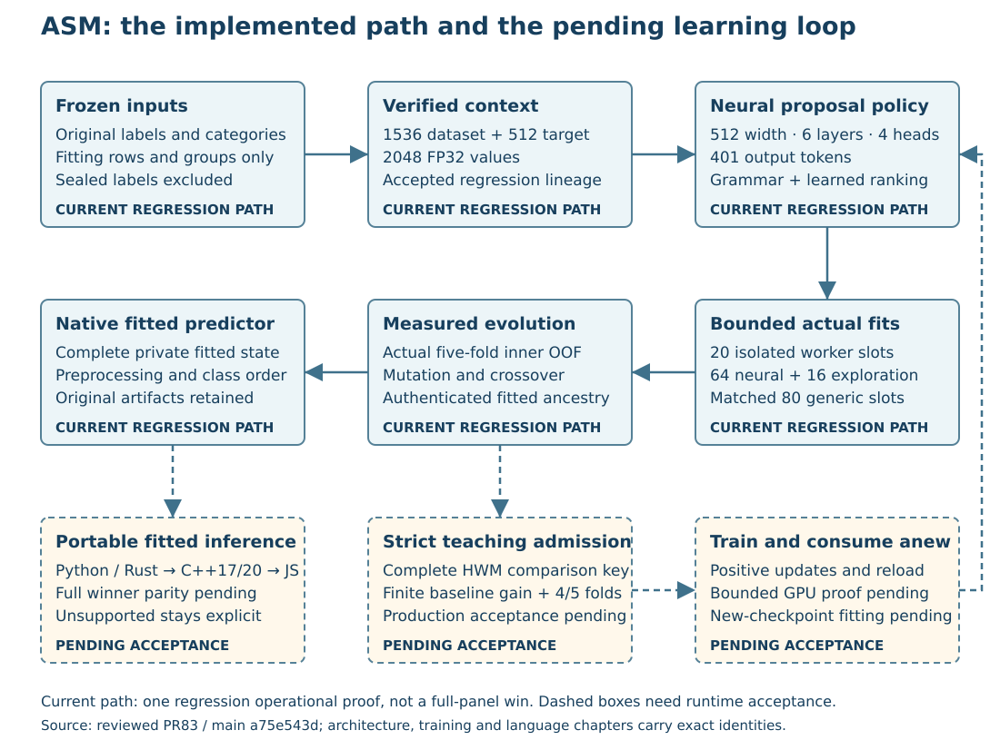

# ASM architecture, encodings and neural models

## Scope and reading rules

**Algorithm Synthesis Model (ASM) learns to generate and optimize executable algorithms from data.** The implementation combines a learned proposal policy with actual fitted evaluation and genetic variation. A generated program is a candidate recipe; a fitted predictor is that recipe plus the state learned from a specific training partition. A checkpoint is the proposal model. Those three artifacts have different identities and different evidence requirements.

This chapter describes source commit `68f56404c3e199e06413bfd645d3fe0803d7b96f`, the frozen PR83 candidate on 2026-09-23. Changes described as **pending training overlay** refer to the stopped 64-file custody patch `595824ef6eb8e15872be058668503cedad1dd9a5ff98ac4700c6f713251d384c`. That patch includes experimental regression consumption; it is not in this source commit. Current-source references below are repository paths with source line numbers. Overlay references are explicitly marked and use the stopped overlay's line numbers.

This is a maintainer document containing internal model and discovery design. The user's request authorizes this explanation and the companion private GP examples. It does not enlarge the allowlist for distributed inference artifacts or authorize publishing private weights, discovery histories, vocabulary assets or training corpora. Hashes identify dependencies; they are not the dependencies themselves.

The most recent bounded origin proof at this source completed its run command in 239.143 seconds; independent report replay took 18.719 seconds. It demonstrated neural-origin fitting and evolution on one regression dataset. Its neural result lost to the matched generic result. It did not execute the complete thirty-dataset demonstration, create current eligible teachers, train a new policy, or qualify a newly trained policy for serving. The performance chapter gives its exact receipts and denominators.

## System at a glance

The solid path has bounded regression execution evidence. Dashed stages require the named runtime acceptance; this diagram does not claim an already qualified self-improving training loop.

## Component map

| Component | Main responsibility | Durable boundary |
|---|---|---|
| `jope-datasets` | Frozen dataset metadata, source and split identity | Content-addressed manifests, source hashes and exact row assignments |
| `jope-bench::panel` | Development-data preparation, methods, metrics, screen/freeze/confirm protocol, ASM orchestration | Campaign plan, prepared data, fits, frozen selections and reports |
| `jope-pipeline` | Search identity, bounded execution, original deadlines, process and output authentication | Started/finished records, arm windows, observations and receipts |
| `jope-policy` | Accepted regression checkpoint binding, CPU context producer, grammar-constrained proposals and learned ranking | Checkpoint receipt, vocabulary, qualified context and proposal evidence |
| `feat-math` | Executable recipe representation, variation and fitting | Canonical recipe identity, fitted state and prediction output |
| `jope-learning` | HWM and score ledgers; pending stricter teaching admission | Comparison identity, immutable blobs, hash-chained events and frozen teaching manifests |
| Python policy package | Existing trainable policy model; pending bounded training campaign and experimental proposal consumer | Model/optimizer checkpoints, architecture, task/vocabulary binding and training proof |
| Native CLI | Current planning/execution front doors; pending `train` orchestration | Pinned requests, source/runtime inventories and supervised execution |

The ordinary CLI and `asm` feature graphs in the stopped follow-on were inspected as manifest text: they have no edge to the engine, Torch, CUDA bindings or a local dependency cycle. That is a source graph check, not a compilation result. Python training runs as a supervised external process; native orchestration does not require linking Torch into the CLI.

## The complete proposed learning cycle

1. Preserve the frozen data schema, original target strings, category strings, missingness and row/group assignments.
2. Derive the proposal context using only the allowed fitting rows. Record preprocessing and encoder identities, then verify actual context production and the numerical qualification required by that context lineage.
3. Use the chosen checkpoint to generate valid executable recipes, and rank the neural pool using learned reward predictions. This stage has no access to held-out scoring labels or fitted GP scores.
4. Place a 64-slot policy pool plus 16 exploration candidates into the neural arm's generation zero; preserve any policy-pool shortfall as `neural_rejection_fallback`, never as a genuine neural sample. Compare with an 80-candidate generic arm under the same declared budgets and executable grammar policy.
5. Actually fit candidates on inner training folds and score their out-of-fold predictions. The measured outcomes, not model-predicted quality, determine the search's parents and winner.
6. Generate mutation and crossover descendants with explicit parent identities. Preserve duplicate/cache handling, rejected variations, unavailable methods and every fit failure.
7. Freeze a recipe and evaluate the unchanged development protocol. Its fitted fold artifacts are separate from its reusable recipe.
8. In the pending teaching path, admit a recipe only after its independently preregistered train-side OOF evidence beats a trivial baseline under the frozen numerical rule.
9. Freeze the eligible corpus, train an explicitly experimental policy, prove real updates and continuation, and export a pinned checkpoint.
10. Consume that exact new checkpoint in a subsequent bounded experiment. A successful export alone is insufficient evidence for this final step.

Steps 1–7 have current bounded regression evidence at the scope described above. The stricter teaching/training/experimental consumption integration is stopped source work awaiting the next reviewed lifecycle and actual runtime acceptance.

## Accepted regression model

The accepted lineage is the recovered lineage-B step-60000 checkpoint. The binding verifies the state, original model, exported tensors, configuration, parameter digest and vocabulary. The rejected step-69000 identity is explicitly refused. A self-consistent receipt around unrelated weights cannot impersonate the accepted model. The model loader rejects missing, extra, incorrectly shaped or non-FP32 tensors.

| Accepted-model property | Value or behavior |
|---|---|
| Dataset context | 1536 FP32 values |
| Target context | 512 FP32 values; all 512 retained |
| Combined context | 2048 FP32 values; 8192 bytes in little-endian vector form |
| Decoder width | 512 |
| Decoder depth | 6 layers |
| Attention heads | 4 |
| Feed-forward width | 2048 |
| Token vocabulary | 401 output tokens |
| Embedding rows | 657, including the configuration's 256 extra rows |
| Maximum configured sequence | 128 tokens; positional table includes the context position |
| Training dropout field | 0.1; disabled for inference |
| Reward ensemble | 4 heads |
| Tensor inventory | 136 tensors for this configuration, including unused inference heads and scalar loss weights |
| Current Rust arithmetic | Candle CPU FP32 |
| Native CUDA BF16 policy parity | Not established by the current CPU inference implementation |

Sources: `crates/jope-policy/src/config.rs:21`, `config.rs:39`, `crates/jope-policy/src/model.rs:1`, `model.rs:41`, `crates/jope-policy/src/lib.rs:133`.

The decoder and reward paths each encode context with a two-layer MLP: 2048→512, GELU, LayerNorm, 512→512, GELU, LayerNorm. The decoder prepends a projected context token to the token embeddings, adds positional embeddings, applies causal self-attention with padding-key masking through pre-normalized layers, normalizes the result and projects through the tied token embedding table narrowed to the output vocabulary.

The reward path pools program-token embeddings, combines them with a separately encoded context, and evaluates four reward MLPs. The combined representation contains the program embedding, its elementwise interaction with a context gate, and an absolute-difference block. A separate runtime head emits a positive runtime estimate through softplus. Learned reward is a proposal-ranking signal; it is not a measured dataset loss.

The source records these accepted identities:

| Identity | SHA256 |
|---|---|
| State | `8ac80c269cc47c253b6f53fa3bc1eb75bb2fcda0bdace3ff8554be0175c400d6` |
| Original model | `053df4f53b84d2ebe7c14fbf907a149760af3d11de4a57b5ff89be8c2d3e8129` |
| Canonical parameter values | `9c7057e7f6a9e348f030da73f03522977b8c08915d3a221d7d5ab2e4213fcd92` |
| Configuration | `2508fc8b8268ea000141c9b119ba3da4e777c506c366168912a88d03482939bf` |
| Original checkpoint vocabulary | `8d55fee4366acd2c175cf55bfd769cebc904770f5227a6fd50a613723dc85787` |
| Executable product restriction | `570b2e5e8d859a73b888f5d0bee27f59da0e2376536babce24c241604f818e81` |

The product restriction preserves the 401-token table while limiting executable heads. A token-compatible restriction is different from inventing a new vocabulary or silently snapping parameters to nearby bins.

## Regression context production

### Original data and preprocessing

The context input binds prepared-data hash, exact training-content hash, ordered fitting-row hash, cut identity and preprocessing hash. It requires at least eight training rows and a nonempty declared feature schema. Numeric versus categorical kinds come from the schema rather than guesses based on strings. Numeric nulls are imputed using training-only medians, with a zero fallback for an entirely missing column; the recorded training transform contains its fitted location/scale. For categories, every present string is a value, including empty text or strings spelling `NA` or `null`. Only an absent value is missing. Original target strings remain separately authenticated before numerical regression parsing.

This context preprocessing is for the proposal encoder. It does not authorize discarding the original schema or replacing a fitted predictor's own training-only preprocessing. Source: `crates/jope-policy/src/context_producer/input.rs:84`.

### Component dimensions and assembly

The current CPU producer uses three components with fixed pretrained assets and fixed transforms:

| Component | Production | Raw output | Contribution to policy context |
|---|---|---:|---:|
| Hyperion | Training features quantized from fitted quantile bounds, three embedding sweeps, scales 4/7/11/15, batch 1024, one target chunk per sweep | 128 values per row | Mean, population standard deviation, 10th and 90th percentile per coordinate: 512 |
| Foundation | Feature/target table prepared with the native deterministic recipe; target normalization computed in f64 after the native f32 cast | 2048 | Frozen mean-centering, learned 2048→1024 projection, then frozen normalization: 1024 |
| Target | Training target values scaled into the training range, two native target windows with seed 17 | 512 | Frozen normalization: 512 |

Assembly concatenates normalized Hyperion512 + projected Foundation1024 + Target512 and clips the full 2048-vector to [-32,32]. It checks all component dimensions and finite values. The source explicitly checks that the Hyperion row width is 128; confusing row width with pooled512 changes the model input meaning. Sources: `crates/jope-policy/src/context_producer.rs:188`, `:278`, `:356`, `:399`, `:422`.

The deterministic foundation preparation selects at most 768 context rows and 256 query rows before `encode_standardized`; that encoder adds no further cap. Hyperion receives every supplied training row and feature column, with no row/column subsampling in this producer. The serialized input is capped at 128 MiB and every context job remains subject to the fixed 30-second worker deadline. On the final 68 reference jobs, Hyperion-stage elapsed time ranged from 6.143 to 14.287 seconds; whole-job wall time ranged from 11.731 to 20.755 seconds. These small-case measurements do not establish coverage for wider or larger cuts. A timeout leaves the context unavailable; it does not permit a new deadline or silent subsampling.

The frozen numerical qualification contract is unchanged, but the implementation includes both execution and numerical corrections. Hyperion uses an embeddings-only sweep that skips the unused confidence head. Foundation uses the separate `encode_standardized` path: train-side feature moments accumulate in f64 before the retained f32 transform, and p10/p90 use Torch 2.7 FP32 rank and stable-lerp arithmetic. Ordinary `encode` retains its legacy feature-moment and percentile arithmetic. The standardized route consumes all rows supplied by the preceding deterministic foundation preparation without additional caps. Cached-decoder fixtures separately check small random-model operations/full-prefix agreement within 1e-4, row/padding behavior and sampling-token/RNG agreement. They do not establish accepted-checkpoint bitwise logits or native CUDA policy parity. Sources: `crates/jope-policy/src/context_producer.rs:238`; `crates/jope-encoders/src/foundation.rs:345`; `crates/jope-encoders/src/foundation/support.rs:123`; `crates/jope-encoders/src/model/tensor_ops.rs:114`; `crates/jope-policy/src/model/cached.rs:270`; `crates/jope-policy/src/decode.rs:485`.

### Qualification and admission

The CPU regression encoder has a stronger boundary than “the vector has 2048 values.” Eight fixed native-reference cases span two families and cuts 0–3. Qualification checks finite FP32 component and final-context values with maximum absolute difference at most 0.0003, exact asset/source/program identities, and actual bounded executions. Consumption binds those eight jobs plus the actual dataset context job: nine independently authenticated process proofs. The reference registry/index and transform hashes are pinned in source.

The retained 68 outputs have final-context maximum absolute differences from 5.3644180e-5 to 2.8765202e-4. The worst case is `cardata-blackmore`, dataset `55e9dfc7a86361d7`, cut 0: 95.884% of the unchanged 3e-4 tolerance. Across all eight cases, maximum component differences are 4.127622e-6 for Hyperion, 2.908707e-5 for foundation and 3.911555e-7 for target. The frozen projection and projected-scale division can amplify small component differences in the assembled vector. Coverage is limited to two numeric meta-train families: blackmore, 629–630 training rows with 4 features, and `cardata-ces11`, 800 rows with 8 features, each at cuts 0–3. Changes to arithmetic, libraries, build/ISA flags or summation order require requalification; this gate is not evidence for wide or category-heavy contexts. Never relax its tolerance to make a build pass.

`VerifiedCpuContext` has private fields and can only be constructed by the verification path outside explicit test support. A syntactically valid JSON vector cannot create admission authority. Sources: `crates/jope-policy/src/context_producer/admission.rs:4`, `:115`, `:234`, `:297`; `crates/jope-pipeline/src/cpu_context_bridge.rs`.

## Stored model assets and the active encoder distinction

The metadata-only S3 audit on 2026-09-23 fetched the three bundle manifests below and pinned their returned bytes, ETags and lengths. No model bodies were downloaded for this chapter. These are declared object sizes from the retrieved manifests; they do not measure resident memory, compute cost or a new numerical qualification.

| Bundle asset | Bytes | Role in this chapter |
|---|---:|---|
| `policy-step-60000/policy.safetensors` | 111,199,088 | Accepted policy export identity, consumed only with its checkpoint binding |
| `policy-step-60000/context_transforms.safetensors` | 8,413,808 | Accepted fixed context assembly transforms |
| `jope-prime-gen31-v2/model-bundle/hyperion_v5_arm_b.safetensors` | 6,650,692 | Exact Hyperion weights pinned by the current CPU context producer |
| `jope-prime-gen31-v2/starforge/starlight_core_regressor.safetensors` | 233,183,532 | Foundation component; manifest describes512 hidden features pooled into2048 |
| `jope-prime-gen31-v2/model-bundle/target_encoder_fused_v1…safetensors` | 78,615,176 | Target component; manifest describes normalized64+64+384 fused representation |
| `hyperion-v7/model.safetensors` | 246,456,988 | Separate stored bundle, not the accepted context producer's pinned weights |
| `jope-prime-gen31-v2/model-bundle/jope_policy.safetensors` | 108,846,812 | Separate gen31 policy artifact; not step-60000 |

The storage name `hyperion-v7` must not be confused with the CPU implementation's `V7Model` Rust type. The actual current producer pins weight hash `88b9e834…`, which matches the v5 arm-B asset, with row width 128. The separate stored v7 manifest describes dimension512, eight heads,12 layers and six bands. Replacing the pinned asset based on its newer-looking name changes the encoder identity and invalidates compatibility.

Two identity pitfalls matter when maintaining this boundary. Hyperion `load_settings` reports a legacy 16-hex identifier, not a SHA-256 digest. The producer therefore authenticates manifest bytes before and after the path-based settings load, authenticates weights before and after `V7Model::load_cpu`, and requires embedding width 128. A legacy identifier must never be compared with or substituted for a cryptographic admission pin. Separately, ordinary `jope encode` resolves `HYPERION_V7_WEIGHTS` as a **bundle directory**, else `$JOPE_HOME/models/bundles/hyperion-v7` (relative to the working directory when unset). The default stored bundle is 512-dimensional and differs from the pinned v5-arm-B producer; both manifests use the loader string `version: v7`, so that string cannot establish checkpoint identity. `jope encode` is not the qualified 2048-value ASM context interface. Current documentation drift remains at `docs/models.md:105`, which supplies a file instead of the expected directory, and the default-v5 comment in `crates/hyperion/src/hyperion.rs:28`. Use exact asset hashes and the qualified context-worker flow.

The retrieved manifests also contain internal/redistribution/provenance declarations that vary by artifact. They are retained evidence about the bundle metadata, not proof that every object is approved for every distribution. The active private run's exact release/input inventory remains the authority for which files it used; S3 presence alone does not establish serving eligibility. Sources: `crates/jope-policy/src/context_producer.rs:41`; custody `metadata-receipts/veox-jopedime-models-use2--bundles--policy-step-60000--manifest.json`, `…--hyperion-v7--manifest.json`, and `…--jope-prime-gen31-v2--manifest.json`.

## Experimental classification context

Current source contains the pure class-partition context representation. The pending training overlay adds the bounded feature producer, process admission and operational proposal wiring. Classification does not parse class names as numbers or reuse the regression target encoder by ordinal coding.

The feature blocks remain Hyperion512 and projected Foundation1024. The pending producer explicitly conditions the foundation path on neutral zero targets and labels this an experimental feature-only probe. Each class gets a centroid over the 128-dimensional training row encodings. The target block contains, per coordinate, the mean, standard deviation, minimum and maximum across class centroids, totaling512. Classes are visited in first-row order, so a bijective renaming preserves even floating-point summation order. Original labels still appear in authenticated input identity, even though their spelling cannot influence numerical pooling.

The resulting lineage is `asm.experimental-class-partition-pool/v1`; `policy_compatible` is false. The false marker means it cannot enter the accepted regression policy loader. A declared binary input must have exactly two classes; multiclass requires at least three, and the fitting data must contain the declared classes. Missing classes are an explicit refusal. Sources: `crates/jope-pipeline/src/search_context.rs:278`; pending `crates/jope-policy/src/context_producer/classification.rs:1`.

At source 68, classification has no neural arm: planning records the accepted regression-only policy as unavailable for binary/multiclass data. The available `asm.generic` classification sampler uses `logit_ridge` for binary or `multiclass_ridge` for multiclass, with l2 in [1e-4, 10], preceded by no transform, `standardize`, `winsor_clip`, or both. Advanced-v3 mutation/crossover preserve that head family and allow at most 4 transforms. A classification ASM result at this source would therefore be a ridge-head transform search; the pending experimental neural consumer is a separate capability.

## Proposal generation, ranking and evolution

Accepted proposals are generated under grammar constraints. Ranking orders the neural pool by the mean of four reward heads, descending; exact ties use program SHA256 then text. Runtime estimates are reported without subtracting an undocumented runtime penalty. Ranking binds the checkpoint, context and vocabulary and records that scoring labels and fitted GP scores were not read. Source: `crates/jope-policy/src/ranking.rs:22`.

Each ranked policy-pool program carries `rank_log_weight`, the log-softmax of its four-head mean predicted reward over that pool. Historical files called this `policy_logprob`. It is a within-context ranking weight, not a sampling/selection probability or propensity; do not use it for importance weighting or off-policy correction. Exploration candidates carry no rank weight.

Each arm starts with 80 generation-zero slots. In the neural arm, slots 0–63 form the ranked policy pool: distinct valid checkpoint samples are labelled `neural_policy`; any shortfall after the bounded sampling rounds is filled by distinct grammar-uniform programs labelled `neural_rejection_fallback`. Slots 64–79 are `random_exploration`. Only `neural_policy` roots and completed descendants with verified neural ancestry count as genuine neural evidence; fallback and exploration roots do not. In the accepted proof at source 68 all 64 pool slots were `neural_policy`,48 completed all five inner folds, and no fallback slots were needed. Receipts retain initial-slot origin and descendant ancestry. Actual completed inner OOF losses select the best four parents. New generations alternate mutation and crossover attempts, canonicalize recipes, reject duplicate executable identities, and retain variation attempts in the journal. Source: `crates/jope-pipeline/src/neural_search.rs:27`, `:1380`.

A recipe may be evaluated on multiple folds or re-used in later fits. Therefore proposal count, recipe count, unique fitted predictors, launched commands and physical fit starts are different denominators. A cache hit does not become another new predictor; a partial/unknown attempt does not become a zero-cost fit. The performance chapter explains the report accounting.

## Experimental trained models and compatibility

The pending training campaign uses the existing Python `JopePolicyModelV3` with task-routed reward/stability behavior. Real admitted training uses width256, two layers, four heads and feed-forward1024; synthetic qualification fixtures use width8, one layer, two heads and feed-forward16. Both consume the explicit context schema. Training uses one-epoch passes, learning rate5e-4, batch256 for admitted rows or2 for fixtures, AMP disabled and automatic batch-size tuning disabled. These are the bounded campaign's settings, not the accepted step-60000 model's architecture.

The export records the complete architecture, vocabulary, task, source, input identities, model state and training proof. The pending experimental consumer requires all architecture fields explicitly; the general-purpose Python loader's backward-compatible defaults cannot reinterpret a saved experimental checkpoint. It compares the reconstructed model's architecture and full state to the export. Sources: pending `python/src/jope/policy/training_campaign.py:780`, `python/src/jope/policy/experimental_proposal.py`, `crates/jope-pipeline/src/experimental_producer.rs`.

The final regression follow-on closes a specific gap: `Configuration.experimental.regression` can explicitly select a newly trained regression export. Omission keeps the accepted baseline. This operational regression route requires **real admitted** training, the same source commit and the exact native encoder identity used by training. It first admits the qualified native2048 regression context, then wraps those exact values in the separate `asm.experimental-regression-context/v1` lineage with zero classes and `policy_compatible:false`. It does not promote the new checkpoint to accepted serving or weaken the accepted hard pins.

Binary and multiclass use their separate experimental context path; a synthetic classifier fixture can qualify mechanical training/consumption behavior only when explicitly reported as synthetic. Synthetic regression training is permitted as a CPU test but cannot be substituted into the operational real-regression consumer. There is no silent accepted-policy fallback after an explicitly chosen experimental checkpoint fails compatibility.

## Development exposure and limitations

The frozen protocol screens methods on development fold0, freezes the top five recipes, and confirms those recipes on the same five development folds; ASM is additionally confirmed if it missed the top five. The synthesized recipe was learned from the outer fold0 fitting set, containing development folds1–4. Thus those later confirmation folds are exposed to recipe learning. Every frozen recipe's fold0 labels influenced screen selection. The report derives row intersections and records them per recipe/fold; it labels the selected five-fold summary adaptive development and leaves sealed evaluation unopened. This is the chosen protocol, not an unbiased outer generalization estimate. Source: `crates/jope-bench/src/panel/selection_exposure.rs:1`.

Remaining architectural acceptance includes real eligible-teacher collection, actual new-parameter training/reload/continuation, subsequent fitted use of that newly trained checkpoint, classification operational qualification, complete fitted-state parity across supported deployment backends, the unchanged full30 panel, and measured warm/cold installation demonstrations. Reusable motif mining must retain full comparison identity and eligibility; new operators need ablation and compatibility tests. GPU inference portability and a broad claim of CPU/native-policy numerical equivalence remain future work.
