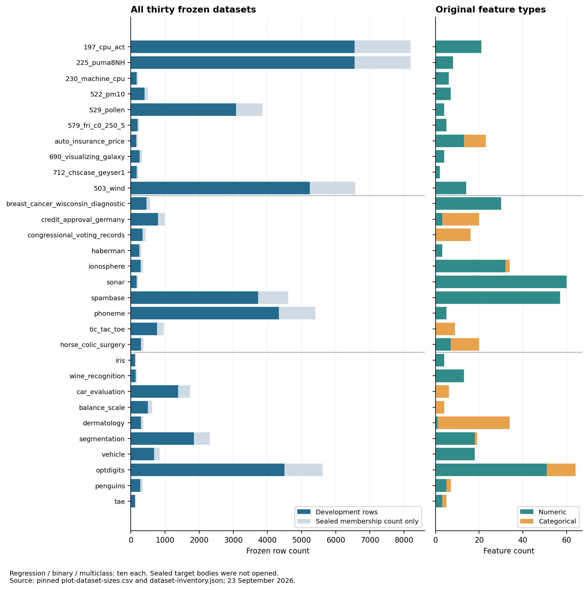

# All thirty datasets and all 522 feature records

All statistics below use development rows only. Numeric values use finite observations; missing cells are counted separately. Standard deviation is the population statistic. Medians and the additional 1%, 5%, 25%, 75%, 95%, 99% quantiles in JSON linearly interpolate sorted values at `(n−1)p`. Category counts retain exact stored strings. Original class ordering and fold class counts are preserved. Upstream metadata, provenance URLs, source byte/hash pins, group-size histograms and all file identities remain in JSON.

## All thirty datasets at a glance

### Per-dataset summary

| Dataset | Task | Total rows | Development | Sealed metadata | Numeric features | Categorical features | Missing development cells | Fold sizes |
|---|---|---:|---:|---:|---:|---:|---:|---|
| 197_cpu_act | regression | 8192 | 6553 | 1639 | 21 | 0 | 0 | 1311,1311,1311,1310,1310 |
| 225_puma8NH | regression | 8192 | 6553 | 1639 | 8 | 0 | 0 | 1311,1311,1311,1310,1310 |
| 230_machine_cpu | regression | 209 | 169 | 40 | 6 | 0 | 0 | 34,32,37,33,33 |
| 522_pm10 | regression | 500 | 402 | 98 | 7 | 0 | 0 | 81,81,91,67,82 |
| 529_pollen | regression | 3848 | 3078 | 770 | 4 | 0 | 0 | 616,616,616,615,615 |
| 579_fri_c0_250_5 | regression | 250 | 200 | 50 | 5 | 0 | 0 | 40,40,40,40,40 |
| auto_insurance_price | regression | 201 | 162 | 39 | 13 | 10 | 10 | 35,32,31,31,33 |
| 690_visualizing_galaxy | regression | 323 | 258 | 65 | 4 | 0 | 0 | 52,52,52,51,51 |
| 712_chscase_geyser1 | regression | 222 | 172 | 50 | 2 | 0 | 0 | 32,34,38,35,33 |
| 503_wind | regression | 6574 | 5238 | 1336 | 14 | 0 | 0 | 1066,1074,1030,1032,1036 |
| breast_cancer_wisconsin_diagnostic | binary | 569 | 455 | 114 | 30 | 0 | 0 | 91,91,91,91,91 |
| credit_approval_germany | binary | 1000 | 800 | 200 | 3 | 17 | 0 | 160,160,160,160,160 |
| congressional_voting_records | binary | 435 | 347 | 88 | 0 | 16 | 0 | 77,57,64,84,65 |
| haberman | binary | 306 | 245 | 61 | 3 | 0 | 0 | 49,49,46,50,51 |
| ionosphere | binary | 351 | 281 | 70 | 32 | 2 | 0 | 55,57,56,57,56 |
| sonar | binary | 208 | 166 | 42 | 60 | 0 | 0 | 34,33,33,33,33 |
| spambase | binary | 4601 | 3723 | 878 | 57 | 0 | 0 | 696,781,710,789,747 |
| phoneme | binary | 5404 | 4330 | 1074 | 5 | 0 | 0 | 866,867,866,870,861 |
| tic_tac_toe | binary | 958 | 766 | 192 | 0 | 9 | 0 | 154,153,153,153,153 |
| horse_colic_surgery | binary | 368 | 292 | 76 | 7 | 13 | 1583 | 58,61,58,58,57 |
| iris | multiclass | 150 | 122 | 28 | 4 | 0 | 0 | 25,23,25,25,24 |
| wine_recognition | multiclass | 178 | 142 | 36 | 13 | 0 | 0 | 29,29,28,28,28 |
| car_evaluation | multiclass | 1728 | 1382 | 346 | 0 | 6 | 0 | 277,277,276,276,276 |
| balance_scale | multiclass | 625 | 500 | 125 | 0 | 4 | 0 | 100,100,100,100,100 |
| dermatology | multiclass | 366 | 292 | 74 | 1 | 33 | 0 | 59,59,58,58,58 |
| segmentation | multiclass | 2310 | 1848 | 462 | 18 | 1 | 0 | 364,372,369,373,370 |
| vehicle | multiclass | 846 | 677 | 169 | 18 | 0 | 0 | 135,136,135,136,135 |
| optdigits | multiclass | 5620 | 4496 | 1124 | 51 | 13 | 0 | 900,899,899,899,899 |
| penguins | multiclass | 344 | 275 | 69 | 5 | 2 | 19 | 55,55,55,55,55 |
| tae | multiclass | 151 | 124 | 27 | 3 | 2 | 0 | 20,25,27,30,22 |

### Frozen dataset coverage

The following chart covers all thirty immutable datasets in task order: regression, binary, multiclass. It preserves the original feature-type metadata and row assignments. Sealed counts come from membership metadata; sealed target bodies were not opened. The per-dataset sections under [§](#regression-datasets), [§](#binary-classification-datasets) and [§](#multiclass-classification-datasets) give readable numeric tables, class/category frequencies and every feature record.

Totals are 55,029 rows, 44,048 development rows, 10,981 sealed membership records and 522 summed feature records. Feature counts are not a union of semantic variables across datasets. The chart and the detailed tables share the same pinned inventory.

## Regression datasets

### 197_cpu_act

Task `regression`; metric `rmse`; 6553 development rows; 1639 sealed rows counted from assignments; 21 numeric and 0 categorical features. Development groups: 6553; all groups: 8192; largest group: 1. Original fold sizes:[1311, 1311, 1311, 1310, 1310]; other-four-fold fit sizes:[5242, 5242, 5242, 5243, 5243]. Declared grouping columns: none.

Development file SHA-256: `c987b431681784b87f12f3c98e660fd0aa76f08d01fe005695f41470b3750019`. Assignment SHA-256: `624d44ee0a5e2214e8edf256f8d9c028ca3f3765237401e3c84cf9c232a60bc7`. Original source SHA-256: `d00fd6bac2eda0821a04ff10277663d211127745a19a474c0feee41a16914fdc`. Original license: unknown; repository license: MIT.

Development target: min 0, median 89, max 99, mean 84.01938, population SD 18.290468; missing 0.

| Feature | Type | Missing | Distinct nonmissing | Minimum | Median | Maximum | Mean | Population SD |
|---|---|---:|---:|---:|---:|---:|---:|---:|
| lread | numeric | 0 | 207 | 0 | 7 | 1845 | 19.349306 | 53.733421 |
| lwrite | numeric | 0 | 177 | 0 | 1 | 575 | 12.922173 | 29.496482 |
| scall | numeric | 0 | 3696 | 109 | 2053 | 12493 | 2307.3473 | 1631.4764 |
| sread | numeric | 0 | 752 | 6 | 166 | 5318 | 209.85686 | 199.84585 |
| swrite | numeric | 0 | 601 | 7 | 117 | 5456 | 149.81505 | 162.43571 |
| fork | numeric | 0 | 207 | 0 | 0.80000001 | 20.120001 | 1.8901007 | 2.4752517 |
| exec | numeric | 0 | 349 | 0 | 1.2 | 59.560001 | 2.7978773 | 5.2634111 |
| rchar | numeric | 0 | 6414 | 278 | 122879 | 2526649 | 195586.22 | 238487.78 |
| wchar | numeric | 0 | 6397 | 1498 | 46082 | 1801623 | 95334.943 | 140638.4 |
| pgout | numeric | 0 | 362 | 0 | 0 | 81.440002 | 2.2342881 | 5.2216254 |
| ppgout | numeric | 0 | 670 | 0 | 0 | 168.06 | 5.8141904 | 14.712169 |
| pgfree | numeric | 0 | 927 | 0 | 0 | 523 | 11.634935 | 31.594236 |
| pgscan | numeric | 0 | 1004 | 0 | 0 | 1237 | 21.142667 | 69.957532 |
| atch | numeric | 0 | 219 | 0 | 0 | 211.58 | 1.0821486 | 5.4985106 |
| pgin | numeric | 0 | 745 | 0 | 2.8 | 126.45 | 8.2493835 | 13.75562 |
| ppgin | numeric | 0 | 955 | 0 | 3.8099999 | 292.60999 | 12.334296 | 22.180491 |
| pflt | numeric | 0 | 2626 | 0 | 64.199997 | 899.79999 | 110.20706 | 114.35173 |
| vflt | numeric | 0 | 3310 | 0.2 | 121.56 | 1365 | 185.84375 | 190.4443 |
| runqsz | numeric | 0 | 253 | 1 | 2 | 2823 | 19.619182 | 128.21611 |
| freemem | numeric | 0 | 2757 | 55 | 579 | 12027 | 1768.3189 | 2497.6881 |
| freeswap | numeric | 0 | 6154 | 2 | 1137126 | 2042280 | 1328586 | 421591.38 |

### 225_puma8NH

Task `regression`; metric `rmse`; 6553 development rows; 1639 sealed rows counted from assignments; 8 numeric and 0 categorical features. Development groups: 6553; all groups: 8192; largest group: 1. Original fold sizes:[1311, 1311, 1311, 1310, 1310]; other-four-fold fit sizes:[5242, 5242, 5242, 5243, 5243]. Declared grouping columns: none.

Development file SHA-256: `31a4ce74a20613e192cab948518ab391feb0b70b0863fbe263d288d4a5df9c6e`. Assignment SHA-256: `f901eda7d22c08a8e7d6b8eb8455f21de4fc58eb4cb497657d2a56bd035cc8e1`. Original source SHA-256: `0be6203e167cc5e7b038368dbfe0a7790d5dc423c9d7e42887907c5c03f81c27`. Original license: unknown; repository license: MIT.

Development target: min-12.415322, median 1.054127, max 11.87619, mean 1.1382282, population SD 5.6448802; missing 0.

| Feature | Type | Missing | Distinct nonmissing | Minimum | Median | Maximum | Mean | Population SD |
|---|---|---:|---:|---:|---:|---:|---:|---:|
| theta1 | numeric | 0 | 6547 | -1.884729 | 0.0060899998 | 1.884735 | -0.0022002574 | 1.0823712 |
| theta2 | numeric | 0 | 6543 | -1.8834831 | 0.016564 | 1.883306 | 0.010064784 | 1.0937572 |
| theta3 | numeric | 0 | 6548 | -1.884449 | 0.023234 | 1.884046 | 0.0076206044 | 1.0832023 |
| thetad1 | numeric | 0 | 6548 | -1.884632 | -0.013532 | 1.884923 | -0.007727921 | 1.0913692 |
| thetad2 | numeric | 0 | 6549 | -1.8847851 | -0.030689999 | 1.884077 | -0.013800457 | 1.09539 |
| thetad3 | numeric | 0 | 6546 | -1.884558 | 0.020455999 | 1.884746 | 0.0078690332 | 1.0864734 |
| tau1 | numeric | 0 | 6534 | -0.59999502 | 0.0047479998 | 0.599011 | 0.00079091185 | 0.34369033 |
| tau2 | numeric | 0 | 6533 | -0.59987199 | 0.0048799999 | 0.59991199 | 0.0012599463 | 0.34712905 |

### 230_machine_cpu

Task `regression`; metric `rmse`; 169 development rows; 40 sealed rows counted from assignments; 6 numeric and 0 categorical features. Development groups: 152; all groups: 190; largest group: 5. Original fold sizes:[34, 32, 37, 33, 33]; other-four-fold fit sizes:[135,137,132,136,136]. Declared grouping columns: none.

Development file SHA-256: `07c9b448d18c0479cb817235efff5ec242fd3723329dcd69582d39043d150c87`. Assignment SHA-256: `68d86fbc518c72ee20dc5feefac8ad2e5a2f7c36ea9613b2755c7177f6f1bf82`. Original source SHA-256: `937b0a23076f948343b8b7ac005bc70ea7080c391218fb4896462699b8cb59c4`. Original license: unknown; repository license: MIT.

Development target: min 6, median 50, max 1150, mean 111.53254, population SD 169.51452; missing 0.

| Feature | Type | Missing | Distinct nonmissing | Minimum | Median | Maximum | Mean | Population SD |
|---|---|---:|---:|---:|---:|---:|---:|---:|
| MYCT | numeric | 0 | 56 | 17 | 110 | 1500 | 196.59172 | 248.93309 |
| MMIN | numeric | 0 | 20 | 64 | 2000 | 32000 | 2901.7751 | 3928.1762 |
| MMAX | numeric | 0 | 21 | 64 | 8000 | 64000 | 12481.811 | 12389.434 |
| CACH | numeric | 0 | 22 | 0 | 8 | 256 | 24.633136 | 38.093256 |
| CHMIN | numeric | 0 | 15 | 0 | 3 | 52 | 4.9940828 | 7.2483396 |
| CHMAX | numeric | 0 | 28 | 0 | 8 | 176 | 19.100592 | 27.884089 |

### 522_pm10

Task `regression`; metric `rmse`; 402 development rows; 98 sealed rows counted from assignments; 7 numeric and 0 categorical features. Development groups: 218; all groups: 273; largest group: 6. Original fold sizes:[81, 81, 91, 67, 82]; other-four-fold fit sizes:[321,321,311,335,320]. Declared grouping columns:['day'].

Development file SHA-256: `a33090c6e33323c48afd74338f72b1caa12376b6af4af00f7a48f6c03168df4c`. Assignment SHA-256: `13a00e1a058422110f6ff4caabdac7f648e5da976e10ed0a27be077534e469dd`. Original source SHA-256: `ecbabaa5a989a8c11f5a57e874c135f386da5379d6689ae6d5d4264a652fa5e0`. Original license: unknown; repository license: MIT.

Development target: min 0.69314998, median 3.3322001, max 5.3845, mean 3.3171902, population SD 0.85366052; missing 0.

| Feature | Type | Missing | Distinct nonmissing | Minimum | Median | Maximum | Mean | Population SD |
|---|---|---:|---:|---:|---:|---:|---:|---:|
| cars_per_hour | numeric | 0 | 374 | 3.8066599 | 7.4974751 | 8.3520803 | 7.0094372 | 1.0713765 |
| temperature_at_2m | numeric | 0 | 197 | -19 | 0.80000001 | 19.799999 | 0.51965173 | 6.3551238 |
| wind_speed | numeric | 0 | 71 | 0.40000001 | 2.8 | 9.3999996 | 3.1445274 | 1.7968553 |
| temperature_diff_2m_25m | numeric | 0 | 56 | -5 | 0 | 4 | 0.11666667 | 0.97697158 |
| wind_direction | numeric | 0 | 288 | 5 | 103.2 | 358 | 140.67065 | 84.378122 |
| hour_of_day | numeric | 0 | 24 | 1 | 12 | 24 | 12.266169 | 6.8120686 |
| day | numeric | 0 | 218 | 32 | 206.5 | 605 | 303.22139 | 197.99917 |

### 529_pollen

Task `regression`; metric `rmse`; 3078 development rows; 770 sealed rows counted from assignments; 4 numeric and 0 categorical features. Development groups: 3078; all groups: 3848; largest group: 1. Original fold sizes:[616,616,616,615,615]; other-four-fold fit sizes:[2462, 2462, 2462, 2463, 2463]. Declared grouping columns: none.

Development file SHA-256: `4afdc668b7c7bdde004b651e639ee62542518fa9629a4b9a9d18f42d2bfe5cf5`. Assignment SHA-256: `225ab47f4b84b8b29f808751a567dc06e49af57f77d918402dc98929494b9aad`. Original source SHA-256: `2e9414f0216e75296ba4211c567dd8a60d269273b38f8e00bd8fea3a37d2e654`. Original license: unknown; repository license: MIT.

Development target: min-12.0391, median-0.0282, max 10.4934, mean 0.013061306, population SD 3.1652511; missing 0.

| Feature | Type | Missing | Distinct nonmissing | Minimum | Median | Maximum | Mean | Population SD |
|---|---|---:|---:|---:|---:|---:|---:|---:|
| RIDGE | numeric | 0 | 3052 | -23.283899 | -0.1736 | 21.406601 | -0.040160139 | 6.4118802 |
| NUB | numeric | 0 | 3047 | -16.393499 | -0.26875 | 17.258301 | -0.017482649 | 5.1239751 |
| CRACK | numeric | 0 | 3057 | -26.4652 | -0.12075 | 25.6434 | -0.07717969 | 7.9651552 |
| WEIGHT | numeric | 0 | 3067 | -34.035198 | -0.1534 | 35.802799 | 0.062779366 | 10.099992 |

### 579_fri_c0_250_5

Task `regression`; metric `rmse`; 200 development rows; 50 sealed rows counted from assignments; 5 numeric and 0 categorical features. Development groups: 200; all groups: 250; largest group: 1. Original fold sizes:[40, 40, 40, 40, 40]; other-four-fold fit sizes:[160,160,160,160,160]. Declared grouping columns: none.

Development file SHA-256: `9c2608cc2a14cb52e26f174518606fbc4bb7ed48b04aa4c62d840a7dc6cbd365`. Assignment SHA-256: `fa08e1237360b16d98c581d6c62695cb6c8631cca9940ba1671a6b8678e60790`. Original source SHA-256: `d32597bb1043df296ac3be1fff926646b26f268f89185310ea898e59b5fff896`. Original license: unknown; repository license: MIT.

Development target: min-2.2208376, median-0.050367098, max 2.1689749, mean-0.045378203, population SD 1.0368873; missing 0.

| Feature | Type | Missing | Distinct nonmissing | Minimum | Median | Maximum | Mean | Population SD |
|---|---|---:|---:|---:|---:|---:|---:|---:|
| oz1 | numeric | 0 | 200 | -1.7117687 | -0.040313881 | 1.7466414 | -0.0097722925 | 0.99221231 |
| oz2 | numeric | 0 | 200 | -1.7675385 | 0.11001987 | 1.7166964 | 0.017360429 | 1.0225496 |
| oz3 | numeric | 0 | 200 | -1.798439 | -0.013159709 | 1.6682318 | 0.024478181 | 0.97661234 |
| oz4 | numeric | 0 | 200 | -1.7556303 | 0.029955601 | 1.6519692 | -0.027132471 | 0.97989126 |
| oz5 | numeric | 0 | 200 | -1.8355519 | 0.022033866 | 1.7011706 | -0.017172821 | 1.0096145 |

### auto_insurance_price

#### Summary and feature statistics

Task `regression`; metric `rmse`; 162 development rows; 39 sealed rows counted from assignments; 13 numeric and 10 categorical features. Development groups: 154; all groups: 193; largest group: 2. Original fold sizes:[35, 32, 31, 31, 33]; other-four-fold fit sizes:[127,130,131,131,129]. Declared grouping columns: none.

Development file SHA-256: `6c0719a5e4433e653e8997fc1f19842fd3aae044531e7639484d24d879d7f971`. Assignment SHA-256: `9769b5f1510b1048afe81125f8f7dbb1272ab81825305af5414c8da6c52c7b1f`. Original source SHA-256: `244c05ca33384bcdd519ff88fad036ae7140a5438b76a8248401cdc065582ac7`. Original license: CC BY 4.0; repository license: MIT.

Development target: min 5118, median 10096.5, max 45400, mean 13127.222, population SD 8034.0417; missing 0.

| Feature | Type | Missing | Distinct nonmissing | Minimum | Median | Maximum | Mean | Population SD |
|---|---|---:|---:|---:|---:|---:|---:|---:|
| make | categorical | 0 | 21 | n/a | n/a | n/a | n/a | n/a |
| fuel_type | categorical | 0 | 2 | n/a | n/a | n/a | n/a | n/a |
| aspiration | categorical | 0 | 2 | n/a | n/a | n/a | n/a | n/a |
| number_of_doors | categorical | 0 | 2 | n/a | n/a | n/a | n/a | n/a |
| body_style | categorical | 0 | 5 | n/a | n/a | n/a | n/a | n/a |
| drive_wheels | categorical | 0 | 3 | n/a | n/a | n/a | n/a | n/a |
| engine_location | categorical | 0 | 2 | n/a | n/a | n/a | n/a | n/a |
| wheel_base | numeric | 0 | 49 | 86.6 | 96.9 | 120.9 | 98.664815 | 6.1873474 |
| length | numeric | 0 | 67 | 141.1 | 172.5 | 208.1 | 174.10123 | 12.321366 |
| width | numeric | 0 | 40 | 60.3 | 65.4 | 72 | 65.856173 | 2.1333027 |
| height | numeric | 0 | 46 | 47.8 | 54.1 | 59.8 | 53.730247 | 2.5110641 |
| curb_weight | numeric | 0 | 140 | 1488 | 2407.5 | 4066 | 2548.8457 | 518.36907 |
| engine_type | categorical | 0 | 6 | n/a | n/a | n/a | n/a | n/a |
| number_of_cylinders | categorical | 0 | 7 | n/a | n/a | n/a | n/a | n/a |
| engine_size | numeric | 0 | 40 | 61 | 110 | 326 | 126.39506 | 42.981816 |
| fuel_system | categorical | 0 | 7 | n/a | n/a | n/a | n/a | n/a |
| bore | numeric | 4 | 35 | 2.54 | 3.31 | 3.94 | 3.3218987 | 0.26890813 |
| stroke | numeric | 4 | 33 | 2.07 | 3.29 | 4.17 | 3.2515823 | 0.31914744 |
| compression_ratio | numeric | 0 | 28 | 7 | 9 | 23 | 10.003148 | 3.7645327 |
| horsepower | numeric | 1 | 52 | 48 | 95 | 262 | 103.68323 | 38.08872 |
| peak_rpm | numeric | 1 | 21 | 4150 | 5200 | 6600 | 5129.8137 | 480.66268 |
| city_mpg | numeric | 0 | 26 | 13 | 24.5 | 49 | 25.024691 | 6.2370365 |
| highway_mpg | numeric | 0 | 29 | 16 | 30 | 54 | 30.518519 | 6.6640942 |

#### Category frequencies

Exact development category frequencies:

- `make`: `{"0": 3, "1": 6, "11": 11, "12": 16, "13": 9, "14": 5, "15": 4, "16": 1, "17": 3, "18": 12, "19": 25, "2": 5, "20": 11, "21": 8, "3": 2, "4": 6, "5": 11, "6": 2, "7": 3, "8": 13, "9": 6}`. Categories absent from the other four folds: `{"0": ["16"], "1": [], "2": [], "3": [], "4": []}`.
- `fuel_type`: `{"0": 14, "1": 148}`. Categories absent from the other four folds: `{"0": [], "1": [], "2": [], "3": [], "4": []}`.
- `aspiration`: `{"0": 134, "1": 28}`. Categories absent from the other four folds: `{"0": [], "1": [], "2": [], "3": [], "4": []}`.
- `number_of_doors`: `{"0": 93, "1": 69}`. Categories absent from the other four folds: `{"0": [], "1": [], "2": [], "3": [], "4": []}`.
- `body_style`: `{"0": 7, "1": 22, "2": 75, "3": 54, "4": 4}`. Categories absent from the other four folds: `{"0": [], "1": [], "2": [], "3": [], "4": []}`.
- `drive_wheels`: `{"0": 8, "1": 96, "2": 58}`. Categories absent from the other four folds: `{"0": [], "1": [], "2": [], "3": [], "4": []}`.
- `engine_location`: `{"0": 159, "1": 3}`. Categories absent from the other four folds: `{"0": [], "1": [], "2": [], "3": [], "4": []}`.
- `engine_type`: `{"0": 11, "1": 10, "2": 112, "3": 15, "4": 10, "5": 4}`. Categories absent from the other four folds: `{"0": [], "1": [], "2": [], "3": [], "4": []}`.
- `number_of_cylinders`: `{"0": 4, "1": 1, "2": 124, "3": 9, "4": 20, "5": 3, "6": 1}`. Categories absent from the other four folds: `{"0": [], "1": [], "2": ["6"], "3": ["1"], "4": []}`.
- `fuel_system`: `{"0": 9, "1": 55, "2": 3, "3": 14, "5": 72, "6": 8, "7": 1}`. Categories absent from the other four folds: `{"0": [], "1": [], "2": [], "3": ["7"], "4": []}`.

### 690_visualizing_galaxy

Task `regression`; metric `rmse`; 258 development rows; 65 sealed rows counted from assignments; 4 numeric and 0 categorical features. Development groups: 258; all groups: 323; largest group: 1. Original fold sizes:[52, 52, 52, 51, 51]; other-four-fold fit sizes:[206,206,206,207,207]. Declared grouping columns: none.

Development file SHA-256: `5c060a8e2459df5e8a533003febab98755a531f3bce0426ac1b617edf2445659`. Assignment SHA-256: `d3f63cf22ce07441cdb3e01d77160d3c36a6630c99c5e7533f9b5563e06db892`. Original source SHA-256: `5fe909e08a622224135a2dcfd409bbe10abab4919f917a07b771c3fb00580852`. Original license: unknown; repository license: MIT.

Development target: min 1409, median 1581, max 1769, mean 1588.6085, population SD 91.295658; missing 0.

| Feature | Type | Missing | Distinct nonmissing | Minimum | Median | Maximum | Mean | Population SD |
|---|---|---:|---:|---:|---:|---:|---:|---:|
| eastwest | numeric | 0 | 258 | -29.666929 | -0.42766218 | 29.48414 | -0.60256838 | 12.015002 |
| northsouth | numeric | 0 | 258 | -49.107689 | 1.8613807 | 49.888725 | 2.4837183 | 22.042518 |
| angle | numeric | 0 | 7 | 12.5 | 102.5 | 133 | 81.486434 | 38.60098 |
| radialposition | numeric | 0 | 245 | -51.099998 | -1.8 | 55.700001 | -1.5406977 | 25.187122 |

### 712_chscase_geyser1

Task `regression`; metric `rmse`; 172 development rows; 50 sealed rows counted from assignments; 2 numeric and 0 categorical features. Development groups: 135; all groups: 169; largest group: 4. Original fold sizes:[32, 34, 38, 35, 33]; other-four-fold fit sizes:[140,138,134,137,139]. Declared grouping columns: none.

Development file SHA-256: `a00344615df0ba8b22227753d6931e72c039bed451500c74c794a91038f63459`. Assignment SHA-256: `161ae799380a7919870d5ae493d2c026c6f36fda9fc2dae192ad5f9009fb205b`. Original source SHA-256: `9231e5c6bb08d6a7fab8509e4a8330063a5e3da77b75ff3b9dc412557ed3e334`. Original license: unknown; repository license: MIT.

Development target: min 43, median 75, max 95, mean 71.098837, population SD 12.668703; missing 0.

| Feature | Type | Missing | Distinct nonmissing | Minimum | Median | Maximum | Mean | Population SD |
|---|---|---:|---:|---:|---:|---:|---:|---:|
| col_1 | numeric | 0 | 16 | 1 | 16 | 23 | 12.209302 | 7.6502261 |
| col_2 | numeric | 0 | 33 | 1.7 | 4.05 | 5.1999998 | 3.5883721 | 1.0771861 |

### 503_wind

Task `regression`; metric `rmse`; 5238 development rows; 1336 sealed rows counted from assignments; 14 numeric and 0 categorical features. Development groups: 172; all groups: 216; largest group: 31. Original fold sizes:[1066, 1074, 1030, 1032, 1036]; other-four-fold fit sizes:[4172, 4164, 4208, 4206, 4202]. Declared grouping columns:['year', 'month'].

Development file SHA-256: `3bb9b2400ba47561c0df144b7a0d2b8583ad589425d3ada4d0c6313c331d4fd2`. Assignment SHA-256: `1cc0ecb4f63ebddab23f309899171f350164ff1b91b81c144e32ad57640cf281`. Original source SHA-256: `2cc1e040bdc20737674a00039cd80e16758c511e697e524ed17e4335ec93e9a6`. Original license: unknown; repository license: MIT.

Development target: min 1.75, median 14.88, max 42.540001, mean 15.517566, population SD 6.6603293; missing 0.

| Feature | Type | Missing | Distinct nonmissing | Minimum | Median | Maximum | Mean | Population SD |
|---|---|---:|---:|---:|---:|---:|---:|---:|
| year | numeric | 0 | 18 | 61 | 70 | 78 | 69.660939 | 5.171068 |
| month | numeric | 0 | 12 | 1 | 6 | 12 | 6.358152 | 3.3938973 |
| day | numeric | 0 | 31 | 1 | 16 | 31 | 15.737686 | 8.8047809 |
| RPT | numeric | 0 | 644 | 0.67000002 | 11.63 | 35.799999 | 12.284956 | 5.5789555 |
| VAL | numeric | 0 | 594 | 0.37 | 10.08 | 33.369999 | 10.579704 | 5.2260336 |
| ROS | numeric | 0 | 589 | 1.5 | 10.83 | 33.84 | 11.576588 | 4.9764516 |
| KIL | numeric | 0 | 439 | 0 | 5.71 | 28.459999 | 6.2592974 | 3.5713878 |
| SHA | numeric | 0 | 575 | 0.13 | 9.9200001 | 33.630001 | 10.369643 | 4.8910479 |
| BIR | numeric | 0 | 446 | 0 | 6.79 | 26.040001 | 7.0677301 | 3.9515225 |
| DUB | numeric | 0 | 565 | 0 | 9.0799999 | 30.370001 | 9.6849523 | 4.9379271 |
| CLA | numeric | 0 | 520 | 0 | 8.04 | 31.08 | 8.4148511 | 4.4694644 |
| MUL | numeric | 0 | 490 | 0 | 8.1199999 | 25.799999 | 8.4560596 | 4.1545162 |
| CLO | numeric | 0 | 520 | 0.039999999 | 8.21 | 28.209999 | 8.6498683 | 4.5013668 |
| BEL | numeric | 0 | 664 | 0.57999998 | 12.42 | 42.380001 | 13.044351 | 5.8033753 |

## Binary classification datasets

### breast_cancer_wisconsin_diagnostic

Task `binary`; metric `auroc`; 455 development rows; 114 sealed rows counted from assignments; 30 numeric and 0 categorical features. Development groups: 455; all groups: 569; largest group: 1. Original fold sizes:[91, 91, 91, 91, 91]; other-four-fold fit sizes:[364,364,364,364,364]. Declared grouping columns: none.

Development file SHA-256: `cc8bdc81b49bef92ae2aee74a4e919ea5d2515465adef12b7ebae53733e33fc6`. Assignment SHA-256: `41c454f412740e2996d3b7894af2e6d7c75042bdae9db222d14427e1ca7fb64c`. Original source SHA-256: `b3845ddf3afff808cd6449daa546caf4d8b18f109b7ebb2344990e4c37fea291`. Original license: CC BY 4.0; repository license: MIT.

Frozen class order: `["0", "1"]`. Development counts: `{"0": 284, "1": 171}`. Counts by original fold: `{"0": {"0": 55, "1": 36}, "1": {"0": 58, "1": 33}, "2": {"0": 61, "1": 30}, "3": {"0": 57, "1": 34}, "4": {"0": 53, "1": 38}}`.

| Feature | Type | Missing | Distinct nonmissing | Minimum | Median | Maximum | Mean | Population SD |
|---|---|---:|---:|---:|---:|---:|---:|---:|
| radius_mean | numeric | 0 | 379 | 6.981 | 13.37 | 28.11 | 14.128822 | 3.5074831 |
| texture_mean | numeric | 0 | 395 | 9.71 | 18.83 | 39.28 | 19.337451 | 4.3409678 |
| perimeter_mean | numeric | 0 | 423 | 43.79 | 86.18 | 188.5 | 91.964747 | 24.188136 |
| area_mean | numeric | 0 | 437 | 143.5 | 551.1 | 2501 | 654.93604 | 347.93468 |
| smoothness_mean | numeric | 0 | 386 | 0.05263 | 0.09578 | 0.1634 | 0.096036352 | 0.014378444 |
| compactness_mean | numeric | 0 | 433 | 0.01938 | 0.09263 | 0.3454 | 0.10405275 | 0.053448375 |
| concavity_mean | numeric | 0 | 432 | 0 | 0.06154 | 0.4268 | 0.088762678 | 0.080580341 |
| n_concave_mean | numeric | 0 | 432 | 0 | 0.03326 | 0.2012 | 0.048554477 | 0.038664424 |
| symmetry_mean | numeric | 0 | 358 | 0.106 | 0.1784 | 0.304 | 0.18096022 | 0.028034982 |
| fractal_dimension_mean | numeric | 0 | 412 | 0.04996 | 0.06161 | 0.09744 | 0.062755077 | 0.00713061 |
| radius_se | numeric | 0 | 438 | 0.1144 | 0.3186 | 2.873 | 0.40416242 | 0.28494741 |
| texture_se | numeric | 0 | 421 | 0.3602 | 1.127 | 4.885 | 1.2224974 | 0.56657768 |
| perimeter_se | numeric | 0 | 432 | 0.757 | 2.244 | 21.98 | 2.8611211 | 2.0984043 |
| area_se | numeric | 0 | 428 | 6.802 | 24.25 | 542.2 | 40.441947 | 47.366591 |
| smoothness_se | numeric | 0 | 442 | 0.001713 | 0.006471 | 0.03113 | 0.0070618176 | 0.0030840353 |
| compactness_se | numeric | 0 | 438 | 0.002252 | 0.02048 | 0.1354 | 0.025522848 | 0.017892893 |
| concavity_se | numeric | 0 | 431 | 0 | 0.02586 | 0.396 | 0.03220903 | 0.031603666 |
| n_concave_se | numeric | 0 | 409 | 0 | 0.01083 | 0.05279 | 0.011810613 | 0.0063615603 |
| symmetry_se | numeric | 0 | 407 | 0.007882 | 0.01868 | 0.07895 | 0.020614919 | 0.0087221018 |
| fractal_dimension_se | numeric | 0 | 437 | 0.0008948 | 0.003224 | 0.02984 | 0.0037881501 | 0.0024496254 |
| radius_worst | numeric | 0 | 387 | 7.93 | 14.98 | 36.04 | 16.256743 | 4.7838454 |
| texture_worst | numeric | 0 | 420 | 12.02 | 25.4 | 49.54 | 25.688879 | 6.1068704 |
| perimeter_worst | numeric | 0 | 419 | 50.41 | 97.96 | 251.2 | 107.09422 | 33.240634 |
| area_worst | numeric | 0 | 440 | 185.2 | 688.6 | 4254 | 878.64 | 556.25614 |
| smoothness_worst | numeric | 0 | 352 | 0.07117 | 0.1312 | 0.2226 | 0.13195897 | 0.023257748 |
| compactness_worst | numeric | 0 | 429 | 0.02729 | 0.2113 | 1.058 | 0.25405004 | 0.15864571 |
| concavity_worst | numeric | 0 | 432 | 0 | 0.2267 | 1.252 | 0.27054573 | 0.20677617 |
| n_concave_worst | numeric | 0 | 396 | 0 | 0.09861 | 0.291 | 0.11400506 | 0.065796181 |
| symmetry_worst | numeric | 0 | 408 | 0.1565 | 0.281 | 0.6638 | 0.2903422 | 0.064265468 |
| fractal_dimension_worst | numeric | 0 | 430 | 0.05504 | 0.07999 | 0.2075 | 0.084133473 | 0.018414541 |

### credit_approval_germany

#### Summary and feature statistics

Task `binary`; metric `auroc`; 800 development rows; 200 sealed rows counted from assignments; 3 numeric and 17 categorical features. Development groups: 800; all groups: 1000; largest group: 1. Original fold sizes:[160,160,160,160,160]; other-four-fold fit sizes:[640,640,640,640,640]. Declared grouping columns: none.

Development file SHA-256: `34ffaac6a51ea0ac2e153ba828ce6b2437f685f6d181bb175356a1285c36ef7d`. Assignment SHA-256: `42532d431f177698ca65270388a542d6a687c9634648d523d601ea7763e5a7c4`. Original source SHA-256: `93e819f4b2d26df1cd5eb9805bd2fe15767941c6c8d66c58eba86d9249cb8ce1`. Original license: CC BY 4.0; repository license: MIT.

Frozen class order: `["0", "1"]`. Development counts: `{"0": 552, "1": 248}`. Counts by original fold: `{"0": {"0": 109, "1": 51}, "1": {"0": 107, "1": 53}, "2": {"0": 118, "1": 42}, "3": {"0": 115, "1": 45}, "4": {"0": 103, "1": 57}}`.

| Feature | Type | Missing | Distinct nonmissing | Minimum | Median | Maximum | Mean | Population SD |
|---|---|---:|---:|---:|---:|---:|---:|---:|
| credit_height | numeric | 0 | 752 | 276 | 2330 | 18424 | 3317.4475 | 2867.9399 |
| credit_duration | numeric | 0 | 30 | 4 | 18 | 72 | 20.98125 | 12.204237 |
| purpose | categorical | 0 | 10 | n/a | n/a | n/a | n/a | n/a |
| credit_guarantee | categorical | 0 | 3 | n/a | n/a | n/a | n/a | n/a |
| rate_fraction_income | categorical | 0 | 4 | n/a | n/a | n/a | n/a | n/a |
| credit_history | categorical | 0 | 5 | n/a | n/a | n/a | n/a | n/a |
| existing_credits_at_bank | categorical | 0 | 4 | n/a | n/a | n/a | n/a | n/a |
| other_credits | categorical | 0 | 3 | n/a | n/a | n/a | n/a | n/a |
| age | numeric | 0 | 53 | 19 | 34 | 75 | 35.77375 | 11.346919 |
| personal_status | categorical | 0 | 4 | n/a | n/a | n/a | n/a | n/a |
| dependents | categorical | 0 | 2 | n/a | n/a | n/a | n/a | n/a |
| employment_type | categorical | 0 | 4 | n/a | n/a | n/a | n/a | n/a |
| employment_length | categorical | 0 | 5 | n/a | n/a | n/a | n/a | n/a |
| foreign_worker | categorical | 0 | 2 | n/a | n/a | n/a | n/a | n/a |
| housing_status | categorical | 0 | 3 | n/a | n/a | n/a | n/a | n/a |
| residence_duration | categorical | 0 | 4 | n/a | n/a | n/a | n/a | n/a |
| checking_account_status | categorical | 0 | 4 | n/a | n/a | n/a | n/a | n/a |
| savings_account_status | categorical | 0 | 5 | n/a | n/a | n/a | n/a | n/a |
| assets | categorical | 0 | 4 | n/a | n/a | n/a | n/a | n/a |
| telephone | categorical | 0 | 2 | n/a | n/a | n/a | n/a | n/a |

#### Category frequencies

Exact development category frequencies:

- `purpose`: `{"0": 181, "1": 78, "2": 151, "3": 226, "4": 9, "5": 15, "6": 41, "7": 8, "8": 81, "9": 10}`. Categories absent from the other four folds: `{"0": [], "1": [], "2": [], "3": [], "4": []}`.
- `credit_guarantee`: `{"0": 726, "1": 37, "2": 37}`. Categories absent from the other four folds: `{"0": [], "1": [], "2": [], "3": [], "4": []}`.
- `rate_fraction_income`: `{"0": 108, "1": 177, "2": 131, "3": 384}`. Categories absent from the other four folds: `{"0": [], "1": [], "2": [], "3": [], "4": []}`.
- `credit_history`: `{"0": 31, "1": 38, "2": 424, "3": 72, "4": 235}`. Categories absent from the other four folds: `{"0": [], "1": [], "2": [], "3": [], "4": []}`.
- `existing_credits_at_bank`: `{"0": 499, "1": 274, "2": 23, "3": 4}`. Categories absent from the other four folds: `{"0": [], "1": [], "2": [], "3": [], "4": []}`.
- `other_credits`: `{"0": 112, "1": 38, "2": 650}`. Categories absent from the other four folds: `{"0": [], "1": [], "2": [], "3": [], "4": []}`.
- `personal_status`: `{"0": 41, "1": 240, "2": 447, "3": 72}`. Categories absent from the other four folds: `{"0": [], "1": [], "2": [], "3": [], "4": []}`.
- `dependents`: `{"0": 671, "1": 129}`. Categories absent from the other four folds: `{"0": [], "1": [], "2": [], "3": [], "4": []}`.
- `employment_type`: `{"0": 16, "1": 166, "2": 492, "3": 126}`. Categories absent from the other four folds: `{"0": [], "1": [], "2": [], "3": [], "4": []}`.
- `employment_length`: `{"0": 51, "1": 131, "2": 261, "3": 145, "4": 212}`. Categories absent from the other four folds: `{"0": [], "1": [], "2": [], "3": [], "4": []}`.
- `foreign_worker`: `{"0": 768, "1": 32}`. Categories absent from the other four folds: `{"0": [], "1": [], "2": [], "3": [], "4": []}`.
- `housing_status`: `{"0": 144, "1": 571, "2": 85}`. Categories absent from the other four folds: `{"0": [], "1": [], "2": [], "3": [], "4": []}`.
- `residence_duration`: `{"0": 104, "1": 243, "2": 113, "3": 340}`. Categories absent from the other four folds: `{"0": [], "1": [], "2": [], "3": [], "4": []}`.
- `checking_account_status`: `{"0": 212, "1": 211, "2": 58, "3": 319}`. Categories absent from the other four folds: `{"0": [], "1": [], "2": [], "3": [], "4": []}`.
- `savings_account_status`: `{"0": 485, "1": 84, "2": 54, "3": 33, "4": 144}`. Categories absent from the other four folds: `{"0": [], "1": [], "2": [], "3": [], "4": []}`.
- `assets`: `{"0": 226, "1": 187, "2": 264, "3": 123}`. Categories absent from the other four folds: `{"0": [], "1": [], "2": [], "3": [], "4": []}`.
- `telephone`: `{"0": 477, "1": 323}`. Categories absent from the other four folds: `{"0": [], "1": [], "2": [], "3": [], "4": []}`.

### congressional_voting_records

#### Summary and feature statistics

Task `binary`; metric `auroc`; 347 development rows; 88 sealed rows counted from assignments; 0 numeric and 16 categorical features. Development groups: 274; all groups: 342; largest group: 8. Original fold sizes:[77, 57, 64, 84, 65]; other-four-fold fit sizes:[270,290,283,263,282]. Declared grouping columns: none.

Development file SHA-256: `77382af6acc208516bcf44d9ff2911848b90c9893eca5499353e79dd7aa98c0c`. Assignment SHA-256: `3a38db7f711af084a16a69625d5ac782b2591fd2aa0682f0074afaa39bdc45c1`. Original source SHA-256: `fbee2fea90f1e1ce3251869a84b87723e37ab6a512c515a4fb6b9f9d72e5ee0c`. Original license: CC BY 4.0; repository license: MIT.

Frozen class order: `["0", "1"]`. Development counts: `{"0": 209, "1": 138}`. Counts by original fold: `{"0": {"0": 58, "1": 19}, "1": {"0": 33, "1": 24}, "2": {"0": 36, "1": 28}, "3": {"0": 44, "1": 40}, "4": {"0": 38, "1": 27}}`.

| Feature | Type | Missing | Distinct nonmissing | Minimum | Median | Maximum | Mean | Population SD |
|---|---|---:|---:|---:|---:|---:|---:|---:|
| handicapped_infants | categorical | 0 | 3 | n/a | n/a | n/a | n/a | n/a |
| water_project_cost_sharing | categorical | 0 | 3 | n/a | n/a | n/a | n/a | n/a |
| adoption_of_the_budget_resolution | categorical | 0 | 3 | n/a | n/a | n/a | n/a | n/a |
| physician_fee_freeze | categorical | 0 | 3 | n/a | n/a | n/a | n/a | n/a |
| el_salvador_aid | categorical | 0 | 3 | n/a | n/a | n/a | n/a | n/a |
| religious_groups_in_schools | categorical | 0 | 3 | n/a | n/a | n/a | n/a | n/a |
| anti_satellite_test_ban | categorical | 0 | 3 | n/a | n/a | n/a | n/a | n/a |
| aid_to_nicaraguan_contras | categorical | 0 | 3 | n/a | n/a | n/a | n/a | n/a |
| mx_missile | categorical | 0 | 3 | n/a | n/a | n/a | n/a | n/a |
| immigration | categorical | 0 | 3 | n/a | n/a | n/a | n/a | n/a |
| synfuels_corporation_cutback | categorical | 0 | 3 | n/a | n/a | n/a | n/a | n/a |
| education_spending | categorical | 0 | 3 | n/a | n/a | n/a | n/a | n/a |
| superfund_right_to_sue | categorical | 0 | 3 | n/a | n/a | n/a | n/a | n/a |
| crime | categorical | 0 | 3 | n/a | n/a | n/a | n/a | n/a |
| duty_free_exports | categorical | 0 | 3 | n/a | n/a | n/a | n/a | n/a |
| export_administation_act_south_africa | categorical | 0 | 3 | n/a | n/a | n/a | n/a | n/a |

#### Category frequencies

Exact development category frequencies:

- `handicapped_infants`: `{"0": 142, "1": 194, "2": 11}`. Categories absent from the other four folds: `{"0": [], "1": [], "2": [], "3": [], "4": []}`.
- `water_project_cost_sharing`: `{"0": 157, "1": 160, "2": 30}`. Categories absent from the other four folds: `{"0": [], "1": [], "2": [], "3": [], "4": []}`.
- `adoption_of_the_budget_resolution`: `{"0": 200, "1": 138, "2": 9}`. Categories absent from the other four folds: `{"0": [], "1": [], "2": [], "3": [], "4": []}`.
- `physician_fee_freeze`: `{"0": 147, "1": 191, "2": 9}`. Categories absent from the other four folds: `{"0": [], "1": [], "2": [], "3": [], "4": []}`.
- `el_salvador_aid`: `{"0": 177, "1": 157, "2": 13}`. Categories absent from the other four folds: `{"0": [], "1": [], "2": [], "3": [], "4": []}`.
- `religious_groups_in_schools`: `{"0": 224, "1": 113, "2": 10}`. Categories absent from the other four folds: `{"0": [], "1": [], "2": [], "3": [], "4": []}`.
- `anti_satellite_test_ban`: `{"0": 185, "1": 151, "2": 11}`. Categories absent from the other four folds: `{"0": [], "1": [], "2": [], "3": [], "4": []}`.
- `aid_to_nicaraguan_contras`: `{"0": 192, "1": 144, "2": 11}`. Categories absent from the other four folds: `{"0": [], "1": [], "2": [], "3": [], "4": []}`.
- `mx_missile`: `{"0": 164, "1": 168, "2": 15}`. Categories absent from the other four folds: `{"0": [], "1": [], "2": [], "3": [], "4": []}`.
- `immigration`: `{"0": 176, "1": 166, "2": 5}`. Categories absent from the other four folds: `{"0": [], "1": [], "2": [], "3": [], "4": []}`.
- `synfuels_corporation_cutback`: `{"0": 123, "1": 211, "2": 13}`. Categories absent from the other four folds: `{"0": [], "1": [], "2": [], "3": [], "4": []}`.
- `education_spending`: `{"0": 142, "1": 182, "2": 23}`. Categories absent from the other four folds: `{"0": [], "1": [], "2": [], "3": [], "4": []}`.
- `superfund_right_to_sue`: `{"0": 169, "1": 159, "2": 19}`. Categories absent from the other four folds: `{"0": [], "1": [], "2": [], "3": [], "4": []}`.
- `crime`: `{"0": 207, "1": 127, "2": 13}`. Categories absent from the other four folds: `{"0": [], "1": [], "2": [], "3": [], "4": []}`.
- `duty_free_exports`: `{"0": 132, "1": 195, "2": 20}`. Categories absent from the other four folds: `{"0": [], "1": [], "2": [], "3": [], "4": []}`.
- `export_administation_act_south_africa`: `{"0": 219, "1": 53, "2": 75}`. Categories absent from the other four folds: `{"0": [], "1": [], "2": [], "3": [], "4": []}`.

### haberman

Task `binary`; metric `auroc`; 245 development rows; 61 sealed rows counted from assignments; 3 numeric and 0 categorical features. Development groups: 226; all groups: 283; largest group: 3. Original fold sizes:[49, 49, 46, 50, 51]; other-four-fold fit sizes:[196,196,199,195,194]. Declared grouping columns: none.

Development file SHA-256: `6261779f619ecbdf9184c49da9fae7bb4f8bbcf1ffadffd51637db2673407b3a`. Assignment SHA-256: `705d871416d7b284d96331ead05b1bf138ba0669923cbe7e28668cbc63c6d56e`. Original source SHA-256: `2f44ac12e09d2fd09d9ac70231cecbfbc333356339dec0509ad1ed96e36e94c0`. Original license: unknown; repository license: MIT.

Frozen class order: `["1", "2"]`. Development counts: `{"1": 181, "2": 64}`. Counts by original fold: `{"0": {"1": 36, "2": 13}, "1": {"1": 36, "2": 13}, "2": {"1": 33, "2": 13}, "3": {"1": 38, "2": 12}, "4": {"1": 38, "2": 13}}`.

| Feature | Type | Missing | Distinct nonmissing | Minimum | Median | Maximum | Mean | Population SD |
|---|---|---:|---:|---:|---:|---:|---:|---:|
| Age_of_patient_at_time_of_operation | numeric | 0 | 47 | 30 | 52 | 83 | 52.665306 | 10.685973 |
| Patients_year_of_operation | numeric | 0 | 12 | 58 | 63 | 69 | 62.857143 | 3.3036776 |
| Number_of_positive_axillary_nodes_detected | numeric | 0 | 28 | 0 | 1 | 46 | 3.9346939 | 6.6807537 |

### ionosphere

Task `binary`; metric `auroc`; 281 development rows; 70 sealed rows counted from assignments; 32 numeric and 2 categorical features. Development groups: 280; all groups: 350; largest group: 2. Original fold sizes:[55, 57, 56, 57, 56]; other-four-fold fit sizes:[226,224,225,224,225]. Declared grouping columns: none.

Development file SHA-256: `9dffeb4dac21ce8104c8bb98f1f96968b1d6262c0c47bd2676293a615ef4bf16`. Assignment SHA-256: `73798005d06153b5109154cc728c53e95fe027f65fd548079e364750c38e7f50`. Original source SHA-256: `adb6fc877404f2b55f6d59fc7322265c733f5cf0ae6d7c2e52c3468733630023`. Original license: unknown; repository license: MIT.

Frozen class order: `["0", "1"]`. Development counts: `{"0": 102, "1": 179}`. Counts by original fold: `{"0": {"0": 21, "1": 34}, "1": {"0": 26, "1": 31}, "2": {"0": 18, "1": 38}, "3": {"0": 19, "1": 38}, "4": {"0": 18, "1": 38}}`.

| Feature | Type | Missing | Distinct nonmissing | Minimum | Median | Maximum | Mean | Population SD |
|---|---|---:|---:|---:|---:|---:|---:|---:|
| 0 | categorical | 0 | 2 | n/a | n/a | n/a | n/a | n/a |
| 1 | categorical | 0 | 1 | n/a | n/a | n/a | n/a | n/a |
| 2 | numeric | 0 | 174 | -1 | 0.88103 | 1 | 0.66155744 | 0.47010906 |
| 3 | numeric | 0 | 215 | -1 | 0.00892 | 1 | 0.028568683 | 0.44112987 |
| 4 | numeric | 0 | 160 | -1 | 0.82683 | 1 | 0.60080947 | 0.53074655 |
| 5 | numeric | 0 | 206 | -1 | 0.0127 | 1 | 0.089482954 | 0.46367215 |
| 6 | numeric | 0 | 180 | -1 | 0.76001 | 1 | 0.55640886 | 0.49881365 |
| 7 | numeric | 0 | 204 | -1 | 0.01128 | 1 | 0.099825658 | 0.52851044 |
| 8 | numeric | 0 | 194 | -1 | 0.71875 | 1 | 0.54520381 | 0.48753108 |
| 9 | numeric | 0 | 211 | -1 | 0.01681 | 1 | 0.17432249 | 0.47797457 |
| 10 | numeric | 0 | 197 | -1 | 0.68627 | 1 | 0.49457996 | 0.55173223 |
| 11 | numeric | 0 | 212 | -1 | 0.02825 | 1 | 0.16022107 | 0.49491547 |
| 12 | numeric | 0 | 193 | -1 | 0.67028 | 1 | 0.4104532 | 0.61450019 |
| 13 | numeric | 0 | 215 | -1 | 0.02105 | 1 | 0.080409858 | 0.50169559 |
| 14 | numeric | 0 | 188 | -1 | 0.62936 | 1 | 0.35983819 | 0.64793776 |
| 15 | numeric | 0 | 214 | -1 | 0 | 1 | 0.077333772 | 0.47171614 |
| 16 | numeric | 0 | 203 | -1 | 0.62121 | 1 | 0.39399758 | 0.61580948 |
| 17 | numeric | 0 | 226 | -1 | 0 | 1 | 0.0025851957 | 0.49900626 |
| 18 | numeric | 0 | 203 | -1 | 0.61996 | 1 | 0.39353537 | 0.61746332 |
| 19 | numeric | 0 | 213 | -1 | 0 | 1 | -0.020650036 | 0.52258519 |
| 20 | numeric | 0 | 198 | -1 | 0.52494 | 1 | 0.3334358 | 0.61650624 |
| 21 | numeric | 0 | 211 | -1 | 0 | 1 | 0.014242954 | 0.51554817 |
| 22 | numeric | 0 | 200 | -1 | 0.53246 | 1 | 0.35669872 | 0.61030843 |
| 23 | numeric | 0 | 209 | -1 | 0 | 1 | -0.036835658 | 0.53328823 |
| 24 | numeric | 0 | 206 | -1 | 0.55389 | 1 | 0.39690103 | 0.57383195 |
| 25 | numeric | 0 | 218 | -1 | -0.01664 | 1 | -0.065681388 | 0.50686043 |
| 26 | numeric | 0 | 206 | -1 | 0.69811 | 1 | 0.53114655 | 0.51992115 |
| 27 | numeric | 0 | 227 | -1 | -0.02294 | 1 | -0.051712669 | 0.5482146 |
| 28 | numeric | 0 | 196 | -1 | 0.48348 | 1 | 0.36189975 | 0.58595804 |
| 29 | numeric | 0 | 212 | -1 | 0 | 1 | -0.03398274 | 0.51497855 |
| 30 | numeric | 0 | 199 | -1 | 0.45114 | 1 | 0.34863491 | 0.56760128 |
| 31 | numeric | 0 | 209 | -1 | 0 | 1 | -0.014466975 | 0.51454688 |
| 32 | numeric | 0 | 198 | -1 | 0.40445 | 1 | 0.33919872 | 0.52562623 |
| 33 | numeric | 0 | 210 | -1 | 0 | 1 | 0.0074272242 | 0.4767589 |

Exact development category frequencies:

- `0`: `{"0": 30, "1": 251}`. Categories absent from the other four folds: `{"0": [], "1": [], "2": [], "3": [], "4": []}`.
- `1`: `{"0": 281}`. Categories absent from the other four folds: `{"0": [], "1": [], "2": [], "3": [], "4": []}`.

### sonar

#### Summary, identities and class counts

Task `binary`; metric `auroc`; 166 development rows; 42 sealed rows counted from assignments; 60 numeric and 0 categorical features. Development groups: 166; all groups: 208; largest group: 1. Original fold sizes:[34, 33, 33, 33, 33]; other-four-fold fit sizes:[132,133,133,133,133]. Declared grouping columns: none.

Development file SHA-256: `413956c1d626d6671e4b2e99f06ef3c9dbeab52cb947aa2dda52c5eb4d590ec4`. Assignment SHA-256: `dce5e4eb3541c056cab75d72b0be5212d4788bfec249a54a6ffe6160e82853f9`. Original source SHA-256: `64378cabaecdb50e2e1e644c1d6bc359f0627ebe313870ad09e1e41ed972529b`. Original license: unknown; repository license: MIT.

Frozen class order: `["0", "1"]`. Development counts: `{"0": 88, "1": 78}`. Counts by original fold: `{"0": {"0": 19, "1": 15}, "1": {"0": 20, "1": 13}, "2": {"0": 16, "1": 17}, "3": {"0": 15, "1": 18}, "4": {"0": 18, "1": 15}}`.

#### Feature statistics

| Feature | Type | Missing | Distinct nonmissing | Minimum | Median | Maximum | Mean | Population SD |
|---|---|---:|---:|---:|---:|---:|---:|---:|
| A1 | numeric | 0 | 141 | 0.0015 | 0.0217 | 0.1371 | 0.028841566 | 0.023686115 |
| A2 | numeric | 0 | 151 | 0.0006 | 0.0286 | 0.2339 | 0.037833735 | 0.034101163 |
| A3 | numeric | 0 | 157 | 0.0015 | 0.0321 | 0.3059 | 0.042960843 | 0.037819594 |
| A4 | numeric | 0 | 152 | 0.0058 | 0.04405 | 0.4264 | 0.053654217 | 0.046923156 |
| A5 | numeric | 0 | 157 | 0.0067 | 0.0625 | 0.401 | 0.075328916 | 0.055578143 |
| A6 | numeric | 0 | 159 | 0.0102 | 0.0898 | 0.3823 | 0.10617169 | 0.061505341 |
| A7 | numeric | 0 | 159 | 0.0033 | 0.11245 | 0.3729 | 0.12627711 | 0.064775691 |
| A8 | numeric | 0 | 162 | 0.0055 | 0.1117 | 0.459 | 0.13576145 | 0.088328103 |
| A9 | numeric | 0 | 164 | 0.0075 | 0.15375 | 0.6828 | 0.18029096 | 0.12123601 |
| A10 | numeric | 0 | 166 | 0.0113 | 0.1809 | 0.7106 | 0.2100741 | 0.138032 |
| A11 | numeric | 0 | 162 | 0.0289 | 0.2273 | 0.7342 | 0.23626867 | 0.13285597 |
| A12 | numeric | 0 | 165 | 0.0259 | 0.24905 | 0.706 | 0.24793976 | 0.13719085 |
| A13 | numeric | 0 | 161 | 0.0184 | 0.25735 | 0.7131 | 0.27112349 | 0.13802798 |
| A14 | numeric | 0 | 165 | 0.0273 | 0.2811 | 0.997 | 0.29665482 | 0.16533271 |
| A15 | numeric | 0 | 163 | 0.0031 | 0.27805 | 0.9137 | 0.32257771 | 0.20514931 |
| A16 | numeric | 0 | 162 | 0.0162 | 0.31505 | 0.9751 | 0.38494157 | 0.23299201 |
| A17 | numeric | 0 | 161 | 0.0349 | 0.3242 | 1 | 0.42208735 | 0.26767643 |
| A18 | numeric | 0 | 163 | 0.0375 | 0.3712 | 1 | 0.45387711 | 0.26423326 |
| A19 | numeric | 0 | 164 | 0.0746 | 0.42215 | 1 | 0.49631566 | 0.25898032 |
| A20 | numeric | 0 | 162 | 0.0656 | 0.4977 | 1 | 0.54843916 | 0.26497105 |
| A21 | numeric | 0 | 162 | 0.0512 | 0.58605 | 1 | 0.59400783 | 0.25705453 |
| A22 | numeric | 0 | 162 | 0.0219 | 0.65335 | 1 | 0.61085241 | 0.2582013 |
| A23 | numeric | 0 | 157 | 0.0563 | 0.66805 | 1 | 0.63666627 | 0.24875836 |
| A24 | numeric | 0 | 159 | 0.0239 | 0.68315 | 1 | 0.6634747 | 0.23756303 |
| A25 | numeric | 0 | 159 | 0.024 | 0.7211 | 1 | 0.6719988 | 0.24365831 |
| A26 | numeric | 0 | 155 | 0.0921 | 0.7545 | 1 | 0.69583916 | 0.23788158 |
| A27 | numeric | 0 | 155 | 0.0481 | 0.7211 | 1 | 0.7011488 | 0.24248268 |
| A28 | numeric | 0 | 155 | 0.0284 | 0.7337 | 1 | 0.69982289 | 0.2339089 |
| A29 | numeric | 0 | 158 | 0.0144 | 0.6808 | 1 | 0.64515843 | 0.23642261 |
| A30 | numeric | 0 | 162 | 0.1354 | 0.61945 | 1 | 0.58621928 | 0.21518403 |
| A31 | numeric | 0 | 166 | 0.0482 | 0.5037 | 0.9657 | 0.51252169 | 0.21079284 |
| A32 | numeric | 0 | 164 | 0.0404 | 0.44535 | 0.9306 | 0.44586867 | 0.20698438 |
| A33 | numeric | 0 | 163 | 0.0477 | 0.39375 | 0.9708 | 0.42063614 | 0.19916545 |
| A34 | numeric | 0 | 165 | 0.0212 | 0.3682 | 0.9647 | 0.40769639 | 0.23003905 |
| A35 | numeric | 0 | 163 | 0.0223 | 0.3369 | 1 | 0.40306205 | 0.2611019 |
| A36 | numeric | 0 | 164 | 0.0185 | 0.32115 | 1 | 0.3937 | 0.27059015 |
| A37 | numeric | 0 | 166 | 0.0379 | 0.3103 | 0.9497 | 0.37263133 | 0.24345705 |
| A38 | numeric | 0 | 164 | 0.0383 | 0.3153 | 1 | 0.34736988 | 0.21649059 |
| A39 | numeric | 0 | 163 | 0.0407 | 0.28345 | 0.9857 | 0.33274458 | 0.20047974 |
| A40 | numeric | 0 | 164 | 0.0202 | 0.28225 | 0.9297 | 0.32078976 | 0.17907208 |
| A41 | numeric | 0 | 164 | 0.0438 | 0.26305 | 0.8995 | 0.29696867 | 0.17064681 |
| A42 | numeric | 0 | 166 | 0.0056 | 0.2534 | 0.8246 | 0.27926265 | 0.17015944 |
| A43 | numeric | 0 | 163 | 0.0159 | 0.2162 | 0.7733 | 0.24302651 | 0.14246534 |
| A44 | numeric | 0 | 157 | 0.0255 | 0.1751 | 0.7762 | 0.21003795 | 0.13362077 |
| A45 | numeric | 0 | 165 | 0.0046 | 0.148 | 0.7034 | 0.19582169 | 0.1514589 |
| A46 | numeric | 0 | 161 | 0.008 | 0.1179 | 0.7292 | 0.16208976 | 0.13726397 |
| A47 | numeric | 0 | 163 | 0.0073 | 0.10385 | 0.5522 | 0.12454398 | 0.089007856 |
| A48 | numeric | 0 | 162 | 0.0052 | 0.0803 | 0.3339 | 0.09448494 | 0.063893903 |
| A49 | numeric | 0 | 154 | 0.0073 | 0.0451 | 0.1981 | 0.053189157 | 0.035846172 |
| A50 | numeric | 0 | 132 | 0.0006 | 0.0179 | 0.0825 | 0.020369277 | 0.013156943 |
| A51 | numeric | 0 | 134 | 0.0009 | 0.014 | 0.1004 | 0.015896386 | 0.01129344 |
| A52 | numeric | 0 | 127 | 0.0008 | 0.01125 | 0.0709 | 0.013522289 | 0.0099364813 |
| A53 | numeric | 0 | 117 | 0.0005 | 0.00955 | 0.039 | 0.010813855 | 0.0070422897 |
| A54 | numeric | 0 | 114 | 0.0011 | 0.0094 | 0.0352 | 0.010825904 | 0.0070825505 |
| A55 | numeric | 0 | 113 | 0.0006 | 0.0076 | 0.0447 | 0.0095614458 | 0.0071552547 |
| A56 | numeric | 0 | 108 | 0.0004 | 0.00705 | 0.0394 | 0.0082789157 | 0.0057867194 |
| A57 | numeric | 0 | 105 | 0.0003 | 0.00575 | 0.0355 | 0.007623494 | 0.0057258021 |
| A58 | numeric | 0 | 115 | 0.0003 | 0.0059 | 0.044 | 0.0080210843 | 0.0065779644 |
| A59 | numeric | 0 | 103 | 0.0001 | 0.0061 | 0.0332 | 0.0079795181 | 0.0061732079 |
| A60 | numeric | 0 | 98 | 0.0007 | 0.0053 | 0.0439 | 0.0065289157 | 0.0052317043 |

### spambase

#### Summary, identities and class counts

Task `binary`; metric `auroc`; 3723 development rows; 878 sealed rows counted from assignments; 57 numeric and 0 categorical features. Development groups: 3381; all groups: 4207; largest group: 69. Original fold sizes:[696,781,710,789,747]; other-four-fold fit sizes:[3027, 2942, 3013, 2934, 2976]. Declared grouping columns: none.

Development file SHA-256: `f02d0bf948106d71bdc4dd57a1acad05e36935396d3ce2450aa326e863d93748`. Assignment SHA-256: `d740e152f7c9942115e88fe36274779a4187bc3cdafa050d75d75ca207804991`. Original source SHA-256: `735e8d43f7ee78ac54ca17404510e95f4c8b364a721e4d9532a1b3221ed70961`. Original license: unknown; repository license: MIT.

Frozen class order: `["0", "1"]`. Development counts: `{"0": 2261, "1": 1462}`. Counts by original fold: `{"0": {"0": 413, "1": 283}, "1": {"0": 486, "1": 295}, "2": {"0": 422, "1": 288}, "3": {"0": 489, "1": 300}, "4": {"0": 451, "1": 296}}`.

#### Feature statistics

| Feature | Type | Missing | Distinct nonmissing | Minimum | Median | Maximum | Mean | Population SD |
|---|---|---:|---:|---:|---:|---:|---:|---:|
| 0 | numeric | 0 | 136 | 0 | 0 | 4.34 | 0.10836691 | 0.31447626 |
| 1 | numeric | 0 | 158 | 0 | 0 | 14.28 | 0.23424926 | 1.4140581 |
| 2 | numeric | 0 | 208 | 0 | 0 | 5.1 | 0.28450175 | 0.50613967 |
| 3 | numeric | 0 | 39 | 0 | 0 | 42.81 | 0.076145582 | 1.53401 |
| 4 | numeric | 0 | 238 | 0 | 0 | 8.33 | 0.30181574 | 0.63247696 |
| 5 | numeric | 0 | 134 | 0 | 0 | 5.88 | 0.099076014 | 0.28457055 |
| 6 | numeric | 0 | 159 | 0 | 0 | 7.27 | 0.1084448 | 0.37299389 |
| 7 | numeric | 0 | 154 | 0 | 0 | 11.11 | 0.10242815 | 0.40766094 |
| 8 | numeric | 0 | 136 | 0 | 0 | 5.26 | 0.090405587 | 0.28227639 |
| 9 | numeric | 0 | 233 | 0 | 0 | 18.18 | 0.24231534 | 0.66893504 |
| 10 | numeric | 0 | 106 | 0 | 0 | 2.61 | 0.057700779 | 0.19908542 |
| 11 | numeric | 0 | 301 | 0 | 0.12 | 9.67 | 0.53767123 | 0.85542489 |
| 12 | numeric | 0 | 147 | 0 | 0 | 5.55 | 0.094139135 | 0.29447118 |
| 13 | numeric | 0 | 119 | 0 | 0 | 10 | 0.057160892 | 0.3424115 |
| 14 | numeric | 0 | 105 | 0 | 0 | 4.41 | 0.050021488 | 0.26409551 |
| 15 | numeric | 0 | 238 | 0 | 0 | 20 | 0.25256245 | 0.86568242 |
| 16 | numeric | 0 | 178 | 0 | 0 | 7.14 | 0.14358313 | 0.44016113 |
| 17 | numeric | 0 | 209 | 0 | 0 | 7.69 | 0.17846092 | 0.49965964 |
| 18 | numeric | 0 | 549 | 0 | 1.3 | 18.75 | 1.6304647 | 1.7444236 |
| 19 | numeric | 0 | 133 | 0 | 0 | 18.18 | 0.087045393 | 0.51437355 |
| 20 | numeric | 0 | 388 | 0 | 0.23 | 11.11 | 0.82221595 | 1.2353801 |
| 21 | numeric | 0 | 81 | 0 | 0 | 17.1 | 0.12898469 | 1.0758037 |
| 22 | numeric | 0 | 157 | 0 | 0 | 5.45 | 0.10662369 | 0.36628547 |
| 23 | numeric | 0 | 133 | 0 | 0 | 12.5 | 0.088568359 | 0.37568098 |
| 24 | numeric | 0 | 355 | 0 | 0 | 20.83 | 0.53969917 | 1.6402831 |
| 25 | numeric | 0 | 251 | 0 | 0 | 16.66 | 0.2710744 | 0.91077722 |
| 26 | numeric | 0 | 221 | 0 | 0 | 33.33 | 0.87795326 | 3.6989178 |
| 27 | numeric | 0 | 179 | 0 | 0 | 5.88 | 0.12094547 | 0.51186153 |
| 28 | numeric | 0 | 140 | 0 | 0 | 14.28 | 0.09994628 | 0.61141527 |
| 29 | numeric | 0 | 167 | 0 | 0 | 5.88 | 0.10789954 | 0.47740186 |
| 30 | numeric | 0 | 113 | 0 | 0 | 12.5 | 0.068775181 | 0.4277239 |
| 31 | numeric | 0 | 90 | 0 | 0 | 4.76 | 0.049648133 | 0.34482243 |
| 32 | numeric | 0 | 167 | 0 | 0 | 8.33 | 0.091326887 | 0.48361691 |
| 33 | numeric | 0 | 97 | 0 | 0 | 4.76 | 0.050577491 | 0.34585255 |
| 34 | numeric | 0 | 161 | 0 | 0 | 20 | 0.10762557 | 0.5614855 |
| 35 | numeric | 0 | 151 | 0 | 0 | 4.76 | 0.099151222 | 0.40425707 |
| 36 | numeric | 0 | 182 | 0 | 0 | 6.89 | 0.13856299 | 0.43320226 |
| 37 | numeric | 0 | 46 | 0 | 0 | 8.33 | 0.014488316 | 0.24219157 |
| 38 | numeric | 0 | 143 | 0 | 0 | 11.11 | 0.07558152 | 0.42405656 |
| 39 | numeric | 0 | 116 | 0 | 0 | 4.76 | 0.067894171 | 0.36984345 |
| 40 | numeric | 0 | 89 | 0 | 0 | 7.14 | 0.045412302 | 0.37629292 |
| 41 | numeric | 0 | 166 | 0 | 0 | 14.28 | 0.12858716 | 0.77234937 |
| 42 | numeric | 0 | 127 | 0 | 0 | 3.57 | 0.045417674 | 0.21994189 |
| 43 | numeric | 0 | 143 | 0 | 0 | 20 | 0.080515713 | 0.65927373 |
| 44 | numeric | 0 | 220 | 0 | 0 | 21.42 | 0.29374161 | 0.99304581 |
| 45 | numeric | 0 | 202 | 0 | 0 | 22.05 | 0.18154714 | 0.94847185 |
| 46 | numeric | 0 | 34 | 0 | 0 | 2.17 | 0.0059629331 | 0.082484296 |
| 47 | numeric | 0 | 93 | 0 | 0 | 5 | 0.025753425 | 0.19009714 |
| 48 | numeric | 0 | 280 | 0 | 0 | 4.385 | 0.03976014 | 0.24401967 |
| 49 | numeric | 0 | 594 | 0 | 0.065 | 9.752 | 0.14165941 | 0.28547001 |
| 50 | numeric | 0 | 203 | 0 | 0 | 4.081 | 0.017885039 | 0.11686678 |
| 51 | numeric | 0 | 867 | 0 | 0 | 32.478 | 0.26717996 | 0.80078459 |
| 52 | numeric | 0 | 456 | 0 | 0 | 6.003 | 0.07593285 | 0.24670478 |
| 53 | numeric | 0 | 279 | 0 | 0 | 19.829 | 0.046236637 | 0.46825088 |
| 54 | numeric | 0 | 1867 | 1 | 2.285 | 1102.5 | 5.2333 | 32.564591 |
| 55 | numeric | 0 | 244 | 1 | 15 | 9989 | 53.011281 | 208.61383 |
| 56 | numeric | 0 | 827 | 1 | 97 | 15841 | 282.47059 | 604.67923 |

### phoneme

Task `binary`; metric `auroc`; 4330 development rows; 1074 sealed rows counted from assignments; 5 numeric and 0 categorical features. Development groups: 4279; all groups: 5349; largest group: 2. Original fold sizes:[866,867,866,870,861]; other-four-fold fit sizes:[3464, 3463, 3464, 3460, 3469]. Declared grouping columns: none.

Development file SHA-256: `bbb0adca013fc84e710901a2a7ad7523000c351e38c9e041cbd9bef125315c3e`. Assignment SHA-256: `0b377d73783b9e26995fe4a821dfefc745d84316f7f457bcecf4985bb832e0f2`. Original source SHA-256: `2e1c31a2c560f3539be5bda1084939765c80ddd814bd6919fd8a3465f9b8aee6`. Original license: unknown; repository license: MIT.

Frozen class order: `["0", "1"]`. Development counts: `{"0": 3048, "1": 1282}`. Counts by original fold: `{"0": {"0": 610, "1": 256}, "1": {"0": 623, "1": 244}, "2": {"0": 583, "1": 283}, "3": {"0": 623, "1": 247}, "4": {"0": 609, "1": 252}}`.

| Feature | Type | Missing | Distinct nonmissing | Minimum | Median | Maximum | Mean | Population SD |
|---|---|---:|---:|---:|---:|---:|---:|---:|
| Aa | numeric | 0 | 1851 | -1.7 | 0.4865 | 4.107 | 0.82364804 | 0.86789971 |
| Ao | numeric | 0 | 2210 | -1.327 | 1.068 | 4.378 | 1.2516467 | 0.85489827 |
| Dcl | numeric | 0 | 2277 | -1.641 | 0.716 | 3.155 | 0.76292702 | 0.92614533 |
| Iy | numeric | 0 | 2152 | -1.494 | 0.286 | 2.785 | 0.40085681 | 0.79622039 |
| Sh | numeric | 0 | 1607 | -1.246 | -0.044 | 2.719 | 0.079781524 | 0.57446239 |

### tic_tac_toe

#### Summary and feature statistics

Task `binary`; metric `auroc`; 766 development rows; 192 sealed rows counted from assignments; 0 numeric and 9 categorical features. Development groups: 766; all groups: 958; largest group: 1. Original fold sizes:[154,153,153,153,153]; other-four-fold fit sizes:[612,613,613,613,613]. Declared grouping columns: none.

Development file SHA-256: `3d2766839ac876c2c3342d3340b2b10d78aae59d0663ec4ced605836f86fc643`. Assignment SHA-256: `5f25ffba77126e2c010512008c353731e2c65de4d33d7b47d2cad20a9366cf1b`. Original source SHA-256: `d00d1522a06b5b67a0aea355c268ffe575e4a28651fa4fbf0e204705be3ce47b`. Original license: unknown; repository license: MIT.

Frozen class order: `["0", "1"]`. Development counts: `{"0": 252, "1": 514}`. Counts by original fold: `{"0": {"0": 54, "1": 100}, "1": {"0": 53, "1": 100}, "2": {"0": 51, "1": 102}, "3": {"0": 47, "1": 106}, "4": {"0": 47, "1": 106}}`.

| Feature | Type | Missing | Distinct nonmissing | Minimum | Median | Maximum | Mean | Population SD |
|---|---|---:|---:|---:|---:|---:|---:|---:|
| t1 | categorical | 0 | 3 | n/a | n/a | n/a | n/a | n/a |
| t2 | categorical | 0 | 3 | n/a | n/a | n/a | n/a | n/a |
| t3 | categorical | 0 | 3 | n/a | n/a | n/a | n/a | n/a |
| t4 | categorical | 0 | 3 | n/a | n/a | n/a | n/a | n/a |
| t5 | categorical | 0 | 3 | n/a | n/a | n/a | n/a | n/a |
| t6 | categorical | 0 | 3 | n/a | n/a | n/a | n/a | n/a |
| t7 | categorical | 0 | 3 | n/a | n/a | n/a | n/a | n/a |
| t8 | categorical | 0 | 3 | n/a | n/a | n/a | n/a | n/a |
| t9 | categorical | 0 | 3 | n/a | n/a | n/a | n/a | n/a |

#### Category frequencies

Exact development category frequencies:

- `t1`: `{"0": 178, "1": 260, "2": 328}`. Categories absent from the other four folds: `{"0": [], "1": [], "2": [], "3": [], "4": []}`.
- `t2`: `{"0": 201, "1": 266, "2": 299}`. Categories absent from the other four folds: `{"0": [], "1": [], "2": [], "3": [], "4": []}`.
- `t3`: `{"0": 168, "1": 268, "2": 330}`. Categories absent from the other four folds: `{"0": [], "1": [], "2": [], "3": [], "4": []}`.
- `t4`: `{"0": 204, "1": 262, "2": 300}`. Categories absent from the other four folds: `{"0": [], "1": [], "2": [], "3": [], "4": []}`.
- `t5`: `{"0": 119, "1": 273, "2": 374}`. Categories absent from the other four folds: `{"0": [], "1": [], "2": [], "3": [], "4": []}`.
- `t6`: `{"0": 196, "1": 261, "2": 309}`. Categories absent from the other four folds: `{"0": [], "1": [], "2": [], "3": [], "4": []}`.
- `t7`: `{"0": 160, "1": 263, "2": 343}`. Categories absent from the other four folds: `{"0": [], "1": [], "2": [], "3": [], "4": []}`.
- `t8`: `{"0": 214, "1": 262, "2": 290}`. Categories absent from the other four folds: `{"0": [], "1": [], "2": [], "3": [], "4": []}`.
- `t9`: `{"0": 167, "1": 265, "2": 334}`. Categories absent from the other four folds: `{"0": [], "1": [], "2": [], "3": [], "4": []}`.

### horse_colic_surgery

#### Summary and feature statistics

Task `binary`; metric `auroc`; 292 development rows; 76 sealed rows counted from assignments; 7 numeric and 13 categorical features. Development groups: 283; all groups: 354; largest group: 4. Original fold sizes:[58, 61, 58, 58, 57]; other-four-fold fit sizes:[234,231,234,234,235]. Declared grouping columns: none.

Development file SHA-256: `4b92b18271d7a289565d1845df42b8d903b22c321954cc78dd9fba90800f92ff`. Assignment SHA-256: `1cd242e37b4b64ebc39ba83e834f7822ebe1bc19746b8970c74574deb99f3539`. Original source SHA-256: `5079ad94ed5d03057e754b97692f1675603d515ebd663fcf34b87c45103e449c`. Original license: CC BY 4.0; repository license: MIT.

Frozen class order: `["0", "1"]`. Development counts: `{"0": 180, "1": 112}`. Counts by original fold: `{"0": {"0": 38, "1": 20}, "1": {"0": 35, "1": 26}, "2": {"0": 31, "1": 27}, "3": {"0": 38, "1": 20}, "4": {"0": 38, "1": 19}}`.

| Feature | Type | Missing | Distinct nonmissing | Minimum | Median | Maximum | Mean | Population SD |
|---|---|---:|---:|---:|---:|---:|---:|---:|
| age_category | categorical | 25 | 1 | n/a | n/a | n/a | n/a | n/a |
| rectal_temperature | numeric | 59 | 38 | 35.4 | 38.1 | 40.8 | 38.139056 | 0.73254976 |
| heart_rate | numeric | 20 | 53 | 30 | 62 | 184 | 71.330882 | 29.13295 |
| respiratory_rate | numeric | 62 | 38 | 8 | 28 | 96 | 31.617391 | 18.790878 |
| extremity_temperature | categorical | 53 | 4 | n/a | n/a | n/a | n/a | n/a |
| peripheral_pulse | categorical | 67 | 4 | n/a | n/a | n/a | n/a | n/a |
| mucous_membrane_appearance | categorical | 39 | 6 | n/a | n/a | n/a | n/a | n/a |
| capillary_refill_time | categorical | 36 | 2 | n/a | n/a | n/a | n/a | n/a |
| pain | categorical | 47 | 5 | n/a | n/a | n/a | n/a | n/a |
| peristalsis | categorical | 41 | 4 | n/a | n/a | n/a | n/a | n/a |
| abdominal_distension | categorical | 53 | 4 | n/a | n/a | n/a | n/a | n/a |
| nasogastric_tube_stomach_gas | categorical | 115 | 3 | n/a | n/a | n/a | n/a | n/a |
| nasogastric_tube_reflux_volume | categorical | 112 | 3 | n/a | n/a | n/a | n/a | n/a |
| nasogastric_tube_reflux_ph | numeric | 237 | 22 | 1 | 5 | 8 | 4.6490909 | 1.9697598 |
| rectal_feces_presence | categorical | 100 | 4 | n/a | n/a | n/a | n/a | n/a |
| rectal_examination | categorical | 112 | 5 | n/a | n/a | n/a | n/a | n/a |
| red_blood_cell_count | numeric | 31 | 50 | 4 | 44 | 75 | 44.961303 | 10.838738 |
| blood_protein | numeric | 37 | 78 | 3.3 | 7.5 | 86 | 25.715294 | 27.945219 |
| abdominocentesis_appearance | categorical | 154 | 3 | n/a | n/a | n/a | n/a | n/a |
| abdominocentesis_protein | numeric | 183 | 38 | 0.1 | 2 | 10.1 | 2.8963303 | 1.841366 |

#### Category frequencies

Exact development category frequencies:

- `age_category`: `{"0": 267}`. Categories absent from the other four folds: `{"0": [], "1": [], "2": [], "3": [], "4": []}`.
- `extremity_temperature`: `{"0": 74, "1": 33, "2": 107, "3": 25}`. Categories absent from the other four folds: `{"0": [], "1": [], "2": [], "3": [], "4": []}`.
- `peripheral_pulse`: `{"0": 5, "1": 118, "2": 91, "3": 11}`. Categories absent from the other four folds: `{"0": [], "1": [], "2": [], "3": [], "4": []}`.
- `mucous_membrane_appearance`: `{"0": 87, "1": 25, "2": 61, "3": 41, "4": 20, "5": 19}`. Categories absent from the other four folds: `{"0": [], "1": [], "2": [], "3": [], "4": []}`.
- `capillary_refill_time`: `{"0": 180, "1": 76}`. Categories absent from the other four folds: `{"0": [], "1": [], "2": [], "3": [], "4": []}`.
- `pain`: `{"0": 44, "1": 62, "2": 65, "3": 37, "4": 37}`. Categories absent from the other four folds: `{"0": [], "1": [], "2": [], "3": [], "4": []}`.
- `peristalsis`: `{"0": 41, "1": 16, "2": 123, "3": 71}`. Categories absent from the other four folds: `{"0": [], "1": [], "2": [], "3": [], "4": []}`.
- `abdominal_distension`: `{"0": 82, "1": 60, "2": 64, "3": 33}`. Categories absent from the other four folds: `{"0": [], "1": [], "2": [], "3": [], "4": []}`.
- `nasogastric_tube_stomach_gas`: `{"0": 61, "1": 92, "2": 24}`. Categories absent from the other four folds: `{"0": [], "1": [], "2": [], "3": [], "4": []}`.
- `nasogastric_tube_reflux_volume`: `{"0": 109, "1": 37, "2": 34}`. Categories absent from the other four folds: `{"0": [], "1": [], "2": [], "3": [], "4": []}`.
- `rectal_feces_presence`: `{"0": 11, "1": 56, "2": 50, "3": 75}`. Categories absent from the other four folds: `{"0": [], "1": [], "2": [], "3": [], "4": []}`.
- `rectal_examination`: `{"0": 27, "1": 17, "2": 18, "3": 40, "4": 78}`. Categories absent from the other four folds: `{"0": [], "1": [], "2": [], "3": [], "4": []}`.
- `abdominocentesis_appearance`: `{"0": 43, "1": 43, "2": 52}`. Categories absent from the other four folds: `{"0": [], "1": [], "2": [], "3": [], "4": []}`.

## Multiclass classification datasets

### iris

Task `multiclass`; metric `log_loss`; 122 development rows; 28 sealed rows counted from assignments; 4 numeric and 0 categorical features. Development groups: 119; all groups: 147; largest group: 3. Original fold sizes:[25, 23, 25, 25, 24]; other-four-fold fit sizes:[97, 99, 97, 97, 98]. Declared grouping columns: none.

Development file SHA-256: `86b4b47bc14f4513838072b130aed1b9c4f5bd9056cc110215a8c66be3d9dcc3`. Assignment SHA-256: `4322393c97bb172340ad840055cbc0edb09b8321ece9d7ce5b0aed1934aadfad`. Original source SHA-256: `ce4982cba30bd5aaa352e51d55e1cf56c56ae6d573d644f36257de1177717228`. Original license: unknown; repository license: MIT.

Frozen class order: `["0", "1", "2"]`. Development counts: `{"0": 37, "1": 40, "2": 45}`. Counts by original fold: `{"0": {"0": 10, "1": 10, "2": 5}, "1": {"0": 5, "1": 11, "2": 7}, "2": {"0": 8, "1": 7, "2": 10}, "3": {"0": 7, "1": 8, "2": 10}, "4": {"0": 7, "1": 4, "2": 13}}`.

| Feature | Type | Missing | Distinct nonmissing | Minimum | Median | Maximum | Mean | Population SD |
|---|---|---:|---:|---:|---:|---:|---:|---:|
| sepal-length | numeric | 0 | 34 | 4.3 | 5.8 | 7.9 | 5.9008197 | 0.8357284 |
| sepal-width | numeric | 0 | 23 | 2 | 3 | 4.4 | 3.0491803 | 0.4435782 |
| petal-length | numeric | 0 | 40 | 1 | 4.5 | 6.9 | 3.8901639 | 1.7489767 |
| petal-width | numeric | 0 | 21 | 0.1 | 1.4 | 2.5 | 1.2540984 | 0.76170081 |

### wine_recognition

Task `multiclass`; metric `log_loss`; 142 development rows; 36 sealed rows counted from assignments; 13 numeric and 0 categorical features. Development groups: 142; all groups: 178; largest group: 1. Original fold sizes:[29, 29, 28, 28, 28]; other-four-fold fit sizes:[113,113,114,114,114]. Declared grouping columns: none.

Development file SHA-256: `ff8de7ed12ef935c0d42be31c08bae6ca18ae909e60dee1d9c1887ce333e253f`. Assignment SHA-256: `0a5a84bbb63803ef0b31e7fde40c3fcd2d0e2246b62033cc820be3c907917614`. Original source SHA-256: `56f5ba3f3ba78f6e522a13e5a97e03ff28cf9fa4107021b22b932f6d4064c145`. Original license: unknown; repository license: MIT.

Frozen class order: `["1", "2", "3"]`. Development counts: `{"1": 47, "2": 57, "3": 38}`. Counts by original fold: `{"0": {"1": 10, "2": 11, "3": 8}, "1": {"1": 9, "2": 12, "3": 8}, "2": {"1": 10, "2": 11, "3": 7}, "3": {"1": 9, "2": 12, "3": 7}, "4": {"1": 9, "2": 11, "3": 8}}`.

| Feature | Type | Missing | Distinct nonmissing | Minimum | Median | Maximum | Mean | Population SD |
|---|---|---:|---:|---:|---:|---:|---:|---:|
| 1 | numeric | 0 | 106 | 11.45 | 13.05 | 14.83 | 13.017746 | 0.78176704 |
| 2 | numeric | 0 | 114 | 0.89 | 1.88 | 5.8 | 2.3453521 | 1.140337 |
| 3 | numeric | 0 | 74 | 1.36 | 2.36 | 3.23 | 2.3671831 | 0.27320313 |
| 4 | numeric | 0 | 55 | 10.6 | 19.25 | 30 | 19.509859 | 3.3591227 |
| 5 | numeric | 0 | 48 | 70 | 98 | 162 | 99.43662 | 14.362247 |
| 6 | numeric | 0 | 80 | 0.98 | 2.38 | 3.88 | 2.3109155 | 0.62909045 |
| 7 | numeric | 0 | 111 | 0.34 | 2.135 | 5.08 | 2.0360563 | 1.0064125 |
| 8 | numeric | 0 | 39 | 0.13 | 0.335 | 0.66 | 0.36577465 | 0.12517213 |
| 9 | numeric | 0 | 89 | 0.42 | 1.545 | 3.58 | 1.6009859 | 0.58075874 |
| 10 | numeric | 0 | 111 | 1.28 | 4.69 | 13 | 5.0982394 | 2.3589459 |
| 11 | numeric | 0 | 71 | 0.48 | 0.96 | 1.45 | 0.94574648 | 0.21709943 |
| 12 | numeric | 0 | 106 | 1.27 | 2.78 | 3.82 | 2.6256338 | 0.69527932 |
| 13 | numeric | 0 | 106 | 278 | 673.5 | 1680 | 751.73239 | 317.35709 |

### car_evaluation

#### Summary and feature statistics

Task `multiclass`; metric `log_loss`; 1382 development rows; 346 sealed rows counted from assignments; 0 numeric and 6 categorical features. Development groups: 1382; all groups: 1728; largest group: 1. Original fold sizes:[277,277,276,276,276]; other-four-fold fit sizes:[1105, 1105, 1106, 1106, 1106]. Declared grouping columns: none.

Development file SHA-256: `014c5c81b356e617cac7daa8901914c12837f5458c221882466f2536f047fc46`. Assignment SHA-256: `c36e08e3b50f2c560f4a0d06cf8d719da1a1352870246ad04f12ec7b7a855fab`. Original source SHA-256: `9c18fe91ba5401cab754456a9bfbfe54a6c307b0d4b880259fb4218edef77998`. Original license: CC BY 4.0; repository license: MIT.

Frozen class order: `["0", "1", "2", "3"]`. Development counts: `{"0": 967, "1": 310, "2": 49, "3": 56}`. Counts by original fold: `{"0": {"0": 194, "1": 64, "2": 10, "3": 9}, "1": {"0": 195, "1": 59, "2": 12, "3": 11}, "2": {"0": 200, "1": 53, "2": 9, "3": 14}, "3": {"0": 186, "1": 69, "2": 10, "3": 11}, "4": {"0": 192, "1": 65, "2": 8, "3": 11}}`.

| Feature | Type | Missing | Distinct nonmissing | Minimum | Median | Maximum | Mean | Population SD |
|---|---|---:|---:|---:|---:|---:|---:|---:|
| buying_price | categorical | 0 | 4 | n/a | n/a | n/a | n/a | n/a |
| maintenance_costs | categorical | 0 | 4 | n/a | n/a | n/a | n/a | n/a |
| doors | categorical | 0 | 4 | n/a | n/a | n/a | n/a | n/a |
| seats | categorical | 0 | 3 | n/a | n/a | n/a | n/a | n/a |
| luggage_boot | categorical | 0 | 3 | n/a | n/a | n/a | n/a | n/a |
| safety | categorical | 0 | 3 | n/a | n/a | n/a | n/a | n/a |

#### Category frequencies

Exact development category frequencies:

- `buying_price`: `{"0": 345, "1": 346, "2": 346, "3": 345}`. Categories absent from the other four folds: `{"0": [], "1": [], "2": [], "3": [], "4": []}`.
- `maintenance_costs`: `{"0": 345, "1": 346, "2": 346, "3": 345}`. Categories absent from the other four folds: `{"0": [], "1": [], "2": [], "3": [], "4": []}`.
- `doors`: `{"0": 341, "1": 351, "2": 346, "3": 344}`. Categories absent from the other four folds: `{"0": [], "1": [], "2": [], "3": [], "4": []}`.
- `seats`: `{"0": 454, "1": 466, "2": 462}`. Categories absent from the other four folds: `{"0": [], "1": [], "2": [], "3": [], "4": []}`.
- `luggage_boot`: `{"0": 448, "1": 468, "2": 466}`. Categories absent from the other four folds: `{"0": [], "1": [], "2": [], "3": [], "4": []}`.
- `safety`: `{"0": 467, "1": 468, "2": 447}`. Categories absent from the other four folds: `{"0": [], "1": [], "2": [], "3": [], "4": []}`.

### balance_scale

#### Summary and feature statistics

Task `multiclass`; metric `log_loss`; 500 development rows; 125 sealed rows counted from assignments; 0 numeric and 4 categorical features. Development groups: 500; all groups: 625; largest group: 1. Original fold sizes:[100,100,100,100,100]; other-four-fold fit sizes:[400,400,400,400,400]. Declared grouping columns: none.

Development file SHA-256: `9267117d816d008803477a791ca9cf346fefc17aba62afc9a9b5d444e9530329`. Assignment SHA-256: `40efdd8487cb7076e85a00d07e1d42d4902a84e1e9aef740d291e341b2509764`. Original source SHA-256: `8c87be0e86f362154b34bd608caf8c5804e357e437b7db91b14974b6afaffe32`. Original license: unknown; repository license: MIT.

Frozen class order: `["0", "1", "2"]`. Development counts: `{"0": 40, "1": 211, "2": 249}`. Counts by original fold: `{"0": {"0": 4, "1": 49, "2": 47}, "1": {"0": 11, "1": 42, "2": 47}, "2": {"0": 8, "1": 39, "2": 53}, "3": {"0": 11, "1": 43, "2": 46}, "4": {"0": 6, "1": 38, "2": 56}}`.

| Feature | Type | Missing | Distinct nonmissing | Minimum | Median | Maximum | Mean | Population SD |
|---|---|---:|---:|---:|---:|---:|---:|---:|
| Left-Weight | categorical | 0 | 5 | n/a | n/a | n/a | n/a | n/a |
| Left-Distance | categorical | 0 | 5 | n/a | n/a | n/a | n/a | n/a |
| Right-Weight | categorical | 0 | 5 | n/a | n/a | n/a | n/a | n/a |
| Right-Distance | categorical | 0 | 5 | n/a | n/a | n/a | n/a | n/a |

#### Category frequencies

Exact development category frequencies:

- `Left-Weight`: `{"1": 100, "2": 100, "3": 100, "4": 100, "5": 100}`. Categories absent from the other four folds: `{"0": [], "1": [], "2": [], "3": [], "4": []}`.
- `Left-Distance`: `{"1": 100, "2": 100, "3": 100, "4": 98, "5": 102}`. Categories absent from the other four folds: `{"0": [], "1": [], "2": [], "3": [], "4": []}`.
- `Right-Weight`: `{"1": 101, "2": 101, "3": 99, "4": 99, "5": 100}`. Categories absent from the other four folds: `{"0": [], "1": [], "2": [], "3": [], "4": []}`.
- `Right-Distance`: `{"1": 70, "2": 86, "3": 106, "4": 118, "5": 120}`. Categories absent from the other four folds: `{"0": [], "1": [], "2": [], "3": [], "4": []}`.

### dermatology

#### Summary, identities and class counts

Task `multiclass`; metric `log_loss`; 292 development rows; 74 sealed rows counted from assignments; 1 numeric and 33 categorical features. Development groups: 292; all groups: 366; largest group: 1. Original fold sizes:[59, 59, 58, 58, 58]; other-four-fold fit sizes:[233,233,234,234,234]. Declared grouping columns: none.

Development file SHA-256: `a447d3a279d1f4c11f3b330935d362e3d8ca4c5e99afe5276f01e411a8e0795e`. Assignment SHA-256: `88ce0ea91c15e418c566d1a455a7b01b6cbc4335be5fbfca3efcf4549267a379`. Original source SHA-256: `c8852ba546e92249debecd9a897cda3f94fd10872fa13c62eb14ab40e279166e`. Original license: unknown; repository license: MIT.

Frozen class order: `["1", "2", "3", "4", "5", "6"]`. Development counts: `{"1": 89, "2": 48, "3": 61, "4": 39, "5": 40, "6": 15}`. Counts by original fold: `{"0": {"1": 16, "2": 9, "3": 11, "4": 10, "5": 8, "6": 5}, "1": {"1": 16, "2": 13, "3": 13, "4": 9, "5": 6, "6": 2}, "2": {"1": 15, "2": 9, "3": 16, "4": 8, "5": 7, "6": 3}, "3": {"1": 22, "2": 9, "3": 10, "4": 6, "5": 10, "6": 1}, "4": {"1": 20, "2": 8, "3": 11, "4": 6, "5": 9, "6": 4}}`.

#### Feature statistics

| Feature | Type | Missing | Distinct nonmissing | Minimum | Median | Maximum | Mean | Population SD |
|---|---|---:|---:|---:|---:|---:|---:|---:|
| erythema | categorical | 0 | 4 | n/a | n/a | n/a | n/a | n/a |
| scaling | categorical | 0 | 4 | n/a | n/a | n/a | n/a | n/a |
| definite_borders | categorical | 0 | 4 | n/a | n/a | n/a | n/a | n/a |
| itching | categorical | 0 | 4 | n/a | n/a | n/a | n/a | n/a |
| koebner_phenomenon | categorical | 0 | 4 | n/a | n/a | n/a | n/a | n/a |
| polygonal_papules | categorical | 0 | 4 | n/a | n/a | n/a | n/a | n/a |
| follicular_papules | categorical | 0 | 4 | n/a | n/a | n/a | n/a | n/a |
| oral_mucosal_involvement | categorical | 0 | 4 | n/a | n/a | n/a | n/a | n/a |
| knee_and_elbow_involvement | categorical | 0 | 4 | n/a | n/a | n/a | n/a | n/a |
| scalp_involvement | categorical | 0 | 4 | n/a | n/a | n/a | n/a | n/a |
| family_history | categorical | 0 | 2 | n/a | n/a | n/a | n/a | n/a |
| melanin_incontinence | categorical | 0 | 4 | n/a | n/a | n/a | n/a | n/a |
| eosinophils_in_the_infiltrate | categorical | 0 | 3 | n/a | n/a | n/a | n/a | n/a |
| PNL_infiltrate | categorical | 0 | 4 | n/a | n/a | n/a | n/a | n/a |
| fibrosis_of_the_papillary_dermis | categorical | 0 | 4 | n/a | n/a | n/a | n/a | n/a |
| exocytosis | categorical | 0 | 4 | n/a | n/a | n/a | n/a | n/a |
| acanthosis | categorical | 0 | 4 | n/a | n/a | n/a | n/a | n/a |
| hyperkeratosis | categorical | 0 | 4 | n/a | n/a | n/a | n/a | n/a |
| parakeratosis | categorical | 0 | 4 | n/a | n/a | n/a | n/a | n/a |
| clubbing_of_the_rete_ridges | categorical | 0 | 4 | n/a | n/a | n/a | n/a | n/a |
| elongation_of_the_rete_ridges | categorical | 0 | 4 | n/a | n/a | n/a | n/a | n/a |
| thinning_of_the_suprapapillary_epidermis | categorical | 0 | 4 | n/a | n/a | n/a | n/a | n/a |
| spongiform_pustule | categorical | 0 | 4 | n/a | n/a | n/a | n/a | n/a |
| munro_microabcess | categorical | 0 | 4 | n/a | n/a | n/a | n/a | n/a |
| focal_hypergranulosis | categorical | 0 | 4 | n/a | n/a | n/a | n/a | n/a |
| disappearance_of_the_granular_layer | categorical | 0 | 4 | n/a | n/a | n/a | n/a | n/a |
| vacuolisation_and_damage_of_basal_layer | categorical | 0 | 4 | n/a | n/a | n/a | n/a | n/a |
| spongiosis | categorical | 0 | 4 | n/a | n/a | n/a | n/a | n/a |
| saw-tooth_appearance_of_retes | categorical | 0 | 4 | n/a | n/a | n/a | n/a | n/a |
| follicular_horn_plug | categorical | 0 | 4 | n/a | n/a | n/a | n/a | n/a |
| perifollicular_parakeratosis | categorical | 0 | 4 | n/a | n/a | n/a | n/a | n/a |
| inflammatory_monoluclear_inflitrate | categorical | 0 | 4 | n/a | n/a | n/a | n/a | n/a |
| band-like_infiltrate | categorical | 0 | 4 | n/a | n/a | n/a | n/a | n/a |
| Age | numeric | 0 | 58 | 0 | 26.5 | 60 | 27.921233 | 15.306591 |

#### Category frequencies

Exact development category frequencies:

- `erythema`: `{"0": 3, "1": 45, "2": 175, "3": 69}`. Categories absent from the other four folds: `{"0": [], "1": [], "2": [], "3": [], "4": []}`.
- `scaling`: `{"0": 6, "1": 84, "2": 160, "3": 42}`. Categories absent from the other four folds: `{"0": [], "1": [], "2": [], "3": [], "4": []}`.
- `definite_borders`: `{"0": 45, "1": 72, "2": 133, "3": 42}`. Categories absent from the other four folds: `{"0": [], "1": [], "2": [], "3": [], "4": []}`.
- `itching`: `{"0": 90, "1": 62, "2": 80, "3": 60}`. Categories absent from the other four folds: `{"0": [], "1": [], "2": [], "3": [], "4": []}`.
- `koebner_phenomenon`: `{"0": 176, "1": 58, "2": 42, "3": 16}`. Categories absent from the other four folds: `{"0": [], "1": [], "2": [], "3": [], "4": []}`.
- `polygonal_papules`: `{"0": 234, "1": 1, "2": 32, "3": 25}`. Categories absent from the other four folds: `{"0": [], "1": ["1"], "2": [], "3": [], "4": []}`.
- `follicular_papules`: `{"0": 265, "1": 10, "2": 14, "3": 3}`. Categories absent from the other four folds: `{"0": [], "1": [], "2": [], "3": [], "4": []}`.
- `oral_mucosal_involvement`: `{"0": 236, "1": 9, "2": 36, "3": 11}`. Categories absent from the other four folds: `{"0": [], "1": [], "2": [], "3": [], "4": []}`.
- `knee_and_elbow_involvement`: `{"0": 201, "1": 21, "2": 50, "3": 20}`. Categories absent from the other four folds: `{"0": [], "1": [], "2": [], "3": [], "4": []}`.
- `scalp_involvement`: `{"0": 210, "1": 23, "2": 44, "3": 15}`. Categories absent from the other four folds: `{"0": [], "1": [], "2": [], "3": [], "4": []}`.
- `family_history`: `{"0": 257, "1": 35}`. Categories absent from the other four folds: `{"0": [], "1": [], "2": [], "3": [], "4": []}`.
- `melanin_incontinence`: `{"0": 233, "1": 8, "2": 40, "3": 11}`. Categories absent from the other four folds: `{"0": [], "1": [], "2": [], "3": [], "4": []}`.
- `eosinophils_in_the_infiltrate`: `{"0": 263, "1": 22, "2": 7}`. Categories absent from the other four folds: `{"0": [], "1": [], "2": [], "3": [], "4": []}`.
- `PNL_infiltrate`: `{"0": 190, "1": 57, "2": 39, "3": 6}`. Categories absent from the other four folds: `{"0": [], "1": [], "2": [], "3": [], "4": []}`.
- `fibrosis_of_the_papillary_dermis`: `{"0": 250, "1": 7, "2": 18, "3": 17}`. Categories absent from the other four folds: `{"0": [], "1": [], "2": [], "3": [], "4": []}`.
- `exocytosis`: `{"0": 92, "1": 47, "2": 109, "3": 44}`. Categories absent from the other four folds: `{"0": [], "1": [], "2": [], "3": [], "4": []}`.
- `acanthosis`: `{"0": 8, "1": 59, "2": 164, "3": 61}`. Categories absent from the other four folds: `{"0": [], "1": [], "2": [], "3": [], "4": []}`.
- `hyperkeratosis`: `{"0": 181, "1": 73, "2": 33, "3": 5}`. Categories absent from the other four folds: `{"0": [], "1": [], "2": [], "3": [], "4": []}`.
- `parakeratosis`: `{"0": 70, "1": 94, "2": 105, "3": 23}`. Categories absent from the other four folds: `{"0": [], "1": [], "2": [], "3": [], "4": []}`.
- `clubbing_of_the_rete_ridges`: `{"0": 202, "1": 17, "2": 44, "3": 29}`. Categories absent from the other four folds: `{"0": [], "1": [], "2": [], "3": [], "4": []}`.
- `elongation_of_the_rete_ridges`: `{"0": 161, "1": 20, "2": 74, "3": 37}`. Categories absent from the other four folds: `{"0": [], "1": [], "2": [], "3": [], "4": []}`.
- `thinning_of_the_suprapapillary_epidermis`: `{"0": 203, "1": 16, "2": 48, "3": 25}`. Categories absent from the other four folds: `{"0": [], "1": [], "2": [], "3": [], "4": []}`.
- `spongiform_pustule`: `{"0": 240, "1": 28, "2": 21, "3": 3}`. Categories absent from the other four folds: `{"0": [], "1": [], "2": [], "3": [], "4": []}`.
- `munro_microabcess`: `{"0": 231, "1": 26, "2": 26, "3": 9}`. Categories absent from the other four folds: `{"0": [], "1": [], "2": [], "3": [], "4": []}`.
- `focal_hypergranulosis`: `{"0": 232, "1": 12, "2": 36, "3": 12}`. Categories absent from the other four folds: `{"0": [], "1": [], "2": [], "3": [], "4": []}`.
- `disappearance_of_the_granular_layer`: `{"0": 216, "1": 23, "2": 40, "3": 13}`. Categories absent from the other four folds: `{"0": [], "1": [], "2": [], "3": [], "4": []}`.
- `vacuolisation_and_damage_of_basal_layer`: `{"0": 231, "1": 3, "2": 37, "3": 21}`. Categories absent from the other four folds: `{"0": [], "1": [], "2": [], "3": [], "4": []}`.
- `spongiosis`: `{"0": 155, "1": 23, "2": 81, "3": 33}`. Categories absent from the other four folds: `{"0": [], "1": [], "2": [], "3": [], "4": []}`.
- `saw-tooth_appearance_of_retes`: `{"0": 232, "1": 4, "2": 34, "3": 22}`. Categories absent from the other four folds: `{"0": [], "1": [], "2": [], "3": [], "4": []}`.
- `follicular_horn_plug`: `{"0": 276, "1": 8, "2": 5, "3": 3}`. Categories absent from the other four folds: `{"0": [], "1": [], "2": [], "3": [], "4": []}`.
- `perifollicular_parakeratosis`: `{"0": 276, "1": 4, "2": 9, "3": 3}`. Categories absent from the other four folds: `{"0": [], "1": [], "2": [], "3": [], "4": []}`.
- `inflammatory_monoluclear_inflitrate`: `{"0": 11, "1": 64, "2": 171, "3": 46}`. Categories absent from the other four folds: `{"0": [], "1": [], "2": [], "3": [], "4": []}`.
- `band-like_infiltrate`: `{"0": 226, "1": 3, "2": 19, "3": 44}`. Categories absent from the other four folds: `{"0": [], "1": [], "2": [], "3": [], "4": []}`.

### segmentation

Task `multiclass`; metric `log_loss`; 1848 development rows; 462 sealed rows counted from assignments; 18 numeric and 1 categorical features. Development groups: 1669; all groups: 2086; largest group: 3. Original fold sizes:[364,372,369,373,370]; other-four-fold fit sizes:[1484, 1476, 1479, 1475, 1478]. Declared grouping columns: none.

Development file SHA-256: `6691b654d75aa6ba4a66792fe7cbeef46738c9a02b5ca667cd41d9e141ecc67a`. Assignment SHA-256: `10bcfcc5634490f57e7b69f3b8071fd1e49d63e2a03a62e182772e6f3df321d6`. Original source SHA-256: `980ba4342d2fe489793cc3431678318f8d1467fe6bf6a687eb18bfc2267a049f`. Original license: unknown; repository license: MIT.

Frozen class order: `["0", "1", "2", "3", "4", "5", "6"]`. Development counts: `{"0": 261, "1": 262, "2": 265, "3": 262, "4": 269, "5": 260, "6": 269}`. Counts by original fold: `{"0": {"0": 47, "1": 49, "2": 51, "3": 54, "4": 51, "5": 59, "6": 53}, "1": {"0": 52, "1": 54, "2": 54, "3": 53, "4": 56, "5": 46, "6": 57}, "2": {"0": 51, "1": 52, "2": 51, "3": 53, "4": 56, "5": 53, "6": 53}, "3": {"0": 57, "1": 48, "2": 56, "3": 54, "4": 51, "5": 53, "6": 54}, "4": {"0": 54, "1": 59, "2": 53, "3": 48, "4": 55, "5": 49, "6": 52}}`.

| Feature | Type | Missing | Distinct nonmissing | Minimum | Median | Maximum | Mean | Population SD |
|---|---|---:|---:|---:|---:|---:|---:|---:|
| region-centroid-col | numeric | 0 | 253 | 1 | 121 | 254 | 124.82955 | 72.877771 |
| region-centroid-row | numeric | 0 | 237 | 11 | 122 | 251 | 123.68019 | 57.350115 |
| region-pixel-count | categorical | 0 | 1 | n/a | n/a | n/a | n/a | n/a |
| short-line-density-5 | numeric | 0 | 4 | 0 | 0 | 0.33333334 | 0.014490139 | 0.040503723 |
| short-line-density-2 | numeric | 0 | 3 | 0 | 0 | 0.22222222 | 0.0046897546 | 0.024343745 |
| vedge-mean | numeric | 0 | 582 | 0 | 1.2777773 | 27.944443 | 1.8955628 | 2.6719697 |
| vedge-sd | numeric | 0 | 1459 | 0 | 0.83148183 | 991.7184 | 5.9348586 | 45.97572 |
| hedge-mean | numeric | 0 | 637 | 0 | 1.4444447 | 44.722225 | 2.4776034 | 3.7718629 |
| hedge-sd | numeric | 0 | 1472 | -1.5894573e-08 | 0.99814636 | 1386.3292 | 8.7672312 | 61.930518 |
| intensity-mean | numeric | 0 | 1087 | 0 | 21.611111 | 143.44444 | 36.80293 | 38.072465 |
| rawred-mean | numeric | 0 | 622 | 0 | 19.555555 | 137.11111 | 32.616883 | 34.956813 |
| rawblue-mean | numeric | 0 | 714 | 0 | 27.277778 | 150.88889 | 43.863998 | 43.415929 |
| rawgreen-mean | numeric | 0 | 637 | 0 | 20.333334 | 142.55556 | 33.92791 | 36.242479 |
| exred-mean | numeric | 0 | 414 | -49.666668 | -10.666667 | 9.888889 | -12.558141 | 11.498634 |
| exblue-mean | numeric | 0 | 604 | -12.444445 | 19.444445 | 82 | 21.183201 | 19.520045 |
| exgreen-mean | numeric | 0 | 361 | -33.88889 | -10.666667 | 24.666666 | -8.6250601 | 11.569724 |
| value-mean | numeric | 0 | 715 | 0 | 28.555555 | 150.88889 | 44.813493 | 42.815875 |
| saturatoin-mean | numeric | 0 | 1519 | 0 | 0.37455574 | 1 | 0.42759796 | 0.23090285 |
| hue-mean | numeric | 0 | 1552 | -3.0441751 | -2.0481283 | 2.9124804 | -1.3641642 | 1.5416936 |

Exact development category frequencies:

- `region-pixel-count`: `{"9.0": 1848}`. Categories absent from the other four folds: `{"0": [], "1": [], "2": [], "3": [], "4": []}`.

### vehicle

Task `multiclass`; metric `log_loss`; 677 development rows; 169 sealed rows counted from assignments; 18 numeric and 0 categorical features. Development groups: 677; all groups: 846; largest group: 1. Original fold sizes:[135,136,135,136,135]; other-four-fold fit sizes:[542,541,542,541,542]. Declared grouping columns: none.

Development file SHA-256: `117699e46fbd73fdfaa9996fc671a7a88463cc768f0f1e859b77ad7120a49b18`. Assignment SHA-256: `44645392494e0be6c4a4d3e708db4af46b0d4c7af52bc6cf3666bf407109030b`. Original source SHA-256: `dad03273414ae7127e30b6e4e66df90319a148b37ead5dd376dd140be5baedc4`. Original license: unknown; repository license: MIT.

Frozen class order: `["1", "2", "3", "4"]`. Development counts: `{"1": 169, "2": 175, "3": 174, "4": 159}`. Counts by original fold: `{"0": {"1": 34, "2": 35, "3": 36, "4": 30}, "1": {"1": 33, "2": 36, "3": 33, "4": 34}, "2": {"1": 37, "2": 34, "3": 34, "4": 30}, "3": {"1": 34, "2": 36, "3": 32, "4": 34}, "4": {"1": 31, "2": 34, "3": 39, "4": 31}}`.

| Feature | Type | Missing | Distinct nonmissing | Minimum | Median | Maximum | Mean | Population SD |
|---|---|---:|---:|---:|---:|---:|---:|---:|
| COMPACTNESS | numeric | 0 | 43 | 73 | 93 | 119 | 93.949778 | 8.1342405 |
| CIRCULARITY | numeric | 0 | 27 | 33 | 44 | 59 | 44.909897 | 6.1908953 |
| DISTANCE CIRCULARITY | numeric | 0 | 63 | 40 | 80 | 112 | 82.490399 | 15.889816 |
| RADIUS RATIO | numeric | 0 | 134 | 104 | 169 | 333 | 169.83161 | 33.806618 |
| PR AXIS ASPECT RATIO | numeric | 0 | 36 | 47 | 61 | 138 | 61.805022 | 8.2894697 |
| MAX LENGTH ASPECT RATIO | numeric | 0 | 19 | 2 | 8 | 55 | 8.6070901 | 4.8232398 |
| SCATTER RATIO | numeric | 0 | 126 | 112 | 157 | 265 | 169.65731 | 33.487679 |
| ELONGATEDNESS | numeric | 0 | 35 | 26 | 43 | 61 | 40.748892 | 7.8641824 |
| PR AXISRECTANGULAR | numeric | 0 | 13 | 17 | 20 | 29 | 20.645495 | 2.6103189 |
| LENGTHRECTANGULAR | numeric | 0 | 65 | 118 | 146 | 186 | 148.14032 | 14.560102 |
| MAJORVARIANCE | numeric | 0 | 125 | 130 | 179 | 320 | 189.4195 | 31.887562 |
| MINORVARIANCE | numeric | 0 | 384 | 184 | 366 | 1018 | 444.34269 | 178.10982 |
| GYRATIONRADIUS | numeric | 0 | 138 | 112 | 174 | 268 | 174.82422 | 32.80978 |
| MAJORSKEWNESS | numeric | 0 | 39 | 59 | 71 | 135 | 72.462334 | 7.7825212 |
| MINORSKEWNESS | numeric | 0 | 23 | 0 | 5 | 22 | 6.3353028 | 4.9982104 |
| MINORKURTOSIS | numeric | 0 | 41 | 0 | 11 | 41 | 12.82127 | 9.0213413 |
| MAJORKURTOSIS | numeric | 0 | 29 | 176 | 189 | 204 | 189.05761 | 6.1604295 |
| HOLLOWS RATIO | numeric | 0 | 31 | 181 | 197 | 211 | 195.79173 | 7.4621283 |

### optdigits

#### Summary, identities and class counts

Task `multiclass`; metric `log_loss`; 4496 development rows; 1124 sealed rows counted from assignments; 51 numeric and 13 categorical features. Development groups: 4496; all groups: 5620; largest group: 1. Original fold sizes:[900,899,899,899,899]; other-four-fold fit sizes:[3596, 3597, 3597, 3597, 3597]. Declared grouping columns: none.

Development file SHA-256: `afaa9819c5ac7059a64f7457e73444b3ba7c28ccb4cd3de27cdf5fe13f7751f6`. Assignment SHA-256: `0407e498a26a4cea16fe28c170e626d1338dc4bf8148d0e1be17ba3d87056018`. Original source SHA-256: `b70b7ac68a54d1ccd41bd24f11324c3af96b67541791fb9d8684cbdf151533c3`. Original license: unknown; repository license: MIT.

Frozen class order: `["0", "1", "2", "3", "4", "5", "6", "7", "8", "9"]`. Development counts: `{"0": 444, "1": 456, "2": 444, "3": 476, "4": 462, "5": 433, "6": 437, "7": 444, "8": 439, "9": 461}`. Counts by original fold: `{"0": {"0": 84, "1": 90, "2": 96, "3": 82, "4": 100, "5": 96, "6": 86, "7": 85, "8": 87, "9": 94}, "1": {"0": 88, "1": 90, "2": 74, "3": 109, "4": 95, "5": 83, "6": 96, "7": 93, "8": 93, "9": 78}, "2": {"0": 77, "1": 99, "2": 106, "3": 92, "4": 89, "5": 83, "6": 95, "7": 80, "8": 72, "9": 106}, "3": {"0": 93, "1": 88, "2": 92, "3": 89, "4": 90, "5": 79, "6": 72, "7": 99, "8": 94, "9": 103}, "4": {"0": 102, "1": 89, "2": 76, "3": 104, "4": 88, "5": 92, "6": 88, "7": 87, "8": 93, "9": 80}}`.

#### Feature statistics

| Feature | Type | Missing | Distinct nonmissing | Minimum | Median | Maximum | Mean | Population SD |
|---|---|---:|---:|---:|---:|---:|---:|---:|
| input1 | categorical | 0 | 1 | n/a | n/a | n/a | n/a | n/a |
| input2 | categorical | 0 | 9 | n/a | n/a | n/a | n/a | n/a |
| input3 | numeric | 0 | 17 | 0 | 5 | 16 | 5.3854537 | 4.6694807 |
| input4 | numeric | 0 | 17 | 0 | 13 | 16 | 11.763345 | 4.2575085 |
| input5 | numeric | 0 | 17 | 0 | 13 | 16 | 11.573176 | 4.4513964 |
| input6 | numeric | 0 | 17 | 0 | 4 | 16 | 5.5584964 | 5.6073441 |
| input7 | numeric | 0 | 17 | 0 | 0 | 16 | 1.3727758 | 3.349232 |
| input8 | numeric | 0 | 16 | 0 | 0 | 15 | 0.13122776 | 0.99381714 |
| input9 | categorical | 0 | 4 | n/a | n/a | n/a | n/a | n/a |
| input10 | numeric | 0 | 16 | 0 | 0 | 15 | 1.9730872 | 3.0879654 |
| input11 | numeric | 0 | 17 | 0 | 12 | 16 | 10.52758 | 5.4372549 |
| input12 | numeric | 0 | 17 | 0 | 13 | 16 | 11.79782 | 4.01247 |
| input13 | numeric | 0 | 17 | 0 | 11 | 16 | 10.540036 | 4.7693414 |
| input14 | numeric | 0 | 17 | 0 | 9 | 16 | 8.261121 | 5.9790084 |
| input15 | numeric | 0 | 17 | 0 | 0 | 16 | 2.0991993 | 3.9437706 |
| input16 | numeric | 0 | 14 | 0 | 0 | 13 | 0.13411922 | 0.91377922 |
| input17 | categorical | 0 | 5 | n/a | n/a | n/a | n/a | n/a |
| input18 | numeric | 0 | 17 | 0 | 1 | 16 | 2.5849644 | 3.4827212 |
| input19 | numeric | 0 | 17 | 0 | 11 | 16 | 9.6209964 | 5.8251162 |
| input20 | numeric | 0 | 17 | 0 | 6 | 16 | 6.8256228 | 5.8753604 |
| input21 | numeric | 0 | 17 | 0 | 6 | 16 | 7.1846085 | 6.1510996 |
| input22 | numeric | 0 | 17 | 0 | 9 | 16 | 7.9857651 | 6.2479372 |
| input23 | numeric | 0 | 17 | 0 | 0 | 16 | 1.9759786 | 3.498392 |
| input24 | categorical | 0 | 8 | n/a | n/a | n/a | n/a | n/a |
| input25 | categorical | 0 | 2 | n/a | n/a | n/a | n/a | n/a |
| input26 | numeric | 0 | 17 | 0 | 1 | 16 | 2.363879 | 3.0806441 |
| input27 | numeric | 0 | 17 | 0 | 11 | 16 | 9.1581406 | 6.1416147 |
| input28 | numeric | 0 | 17 | 0 | 10 | 16 | 9.0745107 | 5.9029827 |
| input29 | numeric | 0 | 17 | 0 | 12 | 16 | 9.7602313 | 6.2595395 |
| input30 | numeric | 0 | 17 | 0 | 8 | 16 | 7.7955961 | 5.9558196 |
| input31 | numeric | 0 | 17 | 0 | 0 | 16 | 2.3709964 | 3.6629328 |
| input32 | categorical | 0 | 3 | n/a | n/a | n/a | n/a | n/a |
| input33 | categorical | 0 | 2 | n/a | n/a | n/a | n/a | n/a |
| input34 | numeric | 0 | 16 | 0 | 0 | 15 | 2.1419039 | 3.3179478 |
| input35 | numeric | 0 | 17 | 0 | 8 | 16 | 7.67371 | 6.2749206 |
| input36 | numeric | 0 | 17 | 0 | 11 | 16 | 9.155694 | 6.1866184 |
| input37 | numeric | 0 | 17 | 0 | 12 | 16 | 10.287811 | 5.9272272 |
| input38 | numeric | 0 | 17 | 0 | 10 | 16 | 9.0538256 | 5.8700142 |
| input39 | numeric | 0 | 15 | 0 | 1 | 14 | 2.9219306 | 3.5062095 |
| input40 | categorical | 0 | 1 | n/a | n/a | n/a | n/a | n/a |
| input41 | categorical | 0 | 8 | n/a | n/a | n/a | n/a | n/a |
| input42 | numeric | 0 | 17 | 0 | 0 | 16 | 1.4971085 | 3.0053319 |
| input43 | numeric | 0 | 17 | 0 | 5 | 16 | 6.6127669 | 6.5197965 |
| input44 | numeric | 0 | 17 | 0 | 7 | 16 | 7.1683719 | 6.4851243 |
| input45 | numeric | 0 | 17 | 0 | 8 | 16 | 7.8153915 | 6.2973257 |
| input46 | numeric | 0 | 17 | 0 | 10 | 16 | 8.5473754 | 5.7808416 |
| input47 | numeric | 0 | 17 | 0 | 1 | 16 | 3.518016 | 4.3473655 |
| input48 | categorical | 0 | 7 | n/a | n/a | n/a | n/a | n/a |
| input49 | categorical | 0 | 9 | n/a | n/a | n/a | n/a | n/a |
| input50 | numeric | 0 | 17 | 0 | 0 | 16 | 0.80649466 | 1.9683692 |
| input51 | numeric | 0 | 17 | 0 | 8 | 16 | 7.7595641 | 5.6567184 |
| input52 | numeric | 0 | 17 | 0 | 10 | 16 | 9.7504448 | 5.1729862 |
| input53 | numeric | 0 | 17 | 0 | 10 | 16 | 9.6554715 | 5.2848009 |
| input54 | numeric | 0 | 17 | 0 | 11 | 16 | 9.1548043 | 5.9832257 |
| input55 | numeric | 0 | 17 | 0 | 1 | 16 | 3.7446619 | 4.8885914 |
| input56 | numeric | 0 | 13 | 0 | 0 | 13 | 0.15814057 | 0.81911142 |
| input57 | categorical | 0 | 2 | n/a | n/a | n/a | n/a | n/a |
| input58 | numeric | 0 | 11 | 0 | 0 | 10 | 0.27935943 | 0.92382518 |
| input59 | numeric | 0 | 17 | 0 | 5 | 16 | 5.7382117 | 5.007576 |
| input60 | numeric | 0 | 17 | 0 | 13 | 16 | 11.981317 | 4.3434726 |
| input61 | numeric | 0 | 17 | 0 | 13 | 16 | 11.577625 | 4.9533614 |
| input62 | numeric | 0 | 17 | 0 | 6 | 16 | 6.7164146 | 5.7925554 |
| input63 | numeric | 0 | 17 | 0 | 0 | 16 | 2.0507117 | 3.990158 |
| input64 | numeric | 0 | 17 | 0 | 0 | 16 | 0.24154804 | 1.3632569 |

#### Category frequencies

Exact development category frequencies:

- `input1`: `{"0.0": 4496}`. Categories absent from the other four folds: `{"0": [], "1": [], "2": [], "3": [], "4": []}`.
- `input2`: `{"0.0": 3810, "1.0": 343, "2.0": 175, "3.0": 89, "4.0": 41, "5.0": 19, "6.0": 10, "7.0": 6, "8.0": 3}`. Categories absent from the other four folds: `{"0": [], "1": [], "2": [], "3": [], "4": []}`.
- `input9`: `{"0.0": 4489, "1.0": 4, "2.0": 2, "5.0": 1}`. Categories absent from the other four folds: `{"0": [], "1": [], "2": ["5.0"], "3": [], "4": []}`.
- `input17`: `{"0.0": 4484, "1.0": 6, "2.0": 3, "3.0": 2, "5.0": 1}`. Categories absent from the other four folds: `{"0": [], "1": ["5.0"], "2": [], "3": [], "4": []}`.
- `input24`: `{"0.0": 4418, "1.0": 24, "2.0": 17, "3.0": 11, "4.0": 12, "5.0": 7, "6.0": 5, "8.0": 2}`. Categories absent from the other four folds: `{"0": [], "1": [], "2": ["8.0"], "3": [], "4": []}`.
- `input25`: `{"0.0": 4491, "1.0": 5}`. Categories absent from the other four folds: `{"0": [], "1": [], "2": [], "3": [], "4": []}`.
- `input32`: `{"0.0": 4484, "1.0": 11, "2.0": 1}`. Categories absent from the other four folds: `{"0": [], "1": [], "2": [], "3": ["2.0"], "4": []}`.
- `input33`: `{"0.0": 4492, "1.0": 4}`. Categories absent from the other four folds: `{"0": [], "1": [], "2": [], "3": [], "4": []}`.
- `input40`: `{"0.0": 4496}`. Categories absent from the other four folds: `{"0": [], "1": [], "2": [], "3": [], "4": []}`.
- `input41`: `{"0.0": 4455, "1.0": 14, "2.0": 11, "3.0": 6, "4.0": 5, "5.0": 3, "6.0": 1, "7.0": 1}`. Categories absent from the other four folds: `{"0": [], "1": ["7.0"], "2": [], "3": ["6.0"], "4": []}`.
- `input48`: `{"0.0": 4441, "1.0": 36, "2.0": 11, "3.0": 2, "4.0": 3, "5.0": 1, "6.0": 2}`. Categories absent from the other four folds: `{"0": [], "1": [], "2": [], "3": [], "4": ["5.0"]}`.
- `input49`: `{"0.0": 4465, "1.0": 18, "10.0": 1, "2.0": 4, "3.0": 4, "4.0": 1, "5.0": 1, "7.0": 1, "8.0": 1}`. Categories absent from the other four folds: `{"0": ["5.0"], "1": ["4.0"], "2": ["10.0", "7.0"], "3": [], "4": ["8.0"]}`.
- `input57`: `{"0.0": 4494, "1.0": 2}`. Categories absent from the other four folds: `{"0": [], "1": [], "2": [], "3": [], "4": []}`.

### penguins

Task `multiclass`; metric `log_loss`; 275 development rows; 69 sealed rows counted from assignments; 5 numeric and 2 categorical features. Development groups: 275; all groups: 344; largest group: 1. Original fold sizes:[55, 55, 55, 55, 55]; other-four-fold fit sizes:[220,220,220,220,220]. Declared grouping columns: none.

Development file SHA-256: `cc9e242f3aa638cbaf2fc6951c37631b5928239aaa0c1dba03cc176629d0a4ed`. Assignment SHA-256: `81a892fa47114e6462ad030e74c1dad1e3936fdd3c0aadfa8cacd354db82b332`. Original source SHA-256: `416c13c9349eba384c5af4711f77a7761ffebcef23cb7e780f65172827b29087`. Original license: unknown; repository license: MIT.

Frozen class order: `["0", "1", "2"]`. Development counts: `{"0": 121, "1": 55, "2": 99}`. Counts by original fold: `{"0": {"0": 25, "1": 11, "2": 19}, "1": {"0": 24, "1": 11, "2": 20}, "2": {"0": 24, "1": 11, "2": 20}, "3": {"0": 24, "1": 11, "2": 20}, "4": {"0": 24, "1": 11, "2": 20}}`.

| Feature | Type | Missing | Distinct nonmissing | Minimum | Median | Maximum | Mean | Population SD |
|---|---|---:|---:|---:|---:|---:|---:|---:|
| island | categorical | 0 | 3 | n/a | n/a | n/a | n/a | n/a |
| bill_length_mm | numeric | 2 | 150 | 33.1 | 44.5 | 59.6 | 43.959341 | 5.5528954 |
| bill_depth_mm | numeric | 2 | 75 | 13.1 | 17.3 | 21.2 | 17.141026 | 1.9388646 |
| flipper_length_mm | numeric | 2 | 55 | 172 | 197 | 231 | 200.89744 | 14.092984 |
| body_mass_g | numeric | 2 | 89 | 2700 | 4050 | 6300 | 4188.4615 | 815.6716 |
| sex | categorical | 11 | 2 | n/a | n/a | n/a | n/a | n/a |
| year | numeric | 0 | 3 | 2007 | 2008 | 2009 | 2008.0218 | 0.81768874 |

Exact development category frequencies:

- `island`: `{"0": 135, "1": 100, "2": 40}`. Categories absent from the other four folds: `{"0": [], "1": [], "2": [], "3": [], "4": []}`.
- `sex`: `{"0": 130, "1": 134}`. Categories absent from the other four folds: `{"0": [], "1": [], "2": [], "3": [], "4": []}`.

### tae

Task `multiclass`; metric `log_loss`; 124 development rows; 27 sealed rows counted from assignments; 3 numeric and 2 categorical features. Development groups: 86; all groups: 106; largest group: 4. Original fold sizes:[20, 25, 27, 30, 22]; other-four-fold fit sizes:[104, 99, 97, 94,102]. Declared grouping columns: none.

Development file SHA-256: `96b5a504b8ee490a66b5d4b01f8fed9f7753885bfc0b49e17c42099cc441517e`. Assignment SHA-256: `7e83b2b19fc5acb93d2afc04ce0a6430f5609b7380c806978d603562186e08ea`. Original source SHA-256: `5eb60cdd947ecb4ea476ba854299dbe18d522df3ed684fb8f60657fdd4132910`. Original license: unknown; repository license: MIT.

Frozen class order: `["1", "2", "3"]`. Development counts: `{"1": 41, "2": 40, "3": 43}`. Counts by original fold: `{"0": {"1": 6, "2": 10, "3": 4}, "1": {"1": 9, "2": 9, "3": 7}, "2": {"1": 10, "2": 5, "3": 12}, "3": {"1": 10, "2": 9, "3": 11}, "4": {"1": 6, "2": 7, "3": 9}}`.

| Feature | Type | Missing | Distinct nonmissing | Minimum | Median | Maximum | Mean | Population SD |
|---|---|---:|---:|---:|---:|---:|---:|---:|
| Whether_of_not_the_TA_is_a_native_English_speaker | categorical | 0 | 2 | n/a | n/a | n/a | n/a | n/a |
| Course_instructor | numeric | 0 | 24 | 1 | 13 | 25 | 13.822581 | 6.9607753 |
| Course | numeric | 0 | 23 | 1 | 3.5 | 25 | 8.0806452 | 6.9683579 |
| Summer_or_regular_semester | categorical | 0 | 2 | n/a | n/a | n/a | n/a | n/a |
| Class_size | numeric | 0 | 42 | 5 | 27 | 66 | 28.193548 | 12.968123 |

Exact development category frequencies:

- `Whether_of_not_the_TA_is_a_native_English_speaker`: `{"1": 23, "2": 101}`. Categories absent from the other four folds: `{"0": [], "1": [], "2": [], "3": [], "4": []}`.
- `Summer_or_regular_semester`: `{"1": 19, "2": 105}`. Categories absent from the other four folds: `{"0": [], "1": [], "2": [], "3": [], "4": []}`.

## Explicitly omitted or unknown statistics

Sealed target values, target distributions, class balance, feature distributions, missingness and category cardinalities are deliberately unread. Their row counts and expected file identities come from frozen metadata only. Raw full-dataset distribution statistics are therefore unavailable; development summaries must not be labeled full-dataset summaries. Checkpoint dataset exposure, unrecorded subject/time identifiers and original licenses marked unknown remain unknown. The broad S3 catalog is a stored metadata inventory, not fresh payload validation, admissible-teacher inventory or a count of trained models. Exact current panel ranks, per-category wins and Elo await the unchanged panel, whose matrix has no completed cells as of 2026-09-23 about 23:55 UTC ([§](targets.md#retained-snapshots-and-plot-data)). Final cold installation, final warm target performance, actual GPU training hours and trained-checkpoint consumption await their own receipts. Under the owner's family-level domains (teacher/train, adaptive development, and evaluation outside training and selection), these thirty datasets remain adaptive-development data ([§](benchmark.md#adaptive-development-exposure)); whether a pretrained encoder was exposed to them also remains unknown.
