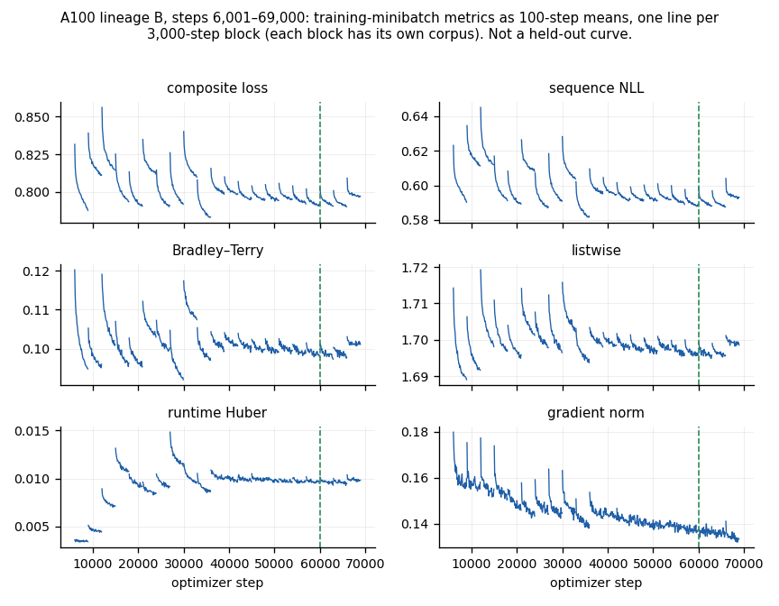
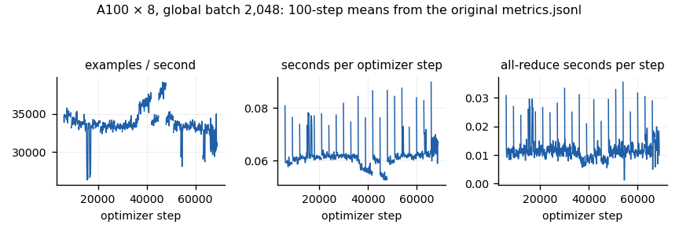
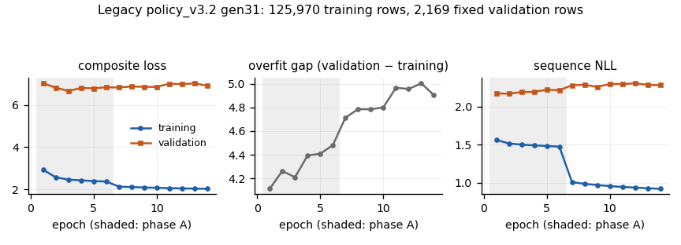

# How ASM works: data, encoding, model, GP, code, training and learning

This chapter describes the whole ASM stack in one place. The first section explains it without jargon. The rest describes the code and the real measurements. Every number comes from source at the stated commit or from a retained file with a recorded SHA-256. When something has not been measured, this chapter says so and draws no curve for it.

**Scope and snapshot.**

- Source references are to `main` at `5de90b1cc0115e8938a8996138873cc8079520bd` unless marked otherwise.
- The one-dataset measurements come from two verified origin-proof journals, `68f56404` and `c5d11ffc`, retained in ASM custody. The canonical report is that of journal `68f56404`, written by the build of source `68f56404c3e199e06413bfd645d3fe0803d7b96f`. Several crates changed between that build and `main` (PR88).
- Numbers recomputed from those journals therefore describe that build. They are not a new run of `main`.
- No new training experiment, GPU window or sealed row was used to write this chapter. Source at the PR90 merge changes none of the core-code files cited here; source support and operational qualification remain separate.

## Explain it like I'm 5

### The recipe-writing robot

Imagine a robot chef that invents recipes. Here a *recipe* is a small computer program that turns a table of numbers into predictions, for example "clean the numbers, then draw the best straight line".

1. **You show it your ingredients.** The robot never gets the whole table. It gets a short *summary card*: 2,048 numbers that describe the columns, how they vary, and how the thing you want to predict behaves. The card is made only from rows the robot is allowed to learn from.
2. **It writes recipe ideas.** A neural network reads the card and writes recipes one word at a time from a fixed list of 401 words. A grammar checker stops it from writing nonsense. It keeps the first 64 different recipes that make sense and adds 16 random "wild" ones, 80 in all.
3. **A cooking contest picks the best.** Every different recipe is sent off to be really cooked and tasted. Failures and timeouts stay in the record but cannot win. Each recipe is trained on four practice folds and tested on the remaining fold, five times over. The best recipes are mixed and changed to make new ones (*mutation* and *crossover*), and the contest runs again. The network's opinion never decides the winner. Only the real tasting does.
4. **Writing the winner down is not finished yet.** Code writers can already turn some simpler recipes into Python, Rust, C++17, C++20 and JavaScript programs that re-train themselves. They cannot yet handle an ASM winner, and the separate fitted-state exporter supports only an allowlisted set of fitted models and requires numerical qualification.
5. **Winners can become lessons.** Later, a recipe that wins *fairly* becomes a teaching example for the network, so its next ideas can be better. That last step is built but has not yet been run on real data.

### Checking that a win is real

A child who only does well on the one test they peeked at has not learned the subject. A child who does well in practice *and* on a new test probably has.

ASM's lift measurement uses the same idea ([§](learning.md#observed-transferable-lift-reporting-contract-not-yet-measured)). It is built but has not yet been run on any real data. Under it, a new way of searching earns credit only when it beats the old way in two places:

- in the practice rounds, meaning cross-validation on the training rows;
- on a separate round of rows it never used, the held fold.

Improvement on only one side earns no positive credit under this descriptive rule. The rule does not identify why the sides disagree. When both win, it earns the smaller of the two wins. [§](learning.md#observed-transferable-lift-reporting-contract-not-yet-measured) makes this exact.

### What the robot cannot do yet

- **It has not yet taught itself anything new.** The step "winners become lessons, lessons make a better network" is built, but no admitted teacher exists and no new network has been trained with it.
- **These training paths do not use policy-gradient reinforcement learning.** The network learns by copying good recipes (imitation) and by learning to rank them. The contest does the exploring. Rewards can weight imitation targets, but there is no PPO/GRPO policy-gradient update in these paths.
- **The bounded origin proof covers one dataset.** It does not demonstrate that the network helps; absence of demonstrated improvement is not evidence of equivalence.

## The stack at a glance

| Stage | What happens | Main source | Status |
|---|---|---|---|
| 1 Data | Frozen development rows. Cut 0 fits on outer folds 1–4 and holds fold 0 back. Sealed rows are never opened. | `crates/jope-pipeline/src/prepared_data.rs`, `search_plan.rs` | available |
| 2 Encoding | Hyperion 512 + projected Foundation 1024 + Target 512 = 2,048 floats, clipped to ±32 | `crates/jope-policy/src/context_producer.rs` | available; CPU outputs are labelled unqualified outside the admitted proof path |
| 3 Policy network | Decoder-only transformer, 512 wide and 6 layers deep, 27,796,494 parameters, accepted step 60,000 | `crates/jope-policy/src/model.rs`, `config.rs` | available (Candle CPU float32) |
| 4 Proposals | Grammar-masked sampling; 64 ranked + 16 exploration programs | `crates/jope-policy/src/decode.rs`, `ranking.rs`, `seeds.rs` | available |
| 5 Bounded GP | 80 generation-0 candidates, 4 elites, up to 76 children per generation (capped by the evaluation limit; 16 in the origin proof), every distinct candidate submitted for a real fit | `crates/jope-pipeline/src/neural_search.rs` | available |
| 6 Refit and held fold | Each arm's winner is refitted on the fitting rows and scored once on fold 0 | `crates/jope-bench/src/panel/asm_campaign.rs`, `campaign.rs` | available |
| 7 Code emission | Legacy recipe emitters: Python and Rust, plus C++17, C++20 and JavaScript where coverage allows | `crates/jope-pipeline/src/emit.rs` | legacy recipe-refit emitters only; they cannot emit an ASM winner; separate allowlisted fitted-state export is implemented; each emitted model still requires qualification |
| 8 Teaching corpus | Guard: 5 folds, at least 4 wins over the training-mean baseline, then HWM and a frozen corpus | `crates/jope-learning/src/eligibility.rs` | implemented; zero teachers admitted |
| 9 Training | Native 512×6 trainer, and the Python 256×2 experimental lineage v1 | `crates/jope-engine/src/training.rs`, `python/src/jope/policy/training_campaign.py` | native held; Python verified only on CPU fixtures |
| 10 New checkpoint | Must beat its parent in a matched fitted search (LOOP-01) | [§](learning.md#loop-01-the-central-regression-milestone) | not measured |

## Deep technical walkthrough

### Stage 1: rows, folds and what each stage may see

A dataset in the frozen panel is split into five outer folds by group. The development partition file holds only development rows. Each row carries its outer fold, a group id, a row id and the original target string.

For cut 0:

- the **fitting rows** are outer folds 1–4;
- the **held rows** are outer fold 0.

For `230_machine_cpu` that is 135 fitting rows and 34 held rows. Their row-id hashes are bound by the frozen evaluation request (`fitting_rows_sha256`, `scoring_rows_sha256`). `SelectionPlan::validate` rejects any overlap between fitting and held rows or between their groups (`crates/jope-pipeline/src/search_plan.rs:68-149`).

Inside the fitting rows, selection uses five **inner folds**. `grouped_inner_folds` counts rows per group and sorts groups largest first, then by group id. It gives each group to the fold with the smallest (size, index) (`search_plan.rs:13-36`). Groups never cross inner folds. Only exact duplicate feature tuples and declared group columns form groups: eight of the ten regression panel datasets declare no group columns.

### Stage 2: the 2,048-float context

The CPU producer builds the context from the fitting rows only (`crates/jope-policy/src/context_producer/input.rs:84-217`):

- numeric columns get training-median imputation and a population z-score;
- categories are indexed;
- the target is z-scored.

It then assembles three blocks. `context_producer.rs:189-271` builds the components, `:423-445` pools Hyperion, and `:357-421` standardizes, projects and assembles.

- **Hyperion 512.**
    - Features only, with no labels.
    - Each column is quantile-bounded and quantized.
    - A V7 sweep produces 128 values per row.
    - The rows are pooled per coordinate as mean, standard deviation, 10th and 90th percentile: 4 × 128.
    - Then `h = (hyp − μ_h)/σ_h`.
- **Foundation 1024.**
    - Features plus the training targets as in-context labels, so this block is **not** label-free.
    - It is 2,048 raw values.
    - It is projected with a frozen 1024×2048 matrix: `z = ((f − μ_f)·Pᵀ − μ_p)/σ_p`.
- **Target 512.**
    - Training targets min–max scaled to [0, 1].
    - Two frozen target windows with seed 17.
    - Then `t = (tgt − μ_t)/σ_t`.

The vector is `concat[h, z, t]`, clipped to ±32 (`context_producer.rs:416`). The recipe identity ends in `frozen-512+1024+512-clip32/v1`; the full string is at `context_producer.rs:127`. The policy configuration still names the first 1,536 values `dataset_dim` and the last 512 `target_dim` (`crates/jope-policy/src/config.rs:39-55`).

[§](architecture.md#component-dimensions-and-assembly) has the qualification tolerances and the pinned asset hashes.

### Stage 3: the policy network

The accepted model is lineage B, step 60,000. It is one set of weights with two heads that answer different questions:

- a decoder that **writes** programs;
- a reward branch that **scores** programs for ordering.

**Decoder (proposal).**

1. The context passes through a two-layer MLP (2048→512→512, GELU and LayerNorm after each layer) and `ctx_proj`.
2. It becomes the token at position 0.
3. Program tokens are embedded with `token_emb`, which has 657 rows: 401 vocabulary rows plus 256 spare. A learned `pos_emb` with 129 rows is added.
4. Six pre-norm decoder blocks follow. Each has causal self-attention with 4 heads of width 128 (packed QKV projection, with future positions and PAD keys masked) and a 512→2048→512 feed-forward network. There is no cross-attention: the context influences every token only through the prefix position.
5. After `out_norm`, the logits are the hidden state times the *tied* token-embedding matrix, narrowed to the 401 real tokens.

Sources: `crates/jope-engine/src/neural.rs:406-461` for the reference forward pass, and `crates/jope-policy/src/model.rs:366-608` for the Candle port.

**Reward branch (ranking).**

1. A second context MLP of the same shape produces `rz`.
2. The program is summarised as `g`: the mean of a separate `reward_token_emb` over non-PAD tokens, followed by LayerNorm. It has **no position term**, so two programs with the same multiset of tokens get the same `g`.
3. The interaction features are `φ = [g, g ⊙ tanh(z_gamma(rz)), |g − z_proj(rz)|]`, 1,536 values.
4. Four reward heads (1536→512→1) each emit a score. Their mean orders the 64 neural slots and records `rank_log_weight`.
5. A runtime head, `softplus(MLP([rz, g]))`, estimates cost.
6. The stability head, the program-only ablation head and seven loss-weight scalars are stored but unused at inference.

Source: `neural.rs:489-531`.

**Parameters.** These are computed from a checked mirror of `expected_inventory` (`model.rs:40-96`): 136 tensors and 27,796,494 parameters.

| Group | Parameters |
|---|---:|
| Context MLP (proposal) | 1,313,792 |
| Context MLP (reward) | 1,313,792 |
| Context prefix projection | 262,656 |
| Token + position embeddings | 402,432 |
| Six decoder blocks | 18,914,304 |
| Output norm | 1,024 |
| Reward program embedding + norm | 337,408 |
| Context gate and projection | 525,312 |
| Four reward heads | 3,149,828 |
| Runtime head | 525,313 |
| Unused at inference (stability, ablation, loss weights) | 1,050,633 |
| **Total** | **27,796,494** |

The Rust port runs in float32 on the CPU. Its numerical parity with the trained tch forward pass is not established, and its `cuda` feature has never been compiled (`crates/jope-policy/src/lib.rs:82-103`).

### Stage 4: grammar, sampling and ranking

**The vocabulary** (`crates/jope-engine/assets/grammar/featmath.json`) has 401 tokens:

| Category | Tokens |
|---|---:|
| `PAD`, `BOS`, `EOS` | 3 |
| `ENGINE` | 1 |
| `TASK` | 4 |
| `OP` (31 transforms, 22 heads) | 53 |
| `VAL` (binned parameter values) | 291 |
| `APPEND` | 3 |
| `EXPR_VAR`, `EXPR_CONST`, `EXPR_FUNC`, `EXPR_BINOP`, `EXPR_END` | 14, 16, 11, 4, 1 |

The product restriction `featmath-jain-v1` keeps the same table but allows fewer operators ([§](architecture.md#accepted-identities-and-the-product-restriction)).

**Sampling** (`crates/jope-policy/src/decode.rs`):

1. Every row starts from `[BOS, ENGINE=featmath, TASK=regression]`.
2. At each step, a grammar automaton gives the legal next tokens. Illegal logits are masked, and the token is drawn from `softmax(logits/T)` with a ChaCha20 generator seeded per request.
3. The defaults are 8 rounds × 128 rows at T = 1 (`decode.rs:39-46`). The origin proof requested 4 rounds × 64 rows at T = 1: see `proposal.request.sampling_rounds` and `sampling_batch` in the neural arm's retained search receipt (journal `origin-proof-68f56404…/journal/asm-search/ec2b7ba9…/search-receipt.json`, SHA-256 `5eae7243b5442635eacb326e0a1ce0b7a4e43ba413ed68e281e1ff33dcd6e069`).
4. Sampling stops after the round in which `POOL_SIZE` = 64 distinct valid programs exist, and the first 64 in draw order are kept (`decode.rs:221`, `:457-459`). A row is valid if it decodes and `feat_math` parses it. Rows that do not reach `EOS` within 128 tokens are dropped.
5. A shortfall is filled with grammar-uniform programs, recorded as `neural_rejection_fallback` and never as neural. Then `EXPLORATION_SIZE` = 16 random exploration programs are added (`decode.rs:26-28`).

**Ranking** (`crates/jope-policy/src/ranking.rs:338-445`) scores the 64 pool programs with the mean of the four reward heads. It sorts them by score, breaking ties by program SHA-256. The scores are within-context logits, not calibrated losses. They order slots; they do not choose GP parents.

### Stage 5: the bounded GP search

`neural_search.rs` runs two arms under the same declared budgets:

- the **neural** arm: 64 policy programs plus 16 exploration programs;
- the **generic** arm: 80 grammar samples.

Constants: `INITIAL_SIZE` = 80, `NEURAL_SLOTS` = 64, `ELITES` = 4 (`neural_search.rs:28-30`).

1. Every canonically distinct candidate is submitted for a real fit on the five inner folds under the execution pool's resource limits (at most 20 workers, 1 thread each, cgroup memory limits; `experiment.rs:58-97`). A canonical duplicate is recorded as failed without a second fit (`neural_search.rs:1192-1233`). A failed or deadline-cut fit gets no loss.
2. Its **selection loss** is the unweighted mean of its five inner-fold losses (`crates/jope-bench/src/panel/optimize_fit.rs:252`).
3. The four best by that loss are the parents.
4. Children alternate between mutation and crossover by attempt parity, and are deduplicated by canonical executable hash. A generation has up to 76 children: `min(76, max_evaluations − observed)` (`neural_search.rs:1718-1719`). The origin proof's cap of 96 allowed one wave of 16.
5. The arm normally stops at its evaluation limit or its original deadline, whichever comes first. It can also stop with `no_measured_parent` or `search_space_exhausted`, or in a resumable cancellation or admission-pending state (`neural_search.rs:1633`, `:1694`, `:1715`, `:1769`).
6. The winner is the minimum selection loss, with ties broken by program SHA-256 (`neural_search.rs:653-667`). It is frozen before any held-fold fit.

In the retained origin proof on `230_machine_cpu` (journal `68f56404`):

| | Neural arm | Generic arm |
|---|---|---|
| Completed candidates | 77 (62 in generation 0) | 89 (76 in generation 0) |
| Stop reason | original deadline | evaluation limit |
| Winner | generation 1, crossover | generation 1, mutation |

The neural winner descends from exploration candidates, not from a `neural_policy` proposal ([§](status.md#canonical-proof-record-and-per-arm-facts)).

### Stage 6: refit, the held fold and code emission

Each arm's winner is refitted on all 135 fitting rows and scored once on the 34 held rows (`asm_campaign.rs:197-250`). The refit sees the held rows' features only, and scoring happens in the parent process (`campaign.rs:279-289, :617`).

The legacy emitters (`crates/jope-pipeline/src/emit.rs`) write Python and Rust, and C++17, C++20 and JavaScript where their coverage gates admit the recipe. The emitted program contains `fit` and `predict` and refits from a training CSV at run time.

**They cannot emit an executable ASM recipe.** Every ASM recipe carries an inserted `(input …)` stage (`crates/jope-pipeline/src/synthesized_recipe.rs:34-47`), and the legacy planner rejects that stage (`crates/feat-math/src/spec.rs:383-389`, `:592`). A separate allowlisted fitted-state path is implemented in `fitted_export.rs` and `fitted_export_run.rs`, including synthesized worker artifacts through `FittedInferenceView::synthesized`. It packages supported saved state and qualifies emitted predictions; it does not make the legacy planner accept synthesized ASM recipes or establish general ASM-winner coverage. The historical deployment requirements are retained in [§](inference.md#deployment-support-definition-priority-and-status).

### Stage 7: teaching and training

**Teaching.**

- A candidate becomes a teacher only if the fixed guard admits it: five folds, at least four fold wins over the training-mean (or class-frequency) baseline, and a mean-loss gain above `1e-12 + 1e-6·|baseline|` (`crates/jope-learning/src/eligibility.rs`, `GuardPolicy::current`).
- It must then pass strict HWM admission into a frozen corpus ([§](teachers.md#the-admission-guard-label-exposure-and-hwm-identity)).
- No teacher has been admitted under this guard.

**The native objective**, which produced step 60,000 (`crates/jope-engine/src/training.rs:1257-1339`):

`L = seq_nll + 0.25·BT + 0.1·ListNet + 0.1·runtime_Huber + 0.05·ablation_BT`

- `seq_nll` is grammar-masked token cross-entropy, with 0.05 smoothing inside the legal set and row weight `0.05 + percentile⁴`.
- `BT` is a weighted pairwise Bradley–Terry loss over the eight programs of each comparison.
- `ListNet` targets `softmax(percentile/0.25)`.
- The optimizer is AdamW at a constant learning rate of 1e-4, weight decay 0.01, gradients clipped to norm 1.0 after the all-reduce, with a global batch of 2,048.
- The trainer is held: `require_original_gpu_grant` refuses every call (`crates/jope-engine/src/task_contract.rs:88-92`).

**The Python v3 objective** (`python/src/jope/policy/losses.py`):

- Kendall–Gal uncertainty weights on `seq_nll` and `runtime_huber`, and fixed weights on the ranking, stability, ablation and routing terms.
- In the default trainer, the imitation loss becomes reward-weighted (RWR) after phase A. The experimental 256×2 campaign sets `phase_a_fraction=0.0`, so it applies RWR from the first step.
- The experimental lineage v1 (256×2) campaign in `training_campaign.py` has run only on CPU fixtures.

**Continuation modes:** cold initialization, weight warm start, explicit new-corpus transition, and exact interrupted resume ([§](training.md#the-four-continuation-names-and-their-commands)).

### Stage 8: "reinforcement learning" — what the code actually does

| Mechanism | Present? | Where |
|---|---|---|
| Policy-gradient reinforcement learning (REINFORCE, PPO, GRPO) | **No.** "GRPO" appears only in a docstring. | `model_v3.py:8` |
| Expert iteration: policy proposes, GP searches as the expert, guard admits, retrain | Structure implemented; no real generation completed | `neural_search.rs`, `teaching.rs`, `eligibility.rs`, `training_campaign.py` |
| Reward-weighted regression on imitation targets | Implemented (Python) | `losses.py:387-442` |
| Rank-weighted behaviour cloning (`0.05 + percentile⁴`) | Implemented (native) | `neural.rs:534-577`; `training.rs:1288-1294` |
| Preference optimisation (DPO) | Functions written, never called | `neural.rs:578-698` |
| Tree search (MCTS) | Rejected for now | `expert_iteration_setup.py` |

The repository's own assessment records `flywheel_effect=False` (`python/src/jope/tools/expert_iteration_setup.py:214`) and a neural-seed success rate of 0 of 140 (`:72-84`). The file itself marks that rate as not verified against its source report (`:83`). **Expert iteration, meaning imitation of search results, is the accurate name for this design.** Calling it reinforcement learning would overstate it.

## Training runs and global metrics

### Which numbers can be compared

A training loss describes the batch it was computed on. Two losses are comparable only when they measure the same population, objective and model family. This section follows three rules:

- **Comparable across checkpoints:** the fixed monitor. It has one panel (`fbff7a04`), one corpus (`11e60a43`) and 2,048 examples for the step-3,000 parent and every A100 block-end checkpoint from 6,000 to 69,000 ([§](#a-fixed-panel-learning-curve-for-the-a100-lineage)).
- **Comparable only within one block or one run:** per-step training losses, and adaptive validation on a panel that changes between blocks.
- **Not comparable at all:**
    - composite losses across objectives (native v3 and Python v3.2/v3.3 with learned weights; RTX additionally exposes `contextfree_bt` telemetry, which alone does not establish a changed objective);
    - any legacy metric across generations, whose training rows grow;
    - internal Elo against anything.

Metrics that were never logged are listed as such: per-step learning rate (it was constant), tokens per second, a reward-MSE, and any reinforcement-learning advantage.

### A fixed-panel learning curve for the A100 lineage

**Source.** The 24 records live under `/home/ubuntu/jain-split/jope-dime/parallel/recovery/eight-a100-20260912/learning-receipts/learning/monitoring/` (schema `parallel.frozen_monitoring.v1`). They cover:

- the parent at step 3,000, scored under executables `87995977…` and `db0aabe9…` with identical values;
- every block end from 6,000 to 69,000.

Each record states `training_selection_used: false`, `final_tests_opened: false`, `independent_evaluation: false` and `evaluation_bias: "frozen adaptive teaching validation panel"`. The extraction is `data/deep-stack/a100-fixed-monitor.csv`, with a SHA-256 manifest `data/deep-stack/extraction-manifest.json`.

| Checkpoint | Sequence NLL | Bradley–Terry | Listwise | Runtime Huber |
|---|---:|---:|---:|---:|
| Parent, step 3,000 | 1.41778 | 0.56216 | 2.31246 | 0.07236 |
| Lowest value on the panel | 1.37754 (step 45,000) | 0.49244 (33,000) | 2.19595 (9,000) | 0.06648 (45,000) |
| Accepted step 60,000 | 1.38693 | 0.50920 | 2.22060 | 0.06846 |
| Unaccepted step 69,000 | 1.39241 | 0.52248 | 2.24601 | 0.07158 |

What this shows:

- **On one unchanged adaptive population, training lowered all four objective losses.** From the parent to step 60,000, sequence NLL fell by 0.0309 nats (2.2%) and Bradley–Terry ranking loss fell by 0.0530 (9.4%).
- **The minimum retained monitor values occurred before step 60,000.** Sequence NLL was lowest at step 45,000, and from there it rose by 0.0094 by step 60,000 and by 0.0149 by step 69,000. Bradley–Terry was lowest at step 33,000.
- **So the accepted checkpoint was not this panel's best**, and the later blocks drifted.
- **The limits.** The panel is adaptive teaching validation, not an independent test. The numbers measure how well the objective fits, not whether GP search improves.

This 24-record series was not in the earlier editions. They showed only the separate fixed comparison of the recovery checkpoint, cycle 25 and cycle 107 ([§](training-history.md#fixed-monitoring-and-actual-promotion-evidence)). The statement in [§](training-history.md#telemetry-limits-and-the-recovery-boundary) that the 78-checkpoint series has no unchanged population is still true of that series. The fixed monitor is a separate, unchanged population for the block-end checkpoints.

### Every step of the A100 run

The six plotted metrics come from the retained 100-step bins (`data/per-step-history/a100-step-bins.csv`, 3,780 rows): composite loss, sequence NLL, Bradley–Terry, listwise, runtime Huber and gradient norm. [§](training-history.md#the-complete-a100-loss-series-steps-600169000) describes how they were extracted.

- Training losses generally fall within each block. Composite loss increases at all 20 single-step corpus boundaries and at 19 of the 20 boundaries when compared using the plotted 100-step means.
- The gradient norm falls from a first 100-step mean of 0.1798 to a last of 0.1334. It spikes briefly at each block boundary, but unlike the losses it trends down across the whole run.

### Throughput and timing

The median of the 21 block medians gives these figures:

- 33,071 examples/s;
- 31,599 examples/s end to end;
- 0.0619 s per step;
- 0.0108 s of all-reduce per step, about 17% of the step.

The 100-step means range from 26,346 to 39,112 examples/s. The extraction (`data/deep-stack/a100-throughput-bins.csv`) records the SHA-256 of each source log. Tokens per second were never logged.

### Training versus validation in the legacy gen31 run

gen31 is the clearest example in the retained data of training loss improving while validation does not:

- Training composite loss fell from 2.926 to 2.022.
- Validation composite loss stayed between 6.67 and 7.04.
- The recorded overfit gap grew from 4.11 to 4.90.
- Training sequence NLL dropped sharply at epoch 7, from 1.474 to 1.008. That is where phase B starts and reward weighting is applied to the imitation loss, so the drop reflects a **change of objective**, not a sudden gain.
- The 0.05-smoothed validation sequence-loss component (`val_loss_components.seq_nll`) rose from 2.175 to 2.283. This differs from the unsmoothed `val_seq_nll` reported in the historical chapter (2.055572 to 2.182772).
- Validation pairwise ranking accuracy stayed between 0.527 and 0.53850.

[§](training-history.md#gen31-fitting-the-objectives-versus-using-the-context) gives the context-advantage diagnostics.

## Measurement status and figure provenance

The global KPI is **not yet measured**. The reporting contract in [§](learning.md#observed-transferable-lift-reporting-contract-not-yet-measured) uses independently repeated nested searches, the per-unit minimum of audit and outer gains, and equal family weighting. The adaptive panel and these historical curves cannot supply an untouched evaluation. No alternative score or statistical significance gate is introduced here.

Reproduce the new historical extraction with `python3 docs/internal/asm-manual/tools/extract_deep_stack_data.py --out OUTPUT`, then draw the six figures with `python3 docs/internal/asm-manual/tools/make_deep_stack_figures.py --repo REPO --training-data OUTPUT --out FIGURES`. The extraction manifest binds every original monitor record and timing log. The figure receipt binds the source files, retained numerical inputs and all output hashes, with per-plot coverage, units and interpretation limits. These are historical observations and source diagrams; none is a new training or fitted-search result.
