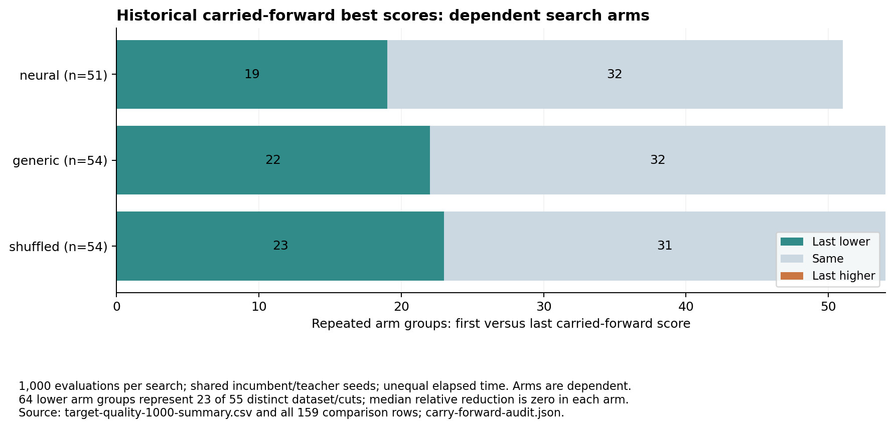
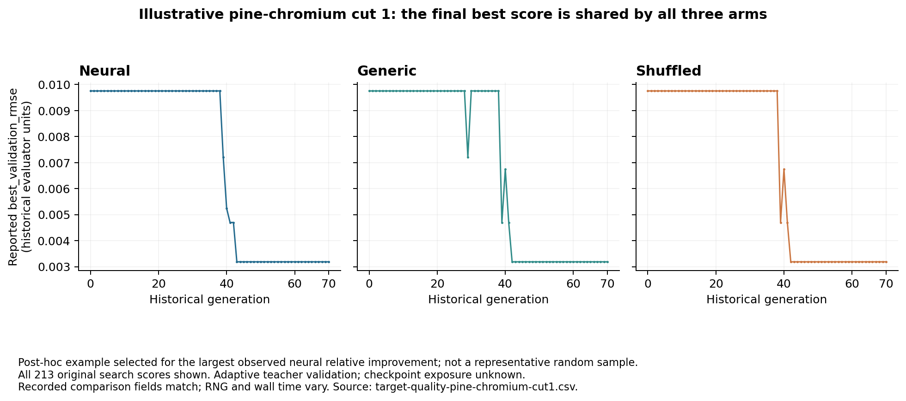
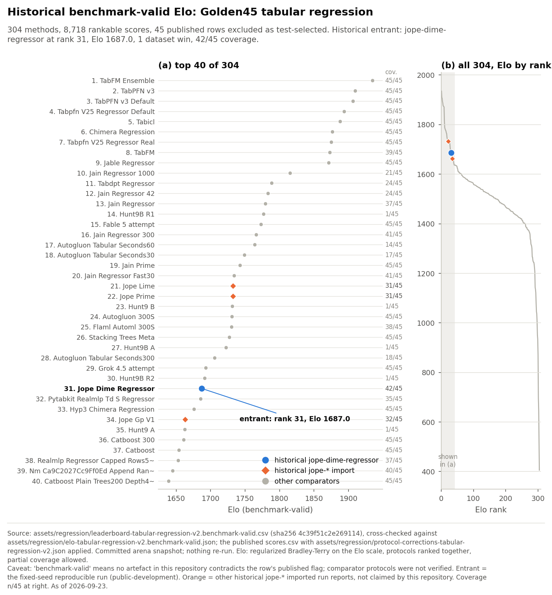
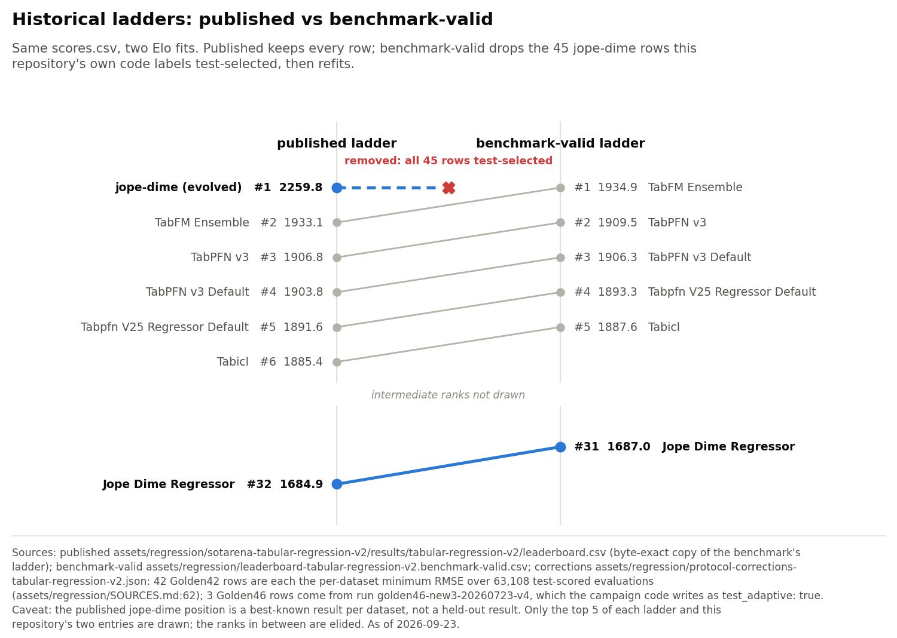
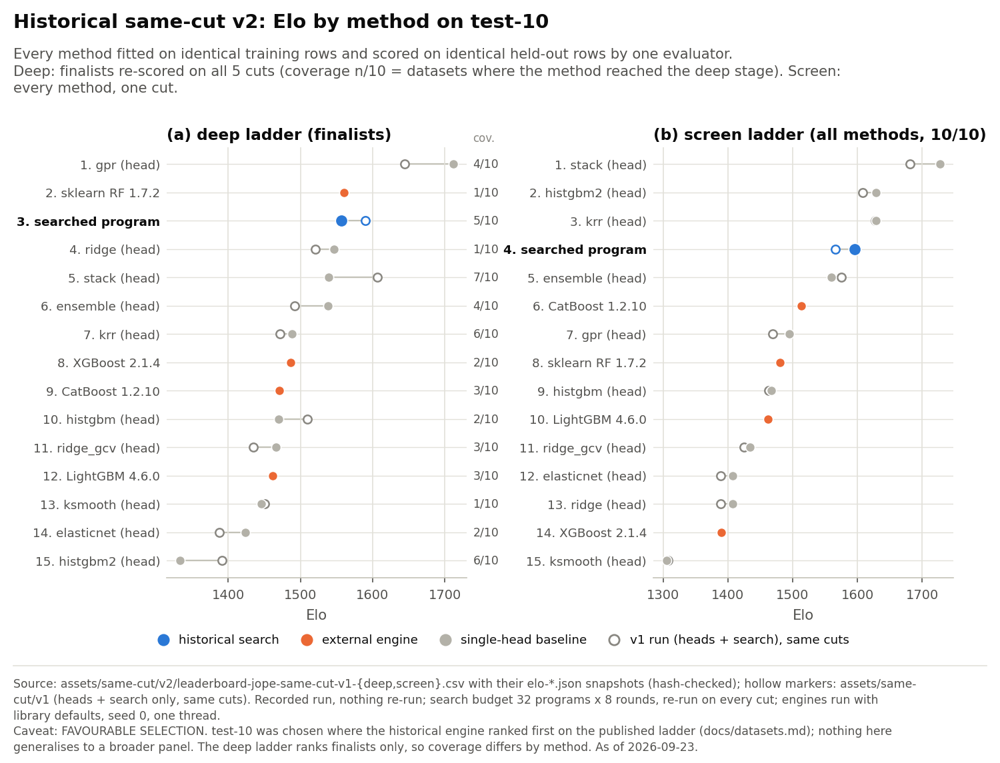
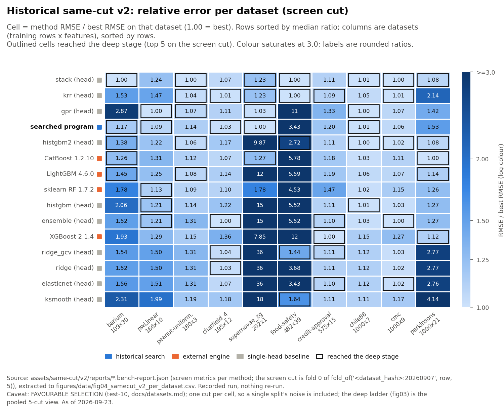
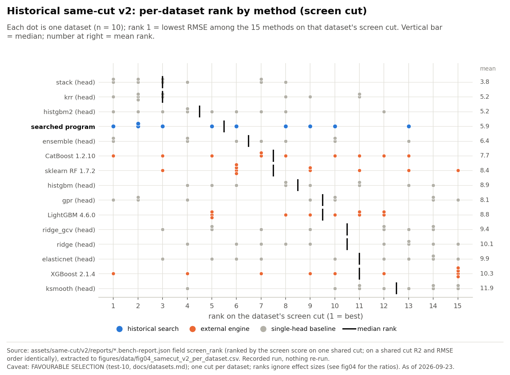
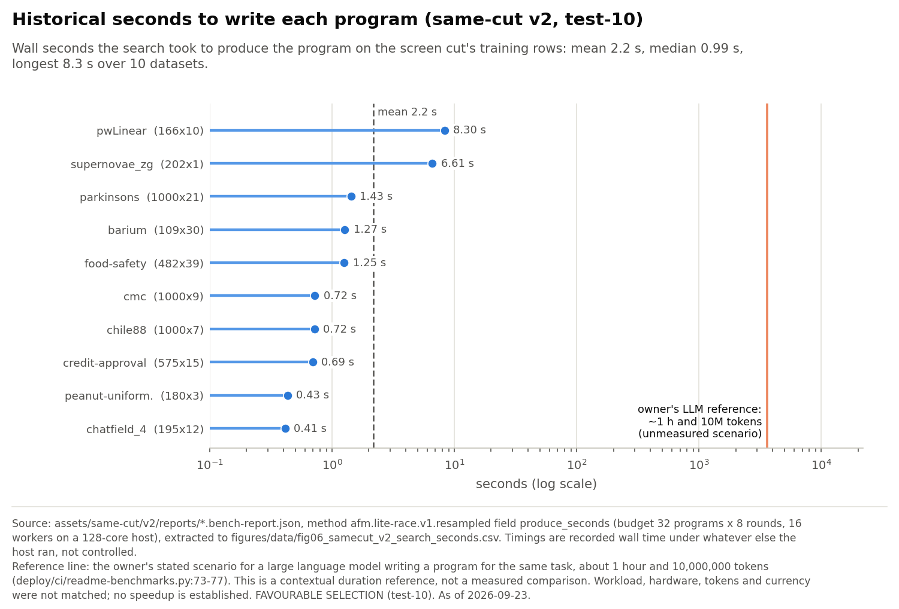

# Historical GP targets, rankings, Elo and attribution limits

This chapter answers two questions: which historical corpora and target records survive, and how the historical target collections and their observed scores changed. What one training example contains is described in [§](teachers.md#a-dataset-is-not-one-training-example), and how the implementation stores and loads packed records in [§](data-estate.md#record-layout). This manual's audit read metadata, manifests and development-score receipts. It did not read sealed labels, model tensors, packed target-record bodies or the large audit-label sidecars, and it ran no training or fits. External packing, inventory and seed audits report results that depend on payloads this audit did not open; those results are attributed separately below and were checked here through retained metadata, scripts and arithmetic, without replaying the payload reads. File-metadata observations, externally reported payload checks and source-derived calculations remain distinct evidence levels.

## Did GP targets get better?

### Carried-forward scores and the admitted receipt inventory

**Some recorded carried-forward best scores became lower.** These are historical development outcomes from searches sharing incumbent and teacher seeds. They are not independent discoveries by each arm, and their no-worsening pattern is partly structural. Corpus growth alone would not establish even this narrower result.

The audit enumerated 29,744 `search.json` paths under `/home/ubuntu/jope-node-mirror/results`, which resolves into `/home/ubuntu/jain-split/jain-datasets/.runtime/node-archive-mirror-20260914/results`. This source covers generations 0–70. The audit rejected 3,387 paths outside the accepted context index's `meta_train` dataset/cut allowlist **before opening their score files**. The remaining 26,357 receipts identify adaptive development-validation RMSE, prepared data, vocabulary, evaluator, execution protocol and completion metadata. Each source file and observation ledger has a distinct recorded digest. Their recorded completion times span September 12, 2026 18:37:13 UTC to September 14, 2026 13:37:43 UTC. These times are receipt metadata, not a new replay of the fits.

Only 3,530 of the 26,357 permitted receipts are also present in the separately preserved `accepted60000-restored` tree, all byte-identical; the other 22,827 receipts, including every permitted generation 10–70 receipt, are absent from that tree. A custody archive preserves all **26,357 original search receipts**, totaling **62,271,855 uncompressed bytes**. A separate streaming verification checked every member name, size and original SHA256 without reopening the source bodies. `original-target-receipts-custody.json` pins the archive and verification. The archive is a second local copy on the same filesystem, not an off-host backup. The separate seed bodies used by the external carry-forward analysis are outside that archive.

### First-to-last comparison at 1,000 evaluations

For a readable comparison, the table restricts each repeated comparison to exactly 1,000 completed evaluations, matching its recorded dataset/family, cut, prepared SHA, vocabulary SHA, evaluator SHA/protocol, execution-order protocol and run. It compares the first retained generation with the last retained generation within that group. Lower RMSE is better. Improvement and worsening use exact `<` and `>` comparisons of the parsed reported scores; unchanged means exact equality, with no epsilon. The analysis script applies no additional cumulative minimum, but the underlying search already carries incumbent/teacher programs forward. Thus the reported per-generation best usually behaves like an inherited incumbent rather than a fresh independent draw, but it is not strictly monotone. In the 9,536 adjacent 1,000-evaluation transitions where the previous best was re-seeded, the recorded best stayed equal 9,406 times, fell 130 times and never rose; all 27 rises occur in the 76 transitions where it was not re-seeded. The score field is `best_validation_rmse` under the historical `featmath_training_fold_normalized_v1` evaluator; the plots do not claim original target units.

| Historical search arm | Repeated arm groups | Last lower | Same | Last higher | Median relative reduction, all groups (unchanged included) |
| --- | ---: | ---: | ---: | ---: | ---: |
| Neural | 51 | 19 | 32 | 0 | 0% |
| Generic | 54 | 22 | 32 | 0 | 0% |
| Shuffled | 54 | 23 | 31 | 0 | 0% |

The 159 arm groups cover **55 distinct dataset/cut pairs**. The 64 lower arm groups (19 + 22 + 23) cover only **23 distinct pairs**; 22 of those 23 end at the same score in every available arm. These counts were independently recomputed from the published comparison CSV. The denominators and shared seed pools make the arm counts dependent; one discovery can later appear in multiple arms.

The separately released external seed audit reports `seed_population_supplied=true` and `teacher_first_v1` for all 26,357 receipts. The previous recorded best appears in the next seed set in 25,790 of 25,985 transitions; 26,051 reported winners (98.84%) are already in that search's seed population. Incumbent, retained-teacher and exploration seed sets are identical across arms in all 8,785 multi-arm dataset/cut/generation groups checked. Those seed-body counts are externally reported and metadata-checked here, not a new local seed-payload replay. They explain why zero first-to-last worsening is not independent evidence of stability. A lower inherited score is also not a new discovery by the receiving arm. `carry-forward-audit.json` preserves these evidence boundaries.

This table is therefore not a paired policy-ranking result. Random seeds change between generations, elapsed time varies, and this audit did not requalify the actual CPU/memory/hardware enforcement or complete build closure of the historical searches. Matching these recorded fields is narrower than the complete current experiment identity. The recorded generation manifests declare 600 seconds and 1,000 evaluations for the illustrative example; those declarations do not establish equal consumed wall time. Checkpoint association is available by generation, but exact exposure of each improved target to later optimizer batches remains unjoined.

### The pine-chromium example, attribution limits and published data

A concrete example is `mendeley-6bspjkt7bg-pine-chromium`, dataset `b68222ad60398ea8`, cut 1. Across generations 0–70 the recorded best development RMSE changes from **0.009749860799638275 to 0.003185684481133936**, a **67.3258% relative reduction**. All three arms finish at the same score. The neural arm first records that final value at generation 43; generic and shuffled do so at generation 42. The external seed audit identifies the final program outside the generic and shuffled seed sets at generation 42, then as an `incumbent_cut_teacher` seed in all three arms at generation 43. The neural arm's later equality is carry-forward, not evidence that it independently discovered that program. This identifies generation-level observations; it does not establish which of two same-generation arms discovered the program first in wall-clock time. The recorded best is not monotone here either: generic reports 0.007209 at generation 29 and 0.009750 at generation 30, and generic and shuffled both rise from 0.004698 at generation 39 to 0.006747 at generation 40; the neural arm first reports 0.007209 at generation 39. The plot data include all 213 generation/arm pairs, with no interpolated missing generation. This example was selected after inspection as the largest first-to-last relative improvement in the neural 1,000-evaluation subset; it is illustrative, not representative.

Relative improvement is `(first_RMSE - last_RMSE) / first_RMSE`. The percentage is meaningful within that dataset/cut. Raw RMSEs from unlike target scales are not averaged to claim overall progress. A running-best curve, if separately shown, must be labelled as such: its monotonicity follows partly from selection. Better retained minima do not prove that a trained neural proposal policy caused the gain. Shared incumbent/teacher seed pools and carry-forward are established in the external audit; search history and ordinary exploration also prevent attribution to policy learning. Count a new search discovery separately from a copied incumbent: authenticate the full seed set, identify the first measured program absent from it, and retain the discovering arm, generation, context, program and parent identities. The aggregate table above does not provide that full per-program discovery ledger. The owner's acceptance rules (proposed) keep four claims distinct: an eligible teacher, a new discovery, information actually consumed by training, and an improved policy. Initial populations must be authenticated, and a discovery must not silently seed another arm. The historical records in this appendix support at most lower retained development scores and, for single programs such as the pine-chromium example, a generation-level first appearance outside a seed set. They do not establish teacher eligibility, consumption by a later optimizer or an improved policy, and a receipt hash alone does not make a program eligible.

The small publication files are `target-quality-1000-summary.csv`, `target-quality-1000-comparisons.csv` and `target-quality-pine-chromium-cut1.csv`. Full 26,357-row extracted evidence stays in custody, with its hash in `historical-target-quality-summary.json`; the manual need not embed the 19.5 MB full extraction. This analysis reads development scores only and creates no new teacher eligibility, promotion or benchmark-valid result.

### Paired final-search outcomes within the admitted development inventory

A metadata-only comparison pairs arms **within the same generation**, keeping the recorded run, dataset/family, cut, prepared SHA, vocabulary SHA, evaluator SHA/protocol, execution-order protocol and exactly 1,000 completed evaluations equal. It uses the existing 26,357 admitted receipts, not a newly expanded input boundary. Scores are finite positive `best_validation_rmse`; lower is better. Each comparison counts exact score equality, with no epsilon.

| Neural compared with | Paired observations | Neural lower | Equal | Neural higher | Geometric mean neural/control RMSE |
| --- | ---: | ---: | ---: | ---: | ---: |
| Generic | 3,268 | 24 | 3,227 | 17 | 1.0001869094 |
| Shuffled | 3,253 | 24 | 3,213 | 16 | 1.0000854976 |

These are repeated adaptive **final-search** observations across generations 0–70, not measurements of initial neural seed quality. The generic comparison covers 52 dataset/cut pairs from 30 families; the shuffled comparison covers 52 pairs from 31 families. Reported wall times differ in every pair. Families, contexts and generations repeat; the arms share incumbent, retained-teacher and exploration seeds, and the search can recover from poor initial proposals. The paired rows are not independent arm discoveries. No independent-sample confidence interval, causal advantage or failure-inclusive benchmark claim follows. The ratios are descriptive and close to one; they do not establish that training improved routing.

The external report's broader routing extract has 42,863 rows. Only 3,530 match this chapter's admitted receipt inventory by retained path and all checked score, prepared-data, vocabulary, evaluator, protocol, completed-evaluation and wall-time fields. The other 39,333 are outside that existing inventory; their eligibility remains unqualified here, **not classified as all sealed**. No original score path was reopened for this join. The broader campaign ratios and p-values are therefore not imported. The compact `packing-routing-audit.json` pins inputs, matching fields, arithmetic and exclusions.

## Existing historical rankings and Elo

### Retained snapshots and plot data

Six committed snapshots are available and their ladder and score SHA-256 values were verified against retained bytes. No new Elo computation occurred in this audit. The snapshots use their own method pools and dataset protocols, so their Elo numbers cannot be compared across snapshots as a universal score.

| Snapshot | Rankable rows | Methods | Datasets | Interpretation |
|---|---:|---:|---:|---|
| same-cut-v1-screen |110|11|10|historical_same_cut_reproducible_snapshot_not_current_ASM30|
| same-cut-v1-deep |50|11|10|historical_same_cut_reproducible_snapshot_not_current_ASM30|
| same-cut-v2-screen |150|15|10|historical_same_cut_reproducible_snapshot_not_current_ASM30|
| same-cut-v2-deep |50|15|10|historical_same_cut_reproducible_snapshot_not_current_ASM30|
| historical-sotarena-published |8763|305|45|historical_published_best_known_test_selected_not_benchmark_valid|
| historical-sotarena-benchmark-valid |8718|304|45|historical_corrected_public_development|

For plots, use `performance-evidence.json.gz`: 6 complete ladder row sets; 520 same-cut score cells, including missing/rejected statuses; 20 per-dataset reports with exact cut identities, source heads and screen/deep timings; 8,763 historical SOTArena score rows; and the 2 current-origin refit loss rows. Do not blend these into one chart without explicit separate protocol panels. The frozen panel (asm-private-30-v1) matrix had no completed cells as of 2026-09-23 about 23:55 UTC; represent it as pending, not a fabricated ranking.

### Ranking figures: interpretation contract

Historical ladders retain their original snapshot names. Benchmark-valid and public-development views are separated. Same-cut screening includes all admitted methods; deepening includes only finalists, so empty cells have a deliberate meaning. A rank heatmap compares methods within a dataset and stage; it is not a plot of absolute loss across datasets. Any chart with only the top methods states that limit, while its CSV preserves the full underlying inventory.

The historical ranking plots that follow use their separately pinned snapshots. They are not new model runs and are not a frozen-panel (asm-private-30-v1) campaign. Benchmark-valid and public-development views retain their original eligibility distinctions. Same-cut deep-stage coverage varies because only finalists were deepened; absent cells are not zero losses. See [§](benchmark.md#the-bradleyterry-model-tie-rule-and-defaults) for the exact Elo model and tie rule, [§](benchmark.md#interpreting-a-rating) for coverage limits and [§](benchmark.md#adaptive-development-exposure) for the adaptive-development interpretation.

All machine-readable rows are retained in `data/performance-evidence.json.gz` and `data/plot-historical-elo.csv`. A displayed top-method subset does not remove the other methods from those inventories. Dataset selection and historical protocol caveats travel with each figure.

### SOTArena published and corrected ladders

#### Historical benchmark-valid Elo

This view retains 304 methods and the historical corrected eligibility filter. The historical `jope-dime-regressor` entrant is rank 31 with Elo 1687.0 in this snapshot. “Benchmark-valid” means no retained artifact contradicts a row's flag; comparator protocols were not independently verified. It does not certify that every comparator obeyed today's frozen ASM protocol.

The top-method view is paired with the distribution of the full method universe. Dataset coverage and the identity of the historical entrant remain visible. These numbers describe the retained historical ladder, not the current accepted step-60000 model's thirty-dataset performance.

#### Why the two historical ladders differ

The published SOTArena snapshot puts historical `jope-dime` at rank 1/Elo 2259.8 with 11 wins and 45/45 coverage. All 45 rows are test-selected: 42 best-test evolution-envelope rows plus 3 test-adaptive accepted replays. The corrected benchmark-valid snapshot excludes those 45; **that rank 1 is not a held-out ASM claim**. The corrected snapshot has 304 methods/8,718 rankable rows. Its fixed-seed historical `jope-dime-regressor` entry is rank 31/Elo 1687.0, 1 win, 42/45 coverage; TabFM Ensemble is rank 1/Elo 1934.9. It remains historical public-development evidence.

The published view includes 45 test-selected `jope-dime` rows; the corrected benchmark-valid view removes them. The historical `jope-dime` rank-one Elo of 2259.8 belongs to the former view. It is a best-known test-selected result, not a held-out claim. An eligibility change alters the overlap graph and the fitted ladder, so these ratings must not be combined into a single current score.

### Historical same-cut screening and deepening

#### Same-cut v1 and v2 snapshots with screen and deep Elo

Same-cut v1 covers native heads plus resampled search; v2 adds XGBoost 2.1.4, LightGBM 4.6.0, CatBoost 1.2.10 and scikit-learn 1.7.2 random forest under Python 3.12.3. Both use the favorable historical test-10 regression selection, seed 20260907, five folds, top-five deepening and 32×8 search. Deep rows include only screened finalists; coverage must be printed with rankings. Their timing fields are then-recorded wall times under uncontrolled host load, not the present isolated-worker timing protocol.

Same-cut v2 compares all fifteen methods during screening on ten regression datasets. Only the five finalists per dataset are deepened across all five cuts, so the deep-stage denominator differs by method. Hollow markers preserve the earlier v1 snapshot; they are a separate run, not confidence intervals. The historical searched program is distinct from the current qualified neural proposal path.

The ten historical datasets were a favorable selection for the earlier engine. Their ranking cannot establish performance on a broader corpus or substitute for the frozen panel (asm-private-30-v1). External engine versions printed in these plots are the historical run versions, not a claim about currently installed adapter versions.

#### Historical relative loss and per-dataset rank

Each heatmap cell is a method's screen RMSE divided by the best screen RMSE on the same dataset. A ratio of one is best; the color saturates at three while displayed values are rounded. This normalization supports within-dataset visual comparison without averaging incompatible raw target units. Outlines show which cells reached the deep stage.

The rank-distribution plot shows all ten per-dataset screening ranks for each method, with mean and median. It reveals variability hidden by a single aggregate ladder. A rank difference conveys ordering, not the magnitude of a loss improvement or a confidence interval.

### Historical production time and the supplied reference scenario

The retained same-cut reports record mean program-production wall time 2.1837062093 seconds, median 0.9870389355 seconds and maximum 8.299870126 seconds across ten datasets. These are recorded timings under the host's contemporary load, not isolated controlled latency measurements and not the current paired ASM proof's elapsed time.

The one-hour/ten-million-token marker is the user's contextual scenario, drawn as a reference line; it is not measured. Workload, hardware, token trace, currency and result quality were not measured under matching conditions. The chart therefore establishes no matched speedup, cost saving, token-efficiency ratio or quality equivalence. The measured current proof and its per-predictor/per-recipe accounting remain separately reported.
