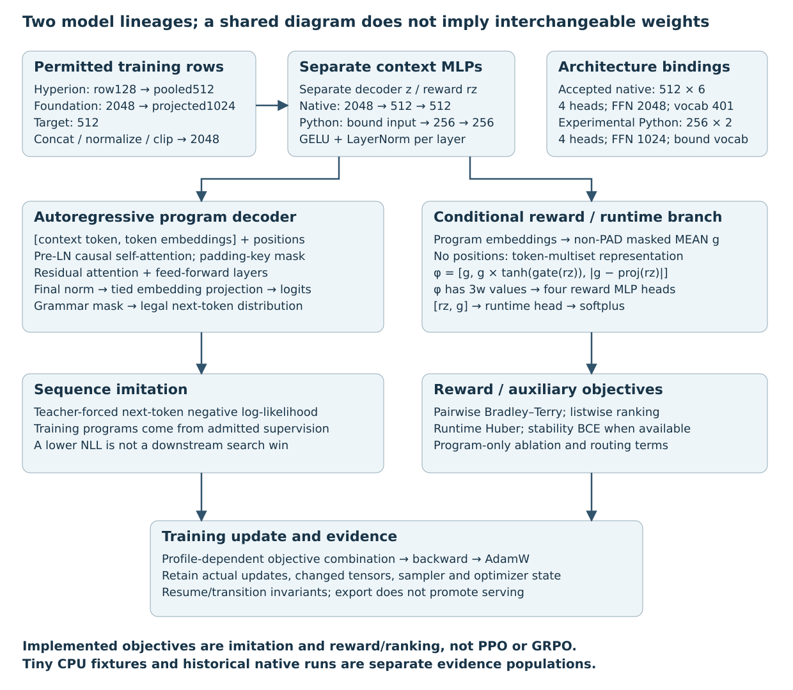

# System overview and core contributions

This monograph documents the product repository `veox-ai/JopeDime`. It separates a conditional neural program generator, measured genetic-programming search, fitted predictors and deterministic code generation. A neural network proposes instructions; fitting produces data-specific state; export lowers that state into a supported language. Those are different artifacts with different evidence requirements.

The evidence cutoff and exact source, asset and file hashes are in the publication record. “Implemented” means a source path exists. “Tested locally” means a retained command executed. “CI verified” means declared jobs passed at an exact head. “Operationally measured” means real inputs and resource boundaries were recorded. “Promoted” means an explicit serving-selection decision. None implies the next automatically.

## Core mechanisms and established methods

The project-specific combination is a frozen three-part context, grammar-restricted proposals, explicit original-versus-executable recipe identity, paired bounded search, fitted export receipts, and a teaching/HWM closure. Attention, AdamW, ridge regression and genetic programming are established methods, not claimed inventions of this project. This text does not make a patent-novelty or freedom-to-operate determination.

The transformer background is [Vaswani et al., 2017](https://arxiv.org/abs/1706.03762). Decoupled weight decay is described by [Loshchilov and Hutter](https://arxiv.org/abs/1711.05101). The evolutionary-program background is [Koza’s genetic-programming book](https://www.genetic-programming.org/gpbook1toc.html). These references explain methods; repository source and receipts establish this implementation.

## Current responsibility map

| Component | Input | Output | Authority it does not confer |
|---|---|---|---|
| Encoder assembly | Permitted fitting rows and labels | 2,048 FP32 context values | Held-data noninterference without a verified fit scope |
| Neural policy | Context, tokens, vocabulary | Ordered grammar-valid proposals | Measured predictive quality |
| GP controller | Candidates, training-only selection requests | Frozen recipe and ancestry | Sealed generalization |
| Fitter | Original fitting features and labels | Bound preprocessing and model state | Export portability |
| Deterministic exporter | Exact fitted model | Source and input boundary | Numerical parity until executed |
| Teacher guard/HWM | Authenticated selection evidence | Eligible records and comparisons | Improved downstream behavior |

*Architecture and evidence boundaries figure unavailable: its SVG is not tracked in this repository.*

## Dated system explanation

The following source-based mechanics come from the maintained manual. Their historical measurement identities remain intact. New CUDA measurements and present audit corrections are isolated in chapters 10 and 11.

## From original rows to a conditional program

The native regression context producer uses only permitted fitting rows. Hyperion embeds
feature rows into 128 values per row, then pools mean, population standard deviation and
10th/90th percentiles into 512 values. Foundation consumes features **and permitted training
labels**, producing 2048 values projected to 1024. The target encoder contributes 512.
Frozen normalizations and clipping assemble a 2048-vector. Thus the configuration name
`dataset_dim=1536` does not mean label-free: its Foundation block is target-conditioned.
The source and numerical qualification details remain in [historical manual section](https://github.com/veox-ai/JopeDime/blob/bcf2e6798aa753d4fda2cb15f967415d21cde3d6/docs/internal/asm-manual/sections/architecture.md#component-dimensions-and-assembly).

The accepted native model has width 512, six causal decoder layers, four attention heads
and feed-forward width 2048. Its vocabulary projects to 401 output tokens from 657 embedding
rows. Separate context MLPs map 2048→512→512 for decoding and reward. Decoding prepends a
context token to program embeddings and adds positions; causal and padding-key masks prevent
future-token/padding attention. A grammar mask limits each sampled token to legal continuations.
A valid token sequence still needs executable-schema validation and an actual bounded fit.

The reward path has a different representation: it averages non-padding program-token
embeddings, without positions. For one context, reordering the same token multiset cannot
create a different semantic reward representation. It combines that pooled vector with a
context-gated product and an absolute-difference block, giving 3×width features to four
reward heads. This learned ranking signal is not a measured RMSE. The runtime head applies
softplus to predict a positive cost. The autoregressive decoder remains order-sensitive.

## From program candidates to eligible teachers

`crates/jope-policy/src/decode.rs` and `ranking.rs` produce and rank a grammar-constrained candidate
pool. `crates/jope-pipeline/src/neural_search.rs` and the `jope-bench::panel` orchestration retain
origin, ancestry, selection and resource identities. `feat-math` supplies typed variation
and fitted preprocessing/predictors. Mutation and crossover operate on executable recipes;
scoring evaluates retained predictions against the appropriate labels. A neural proposal,
a mutated descendant and a generic candidate are distinct origins.

`crates/jope-bench/src/panel/teaching.rs` now implements preregistration, admission and verification;
`crates/jope-learning/src/eligibility.rs` supplies the guard. Admission uses the fixed candidate’s
complete train-side OOF comparison, including the trivial baseline and immutable comparison
identity. Failed, incomplete or ineligible observations are not quietly relabeled teachers.
That fixed-program evidence serves teaching. The new transfer procedure audit instead
repeats selection independently inside each fold; these receipts are not interchangeable.

## From teachers to changed parameters and another measured search

`crates/jope-cli/src/train.rs` now exposes preparation/materialization, planning, run, resume,
comparison and export. `python/src/jope/policy/training_campaign.py` supervises the bounded
Python path. Its normal experimental configuration is width 256, two layers, four heads and
feed-forward width 1024. Its input width is corpus/checkpoint-bound `dataset_dim + target_keep_dim`,
including any permitted zero-tail pruning; it is not universally the native 2048. This is a newly initialized lineage, not a continuation of native
512×6 step 60,000. Tiny 8×1 CPU smoke fixtures are a third configuration, not historical
training evidence.

`model_v3.py::loss_components` and `losses.py::kg_combine` implement supervised sequence
negative log-likelihood, reward pairwise Bradley–Terry and listwise ranking terms, runtime
Huber, stability BCE, a program-only ablation term and routing cross-entropy, subject to the
selected profile and available supervision. Diagnostic listwise entropy is a baseline for
interpreting cross-entropy, not a new measure of generalization. These are imitation and
reward/ranking objectives; the implemented training path is not PPO or GRPO.

`train_v3.py` runs backward passes and AdamW updates, retaining model/optimizer state,
sampler/exposure information and proofs of actual update counts and parameter changes.
`training_transition.py` binds corpus, optimizer and schedule invariants. The comparison
path implements declared fresh/replay siblings and a replay-only control within their
original windows; actual sampled exposure must be verified, not inferred from the nominal
mixture. Resume is not permission to reset a deadline or silently replace replay supervision.

A checkpoint file alone proves none of this. Verify committed updates, changed parameters,
lineage and reload first; then compare the challenger with its parent by actual downstream
fitting under one frozen protocol. `training_campaign.py` export verifies the campaign and
marks the experimental bundle `serving_eligible: false`. It does not promote the accepted
serving pointer. Native Candle-versus-tch policy numerical parity remains limited as recorded
in [historical manual section](https://github.com/veox-ai/JopeDime/blob/bcf2e6798aa753d4fda2cb15f967415d21cde3d6/docs/internal/asm-manual/sections/architecture.md#decoder-and-reward-architecture); the source map is not a new parity qualification.

## From a fitted predictor to deployable code

The private recipe, fitted native state, emitted refitting recipe and fitted inference
bundle remain four different artifacts ([historical manual section](https://github.com/veox-ai/JopeDime/blob/bcf2e6798aa753d4fda2cb15f967415d21cde3d6/docs/internal/asm-manual/sections/architecture.md#gp-representation-recipes-fitted-predictors-and-the-four-artifact-types)).
`fitted_export.rs` prepares an allowlisted bundle and `fitted_export_run.rs` qualifies emitted
predictions under the original limits. Match the raw input boundary, saved preprocessing and
native predictions across supported backends. Successful source generation is not numerical
qualification, and a qualified export is not evidence that training improved the policy.

