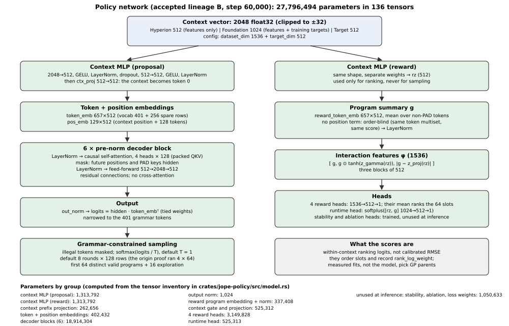

# Neural program generator

The accepted checkpoint is step 60,000 of lineage B. The inventory in `data/tensors.json` was reread from the pinned safetensors header for this publication; it contains 136 tensors and 27,796,494 scalar parameters. A scalar tensor counts as one parameter. F32 storage is verified separately from parameter count; accepted checkpoint identity is not inferred from a directory name.

## Shapes and equations

Let C ∈ R^(B×2048), tokens ∈ N^(B×T), width d=512, heads H=4 and head width 128. The context MLP generates a prefix token; the program positions follow it. The causal mask hides future positions and the padding mask hides PAD keys.

Attention(Q,K,V) = softmax(QKᵀ / √128 + M)V (4.1)

FFN(h) = W₂ GELU(W₁h + b₁) + b₂ (4.2)

The output projection is tied to token embeddings but narrowed to the 401 real vocabulary tokens. Spare embedding rows are not extra executable grammar tokens. KV caching reuses prefix state inside a request; the study forbids cross-request context reuse. CPU-versus-CUDA FP32 qualification is distinct from equivalence to historical tch/BF16 training arithmetic.

## Accepted lineage and exact loading

The loader compares tensor names, shapes and dtypes, then checks model identity against the receipt. Accepted and challenger constructors have separate identity checks. The rejected step-69,000 state must not be silently substituted. Experimental 256×2 training is a different lineage, not a small continuation of the accepted 512×6 tensor topology.

The tensor-by-tensor appendix supports an independent sum and exposes stored but inactive heads.

## the policy network

The accepted model is lineage B, step 60,000. It is one set of weights with two heads that answer different questions:

- a decoder that **writes** programs;
- a reward branch that **scores** programs for ordering.

**Decoder (proposal).**

1. The context passes through a two-layer MLP (2048→512→512, GELU and LayerNorm after each layer) and `ctx_proj`.
2. It becomes the token at position 0.
3. Program tokens are embedded with `token_emb`, which has 657 rows: 401 vocabulary rows plus 256 spare. A learned `pos_emb` with 129 rows is added.
4. Six pre-norm decoder blocks follow. Each has causal self-attention with 4 heads of width 128 (packed QKV projection, with future positions and PAD keys masked) and a 512→2048→512 feed-forward network. There is no cross-attention: the context influences every token only through the prefix position.
5. After `out_norm`, the logits are the hidden state times the *tied* token-embedding matrix, narrowed to the 401 real tokens.

Sources: `crates/jope-engine/src/neural.rs:406-461` for the reference forward pass, and `crates/jope-policy/src/model.rs:366-608` for the Candle port.

**Reward branch (ranking).**

1. A second context MLP of the same shape produces `rz`.
2. The program is summarised as `g`: the mean of a separate `reward_token_emb` over non-PAD tokens, followed by LayerNorm. It has **no position term**, so two programs with the same multiset of tokens get the same `g`.
3. The interaction features are `φ = [g, g ⊙ tanh(z_gamma(rz)), |g − z_proj(rz)|]`, 1,536 values.
4. Four reward heads (1536→512→1) each emit a score. Their mean orders the 64 neural slots and records `rank_log_weight`.
5. A runtime head, `softplus(MLP([rz, g]))`, estimates cost.
6. The stability head, the program-only ablation head and seven loss-weight scalars are stored but unused at inference.

Source: `neural.rs:489-531`.

**Parameters.** These are computed from a checked mirror of `expected_inventory` (`model.rs:40-96`): 136 tensors and 27,796,494 parameters.

| Group | Parameters |
|---|---:|
| Context MLP (proposal) | 1,313,792 |
| Context MLP (reward) | 1,313,792 |
| Context prefix projection | 262,656 |
| Token + position embeddings | 402,432 |
| Six decoder blocks | 18,914,304 |
| Output norm | 1,024 |
| Reward program embedding + norm | 337,408 |
| Context gate and projection | 525,312 |
| Four reward heads | 3,149,828 |
| Runtime head | 525,313 |
| Unused at inference (stability, ablation, loss weights) | 1,050,633 |
| **Total** | **27,796,494** |

The Rust port has a float32 CPU baseline and an explicit CUDA path in the timing-study build. Its numerical parity with the trained tch forward pass is not established, and the historical manual had no compiled CUDA proof; the new timing study is recorded in chapter 10 (`crates/jope-policy/src/lib.rs:82-103`).

## grammar, sampling and ranking

**The vocabulary** (`crates/jope-engine/assets/grammar/featmath.json`) has 401 tokens:

| Category | Tokens |
|---|---:|
| `PAD`, `BOS`, `EOS` | 3 |
| `ENGINE` | 1 |
| `TASK` | 4 |
| `OP` (31 transforms, 22 heads) | 53 |
| `VAL` (binned parameter values) | 291 |
| `APPEND` | 3 |
| `EXPR_VAR`, `EXPR_CONST`, `EXPR_FUNC`, `EXPR_BINOP`, `EXPR_END` | 14, 16, 11, 4, 1 |

The product restriction `featmath-jain-v1` keeps the same table but allows fewer operators ([historical manual section](https://github.com/veox-ai/JopeDime/blob/bcf2e6798aa753d4fda2cb15f967415d21cde3d6/docs/internal/asm-manual/sections/architecture.md#accepted-identities-and-the-product-restriction)).

**Sampling** (`crates/jope-policy/src/decode.rs`):

1. Every row starts from `[BOS, ENGINE=featmath, TASK=regression]`.
2. At each step, a grammar automaton gives the legal next tokens. Illegal logits are masked, and the token is drawn from `softmax(logits/T)` with a ChaCha20 generator seeded per request.
3. The defaults are 8 rounds × 128 rows at T = 1 (`decode.rs:39-46`). The origin proof requested 4 rounds × 64 rows at T = 1: see `proposal.request.sampling_rounds` and `sampling_batch` in the neural arm's retained search receipt (journal `origin-proof-68f56404…/journal/asm-search/ec2b7ba9…/search-receipt.json`, SHA-256 `5eae7243b5442635eacb326e0a1ce0b7a4e43ba413ed68e281e1ff33dcd6e069`).
4. Sampling stops after the round in which `POOL_SIZE` = 64 distinct valid programs exist, and the first 64 in draw order are kept (`decode.rs:221`, `:457-459`). A row is valid if it decodes and `feat_math` parses it. Rows that do not reach `EOS` within 128 tokens are dropped.
5. A shortfall is filled with grammar-uniform programs, recorded as `neural_rejection_fallback` and never as neural. Then `EXPLORATION_SIZE` = 16 random exploration programs are added (`decode.rs:26-28`).

**Ranking** (`crates/jope-policy/src/ranking.rs:338-445`) scores the 64 pool programs with the mean of the four reward heads. It sorts them by score, breaking ties by program SHA-256. The scores are within-context logits, not calibrated losses. They order slots; they do not choose GP parents.

## The accepted regression model: lineage B, step 60,000

### Checkpoint binding and configuration

The accepted lineage is the recovered lineage-B step-60000 checkpoint. The binding verifies the state, original model, exported tensors, configuration, parameter digest and vocabulary. The rejected step-69000 identity is explicitly refused. A self-consistent receipt around unrelated weights cannot impersonate the accepted model. The model loader rejects missing, extra, incorrectly shaped or non-FP32 tensors.

| Accepted-model property | Value or behavior |
|---|---|
| Dataset context (historical name of `dataset_dim`) | 1536 FP32 values: Hyperion 512 from features only plus Foundation 1024 conditioned on the training targets, so not label-free |
| Target context | 512 FP32 values; all 512 retained by the configuration (`target_keep_dim` 512), although most of them may be constant zero (`python/src/jope/policy/train_v3.py:919-920`) |
| Combined context | 2048 FP32 values; 8192 bytes in little-endian vector form |
| Decoder width | 512 |
| Decoder depth | 6 layers |
| Attention heads | 4 |
| Feed-forward width | 2048 |
| Token vocabulary | 401 output tokens |
| Embedding rows | 657, including the configuration's 256 extra rows |
| Maximum configured sequence | 128 tokens; positional table includes the context position |
| Training dropout field | 0.1; disabled for inference |
| Reward ensemble | 4 heads |
| Tensor inventory | 136 tensors for this configuration, including unused inference heads and scalar loss weights |
| Arithmetic | Candle FP32 CPU baseline; explicit CUDA study path, qualified status in chapter10 |
| Native CUDA BF16 policy parity | Not established by the current CPU inference implementation |

Sources: `crates/jope-policy/src/config.rs:21`, `config.rs:39`, `crates/jope-policy/src/model.rs:1`, `model.rs:41`, `crates/jope-policy/src/lib.rs:133`.

### Decoder and reward architecture

The decoder and reward paths each encode context with a two-layer MLP: 2048→512, GELU, LayerNorm, 512→512, GELU, LayerNorm. The decoder prepends a projected context token to the token embeddings, adds positional embeddings, applies causal self-attention with padding-key masking through pre-normalized layers, normalizes the result and projects through the tied token embedding table narrowed to the output vocabulary.

The reward path averages the program-token embeddings over non-padding positions, with no positional embedding, combines that mean with a separately encoded context, and evaluates four reward MLPs. The combined representation contains the program embedding, its elementwise interaction with a context gate, and an absolute-difference block. A separate runtime head emits a positive runtime estimate through softplus. Learned reward is a proposal-ranking signal; it is not a measured dataset loss.

**Reward pooling is order-blind.** The mean has no positional input. For one context, two programs whose tokens form the same multiset, for example the same operators or parameter values in a different order, receive the same pooled representation and therefore the same four reward scores, up to floating-point summation order. The decoder still conditions on token order; only the learned ranking signal is affected. At this source that signal orders the neural pool's slots and records `rank_log_weight`; it does not select programs (step 3 of [historical manual section](https://github.com/veox-ai/JopeDime/blob/bcf2e6798aa753d4fda2cb15f967415d21cde3d6/docs/internal/asm-manual/sections/architecture.md#the-learning-cycle-what-is-proven-and-what-remains)). The pooling is the same in the Candle port (`crates/jope-policy/src/model.rs:14`, `:555-567`), in the native tch model it mirrors (`crates/jope-engine/src/neural.rs:496-505`), and in the Python `JopePolicyModelV3` that the pending campaign trains (`python/src/jope/policy/model_v3.py:391-404`; the stopped overlay's copy keeps it). The Python module docstring (`model_v3.py:7-9`) still describes a bidirectional reward encoder with attention pooling; the code discards that encoder, recording that it collapsed (`:258`), and mean-pools instead.

Native source also contains an isolated experimental `OrderAwareRewardEncoder` (`parallel.reward_program_attention_2x256x4.v1`), which adds positional embeddings and two attention layers. Its source comment states that production `Policy` does not construct it and that a separately qualified reranker must opt in with a new artifact; at this source only its unit tests use it (`crates/jope-engine/src/neural.rs:180-263`; `crates/jope-engine/tests/reward_sequence.rs:7-24`). Status: implemented but unqualified.

**Owner rule (proposed): measure before changing the architecture.** First measure how often distinct candidate programs collide on one token multiset, and the ranking regret those collisions cause. Defer architecture changes, including adopting an order-aware reward input, so that the first causal learning experiment keeps changes to architecture, objective, corpus and sampler distinguishable.

### Accepted identities and the product restriction

The source records these accepted identities:

| Identity | SHA256 |
|---|---|
| State | `8ac80c269cc47c253b6f53fa3bc1eb75bb2fcda0bdace3ff8554be0175c400d6` |
| Original model | `053df4f53b84d2ebe7c14fbf907a149760af3d11de4a57b5ff89be8c2d3e8129` |
| Canonical parameter values | `9c7057e7f6a9e348f030da73f03522977b8c08915d3a221d7d5ab2e4213fcd92` |
| Configuration | `2508fc8b8268ea000141c9b119ba3da4e777c506c366168912a88d03482939bf` |
| Original checkpoint vocabulary | `8d55fee4366acd2c175cf55bfd769cebc904770f5227a6fd50a613723dc85787` |
| Executable product restriction | `570b2e5e8d859a73b888f5d0bee27f59da0e2376536babce24c241604f818e81` |

The product restriction preserves the 401-token table while limiting executable heads. It removes ten head operators (`extra_trees`, `gam_boost`, `logit_ridge`, the four multiclass heads, `portfolio`, `ridge_gcv` and `tab_boost`), and the vocabulary has no operator token for `pls` or `hurdle2`. The regression proof bound both arms to this restricted vocabulary, and mutation replaces a head only with `histgbm`, `ridge`, `ridge_gcv`, `elasticnet`, `histgbm2`, `gpr` or `ksmooth`; crossover keeps a parent's head. Six of the seventeen registered regression recipes (`tab_boost`, `extra_trees`, `gam_boost`, `pls`, `hurdle2` and `portfolio`) are therefore unreachable by any ASM operator at this source, and `ridge_gcv` is reachable only through mutation. Sources: `crates/jope-engine/assets/grammar/featmath-jain-v1.json` (`restriction.removed_ops`); `crates/feat-math/src/evolve.rs:29-39`, `:1480-1492`; `crates/jope-bench/src/panel/optimize.rs:254`; `crates/jope-bench/src/panel/methods.rs:60-89`. A token-compatible restriction is different from inventing a new vocabulary or silently snapping parameters to nearby bins.

## Model lineages

A lineage is a chain of checkpoints sharing one architecture and parameter ancestry. A higher step number, a newer file or a shared vocabulary does not place a checkpoint in the accepted line. The table covers three lineage-B checkpoints and the planned experimental line, as of 2026-09-23 about 23:55 UTC.

| Checkpoint or line | Architecture | Role and status | Identity and sources |
|---|---|---|---|
| Lineage B, step 60,000 | Native tch `model.ot`: width 512, six layers, four heads, feed-forward 2048 | The accepted regression model and the only identity the current consumer admits. Available. | State `8ac80c26…`, pinned with its model, parameter, configuration and vocabulary hashes (`crates/jope-policy/src/lib.rs:133-150`, `:161`; `crates/jope-policy/src/config.rs:289-325`); [historical manual section](https://github.com/veox-ai/JopeDime/blob/bcf2e6798aa753d4fda2cb15f967415d21cde3d6/docs/internal/asm-manual/sections/architecture.md#checkpoint-binding-and-configuration) |
| Lineage B, step 60,100 | Same as step 60,000 | Historical hardware continuation: the September 14 qualification run carried AdamW for 100 updates from step 60,000 on the unchanged corpus, with zero fresh programs, at world 1 × microbatch 256 × accumulation 8. It is neither a serving model nor a production continuation, and the accepted binding refuses any step other than 60,000. | Final state `745be4b5…`; [historical manual section](https://github.com/veox-ai/JopeDime/blob/bcf2e6798aa753d4fda2cb15f967415d21cde3d6/docs/internal/asm-manual/sections/training-history.md#the-rtx-step-60100-qualification-run) |
| Lineage B, step 69,000 | Same as step 60,000 | Endpoint of the last retained A100 block, steps 66,001–69,000. Unaccepted: an export receipt naming its state or model hash is refused before any other check. | State `58c4a1f6…`, model `f3694654…` (`crates/jope-policy/src/lib.rs:152-159`, `:249-253`; `crates/jope-policy/src/config.rs:177-182`); [historical manual section](https://github.com/veox-ai/JopeDime/blob/bcf2e6798aa753d4fda2cb15f967415d21cde3d6/docs/internal/asm-manual/sections/training-history.md#a100-checkpoints-and-the-accepted-step-60000) |
| Experimental regression lineage v1 (256×2, new initialization) | Python `JopePolicyModelV3`: width 256, two layers, four heads, feed-forward 1024 | The line the stopped training64 campaign would train, starting from a new initialization. No real campaign has run with it. Pending integration. | Stopped patch `595824ef…`; [historical manual section](https://github.com/veox-ai/JopeDime/blob/bcf2e6798aa753d4fda2cb15f967415d21cde3d6/docs/internal/asm-manual/sections/training.md#what-the-pending-campaign-trains) |

The two architectures are not interchangeable. The Python path cannot load step 60,000, and the accepted loader rejects the smaller model's tensor shapes, so lineage v1 is a new line rather than a continuation of lineage B. Compare the two only through matched downstream fits under one protocol, never through loss values ([historical manual section](https://github.com/veox-ai/JopeDime/blob/bcf2e6798aa753d4fda2cb15f967415d21cde3d6/docs/internal/asm-manual/sections/training.md#what-the-pending-campaign-trains)). Training or exporting a lineage-v1 checkpoint does not move the accepted serving pointer ([historical manual section](https://github.com/veox-ai/JopeDime/blob/bcf2e6798aa753d4fda2cb15f967415d21cde3d6/docs/internal/asm-manual/sections/training.md#plan-run-resume-verify-and-export)).

Historical lineage A and the legacy Python gen31 and round-1 runs are recorded in [historical manual section](https://github.com/veox-ai/JopeDime/blob/bcf2e6798aa753d4fda2cb15f967415d21cde3d6/docs/internal/asm-manual/sections/training-history.md#dated-lineage-and-evidence-coverage); the current accepted consumer admits none of their checkpoints.

Owner naming rules for lineage v1 (proposed):

- The new initialization is `M_init`. It is named `M0` only after it has actually trained on its first frozen corpus, `C0`, and that run has passed the pending campaign's verification, which includes positive optimizer updates, changed parameter digests, exact reload, an actual resumed optimizer state, increasing step counters and at least two committed passes ([historical manual section](https://github.com/veox-ai/JopeDime/blob/bcf2e6798aa753d4fda2cb15f967415d21cde3d6/docs/internal/asm-manual/sections/training.md#plan-run-resume-verify-and-export)).
- Passes through one corpus are continuation, not generations: the pending plan's two passes through `C0` (`--passes 2`) do not make two generations. A new generation needs the LOOP-01 chain: a new eligible target, actual exposure, changed parameters, compatible reload and improved fitted search.
- The pending corpus request can name an optional Python initialization checkpoint ([historical manual section](https://github.com/veox-ai/JopeDime/blob/bcf2e6798aa753d4fda2cb15f967415d21cde3d6/docs/internal/asm-manual/sections/training.md#build-the-real-corpus-from-admitted-evidence)); the campaign then uses a weight warm start, and otherwise a cold initialization. This manual retains cold initialization as the plan for lineage v1. Warm-start support is an unselected interface option, not a qualified lineage start; the owner has not ruled whether lineage v1 admits a warm start, and no prohibition is inferred. Before any admitted run, record which form `M_init` actually took.
- Step 60,100 remains historical hardware continuation and step 69,000 remains unaccepted; neither seeds lineage v1.

