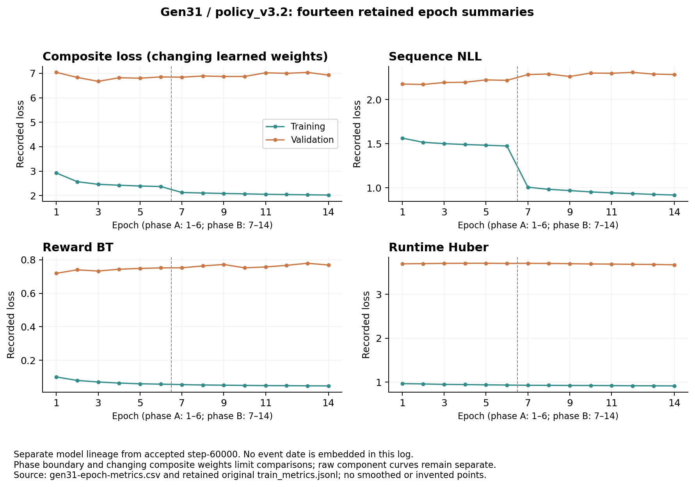
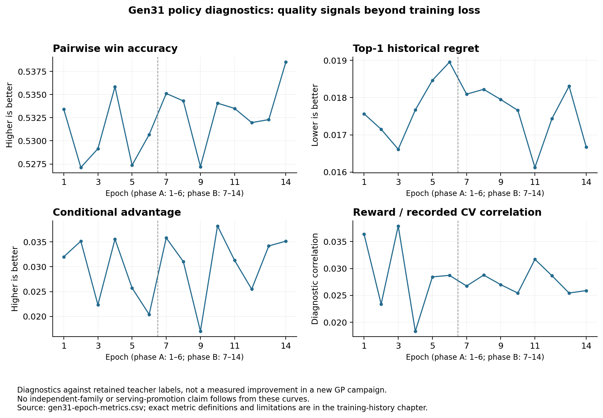
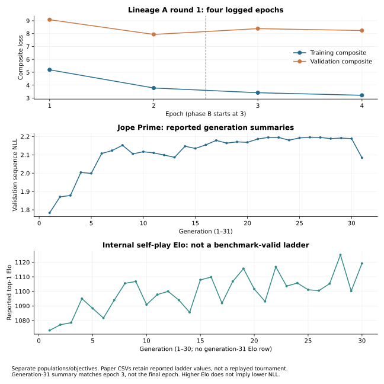
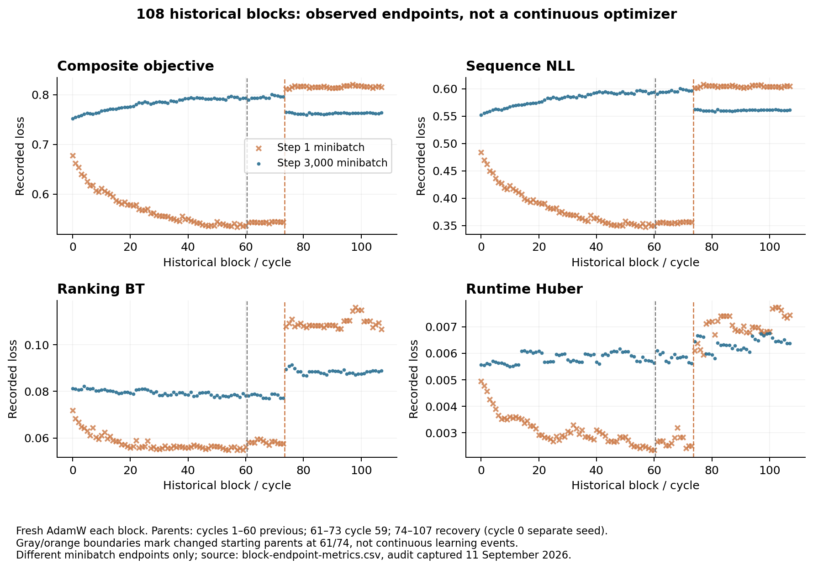
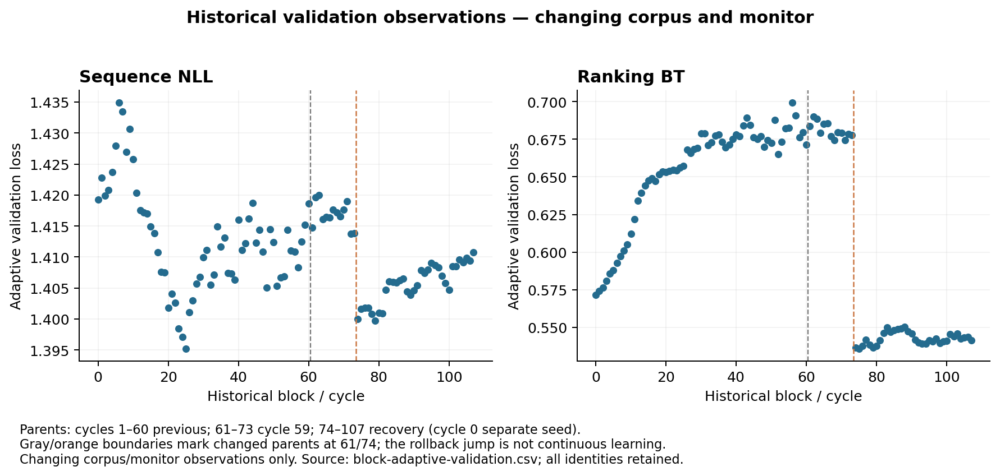
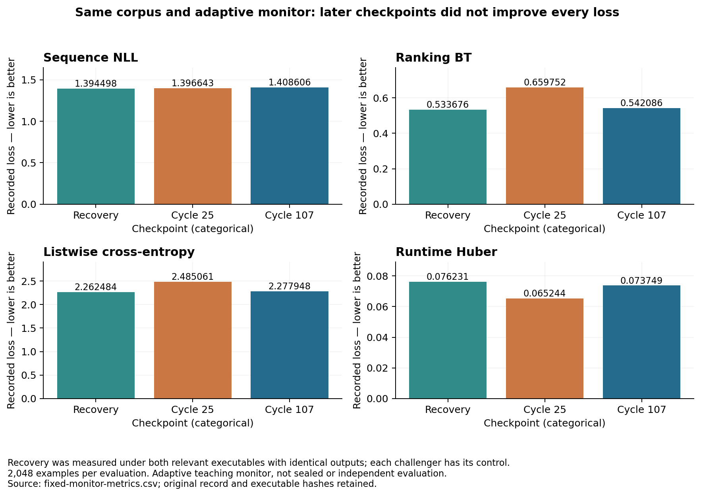
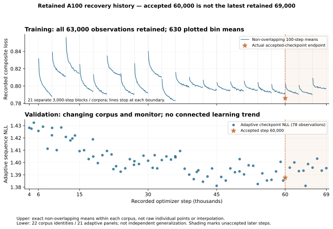
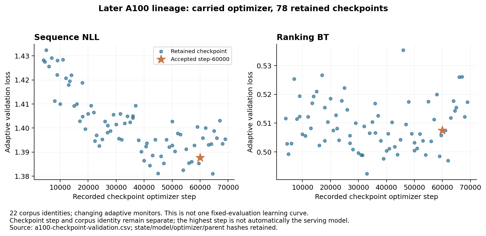
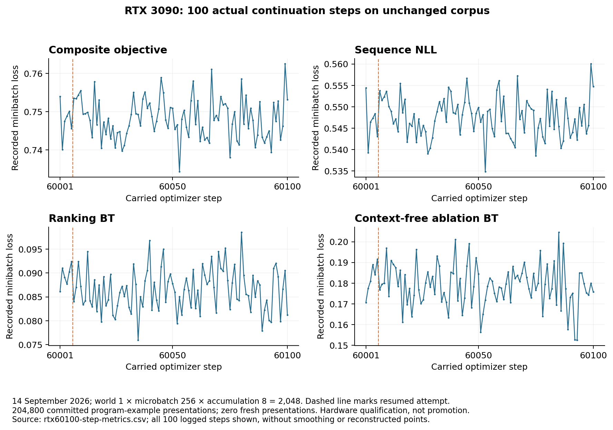

# Training scale and measured progress

Scale is an accounting problem, not a single model-step counter. The freshly downloaded corpus catalog has its own content hash and metadata counts in `data/catalog.json`. It does not identify optimizer exposure. Checkpoint steps, teaching records, unique programs, comparison groups, token positions and optimizer minibatches are separate units.

## Exposure accounting

A corpus manifest establishes the records available to a loader. Sampling logs establish which records were exposed. Optimizer receipts establish actual updates. A repeated record adds optimizer exposure but not a new unique program. Multiple candidate evaluations can belong to one comparison. Unknown historical totals remain unknown.

The accepted weight file's 60,000 label must be interpreted with checkpoint lineage and corpus transitions. Reset blocks, rejected continuations and the accepted recovery branch must not be collapsed into a fictional continuous run.

*Historical training loss and corpus-block boundaries figure unavailable: its SVG is not tracked in this repository.*

*Historical training throughput figure unavailable: its SVG is not tracked in this repository.*

## Historical evidence series

The following retained series and counts preserve their source dates, corpus hashes and checkpoint regimes. They are re-rendered from retained CSV/JSON, without filling missing steps or inferring downstream gains from declining loss.

The supplied CSVs retain original values, source file SHA-256, source path and line, and JSON Pointer where appropriate. There is no interpolation. Separate figures show different populations; joining them into one curve would erase changes in architecture, objective, corpus, sampler and validation protocol. The later recovery lineage has an independently audited, complete retained series of 63,000 per-step observations; the older 108-block capture retains only block endpoints.

The new core-technology chapter adds a separately verified [24-record A100 fixed-monitor series](https://github.com/veox-ai/JopeDime/blob/bcf2e6798aa753d4fda2cb15f967415d21cde3d6/docs/internal/asm-manual/sections/deep-stack.md#a-fixed-panel-learning-curve-for-the-a100-lineage) and historical throughput. It does not replace the different populations retained below.

## Dated lineage and evidence coverage

| Observation or historical interval | Retained state | What is established; what is not |
|---|---|---|
| Jope Prime gen31, preserved by the provenance inventory dated 2026-07-12 | Fourteen complete epoch-summary rows, explicitly `policy_v3.2`; immutable warm-start checkpoint identified as `6a204434…`; 125,970 training and 2,169 validation rows | Real logged training and validation measurements. The log itself has no wall-clock timestamp or exact trainer-source hash; its event date is not inferred from file modification time. The provenance inventory's date is a historical declaration, not a newly verified execution date. |
| Lineage A, historical xbabe2 Python control plane | Four surviving frozen corpus snapshots and original warm-start state; substantial live control-plane state and later checkpoint descendants declared lost | Historical training and teaching data existed. The lost accepted-pointer and sealed-use history cannot be reconstructed merely from aggregate scores. |
| September 9–11 native training audit | 108 completed 3,000-step blocks, 108 different corpus identities and 62 starting checkpoint identities | Original initialization records explicitly reset AdamW. The capture retains each block's first and last metric row, not its complete per-step log. |
| September 12–13 recovery lineage (lineage B, [historical manual section](https://github.com/veox-ai/JopeDime/blob/bcf2e6798aa753d4fda2cb15f967415d21cde3d6/docs/internal/asm-manual/sections/data-estate.md#lineages-a-and-b-and-the-staging-store)), retained A100 metrics and checkpoint manifests | 63,000 complete metric rows at steps 6,001–69,000 in 21 blocks/corpora; 78 checkpoints at steps 4,000–69,000 across 22 corpus identities | This later lineage carries FP32 AdamW ancestry. Complete logged losses accompany the metadata. The accepted serving checkpoint remains 60,000; 69,000 is unaccepted. Validation remains adaptive and its corpus/panel changes. |
| September 14, 22:19:52–22:27:47 UTC | Complete 100-row RTX qualification trajectory, steps 60,001–60,100, interrupted and resumed after 60,006 | Original metadata records carried optimizer state and changed model/parameter identities. It explicitly describes unchanged-corpus hardware qualification, with zero fresh programs: a historical hardware continuation, not a production improvement or promotion run. |
| September 18, 20:17:48 UTC publication manifest | Product bundle `policy-step-60000`, source checkpoint `8ac80c269cc47c253b6f53fa3bc1eb75bb2fcda0bdace3ff8554be0175c400d6` | The current product's accepted source checkpoint is pinned. Publication time is distinct from training time. |
| Current bounded ASM work, as of 2026-09-23 about 23:55 UTC | Verified one-dataset regression neural-origin proof at source `68f56404`, merged to main as `a75e543d2` (PR83); the training64 follow-on remains a stopped, unmerged patch (pending integration), and no eligible real corpus has been demonstrated for its admission guard ([historical manual section](https://github.com/veox-ai/JopeDime/blob/bcf2e6798aa753d4fda2cb15f967415d21cde3d6/docs/internal/asm-manual/sections/teachers.md#present-teacher-readiness-and-the-smallest-real-path)) | New category training and subsequent consumption of its learned export remain pending; no checkpoint has been trained by this work. No new GPU-hour budget is inferred from historical training. Experimental regression lineage v1 (pending integration) is not part of this history. |

Sources: `docs/adr/ADR-0005-canonical-learning-loop.md:12-24,72`, `docs/learning.md:280-285`; historical native audit `learning-hpc.md:37`; original checkpoint manifests and metrics pinned in the CSVs; `models/bundles/policy-step-60000.json:7,73`; `/home/ubuntu/jope-prime/provenance.json:3,13,129`. The retained legacy source declares `policy_v3.2` at `/home/ubuntu/jope/src/jope/policy/model_v3.py:40`; it is useful for interpreting the old log, but the log does not attest that exact source build.

The accepted serving model is the native 512×6 decoder at step 60,000 ([historical manual section](https://github.com/veox-ai/JopeDime/blob/bcf2e6798aa753d4fda2cb15f967415d21cde3d6/docs/internal/asm-manual/sections/architecture.md#checkpoint-binding-and-configuration)). Experimental regression lineage v1 (256×2, new initialization) is the separate line that the pending bounded campaign would start: a Python `JopePolicyModelV3` with width 256 and two layers, a new, smaller model family rather than a continuation of step 60,000 ([historical manual section](https://github.com/veox-ai/JopeDime/blob/bcf2e6798aa753d4fda2cb15f967415d21cde3d6/docs/internal/asm-manual/sections/training.md#what-the-pending-campaign-trains)). Status at the PR83/stopped-overlay snapshot: pending integration; the training64 patch was then outside main. PR88 later integrated it ([historical manual section](https://github.com/veox-ai/JopeDime/blob/bcf2e6798aa753d4fda2cb15f967415d21cde3d6/docs/internal/asm-manual/sections/status.md#implementation-snapshot-and-this-manuals-own-identity)); no real campaign checkpoint is established. Its initial model `M_init` is named `M0` only after it has actually trained on its first corpus `C0`; as of 2026-09-23 about 23:55 UTC it has no trained checkpoint. None of the records in this appendix belongs to it, and its measurements must not be joined to these historical trajectories.

## Legacy Python training: gen31 and round 1

### Gen31: fitting the objectives versus using the context

#### Epoch losses and the routing warning

The gen31 log contains epochs 1–14, with phase A at epochs 1–6 and phase B at 7–14. Both phases train the ranking branch. The retained v3.2 trainer lowers the context-encoder learning rate at the phase boundary, while phase B adds reward-weighted sequence imitation. It logs two GPUs, requested batch size 2,048 and learning rate 0.00015. Its final elapsed timer is 1,135.158 seconds; that timer is a run-local measurement, not a cold-install or end-to-end campaign duration.

Every point is an original epoch summary. The training sequence component (`train_loss_components.seq_nll`) fell from 1.563002 to 0.918725, but 0.466185 of that fall occurred in one step at the phase A→B boundary (1.473704 at epoch 6, 1.007519 at epoch 7), where phase B adds reward-weighted sequence imitation; within each phase it fell by only about 0.089. Held-out sequence NLL (`val_seq_nll`, no label smoothing) rose in every phase-A epoch and overall from 2.055572 to 2.182772 (+6.2%). The full training composite fell from 2.926419 to 2.022394, while validation composite changed from 7.039105 to 6.926823 and reached its minimum of 6.671162 at epoch 3. The final epoch therefore was not the best by every monitored objective. The train/validation composite gap grew from 4.112686 to 4.904429. The model fitted its training objective while held-out likelihood got worse; these measurements do not show that a newly generated algorithm outperformed its ancestor. The figure's validation sequence line is the 0.05-smoothed `val_loss_components.seq_nll`, not `val_seq_nll`.

Routing is a particularly visible warning: training routing cross-entropy fell from 0.642189 to 0.005816, while validation routing cross-entropy remained 3.498959 at the end. The retained labels and grouping still need to be held constant before assigning causality, but a near-zero training classifier loss alone is plainly insufficient evidence of useful routing.

#### Context advantage and ranking diagnostics

Pairwise validation ordering accuracy rose from 0.533419 to 0.538499. The genome-only control rose from 0.501411 to 0.503346, so recorded conditional advantage changed from 0.032008 to 0.035153: approximately 3.20 to 3.52 percentage points. This is a modest ranking diagnostic on retained candidates, not a 53.8% downstream tournament win rate. Historical top-1 regret decreased from 0.017565 to 0.016676 in the retained target's units. Predicted-reward correlation remained small, 0.036390 to 0.025889. The uncertainty/error statistic was negative, −0.196674 to −0.228137; it does not establish calibrated uncertainty.

#### Metric definitions and the v3.2 objective

The following definitions explain why similarly named numbers cannot be substituted for one another:

| Logged metric | Source meaning and limitation |
|---|---|
| `train_loss`, `val_loss` | Combined objectives, including learned uncertainty weights and regularizing log-variance terms. They are not sums of the plotted raw component values. Training aggregation averages executed batch losses across ranks. |
| `train_loss_components.seq_nll` / `val_loss_components.seq_nll` | Legal-token, 0.05-smoothed sequence cross-entropy with applicable provenance/phase row weights. |
| `val_seq_nll` | A separate validation evaluator uses zero label smoothing and averages batch NLL. It is deliberately distinct from `val_loss_components.seq_nll`; the first epoch logs 2.055572 versus 2.175046. |
| Pairwise ordering accuracy | Agreement on unequal-value pairs within a dataset. This implementation does not give explicit half-credit to tied predictions; its Boolean comparison has an order-dependent tie convention. |
| Conditional advantage | Conditional reward ranking accuracy minus the genome-only control's accuracy on the same retained population. It probes context use; it does not fit new programs. |
| Historical top-1 regret | Per dataset, best retained target value minus the target value of the retained program selected by predicted reward, averaged over datasets. It is not regret relative to an unknown optimum. |
| Reward CV correlation | Pearson correlation with retained `robust_delta` labels. The name does not make it a new downstream cross-validation score. |
| Head accuracy | Match at the first head-role grammar token under teacher-forced decoding, grouped by engine. It is not fitted-prediction accuracy. |
| Uncertainty/error Spearman | Correlation between sorted positional ranks of ensemble dispersion and absolute reward error. The retained implementation does not average tied ranks, so preserve the implementation identity when comparing it. |

The old v3.2 objective has seven components: sequence NLL, reward Bradley–Terry, reward listwise, runtime Huber, stability BCE, ablation Bradley–Terry and routing cross-entropy. Its profile scales are respectively 1, 1, 0.5, 0.2, 0.5, 1 and 0.5. Reward/ranking/ablation/routing terms use fixed profile scales; sequence, runtime and stability use the retained Kendall–Gal-style learned weighting. The log's `loss_weights` values are `exp(-log_var)`, not complete effective coefficients. This differs materially from the five-term native objective below. Source interpretation is grounded in retained v3.2 code; absence of an exact run-source binding remains explicit.

Sources: original `train_metrics.jsonl` SHA `d57de1b28a8678327c984a82732cd774520db2cb0994d893a45f8a5ea428e312`, lines 1–14; `/home/ubuntu/jope/src/jope/policy/train_v3.py:360,364,438,444,474,580,613`; `policy/model_v3.py:40,286,300,305,372,376`; `policy/losses.py:23,35,48,86,100`; `model.py:981,997,1015`. Full hashes and exact definitions are retained in this chapter's metadata.

### Round 1 and the reported self-play ladder

#### Round-1 epochs and the gate receipt

Four original `round1.train_metrics.jsonl` rows survive for the lineage-A Python model `policy_v3.3-fused-heads`. They log phase A at epochs 1–2 and phase B at 3–4, with learning rate 0.0005. This is a separate model/run from gen31 and the native recovery lineage; their composite losses must not be joined into one trajectory.

| Logged measure | Epoch 1 | Epoch 4 | Interpretation |
| --- | ---: | ---: | --- |
| Training composite | 5.191046 | 3.212379 | Better fit to the run's changing phase objective |
| Validation composite | 9.080722 | 8.241397 | Minimum 7.938042 at epoch 2; the final epoch is worse than that minimum |
| Validation minus training composite | 3.889675 | 5.029017 | The recorded gap widens; phase changes limit a simple overfitting interpretation |
| Validation pairwise accuracy | 0.577940 | 0.624193 | A ranking diagnostic, not downstream predictive performance |
| Validation sequence NLL | 1.686433 | 1.773742 | The final value is worse, despite the lower composite |

A separate gate receipt dated **2026-07-25 10:24:49.812 UTC** compares 557 validation rows per model: pairwise accuracy 0.534717 → 0.663611, sequence NLL 2.110434 → 1.838604, and reward/CV correlation −0.097427 → 0.445109. It records `pass: true` and explicitly says “gate only; nothing deployed or rotated.” These are real retained gate measurements, not proof of current teacher eligibility, an independent unseen-family evaluation, or a subsequent serving promotion. The gate's timestamp does not supply a missing event timestamp for every epoch.

#### The reported generation-level loss and internal Elo

The two lower panels retain the **reported paper CSV summaries** from `/home/ubuntu/jope-prime/docs/paper/data/`, rather than replaying their historical tournaments. The loss table has generations 1–31; the internal self-play Elo table has generations 1–30. Across the loss summaries, validation sequence NLL changes from 1.783587 to 2.084099, and pairwise accuracy from 0.594856 to 0.529146. Internal top-1 Elo changes from 1,073.2 to 1,119.2. Over their thirty common generations, the descriptive Pearson correlation between Elo and sequence NLL is +0.728336: higher internal Elo coexists with worse likelihood. Correlation across this evolving history is not a causal result, and the underlying populations/objectives have not been frozen for a new matched evaluation.

The generation-31 summary exactly matches **epoch 3**, not epoch 14, on validation sequence NLL, validation pairwise accuracy and the training sequence component. That explains why a generation-level table and the final gen31 log row can disagree without either number being fabricated. There is no generation-31 Elo row in this retained table. Neither the internal ladder nor its `shipped` column establishes a current release or the benchmark-valid Elo described in [historical manual section](https://github.com/veox-ai/JopeDime/blob/bcf2e6798aa753d4fda2cb15f967415d21cde3d6/docs/internal/asm-manual/sections/targets.md#historical-benchmark-valid-elo). Full source-to-tournament provenance and exposure qualification remain separate from this arithmetic/source-file check.

The companion `data/legacy-training/` retains all four original files byte-for-byte, a hash-pinned recomputation receipt and the plot input/output hashes. Their source paths are `/home/ubuntu/jope-flywheel/training/round1/{round1.train_metrics.jsonl,gate-result.v1.json}` and `/home/ubuntu/jope-prime/docs/paper/data/{loss_components_by_generation.csv,elo_trajectory.csv}`. No model or dataset payload was opened to assemble this supplement.

## Native training: the 108-block audit and the A100 recovery lineage

### The September 11 native objective and 108 reset blocks

#### Native architecture and objective

The audited native decoder consumes a 1,536-dimensional dataset vector and a 512-dimensional target vector. The configuration uses width 512, six decoder layers, four attention heads, FFN width 2,048, dropout 0.1, 401 vocabulary tokens, 657 embedding rows and maximum sequence length 128. The reward path has separate context processing and four reward heads. These are the observed historical dimensions, not a claim that every historical model version used identical architecture.

The active native objective was:

`L = sequence_nll + 0.25 × ranking_bt + 0.10 × ranking_listwise + 0.10 × runtime_huber + 0.05 × contextfree_bt`.

Sequence loss is legal-token cross-entropy with 0.05 smoothing and normalized program weights `0.05 + percentile^4`. Bradley–Terry uses weighted within-comparison winner/loser pairs. Listwise uses a `softmax(percentile / 0.25)` target; its nonzero entropy floor matters when interpreting an apparent plateau. Runtime loss compares `log1p` seconds. The program-only ablation term checks whether ranking can be achieved without dataset context. Stability and the seven stored log-variance parameters were inactive in this native build. Seven parameter names do not imply seven optimized losses.

#### Endpoint measurements and parent regimes

The audit's original capture includes exactly two metric records per block: first and last, plus the original full log's path, SHA and reported 3,000-row count. The intermediate 2,998 rows per block are not reconstructed. These endpoints are sampled minibatches, not averages over the whole block. All 108 blocks reset AdamW, so their 324,000 summed steps are **block work**, not one optimizer's age. At global batch 2,048, the corresponding 663,552,000 nominal program-example presentations are not unique programs or discoveries. Replayed or uncommitted work outside this completed block census is not silently included.

The starting checkpoint changes in three regimes. Cycle 0 starts from the earlier campaign checkpoint `20dca670…`. Cycles 1–60 warm-start their model from the preceding block's checkpoint, while still resetting AdamW. Cycles 61–73 repeatedly start from cycle 59 (`61ba6043…`), and cycles 74–107 repeatedly start from the recovery checkpoint `c2f229c9…`. These are model-parent relationships, not optimizer-state continuation.

All 34 first-to-last reductions in composite, sequence NLL, Bradley–Terry and listwise loss occur exactly in cycles 74–107, the recovery-parent regime. Every block in cycles 0–73 has a higher final sampled value for those four losses than its first value. Runtime Huber decreases exactly in cycles 78–107. The counts therefore align with the parent regime; they are not scattered improvements across 108 comparable starts. The visible jumps at cycle 74 coincide with the rollback to the recovery parent and must not be interpreted as a continuous learning event. Endpoints still sample different minibatches on different corpora, so this is descriptive evidence, not a paired significance test or causal isolation of the parent change. The last block's training NLL was 0.561710, while its adaptive validation NLL was 1.410741; that gap is not a sealed generalization estimate.

#### Adaptive validation observations

The plotted validation points are deliberately not a continuous generalization curve. Dashed boundaries identify the repeated-cycle-59 regime from cycle 61 and the recovery-parent regime from cycle 74. The validation Bradley–Terry jump near cycle 74 coincides with that rollback; it is not evidence of smooth accumulated improvement. Each source identity travels with its value. Old native telemetry exposed total loss and four component losses but omitted the active ablation component; its contribution cannot be inferred exactly by subtracting rounded or differently aggregated values. Per-term gradient norms were also unavailable. The later RTX log does expose `contextfree_bt` and weighted terms, so that historical limitation must not be presented as universal.

Sources: `docs/legacy/root-docs/audits/worldclass-redteam-20260911/learning-hpc.md:9,21,33,37`; retained `evidence/learning-native-v3/neural.rs:447,512` and `training.rs:692,712,720,863`; research capture `/home/ubuntu/jain-split/jope-dime/docs/audits/worldclass-redteam-20260911/learning-remote-metadata.json` SHA `1d2ab6ad9a8df4749bd1da000c6b1ea04d00395a777199907f3b599ad9af528b`.

### Fixed monitoring and actual promotion evidence

The fixed monitor is the stronger loss comparison in this audit: all records bind corpus `11e60a43…`, panel `fbff7a048…` and 2,048 sampled examples. Recovery was evaluated by both relevant executable builds with identical recorded outputs. Cycle 25 can be paired with recovery under executable `8ca21024…`; cycle 107 can be paired with recovery under `3382cdcb…`. The CSV retains both recovery rows even where the visual combines their identical values.

| Checkpoint | Sequence NLL | Bradley–Terry | Listwise | Runtime Huber |
|---|---:|---:|---:|---:|
| Recovery checkpoint `c2f229c9…` (step 3,000) | 1.394498 | 0.533676 | 2.262484 | 0.076231 |
| Cycle 25 | 1.396643 | 0.659752 | 2.485061 | 0.065244 |
| Cycle 107 (one reset block started from recovery) | 1.408606 | 0.542086 | 2.277948 | 0.073749 |

Sequence and reward-ranking losses did not improve over recovery in these fixed-monitor observations; runtime error was lower. This is an objective tradeoff, not an overall win. The monitor explicitly marks itself adaptive teaching validation, not independent evaluation; `training_selection_used` is false, but that does not turn previously used teaching labels into sealed data.

All 48 promotion decisions indexed in the September 11 capture were **inconclusive**, with qualification evidence not supplied. This is not a measured 0/48 challenger win rate. It establishes missing evidence at that historical observation. The later accepted 60,000 checkpoint belongs to a subsequent recovery lineage; the September 11 result must not be extended to claim that no later checkpoint was ever accepted. A full joined chain of matched executable comparisons and successive qualified target improvements is still required for a quantitative “the flywheel kept improving” claim.

### The complete A100 loss series: steps 6,001–69,000

#### Source and extraction

A second retained source supplies the complete per-step loss series for this lineage. Original `metrics.jsonl` files in cycles `000001` through `000021` of `eight-a100-recovery-20260912/learning`, under `/home/ubuntu/jope-migration-evidence/claude/node-high-value/files/home/ubuntu/jope-dime/parallel/runs`, contain **63,000 contiguous reported optimizer steps**, exactly 3,000 per block. Their embedded timestamps span September 12, 18:43:27 through September 13, 18:09:49 UTC. These dates come from the rows, not filesystem modification time. All rows record rank 0, world 8, microbatch 256, accumulation 1 and global batch 2,048. Every row binds the block's corpus and a carried FP32 AdamW parent; parent identities match the retained checkpoint lineage. A100 attribution is historical run lineage, not a new device probe.

The compressed `data/per-step-history/a100-step-metrics.csv.gz` preserves all 63,000 rows and **378,000 exact numeric metric tokens**: `loss`, `sequence_nll`, `ranking_bt`, `ranking_listwise`, `runtime_huber` and `gradient_norm`. Step, local step and timestamp tokens are also preserved. Cycle plus one-based `source_line` resolves each value to a pinned original log in `source-manifest.json`. This is a selected-column extraction, not a replacement for all raw telemetry: timing breakdowns, counters and other nested fields remain in the source logs. A second read compares every selected token against its original and rechecks each full log hash.

#### Within-block and boundary patterns

The upper panel shows 630 **non-overlapping 100-step arithmetic means**, with a separate line per corpus; it does not display every noisy minibatch point or interpolate absent data. The underlying CSV retains every selected point. The lower panel shows the original 78 checkpoint sequence-NLL observations without joining changed evaluation populations. Dashed orange marks the accepted step 60,000; shaded later steps remain unaccepted.

The within-block pattern is consistent, but its interpretation is bounded. All 21 composite-loss OLS slopes are negative, all 21 final sampled losses are below their first samples, and all 21 last-100 means are below their first-100 means. The median last-100 minus first-100 change is **−0.017066**, with range **−0.043771 to −0.008792**. Every single-point block boundary jumps upward; 19 of 20 boundary comparisons also rise when comparing adjacent 100-step means. Thus “sawtooth” describes the recorded pattern, not a claim that every individual optimization step improves. Each of the 21 blocks has a distinct corpus. Changed sampling and teaching data prevent attributing a boundary jump, or an across-block decline, to parameters alone.

| Block and optimizer range | First sampled loss | Last sampled loss | First-100 mean | Last-100 mean |
|---|---:|---:|---:|---:|
| 1: 6,001–9,000 | 0.855045 | 0.792636 | 0.831595 | 0.787825 |
| 18: 57,001–60,000, accepted endpoint | 0.819152 | 0.785951 | 0.801961 | 0.790811 |
| 21: 66,001–69,000, unaccepted endpoint | 0.830200 | 0.792011 | 0.809123 | 0.797115 |

A descriptive OLS over all 54,000 observed steps from 6,001 through 60,000 has slope **−3.3860 × 10⁻⁷ loss per step**, R² **0.1885**, and fitted first-to-last change **−0.018284**. These are arithmetic summaries of serially dependent observations from changing corpora, not confidence estimates or a measured generalization gain. `a100-block-statistics.csv` retains all 126 block/metric summaries, including each slope and endpoints; `a100-corpus-boundaries.csv` makes the boundary comparisons explicit.

#### Telemetry limits and the recovery boundary

The composite loss is retained as reported. These 63,000 rows expose four named objective components and gradient norm, but omit top-level `contextfree_bt`, effective objective weights and per-step learning rate. Absence of a telemetry field does not establish that its objective was inactive. Do not fill it with zero, reconstruct the full objective from an incomplete component list, or directly compare its composite scale with the separately recorded RTX qualification run. Loss reduction is evidence of objective fitting; it does not by itself establish better encoding-conditioned GP proposals or cheaper, better fitted algorithms.

The inspected cycle-`000000/train-2` directory has checkpoint/run metadata but no `metrics.jsonl`: steps 3,001–6,000 therefore lack per-step rows **in this inspected source**. The antecedent steps 1–3,000 are outside this per-step source set. This is a precise recovery boundary, not a claim that no other log could exist. It also does not erase the earlier fixed 2,048-example monitor: that separate recovery/cycle-25/cycle-107 comparison remains in the preceding section. The later 78-checkpoint series spans 22 corpora and 21 panels and does not provide one unchanged evaluation population.

### Carried state, accepted step 60,000 and RTX step 60,100

#### A100 checkpoints and the accepted step 60,000

The 78 retained A100 state manifests live under `/home/ubuntu/jope-node-mirror/weights/runs/eight-a100-recovery-20260912/learning/cycle-*/train-2/checkpoints/step-*/state.json`. The retained metadata covers 78 checkpoints, all with “carried FP32 AdamW with bias-correction step.” This is materially different from the 108 reset blocks. It spans 22 corpus identities and recorded steps 4,000–69,000. The graph keeps these as adaptive validation observations. A higher retained step is not automatically the serving model. The accepted 60,000 state's exact hash is `8ac80c26…`, corpus `1c840597…`, model `053df4f5…`, and parameter digest `9c7057e7…`; it records ancestry from step 57,000 and requests fresh-balanced sampling. Its request for 50% fresh comparisons does not mean 50% fresh program slots or measured downstream improvement. The block-18 per-step log ends at this exact step/corpus; block 19 explicitly starts from accepted state `8ac80c26…`. Of the 78 retained checkpoints, 74 also have validation entries inside the per-step logs; all 296 overlapping metric cells match the separately extracted checkpoint CSV. Sequence NLL is 1.428209 at step 4,000, 1.387687 at accepted 60,000, and 1.395417 at unaccepted 69,000; different adaptive panels limit this to descriptive observations. The product explicitly refuses the retained step-69,000 state/model identities rather than selecting the highest numbered checkpoint. The accepted state records no `execution_partition`, while the native trainer's exact resume requires one equal to the requested topology (`crates/jope-engine/src/training.rs:1106`), so step 60,000 cannot be resumed as the same experiment; [historical manual section](https://github.com/veox-ai/JopeDime/blob/bcf2e6798aa753d4fda2cb15f967415d21cde3d6/docs/internal/asm-manual/sections/training.md#native-lineage-b-the-held-command-and-its-blockers) describes the held continuation routes.

#### The RTX step 60,100 qualification run

The RTX run retains every metric record at steps 60,001–60,100. The exact 100-row source is `/home/ubuntu/jope-evidence/xbabe2-migration-20260914/accepted60000-restored/parallel/runs/xbabe2-hardware-qualification-20260914/final-runtime-v2-eof/train/metrics.jsonl`, distinct from the earlier recovery attempts. RTX 3090 attribution comes from ADR-0005; the retained run metadata itself records world size 1. Its first attempt starts from 60,000; later rows record initial optimizer step 60,006 after recovery. Therefore the graph uses optimizer step, not the run-local elapsed timer, which resets at resume. The timestamp span includes interruption/recovery and differs from the final attempt's 73.561-second elapsed value; neither should replace the other without labeling its scope.

The final state records **world 1 × microbatch 256 × accumulation 8 = global batch 2,048**. ADR-0005 at `a75e543d2` describes this run as microbatch 32 × accumulation 8; the retained state corrects that. Documentation-correction PR86 (head `0079ceddb`), merged at 2026-09-24T00:04:12Z as main `2b375ef11`, appended the same correction to ADR-0005 as its “Implementation correction — 2026-09-23” section without rewriting its historical decision. Model digest changes from `053df4f5…` to `1f202cce…`; parameter digest changes from `9c7057e7…` to `762094a0…`; optimizer identity also changes. The final state is `745be4b5e998bce85615349a5b03b901cd8ad2cf605e6dce3b86fbf777cc7388`. These are retained training-update and continuation evidence, not a fresh numerical replay performed for this manual.

The receipt commits 204,800 program presentations and zero fresh programs. Its purpose is explicitly “isolated unchanged-corpus hardware qualification, not production continuation outcomes.” Final adaptive validation NLL is 1.409792 and Bradley–Terry 0.475421, on 256 examples. Step 60,000's retained validation used a different panel and 2,048 examples; comparing those numbers as a paired improvement would be invalid. The checkpoint is not promoted by being 100 steps newer. Training further on one unchanged corpus is continuation, not a new generation. The recorded interruption and recovery after step 60,006 is also not evidence of an exact interrupted resume as the owner now defines it: that must reject optimizer fallback before any update and prove that the interrupted and uninterrupted runs reach the same state, and this manual has no such parity comparison for this run.

## Current publication regeneration and provenance

Edition 3 regenerated the seven retained-history figures and the 63,000-step SVG from the
same authenticated observations. `data/historical-plot-provenance.json` records each figure’s
source hashes, extraction/replay and plotting commands, coverage, units and interpretation
limits. `tools/reextract_training_metrics.py --output NEW_CUSTODY_DIRECTORY` reproduces the
3,218 original metric values and 78 checkpoint lineage rows using frozen row-selection metadata;
it does not overwrite original records or invent missing observations. The A100 per-step
extraction command remains in `data/per-step-history/README.md`. This rebuild rechecked all
21 original A100 logs and all 82 retained historical sources. For the 108-block history,
the original remote logs are represented only by their retained endpoint capture and recorded
hashes; this is not a new independent recovery of those remote logs.

All 63,000 step rows and 378,000 six-metric tokens matched their retained original logs.
These are metadata reconstruction and plotting checks, not optimizer execution or new
measurements. The new observed-transferable-lift KPI remains **not yet measured**
([historical manual section](https://github.com/veox-ai/JopeDime/blob/bcf2e6798aa753d4fda2cb15f967415d21cde3d6/docs/internal/asm-manual/sections/learning.md#observed-transferable-lift-reporting-contract-not-yet-measured)).

