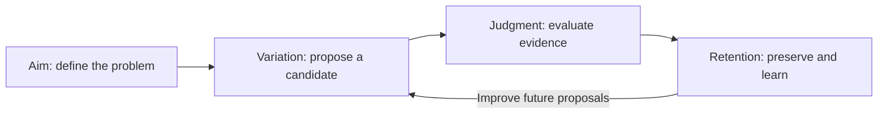

Innovation requires more than producing something different. It requires choosing a worthwhile problem, proposing a candidate, establishing what the candidate accomplishes, and carrying that experience forward. We organize these functions into four pillars: **aim, variation, judgment, and retention**. Their connection motivates EurekaZero: an experiment can evaluate a proposal and improve the ability to propose the next one.

## 2.1 Novelty is cheap; warranted improvement is not

A random generator can produce unfamiliar strings without knowing whether they express anything useful. Producing difference and producing value are separate achievements. The standard definition of creativity consequently requires originality and effectiveness ([Runco and Jaeger, 2012](https://doi.org/10.1080/10400419.2012.650092)). For algorithm discovery, effectiveness must be supported by evidence under specified conditions. An unexpected program becomes a contribution when its behavior establishes something worth retaining.

Recent research makes this distinction concrete. In a blinded study involving more than 100 NLP researchers, language-model-generated ideas received higher novelty ratings than expert-generated ideas ([Si et al., 2024](https://arxiv.org/abs/2409.04109)). In a subsequent execution study, AI-generated ideas experienced larger declines in assessed quality after implementation than human-generated ideas ([Si et al., 2025](https://arxiv.org/abs/2506.20803)). These findings distinguish perceived promise from demonstrated value. Judgment must reach beyond how an idea sounds.

## 2.2 Four pillars connect invention to learning

The four pillars are our practical synthesis of complementary traditions, summarized in Table 1. They describe functions that may recur, overlap, or change order. Scientific practice can revise the question as well as the answer.

**Aim defines what is worth improving.** Hamming emphasized the importance of choosing consequential problems ([Hamming, 1986](https://www.cs.virginia.edu/~robins/YouAndYourResearch.html)). For an invention system, this means specifying the objective, permitted information, and constraints. A problem encoding makes some distinctions available to the learner and may erase others. The score expresses a chosen purpose; it does not establish that the purpose is worthwhile.

**Variation proposes what might work.** Recombination, analogy, abstraction, and perturbation offer different routes to candidates. Boden distinguishes combinational, exploratory, and transformational creativity ([Boden, 1998](https://doi.org/10.1016/S0004-3702\(98\)00055-1)). The solution representation determines which changes the machine can express. A grammar may prevent invalid programs while excluding useful mechanisms. Learning improves choices within the possibilities the representation permits.

**Judgment supplies evidence.** For an ML algorithm, the relevant evidence is performance on appropriately held-out observations under declared resources and comparisons. A proof, a simulation, and an experiment warrant different conclusions. The referee must match the claim: learning from an incomplete or exploitable score can improve that score while missing the intended goal. Reliable judgment is therefore part of the invention problem itself.

**Retention changes what happens next.** Campbell's account joins variation to selective retention ([Campbell, 1960](https://doi.org/10.1037/h0040373)). A retained artifact can solve a problem again; retained experience can improve how future problems are approached. Informative failures belong in that experience alongside successes. Archives, reusable methods, and learned parameters serve different parts of this function. Figure 2 highlights the feedback path EurekaZero studies: outcomes that change future proposals.

**Table 1. Selected traditions illuminate the four functions.** The mapping is our synthesis, not a claim that these sources propose an identical theory. Biological selection has no intentional aim.

| Account | Aim | Variation | Judgment | Retention |
| - | - | - | - | - |
| Darwin's natural selection ([1872 edition](https://www.gutenberg.org/ebooks/2009)) | Environmental selection conditions; no intention | Heritable differences | Differential survival and reproduction | Inheritance |
| Campbell ([1960](https://doi.org/10.1037/h0040373)) | Selection conditions | Blind variation | Selection among variants | Selective retention |
| Hamming's research practice ([1986](https://www.cs.virginia.edu/~robins/YouAndYourResearch.html)) | Important problems | New approaches | Results that withstand scrutiny | Cumulative methods and insight |
| AlphaGo Zero ([Silver et al., 2017](https://www.nature.com/articles/nature24270)) | Win under Go's rules | Policy-guided search | Self-play outcomes | Updated network |



**Figure 2. Evaluation can improve both artifacts and future proposals.** Schematic of the four-pillar synthesis, not a result or a fixed implementation diagram. The feedback path represents experience used to change proposal behavior during learning. Feedback can also revise the objective, representation, or evaluation. This training loop is absent from the search = 1 deployment procedure.

## 2.3 Taste is judgment moved upstream

Expertise makes variation selective. Poincaré described mathematical invention in terms of discerning useful combinations ([Poincaré, 1910](https://doi.org/10.1093/monist/20.3.321)); Chase and Simon showed how chess expertise draws on meaningful configurations of pieces ([Chase and Simon, 1973](https://doi.org/10.1016/0010-0285\(73\)90004-2)). We use *taste* for this anticipatory judgment: a learned tendency to propose candidates that withstand subsequent evaluation. Taste guides a proposal before its outcome is known; the referee still determines whether it succeeds.

A simple model connects proposal quality to search. Fix the problem, incumbent, proposal distribution, and win criterion. If independent attempts each win with the same probability, the expected waiting time to the first win is

```math
\mathbb{E}[N_{\mathrm{tries}}] = \frac{1}{q}. \tag{1}
```

Here, q is the per-attempt win probability, with 0 < q ≤ 1 and invalid attempts counted as failures. N denotes the number of attempts through the first success. Equation (1) is the geometric waiting-time identity, not a universal law of discovery. Adaptive search, correlated proposals, and changing incumbents need not satisfy it.

Under this model, improving the proposal distribution raises q and lowers expected search cost. At constant cost per attempt, expected cost per win falls in the same proportion. This gives *taste* an operational consequence, although q also depends on task difficulty, output validity, and incumbent strength. A win establishes comparative performance under the chosen criterion; algorithmic originality requires separate evidence.

As q approaches one, expected attempts approach one. **Search = 1**, however, specifies a deployment budget B = 1: one complete candidate, with no retry, repair, reranking, or target-time weight update. It does not assert q = 1. One generation can involve many autoregressive forward passes, and ordinary fitting of the emitted estimator remains separate from inventing it. The scientific question is how often that first candidate succeeds on a new problem.

## 2.4 Feedback supplies a teacher beyond the historical record

Training on prior work supplies useful concepts and preferences. Outcomes provide an additional signal: whether a proposal works even when the historical record contains no endorsement of it. AlphaGo Zero demonstrated the force of this distinction within a precisely defined game, learning from self-play without human game data ([Silver et al., 2017](https://www.nature.com/articles/nature24270)). Its full player combined a network with search; the paper also evaluated the network alone. Expert Iteration likewise separates planning from a network that generalizes the resulting plans ([Anthony et al., 2017](https://arxiv.org/abs/1705.08439)).

These examples establish a mechanism for turning evaluated experience into reusable judgment. They do not establish that invention is as easy to judge as Go. Evidence can also flow back to people: professional Go play showed increased novelty and improved AI-estimated decision quality after superhuman AI became available ([Shin et al., 2023](https://doi.org/10.1073/pnas.2214840120)). The broader lesson is that a historical prior can be revised through contact with outcomes.

## 2.5 From successful artifacts to reusable discovery

The pillars can be distributed across people, agents, experiments, and learned models (Table 2). Socher's October 2026 account of the *Eureka Machine* combines a map of human knowledge, a model of physical reality, digital twins, and autonomous laboratories ([Socher, 2026](https://nextbigideaclub.com/magazine/ais-biggest-breakthrough-wont-chatbot-bookbite/61534/)). In our decomposition, these strengthen retention and judgment, while agents contribute proposals and criticism. Such infrastructure can supply experience for learning as well as support search.

**Table 2. The distinction is how experience changes future proposals.** Functional comparison of human research, agentic discovery, and EurekaZero's proposed regime. Agent systems vary; they can retain experience and update models. The last column describes the research design, not measured success.

| Function | Human research | Agentic discovery | EurekaZero |
| - | - | - | - |
| Aim / define | Questions and standards | Assigned or revised goals | Human-defined game and task encoding |
| Variation / propose | Ideas and designs | Generated proposals and revisions | Learned program writer |
| Judgment / test | Analysis and experiments | Tools, tests, simulations | Training referee; separate final evaluation |
| Retention / learn | Expertise, methods, literature | Archives, context, reusable skills, model updates | Experience used to train future proposals |
| New-task proposal budget | Depends on the task | Depends on the system | One complete candidate, B = 1 |

Execution-grounded reinforcement learning for research ideas already investigates how experimental outcomes can train a proposer ([Si et al., 2026](https://arxiv.org/abs/2601.14525)). EurekaZero focuses the question on a demanding deployment condition: can accumulated discovery experience improve a single algorithm proposal for an unseen problem? Training may involve extensive search. Deployment measures the capability that remains when the proposal-revision loop is removed.

> A discovery is an outcome. A learned ability to discover is a capability.

The next section traces how representation learning, program generation, and self-play supplied the building blocks for this capability.

# BibTeX references

The following bibliography contains the 14 works cited in Section 2. Copy the complete block into `references.bib`.

```bibtex
% EurekaZero -- Section 2 bibliography
% Cite keys match the accompanying section and source notes.
% Preprints retain their initial arXiv publication year.

@article{runco2012standard,
  author = {Runco, Mark A. and Jaeger, Garrett J.},
  title = {The Standard Definition of Creativity},
  journal = {Creativity Research Journal},
  year = {2012},
  volume = {24},
  number = {1},
  pages = {92--96},
  doi = {10.1080/10400419.2012.650092},
  url = {https://doi.org/10.1080/10400419.2012.650092}
}

@misc{si2024ideas,
  author = {Si, Chenglei and Yang, Diyi and Hashimoto, Tatsunori},
  title = {Can {LLMs} Generate Novel Research Ideas? A Large-Scale Human Study with 100+ {NLP} Researchers},
  year = {2024},
  eprint = {2409.04109},
  archivePrefix = {arXiv},
  primaryClass = {cs.CL},
  doi = {10.48550/arXiv.2409.04109},
  url = {https://arxiv.org/abs/2409.04109},
  note = {Preprint, first posted 6 September 2024}
}

@misc{si2025gap,
  author = {Si, Chenglei and Hashimoto, Tatsunori and Yang, Diyi},
  title = {The Ideation--Execution Gap: Execution Outcomes of {LLM}-Generated versus Human Research Ideas},
  year = {2025},
  eprint = {2506.20803},
  archivePrefix = {arXiv},
  primaryClass = {cs.CL},
  doi = {10.48550/arXiv.2506.20803},
  url = {https://arxiv.org/abs/2506.20803},
  note = {Preprint, first posted 25 June 2025}
}

@misc{hamming1986research,
  author = {Hamming, Richard W.},
  title = {You and Your Research},
  year = {1986},
  month = mar,
  howpublished = {Bell Communications Research Colloquium, 7 March 1986},
  note = {Transcript by J. F. Kaiser},
  url = {https://www.cs.virginia.edu/~robins/YouAndYourResearch.html}
}

@article{boden1998creativity,
  author = {Boden, Margaret A.},
  title = {Creativity and Artificial Intelligence},
  journal = {Artificial Intelligence},
  year = {1998},
  volume = {103},
  number = {1--2},
  pages = {347--356},
  doi = {10.1016/S0004-3702(98)00055-1},
  url = {https://doi.org/10.1016/S0004-3702(98)00055-1}
}

@article{campbell1960bvsr,
  author = {Campbell, Donald T.},
  title = {Blind Variation and Selective Retentions in Creative Thought as in Other Knowledge Processes},
  journal = {Psychological Review},
  year = {1960},
  volume = {67},
  number = {6},
  pages = {380--400},
  doi = {10.1037/h0040373},
  url = {https://doi.org/10.1037/h0040373}
}

@book{darwin1872origin,
  author = {Darwin, Charles},
  title = {The Origin of Species by Means of Natural Selection, or the Preservation of Favoured Races in the Struggle for Life},
  edition = {6},
  publisher = {John Murray},
  address = {London},
  year = {1872},
  url = {https://www.gutenberg.org/ebooks/2009},
  note = {Sixth edition; the first edition appeared in 1859}
}

@article{poincare1910creation,
  author = {Poincar{\'e}, Henri},
  title = {Mathematical Creation},
  journal = {The Monist},
  year = {1910},
  volume = {20},
  number = {3},
  pages = {321--335},
  doi = {10.1093/monist/20.3.321},
  url = {https://doi.org/10.1093/monist/20.3.321}
}

@article{chase1973perception,
  author = {Chase, William G. and Simon, Herbert A.},
  title = {Perception in Chess},
  journal = {Cognitive Psychology},
  year = {1973},
  volume = {4},
  number = {1},
  pages = {55--81},
  doi = {10.1016/0010-0285(73)90004-2},
  url = {https://doi.org/10.1016/0010-0285(73)90004-2}
}

@article{silver2017mastering,
  author = {Silver, David and Schrittwieser, Julian and Simonyan, Karen
    and Antonoglou, Ioannis and Huang, Aja and Guez, Arthur
    and Hubert, Thomas and Baker, Lucas and Lai, Matthew
    and Bolton, Adrian and Chen, Yutian and Lillicrap, Timothy
    and Hui, Fan and Sifre, Laurent and van den Driessche, George
    and Graepel, Thore and Hassabis, Demis},
  title = {Mastering the Game of {Go} without Human Knowledge},
  journal = {Nature},
  year = {2017},
  volume = {550},
  pages = {354--359},
  doi = {10.1038/nature24270},
  url = {https://www.nature.com/articles/nature24270}
}

@misc{anthony2017expert,
  author = {Anthony, Thomas and Tian, Zheng and Barber, David},
  title = {Thinking Fast and Slow with Deep Learning and Tree Search},
  year = {2017},
  eprint = {1705.08439},
  archivePrefix = {arXiv},
  primaryClass = {cs.AI},
  url = {https://arxiv.org/abs/1705.08439}
}

@article{shin2023superhuman,
  author = {Shin, Minkyu and Kim, Jin and van Opheusden, Bas and Griffiths, Thomas L.},
  title = {Superhuman Artificial Intelligence Can Improve Human Decision-Making by Increasing Novelty},
  journal = {Proceedings of the National Academy of Sciences},
  year = {2023},
  volume = {120},
  number = {12},
  pages = {e2214840120},
  doi = {10.1073/pnas.2214840120},
  url = {https://doi.org/10.1073/pnas.2214840120}
}

@misc{socher2026pillars,
  author = {Socher, Richard},
  title = {{AI}'s Biggest Breakthrough Won't Be a Chatbot},
  howpublished = {Next Big Idea Club, author-contributed Book Bite},
  year = {2026},
  month = oct,
  url = {https://nextbigideaclub.com/magazine/ais-biggest-breakthrough-wont-chatbot-bookbite/61534/},
  note = {Published 8 October 2026. Author summary of The Eureka Machine. Accessed 30 October 2026}
}

@misc{si2026execution,
  author = {Si, Chenglei and Yang, Zitong and Choi, Yejin
    and Cand{\`e}s, Emmanuel and Yang, Diyi and Hashimoto, Tatsunori},
  title = {Towards Execution-Grounded Automated {AI} Research},
  year = {2026},
  eprint = {2601.14525},
  archivePrefix = {arXiv},
  primaryClass = {cs.CL},
  doi = {10.48550/arXiv.2601.14525},
  url = {https://arxiv.org/abs/2601.14525},
  note = {Preprint, first posted 20 January 2026}
}
```

# Editorial handoff

The manuscript uses **aim, variation, judgment, retention**, with **define, propose, test, learn** as their operational counterparts. This reconciles the four-pillar versions of the supplied plans. The older five-component taxonomy is not used.

The equation is a conditional waiting-time identity. A one-candidate budget does not imply certain success or establish algorithmic originality. The comparisons and figure state a proposed research regime; no EurekaZero result, architecture detail, or unverified performance number has been inserted.

The Socher citation refers to his author-contributed summary, which was read, rather than implying that the entire book was inspected. The Darwin reference identifies the sixth edition actually inspected. Contemporary empirical claims follow the primary papers; classic article metadata was checked against publisher-deposited Crossref records. No direct quotations are used.

The conceptual figure replaces the proposed novelty-versus-value chart because no measured coordinates or performance ordering were supplied. The section retains both requested tables, Equation 1, the intellectual argument, and the handoff to Section 3.

The separate source-file export and PDF compilation could not be completed after the execution environment became unavailable. The text, equation source, diagram source, and BibTeX are preserved here.
