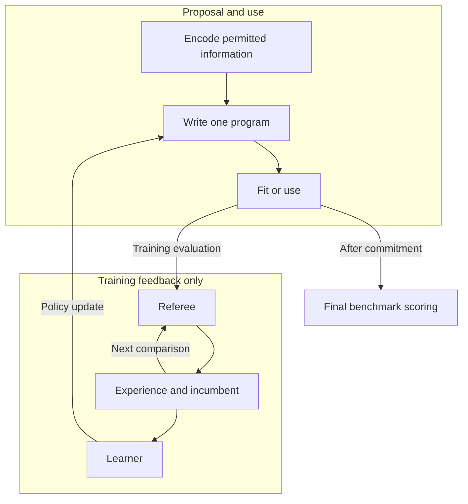

# 4 Innovation as a game

Innovation becomes a learning environment when a problem can be represented, candidate solutions can be expressed, and their outcomes can be judged. The problem defines the board; a complete solution is a move; an evaluation procedure supplies the referee. Experience then has two products: evidence about the proposed solution and a training signal for the next proposal. We formulate this interface for EurekaZero. Its purpose is to turn repeated experimentation into a reusable ability to propose, while making the conditions for that ability explicit.

## 4.1 The board, the move, and the referee

Games make learning tractable by specifying what a player may observe, what it may do, and how an outcome is scored. AlphaGo Zero used these rules to generate its own training experience through self-play [1]. Algorithm discovery can also be organized as gameplay: AlphaTensor searches for matrix-multiplication algorithms, and AlphaDev constructs instruction sequences for sorting [2, 3]. These precedents establish that discovery games are possible. EurekaZero’s question is how experience across problems can improve a single complete proposal for a new problem.

**Table 4. The game interface makes invention operational.** The analogy concerns observations, actions, and feedback; it does not require a symmetric, zero-sum contest.

| Element | Go | Innovation game |
| - | - | - |
| Board | Position and relevant game history | Permitted task evidence, objective, constraints, and known comparator |
| Move | A legal placement or pass | One complete candidate solution |
| Legality | Satisfies the chosen rules | Meets structural, execution, output, and resource requirements |
| Referee | Game rules and scoring | An evaluation protocol with withheld evidence |
| Win | Higher score, or resignation | Admissible improvement under a declared comparison rule |
| Opponent | Another policy, possibly a past self | Incumbent, comparison population, or adaptive challenge |
| Experience | Positions, actions, outcomes | Problems, proposals, outcomes, and provenance |

Table 4 specifies the correspondence. We summarize it as

```math
\mathcal{G}=(\mathcal{P},\phi_P,\mathcal{S},\phi_S,V,R,\mathcal{O}),
```

where 𝒫 and 𝒮 are the problem and solution spaces, φₚ and φₛ their representations, V the referee, R the learning reward, and 𝒪 the comparison or challenge process. Here φₛ may simply encode a program as tokens; the notation does not require a separate latent decoder. These components must be accompanied by a task-sampling rule and an information-access contract.

At the level of a complete proposal, one episode is a contextual bandit: observe a context, choose an action, and receive feedback [4]. Token generation is the internal construction of that action. A sequence of experiment-guided edits would instead define a multi-step discovery process. The asymmetry with Go is consequential: one complete algorithm can be much more expensive to judge than one board-game move.

## 4.2 The board specifies what the player can know

The board is the aim made machine-readable. For an ML task, it includes permitted training evidence, the prediction target, the metric, resource limits, and relevant deployment conditions. A representation may summarize that evidence through data statistics or landmark measurements: the behavior of specified probe models. Such measurements are part of encoding, with their computation and information access charged to that stage.

A useful encoding preserves distinctions that change which solution is appropriate. Its invariances must preserve the task: row order may be irrelevant for exchangeable observations and essential for forecasting. Feature identities and relationships may also matter. Compression is therefore a design trade-off, not a guarantee that the summary contains everything an algorithm designer would need.

The information boundary applies to every step that constructs the board. Withheld labels or outcomes cannot enter summaries, landmarks, preprocessing, or proposal selection. During fold evaluation, learned transformations must be fit within the permitted training partition. People still choose the objective and the available evidence; the policy learns how to respond to that choice.

## 4.3 The move specifies what the player can invent

The solution representation defines the player’s possibilities. A typed program language can express compositions of transformations and estimators while excluding certain malformed combinations. Grammar-constrained generation provides a precedent for enforcing syntactic validity [5]; termination, numerical behavior, and resource compliance still require checks. A token sequence describes the program, the program specifies its execution, and an auxiliary embedding may help learning. These objects need not be interchangeable.

Output support sets the scope of an invention claim. A decoder restricted to archived complete programs learns selection within that archive. New compositions require a language and decoder that permit them, followed by outputs that demonstrate them. Canonicalization can remove specified syntactic duplicates; it cannot generally certify semantic equivalence or establish absence from all prior literature. The important question is what useful behavior the player can express beyond its existing repertoire.

## 4.4 The referee separates execution from improvement

The referee first establishes whether a proposal can compete. Parsing or type errors, crashes, inadmissible outputs, and exceeded budgets are distinct failures. We use *stillborn algorithm* for a proposal that cannot produce an admissible evaluated result. A program that executes successfully but loses is a different outcome, and supplies different learning evidence.

For admissible proposals, the referee measures quality against the declared objective under matched evaluation conditions. A win requires the specified improvement over the comparator; a draw tolerance and any tie-breaking rule must be fixed in advance. Complexity can break a declared performance tie. Structural novelty can support exploration, but does not establish a performance win. The learning reward and the promotion rule serve different purposes and must be specified separately.

This separation follows the common-task principle: competitors face a shared prediction task and an external assessment [6]. It does not make the assessment infallible. Repeated adaptation to a holdout can overfit that holdout [7]. Training-game scores may teach the player; development scores may guide system design; final benchmark outcomes assess frozen entrants. Feedback used for either of the first two purposes cannot also be treated as untouched final evidence. For noisy metrics, improvement remains evidence under a protocol rather than a universal proof of superiority.

## 4.5 Self-play requires an adaptive standard

An incumbent provides a concrete opponent: the best admissible solution retained for a problem under the comparison rule. In a ratcheting-incumbent game, a qualifying challenger replaces it, changing the standard faced by later proposals. Past discoveries thereby become part of the environment in which future discoveries are learned. A comparison population or an adaptive challenge generator offers another way to create this interaction.

The distinction is substantive. On a fixed board, subtracting the same incumbent score from every candidate leaves their ordering unchanged. Relative scoring alone therefore does not establish self-play. We use *algorithmic self-play* for a process in which the player’s discoveries alter subsequent competition or challenges. Its implementation must identify that adaptation and its effect on experience. Updating policy weights or replay against an unchanged standard is learning, but does not by itself supply this mechanism.

The two forms of retention are complementary. Updating an incumbent preserves a solution; updating the policy can change which solutions are proposed elsewhere. The latter is the capability needed for single-generation deployment. An archive of successes alone does not demonstrate it.



**Figure 3. Training uses feedback; deployment commits to one proposal.** Schematic of the game contract, not a claim about a particular network architecture. The upper path remains at deployment. Training outcomes return to retained experience, an adaptive incumbent, and the learner. Final benchmark scoring follows commitment and has no return path to the writer.

## 4.6 One episode, one deployment, many boards

Consider an illustrative regression episode. The board describes permitted data, a prediction loss, and execution limits. The player writes a complete pipeline—for example, a feature transformation followed by a regularized estimator. The referee checks it, fits each learned component on the appropriate training partition, and measures held-out predictions. It records the program, outcome, resource use, and evaluation provenance. A qualifying improvement can replace the incumbent; failures and losses can also train the proposal policy. This walkthrough specifies a possible episode, not a measured discovery.

Deployment keeps only the upper path in Figure 3: encode the new task, generate one complete program, and fit or use it. *Search = 1* counts complete candidates, not API calls or neural-network forward passes. Autoregressive generation may require many passes. Repair, reject-and-resample, or selection among completed alternatives violates this contract; a failed proposal remains a counted failure. Fitting the emitted estimator on permitted training data is allowed. Any search among models performed inside that estimator must be disclosed separately. Benchmark evaluation occurs after commitment and cannot revise the proposal.

The same interface can describe classification, regression, forecasting, kernels, mathematical constructions, or engineering designs. Each board needs suitable observations, an expressive solution language, and a referee whose evidence supports the intended claim. Reusing this interface does not establish that one set of trained weights transfers across those domains. Its generality lies in the learning problem it exposes: experience with judged proposals can improve the distribution of future proposals.

> A problem becomes a game when proposals can be expressed, outcomes can be judged, and experience can improve the player.

A game supplies experience. Its practicality depends on the cost and informativeness of that experience.

# References

1. Silver et al. (2017). Mastering the game of Go without human knowledge. *Nature*, 550, 354–359. [DOI](https://doi.org/10.1038/nature24270).

2. Fawzi et al. (2022). Discovering faster matrix multiplication algorithms with reinforcement learning. *Nature*, 610, 47–53. [DOI](https://doi.org/10.1038/s41586-022-05172-4).

3. Mankowitz et al. (2023). Faster sorting algorithms discovered using deep reinforcement learning. *Nature*, 618, 257–263. [DOI](https://doi.org/10.1038/s41586-023-06004-9).

4. Chu, Li, Reyzin, and Schapire (2011). Contextual Bandits with Linear Payoff Functions. *AISTATS*, PMLR 15, 208–214. [Proceedings](https://proceedings.mlr.press/v15/chu11a.html).

5. Kusner, Paige, and Hernández-Lobato (2017). Grammar Variational Autoencoder. *ICML*, PMLR 70, 1945–1954. [Proceedings](https://proceedings.mlr.press/v70/kusner17a.html).

6. Donoho (2017). 50 Years of Data Science. *Journal of Computational and Graphical Statistics*, 26(4), 745–766. [DOI](https://doi.org/10.1080/10618600.2017.1384734).

7. Dwork et al. (2015). The reusable holdout: Preserving validity in adaptive data analysis. *Science*, 349(6248), 636–638. [DOI](https://doi.org/10.1126/science.aaa9375).

# BibTeX source

Copy the complete block below into `references.bib`. It contains exactly the seven works cited in this section.

```bibtex
@article{silver2017mastering,
  title = {Mastering the game of {Go} without human knowledge},
  author = {Silver, David and Schrittwieser, Julian and Simonyan, Karen and Antonoglou, Ioannis and Huang, Aja and Guez, Arthur and Hubert, Thomas and Baker, Lucas and Lai, Matthew and Bolton, Adrian and Chen, Yutian and Lillicrap, Timothy and Hui, Fan and Sifre, Laurent and van den Driessche, George and Graepel, Thore and Hassabis, Demis},
  journal = {Nature},
  year = {2017},
  volume = {550},
  number = {7676},
  pages = {354--359},
  doi = {10.1038/nature24270},
  url = {https://doi.org/10.1038/nature24270}
}

@article{fawzi2022alphatensor,
  title = {Discovering faster matrix multiplication algorithms with reinforcement learning},
  author = {Fawzi, Alhussein and Balog, Matej and Huang, Aja and Hubert, Thomas and Romera-Paredes, Bernardino and Barekatain, Mohammadamin and Novikov, Alexander and Ruiz, Francisco J. R. and Schrittwieser, Julian and Swirszcz, Grzegorz and Silver, David and Hassabis, Demis and Kohli, Pushmeet},
  journal = {Nature},
  year = {2022},
  volume = {610},
  number = {7930},
  pages = {47--53},
  doi = {10.1038/s41586-022-05172-4},
  url = {https://doi.org/10.1038/s41586-022-05172-4}
}

@article{mankowitz2023alphadev,
  title = {Faster sorting algorithms discovered using deep reinforcement learning},
  author = {Mankowitz, Daniel J. and Michi, Andrea and Zhernov, Anton and Gelmi, Marco and Selvi, Marco and Paduraru, Cosmin and Leurent, Edouard and Iqbal, Shariq and Lespiau, Jean-Baptiste and Ahern, Alex and K{\"o}ppe, Thomas and Millikin, Kevin and Gaffney, Stephen and Elster, Sophie and Broshear, Jackson and Gamble, Chris and Milan, Kieran and Tung, Robert and Hwang, Minjae and Cemgil, Taylan and Barekatain, Mohammadamin and Li, Yujia and Mandhane, Amol and Hubert, Thomas and Schrittwieser, Julian and Hassabis, Demis and Kohli, Pushmeet and Riedmiller, Martin and Vinyals, Oriol and Silver, David},
  journal = {Nature},
  year = {2023},
  volume = {618},
  number = {7964},
  pages = {257--263},
  doi = {10.1038/s41586-023-06004-9},
  url = {https://doi.org/10.1038/s41586-023-06004-9}
}

@inproceedings{chu2011contextual,
  title = {Contextual Bandits with Linear Payoff Functions},
  author = {Chu, Wei and Li, Lihong and Reyzin, Lev and Schapire, Robert},
  booktitle = {Proceedings of the Fourteenth International Conference on Artificial Intelligence and Statistics},
  series = {Proceedings of Machine Learning Research},
  volume = {15},
  pages = {208--214},
  year = {2011},
  publisher = {PMLR},
  url = {https://proceedings.mlr.press/v15/chu11a.html}
}

@inproceedings{kusner2017grammar,
  title = {Grammar Variational Autoencoder},
  author = {Kusner, Matt J. and Paige, Brooks and Hern{\'a}ndez-Lobato, Jos{\'e} Miguel},
  booktitle = {Proceedings of the 34th International Conference on Machine Learning},
  series = {Proceedings of Machine Learning Research},
  volume = {70},
  pages = {1945--1954},
  year = {2017},
  publisher = {PMLR},
  url = {https://proceedings.mlr.press/v70/kusner17a.html}
}

@article{donoho2017fifty,
  title = {50 Years of {Data Science}},
  author = {Donoho, David},
  journal = {Journal of Computational and Graphical Statistics},
  year = {2017},
  volume = {26},
  number = {4},
  pages = {745--766},
  doi = {10.1080/10618600.2017.1384734},
  url = {https://doi.org/10.1080/10618600.2017.1384734}
}

@article{dwork2015reusable,
  title = {The reusable holdout: Preserving validity in adaptive data analysis},
  author = {Dwork, Cynthia and Feldman, Vitaly and Hardt, Moritz and Pitassi, Toniann and Reingold, Omer and Roth, Aaron},
  journal = {Science},
  year = {2015},
  volume = {349},
  number = {6248},
  pages = {636--638},
  doi = {10.1126/science.aaa9375},
  url = {https://doi.org/10.1126/science.aaa9375}
}
```

# Editorial handoff

The section follows the implementation discipline of `EurekaZero_Final_Paper_Plan(4).md` and `EurekaZero_Writing_Strategy_and_Style(4).md`. It defines the game interface without asserting unprovided architecture details or experimental results.

**Assembly decisions.** Use numeric citations; preserve section labels `sec:innovation-game` and `sec:game` on the same LaTeX section. Table 4 and Figure 3 retain the exhibit numbering of the more detailed briefs; renumber globally during assembly. No new numbered equation is required.

**Evidence boundaries.** The regression episode is explicitly illustrative because no recorded episode was supplied. The method section must identify the actual output support, encoder, reward, incumbent or challenge update, and deployment failure policy. The source section contains no unknown numerical results or citation placeholders.

**Source checks.** Publication metadata was checked against publisher-deposited records and primary proceedings. AlphaTensor and AlphaDev game formulations were inspected in the primary articles. The AlphaGo Zero claim uses the primary abstract. Donoho’s common-task description was inspected in an author manuscript; Dwork’s adaptive-holdout claim was checked against publisher metadata and the authors’ extended treatment. No numerical promotion threshold, universal-transfer claim, or unverified creativity quotation is used.

**Delivery status.** The complete prose, table, diagram source, and BibTeX are preserved here. Downloadable LaTeX, BibTeX, and PDF exports could not be completed after the document-building environment became unavailable. PDF compilation and rendered-page inspection remain unfinished; the Page diagram is editable Mermaid source.
