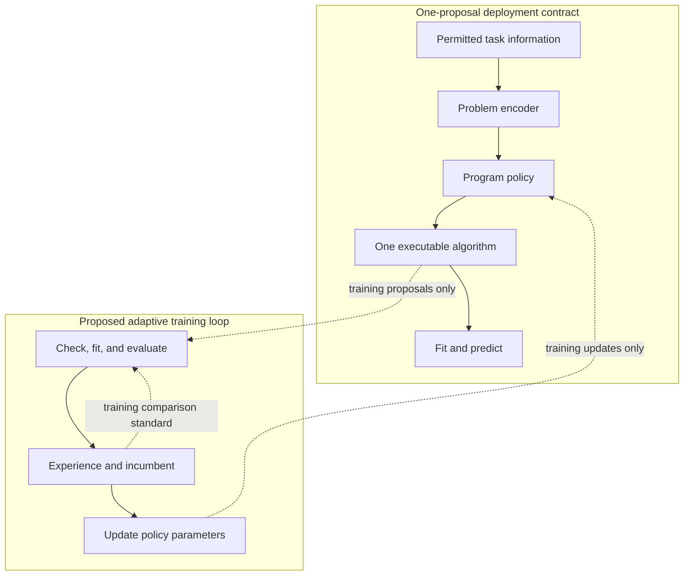

EurekaZero asks whether experience from many discovery episodes can improve the first complete proposal for a new problem. Its central object is a conditional policy: a learned rule that maps permitted task information to an executable algorithm. Experiments supply supervision during training; the deployed policy must make its proposal before receiving an experimental verdict. Self-play and expert iteration provide precedents for turning expensive problem solving into a reusable policy [1,2]. The question here is how much of that capability can be expressed in one complete algorithm.

We distinguish the framework from its documented reference implementation. CLOVER v1 provides a concrete encoder-conditioned policy, executable program representation, and supervised learning objective. Its deployed output space is a fixed program archive. The adaptive loop below specifies how EurekaZero would extend that foundation; it is not evidence that unrestricted program invention or a closed, improving policy flywheel has already been demonstrated [3,4].

## 6.1 Architecture and Data Flow

The framework has three deployment components: a problem encoder, a program-writing policy, and a deterministic interpretation or code-generation stage. For a problem p, the encoder produces a representation zₚ; the policy generates a complete representation s; and the decoder D turns s into an executable algorithm a:

```math
z_p=E_p(p),\qquad s\sim\pi_\theta(\cdot\mid z_p),\qquad a=D(s).
```

Here s denotes the actual output representation, such as a token sequence; it does not imply a separately learned latent solution space. Training adds an evaluator, an experience store, an incumbent or comparison population, and a parameter-update procedure. Figure 2 separates these roles. The deployment checkpoint and encoding recipe are fixed before the new task is scored.

The documented CLOVER v1 policy has 893,957 parameters: a context projection followed by a causal prefix Transformer with two layers, width 128, four attention heads, and feed-forward width 512. Its vocabulary contains 282 tokens, and its maximum sequence length is 640 [3]. No shared problem–program metric space or contrastive alignment loss is needed to describe this pathway.



**Figure 2. From discovery experience to one proposal.** Solid arrows show the deployment contract. Dashed arrows belong to the proposed adaptive training process and are absent during deployment. The encoder recipe and policy checkpoint are fixed at deployment; fitting updates the emitted estimator's parameters. In the documented reference, the writer decodes through a fixed archive trie.

## 6.2 Reading the Problem

The representation determines what distinctions the policy can learn. A tabular task provides training observations, a target, an objective, and resource constraints. An informative encoding should preserve differences relevant to choosing an algorithm: whether useful structure is approximately linear, whether interactions matter, and whether sample size permits an expensive estimator. These are requirements on the interface, not guarantees that any particular embedding captures them.

CLOVER v1 consumes 2,051 values from NVIDIA Kumo-Tabular Small: 2,048 pooled hidden values and three query diagnostics. Its normalization statistics were computed from the original training corpus and frozen; zero scales become one, and standardized inputs are clipped to ±10 [3]. The proposed deployment contract admits only training-side task evidence. Final evaluation labels, their derived statistics, and previous final-set outcomes cannot become policy inputs.

A separate optional DOPE interface supplies 512 coordinates: a 256-dimensional descriptor, a 128-dimensional task representation, and a 128-dimensional distribution representation. Its landmark masks distinguish an observed zero from an unavailable measurement; nonfinite observations become zero with a missing mask. Native landmark probes and neural encoding have separate costs [5]. This interface is not interchangeable with the historical 2,051-dimensional input without a compatible trained consumer. The documented optional consumer path also does not establish a predictive advantage or identify the final EurekaZero checkpoint.

Encoding belongs in the inference budget. If landmarks fit probe models on the new task, those fits are target-time computation and must be reported even when the policy emits only one algorithm. Search = 1 constrains complete algorithm proposals; it does not make preprocessing or diagnostic computation free.

## 6.3 Representing an Executable Move

A proposal must specify a computation. In the tabular setting, that computation includes data transformations, an estimator, and its declared fitting procedure. For example, “standardize the features, then fit ridge regression” describes a program composition; its coefficients are learned later from the permitted training rows. This is an illustrative composition, not a claimed discovered winner or an assertion about exact DSL syntax.

Structural constraints and learned quality have different responsibilities. A grammar or type system can restrict which structures are expressible, while the policy learns which admissible structures to favor. Grammar-based generation has established precedent [6], but syntactic validity alone does not ensure numerical stability, resource compliance, or useful predictions. Those properties require execution and evaluation.

The reference policy imposes a stronger restriction: decoding traverses a fixed trie containing 6,640 complete programs derived from the original training teachers [3]. Every completed output therefore belongs to that catalog. Token-by-token generation does not change this fact. The policy can learn a better task-dependent choice, but it cannot express a complete program absent from its support.

For the broader invention claim, the admissible representation must permit new complete compositions, and the learned policy must assign them nonzero probability. Enlarging an archive with externally discovered programs expands future selection; it does not establish that the policy originated those programs. Learned program synthesis offers useful precedents for acquiring reusable structure [7]. Whether EurekaZero can produce a useful new composition on its first attempt remains an empirical question.

## 6.4 Learning from the Game

The reference learner combines program imitation with predictions of measured quality, relative ranking, feasibility, and runtime. Its documented objective is:

```math
\begin{aligned}
\mathcal L_6={}&\mathcal L_{\mathrm{CE}}
+0.25\mathcal L_{\mathrm{quality}}
+0.25\mathcal L_{\mathrm{pair}}\\
&+0.10\mathcal L_{\mathrm{list}}
+0.10\mathcal L_{\mathrm{feas}}
+0.05\mathcal L_{\mathrm{runtime}}.
\end{aligned}
```

The quality and runtime terms use Huber losses; the pairwise term uses Bradley–Terry ranking, and feasibility uses cross-entropy. The quality target is the negative mean log ratio of program RMSE to a complementary-fold mean predictor's RMSE, with stabilization and clipping defined by the training recipe [3]. The token term teaches program choices; the auxiliary terms teach properties of measured candidates. Their presence does not demonstrate that an auxiliary prediction improves the final proposal.

Training rotates teacher windows containing up to eight measured candidates plus an eligible winner. A macro-batch contains up to sixteen contexts, with at most one context from each parent lineage, and optimization uses AdamW [3]. This is a concrete supervised update. The objective is neither a contrastive problem–program alignment loss nor, by itself, evidence of reinforcement learning against an adapting opponent.

Algorithm 1 gives the proposed outer loop. The incumbent supplies an adaptive comparison standard: verified improvements change what subsequent proposals must beat. Candidate evaluation, archive promotion, and parameter learning are separate operations. An archive can improve while the policy remains unchanged; retaining that experience in the writer's parameters requires a parameter update. In the proposed expert-iteration realization, promoted training programs become teacher targets once admitted to the writer's versioned support. Promotion therefore changes the subsequent teacher distribution, rather than merely changing a stored score. Expert iteration makes this separation explicit by alternating stronger decisions with policy learning [2].

**Algorithm 1. Proposed algorithmic self-play protocol.** The update objective, sampling rule, promotion criterion, and support-admission rules are fixed in the run specification. This protocol describes the required integration, rather than an already qualified end-to-end run.

```text
Inputs: training problems; initial policy; admissible program support;
        evaluator; incumbent store; declared sampling and update rules.
Repeat for each training round:
  1. Sample training contexts and snapshot their incumbent records.
  2. Encode permitted task evidence and generate training candidates.
  3. Check, fit, and evaluate candidates under the declared resource limits.
  4. Store outcomes, failure classes, costs, and source identities.
  5. Promote candidates that satisfy the declared comparison criterion.
  6. Admit approved programs to versioned support; construct learning
     targets, including newly eligible winners, from retained experience.
  7. Update policy parameters under the declared objective.
  8. Version the policy, support, and training records for the next round.
Select the deployment checkpoint using development evidence only;
freeze it before opening the final evaluation outcomes.
```

Execution failures remain distinguishable from valid but losing candidates. Reused development folds can guide learning, but they cannot also supply an untouched final test. In the inspected source snapshot, the adaptive ratchet and surrogate tools are documented as offline, shadow-only components that do not train the proposal policy [4]. Closing the loop therefore requires connecting verified new outcomes to a specified writer update and establishing improvement beyond the corresponding frozen policy.

## 6.5 Deployment with One Proposal

Deployment begins with a frozen checkpoint, encoding recipe, output-support version, decoding rule, and resource budget. The system encodes permitted task information, generates one complete algorithm, fits that algorithm on the allowed training rows, and predicts. Autoregressive generation may take many forward passes. “One generation” refers to one complete proposal, not one neural-network evaluation.

All completed candidates produced or ranked for the task count toward the proposal budget. Complete-program beam selection, rejection followed by resampling, compile-and-repair, and measured best-of-N selection do not satisfy the one-proposal contract. If the chosen program cannot be executed within the stated rules, the attempt is recorded as a failure; a replacement would be another attempt. Subsequent benchmark scoring measures the frozen choice and cannot revise it.

Estimator fitting is distinct from choosing the program. A fixed ridge procedure may solve for coefficients, and a prescribed iterative estimator may optimize its parameters. If the emitted procedure also compares alternative model families or hyperparameter configurations, that internal selection and its cost must be disclosed. The outer candidate count alone cannot establish the absence of all target-time search.

The computational account consequently includes encoding, generation, validation or lowering, fitting, and prediction, with benchmark scoring reported separately. This makes the claim testable: the proposal is committed before the evaluator reveals how it performed.

## 6.6 What the Mechanism Can Change

The proposed mechanism has a specific causal chain. Task representations make relevant differences available; an executable representation limits wasted proposals; experiments reveal which choices work; and learning changes the probability of future choices. Paying for this learning across many tasks is useful only if the resulting policy generalizes to new ones. A lower training loss alone cannot establish that transfer.

For a fixed archive, the immediate target is better conditional selection. For an expressive program language, the stronger target is useful new composition. Neither follows merely from an architecture diagram, an expanding incumbent pool, or a prediction head. The decisive evidence is the behavior of the frozen writer on problems that did not supply its learning signal. Section 7 can then ask whether that first proposal is competitive with the selected frontier-designed methods and the pinned Kumo configuration.

# References

1. Silver, D., et al. (2017). *Mastering the game of Go without human knowledge*. Nature, 550, 354–359. [Primary paper](https://www.nature.com/articles/nature24270).

2. Anthony, T., Tian, Z., and Barber, D. (2017). *Thinking Fast and Slow with Deep Learning and Tree Search*. arXiv:1705.08439. [Primary preprint](https://arxiv.org/abs/1705.08439).

3. JopeDime contributors (2026). *Continuous GP policy model documentation*. Inspected source snapshot a9a304d1a60e17194dbf3fbeae21a80f8e442463; historical v1 and separately identified v2 source. [Pinned documentation](https://github.com/neverhuman/JopeDime/blob/a9a304d1a60e17194dbf3fbeae21a80f8e442463/deploy/dl-flywheel/docs/model.md).

4. JopeDime contributors (2026). *JopeDime README*. Same inspected source snapshot. [Pinned source](https://github.com/neverhuman/JopeDime/blob/a9a304d1a60e17194dbf3fbeae21a80f8e442463/README.md).

5. JopeDime contributors (2026). *Optional and progressive Dope encodings*. Same inspected source snapshot. [Pinned documentation](https://github.com/neverhuman/JopeDime/blob/a9a304d1a60e17194dbf3fbeae21a80f8e442463/docs/optional-landmarks.md).

6. Kusner, M. J., Paige, B., and Hernández-Lobato, J. M. (2017). *Grammar Variational Autoencoder*. Proceedings of ICML, PMLR 70, 1945–1954. [Primary proceedings](https://proceedings.mlr.press/v70/kusner17a.html).

7. Ellis, K., et al. (2020). *DreamCoder: Growing generalizable, interpretable knowledge with wake-sleep Bayesian program learning*. arXiv:2006.08381. [Primary preprint](https://arxiv.org/abs/2006.08381).
