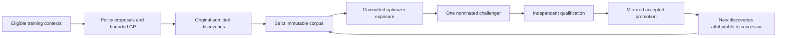

# Making Jope’s learning loop scientifically credible and computationally efficient

## Decision

Jope has substantial working machinery: a bounded program language, evolutionary search, packed teaching corpora, a transformer policy, multi-GPU optimization, and demonstrably faster warm resident execution. It does **not yet have verified evidence of the requested self-improving two-cycle scientific loop**. More training or more occupied GPUs would currently amplify several unresolved measurement, continuity, and execution problems.

The immediate investment should close the original evidence and execution path, diversify collection across eligible contexts, and optimize the dominant measured costs. The strongest performance design is a combination of compact representations, reusable computation, and a separately qualified cheap screening stage followed by authoritative full evaluation. A universal conversion to lower precision is neither necessary nor sufficient. The detailed numerical design is in [PRECISION_DESIGN.md](PRECISION_DESIGN.md).

The audit examines local xbabe2 source, retained releases and original metadata on the eight-A100 node, and primary research. Root coordinates integration; authority owns execution/history and GP semantics, admission owns data/context eligibility, and scheduler owns training/residents. Findings and disagreements were exchanged under the lock in [AGENT_CHAT.md](../../../AGENT_CHAT.md). The three component audits provide source locations and hashed captures: [GP](authority-gp.md), [data/folds](data-folds.md), and [learning/HPC](learning-hpc.md). Numerical benchmarks and scientific experiments proposed below have **not** been run by this research phase.[^scope]

## 1. What the evidence actually establishes

| Question | Finding | Interpretation |
|---|---|---|
| Does optimization execute? | 108 completed blocks, each 3,000 steps; 62 starting checkpoint identities and 108 corpora | Real optimizer work, but every block reset AdamW and its sampler. This is not 324,000 continuous optimizer steps. |
| Is an improved serving policy demonstrated? | All 48 indexed promotion decisions are inconclusive: qualification evidence was not supplied; zero accepted decisions | Independent challenger win rate is unavailable. This is not 48 measured defeats. |
| Are all eligible contexts being explored? | 28,560 declared jobs across 68 generations repeatedly select 140 dataset/cut identities, with cuts 0 and 1 | Broad job count hides narrow context coverage. These are declared jobs, not 28,560 verified successful admissions. |
| Are five folds implemented? | Five ordinary group-aware folds and five rolling origins exist in preparation code | The observed controller selects only the first two cuts and does not rotate them. |
| Is the expansion queue 4,048? | Bounded census finds 1,930 three-receipt computation-identity groups outside retained indexes and zero verified eligible additions | Missing eligibility/provenance cannot be repaired by calling files a backlog. The complete project inventory remains unfinished. |
| Is GPU training already mixed precision? | BF16 forward execution with FP32 master parameters and AdamW moments | “Enable BF16” is not a new performance intervention. |
| Does warm execution help? | Original 128-step qualifier: warm eight ranks 15.93 s versus cold eight ranks 50.32 s | Strong fixture evidence for amortizing setup; not proof of safe corpus changes or uninterrupted training. |
| Is current CUDA GPR ready? | 28/32 prototype fixtures passed its looser tolerance; no kernel qualified; cold CUDA 8.19 s versus CPU 2.54 s | Required parity is absent and measured end-to-end speed is worse. |

The training census sums to 324,000 block steps and 663,552,000 nominal program-example presentations at global batch 2,048. That arithmetic does not establish unique examples, fresh discoveries, committed exposure for failed attempts, or optimizer age. The packed corpus at snapshot 421 contains 8,899,150 records; record count is also not independent scientific evidence.[^learning][^data][^cuda]

A source-bound monitor gives a more informative quality warning than aggregate loss. Recovery and cycle 107 were measured with the same 2,048-example panel, corpus, and native monitor executable. NLL worsened from 1.394498 to 1.408606, and Bradley–Terry loss from 0.533676 to 0.542086: approximately 1.01% and 1.58% regression. Runtime loss improved. This is a fixed **adaptive-teaching monitor**, not independent generalization or a protected promotion decision. It nevertheless argues against assuming recent optimization improved the desired behavior.[^learning]

Root independently joined the latest completed generation-66 report into 140 matched context groups and rehashed all 420 underlying `search.json` summaries, finding 420 matching endpoints and no mismatches. Against generic grammar, training contexts show **1 win, 120 ties, 3 losses**; development contexts show **0 wins, 16 ties, 0 losses**. All 420 pure-predicted endpoints are unavailable, and all 420 actual-cut baselines are missing. Search summaries attribute 138/140 neural winners to retained cut teachers and 2/140 to subsequent GP. This endpoint is mostly measuring retention of existing champions. It cannot isolate whether neural generation or ranking helps. Observation ledgers and native admission were not independently verified by this join.[^paired]

Equal 600-second/1,000-slot limits can legitimately yield unequal realized evaluations. Report both quality versus elapsed budget and quality versus unique evaluated programs; do not call these equal-evaluation comparisons. Do not infer a global absence of learned signal from this selected generation, and do not call its adaptive scores independent wins.

## 2. The algorithmic game and the AlphaGo Zero comparison

AlphaGo Zero couples a policy/value network to tree search: search improves move selection, complete games provide outcomes, and training improves subsequent search. AlphaZero’s familiar objective combines a value error, imitation of the search policy, and regularization. The transferable principle is a measured improvement operator whose new experience improves the next policy; a literal Go win threshold or tree-search implementation is not automatically appropriate for program synthesis.[^az]

Jope currently implements **neural-seeded evolutionary program search with reward-weighted imitation and learned ranking**. It has no inspected MCTS visit targets, PUCT selection, or two-player terminal return. This is related in motivation to expert iteration, which alternates planning and generalization, but it does not reproduce that paper’s tree-search algorithm.[^gp][^exit]

The practical game contract should be explicit:

| Element | Proposed explicit contract, preserving current frozen semantics |
|---|---|
| Task/state | An eligible dataset family, cut, training-derived context, legal partial program, and remaining reservation |
| Actions | Legal typed grammar extensions or bounded mutation/crossover actions |
| Terminal object | A canonical complete program with a resource contract |
| Observation | One original authorized computation, with complete data/runtime/fidelity identity and retained outcome |
| Teaching reward | Adaptive cut score, program cost and validity under a frozen transform; never an untouched-test claim |
| Improvement | Better original admitted programs per reserved compute, followed by verified policy improvement |
| Independent comparison | Preselected policies and controls, fixed access rules, family-aware inference and protected references |

The desired loop is:

The weakest links now are original admission/custody, continuity, pure-policy measurement, and promotion production. Changing evolution to MCTS before these work would make causal diagnosis harder. A later prefix-value experiment needs legal action masks, cost-aware terminal evaluation, search-policy targets, transposition identities and a value function that predicts improvement under a specified remaining budget. It should compete against repaired evolution in its own funded lineage.

Deployed native-v5 retains up to 80 prediction-distinct survivors, selects from the best ten, injects a random grammar attempt every eighth attempt, and otherwise mutates or crosses programs. Its parent selection cycles through ranks using the proposal counter. This couples parent rank to mutation/crossover parity; it is not independent roulette sampling. Policy-generated seeds can still affect survivors and descendants. A newer **unreleased** local weighted-parent helper contains a separate defect: dividing adjacent integer seeds by `u64::MAX` is not a pseudorandom draw. The inspected production-sized seed produces one identical floating-point quantile for 1,000 increments. Fix both sampling semantics in a new qualified release, retaining legacy identities.[^gp]

## 3. Model and objective: make the gradients serve the actual decision

The deployed configuration combines 1,536 dataset-context dimensions and 512 target-context dimensions with a six-layer causal transformer: width 512, four attention heads, FFN 2,048, maximum sequence length 128, dropout 0.1. It is a plausible small program policy. No evidence currently justifies enlarging it.[^learning]

The actual five-term objective is:

`L = L_sequence + 0.25 L_BT + 0.10 L_listwise + 0.10 L_runtime + 0.05 L_ablation_BT`.

| Term | Existing definition | Audit requirement |
|---|---|---|
| Sequence imitation | 0.95 target-token negative log-likelihood plus 0.05 uniform cross-entropy over legal tokens; normalized program weight `0.05 + percentile^4` | Report legal probability mass, actual weighted exposure and held-fixed NLL; lower training loss alone is insufficient. |
| Pair ranking | Bradley–Terry comparisons within eight-program groups; absolute value-gap weight, doubled for top-decile involvement | Freeze tie rules, value transform and weighting; expose pair count and gradient scale. |
| List ranking | Target `softmax(percentile / 0.25)` versus predicted reward logits | Account for target entropy and support changes before interpreting the loss floor. |
| Runtime | Huber loss between predicted and observed `log1p(seconds)` | Include machine/runtime identity and failed/censored outcomes; keep utility and quality separately visible. |
| Context-free ranking | Auxiliary Bradley–Terry head using program representation alone | Test whether it helps shared priors or suppresses context-specific distinctions. |

Stability and seven learned loss-weight scalars are inactive in this release. The runtime logarithm matches the stored label convention; the inspection does not establish a double-log bug. Five active terms, their normalization and their gradient recipients must be frozen before any semantic correction creates a new objective/corpus lineage.[^learning]

The most concrete model-design problem is the reward/runtime representation: **mean pooling of token embeddings without position cannot distinguish programs with the same token multiset in different orders**. This can matter for noncommuting transforms. Its ranking gradients also do not train the independent generation decoder parameters. Four reward heads trained through their mean do not establish calibrated uncertainty. These are structural findings, not proof that they caused any particular historical result.

The next model work should be ordered:

1. Add complete term, gradient-norm and gradient-reachability reporting to the frozen objective. Check that runtime or context-free objectives cannot conceal regression in program selection.
2. Verify global weighted reduction. Current per-microbatch normalization can change the effective objective when world size or microbatch allocation changes, despite a constant nominal global batch.
3. Finish compatible optimizer carry and exact continuation before comparing learning curves. Audit seed, RNG, sampler, corpus, objective and committed new-step windows.
4. After the required support/replay experiment, compare the existing reward encoder with one compact order-aware encoder on the same admitted corpus. Freeze the decoder or explicitly account for shared parameters. A typed AST encoder is a later, distinct intervention.
5. Evaluate whether reward-weighted imitation actually improves direct predicted winners and downstream search. Consider advantage-relative policy targets or uncertainty-guided search only after this measurement works; they are changes to the learning problem, not an automatic fix.

The specified 50/50 fresh/broad sampler is a split of **comparison groups**, not necessarily of program presentations. A fresh eight-program group can contain only one fresh item. If half the groups are fresh, the minimum fresh-slot share is therefore 1/16 overall. Report actual committed fresh programs, repeated programs, distinct contexts/families, champions and fallback. Family balance and seven distinct comparators are useful; relabeling retained history as new discovery is not.[^learning]

## 4. Five folds, leakage and deliberate coverage

Preparation has five ordinary folds with grouping for identical predictors and available entity IDs; classification can stratify by class. Time-series preparation has five rolling origins when the task/horizon metadata select that path. Repeated regression cuts change deterministic partition seeds and reject duplicate training membership. Those cuts overlap and remain members of the same source family. They must not be counted as independent datasets.[^data]

The active index contains 8,894 contexts: 6,962 training, 1,054 existing meta-validation and 878 sealed-test contexts, spanning 62/8/10 families respectively. The observed controller passes `cuts=2`, `cut_start=0` unchanged across 68 generations. Thus five-fold preparation and two-cut collection coexist. Merely setting a larger global cut count would also alter qualification if roles were not separated.

Preserve all existing memberships, the ten sealed-test families and every frozen qualification role. Repair production **training collection** to select eligible contexts lacking strict evidence across families and cuts. Use all five ordinary folds in a new coverage schedule where those original memberships exist; then consider additional admitted repeated cuts. Leave the existing eight-family/two-cut/three-seed qualification panel unchanged. Any broader five-fold scientific comparison requires its own prospectively frozen role and reservation.

Disjoint integer train/validation indices do not establish absence of entity or temporal leakage. In this index, 6,000 context records lack the `entity_columns` field and 95 have empty declarations; metadata cannot determine whether those absences are appropriate. Audit family aliases, source overlap, duplicated predictors, target/feature provenance and temporal ordering. A temporal dataset mislabeled regression can bypass the rolling-origin path. Fit preprocessing on training rows only, then apply its frozen state to the scoring rows. Do not use sealed targets to choose subsamples or transformations. These precautions follow the dependence structure of the data, not a preference for the number five.[^data][^cv]

For the requested strong roulette strategy, use hierarchical sampling with an auditable coverage floor. One proposed training-collection distribution is:

`w_c = 1 / (1 + committed_unique_strict_c + in_flight_c)^2`

`P(c | chosen family/dataset) = 0.10 / number_eligible + 0.90 * w_c / sum(w)`.

A zero-evidence cut has 100 times the raw weight of a cut with nine committed observations before the uniform mixture. The coefficient and exponent are proposed settings to freeze and test, not existing policy. Balance families first and datasets second so a family with many repeated cuts cannot dominate. A deterministic deficit sweep must guarantee eventual coverage; random expectation alone is not an even-distribution guarantee. Use a real seeded PRNG or counter-based hash stream, with separate domains for each scheduling stage.

Count only complete original computation identities for evidence; track reuse, attempts, failures and unknown starts separately. Include in-flight reservations to prevent 104 workers piling onto the same empty cut. Failed contexts need explicit diagnosis/cooldown rather than infinite overweighting; ambiguous starts remain unavailable. Cost-aware choices can operate within coverage guarantees, never silently eliminate expensive families. Development and protected comparisons retain their frozen schedules.

## 5. Context inclusion and binary data

The metadata census distinguishes index membership, receipt completeness, compatible metadata, historical disposition, assembly and eligible admission. Across bounded named roots and 17 retained index artifacts, 1,930 groups have all three component receipts outside retained indexes; vector bytes and their complete dependency graph were not independently verified. In the separate 2,695-cut expansion-preparation census, ten cuts satisfy the selected strict component-metadata fields; that is **not ten eligible additions**. Zero match eligible registry families/current partitions in the bounded metadata join. The broader full-project inventory and native verification remain unresolved.[^data]

Preserve the active index by reference. Apply seed-20260907 80% training / 20% distinct development reserve only to genuinely new eligible regression components. Remove sorted-tail legacy partition helpers and Boolean assembly declarations from execution authority. Frozen component identities must include aliases, prepared/training/preprocessing identities, vocabulary/registry, dependency bytes and runtime. Different specifications cannot be collapsed merely because part of their identity matches.

The expected composition dimensions are 512 Hyperion + 1,024 projected foundation + 512 target. The selected source helper currently invokes native CUDA; the earlier claimed retained CPU helper was not located in bounded searches. Resolve that discrepancy before extending a presumed implementation. Select **eight deterministic training-only reference cuts across two families before opening their files**. Run only the bounded two-CPU-thread qualification with finite-output checks, unchanged dimensions, exact dependencies and the existing `3e-4` parity tolerance. No blanket reference scan, sealed-reference access, or expansion claim from old training references is permitted.

Corpus snapshot 421 already reuses 7,863 groups and rebuilds 14: 99.82% reuse by group count. Its index is approximately 55.6 MB. Records are fixed 532 bytes, with sealed read-only mappings and hash/size cache checks. These are useful foundations. Native-v3’s device cache still keys on the **whole index digest**, so a changed corpus can rebuild all rank-local device tensors despite host shard reuse. Implement per-shard immutable device reuse, reference counting and peak old-plus-new memory checks; qualify all-rank activation and interrupted publication. Do not replace binary packing merely to introduce a fashionable format.[^data][^learning]

## 6. Performance priorities and the smarter-type design

The eight-A100/124-vCPU node has two very different jobs: policy training/inference and heterogeneous small program fits. Hardware peak arithmetic is not end-to-end throughput. CPU allocation, copies, process setup, fitting, prediction, synchronization, checkpointing, publication and queue delay need separate timers. GPU profiling should distinguish launch, memory and arithmetic limits; NVIDIA’s performance guide explicitly treats small matrix operations as potentially latency or memory limited.[^gpu]

For 108 successful historical training blocks, controller elapsed totals 25,206.18 seconds; measured step sections total 20,006.42 seconds, or 79.37%. The rank timer starts after substantial initialization, and step time itself includes host work and collectives. Neither this ratio nor the earlier unsupported 93% claim is pure GPU arithmetic occupancy. Retained health samples report 1.18% occupancy over an hour with missing observation intervals; that is not a certified useful-hour result.[^learning]

| Priority | Intervention | Evidence and required decision |
|---|---|---|
| First | Full timing and original cost ledger | Separate search wall from CPU core-seconds; provider node billing includes idle time. Bind rows, width, head, runtime, precision and outcomes. |
| First | Warm sequential eight-GPU tasks with durable acceptance | Existing same-corpus qualifier is favorable; qualify changed corpora, deadlines, exact resume and all-rank custody before deployment. |
| First | Compact matrices, typed programs and immutable common-work caches | Source exposes nested row allocations and repeated transformations. Preserve semantics and verify exact fixtures; speed is not yet measured. |
| Next | Head-specific CPU optimization | Profile retained GPR, histogram tree, linear and kernel workloads by dimensions. Optimize dominant aggregate cost, including orchestration outside fit timers. |
| Next | Separate cheap screening and full evaluation | Measure finalist retention and full-score regret at equal total reservation. Account for screening cost and every numerical start. |
| Conditional | Mixed precision, batching and CUDA for suitable kernels | Use only measured crossover sizes and separately qualified numerical contracts. Current CUDA GPR fixture is a negative result. |
| Later | Alternative GPU allocations or a larger model | Require disjoint leases, communicator isolation, objective equivalence and improved useful queue completion. |

Warm qualifier times are 15.93/19.28/26.46 seconds on 8/4/2 ranks at the same global batch. Four and two ranks consume fewer device-seconds per task, but leave paid capacity idle unless other funded work safely uses it. Begin with the required qualified eight-GPU sequential path. Evaluate concurrent allocations only after device/communicator isolation and objective normalization are verified.

Rust is already suitable for grammar handling, scheduling, packed readers and many CPU kernels. A flat matrix with explicit stride, an interned typed program representation, cache-friendly scratch buffers and fewer repeated conversions can matter more than language changes. C++17 is appropriate where a measured hotspot benefits from an existing optimized library or a small fused native extension. It is not an automatic speed upgrade over Rust. Compile emitted native programs only when compilation amortizes over enough future use; most one-off small candidates should not incur a compiler startup.

A further head-specific check confirms that `histgbm2` uses exact split search despite its name, while the separate `histgbm` implementation already bins features. Composite GPR also constructs scratch vectors inside its pairwise gradient loop; plain RBF follows another path. Reusing those buffers and testing the existing binned head as a separate screening condition are concrete experiments. Their cost shares and speedups remain unverified; see the [retained head-source evidence](authority-gp/head-hotspot-source.json).

The new authority path also needs throughput qualification: runtime hashing, lock wait, durable journal/database writes and independent witness acknowledgment can add material per-task cost. Include them in the release benchmark. Amortize only through qualified immutable caching or durable group commits; no fit-start token may precede its required witness acknowledgment.

CUDA is a candidate for sufficiently large or batched dense work, resident neural inference and fused launch-bound training sections. It is a poor default for a stream of tiny irregular CPU tasks. CUDA Graphs can reduce repeated launch overhead for compatible static execution, but require a profile, stable storage/shapes and a native integration plan; Python `torch.compile` is not a drop-in switch for this Rust/tch deployment.[^graphs]

Profile Rust build critical paths with Cargo timings, separate CPU-only evaluator features from heavy neural dependencies, and reuse source-bound build artifacts. Selective PGO/ThinLTO can be tested after runtime bottlenecks are known. Do not enable fast-math, change reductions or swap BLAS silently under exact fixtures. Build throughput and numerical runtime are different measurements.[^rust]

The [precision design](PRECISION_DESIGN.md) spells out FP64/FP32/BF16/TF32 choices, exact compact categorical/bitset representations, typed bytecode, common-subexpression reuse, conditioned mixed-precision solves, and a multi-fidelity qualification experiment. Its central test is **better full-quality discoveries per paid unit of time**, not more low-precision fits.

## 7. Metrics that can demonstrate progress

Emit status with search ID, controller generation, GP generation when available, arm, seed, checkpoint, logical slots, physical starts, reuse, failures, unknown outcomes, elapsed time and absolute deadline. A displayed zero score must be distinguished from missing evidence.

For each actual cut, let `E` be original-unit RMSE and let `B` be RMSE on the scoring rows of the **training-target mean**. Display `E`, `B`, `E/B`, RMSE skill `1-E/B`, and squared-error skill `1-(E/B)^2` when `B > 0`. Ordinary R² uses the scoring-target mean and must be labeled separately. When `B=0`, ratios are unavailable; a valid `E=0` remains valid evidence. Do not average unnormalized original-unit errors across datasets. Produce baselines during authorized evaluation and independently verify their units from retained evidence; never reconstruct them by unauthorized target reads.[^gp]

Track distinct questions separately:

| Metric/control | Question answered |
|---|---|
| Direct predicted winner on a frozen common pool vs random ordering | Does the reward model select better programs before outcomes are revealed? |
| Neural-generated pure pool vs generic grammar under matched reservations | Does learned generation improve candidate quality/diversity? |
| Correct context vs shuffled training-family context | Does matching conditioning help beyond the globally learned prior? |
| Retained teacher vs final evolved winner | Does additional search produce an original improvement? |
| Full neural-seeded search vs full controls at fixed cost | Does the entire policy/search system improve quality per resource? |
| Accepted successor followed by original new discoveries | Does the feedback loop actually close? |

A best-of-evaluated-pool oracle is not a pure predicted winner. A generic grammar is not a randomly initialized network. A shuffled network still contains its learned prior. Known teachers and reused completions are valuable but must be visible. Preserve missing predictions and failed fits; never filter to successful easy cases for a win-rate denominator.

Use matched contexts and seeds, family-macro effects, uncertainty intervals and explicit ties. Resample families with all their repeated cuts/seeds together. Eight development families provide limited inferential resolution; thousands of repeated observations do not create thousands of independent tasks. Research on few-run RL evaluation motivates uncertainty reporting, and model-selection research explains why repeatedly optimized heldout scores cannot serve as untouched tests.[^stats][^selection]

Preserve the existing promotion policy: at least 1% mean improvement and a strictly positive confidence lower bound against recovery, serving and original serving, with at most 0.5% NLL and 1% ranking regression, 95% intervals with 10,000 seeded family bootstrap replicates; eight development families, two cuts, three seeds; 16 concurrent searches, 1,000 slots and 600 seconds per search, with the existing fit and aggregate budgets. Recovery, serving, original serving, cycle-25, generic and shuffled panel arms remain required; cycle-25/generic/shuffled are not additional mandatory 1% primary-improvement comparisons. The ten sealed-test families remain sealed. Matched final GP quality and failure-rate protections against serving also remain. A zero-error reference remains valid evidence but cannot supply a positive denominator for the existing ratio gate. The current producer-verification function intentionally refuses promotion until original execution evidence is qualified; remove the placeholder only by implementing that evidence chain, never by weakening the policy.[^promotion]

## 8. Execution plan with completion gates

[gap-register.json](gap-register.json) is the action/evidence register for this audit. It supplements the existing [integration issue register](../../../parallel/runs/registry-integration-20260910/issues.json); the older statuses must not be mistaken for a certification of current loaded code. Each action distinguishes implementation, verification, deployment and scientific qualification.

| Stage / accountable owner | Concrete work | Exit gate |
|---|---|---|
| 0 — Root with authority | Freeze full local/remote inventory, executable/source closure, original and `-next` overrides, descendants and task receipts. Reconcile original completions and permanently unavailable ambiguous starts. Preserve serving/residents/history. | Every launch route is inventoried and authority-mediated or rejects before numerical start. Missing/unreadable/unvisited entries remain visible. |
| 1 — Root with authority/admission | Freeze transfer tranches; independently verify original raw/protected copies; restore applications and both-host acknowledgment. Complete history/recovery/witness/query operations without activation side effects. | Complete matching manifests and recovery evidence; synchronization certificate separate from collection activation. |
| 2 — Authority with root | Finish selection, retained-model query, search-access, monitoring and aggregate producers plus independent verifiers. Qualify the unmocked synthetic chain and interrupted publication. | Original source-bound release matrix passes; hard deadlines and witness acknowledgment precede fit-start tokens. |
| 3 — Admission | Complete eligibility census, context composition qualification, immutable successor index and deterministic least-covered scheduling. | Preserved memberships, no sealed access, native membership/publication verification; empty queue reported if no additions qualify. |
| 4 — Scheduler | Separate serving head, experiment head and task; implement single-use funded hold permits, optimizer carry/new-step semantics, immutable shard reuse and complete resident protocol. | Reconciled/drained eight-rank transition under exclusive lease; all-rank readiness, exact continuation and recovery qualify. Rollback also drains/reconciles. |
| 5 — Root release integrator | Import final history delta, reconcile exclusions/witness, commit recovery epoch, explicitly activate collection scopes. | At most 16 reserved canary slots, every outcome reconciled; only then expand within 104 aggregate evaluator slots. |
| 6 — Scheduler with admission | Publish strict corpus from original observations. Freeze five-term objective. Run distinguishable support/replay conditions using selected three seeds, compatible recovery initialization, global batch 2,048, 1,000 **new** steps, five-minute caps. | Original exposure, task outcomes, costs and fixed diagnostics available. No duplicate conditions or fabricated fresh data. |
| 7 — Root with authority | Nominate at most one challenger from training-only evidence; run complete protected-reference qualification; commit/mirror accepted decision and predecessor-check serving publication. | Accepted policy P1 produces subsequent original attributable discoveries; repeat to P2 and subsequent discoveries. Otherwise retain recovery and close only the tested hypothesis. |
| 8 — Scheduler/root | Measure the unattended useful hour alongside funded work once execution qualifies; finish source-bound UI verification. | 3,600 seconds / 28,800 GPU-seconds accounted, at least 90% useful occupancy, required handoff bound, complete interval classifications and original progress receipts. |

The original 312/208 proposal reserves and all existing promotion/collection limits remain unchanged. Generic and shuffled production collection controls need explicit reservations and an unresolved scientific purpose. If a support factor has no eligible new support, do not run nominally different but identical conditions. The canonical remote qualification-budget files were missing in the bounded audit; no remaining balance or renewed grant can be certified. A proposed experiment is not funding authorization.

After stages 0–4, prioritize reconciliation, proposal replenishment, funded training/monitoring, qualification, then background exports in the selected order. Do not fill idle slots with scientifically undefined tasks. Stop new dispatch when funding, authority, original identity, evidence, deadline or custody fails; retain and reconcile work already accepted.

Before every transfer tranche calculate missing **unique** objects, staging, materialization, snapshots, growth and reserve. Enforce one aggregate limiter: 64 MiB/s initial and 8 MiB/s background, with free reserve `max(250 GiB, 10%)`. Preserve durable history and original transfer-lineage limitations. Do not downsize hardware until recoverable custody exists. Transfer preparation remains independent of production activation.

The useful-hour measurement can accompany qualified funded training or qualification; it does not require waiting for an accepted challenger.

Charge actual paid node wall time separately from CPU core-seconds and GPU device-seconds. At a verified node price `C` per hour, allocated-node cost for `t` seconds is `C*t/3600`, including idle intervals. The provider rate was not established here. Report storage and transfer growth, reservations, spent/released amounts, unknown consumption and unpaid/unfunded requests without silently netting them away.

## 9. Adversarial release and scientific checks

The release must cover the root library and 56 binaries, relevant CPU/neural/runtime tests, formatting, lint, and exact fixtures against frozen sources. The earlier integrated run is incomplete; the interrupted query-unit run had **8 passes and 1 failure**, not a passing release. Complete original final results are required. Obtain source-bound Tuiwright and Bullet verification for the deployed UI.

| Attack/failure | Required observation |
|---|---|
| Duplicate clients, alternate binary or alias, direct library fit | At most one authorized start; denied routes never enter numerical execution. |
| Missing witness tail, stale restored authority/history, partial recovery | No token release; original histories and exclusions retained. |
| Invalid/failed outputs, changed component bytes, wrong family or target provenance | Admission rejects with original evidence; no promotion or corpus contamination. |
| Sealed-reference path encountered during composition | Selection happens before file opening; forbidden references remain unopened. |
| Zero RMSE, zero baseline, rescaled targets, ties, missing slots | Correct units and unavailable states; valid zeros retained. |
| Parent RNG defects, partial scores, concurrent roulette requests | Reproducible valid draws; expected distribution; no herd dispatch or starvation. |
| Rank loss, lost acceptance reply, reused PID, socket replacement | Durable custody or unavailable ambiguous state; no blind retry. |
| Checkpoint resume, altered corpus/objective/world size, old absolute step | Identity checks reject incompatibility; task requires its requested new committed steps. |
| Missing/expired funding, late task, lease collision | Rejection before numerical start; complete cost reconciliation. |
| Mixed precision/subsampling accidentally admitted as full-f64 evidence | Schema and authority rejection; fidelity cannot disappear during publication. |
| Interrupted corpus or promotion publication, stale serving predecessor | Immutable recovery and mirrored decision checks; no split serving state. |

A faster kernel is only implemented when source exists, verified when original source-bound tests pass, deployed when the loaded release matches, and scientifically qualified when the intended comparison succeeds. The same distinction applies to the entire flywheel.

## 10. Corrections and remaining uncertainty

This audit deliberately challenged other agents’ favorable and unfavorable claims. The 4,048 backlog, 98% CPU utilization, 93% training occupancy, 66 ms candidate median and 12 ms per-fit spawn claim did not survive their proposed interpretations. Load average is not CPU busy percentage. A historical `--help` probe is not candidate startup. A bounded head-cost profile can guide optimization but its summed wall timer is not automatically CPU core-seconds. Later chat-only percentages for spawn, head shares, repeated fits and semantic duplicates remain unverified until their original scoped artifacts and derivations are retained.

Likewise, flat storage is not automatically bit-identical; no observation publication does not exempt screening from execution authority; missing policy log probabilities in old seed files do not prove a newer function ran; and shared final scores do not establish a useless policy. These distinctions prevent spending the next expensive run on an incorrect diagnosis.

Remaining limits are explicit: full-project/remote raw inventory and transfer lineage are unfinished; metadata presence is not independent object or numerical verification; protected payloads were not opened for this audit; runtime captures are time-bounded; current source differs from retained deployed releases; and proposed precision/layout speedups are unmeasured. The source-bound generation-66 summary join does not certify underlying observation admission. No accepted challenger or two original post-promotion discovery cycles is demonstrated.

At the post-containment capture, all four original/`-next` collection/controller units had no main process and restart disabled, while the native-v3 resident pool was preserved. Earlier 104-worker activity was real but historical. Containment done during the preceding authorized recovery work does not qualify production resumption. Research-phase changes are audit artifacts only; the earlier partial source implementation remains unqualified.[^runtime]

## Sources and evidence

[^scope]: [Audit scope](scope.json), [coordination log](../../../AGENT_CHAT.md), and [source/evidence index](evidence-index.json). Captures were made on 2026-09-11; exact timestamps and hashes are retained per artifact.
[^learning]: [Learning and HPC audit](learning-hpc.md), [108-block derivation](learning-derived-summary.json), [performance arithmetic](learning-performance-summary.json), [original fixed monitors and budget check](learning-monitor-budget-metadata.json), and [frozen native-v3 source](evidence/learning-native-v3/training.rs).
[^data]: [Data/fold audit](data-folds.md), [metadata census](data-folds-evidence/metadata-census.json), and [original corpus metadata](data-folds-evidence/source-corpus-metadata.json). Census scope and grouping limitations are part of the evidence.
[^gp]: [GP source audit](authority-gp.md), [findings and hashes](authority-gp/findings.json), [independent remote release capture](authority-gp/remote-source.json), [representation/parent-loop addendum](precision-layout.md), and [original deployed parent selection](authority-gp/remote-parent-selection.json). Local dirty source and retained native-v5 are separate contracts.
[^paired]: [Paired diagnostic](evidence/paired-diagnostic.json), [independent search-summary verification](evidence/diagnostic-verification.json), [paired outcome CSV](paired-outcomes.csv), [join producer](evidence/paired-diagnostic.py), and [verification producer](evidence/verify-diagnostic.py). The diagnostic’s earlier `source_receipts_reverified:false` describes its initial stage; the later verifier covers search summaries only.
[^cuda]: [Retained prototype report capture](evidence/retained-results.json), original remote `runs/parity/gpr-cuda-v1/report/report.json`, SHA-256 `04cb88b43d47ae3c757fc052686f311b779df2e4553884d9e6be62c8885f7fe5`.
[^runtime]: [Post-containment runtime capture](evidence/runtime.json), [capture code](evidence/capture-runtime.py), and [prior containment evidence](../../../parallel/runs/recovery-execution-20260911/contain-resume-result.json). Service state is not a full-project fit-boundary certificate.
[^promotion]: [Frozen promotion policy and producer refusal](evidence/promotion_gate.py), copied from [current source](../../../parallel/tools/promotion_gate.py). Constants and required reference checks were read directly; this report does not change them.
[^az]: Silver et al., [Mastering Chess and Shogi by Self-Play with a General Reinforcement Learning Algorithm](https://arxiv.org/abs/1712.01815), 2017, and DeepMind, [AlphaGo Zero: Starting from scratch](https://deepmind.google/blog/alphago-zero-starting-from-scratch/), 2017. Used for the policy/search/outcome mechanism, not Jope performance claims.
[^exit]: Anthony, Tian and Barber, [Thinking Fast and Slow with Deep Learning and Tree Search](https://arxiv.org/abs/1705.08439), 2017. Expert iteration separates planning and generalization; Jope’s evolutionary analogue is an interpretation.
[^cv]: [Scikit-learn cross-validation documentation](https://scikit-learn.org/stable/modules/cross_validation.html). Used for group/time dependence concepts, not as evidence of Jope’s implementation.
[^gpu]: NVIDIA, [GPU Performance Background](https://docs.nvidia.com/deeplearning/performance/dl-performance-gpu-background/index.html) and [Nsight Systems User Guide](https://docs.nvidia.com/nsight-systems/UserGuide/). Used for bottleneck classification and timeline measurement.
[^graphs]: PyTorch, [Accelerating PyTorch with CUDA Graphs](https://pytorch.org/blog/accelerating-pytorch-with-cuda-graphs/). Applicability to Jope’s native runtime requires implementation and measurement.
[^rust]: Rust project, [Cargo build timings](https://doc.rust-lang.org/cargo/reference/timings.html), [profile-guided optimization](https://doc.rust-lang.org/rustc/profile-guided-optimization.html), and [Cargo profiles](https://doc.rust-lang.org/cargo/reference/profiles.html). No speedup is inferred from these options alone.
[^stats]: Agarwal et al., [Deep Reinforcement Learning at the Edge of the Statistical Precipice](https://arxiv.org/abs/2108.13264), 2021. Used for uncertainty-aware aggregate evaluation with limited runs.
[^selection]: Cawley and Talbot, [On Over-fitting in Model Selection and Subsequent Selection Bias in Performance Evaluation](https://www.jmlr.org/papers/v11/cawley10a.html), 2010. Used for the adaptive-selection distinction.
