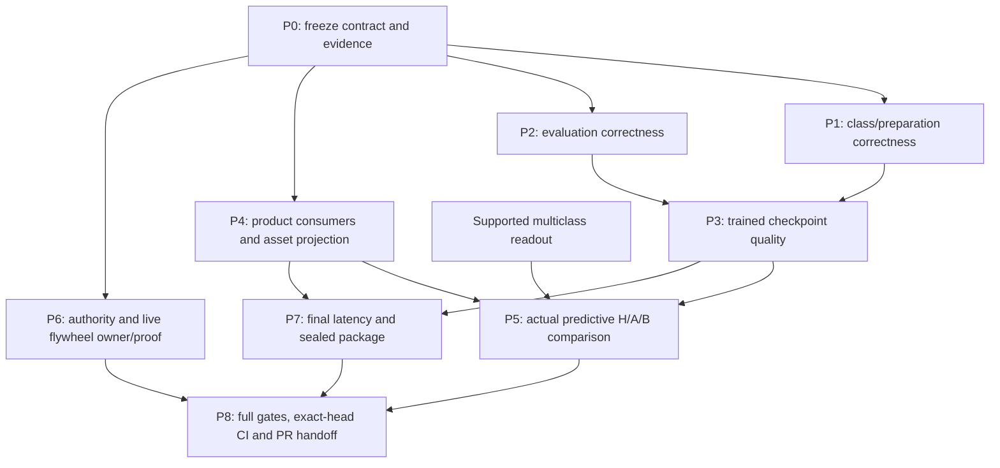

# Optional landmarks and HPC: coordinated completion plan

Execution record: 27 October 2026. The [engineering specification](specs/optional-landmarks/engineering-spec-optional-landmarks.md)
and [mission](specs/optional-landmarks/mission-optional-landmarks.md) govern correctness. This plan includes
the user's subsequent requests for GPU Dope features, Micro HPC reuse, and coordinated upgrades
in both repositories. The attached source documents preserve their wording; trailing Markdown
spaces are normalized for repository hygiene. Implementation and qualification are separate milestones.

**Binding update:** Jepson’s ADDENDUM in the mission supersedes this plan’s earlier no-training
assumption. The current old-checkpoint implementation is a compatibility baseline. Completion
now additionally requires trained mask robustness, both optional Jope consumption paths,
flywheel regression/liveness, per-task quality, and entirely Rust inference.

## P4 continuation update

The user-authorized focused continuation now implements explicit direct/learned product
consumers, scoped controller admission, a selected-only policy projection, typed context
semantics, CLI/appliance/pipeline propagation and companion schemas. The
[P4 implementation record](qualification/optional-landmarks-p4.md) describes the changes,
focused verification, asset-owner review packet and remaining acceptance. The snapshot below
is the preserved 17:40 observation; it is not a claim that product selection is still absent.
Preparation/P1, sampled evaluation/P2, final trained identity, governed package approval,
production authority/liveness and the final quality/latency/aggregate gates remain open.

## 19:26 UTC draft and bounded-execution update

[JopeDime draft #431](https://github.com/neverhuman/JopeDime/pull/431) is published under
the explicit 19:03 user direction to push the checkpoint and run CI. This updates the earlier
local-gate-before-publication sequence for this draft; final qualification remains required.
The initial run at `c4a66e608` exposed documentation and identity-ledger failures. Local repairs
preserve numerical/emission fixtures and record the dependency identities as closed historical
transitions. A fresh run is required at the next pushed head.

P6 now has one actual authorized Rust execution at `a9cb739732d94814228408f1bee3209456224080`:
two native measurements on fresh synthetic TRAIN data, zero-landmark Dope512, diagnostic HWM
ingest/archive/checkpoint, separate-process reload and stale-CAS refusal. Both processes exited;
no daemon remains. This CPU reference run establishes bounded execution and durability.
It does not establish production admission, model training, predictive quality or continuous
flywheel health. The [P6 record](qualification/optional-landmarks-p6.md) binds the source,
binary, checkpoint, resource limits and saved-run verification. No second acquisition is planned.

A durable `StateSnapshotAuthority` storage implementation and eight tests are complete.
Authenticated evidence verification and a deployment/authority owner still gate accepted
Snapshot publication and ongoing rounds. P1/P2 remain with the existing Dope writer; the next
integration step is a reviewed immutable published source and preparation identity, followed
by final package, latency, predictive and aggregate gates. No merge or release is authorized.

## Closeout decision and current snapshot

This is an implemented Rust/CUDA integration with an initial trained candidate, not a completed
quality-qualified product. The remaining critical work is preparation/evaluation correctness,
real product consumer selection and predictive validation, a production flywheel, final packaging,
and the latency gate. Additional HPC work must support those exits rather than expand the scope
indefinitely. Source custody is now resolved; it is no longer a reason to delay the next phase.

Snapshot: 27 October 2026, after the 17:40 UTC GPU qualification window.

| Surface | Verified state | Remaining limit |
| --- | --- | --- |
| Dope PR | [#340](https://github.com/neverhuman/dope/pull/340), published `25d1785c823e0a401b8775306666924e407ccd9f`, open/draft; local engine 164, research 98 and `just check` passed | Latest read:19 successful checks, cpu/paper-clean still running,2 workflow skips; not fully green |
| JopeDime | Branch `codex/optional-progressive-landmarks`, source `83e09f42ea6dd2378994a72721d1c44e575c9d10`, pins published Dope 25d1785c | Six local implementation commits, no push or Jope PR yet; plan/identity evidence is being finalized |
| Contract and conditioning | Shared bundle, nonfinite sanitation, present zeros, observed-only partial conditioning, skipped probes in none/fast, deterministic sampling, original native report path | Final combined suites remain necessary after any new preparation/pin change |
| Resident inference | Whole checksummed model, first 512 of actual 629 coordinates, shared CUDA device, deep-copy exports, scoped 1536/2048 fusion; no Python product inference or CPU fallback | Native CV/preparation remain Rust CPU work; CUDA native probes/graph capture are not implemented |
| Latest SDK execution | Ten ordinary tests passed on the new pin; the two artifact tests were explicitly run separately and each passed, covering all 12 test IDs | Counts are not additive with older overlapping suites; execution is not predictive quality |
| Candidate numerical result | CPU/CUDA629/512 max absolute error1.907348633e-6; real three-task native sessions, both consumers, exact terminal/full equality; context error≤7.390975952e-6 | Multiclass example has K3; this does not certify K=33 or downstream multiclass policy support |
| Training | Candidate `ecded022…`, eight epochs,360 genuine updates,714 cells; all 40 active encoder tensors changed; same weight pin for all masks | Initial capped run; no K≥33 training cells; candidate remains explicitly unqualified |
| Training custody | Original 4e095b74 source recovered, all five pre-run pins exact, complete 19-file archive independently verified | Fourteen helper files have retrospective owner attestation rather than independently recorded pre-run pins; preserve this limit |
| Development quality | 112 requested,102 complete,10 wideMC unavailable;1,224 complete and120 unavailable arm/seed rows; no failures in the valid study | Full mask/N study, absolute strength, actual Jope consumer quality and supported wide-table protocol are unfinished; true-subsample BB conditioning mismatch is now verified |
| Sessions and products | Immediate snapshot, bounded ordered updates, effective-conditioning versions, duplicate/scope/pin checks, cancellation/failure preservation; CLI/pipeline/appliance landmark flags | Both optional consumers exist in SDK; explicit learned-consumer product selection/receipts and a qualified candidate package remain open |
| Appliance baseline | Released-weight sealed fit/fit-predict/progressive/full/tamper/hidden-GPU/schema smoke passed; CPU asset-load thread escape fixed and repro retained | That package is source 1c05/Dope 972, not a final 25/trained-candidate package; host CUDA libraries are required |
| Flywheel | 26 admission/snapshot contract tests pass; protected ancestry and absent labels are checked | No live Rust runtime identified on this host; no production authority binding established; live-green unmet |
| Gates | Patched zstd graph,177 focused tests+1 ignored, security/default workspace Clippy pass; final-pin identity13+13, six-consumer CUDA Clippy,26 admission/snapshot tests and4 schema tests pass | Fresh final aggregate `just required`, final package and exact-head hosted CI remain required |
| Performance | None/fast genuinely skip landmark evidence; CPU resource ceiling proven on sealed baseline | Earlier CUDA cold cells achieve 2.0–4.9×, so the 5× gate has not passed |
| Proposed H1 optimization | None mode exact on285/285 real tables | Full mode differs on26/285; held out of integration until corrected |

The independent candidate none/full ratios are:

| Task | Paired datasets | Ratio | Paired95% interval | Interpretation |
| --- | ---: | ---: | --- | --- |
| Regression | 41 | .9638 | [.8863,1.0317] | 3.6% loss at the point estimate; interval still permits a material loss |
| Binary | 17 | 1.0528 | [.9131,1.2602] | Point estimate improves; interval and denominator floors limit conclusions |
| Multiclass | 44 | .9950 | [.9624,1.0205] | Near full at the point estimate, under this narrow development protocol |

These are existing six-auditor clipped retention metrics, not general predictive accuracy.
Floors affect24/41 regression,11/17 binary and1/44 multiclass datasets. Raw task metrics,
full-versus-released comparisons, null importance correlations and uncertainty remain visible.
The parallel study's extra wide-table chance fallbacks are invalid measurements. Do not promote
102 valid datasets to112 measured datasets or infer monotonic quality from embedding cosine.

## Binding PR policy and delivery boundaries

The user explicitly reaffirmed `/home/ubuntu/gb_dope_pr_policy_1514.md`:

> #339 closed, folded into #340. ONE open Dope PR per lane, branch off latest main,
> rebase on main before push, no stacking. #340 is the single landmarks PR: finish it,
> get CI fully green, mark ready, then ping for merge (neverhumanbot approve exact head
> + rebase merge). New work goes on #340 or waits until it merges.

Claude-Code remains the only writer/pusher of #340. Training and HPC owners hand over immutable
commits/patches; they do not push its branch. No additional Dope landmarks PR or stacked PR is
opened. Refresh main before integrating/pushing, then run checks on the actual resulting head.
A later rebase or fix invalidates earlier head-bound CI/review evidence.

This policy updates the earlier instruction to leave the Dope PR permanently in draft: once its
claimed scope is finished and all required exact-head checks are green, mark #340 ready and ask
for the policy's bot approval/merge handoff. Do not bypass that flow or manufacture another
review identity. JopeDime gets the separate linked integration PR after its local gate passes.
This planning turn does not merge either repository or publish a release.

A baseline implementation can be delivered as a draft/handoff with its unsupported cases and
unqualified weights explicit. That is not an exception to the binding addendum: readiness and
merge require the applicable product, quality and live-flywheel gates, or an expressly accepted
scope revision. Exact-head CI alone does not replace them. Do not silently shrink the stated
scope to mark a PR ready. Additional Dope fixes join #340 while open or wait for its merge,
following the same policy.

## Ordered path to completion

### P0 — Freeze scope, interfaces and evidence before more optimization

**Owner:** Codex for cross-repository acceptance; Claude-Code for Dope integration. Existing owners
must acknowledge any new assignment. Source and weight pins are separate: source 25d1785c is not
approval of candidate ecded022.

1. Retain one live acceptance ledger mapping each mission/addendum requirement to implementation,
   exact source/weight/recipe identity, executed command, result artifact and unresolved gap.
2. Preserve original released checkpoint/full fixtures, strict readers, Hyperion identities,
   normalizers, pipeline receiptv3 and existing search behavior. Publish vectors/events without
   reseeding search or reranking candidates.
3. Use short interface/CPU/CUDA/identity checks while the preparation contract is changing.
   Reserve expensive full aggregate suites, sealed builds and matched timing campaigns for a
   stable candidate head; repeat only when a source/dependency/failure change warrants it.
4. Bind the next training/evaluation launch to its actual command, full source closure, role
   manifest, model/native-report hashes and physical row/column selection before it starts.
5. Maintain one writer per checkout, no new lanes, append-only comms, and a declared CPU/GPU
   reservation. Reuse each lane's target; preserve historical packages and test evidence.

**Exit:** a named candidate source/preparation/checkpoint tuple, truthful gap ledger and agreed
owner handoffs. Current schema/session interfaces and source custody are substantially closed;
new preparation identities below still require a final pin.

### P1 — Close class/preparation correctness without breaking the released path

**Owner:** Claude-Code integrates on #340; Claude/AGY supplies Python/training changes; Codex reviews
and adopts the published API in JopeDime. This precedes final candidate registration and quality.

1. Preserve released cap32 behavior under its historical preparation identity and full-output
   goldens. Newly exposed optional paths must explicitly reject unsupported class/label cases
   until a lossless policy exists; silently dropping classes is not an acceptable new contract.
2. Introduce an explicit lossless FIT-vocabulary preparation policy, selected identically by every
   mask mode for the trained product. Bind class policy and preparation version into source,
   conditioning, component and receipt identities.
3. Build categorical statistics from mapped FIT classes. Use raw target moments only for
   regression. Never use query/evaluation labels to select classes or fit vocabularies.
4. Preserve fractional, noncontiguous and nearby distinct labels; remove accidental rounding
   collapse from the new lineage. Keep unknown query classes explicit and correctly masked.
5. Add Python/Rust parity fixtures for K=3/32/33, fractional/close labels, class-order reindexings,
   absent classes, unknown labels and physical-row scope. Sampling must preserve full-FIT base
   descriptors and sample only declared evidence work.
6. Recheck derived features at each mask and hierarchy level: confidence, stability,
   regularization, spectrum, BB and column metadata must remain unavailable when not observed.
   A23-value bundle still cannot reconstruct the original256-feature/full-report conditioner.
7. Publish the integrated immutable Dope commit, then repin Jope once and rerun actual native
   progressive/full CPU/CUDA equality. If the preparation semantics differ from those used for
   ecded022 training, assess that mismatch and retrain under the exact new policy when necessary.

**Exit:** supported cases are lossless and parity-tested; unsupported cases fail explicitly;
released same-backend feature bytes remain unchanged; one preparation/weight identity serves
none, partial, sampled and full modes. K=33 is not qualified by the current K=3 GPU smoke.

### P2 — Repair the qualification harness before spending another large run

**Owner:** Claude-Code, independently reviewed by Codex's data reviewer. The current valid102
results remain development evidence; discarded failure traces are not reconstructed as facts.

1. Fail closed on all ten raw-width>64 multiclass tables in the current synthesis protocol.
   Add a companion invalidation/corrected denominator report without rewriting old receipts.
2. Retain requested, valid, unavailable and failed counts at dataset×arm×seed×auditor granularity.
   Record real/synthetic/test widths and actual exceptions. Remove chance substitution as a
   representation of evaluator failure; undefined quantities remain null/unavailable.
3. Read the pinned role manifest before any tensor cache/blob. Avoid the old main entrypoint's
   mixed-role cache/outer-aggregate builder. Test forbidden opens, not just filtered outputs.
4. Repair the verified N-arm partition defect: Q3 passes sampled native reports but full FIT X/y
   to Python conditioning, which has no evidence-position parameter and builds BB on full rows.
   Served Rust correctly uses selected positions. Add explicit evidence positions, gather sampled
   BB inputs, retain full-FIT static descriptors, and bind report/physical row/schema scope.
   Test genuine reductions against Rust before rerunning sampled arms. Source inspection found
   72 true N300 reductions,66 after the wide-table guard; numerical/quality effect is unmeasured.
   The separate trainer slices its N300 arrays correctly; its117-table selection audit does not
   validate this evaluation path. The unsampled102-dataset none/macro/full stage is unaffected.
5. Add tiny reproductions for dimension mismatch, per-auditor failure, missing full evidence,
   singleton classes, nonfinite scores, unknown labels and zero/negative relative baselines.
6. A future wide-table feature-selection recipe must be explicit and FIT-only, retain original
   column IDs, and apply the same selection to real/synthetic/evaluation data. It changes the
   experiment and needs paired reruns for both checkpoints; it cannot validate the old fallbacks.

**Exit:** all 112 requested IDs reconcile exactly to valid+explicit unavailable+failed cases;
no failed auditor masquerades as a measurement; source/launch/row/column/report custody is
verifiable; sampled inputs agree with served semantics before N300 claims. The frozen source
call-graph proof is `q3-narm-bb-source-audit.json`, SHA
`5afec89a824af017f967807f38f1a4d034a48a463c6395db421645bf86e3d56b`,
under the independent stage1 evidence directory.

### P3 — Qualify mask training and decide whether a second training run is needed

**Owner:** Claude/AGY for training; Claude-Code for evaluation; Codex for independent review.
Depends on P1/P2. Training/research may use Python; production inference stays Rust.

1. Freeze the primary task metrics, comparison margins and mask/N protocol before the next run.
   Retain the 112 development roster as evaluation-only; outer/sealed data stay outside training.
   Record family-level overlap uncertainty rather than asserting family separation from ID hashes.
2. Compare released versus candidate on none, macro, macro+larger, random sparse/dense, full and
   N100/200/300/500/1000 with the fixed paired seeds. Report actual N/selection IDs and cases
   where a requested sample equals full on a small table.
3. Average seeds within each dataset first, use the same paired roster for each comparison,
   then report per-task and pooled point estimates/intervals, absolute real/synthetic scores,
   retention clipping/floor flags and feature-importance metrics with nulls retained.
4. Measure none→macro→larger→terminal changes directly. Do not infer monotonic predictive quality
   from growing coverage, latent cosine or training losses. Check full-versus-released strength
   so a weakened full baseline cannot make none/full look better.
5. Report zero loss against both5% and8% limits, N300/full against95%, and the smallest tested N
   meeting the target on supported paired rosters. N300 remains this version's default regardless
   of which smaller N has a favorable point estimate. State uncertainty separately from point
   threshold results; do not claim statistically established95% retention from a wide interval.
6. If correction/exposure/quality requires another run, declare task/view weighting, native
   full/N evidence, deterministic random masks and missing-evidence handling explicitly. Start
   with a real gradient smoke; then train with bounded resources and retain real update counters,
   loss history, active-parameter movement, source closure and safetensors export hashes.
7. Register a trained product identity only after this evidence and preparation parity pass.
   An arbitrary checksum or owner label `MaskDropoutV1` is not product admission. Keep current
   `UnqualifiedCandidateV1` and released d0 identities available separately until then.

**Exit:** a reproducible, honestly qualified checkpoint/recipe or a documented failed gate that
keeps the mission open. Present evidence does not establish universal95%, progressive quality
monotonicity, absolute strength or a world-class task result.

### P4 — Finish both optional product consumers with a sound package boundary

**Owner:** Codex; model/package owner confirms the governed asset projection. Can proceed with
P1/P2 after SDK interfaces are frozen; final candidate activation depends on P3.

1. Add explicit optional consumer selection to raw encode, pipeline and appliance paths.
   Omitted options retain current behavior. Direct mode returns raw Dope512; learned mode consumes
   that same encoding through Jope's context MLP using supplied foundation1024/target512.
2. Require a verified component artifact with physical FIT/fold scope, preparation/component
   recipe, producer/checkpoint ancestry and permitted use. Current scope/byte digests establish
   integrity/compatibility, not admission or rights by themselves.
3. Add a separate opaque verified policy-asset projection and constructor. Preserve the full
   `LoadedModelBundle::load` contract: it opens the entire bundle, including prohibited Starlight
   assets, so it must not be weakened to load an incomplete package.
4. Reuse secure descriptor-relative no-symlink/bounded reads, pinned parent manifest and selected
   tensor/metadata/inventory/registry verification. The smallest current verification closure
   includes policy weights, metadata, preprocessing inventory, registry and selected notice;
   supplied scoped component vectors avoid executing or shipping foundation/target weights.
5. Respect actual custody: Jope policy artifacts are eligible non-open assets, with redistribution
   conditioned by `jain-governed-models.txt` on an approved Jain release bundle. Prepare a concrete
   projected layout, checksums, notices and SBOM for owner review before distribution. Do not
   include prohibited Starlight weights or rewrite license eligibility.
6. Keep raw Dope512 and learned Jope context512 as distinct opaque semantic products/recipes.
   The learned result is already a context: never fuse and run it through the context MLP again.
   Keep Dope/context kernels resident on the selected GPU; explicitly identify any current Rust
   CPU decoder/reward seam rather than implying those unsupported GPU heads run on CUDA.
7. Emit initial and subsequent consumer outputs/companion receipts with both model pins,
   component/source/conditioning digests and versions. Preserve bounded ordering, duplicate
   idempotency, cancel/failure last-valid state, output protections, final stdout and receiptv3.
8. Add CLI propagation, invalid-component/asset/recipe refusal, no-double-MLP, model-switch,
   duplicate/cancel/failure and CPU/CUDA oracle tests, including selected-asset sentinel tests
   proving unrelated/prohibited weights are never opened.

**Exit:** both consumers are selectable through the product, use authenticated scoped inputs
and approved asset custody, and publish correctly identified 512-value outputs/events without
changing accepted search behavior. SDK availability alone does not close this phase.

### P5 — Measure downstream benefit and close the multiclass readout gap

**Owner:** Codex for the Rust evaluation surface; existing model/evaluator owner must ACK the
readout/program-bank responsibility. This is a separate result from Dope generative retention.

1. Freeze legacy baseline H, directDope A, Dope→JopeDL B and a real component-matched control.
   Use the same task partitions, fixed program bank, seeds and compute budgets. Do not fabricate
   foundation/target values to claim a component-matched result.
2. Supply outcome-free program views and exact context→FIT/physical-row mappings. Bind allowed
   training ancestry, checkpoint/consumer/component identities, vocabulary and evaluator identity.
3. Each arm selects from FIT-only inputs, then refits and evaluates on untouched rows. A shadow
   TRAIN-pool reward diagnostic is useful for debugging but does not replace predictive testing.
4. For existing supported binary/regression vocabulary, construct the decoder context exactly
   once. Direct raw-context transfer is an explicitly unqualified basis-transfer experiment;
   B uses its already-derived context, with the same bank and decoder/reward scorer thereafter.
   Test B scoring against the single-MLP oracle and reject semantic product confusion.
5. Add genuinely supported multiclass prediction/readout and its model/vocabulary identity.
   The current governed Gen31 vocabulary supports binary/regression; finite multiclass context
   execution does not fix that. Choose and implement a supported Rust readout with training-only
   provenance before declaring the three-task product complete.
6. Use task-appropriate absolute metrics and comparisons as well as retention/importance:
   regression score/error, binary discrimination/calibration and multiclass accuracy/macro
   measures/probability loss under the existing benchmark protocol. Report exceptions,
   per-task regressions, paired uncertainty and full/zero/progressive differences.

**Exit:** both consumer recipes have actual held-out predictive results across all three tasks,
with a supported multiclass readout and component confounding controlled.512 finite values and
unchanged search winners do not establish this benefit.

### P6 — Establish an actual live flywheel and its production regression

**Owner:** Codex for integration; deployment/authority owner is presently unconfirmed. Identify
that owner immediately, in parallel with P1/P2; do not leave this discovery until final CI.

1. Identify the intended live deployment, runtime binary/source hash, state roots, service/unit,
   resource budget, admitted data and key/authority boundary. Current host inspection found no
   live Rust flywheel; other deployment health is not established. Retired Python units remain
   untouched. Source test success cannot certify a running service.
2. Implement/integrate durable `LocalSnapshotAuthority` and authenticated
   `SnapshotEvidenceVerifier` using controller-adopted artifact/admission/lineage/witness/input
   evidence. Memory authorities and64-character-string verifiers remain test scaffolds.
3. Add a production-path encoder→round→ingest→checkpoint→reload/CAS/publication regression.
   Include none/partial/full, duplicate updates, scope/pin mismatch, protected ancestors,
   missing labels, cancellation/failure, conflicting writers, retained previous state and
   denied remote publication. Embedding generation must not mint quality or policy labels.
4. Keep the existing target-free ID-feature guard. Any learned context provider must fit inside
   its declared outer fold and bind exact training ancestry; never inject a global or cut0
   target-derived vector into held-out nested folds.
5. On an owner-authorized deployment, retain a runtime hash/PID, fresh health/heartbeat,
   at least two progressing round/ingest observations, checkpoint reload/resume and alarm
   status. Compare around each final PR head; a stale healthy receipt is insufficient.
6. Wire the regression into appropriate exact-head CI while keeping unit-contract, production
   publication and live-health evidence separately labeled. Use trusted credential boundaries;
   do not enable privileged execution of untrusted PR code to obtain live evidence.

**Exit:** real production rounds continue with valid provenance and fresh observed progress,
and the runtime reload/publication regression passes. This phase is currently blocked on an
identified deployment/authority owner, not solved by the 26 contract tests.

### P7 — Finish measured performance and a sealed, usable package

**Owner:** Claude-Code for native/latency measurements; Codex for product/package/GPU acceptance.
The full qualification run follows the final model/preparation/consumer source freeze.

1. Profile the public call: parse, full preparation, model load/hash, CUDA initialization,
   transfer/forward, native evidence groups, reconditioning, event queue and serialization.
   Reuse resident weights/static preparation; do not rehash or reload on every update.
2. Run real fixtures plus synthetic1k/10k/50k rows at the agreed widths and task classes, matched
   affinity/thread/GPU conditions and paired order. Record p50/p95 with≥15 repeats, native time
   separately, time to initial/terminal snapshots and weight-cold versus resident latency.
3. Require≥5× per declared supported cold GPU gate cell before reporting the latency gate
   passed. Preserve all failures, missing cells and descriptive aggregates. Do not hide driver
   startup by relabeling resident calls as weight-cold or by slowing full mode.
4. Apply exact HPC fixes only when they preserve behavior and improve the measured bottleneck.
   If the cold gate remains unmet after bounded work, report that concrete result and keep
   qualification open; changing the target/hardware/serving contract requires an explicit decision.
5. Package the approved trained checkpoint/manifest/licenses with no Python inference or runtime
   downloads. Use a separate measured profile/size budget for the optional Jope policy closure:
   selected weights/metadata/preprocessing/registry total117,501,806 uncompressed bytes before
   manifest/notices/Dope. Do not inflate the small Dope-only profile or package the full bundle
   containing prohibited foundation weights.
6. Produce a fresh sealed artifact at the final source pin. Test fit and fit-predict, all task
   types, none/fast/progressive/full/subsample, initial emission and terminal/full equality,
   both consumers, component aliases, output failure/cancellation, schemas, hidden GPU,
   tampered weights/manifest and fresh-process CPU thread limits. Retain SBOM/notices/fences.
7. Preserve the documented host-CUDA-library requirement. A driver-only host/container claim
   is a separate portability qualification requiring a legal runtime-library projection and
   clean offline smoke; it is not implied by packaged safetensors or lazy CUDA loading.

**Exit:** the shipped profile is reproducible and usable on its declared runtime, and measured
latency passes its stated gate or remains explicitly failed. Candidate and released-package
measurements must never be mixed into a single unqualified pass.

### P8 — Run final gates once the candidate is stable, then complete the PR lifecycle

**Owner:** Claude-Code for #340; Codex for JopeDime. Depends on required P1–P7 exits for a mission
completion claim; optional HPC work is not a reason to keep adding unrelated scope.

1. Freeze exact Dope/Jope source heads, weight/preparation/recipe identities and evidence index.
   Refresh current main and open PR state. Rebase Dope before pushing as the policy requires;
   preserve original authorship and rerun affected checks after any resolution.
2. Run Dope engine/fast/check and relevant native/Python/CUDA/contract/security gates. Retain
   earlier aggregate failures as historical; an isolated rerun is not an aggregate pass.
3. Run Jope `just required`, relevant CPU/CUDA feature combinations, schemas/dependency fences,
   historical receipts, released checkpoint/full-path/Hyperion compatibility and the actual
   flywheel regression. Record skipped/ignored/unavailable cases without counting them passed.
4. Rebaseline only announced evaluator identity after a real lock/source change; compare every
   other behavior fixture. Current final-pin identity regeneration/comparison each pass 13 tests;
   the known historical identity table is unchanged.
5. Push only after the local required gate. Publish/update the one linked Jope integration PR
   with concrete behavior, commands, exact-head evidence, metrics and remaining limits. On Dope
   keep all still-open work on #340; do not create a second landmarks PR or a stack.
6. Require all declared exact-head hosted/manual CI, substantive review and resolved blockers.
   Queued/running/skipped/stale checks do not establish green. For #340 then mark ready and
   issue the policy's merge handoff, requiring neverhumanbot approval of the exact current head
   and the guarded rebase-merge flow. Any changed head needs refreshed CI/approval.
7. Keep release/publication and deployment owner actions separate from PR readiness. This plan
   does not publish a release. Complete normal remote verification and lane custody/cleanup
   only after an authorized lifecycle closes the branch; preserve unique commits/evidence first.

**Exit:** two linked, accurately scoped PRs have current evidence; #340 follows the explicit
ready/bot-approval/merge handoff policy. The whole mission is called complete only after all
binding product/quality/live/performance exits are met or the user explicitly accepts a revised
requirement based on concrete evidence.

## Scheduling and scope control



Start P1/P2 correctness work now under the existing Dope writer; identify the P6 live owner and
P5 multiclass/readout owner in parallel. Codex can build P4 product selection/projection against
the fixed SDK while those owners work. P3 quality follows corrected preparation/evaluation;
P5 predictive experiments follow usable consumers/readout. P7 final timing/package and P8 full
aggregate CI follow a stable dependency/checkpoint freeze. Re-run smaller reproductions first
when a gate fails; do not launch duplicate large campaigns or keep resetting a deadline.

The admitted baseline already includes resident CUDA, cached preparation/session lifetimes,
bounded native work, immutable exports and verified weight loading. H1 exact preparation fixes
may be worth integrating once 570/570 real comparisons pass. Broad Micro import, batching,
CUDA graphs, approximate kernels, wider-table selection research and new C++ backends can wait
until the focused PR lifecycle permits them. They cannot defer correctness or be used to claim
an unmet5× gate. New Dope work follows #340-or-wait policy throughout.

## Ownership and coordination

Codex owns cross-repository acceptance and the JopeDime optional-landmarks checkout. Claude-Code is the sole writer/pusher of Dope PR #340; Claude/AGY owns the separate training source checkout. Claude-Code also owns native quality/performance qualification. Gemini
owns proposed preparation/kernel optimizations in its own claimed checkout. The separate Codex
Micro-import owner retains the prepared JopeDime import packet; the optional-landmarks writer
will not independently apply that overlapping packet. Read-only reviewers inspect shared
contracts and lifecycle behavior. Claude-Code acknowledged Q1/Q2 ownership in the shared log at14:32Z. The independent102-dataset stage is complete; the parallel all-arm study requires width/error and sampled-BB repairs before requalification. Gemini acknowledged H1/G1 preparation work at 14:36Z; Claude has committed the named training
options and resident CLI fix at `82cea8c48f9194322a6c4f71ae7cea4d2202b986`. The Micro import
owner retains its checkout handoff dependency.

Use append-only `jope_plan/comms.md` for contract decisions, claims, exact commits, benchmark
reservations and stopped-head handoffs. JopeDime claims additionally use `AGENT_CHAT.md` under
its lock. A proposed assignment becomes active only when its owner acknowledges it. Each
checkout has one writer. Reuse permitted lanes, respect their limits, and preserve existing
work. Share immutable commits/patch hashes, not mutable local dependencies. No new standalone
Micro experiments are required: integration and new qualification happen in Dope/JopeDime.

The P0–P8 sequence above is authoritative. Dope PR #340 is already published; Jope pins its immutable25d1785c source baseline. Its final trained product/preparation identity is still pending. The latest user-reaffirmed PR policy controls Dope readiness and merge handoff; no new Dope stack or release is planned.

## Fixed behavior

- One bundle contract: 23 squashed f32 gains, 23 mask bits, derived status, sample size, scoped
  source digest and optional provenance. NaN and both infinities become positive zero/missing;
  measured finite zero stays present. Raw and squashed constructors are distinct.
- None/fast perform no native CV, spectrum or building-block work. They keep complete train-only
  target, shape and table descriptors. Partial conditioning uses observed evidence only.
- Progressive defaults to N=300. Full remains unsampled unless requested. Actual groups are
  macro 1–6,14,15,22; larger 7–13,16,17; fine 18–21,23. Native folds and completed work are reused.
- Preserve original full native reports and their conditioning path. Terminal progressive and
  synchronous full must agree for identical sampling/options. Completion can still have partial
  measured coverage; unsupported and over-budget cells must remain visible.
- Dope512 is the first 512 actual Dope629 coordinates, with a separate recipe identity. Resident
  GPU weights, intermediates and supplied fusion components remain on the selected GPU until
  explicit serialization. CPU is an explicit reference option, never an automatic fallback. Serial and batched GEMM
  may differ numerically; qualify same-shape equality separately and retain the serial default
  unless a batched path is identical or explicitly versioned and qualified.
- Preserve accepted Hyperion products, normalizers, search candidate ordering/seeds and frozen
  pipeline receipt v3. Publish Dope/fusion updates through the session/event API. Changing how
  search acts on an updated vector is a separate behavior decision.

## Gap closure and acceptance

| ID / owner | Concrete work | Required evidence | Current state |
| --- | --- | --- | --- |
| C1 — Claude-Code + Codex | Freeze bundle JSON, sanitation, sentinel, merge scopes and shared fixtures; bind source to task, targets, schema, labels and physical training IDs | Same fixture parsed in Python, Dope Rust and JopeDime; NaN/Inf, measured zero, single-squash, scope rejection and stable-hash tests | Implemented; final combined rerun pending |
| C2 — Claude-Code | Expose named MLC-v3 training options with work budget 2e12; leave legacy Default unchanged; use named options in both product paths | Options digest and budget in receipts; real/wide tables demonstrate genuine native coverage; legacy full bytes unchanged | Dope helper/CLI verified at 82cea8c4; Jope adopts helper on published `25d1785c` |
| C3 — Codex | One admitted native CPU shared across pipeline cuts; cancellation-aware sessions; bounded updates; join all workers on output failure | Initial event precedes worker completion, duplicate idempotency, sibling-join failure test, CPU-ceiling admission test, cancellation/panic preserving last snapshot | Implemented; final rerun pending |
| C4 — Codex | Finish CLI/appliance output protection, error mapping, receipt reference and actual generated schema validation | Weights/input/output alias refusals preserve bytes; event-output errors retain output failure class; generated run and encoding receipts validate | Expanded sealed baseline package proof passed; trained-candidate package rerun pending |
| C5 — Claude-Code + Codex | Fix Dope raw-table CUDA CLI to call resident tensor forward and bound its explicit CPU reference pool; published immutable Dope pin; reviewed Candle source reconciliation; released whole checkpoint and license packaged | Actual RTX 3090 numerical parity and residency, CPU-only and CUDA feature builds, dependency fences/security provenance, sealed appliance fit/fit-predict with no runtime download | Jope pins published `25d1785c`; baseline package passed; trained candidate/new final package pending |
| C6 — Codex | Qualify GPU runtime portability separately from weight packaging; retain documented host-library requirement until supported CUDA runtime libraries are packaged with reviewed licenses/loader paths | Clean driver-only host/container, offline startup and GPU fit/fit-predict, tamper refusal, library/driver compatibility matrix and SBOM; existing native-only package remains portable | Open; current GPU profile requires host CUDA libraries |
| Q1 — Claude-Code | Real native retention and feature-importance comparison on the available 112 development datasets | Zero, macro, macro+larger, full, N=100/200/300/500/1000; fixed paired seeds; dataset exclusions/errors and per-dataset metrics; zero relative retention loss, progressive changes, N300/full ratio, smallest tested N meeting 95% | Trained candidate paired stage:102complete/112requested,10wideMC unavailable; none/full point ratios .9638 regression/1.0528 binary/.9950MC, with unresolved uncertainty. Parallel all-arm wide-table metrics invalid; owner repair pending. Existing policy unqualified |
| Q2 — Claude-Code + Codex | Matched latency matrix on real fixtures and synthetic 1k/10k/50k tables | Real fixtures plus synthetic 1k/10k/50k × p10/64/200; ≥15 repeats; p50/p95 public encode time, native evidence separately, full preparation included; CPU and CUDA weight-cold/resident timings, thread/device/commit/checkpoint identities and resource sampling | Old baseline CUDA cold 7/7 measured synthetic cells FAIL 5× (2.0–4.9×); eight CUDA cells unmeasured/quarantined; post-H1/training rerun required |
| Q3 — both integration owners | Full required suites and compatibility audit on final heads | Dope engine/fast/check gates; Jope `just required`, relevant feature combinations, historical receipts, checkpoint loading, frozen Hyperion assembly and Python/Rust tolerances | Focused suites pass; final aggregate gates pending after verified local security/Clippy repair; exact-head Dope CI still running |

Do not silently change the N=300 default in response to an ablation. Report the smallest tested
N meeting the target and distinguish it from this version's agreed default. The binding ADDENDUM authorizes and requires mask-aware training; this supersedes the earlier
no-training restriction. Train against the actual optional-conditioning recipe, not a leaked
full-report feature vector with only its first46 entries masked. Singleton-class sampling currently fails explicitly;
preserve the last snapshot and document that restriction rather than silently switching modes.

## Binding addendum phase: trained optional landmarks and live consumers

| ID / owner | Implementation | Acceptance evidence |
| --- | --- | --- |
| T1 — Claude, Dope training writer (ACK 16:10Z) | Fine-tune the released MLC-v3 encoder on an authenticated training-only roster with deterministic task-balanced none, progressive-group, random-partial and full masks. Rebuild gains/masks/ranks/contrasts/interactions/confidence/column/spectrum/building-block availability exactly as product conditioning permits. Keep the full input dimension and output layout fixed. | Frozen roster/exposure hash, seed/schedule/configuration, source/checkpoint identity, real optimizer steps/losses; tests proving withheld evidence cannot leak through derived inputs. The112 development roster and outer/sealed families are evaluation-only. |
| T2 — Claude + Codex | Export one mask-aware safetensors checkpoint and a checksummed model/recipe manifest. Every mask mode uses that same pin. Preserve the historical d0 checkpoint and its legacy recipe/tests instead of overwriting them. | Strict Rust load of expected tensors/dtypes/shapes; finite CPU/CUDA none/partial/full output; Python/Rust tolerances for the trained weights; fixed512/629 dimensions; no Python process, LibTorch or runtime weight download in product inference. New trained weights have a new identity; historical full outputs remain frozen under the historical identity. |
| J1 — Codex, Jope product writer | Implement and keep optional both consumers: Dope encoding directly through the product encoding/fusion surface, and the same encoding into JopeDime’s own DL model. Bind input recipe/checkpoint/mask scope; keep accepted legacy defaults available. | Run and document matched ablations: legacy baseline, Dope-only, Dope plus Jope DL; same splits/seeds/budgets and per-task downstream metrics. Actual model invocation/learning receipts are required; tensor assembly alone does not close this row. |
| F1 — Codex + current flywheel owner | Establish current live flywheel health without interrupting its services. Add a regression test exercising the production self-play/data path with the optional encoder, updates and pinned identity, and run it for every PR head. | Existing rounds continue, checkpoint/receipt provenance remains valid, no poisoned/held-out rows enter training, none/partial/full paths stay finite and dimensionally compatible, checkpoint reload/resume works. Record live observations separately from unit-test success. A green historical service receipt does not establish current health. |
| Q4 — Claude-Code | Repeat quality and latency qualification with the trained candidate and both optional consumers; report each mask level and regression/binary/multiclass separately. | Existing task-appropriate metrics/baselines, paired seeds/CIs and explicit regressions, per-task fast latency test, N ablation and feature importance. Old-checkpoint Q1/Q2 remain baseline evidence. “World-class” is not claimed from plumbing or pooled averages. |

Training/research may use Python and CUDA; **product inference is100% Rust**. This includes
conditioning/preparation, Dope forward, progressive updates and optional Jope DL inference.
The new training mandate does not authorize a Python production fallback, a live service
restart, training on development/outer-test families, or silently promoting a checkpoint.
Coordinate GPU0 reservations before any training run. Start with a small reproducible gradient
smoke, then run the declared balanced schedule and retain the full learning/evaluation receipts.

The training admission roster has 2,199 gradient datasets (1,623 regression, 378 binary, 198
multiclass). Fresh manifests contain 2,001 reg/bin and 197 valid multiclass partitions; one
multiclass table has only one FIT class and is explicitly excluded. Filter the pinned roster
before opening any blob. Never deserialize the mixed-role tensor cache or full report archive
in the trainer. Preserve full FIT separately from capped optimizer episodes; static descriptors
and class vocabulary use complete FIT, and native/BB evidence uses the declared sample. Bind
report hashes to exact physical FIT/query IDs. Cache column conditioning per level; keep full
measured auxiliary targets separate from masked inputs. A functional loader/one-update smoke
must prove forbidden-open sentinels, finite gradients, positive real updates, active encoder
parameter changes and accurate task×view counters. Syntax checks cannot establish these facts.

J1's Rust SDK execution proof now passes both consumers on all three task inputs with released and trained-candidate weights. The candidate also executes native progressive sessions and exact terminal/full equality on RTX3090. Its real CUDA context kernels differ from the scalar CPU oracle by at most 7.40e-6 at tolerance 3e-5. Resident product fields are opaque, public exports copy
device storage, and independent-storage tests pass. Caller-supplied pins are explicitly
unqualified. Predictive ablation and CLI/appliance consumer selection still remain.

For the consumer ablation, reuse outcome-free frozen program views and actual policy reward
inference for a shadow TRAIN-pool diagnostic. The existing external-score harness records
provenance but does not authenticate it; require the context-to-FIT mapping, native/checkpoint
ancestry, evaluator identity and exact 1103-token vocabulary. Do not relabel development data
to satisfy the TRAIN-only pool guard. Actual development prediction needs a fixed program bank
and same-cut evaluator where each arm selects its program from FIT-only inputs, then refits and
scores untouched rows. A and B compare complete consumer recipes; B additionally uses
foundation/target components, so add a component-matched control before attributing a difference
solely to its MLP. The governed Gen31 policy supports binary/regression only. Multiclass needs
a genuinely supported downstream readout; finite context execution cannot qualify that task.
Do not replace the flywheel's target-free ID features with global Dope vectors: any learned
provider must fit inside the declared outer fold and bind its training provenance.

F1 has 26 passing admission/snapshot regression tests, including nine frozen real Rust outputs
(three tasks × none/macro/terminal), protected-ancestor refusal, missing labels, duplicate/pin
rules and unchanged authority/remote state on incompatible updates. These are contract proofs.
At the 17:40 snapshot, both authority traits had only test implementations. The 19:26 update
above records the completed durable `StateSnapshotAuthority` storage port and diagnostic run.
A production evidence verifier/store binding and fresh deployed PID/runtime/heartbeat/progress
observations are still required. Gemini confirmed zero deployed Rust flywheel/appliance processes
on this host at 17:19 UTC. Retired Python units and stale healthy receipts cannot satisfy the
live-green requirement. Keep existing services untouched while the owner supplies the deployment boundary.

The first candidate has completed a safe paired development stage:112requested,102complete,10wideMC explicitly unavailable. None/full point retention is .9638 regression,1.0528 binary and .9950 multiclass, but confidence intervals do not establish the target across tasks. The independent102cohort exactly matches1,224 common rows from the parallel study; that study's extra wideMC values need quarantine because synthesis/evaluation widths differ and failures were converted to chance scores. Exact training source custody is now recovered and independently verified, with helper use at launch owner-attested. Lossless class-preparation lineage remains open. See [the trained-candidate evidence and ordered owner handoff](qualification/optional-landmarks-dropout-candidate.md). Do not promote from pooled retention or tensor parity.

## HPC integration waves

Prioritize elapsed public-call cost and CPU work. Port as many applicable improvements as pass
parity, resource and end-to-end benefit checks; component speed alone does not qualify a port.
Micro's correlation-based landmark reports cannot substitute for genuine native CV evidence.
Dope PR [#339](https://github.com/neverhuman/dope/pull/339) is closed and its native ridge/basis work has been folded into [#340](https://github.com/neverhuman/dope/pull/340). Claude-Code remains that PR's sole writer. Gemini's phase2 port `3793ba31a3dc93a138ccee4234b3a4f9ec755ed5` is available on the split baseline 25d1785c with 75 focused tests/Clippy and exact conditioning goldens passing; it is excluded: Claude-Code's broader 285-table check found full conditioning/feature differences on 26 tables despite all 285 none cases matching. Fix signed-zero/NaN tie ordering and other full-path differences, add real regression fixtures, and require 570/570 exact outputs before admission. Component gains still require a combined-head timing rerun before product attribution.

| Wave / proposed owner | Work in Dope / JopeDime | Admission and completion test |
| --- | --- | --- |
| H1 — Gemini, integrated by Claude-Code | Rust preparation candidate `7a5cffa9c1ef17ba47c91bf3b3dd340762be435e`: reuse sorted columns/ranks, inverse index maps, scratch buffers, fused exact descriptor/building-block reductions; profile parse, scaler and descriptor spans separately | Existing full/parity goldens and real-table conditioning digests identical; measured 1k/10k/50k preparation improvement; deterministic 1/multiple-thread reductions |
| H2 — Codex + GPU specialist | Preserve resident whole-model CUDA inference; add bounded batched encoding where consumers can batch, reuse input/output buffers, measure allocation/transfer bytes and owned stream lifetimes | Actual GPU numerical parity, bounded concurrent sessions, retained snapshot tensor immutability, B=1/8/64/256 throughput and p95; no per-update weight reload/hash; host copies only at requested export |
| H3 — Claude-Code | Reuse full-panel preparation/folds/bases and exact Rust kernel optimizations (PR #339 ridge/basis, then claimed `eval/gbdt.rs` allocation reuse and separate net/spectrum work); evaluate applicable C++17/20 kernels behind explicit backend selection | Same native reports/coverage within a backend, FFI ownership/error tests, sanitizer and package/dependency checks, paired full-path speedup; preserve legacy portable backend |
| H4 — Micro-import owner + Gemini | Focused JopeDime feat-math ports: contiguous Jacobi, width-512 no-op/pre-capping, sort cache, exact HistGBM constant/duplicate filtering and reusable partitions, ksmooth selection | Frozen source/state/prediction parity, tie-order and edge cases, unchanged default emitter identity; opt-in recipe identity for changed generated code; Rust plus C++17/20 emitted-program compile/run tests |
| H5 — Micro-import owner | Persistent bounded workers, binary/slab transport and direct buffered CSV writing; retained fit state; source/toolchain-keyed split runtime/glue compilation and atomic CAS publication | Real selected-model reload, independent reference execution, cold/miss/hit/mixed traffic, no leaked/detached children, input lifetime/CSV-expiry stress and source rebuild custody |
| H6 — Codex + GPU/kernel owners | Evaluate CUDA graph capture and fused routing only after stable buffer ownership and measured B=1 launch costs; evaluate exact GPU native kernels only where genuine CV semantics and costs are preserved | Graph cache keys bind checkpoint/source/Candle/CUDA/device compute capability/dtype/shape/level; lazy active-shape capture and measured break-even; graph slot generations and leased output storage; A/B/A inputs, delayed consumers/backpressure, cancellation/lane recreation and stale-handle tests; same outputs/tie decisions and explicit recipe/device identity; include cold capture/JIT/transfer costs; show end-to-end benefit before activation |

H4/H5 overlap the existing 149-file Micro import packet. The import owner will split and
register applicable source, workspace, tests, assets and CI changes; this checkout will not
apply the separate feat-math patch independently. Coordinate the final Dope dependency and
shared runtime/feature changes before merging any integration branches. The packet currently includes a copied Python `MultiLevelLandmarkModel`
and stat-keyed hash helpers. Preserve them as historical/reproduction evidence if needed, but
route new product execution through the immutable Dope dependency and shared bundle contract.
Do not introduce a second live model implementation or replace strict checkpoint verification
with the historical stat cache.

The current baseline publishes compatible-size Dope/fusion tensors; the pretrained policy has
not been qualified on their changed distribution. Call that baseline plumbing in PRs. The
binding addendum now requires the optional actual DL-consumer ablation (J1); do not call it
complete until the model executes and its task-specific quality is measured.

A C++ native kernel backend and C++17/20 generated-program execution are separate surfaces.
Pin C++ compiler/libm/ISA and strict floating-point flags (`-ffp-contract=off`, no fast-math
or reassociated reductions), row/tie order and bounded scratch. No C++ exceptions cross FFI.
Any new native FFI requires its own opt-in feature, ABI/ownership contract, sanitizer results,
package/dependency policy and SBOM. Do not feature-unify `fitted-cpp` into the native appliance.
Preserve its existing pure-Rust fitting closure.

Keep full checkpoint SHA verification on every load. Existing measured hashing cost is small
for this checkpoint; resident sessions already amortize it. Do not introduce a stat-only trust
cache. Preserve FP32 inference and exact CPU arithmetic for compatibility-preserving waves;
FP16/TF32/fast-math, alternate solvers and synthesized evidence need separate accuracy/quality
decisions. The addendum requires evaluating optional neural consumers; retain legacy defaults
and use separate identities/configuration for those experiments.

## Measurement and gate protocol

Freeze source commit, checkpoint SHA, fixture IDs/physical rows, options digest, compiler,
CPU affinity/thread limits and GPU identity. Use matched baseline/candidate order and repeated
runs; report cold startup, parsing, complete preparation, native groups, conditioning, forward,
serialization and queueing without adding overlapping spans. Include failed and slow cases.
Report time to initial snapshot, time to terminal receipt and resident throughput separately,
including queue/batch wait and measured native coverage/states. For concurrent paths record peak
runnable tasks, CPU-ms, memory and throughput as well as p95. OpenMP, Rayon, C++ workers, JIT and
linker threads all count toward admission. Reserve a common CPU/GPU benchmark window in the
shared log and hold `jope_plan/qualification.lock` during timed latency runs; coordinate builds
and benchmarks through the same reservation. Host load near 240 is unsuitable for promotion
claims: reschedule unstable measurements rather than treating load logging as isolation.
Consider an upstream Dope512 tensor API that shares the existing hidden-state computation and
skips only output heads unused by the first 512 coordinates. Retain the complete checkpoint and
legacy629 APIs. Require bit-identical first 512 equality at B1/8/64/256 on CPU/CUDA and measured
benefit before adoption; this candidate avoids graph lifetime complexity.

Persistent/captured buffers must not mutate an already published snapshot: retain its tensor
bits, source/conditioning digests and version until the consumer releases it. Use explicit
slot/generation ownership and leased storage before allowing replay reuse.

Freeze the 112-table development roster and its hash before Q1. Record requested N, actual
selected row count and physical-ID digest for every arm (N300 can equal full on small tables).
Keep singleton/wide-table failures in the roster with per-arm availability, not silent deletion. Use the existing six-auditor
`v3_ledger_replay` retention R and RF feature-importance Spearman protocol, with paired generation
seeds 20261024 and 20261025. Average paired seeds per table before equal-weight dataset
aggregation. Publish numerator/denominator, valid/failed counts, mean/median and paired confidence
intervals, separately for regression, binary and multiclass as well as pooled. For nonpositive full-R baselines report absolute changes and mark relative loss
undefined, without silently dropping the table. The primary relative result is the ratio of
paired mean R over the same valid roster; a pooled pass must not hide a failing task; include per-table ratios and regressions. Zero-mode
loss must be at most 8% (also report the 5% threshold); N300/full must reach 95% before either
claim passes. Every progressive transition, including macro+larger, needs a paired comparison.

Fast-mode success requires at least 5× versus genuine full evidence. Define each required
1k–50k GPU cold cell as p50(full public call)/p50(fast public call); a blanket suite pass requires
all those supported cells to meet 5×. Publish per-cell p95 and every failure, plus a descriptive
geometric mean; an aggregate mean must not hide failing cells. Small real fixtures and CPU
reference results remain separately labeled. Resident speedups are reported separately. Retention success
requires the actual existing transfer metrics, not landmark cosine, latent cosine or training
scores. Report uncertainty and paired changes; a progressive quality regression beyond noise
is a gap even if the implementation is deterministic.

Run focused suites first, then the required gates. Historical JopeDime failures include four
RustSec advisories present on unchanged main and deprecated smartcluster descriptor registration.
Own-lane repair e65022eee now passes the full security lane, workspace Clippy and177 affected
package/daemon tests, with independent I/O-safety review and global unsafe-code denial retained.
Those historical failures are preserved; the final published-pin aggregate gate remains pending.
Dope's earlier aggregate fast run also retains a pilot-fixture failure despite an isolated
passing rerun; require a real final-head aggregate result rather than treating that rerun as one.

The expanded sealed baseline harness already passes fit-predict, progressive/sampled-full
equality, mixed/missing/binary/multiclass input, hidden GPU, tampered weights and actual receipt
schema checks at source 1c05/Dope 972. Preserve that evidence as historical. Rerun the full package
matrix, both product consumers, protected outputs and candidate assets at the final stable pin.
Dope also needs final-pin actual CUDA raw-table CLI evidence against its resident tensor reference;
a default CPU engine gate cannot establish CUDA execution. Do not relabel the baseline package
proof as a final trained-product acceptance result.

Useful commands, run from each claimed lane with its normal reused target directory:

```bash
# JopeDime: focused actual GPU model/session coverage.
CARGO_INCREMENTAL=0 CARGO_PROFILE_DEV_DEBUG=line-tables-only \
  cargo test --locked -p starforge --features dope-cuda --lib --test dope_encoding
# Consumer feature checks and actual packaged behavior.
cargo check --locked -p jope-cli -p jope-pipeline -p jope-appliance \
  --features jope-cli/dope-cuda,jope-pipeline/dope-cuda,jope-appliance/dope-cuda
bash deploy/appliance/build.sh --profile dope-gpu --out target/dope-appliance
bash deploy/appliance/test-dope-gpu.sh target/dope-appliance/jopedime target/dope-package-proof
just required

# Dope: contract/preparation plus Python reference, then repository aggregate gates.
cargo +1.88.0 test --manifest-path engine/Cargo.toml --locked \
  --test landmark_bundle --test prepare_parity_a --test prepare_parity_b
python -m pytest research/levels/tests/test_optional_landmarks.py -q
just engine
just fast
just check
```

The linked PRs must contain concrete behavior, exact acceptance commands, measured
results, published dependency identity and remaining gaps. Canonical checkouts retain foreign
dirty work; integration proceeds through reviewed PR branches, without an automatic merge,
release, service rollout or promotion of unqualified HPC results.

## Candidate and package handoff, 27 October 2026

The first dropout candidate is `ecded0225fca7c6e13c413b0e39b1040bf95f7694940b2809f1ce2ce2abf7bd9`.
Its receipt records eight epochs, 360 optimizer steps and 714 training cells (319 regression,
199 binary, 196 multiclass), with 495 sampled native arms. Independent raw-file comparison
confirms all 40 encoder-active tensors changed, among 56 finite FP32 tensors/444,168 parameters.
This is an initial capped training run, not exposure to every eligible training table.

Rust CPU and actual RTX 3090 full 629/first 512 numerical comparisons both pass against the Python
CPU reference at maximum absolute error 1.91e-6 (tolerance 3e-5). Both Rust consumers also pass
none/partial/terminal execution and terminal/full equality for the candidate on three tasks.
These are numerical and execution results; the synthetic operator fixture does not establish
native coverage or retained quality. The candidate remains explicitly unqualified pending Q4.

The currently published Dope 25d1785c preparation retains its 32-class cap. Preserve that released
behavior and its old goldens, and introduce a separately identified lossless FIT-class policy
for the new product rather than silently changing historical full outputs. It must pass both
backends for K3/32/33, fractional/nearby labels, class-order reindexings and unknown labels. The
training source archive is now independently verified at original4e095b74. Preserve the distinction from post-training integration52619c78 and the retrospective helper attestation; do not rewrite historical hashes or claim that all19 files were independently pinned before launch.

Sealed package source `1c05c9e1de83b792c162bd95001bb36ef2eea819` passes the expanded actual GPU
smoke and packaging checks with the released checkpoint. A fresh-process CPU probe found and
fixed global Rayon initialization in asset-frame decoding before the Dope pool existed. With
thread environment overrides removed and CPU affinity 16–23, fixed fast-mode peaks are 4/3/4
threads across regression/binary/multiclass; the old package reached 10 under that affinity and
104–105 with ordinary host affinity. Paired regression encodings remain bit-identical. This is
resource evidence, separate from the unmet 5× cold latency gate.
