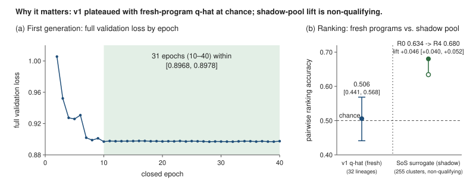

# CLOVER: technical write-up (venue-neutral master draft)

Status: **draft for the owner's review**, revised 2026-10-13 and audited against its sources on 2026-10-16. This revision replaces the 2026-10-10 draft. `CHANGES.md` lists what changed and why, and `NUMBERS_TRACE.md` records where every claim was re-hashed and re-derived. The report covers events up to 2026-10-13T12:00Z; nothing later is reported here.

Every number carries a claim id in square brackets, for example `[C26]`. Each id resolves to an entry in `claims.json`, which gives the statement, the exact value, the source (`path:line`, a JSON path, or a receipt SHA-256) and a status:

- **established**: measured or recorded, with a hash-pinned source;
- **preliminary**: a small sample, a synthetic-fixture benchmark, a projection, a design constant, or a value taken from a plan rather than a receipt;
- **non-qualifying**: a real measurement from an owner-labelled scratch run (ruling R22). It is directional only and never a headline, a promotion input or a qualification result;
- **pending**: a pre-registered or planned result that does not exist yet.

Nothing pending has been estimated, extrapolated or filled in. The LaTeX scaffold (`tex/`), its figure scripts and the claim checker (`tools/`) are lane files in `.agent/proposals/claude-rlfw-20261009/paper/` on xbabe2, not in this repository. The scaffold mirrors the 2026-10-10 draft and has not been regenerated for this revision; in it, a pending value renders as `\pending{Cnn}`. Most claim sources resolve through the host-local roots in `claims.json` (`source_conventions.roots`), so their hashes can be re-checked on xbabe2, not from a clone. Three roots (CAPTURE, ARENA and HOST) moved under xbabe2's evidence store on 2026-10-15, and `claims.json` records their new paths. From a clone, `cargo run -p jope-records -- paper-trace` checks that every number printed here is accounted for by a claim it cites; on xbabe2, `paper-trace --sources` also re-hashes every claim source against its pin.

The public wording rule applies to this file. Teacher programs are called **verified high-water-mark programs from an offline search**. How those programs, or new ones, are found is out of scope here. It lives in the internal companion and in the internal direction documents.

---

## Title options

1. **CLOVER: Qualified Program Discovery with Learned Evaluation Allocation** (recommended; it matches the 2026-10-12 direction [C146])
2. **Learning from Verified Outcomes, Anchored: the First Learning Candidate of a Program-Discovery System**
3. **Verified, Anchored, Gated: Continual Learning for a Model That Writes Programs from Data**

## Abstract

A model that reads your data and writes a program produces an artifact that can be executed, audited and re-verified. CLOVER separates two capabilities [C146]:

- **CLOVER-Discover** is a qualified program-discovery engine. It combines a conventional offline search with reproducible execution and independent verification, and it must be useful with no neural controller.
- **CLOVER-Learn** is a learned controller. It is accepted only if controlled experiments show that it adds value over Discover.

This report covers the first CLOVER-Learn candidate and the contracts that let it learn from verified outcomes. The candidate is a 0.89M-parameter policy [C01] over a 2,051-value dataset encoding [C03]. It decodes inside a catalog of 6,640 verified high-water-mark programs from an offline search [C05].

Its first generation trained for 17,773 updates [C22] and then plateaued. Full validation loss stayed between 0.8968 and 0.8978 for 31 epochs [C27], and its outcome head ranked fresh programs at chance [C76].

The second generation's learner is now merged source [C117]. It:

- continues from the sealed first-generation state after a logged warm restart [C81, C130];
- trains on L6 plus 0.2 times an exact KL divergence to the frozen first-generation policy [C119, C120];
- holds adoptions under two sticky guards [C123, C124];
- closes every run through ordered intent, verification and result records [C126];
- admits verified outcomes only with a caller-written acceptance and a return witness [C127].

On the GPU, its next update reproduces the first generation's bitwise in eight receipts [C131]. It has not run live.

In owner-labelled scratch runs, which are non-qualifying, two effects appeared:

- The KL anchor kept the probe KL to the frozen policy at or below 0.014 for up to eight epochs. At the same learning rate, L6 alone passed 0.05 within two epochs in two of three runs [C136, C137].
- A measured-tilt term lowered its own held-out loss [C138].

No objective has been shown to beat the frozen first-generation policy under qualified evaluation [C142, C158]. Three questions are pre-registered hypotheses with no result yet [C154–C157]:

- whether discovery expands useful support;
- whether learned selection beats simple selectors;
- whether fresh feedback helps.

## Page-1 figure

### Figure 1: why this matters

**Figure 1. The first generation plateaued, and its outcome head ranked new programs at chance.** (a) Full validation loss over all 263 validation contexts fell from 1.0055 at epoch 2 [C26], then stayed within [0.8968, 0.8978] for all 31 closed epochs from epoch 10 to epoch 40 [C27], over 17,773 updates in total [C22]. (b) On the 32 kept development contexts, one lineage each, its outcome head ranked freshly executed programs with pairwise accuracy 0.506 [0.441, 0.568]; chance is 0.5 [C76].

Both panels are established measurements of the frozen first generation. They show the gap that learning from verified outcomes is meant to close. They are not a result of the second generation: no objective has yet been shown to beat the frozen policy under qualified evaluation [C142, C158].

`jope-records paper-trace --write-figure` renders the figure from `figures/v1_full_validation.dat`, which is byte for byte the file C27 pins, and from C76's value. `paper-trace` fails if the picture, its data or those claims disagree.

### The planned teaser (specification only; no data yet)

One row of three panels, CLOVER in green, one shared legend below, and a closing value sentence in the caption. **Panels are filled only from qualified receipts [C114].**

1. H3 / E1: per-epoch fixed-panel loss difference, restart-only control minus fresh-feedback learner, with 95% BCa bands [C100, C156].
2. H2 / E2: expected best-of-8 verified score for the frozen first generation, the live learner and the control on the 27 D-confirm contexts [C102, C103].
3. Cost per verified outcome [C110].

Until those receipts exist, page 1 carries Figure 1 instead, and the teaser panels have no data.

---

## 1. Introduction

Most learned tabular models answer a question with a number. A program that produces the number is a different kind of answer. It can be read, run somewhere else, versioned, re-run on new rows and checked against an independent implementation. The product story here is simple: **the model reads your data and writes a program.**

Such a system needs two different things.

- **It must find good programs.** This is a discovery problem.
- **It may learn to spend its evaluation budget better.** This is a learning problem: choosing which candidates to execute, and eventually which to propose.

The earlier draft of this report treated a single continual-learning loop as the whole system. The 2026-10-12 direction separates the two [C146]. The rest of this report follows that split.

### 1.1 CLOVER in two parts

**CLOVER-Discover** is a qualified program-discovery engine. It uses a conventional offline search, reproducible execution, independent semantic checks and controlled evaluation to find useful programs beyond the existing catalog. It must stand on its own, with no neural controller. Discover is the foundation [C146].

**CLOVER-Learn** is a learned evaluation-allocation controller. It tries to improve which programs are evaluated, and later which candidates the search proposes, using qualified historical and fresh feedback. It is accepted only when controlled experiments show incremental performance or efficiency over Discover alone [C146].

The direction states four hypotheses and tests them separately [C147]:

- **H1 (discovery).** Qualified offline search repeatedly finds useful programs outside the 6,640-program catalog.
- **H2 (selection).** A learned selector picks better candidates than conventional selection methods from identical frozen pools.
- **H3 (feedback).** Fresh verified outcomes improve selection or discovery beyond frozen models, offline replay and optimizer restarts.
- **H4 (conditional).** Learned guidance improves the search's own candidate generation.

If H1 holds and H2 and H3 fail, CLOVER remains a verified discovery engine. It does not claim to be a self-improving reinforcement-learning flywheel [C147]. More generally, **no self-improving-RL claim is made until fresh feedback causally improves independently confirmed selection beyond the strongest non-learning baseline** [C148].

### 1.2 The first CLOVER-Learn candidate

The policy studied here is one CLOVER-Learn candidate, not an assumed winner [C151]. It exists in two generations.

- **The first generation (v1)** trained for 17,773 updates [C22]. It plateaued at the learning-rate floor [C25, C27], and its outcome head ranks fresh programs at chance [C76].
- **The second generation (v2)** is a learner whose source merged on 2026-10-12 [C117]. It continues v1's sealed state and admits verified outcomes back into training.

Building a learner that can safely take such outcomes is hard, for three reasons.

- **Outcomes are expensive and fragile.** A score requires compiling and running a program on two inner folds, then storing its artifacts. Any step can fail, time out or end in an unknown state.
- **A wrong outcome is worse than a missing one.** An incorrect score that enters training is silent. It changes gradients and cannot be detected later without the original bytes.
- **Continual training has its own integrity problems.** New targets must reach the learner without perturbing roles, without double counting, and without a restart changing what the model has seen. The policy must also not drift away from a known-good state without anyone noticing.

The v2 learner treats each of these as a first-class contract. An outcome becomes a target only if it is **verified**, meaning two implementations agree [C39]. It must also be **custodied**: its bytes are held create-only and referenced by exact version. Finally, it must be **admitted** at a closed epoch through an inbox whose acceptance is written by the caller, never by the builder [C127]. Unknown outcomes stay unknown. Every update is anchored to the frozen v1 policy by an exact KL term [C120]. Two sticky guards stop adoptions when validation loss regresses or the policy drifts [C123, C124].

### 1.3 Contributions

1. **A verified-outcome contract for continual learning.** An outcome becomes a target only after native and emitted executions agree to within $10^{-9}$ per row [C39], its artifacts are created once and read back by exact version, and its key can never execute twice. Unknown stays unknown (Section 5).
2. **An anchored continual objective with separate identities.** Each update minimizes L6 plus $0.2$ times the exact KL divergence from the policy to the frozen v1 policy over the decoding catalog. The term is computed in evaluation mode, so it draws no random numbers [C119, C120].
   - The training objective has its own digest, bound into every proof [C121].
   - The label objective that defines targets keeps its own unchanged identity [C121].
   - At the anchor, the anchored update is observed to equal the frozen v1 update bitwise [C122] (Section 4.4).
3. **Two sticky adoption guards.**
   - A fixed-panel regression guard [C123].
   - A deadline-bounded KL guard, measured first at every closed epoch [C124].
   - Both hold adoptions without stopping training, and both are sealed in every verified closure (Section 6.6).
4. **Caller-written acceptance for verified-outcome packets.** A packet is admitted only after its builder returns in time. The caller then writes an acceptance envelope, and an operator records a return witness. Admission never depends on the absence of a refusal [C127] (Section 6.4).
5. **Verified-watermark custody and an ordered terminal closure.** Every committed step is joined to its proof, acknowledgement and emission. Every proof is re-hashed before closure and resume. A run ends through intent, then verification, then result [C125, C126] (Section 6.7).
6. **A complete record of the first generation, including its plateau** (Section 10.1).
7. **Verification as a defect detector.** A one-ulp binning disagreement was found in 41 of 1,554 evaluated pairs [C41] (Section 5.5).
8. **An honest evidence ledger.** It keeps three kinds of result apart:
   - bitwise build qualification [C131, C132];
   - non-qualifying scratch evidence [C136–C140];
   - pending, pre-registered tests of H1 to H4 [C154–C158] (Sections 9 and 10).

### 1.4 What this report does not claim

- That any v2 objective improves executed-program quality, matched win rate or L6 over the frozen v1 policy [C142, C158].
- That the v2 learner has run live. The 72-hour live run, the drain of v1's recorded proposals and any promotion are owner decisions that have not been taken [C145].
- That CLOVER is a self-improving system [C148, C153].

---

## 2. Problem setup and notation

### 2.1 Contexts and roles

A **context** $c$ is one exact data run. It consists of:

- a dataset version;
- a cut, meaning its train/test split;
- two inner folds $j \in \{1, 2\}$ on the training rows [C11];
- a parent lineage $\ell(c)$;
- a role $r(c)$.

Outer test rows are never part of a context's inputs. Roles are assigned per parent lineage by a fixed SHA-256 threshold, so that about 5% of parents are validation [C15]. Every alias, target variant and synthetic descendant inherits its parent's role, so a lineage is never split across roles. Sealed and excluded families stay outside the training closure entirely.

Each context has a frozen encoding $x_c \in \mathbb{R}^{2051}$ [C03] and a normalized input

$$z_c = \operatorname{clip}\!\left(\frac{x_c - \mu}{\sigma},\, -10,\, 10\right),$$

where $\mu$ and $\sigma$ are fit once on training contexts only, and zero scales become one [C04].

### 2.2 Programs and the catalog

A program $p$ is a string in a typed domain-specific language. It transforms the feature matrix and fits a model on a fold's fitting rows. It can be executed natively or compiled from emitted source.

The policy decodes inside a fixed **catalog** $\mathcal{A}$ of $|\mathcal{A}| = 6{,}640$ programs [C05]. The catalog was drawn only from teachers of training contexts; no validation teacher enters it [C05]. A decoded program can be new for a given context even when the same string appears elsewhere. Finding programs outside the catalog is the job of CLOVER-Discover and hypothesis H1 (Section 9.6).

### 2.3 The executed-outcome score $q$

Executing $p$ on context $c$ yields one outcome class:

$$o(c,p) \in \{\textsf{completed},\ \textsf{failed},\ \textsf{timeout},\ \textsf{parity\_unqualified},\ \textsf{unknown}\}.$$

For a completed program:

- $r_j$ is the RMSE of $p$ on inner fold $j$;
- $b_j$ is the RMSE of the complementary-fold **mean predictor** on the same fold;
- $y$ is the context's training targets.

Then [C11]:

$$s_c = \begin{cases} 1.4826\,\mathrm{MAD}(y) & \text{if positive}\\ \mathrm{IQR}(y)/1.349 & \text{else if positive}\\ \mathrm{SD}(y) & \text{otherwise}\end{cases} \tag{1}$$

$$\varepsilon_c = \max\!\big(10^{-12}\max(1, |\bar{y}|),\ 10^{-6}\, s_c\big) \tag{2}$$

$$q(c,p) = -\tfrac{1}{2}\sum_{j=1}^{2} \log \frac{\max(r_j, \varepsilon_c)}{\max(b_j, \varepsilon_c)} \tag{3}$$

$$q_{\mathrm{opt}} = \operatorname{clip}\!\big(q, -\log 1000, \log 1000\big), \qquad q_{\mathrm{grid}} = \operatorname{round\_half\_even}(10^{6}\, q). \tag{4}$$

How to read these quantities:

- $q > 0$ means a lower geometric-mean error than the mean predictor; $q = \log 10$ means ten times lower. $q$ is finite by construction.
- $q_{\mathrm{opt}}$ is the regression target.
- $q_{\mathrm{grid}}$ is the ordering and tie key. Equality on the grid is a tie, which makes ties transitive.
- The baseline $b_j$ comes only from rows that carry per-fold detail, and every such row must agree. A context without one is `UNKNOWN_BASELINE`, and its programs get no $q$. They are masked, never set to zero.

### 2.4 Feasibility and runtime

Each execution also yields a feasibility class (completed, failed or timeout) and a runtime $t$ in seconds. The timeout is 90 s [C12]. Runtime is modelled as $\log(1+t)$, and a timeout is right-censored at $\log(1+90)$ [C12].

### 2.5 High-water marks and teachers

For each context, the **high-water mark** $h_c$ is the best $q_{\mathrm{grid}}$ among verified, comparable records. Comparable means the same context, protocol, evaluator, baseline and $\varepsilon$. The program that attains $h_c$ is the context's **teacher**: a verified high-water-mark program from an offline search.

- If no comparable record exists, $h_c$ is null. It is never zero.
- Teachers are frozen for the life of a model generation.
- Verified programs written by the model never replace a teacher, and in this work they never become imitation targets (Section 4).

### 2.6 Quantities of interest

For a policy $\pi_\theta(p \mid c)$ over the catalog:

- **Mean quality.** $J_{\mathrm{mean}}(\theta) = \mathbb{E}_c\, \mathbb{E}_{p \sim \pi_\theta}[q(c,p)]$, conditional on completion, with the completion rate reported alongside.
- **Best-of-$B$ gain.** $J_B(\theta) = \mathbb{E}_c\, \mathbb{E}_{p_1..p_B \sim \pi_\theta}\big[\max(h_c, q_1, \dots, q_B) - h_c\big]$.
- **Tie-adjusted score against the teacher.** For the best of $B$ draws, $q^\star$, the score is:
  - $1$ if $q^\star > h_c + \tau$;
  - $\tfrac12$ if $|q^\star - h_c| \le \tau$;
  - $0$ otherwise.

  Here $\tau = 0.01$ [C71], and a failure ranks lowest.

All three are measured on the inner folds of the task's training rows. They are **task-label-aware inner-CV quantities**, not held-out generalization estimates (Section 12). None of them is the training loss. In particular, L6 is a training objective, not a success metric [C152].

---

## 3. Model

### 3.1 Dataset encoder and normalizer

Each context is encoded once, by a pinned pretrained tabular encoder, into 2,051 values: 2,048 pooled hidden values and 3 query diagnostics [C03]. The encoder reads the context's training rows, including their labels. It never reads outer-test rows. The normalizer in Section 2.1 is frozen from the original training contexts and is never refit, including when new variants arrive [C04].

### 3.2 PolicyLM

PolicyLM is a pre-LN causal transformer with 893,957 trainable parameters [C01]: width 128, 2 blocks, 4 heads, feed-forward width 512, dropout 0.1, a 282-token vocabulary and programs of at most 640 tokens [C02].

- Its first position is a **context prefix** produced by a two-layer MLP over $z_c$.
- Program tokens follow, with learned positions.
- The language-model head is tied to the token embedding.
- Attention uses an explicit deterministic kernel.
- The parameter hash is defined over sorted named tensors, so a checkpoint's identity is reproducible across hosts.

### 3.3 Catalog-constrained decoding

Decoding walks a prefix tree built from the catalog. At each step, the model's logits are renormalized over the children of the current prefix and sampled at temperature 1.0 [C80]. Every decoded string is therefore a complete, grammatical catalog program. Its probability under the policy is exactly computable, as a sum of log-probabilities along the path.

The same tree makes the KL divergence between two policies over the whole catalog exactly computable by the chain rule (Section 4.4). Training uses a grammar-legal mask (Section 4), which is a different normalization from decoding. Section 12 discusses the consequence.

### 3.4 Heads

Three heads read the concatenation of the hidden state at the end-of-sequence position and the context embedding:

- $\hat q$, a scalar regression of $q_{\mathrm{opt}}$;
- feasibility logits over three classes;
- $\hat t$, the log-runtime.

The ranking terms of the objective act on $\hat q$, not on the policy's token probabilities (Section 4.2).

---

## 4. Objectives

### 4.1 The label objective L6: terms and supports

The label objective is a support-masked sum of six terms [C08]:

$$\mathcal{L}_6 = 1.00\,\mathcal{L}_{\mathrm{CE}} + 0.25\,\mathcal{L}_{\mathrm{BT}} + 0.10\,\mathcal{L}_{\mathrm{list}} + 0.25\,\mathcal{L}_{q} + 0.10\,\mathcal{L}_{\mathrm{feas}} + 0.05\,\mathcal{L}_{\mathrm{rt}}.$$

Each term is averaged within a context first, then over the contexts that support it. A term with no support in a batch is masked: its numerator and denominator are zero, and no pseudo-label is created.

- $\mathcal{L}_{\mathrm{CE}}$: grammar-masked sequence cross-entropy on **CE-eligible rows only**, which are the frozen teachers.
- $\mathcal{L}_{q}$: Huber loss ($\delta = 1$) between $\hat q$ and $q_{\mathrm{opt}}$ over measured programs [C13].
- $\mathcal{L}_{\mathrm{BT}}$: Bradley–Terry loss $\sum w_{ik}\,\mathrm{softplus}(\hat q_k - \hat q_i)/\sum w_{ik}$ over same-context pairs with distinct $q_{\mathrm{grid}}$, where $i$ is the better program. The pair weight is $\min(|\Delta q_{\mathrm{opt}}|, 1)$, doubled when either program sits at or above the 0.9 within-context midrank percentile [C13].
- $\mathcal{L}_{\mathrm{list}}$: listwise cross-entropy between $\mathrm{softmax}(\text{midrank\,pct}/0.25)$ and $\mathrm{softmax}(\hat q)$, for contexts with at least three measured programs [C13].
- $\mathcal{L}_{\mathrm{feas}}$: three-class cross-entropy where the class is recorded.
- $\mathcal{L}_{\mathrm{rt}}$: Huber loss on $\log(1+t)$ for completed runs, and $\mathrm{ReLU}(\log 91 - \hat t)^2$ for timeouts [C12].

**Batching.** Each update draws up to 16 training contexts, at most one per parent lineage, and packs them into micro-batches of at most 8,192 padded tokens without truncation. A context contributes a rotating window of up to eight measured programs plus an eligible teacher [C07].

**Optimizer.** AdamW, learning rate $3\times10^{-4}$, weight decay 0.01 with biases and norms excluded, gradient-norm clip 1. A plateau controller halves the rate with patience 5, down to a floor of $10^{-6}$ [C06].

### 4.2 What L6 does, and what it leaves to later work

L6 is conditional imitation of teachers plus outcome modelling.

- Measured programs written by the model are **CE-ineligible**. They teach $\hat q$, the feasibility head and the runtime head, and they shape the ranking terms.
- They never become imitation targets, in v1 or in v2 [C127].

This is deliberate. A program the model wrote that scored well is evidence about the program. Whether to raise its probability is a policy-improvement decision with its own risks: collapse, and a winner's curse on noisy folds. Under the CLOVER direction, such decisions compete only after a simple outcome predictor has shown that ranking is useful (H2, Section 9.6).

### 4.3 The v1 plateau and the R14 warm restart

v1 halved its learning rate nine times between steps 2,477 and 5,677. It then trained 12,096 more updates at the $10^{-6}$ floor [C25]. Over the 31 closed epochs from epoch 10 to epoch 40, full validation loss stayed between 0.8968 and 0.8978 [C27]. The 16-context fixed panel moved from 1.3814 to a best of 0.87052 at step 16,813, and ended at 0.87121 [C29]. The terminal control state confirms the plateau: both rate groups at $10^{-6}$, after nine reductions [C83].

New verified targets are of little use to a learner whose step size is $10^{-6}$. Owner ruling R14 therefore applies a single logged control event at v2 genesis [C81]:

- both learning-rate groups are set to $3.75\times10^{-5}$, three halvings below the original rate;
- the plateau state is reset, with patience and floor unchanged;
- the AdamW moments are **kept**.

This is a single warm restart in the sense of SGDR (Loshchilov and Hutter, 2017). Genesis applies it only after three gates have passed on v1's unchanged control state [C130]:

1. bitwise CPU restore of the captured checkpoint;
2. bitwise GPU restore, round-trip and random-state parity;
3. an exact next-update parity probe (Section 6.8).

A warm restart can change the loss by itself. A loss reduction after v2 genesis would therefore not show that feedback helps. That question belongs to H3, which needs matched restart-only and frozen controls (Section 9).

### 4.4 The anchored objective (R23)

At the v2 restart rate, L6 alone moves the policy away from v1 quickly. In a scratch run labelled non-qualifying, the exact catalog KL from v1 reached 0.031 after one epoch and 0.053 after two [C136]. Owner ruling R23 (2026-10-11) therefore makes the v2 **training objective** [C119]:

$$\mathcal{L}_{\mathrm{v2}}(\theta) = \mathcal{L}_6(\theta) + \lambda\,\frac{1}{|K|}\sum_{c \in K} \mathrm{KL}\big(\pi_\theta(\cdot \mid c)\ \|\ \pi_{\mathrm{v1}}(\cdot \mid c)\big), \qquad \lambda = 0.2.$$

$\pi_{\mathrm{v1}}$ is the frozen v1 terminal policy, whose parameter hash is pinned [C22, C120]. $K$ is the batch's first context, so one context is used per step [C120].

**The KL term.** The KL is exact. By the chain rule over the catalog's prefix tree $T$, it is

$$\mathrm{KL}(\pi_\theta \| \pi_{\mathrm{v1}}) = \sum_{n \in T_{\mathrm{branch}}} \rho_\theta(n) \sum_{a \in \mathrm{ch}(n)} \pi_\theta(a \mid n) \log \frac{\pi_\theta(a \mid n)}{\pi_{\mathrm{v1}}(a \mid n)},$$

where:

- $\rho_\theta(n)$ is the probability that the policy reaches prefix $n$;
- $\mathrm{ch}(n)$ are the catalog children of $n$, end of sequence included;
- the sum runs over every branching node, while single-child steps contribute zero;
- both distributions use the deployed child mask and temperature 1.0, the decoding temperature [C120].

**How it is computed.**

- The term is evaluated with the policy in evaluation mode, so it adds no dropout noise and draws no random numbers.
- The policy pass carries gradient, with activation checkpointing over 16,384-token chunks of the tree.
- The anchor pass runs without gradient [C120].
- The anchor model is loaded read-only from the sealed v1 capture and shared with the KL guard (Section 6.6).

**Step order.** One update is:

1. the frozen L6 micro-batch step, copied line for line;
2. the weighted KL backward;
3. the frozen tail: finite-gradient check, clip at 1, optimizer step [C120].

**Reporting.** The reported `loss` stays the L6 total. Loss history, plateau control, the regression guard and parity therefore stay on the pre-R23 scale. The KL value and the total objective are reported separately [C120].

**At the anchor.** When $\theta = \theta_{\mathrm{v1}}$, the KL value is exactly 0. Its gradient is not exactly zero: a float64 rounding residual of at most about $3\times10^{-17}$ remains. In the fixtures, the accumulated, clipped gradient and the AdamW update absorbed it. Parameters, both moments, the step count, the random state and the clip norm all came out bitwise equal to the frozen L6 step. The GPU parity probe on the anchored build observed the same [C122, C131]. This is an observed property, not a structural guarantee, and it is re-qualified whenever the step changes.

This construction is a KL-regularized update toward a fixed reference policy, in the line of KL-constrained policy updates (Schulman et al., 2015) and KL-penalized fine-tuning toward a pretrained policy (Ziegler et al., 2019). Two things distinguish it. The KL is exact over a finite catalog rather than estimated from samples. And its reference is the policy that the evaluation compares against.

### 4.5 Training identity versus label identity

Two objective identities are kept apart [C121].

- **The training-objective identity** is the digest of $\{\mathcal{L}_6, \text{the anchor block}\}$.
  - It must equal the campaign identity and the value sealed at genesis.
  - It is bound into every batch proof, the progress record, the terminal intent, the verification record and the result.
  - A root without it is refused; there is no migration from earlier builds.
- **The label-objective identity** is pinned by the target contract, target preparation and the overlay packets. It stays the unchanged L6 identity.
  - The anchor term reads no labels or targets.
  - Changing the label identity would invalidate every preparation proof and packet chain for no semantic reason.

---

## 5. Verified execution

### 5.1 Two implementations and the parity rule

Every program is executed twice per inner fold:

- by the **native** evaluator, which interprets the program directly;
- by an **emitted** implementation, generated from the program and compiled.

A result is numeric only if every prediction agrees within $10^{-9}\max(1, |\text{reference}|)$ [C39]. The tolerance is never loosened for throughput. In early qualification, three measured results covering six fits produced 486 emitted predictions that were bit-exact with the native evaluator [C40]. This is a form of differential testing (McKeeman, 1998).

### 5.2 Create-only exact-version custody

Each successful evaluation produces a wrapper record and its artifacts: metrics, predictions, emitted source, logs and the compiled executable.

- Each object is written **create-only** to versioned object storage with a conditional put.
- It is then read back by exact version identifier and checked against its SHA-256.
- The result record is published **last**, so a reader that finds a result record also finds every artifact it names [C39].

Every reference is a 5-tuple: bucket, key, version id, SHA-256 and byte length.

### 5.3 A registry in which unknown stays unknown

Executions are claimed in a registry before they start. A claim that is reserved or started and then loses its process becomes **unknown** [C90]. Ways to lose the process include a crash, an expired lease, a dropped channel or 30 s of heartbeat silence.

- An unknown key is never retried. The remote execution or the storage write may have succeeded, and a retry could double-execute or overwrite.
- A completed key is never re-executed; it is served from cache.

The v2 registry imports every historical claim. A trial import over 19 historical sources found 3,927 historical keys: 3,869 completed (cache only), 58 blocked and **0 executable** [C50]. Its canonical keys reproduce all 2,774 entries of the earlier census [C51]. The census of sealed private copies made 2,185 canonicalizer calls, rejected none and evaluated no program [C52].

### 5.4 Parity failures as program outcomes (R5)

A deterministic disagreement between native and emitted predictions is recorded as `parity_unqualified` for that program, with its custody preserved. It gets no $q$ and never becomes a target. For best-of-$B$ accounting, the slot is charged and counts as a failure [C80].

An earlier rule excluded the whole context, for every arm, after one such failure. Under that rule, 21 of the 53 contexts in one development match set were excluded [C71], and the censoring bounds became too wide to decide anything [C75].

### 5.5 Case study: a one-ulp disagreement between two binary searches

The parity rule flagged 41 deterministic failing (context, program) pairs, covering 40 programs, among 1,554 evaluated pairs [C41].

- The failures are deterministic. 114 observations across repeats, attempts and two hosts gave identical prediction hashes [C44].
- Clean evaluations are exact. 253 of 253 screen rows had maximum error 0, and 2,557 of 2,558 clean fold checks were bit-exact on every row [C45].

**Every failing pair contains a quantile-binning operator** [C42]. Binning occurs in 22.0% of evaluated pairs and in 24.64% of catalog programs [C42]. The conditional failure rate is 12.0% (95% CI 8.7–15.9%) with binning, and 0 of 1,212 without it [C43].

**Mechanism.** Two small defects combine.

1. Quantile edges are interpolated as $s_{lo}(1-f) + s_{hi} f$. On a tie plateau, where $s_{lo} = s_{hi} = a$, this sum often lands one ulp below or above $a$, depending on $f$. The edge vector is then non-monotone, for example $[a, a, a^-, a^+, a, \dots]$.
2. The two implementations locate a value's bin with different binary searches.
   - The native code uses the standard-library partition search, whose probe sequence changed in Rust 1.82.0.
   - All four emitters keep the classic midpoint loop [C49].
   - On a sorted vector the two always agree. On a non-monotone one they probe different midpoints and return different bins.

**A worked example** [C47]:

- 554 of 800 training rows share one value;
- three of nine plateau edges land one ulp off;
- the native code assigns bin 3 and the emitted code bin 0;
- all 800 validation predictions differ, with a maximum error of 0.0986.

Across failing pairs, the maximum normalized error ranges from $3.3\times10^{-8}$ to 0.344 [C48]. An offline replication of the arithmetic found a divergence in 29 of 29 failing pairs and in none of 200 of 212 clean pairs ($p = 3.4\times10^{-28}$) [C46].

Three observations make this worth reporting.

- **The defect is invisible to a normal test suite.** Each implementation is internally correct on sorted input, and the bug needs both a tie plateau and an interpolation round-off.
- **It is invisible to a loss curve.** A wrong score of 0.0986 RMSE units on a context looks like any other noisy outcome.
- **It was caught because no score enters training without agreement.** Without the rule, roughly 2.6% of evaluated pairs [C41] would have entered training with values that depend on which implementation ran.

A fix has been proposed to the engine owner: a single pinned search, emitted identically everywhere and released under a new evaluator protocol identity. It is not part of this work. The CLOVER direction also lists auditing evaluator quantile semantics as a first-priority comparability item [C149].

---

## 6. The continual-learning loop (the CLOVER-Learn candidate)

The loop has five stages: **decode → execute and verify → export → adopt → expose**. A planner journal ties them together. Figure 2 of the scaffold draws the stages. The v2 learner adds three things around those stages: an anchor (Section 4.4), guards (Section 6.6) and closure custody (Section 6.7).

### 6.1 Planner journal, epochs and batches

The planner is a hash-chained journal.

- An **epoch** exhausts the current training snapshot.
- A **batch** is a set of up to 16 contexts with distinct parent lineages [C07], identified by an order-independent membership fingerprint. A context appears in many epochs, but an exact batch membership is never reused.

A batch is first **reserved**. It becomes **committed** only after three things have happened:

1. the optimizer step has run;
2. a physical checkpoint has been written, covering the model, the AdamW state, the CPU and CUDA random states and the control state [C09];
3. a batch proof binding all of them has been stored.

Exposure and coverage counters advance only on commit. A failed or ambiguous update is preserved for reconciliation and never replayed.

### 6.2 Proposals and the outbox

Each update emits proposals from the pre-update checkpoint.

- v1 emitted two per update: one for a rotating training context and one for a rotating validation context [C10].
- The v2 learner emits one (training only) or two [C134]. The single-emission setting, used by the v2 build-qualification root, keeps the outbox's 100,000-row lifetime limit above the 80,000-update window [C82, C87, C134].

Proposals are appended durably to an **outbox** before any execution. An outbox has fixed lifetime limits: 32,768 pending, 100,000 rows and 256 MiB [C87]. v2 therefore opens a fresh outbox under its own campaign and treats older outboxes as read-only input. Validation proposals are evaluation-only, and their outcomes are never targets.

### 6.3 Closed-epoch adoption with a composite snapshot identity

New verified targets reach the learner only through an **adoption inbox**, and only at a closed epoch boundary. At startup, when the current epoch is closed, and after every closed epoch, the learner reconciles the inbox and adopts at most one candidate [C128]. It adopts nothing while either guard holds (Section 6.6).

- **Candidates** are immutable files with a sequence number $k$, the predecessor snapshot hash and the pins (objective, normalizer, catalog, roles). They are written exclusively and fsynced.
- **Prepared candidates** are consumed only with their operator acceptance envelope. That envelope carries the exact terminal marker bytes, the sealed original time bound and physical in-time evidence [C128].
- **At most one adoption per closed epoch**, in order $k = k_{\text{last}} + 1$. An adoption is refused, with **no state change**, if any of these holds:
  - the epoch is not fully consumed;
  - a reservation is unresolved;
  - the role authority is stale;
  - a pin or predecessor mismatches;
  - a hash mismatches;
  - the sequence is out of order.
- **Fresh role proof.** A second role-authority proof is taken after hydration, at most 60 s old [C89], and rechecked inside the planner compare-and-swap [C128]. A refusal at that point stops before the swap and records a hold.
- **Crash consistency.** The adoption intent is fsynced before the swap. On restart, reconciliation proves its joins: closed epoch, checkpoint before adoption, reservation-free state, planner head and candidate chain.
  - A swap without a record is completed from planner state.
  - A record without a swap is a HOLD.
  - Nothing is adopted twice.
  - A hold keeps training on the active snapshot.
  - A refused inbox stops the run.

A v2 snapshot has two components: a **variant extension** $E$ (measured targets on derived datasets) and a **native overlay head** $H$ (Section 6.4). Its identity is $E$ alone when no overlay exists, and otherwise

$$\mathrm{id}(E, H) = \operatorname{digest}\{\texttt{jope.flywheel-composite-snapshot/v1},\ E,\ H\}.$$

The adopted manifest is the variant manifest with only its snapshot hash replaced. Membership is therefore identical, and the frozen adoption code accepts it unchanged.

### 6.4 The native-result overlay and caller-written acceptance

About 98% of proposals fall on original (native) contexts [C93], whose stored training data cannot be rewritten. The **overlay** turns verified native results into append-only, train-only packets.

**Per-row verification.**
1. Emission identity, re-derived from the stored emission bytes.
2. Context description in the training role; outer-test values are never decoded.
3. Request identity equal to the evaluation key.
4. Exact-version GET of every artifact, and a re-check of the parity measurement.
5. A recomputed baseline on the registered training prefix.
6. Anchoring to the stored baseline, or refusal (`BASELINE_DISAGREEMENT`, `SHARD_RMSE_DISAGREEMENT`).
7. A tokenize/detokenize round trip.

**Roles.** Training rows only. Validation rows become evaluation-only. Failure custody gets no $q$. Unknown, leased and recorded rows stay pending.

**Labels.** The frozen label rules run on the union of the stored rows and the cumulative overlay rows. Overlay rows are never CE-eligible [C127].

**Loader.** The frozen per-context window is kept unchanged. Up to $\min(|O_c|, 8)$ overlay rows are appended by a digest rotation within the 8,192-token budget [C89]. Without this, a new row in a rotation of about 1,248 stored rows [C93] could wait many epochs to appear for the first time.

**Packets.** Each packet is a delta of at most 2,048 new rows and 1,024 contexts [C89]. Packets are chained by predecessor head, and each carries a census whose classes must sum exactly.

**Caller-written terminal acceptance** [C127]. The packet builder never certifies itself.

- When a build starts, it fixes one paired time bound (wall, monotonic, boot) and seals it in the success marker.
- Only after the build function has *returned* does the caller write one create-only acceptance envelope outside the packet's directory. The envelope pins:
  - the exact marker bytes;
  - the sealed packet and receipt;
  - the unchanged bound;
  - a post-return clock sample;
  - physical evidence of in-time completion: either an in-process return, or a successful service exit before the monotonic deadline on the same boot.
- The bounded publisher then fsyncs a publication candidate, links it into place, and rechecks the original bound after those final operations.
- An operator records a **return witness** only after the publisher has returned inside that bound.

Consumers admit a packet only with the accepted envelope, the publication candidate and the return witness. Admission never relies on the absence of a refusal. These cases all admit nothing:

- a build that raised;
- a reader in the middle of a build;
- a root that returned but was not accepted;
- a late caller.

Callers must accept each packet before building its successor.

**Limitations.** The envelope is not signed. It guards against accidental and late admission, not against an adversary who can write files. The durability fixtures are toy-scale CPU worlds, not hardware power-loss qualification [C127].

### 6.5 First-exposure proofs

"Admitted" is different from "learned from". A **first-exposure proof** names the first committed batch whose selection receipt actually selected a newly admitted result. It records the step, the batch hash, the checkpoint, and the exact result reference **as stored in the snapshot**.

- A caller-supplied reference cannot certify itself.
- Step and batch order must be monotone.
- A result admitted at adoption $k$ and first selected after a later adoption $k'$ still counts, if $k'$ keeps its exact reference.
- Reports list actual selections, pending results and refusals. No first exposure is assumed from timing.

Feedback latency from proposal to first exposure is a pre-registered live metric [C105].

### 6.6 Two adoption guards

Both guards act at every closed epoch, inside the same boundary step and before any adoption. They share four properties [C123, C124]:

- each holds adoptions only, and training on L6 plus the anchor continues on the active snapshot;
- each is sticky once tripped, and raises an alert for owner review;
- each is sealed in every verified closure and recovered only from that seal, so a deleted, reset, malformed or symlinked state file is refused at restart;
- each is absent at genesis.

**Regression guard (G32).** At each closed epoch, the latest fixed-panel validation L6 is compared with the sealed v1 reference. That reference is 0.8705178834, v1's plateau best on the fixed panel [C29, C123]. Three consecutive closed epochs above $1.02\times$ the reference trip the guard. A good epoch resets the count before a trip but never clears a trip [C123]. The earlier draft took the reference from a plan that named v1's final panel value; the merged guard uses the plateau best [C92].

Each closed epoch's check runs exactly once. Boundary work deferred at a deadline runs at the next start, before any adoption or reservation, or is deferred again. The guard makes no claim about how much was learned.

**KL guard (gap T12).** At each closed epoch, *first* in the boundary and before any boundary side effect, the guard measures the same exact catalog KL from the current policy to $\pi_{\mathrm{v1}}$ [C124].

- **Probes.** 64 training contexts, chosen by a campaign-seeded digest. Validation and outer-test contexts are never probes.
- **Closure check.** Each probe also checks that the leaf probabilities sum to 1 within $10^{-9}$. A failed check makes the probe unavailable; it never yields an approximate passing value.
- **Thresholds:**
  - a mean of 0.03 or more is a recorded, non-blocking **alarm**;
  - a mean of 0.05 or more, or a maximum of 0.15 or more, trips a sticky **hold**.
- **Deadline.** The measurement checks the deadline at entry, after every chunk's forward pass, after every probe and before returning. A probe that cannot finish in time is unavailable, never a value. The whole boundary is then deferred, with no change to guard state, evidence or plateau.
- **Status.** The KL guard has measured only in fixtures. The build dry runs sealed its empty initial state, because no epoch closed within their two or three updates. It has never measured on real training data [C132].

The thresholds are defined on the current catalog. When support expands, the CLOVER direction requires a reference distribution with positive probability on the new programs and a new, versioned stability protocol. The 0.05 threshold does not carry over [C150].

### 6.7 Verified-watermark custody, tick-safe stop and the terminal closure

**Verified watermark.** After every closed epoch the learner writes a verified watermark [C125]. Each pass:

- chain-verifies planner and outbox events from the previous watermark's head;
- joins every committed step to its proof (whose bytes equal the planner's commit evidence), its durable acknowledgement row and its outbox emission event;
- requires counts to be continuous.

Work on the suffix is bounded, and the prefix is re-joined by its head hash.

**Prefix integrity.** A watermark certifies only the bytes seen then. So before any clean closure and before any resume, every committed proof file is re-hashed against its planner-chain evidence. The proof filenames must also be exactly the committed steps, regular files only, with no gap, orphan or future entry [C125].

**Tick-safe stop.** v1 ended by its service runtime limit while idle, at step 17,773 [C31]. Its own deadline path had to finish a terminal verification inside a 180 s reserve [C31], and it could not: the unindexed planner verification takes 516.36 s on the second host [C35]. Owner ruling R17 accepted the state as a clean stop after four read-only proofs [C31]. v2 removes this failure class in three ways [C126]:

1. **Bounded work.** A reservation starts only when the remaining in-loop time covers the bounded step budget. Boundary work starts only when its own budget remains. The deadline and update cap come from the campaign manifest: launch plus 72 h, and at most 80,000 new updates [C82].
2. **Bounded closure.** With an index, the same verification takes 4.12 s for the planner and 1.16 s for the outbox [C36]. The r3 dry-run closures measured 0.47 s on CPU and 0.46 s on GPU [C132].
3. **Ordered terminal records** [C126]:
   1. a segment record names each run segment before any reservation;
   2. a **terminal intent** is published, and an intent is not a clean stop;
   3. suffix joins, the prefix re-hash, the proof inventory and full indexed verification run inside a closure budget;
   4. a **verification** record binds the intent, watermark, heads, control, checkpoint, execution and both guard states;
   5. only then is the **result** written, binding both.

   Any closure error publishes a failure record and no clean result. Resume refuses a missing, stale, failed or rebound closure, and any fatal record.

### 6.8 Deterministic restart and custody transfer

v2 starts from v1's terminal checkpoint, so the transfer must be exact.

- **Capture.** A read-only capture walked all 52,329 entries (3,272,631,982 bytes) of v1's root before and after copying, and found them identical. It made zero optimizer updates, journal writes or replays [C32].
- **Restore parity.** All 48 model tensors, 144 AdamW tensors and the random states restore bit-identically on CPU and on the GPU [C33].
- **Next-update parity.** One isolated, never-committed update runs from v1's final checkpoint on v1's own next batch, with v1's control unchanged.
  - The frozen v1 step primitives and the v2 learner, with one and with two emissions, produced bitwise-equal model, AdamW and random-state tensors and state files. Loss was 0.9540845 on every side.
  - This held in **eight** receipts across the builds from r2 to r3. The last one covers the anchored step at KL 0 [C131].
  - The scope is update-only. Emitted programs differ between sides by design. Next-update parity on CPU was not run [C162].
- **Determinism.** Two independent v2 dry runs from the capture produced byte-identical optimizer state and decoded output at the next step [C34].
- **A fresh schedule, not a resumed epoch.** v1 stopped partway through an epoch, with 5,712 contexts consumed and 1,270 remaining. v2 does not continue that partial epoch [C129].
  - Genesis records it exactly and declares a fresh full pass over the active manifest.
  - The new journal inherits v1's ancestry (optimizer steps, completed epochs, batch fingerprints, exposed contexts and presentations), so no historical batch membership is reused.
  - v1's partial epoch is never counted as completed.

### 6.9 Resource envelope

Everything runs inside a declared envelope on two hosts, each with 128 CPU cores and one RTX 3090 [C84]:

- the learner's control group is capped at 8 CPU and 8 GiB, with 64 tasks;
- scoring workers get 1 CPU and 1 GiB each;
- admission is refused below 15% available memory;
- the learning host has an inclusive 16 GiB budget [C88].

**Scoring is the bottleneck.** During v1 the native scorer drained at most about 1,024 evaluations per hour, while the learner produced about 2,000–2,200 proposals per hour [C85]. That is consistent with two proposals per update at 0.2817 updates per second [C23, C24].

The v2 scoring broker is a single writer that leases context-affine tickets of at most 8 keys to workers on the second host. Write transactions stay under a 50 ms budget, so the learner's 2 s acknowledgement is never starved. In simulation the maximum was 37.6 ms [C53]. The broker alone is far from the limit: its simulated lower bound is 124,343 verified evaluations per hour [C54]. Sustained live throughput is pending [C108].

On the learner side, two per-update checks were re-implemented with an index and a memo: outbox bookkeeping and the role-authority check. In synthetic worlds they fall from 344.9 ms to 6.5 ms and from 21.8 ms to 2.3 ms per update [C55]. These are fixture timings, not live measurements.

The anchored step adds one anchor pass and one checkpointed policy pass per update. Its GPU step time and memory have not been measured separately [C160].

---

## 7. Storage and cost

### 7.1 Where the money goes

Under the current protocol each evaluation writes about 4.69 MB in 7 objects. Of that, 4.45 MB is a compiled executable that is rebuilt non-reproducibly every time. The score row itself is about 100 bytes [C57].

Prices come from the provider's published price list and are pinned in a receipt [C56]:

- Standard storage: \$0.023 per GB-month;
- Glacier Instant Retrieval: \$0.004 per GB-month;
- PUT: \$0.005 per 1,000;
- GET: \$0.004 per 10,000.

At 2,000 evaluations per hour the raw footprint is 225.12 GB per day. With no expiry, that adds \$155.33 to the monthly bill **every month** [C58]. Custody also dominates time: about 94% of an evaluation's wall time is custody input and output rather than computation [C86].

### 7.2 A proposed tiered retention policy

| Class | Contents | Proposed retention |
|---|---|---|
| Score ledger | every outcome: keys, $q$, $q_{\mathrm{opt}}$, $q_{\mathrm{grid}}$, per-fold errors, baselines, $\varepsilon$, feasibility, runtime, parity flag, result 5-tuple, artifact hashes | permanent [C91] |
| Small artifacts | wrapper, metrics, predictions, emitted source and logs, in compressed packs with a member index | permanent [C91] |
| Keeper executables | a new per-context best; parity failures (for forensics); a pre-registered 1% hash-selected audit sample [C62]; anything cited by a receipt | permanent [C91] |
| Other executables | everything else | 14 days [C91] |
| Raw hot objects | as written by the evaluator | until packed and verified, at most 7 days [C91] |

**This is a proposal.** No deletion, expiry, lifecycle rule or storage-class transition is authorized. Each of those is an owner decision [C159]. The mechanics below describe what the policy would require if it were approved.

- **Pack, verify, then delete.** A pack is uploaded create-only and read back by version. Every member's SHA-256 is checked against the evaluator's record. Only after that, and only under a separate owner authorization, would raw versions be removed, each with a receipt. Expiry would never be delegated to a lifecycle rule.
- **Budget guard.** 25 GB per day of net-new retained bytes, a 1 TB raw hot tier and 1.5 million PUTs per day. The alarm fires at 80%, and scoring pauses at 100% [C91]. The learner is never stopped mid-step.
- **Audit sample.** Its salt was sealed before any v2 evaluation existed [C62].

The custody package passes 27 fixtures, including a restore drill and refusal of a delete attempted before pack read-back [C67]. Measured compression ratios on real artifacts and a live disaster-recovery drill are pending [C109, C113].

### 7.3 Finding: requests, not bytes, dominate

Under the proposed tiered retention, the permanently retained tier grows by \$0.09 to \$0.89 per month each month, for compression ratios from 30× down to 3× [C60].

Request charges do not shrink with retention. At 7 PUTs plus 7 GETs per evaluation and 2,000 evaluations per hour, they cost \$54.43 per month. That alone exceeds the \$25-per-month target [C59]. Bundling each evaluation into one object brings requests down to about \$7.8 per month [C59].

There is a second structural finding. A 1 TB raw cap fills in about 4.4 days at full rate. The 7-day raw maximum is therefore unreachable at that rate, and packing must keep up [C61].

Every figure in this subsection is a projection from the verified price list and declared assumptions; the live meter is pending [C110]. The structural fix belongs with the evaluator owner: reproducible builds, a content-addressed executable cache and one object per evaluation.

---

## 8. Data and roles

**Inventory.** The original inventory holds 14,987 data runs from 3,003 dataset versions.

- 12,581 are eligible under the role and exclusion rules.
- 7,120 have a complete teacher and input join: 6,857 training and 263 validation.
- The other 5,461 eligible contexts are an explicit join backlog [C14].

The real tier of the dataset bucket holds 3,859 datasets: 2,611 regression, 843 binary, 322 multi-label and 83 time series [C16].

**Lineages and roles.** The parent-lineage registry has 1,068 parents: 1,014 training and 54 validation [C15]. During v1, one closed-epoch adoption of a measured variant extension raised training membership from 6,859 to 6,982 contexts and validation from 264 to 266 [C19].

**Measured support is sparse.** On the full validation pass, all 263 contexts carry CE support. Only 99 carry the multi-program measurements behind the $q$, ranking and runtime terms [C18].

**Leakage gates.**
- Outer-test rows never reach the encoder, normalizer, labels or teachers.
- Validation outcomes are evaluation-only.
- Parent lineages never straddle roles.
- A changed feature, target or split needs a fresh encoding and fresh measurements; parent labels are never copied.
- Sealed and excluded families stay outside the training closure.
- The sealed families are the single holdout, under the 2026-10-07 one-holdout ruling: the corpus authority accepts only the one-holdout role map [C180]. Every evaluation set in this report (the 263 validation contexts, D-tune and D-confirm, the 885 held-out-lineage training contexts [C173]) is drawn from the training and validation roles, not from that holdout.

**Licences.** 3,755 of the 3,859 real datasets have licence status *unknown*, and 104 are *recorded* [C16]. An owner ruling (ALL-DATA-RESEARCH) permits their use in this research pipeline regardless of licence [C17]. The test-row leak rule and the holdout and sealed denylists stay in force, and **no redistribution or production use is granted** [C17]. This limits what can be released (Section 12).

---

## 9. Evaluation protocol

### 9.1 The development split (R6)

The development roster has 53 contexts, one per validation parent lineage. Before any full measurement, it was split by a seeded hash of the lineage id into **26 D-tune** and **27 D-confirm** contexts [C79]:

- D-tune contexts may be fully measured and looked at any number of times, and every look is logged;
- D-confirm contexts are never fully measured and get exactly **one** official look per pre-registered comparison;
- no development measurement ever becomes an optimizer target.

**Disclosure.** All 53 roster contexts, including the 27 now in D-confirm, appeared in historical development matches launched before the split was sealed. One of those matches finished 2 min 21 s after the seal (Section 10.1.4) [C71]. The single-look rule protects only the new comparisons. It does not make D-confirm an untouched test set.

### 9.2 E1: does verified feedback help beyond the restart? (an H3 test)

- **Arms.**
  - LIVE is the v2 learner with closed-epoch adoptions.
  - CONTROL is a shadow learner. It starts from the identical capture, control state, R14 event, seed, batch size and ancestry, and never adopts [C80].
  - The shadow learner exists as lane source and is not yet merged [C68].
- **Primary endpoint.** $\Delta = \mathcal{L}_{\mathrm{fixed}}(\text{CONTROL}) - \mathcal{L}_{\mathrm{fixed}}(\text{LIVE})$ [C100].
  - $\mathcal{L}_{\mathrm{fixed}}$ is the frozen L6 on the fixed original validation panel, compared at matched absolute steps.
  - It is averaged over every fixed-panel evaluation in the second half of the common update range.
- **Test.** Per-context paired differences, a paired bootstrap over contexts with 10,000 resamples, and a BCa 95% interval. Feedback is declared helpful only if the lower bound exceeds zero [C80, C100].
- **Secondary.** Per-term deltas (CE is expected to stay unchanged), the fixed training-panel loss, and admitted rows and first exposures per epoch [C101].
- **Integrity.**
  - Validation contexts never receive overlay rows.
  - An arm that ends on a global stop makes E1 incomplete. Incomplete is reported, not imputed.
  - No E1 metric is computed on D-confirm.

E1 alone does not settle H3. The CLOVER direction also requires an offline-replay control and an exact intervention definition that separates new-data volume from freshness [C149].

### 9.3 E2: do the policies write better verified programs? (an H2-adjacent test)

- **Checkpoints.** v1-final, plus LIVE and CONTROL at launch + 24 h, 48 h and 72 h (the nearest committed checkpoint at or before each mark).
- **Sampling.** $G = 16$ proposals per context per checkpoint from the frozen decoder, at temperature 1.0, seeded by a digest of context, checkpoint and protocol [C80].
- **Metric.** Expected best-of-8 verified $q$, estimated by the U-statistic
  $$\widehat{\mathbb{E}}\big[\max_{b \le B} q_b\big] = \sum_{i=B}^{G} \frac{\binom{i-1}{B-1}}{\binom{G}{B}}\, q_{(i)}, \qquad q_{(1)} \le \dots \le q_{(G)},$$
  which is unbiased for i.i.d. draws (Walder and Karkhanis, 2025; Chen et al., 2021). Failures rank lowest. Also reported:
  - mean verified $q$;
  - the win rate against the teacher, with contexts that lack a measured teacher reported separately [C103].
- **Primary test.** On D-confirm, in a single look at the end of the window: $\Delta$ best-of-8, LIVE-final minus CONTROL-final, paired over contexts, BCa 95%, one-sided $\alpha = 0.05$ [C102]. The secondary is the same comparison against v1-final [C103].
- **Outcome rules.**
  - A non-numeric failure charges its slot as a failure.
  - `parity_unqualified` charges its slot, carries no $q$ and counts as a failure.
  - Unknown or expired outcomes are excluded from the estimator, counted and reported per arm.
  - An arm with more than 5% unknown outcomes is reported **inconclusive** [C80].
- **Budget.** About 4,208 evaluations, scored through the broker into an evaluation-only outbox [C80].

### 9.4 Exact best-of-$B$ on fully measured contexts

On a D-tune context where every catalog program has been measured, the best-of-$B$ distribution of a policy is exact. With $F_\pi(x) = \sum_{p:\, q_p \le x} \pi(p \mid c)$,

$$\Pr\Big[\max_{b \le B} q_b \le x\Big] = F_\pi(x)^B,$$

so $J_B$ needs no sampling. This calibrates the sampled estimator and measures how far the catalog's best program sits above the teacher. That ceiling audit is pending [C116].

### 9.5 Matched games and statistics

- **Matched games.** A comparison is valid only on the same context, dataset hash, cut, evaluator, vocabulary, protocol and metric direction.
- **Elo.** Ratings from matched games are descriptive and order-dependent. They never replace paired, lineage-clustered intervals.
- **Unknowns.** Reported with an explicit denominator; never imputed.
- **Multiplicity.** A challenger is promoted only through a fixed schedule of looks with alpha spending (Lan and DeMets, 1983).
- **Amendments.** Any change to an endpoint, test, context set or checkpoint schedule is a new sealed version, created before the affected look [C80].

### 9.6 CLOVER hypotheses and gates

The CLOVER direction stages the work as gates, not commitments [C149]. There is no requirement to advance through all of them.

| Phase | Question | Exit evidence |
|---|---|---|
| 0 | Comparability | One qualified, reproducible baseline and a consistent accounting contract |
| 1 | Useful support expansion (H1) | Repeated useful expansion beyond the catalog, not one new hash or one favourable inner-fold score |
| 2 | Ranking learnability (H2) | Learned ranking improves actual selection on identical frozen pools against simple selectors |
| 3 | Fresh-feedback value (H3) | A feedback contribution distinguishable from support changes, restarts and ordinary extra optimization |
| 4 | Guided discovery (H4) | Guidance improves discovery, or lowers its total cost, against the conventional search at equal operators and resources |
| 5 | Independent qualification and handoff | Approval-quality evidence on genuinely unexposed families, or a documented inconclusive result |

The Phase 0 foundations are merged [C149]: an experiment-identity contract, quantile and parity audits, a label-visibility audit, and fail-closed hold and recovery. The result of each hypothesis is pending [C154–C157].

The v2 learner sits in this plan as a CLOVER-Learn candidate [C151]. Its E1 and E2 protocols are inputs to H3 and H2. They are not substitutes for the matched controls and simple-selector baselines those hypotheses require.

### 9.7 The scratch judge and its sample-size rule

A separate scratch judge reads paired per-context L6 series. A comparison can be labelled GREATER or WORSE only when two conditions hold [C142]:

- the 95% interval excludes zero;
- the series covers at least 881 independent paired contexts.

Otherwise the label is INCONCLUSIVE, and panel means or single epochs stay unmeasured. The full validation set has 263 contexts, so every complete full-validation comparison is at most INCONCLUSIVE.

A later review, merged on 2026-10-13, found that the figure of 881 came from reading a single pair's standard error as the paired standard deviation across contexts. It is not an applicable sample size [C144]. The adequate, pre-registered sample size for a qualified comparison is itself pending [C158].

To reach the 881 the rule still requires, the judge adopted a 1,148-context set: the validation contexts plus training contexts from parent lineages held out of the training of sweeps 4b to 6 and of every later fine-tuning run (sweeps 3 and 4a had no holdout), in 221 parent clusters. It was adopted before any paired look on it, with a parent-cluster bootstrap and Holm correction over three checkpoints [C173]. Its first look raised a regression alert for all three fine-tuned checkpoints against the frozen v1 policy (Section 10.3.1) [C174].

---

## 10. Results

### 10.1 Established

#### 10.1.1 The v1 run, end to end

| Quantity | Value |
|---|---|
| First full pass | 429 updates over all 6,857 training contexts; 263 validation contexts scored [C20]; 844.3 s, of which input 36.6%, decoding 29.9%, optimizer 3.4% [C21] |
| Continuation | 17,344 new updates (17,773 absolute), 40 lineage epochs, 284,006 presentations, 6,982 unique training contexts [C22] |
| Pace | 3.550 s per committed update on average, restarts included [C23] |
| Proposals | 35,546 written; 2,734 verified and published; 2 cache hits; 43 in failure custody; 15 unknown; 32,752 recorded and never attempted [C30] |
| Learning rate | nine halvings between steps 2,477 and 5,677; 12,096 updates at the $10^{-6}$ floor [C25] |
| Full validation (263 contexts) | 1.0055 at epoch 2; best 0.8968 at epoch 28; 0.8975 at epoch 40 [C26] |
| Plateau | between 0.8968 and 0.8978 for all 31 epochs from 10 to 40 [C27] |
| Fixed 16-context panel | validation 1.3814 → best 0.87052 (step 16,813) → 0.87121; training 1.4274 → 0.88080 [C29] |
| End | runtime limit while idle; accepted as a clean stop under R17 [C31] |

**Where the improvement came from.** From epoch 2 to epoch 40, the validation terms moved as follows [C28]:

- CE fell from 0.6376 to 0.5477;
- Bradley–Terry fell from 0.4719 to 0.4136;
- listwise fell from 1.9985 to 1.9736;
- runtime fell from 0.1001 to 0.0758;
- the $q$-regression term went from 0.1804 to 0.1809.

In words: the model learned to imitate teachers better and learned something about runtimes and orderings, but its estimate of $q$ on held-out contexts did not improve at all.

#### 10.1.2 The outcome head ranks fresh programs at chance

On the 32 kept development contexts, the $\hat q$ head's pairwise ranking accuracy on freshly executed programs was 0.506 [0.441, 0.568] [C76]. Chance is 0.5.

Accordingly, reranking 32 policy samples by $\hat q$ and executing the top 8 did not beat plain sampling [C75]:

- the score difference was 0.031 [−0.0625, 0.125];
- the best-of-8 difference was 0.0187 [−0.0320, 0.0811];
- the recorded decision is **inconclusive**.

An earlier, separate outcome-prediction model told a similar story. On the corrected 7,120-view pool it trailed a LightGBM comparator on equal-lineage $R^2$, 0.690 against 0.785, with a paired difference interval of [−0.133, −0.056] [C78]. On row-weighted $R^2$ the two scored 0.652 and 0.752, and on beat10 AUC 0.901 and 0.903, a difference whose interval includes zero [C178]. That 0.785 is not the 5,363-context clean-pool reference of the same value, and on the original 7,087-view pool the LightGBM yardstick scored $R^2$ 0.718 and beat10 AUC 0.903 at repeat 0 [C179]. Under the CLOVER direction, this is exactly the comparison H2 formalizes: a learned ranker must beat simple predictors before anything more elaborate competes [C147, C148].

#### 10.1.3 Restore, determinism and closure

- **Restore parity.** The terminal checkpoint restores bit-identically on CPU and GPU: 48 model tensors, 144 AdamW tensors and the random states, with 0 mismatches [C33].
- **Determinism.** Two dry runs from the capture produced byte-identical state and decoded output [C34].
- **Closure.** Terminal verification falls from 516.36 s without an index to 4.12 s with one [C35, C36]. A v2 dry-run closure takes 0.44 s [C37].
- **Throughput.** A three-update GPU dry run of the v2 executor ran at 0.740 updates per second. With $n = 3$ this is preliminary and not a speed-up claim [C38].

#### 10.1.4 Development-panel matches (historical, directional)

These matches were launched before the R6 split was sealed; the rerank match finished 2 min 21 s after the seal. They used a v1 checkpoint taken during training and the older whole-context exclusion rule. 32 of 53 contexts were kept [C71]. Intervals are percentile bootstraps over parent lineages (2,000 draws), **not** BCa [C77].

| Arm (best of 8, 32 contexts) | Score vs. teacher | Expected best $q$ | Mean regret vs. teacher |
|---|---|---|---|
| Teacher (reference) | 0.5 by construction | 2.134 [1.186, 3.438] [C73] | 0 |
| Uniform over the catalog | 0.078 [0.016, 0.156] [C72] | 1.542 [0.900, 2.526] [C73] | 0.591 [C74] |
| Policy sampling | 0.109 [0.031, 0.203] [C72] | 1.994 [1.050, 3.268] [C73] | 0.140 [C74] |
| Policy sampling + $\hat q$ rerank of 32 | 0.141 [0.0625, 0.234] [C72] | 2.013 [1.078, 3.284] [C73] | 0.121 [C74] |

Read these with care.

- The policy's regret against the teacher is about a quarter of the uniform arm's: 0.140 against 0.591 [C74].
- The marginal intervals overlap, because contexts differ enormously in difficulty.
- The paired policy-versus-uniform difference has not been computed yet. It can be computed from the existing records without new execution [C115].
- The teacher's own $q$ is the maximum of an offline search on the same folds, so it carries an optimistic winner's-curse bias relative to any single program. The score against it is a conservative yardstick.

#### 10.1.5 Verification census

The census is reported in Section 5.5 [C41–C49]. The registry import has 0 executable historical keys [C50].

#### 10.1.6 Source qualification of the loop

The v2 learner and its four companion packages are merged [C117]. They run as 230 offline CPU fixture identities with no skips [C118]:

| Package (merged) | Fixtures on `main` |
|---|---|
| Learner (`continuous_v6`, R23 build) | 83 |
| Native-result overlay | 55 |
| Generated-target preparation | 36 |
| Terminal capture | 32 |
| Closed-epoch adoption inbox | 24 |

Before the overlay durability fixtures were added, the R23 build passed 213 of 213 under two torch versions, the host's and continuous integration's [C161].

Earlier lane deliveries also reported fault-injection results. These are lane receipts, not results re-run on `main`:

- adoption inbox: 10 of 10 [C63];
- overlay components: 8 of 8 [C64];
- overlay builder: 17 of 17 [C65];
- terminal capture: 31 of 31 [C69].

Four further lane packages were not part of the merged learner set: the scoring broker [C66], tiered custody [C67], the shadow control learner [C68] and the learner-throughput package (22 fixtures; 8 of 8 fault injections caught) [C70]. Every result in this subsection is source-level, on private synthetic worlds. None is live qualification.

### 10.2 v2 build qualification (bitwise; not live)

- **Next-update parity.** Eight GPU receipts, from the r2 build through the R23 build, each found the frozen v1 step and the v2 learner (one and two emissions) bitwise equal [C131]:
  - 48 model, 144 AdamW and 2 random-state tensors, plus the state file;
  - loss 0.9540845.

  The last receipt runs the anchored step at KL 0.
- **Dry runs of the R23 build** [C132]. Both runs ended at their update cap and closed in under half a second. The KL guard's state was sealed in each closure, with an empty history: no epoch closed, so the guard made no measurement.

  | Dry run | Final step | Anchor KL per update |
  |---|---|---|
  | CPU, 2 updates | 17,775 | 0, then $1.4\times10^{-4}$ |
  | GPU, 3 updates | 17,776 | 0, $1.5\times10^{-4}$ and $4.2\times10^{-4}$ |
- **Coverage of the merged bytes.** The R23 qualification checked 21 runtime files [C133].
  - 19 of them are byte-equal on `main` today.
  - The overlay packet module and its offline runner changed afterwards, in the caller-completion work. The merged admission path therefore has fixture coverage only.
- **Not measured:**
  - next-update parity on CPU [C162];
  - the anchored step's GPU time and memory [C160];
  - the 80,000-update closure time, which is a linear projection.

### 10.3 Non-qualifying scratch evidence (owner ruling R22)

Owner ruling R22 permitted scratch training on native detail-shard measurements [C135]. It was labelled scratch-only and non-qualifying, with no live learner, drain, waves, storage writes or merges, and with validation and outer-test rows used for evaluation only. This section reports five of those runs: sweeps 3, 4a, 4b, 5 and 6. Earlier R22 runs (a first run and sweep 2) used older harness revisions and are not summarized here.

**Common setup:**

- every sweep started from the frozen v1 parameters, with v1's AdamW moments;
- each ran on one RTX 3090.

**Common labels.** Every receipt is labelled non-qualifying and declares itself neither a valid benchmark nor a promotion input. Each one lists the qualification guards it bypassed. In particular, its targets lack the seven-artifact native/emitted closure that qualified targets require [C135].

**Probe KL.** The table reports the KL from each arm to the frozen v1 policy, as the mean over 64 training probes, given as its range over the arm's complete epochs [C136, C137]. An arm marked "stopped" was halted by the harness's KL rule.

| Sweep | LR | Arms and probe KL (range) |
|---|---|---|
| 3 | $10^{-5}$ | L6 only 0.012–0.044 · L_PI 0.01 + 0.2·KL 0.004–0.008 · L_PI 0.03 + 0.2·KL 0.020–0.036 · L_PI 0.1 + 0.2·KL 0.102 at epoch 1 (stopped) |
| 4a | $3.75\times10^{-5}$ | L6 only 0.031 → 0.053 (stopped at 2) · **L6 + 0.2·KL 0.004–0.011 over 8** · L_PI 0.01 0.011–0.020 · L_PI 0.03 up to 0.057 (stopped at 4) |
| 4b | $10^{-5}$ | L6 only 0.011–0.041 · L_PI 0.01 0.005–0.010 · L_PI 0.03 0.024–0.042 |
| 5 | $3.75\times10^{-5}$ | L6 only 0.035 → 0.052 (stopped at 2) · **L6 + 0.2·KL 0.004–0.008** · plus L_PI 0.01 0.009–0.016 |
| 6 | $3.75\times10^{-5}$ | L6 only 0.031 at both epochs (2 by design) · **L6 + 0.2·KL 0.006–0.014** · plus L_PI 0.01 0.013–0.036 (7 complete epochs) |

Sweeps 4b, 5 and 6 also scored a held-out split of 885 training contexts from 167 parent lineages, kept out of their training. Read directionally, the receipts show three things.

1. **The KL anchor bounds drift** [C137].
   - At the v2 restart rate, L6 alone reached 0.052–0.053 within two epochs in two sweeps. Every L6 + 0.2·KL arm stayed at or below 0.014 for up to eight epochs.
   - At the lower rate, L6 alone still drifted to 0.041–0.044 by epoch 8.
   - Adding the measured-tilt term L_PI raises drift with its weight.
2. **L_PI improves held-out L_PI** [C138].
   - Held-out L_PI starts at 7.080. At each arm's last complete epoch, the L_PI arms ended below their comparators:
     - sweep 4b: 6.813 (weight 0.01) and 6.591 (0.03), against 7.211 for L6 alone;
     - sweep 5: 6.865, against 7.066 for L6 + 0.2·KL;
     - sweep 6: 6.675, against 7.088.
   - L_PI is the term being trained, on targets without the qualified closure. Held-out L_PI is not executed-program quality.
   - Held-out L6 did not improve in any arm by its last evaluated epoch: it went from 0.8610 to between 0.8621 and 0.8660 [C139].
3. **No objective has beaten the frozen v1 policy on L6 under qualified evaluation** [C140–C143, C158].
   - The frozen v1 parameters score 0.8973272 on the 263-context full validation set when re-evaluated by these harnesses [C141].
   - The arms' last evaluated epochs range from 0.8963 to 0.9022 [C140].
   - Six of those arms ended below the frozen value, by 0.00003 to 0.00098. The lowest is sweep 6's L6 + 0.2·KL arm at 0.8963494. Two of the six, the sweep 6 arms at epoch 8, were later judged against frozen v1 and are INCONCLUSIVE (Section 10.3.1) [C176]. The other four have no paired verdict against frozen v1; sweep 3's two were judged only against their own L6 control, at epochs 1 to 3. None of the six is a result [C163].
   - The L6 + 0.2·KL arm of sweep 4a moved its 16-context fixed panel from 0.8712 to 0.8649, while its full validation moved from 0.8973 to 0.8977 [C140].
   - Every comparison the scratch judge has labelled, through 2026-10-13T00:06Z, is INCONCLUSIVE, and none is GREATER [C142]. That covers sweep 3, the RLOO and PKPO arms and the IPO and DPO arms of other lanes.
   - Sweeps 4a, 4b and 5 have no judge verdict. Sweep 6 was judged later and is INCONCLUSIVE (Section 10.3.1) [C143, C176].
   - The sample size that would make a comparison qualifying is itself pending [C144, C158].

These runs motivated R23 [C119]. They are not evidence that the anchored learner improves anything other than its own stability.

### 10.3.1 Update of 2026-10-13 (non-qualifying)

Three merges, four further scratch training runs and five judge records followed the sweeps above [C182]. All of them are non-qualifying. One look, on a pre-registered set of 1,148 contexts, is the first large enough for the judge's rule. **It raised a regression alert for all three fine-tuned checkpoints it judged against the frozen v1 policy**: two runs of the anchored recipe, and R25, which adds a neighbour term [C174]. No objective has beaten frozen v1 on L6, and no qualified evaluation exists yet [C158].

**Merged source.**

- Verified archive targets and a frozen-round actor update branch, as build-only libraries with CPU fixtures [C164].
- One pre-registered scratch arm, R25. It adds a single term to the anchored objective: L6 + 0.2·KL + 0.25·CE_kNN. CE_kNN teaches each training context the verified teacher programs of its four nearest training neighbours in the frozen encoder space [C165].
- A closed pilot of the offline search for hypothesis H1, reported below [C166–C168].

**Paired looks against frozen v1 on the 263 validation contexts.** Each difference is the arm's L6 minus frozen v1's, so negative is better. The first interval is the per-context 95% interval and the second is the parent-cluster interval over 54 clusters. The judge labels a difference LOWER or HIGHER only with at least 881 contexts, and never from a cluster interval, so every row is INCONCLUSIVE [C170, C176].

| Checkpoint | Updates | Difference | Per-context interval | Cluster interval |
|---|---|---|---|---|
| Sweep 6, L6 + 0.2·KL (epoch 8, incomplete) | 2,621 | −0.000978 | [−0.00446, +0.00250] | not computed |
| Sweep 6, L6 + 0.2·KL + 0.01·L_PI (epoch 8, incomplete) | 2,621 | −0.000315 | [−0.00365, +0.00302] | not computed |
| L6 + 0.2·KL matched control, epoch 1 | 352 | −0.00107 | [−0.00335, +0.00121] | [−0.00437, +0.00198] |
| the same run, epoch 2 | 704 | +0.00399 | [+0.00119, +0.00679] | [+0.00006, +0.00947] |
| the same run, epoch 3 | 1,056 | −0.00321 | [−0.00600, −0.00042] | [−0.00746, +0.00043] |
| the same run, epoch 4 | 1,408 | −0.00163 | [−0.00414, +0.00088] | [−0.00492, +0.00124] |
| R25, epoch 1 (stopped by its KL rule) | 352 | +0.00012 | [−0.00189, +0.00213] | [−0.00331, +0.00303] |

Sources: [C176] for the sweep 6 rows (its rows carried no parent identities); [C170] for the rest, with [C169] for R25.

Three things in this table matter more than any single row.

- **Adjacent epochs of one run disagree.** The matched control's per-context interval lies above zero at epoch 2, a regression, and below zero at epoch 3, an improvement, one epoch later [C170]. Intervals over 263 contexts are not stable enough to decide. That is why the judge withholds a label at this size.
- **The comparison is reproducible.** The control's epoch-4 checkpoint is bitwise identical to sweep 6's L6 + 0.2·KL arm at the same update count [C170].
- **The neighbour term moved the policy too far.** R25's mean probe KL to frozen v1 reached 0.1079 after one epoch, about twice the 0.05 stop, so the harness froze it at 352 updates. Its one paired look is flat [C169].

**Further training runs without a paired verdict.** Full-validation L6 telemetry by epoch; frozen v1 scores 0.8973272 [C141].

| Run | What differs from the matched control | Epochs 1–4 | Mean probe KL |
|---|---|---|---|
| R26 | dropout seed only | 0.8965543, 0.8989283, 0.8944658, 0.8951989 | at most 0.0106 [C171] |
| R27 | adds CE_kNN at weight 0.05 | 0.8957436, 0.9002211, 0.8946769, 0.8951011 | 0.0191 → 0.0377 (alarm at epoch 4) [C172] |

These are single-run aggregates with no paired look, so they are not results. R26's held-out L6 rose from 0.8610 to between 0.8633 and 0.8656, as in the earlier sweeps [C171].

**A larger pre-registered evaluation set.** The judge adopted a 1,148-context set before any paired look on it [C173]. It contains the 263 validation contexts and 885 training contexts from 167 parent lineages, in 221 parent clusters. The 885 were held out of the training of all three judged checkpoints, and of sweeps 4b to 6; sweeps 3 and 4a had no holdout. Three checkpoints are pre-registered for one look each, with Holm correction. The held-out lineages were in frozen v1's own training, so the set is conservative for a challenger and is not an unseen-family test.

**The first adequately sized look: regression.** Each difference is the arm minus frozen v1 over all 1,148 contexts, with the parent-cluster 95% interval. All three Holm steps reject, each at p = 1/2000 [C174]. The per-term consistency check between evaluation and training numerators passed all 6,888 checks of each checkpoint under an absolute-error escape registered before the look; under the original relative rule alone, 4 feasibility terms with absolute differences near $1.3\times10^{-8}$ would have failed [C183].

| Checkpoint | Updates | Difference | Cluster interval | Label |
|---|---|---|---|---|
| R25, epoch 1 | 352 | +0.00511 | [+0.00413, +0.00611] | REGRESSION ALERT |
| L6 + 0.2·KL (matched control), epoch 4 | 1,408 | +0.00310 | [+0.00195, +0.00434] | REGRESSION ALERT |
| R26 seed replicate, epoch 4 | 1,408 | +0.00333 | [+0.00214, +0.00461] | REGRESSION ALERT |

The strata are reported but do not decide [C177]:
- **The 263 validation contexts.** Each difference is near zero: +0.00119, −0.00070 and −0.00108. Every interval includes zero.
- **The 885 held-out-lineage contexts.** Every difference is clearly positive, from +0.0042 to +0.0063.

**Read directionally, the alert comes from lineages the fine-tunes did not revisit, with no detectable change on the validation lineages.** The strata are reported, not decided [C177]. The pattern is consistent with forgetting. The KL anchor at weight 0.2 bounded drift on the training probes (Section 10.3), but it did not prevent this.

It is a regression alert, not a qualified result, and the comparison runs against a policy that had trained on the held-out lineages. It leaves no basis for a claim that this objective improves on frozen v1.

**A closed pilot of the offline search (H1).** On a frozen roster of training contexts, three arms started the offline search differently: from nothing, from draws of the frozen v1 policy, and from the context's own previously verified best program. Selected programs were scored on the same training inner folds; lower loss is better. 17 contexts completed all three arms [C166, C168].

| Comparison (17 contexts) | Lower loss | Equal | Higher loss | Median log loss ratio |
|---|---:|---:|---:|---:|
| started from frozen v1 draws vs from nothing | 10 | 2 | 5 | −0.000349 |
| started from the verified best program vs from nothing | 16 | 1 | 0 | −0.0354 |

- The three arms beat the re-measured incumbent in 8, 10 and 11 of the 17 contexts. Attempt counts and CPU costs differed between arms [C166].
- 40 of the 51 selected programs lie outside the 6,640-program catalog. Their behavioural novelty is unknown [C167].
- Native and emitted predictions matched bitwise on both training probes for 48 of the 51. The three parity failures stay visible and cannot support a discovery claim [C167].
- 18 arms were interrupted, and six contexts have unknown outcomes. There was no retry [C168].

Read directionally: **draws from the frozen policy did no better as starting points than no start at all**, and starting from a verified program helped. That is a baseline for H4, not evidence for it. H1 remains unestablished, and no qualified reward exists [C168].

**Next, as of this revision: one expert-iteration round (EI-1), planned only** [C175]. Its steps:

1. Search a fresh frozen roster of 48 training contexts whose parents are disjoint from the held-out stratum above.
2. Qualify the winners.
3. Freeze a versioned successor support that gives them a finite policy likelihood.
4. Fine-tune against a matched zero-weight control.
5. Judge both on the 1,148-context set.
6. Re-seed the search from the fine-tuned policy.

The regression above changes how the round has to be judged. EI-1 fine-tunes with the same anchored recipe. A comparison against frozen v1 would therefore mostly measure that recipe's forgetting. The proposed primary is the EI-1 arm against its matched control, which is the same run with the new targets at weight zero, so the base recipe cancels. Forgetting mitigation would be a separately pre-registered question [C174, C175].

At this revision, nothing was to run before the successor-support work merged and the owner signed off.

### 10.4 Pending (pre-registered or planned)

| Id | Result | Status |
|---|---|---|
| C100 | E1 primary: fixed-panel loss difference, control minus live | pending |
| C101 | E1 secondary: per-term deltas, training panel, exposures per epoch | pending |
| C102 | E2 primary: best-of-8, live minus control, D-confirm, one look | pending |
| C103 | E2 secondary: live minus v1-final; mean $q$; win rate per arm | pending |
| C104 | number of closed-epoch adoptions, at least one carrying overlay rows | pending |
| C105 | feedback latency p50/p90 by stage | pending |
| C106 | E3 (exploratory): change per adoption against admitted rows | pending |
| C107 | E4: outcomes that would have entered training wrongly without parity | pending |
| C108 | E5: sustained verified evaluations per hour | pending |
| C109 | measured compression ratios on real artifacts | pending |
| C110 | live storage and request cost; cost per verified outcome | pending |
| C111 | overlap audit of the learning-rate panel against D-confirm | pending |
| C112 | v2 fixed-panel trajectory after the warm restart | pending |
| C113 | disaster-recovery drill from object storage alone | pending |
| C114 | teaser panels | pending |
| C115 | paired policy-versus-uniform difference on T1 | pending |
| C116 | full-measurement ceiling audit on D-tune | pending |
| C154 | H1: useful support expansion beyond the catalog | pending |
| C155 | H2: learned selection versus simple selectors on identical frozen pools | pending |
| C156 | H3: fresh feedback versus frozen, offline-replay and restart-only controls | pending |
| C157 | H4: guidance improves the search's own candidate generation | pending |
| C158 | qualified, adequately powered comparison of any v2 objective with the frozen v1 policy | pending |
| C160 | GPU step time and memory of the anchored step | pending |
**Headline claims and the teaser are chosen only after a qualified look.**

---

## 11. Related work

**Tabular foundation models.** Prior-fitted networks learn to predict on a new table in one forward pass (Hollmann et al., 2023; Hollmann et al., 2025). Tree ensembles remain strong on typical tabular data (Grinsztajn et al., 2022). CLOVER uses a pretrained tabular encoder only as the context representation. Its output is a program rather than a prediction, so the answer can be executed and verified independently.

**AutoML.** Systems such as Auto-sklearn (Feurer et al., 2015) and AutoGluon-Tabular (Erickson et al., 2020) search pipelines per dataset at run time. CLOVER-Discover is that kind of qualified search. CLOVER-Learn asks whether a model that proposes programs in one decoding pass, learning across datasets from verified outcomes, can allocate the search's evaluation budget better than simple rules.

**Program generation from execution feedback.** Several lines of work connect generated code to execution:

- large language models generate code that is filtered or ranked by execution (Chen et al., 2021; Li et al., 2022);
- execution signals train the generator (Le et al., 2022) or a separate verifier (Ni et al., 2023);
- execution can guide decoding (Chen et al., 2019);
- grammar- and parser-constrained decoding guarantees well-formed output (Yin and Neubig, 2017; Scholak et al., 2021; Poesia et al., 2022).

CLOVER differs in its reward and its integrity requirements:

- a score is a cross-validated error ratio, not a unit-test pass;
- a score counts only after two independent implementations agree;
- the loop guarantees no re-execution, no imputation of unknown outcomes, and proven exposure.

**Learning from verified outcomes and expert iteration.** Expert iteration distils a slow expert into a fast apprentice (Anthony et al., 2017; Silver et al., 2018). Self-training on filtered generations (Zelikman et al., 2022; Gulcehre et al., 2023) and verifier-guided training (Cobbe et al., 2021; Lightman et al., 2024) follow the same pattern.

The v2 learner is the conservative member of this family. Verified outcomes train the judgement heads and the shared trunk, never the imitation term. The CLOVER direction treats distillation, RLOO, PKPO and preference optimization as candidates that compete only after a simple outcome predictor proves useful [C148]. Pass@k-style objectives and estimators motivate the best-of-$B$ metric (Chen et al., 2021; Walder and Karkhanis, 2025).

**KL-regularized updates.** Constraining or penalizing the KL divergence to a reference policy is standard:

- in trust-region policy optimization (Schulman et al., 2015);
- in fine-tuning a pretrained language model against a reward (Ziegler et al., 2019).

R23's anchor is a penalty toward a frozen earlier generation. Its KL is exact over a finite catalog, its value is guarded separately, and it carries its own objective identity (Section 4.4).

**Continual learning and restarts.** Catastrophic forgetting and its remedies are surveyed by Parisi et al. (2019). Elastic weight consolidation regularizes toward old parameters (Kirkpatrick et al., 2017), whereas the R23 anchor regularizes toward the old policy's output distribution. Warm restarts reset the learning rate on a schedule (Loshchilov and Hutter, 2017), and AdamW decouples weight decay (Loshchilov and Hutter, 2019). R14 is a single logged restart. Separating its effect from the effect of new data is the restart-only control in H3.

**Verification, custody and reproducibility.** Relevant prior work:

- differential testing compares independent implementations (McKeeman, 1998);
- floating-point round-off is a known source of disagreement (Goldberg, 1991);
- crash-consistent persistence is hard to get right (Pillai et al., 2014);
- reproducible builds are the remedy for the executable footprint in Section 7 (Lamb and Zacchiroli, 2022).

**Evaluation methodology.** This draft draws on:

- bootstrap BCa intervals (Efron, 1987; DiCiccio and Efron, 1996);
- interval-first reporting for learning systems (Agarwal et al., 2021);
- pre-registration and reproducible practice (Munafò et al., 2017);
- group sequential alpha spending (Lan and DeMets, 1983);
- Bradley–Terry pairwise models (Bradley and Terry, 1952);
- listwise ranking (Cao et al., 2007);
- robust scale estimation (Rousseeuw and Croux, 1993);
- leakage in applied machine learning (Kaufman et al., 2012; Kapoor and Narayanan, 2023).

---

## 12. Limitations

- **No live v2 result.** Everything about v2 is source, fixtures, bitwise build qualification and dry runs. The 72-hour live run, the drain and any promotion are owner decisions that have not been taken [C145]. The feedback effect, adoption counts, latency, throughput and cost are pending [C100–C113].
- **No hypothesis has a result.** H1 to H4 are pending [C154–C157]. Under the CLOVER direction, an inconclusive comparison triggers a review of measurement, power and cost. It does not justify more elaborate modelling.
- **Scratch evidence is non-qualifying.** It has four limits:
  - the R22 sweeps trained on targets without the qualified closure;
  - they bypassed several qualification guards;
  - each arm ran once, on one seed;
  - every arm started from the same frozen state [C135].

  Their drift and held-out L_PI results are directional only [C136–C140].
- **No qualified sample size.** The scratch judge's 881-context rule rests on a unit misreading [C144]. The full validation set has 263 contexts. An adequately powered, pre-registered comparison does not yet exist [C158].
- **Two values for frozen v1 full-validation L6, from two checkpoints.** v1's own epoch-40 validation record reads 0.8975 [C26]. It evaluates the parameters after step 17,416, the last update of epoch 40. The scratch harnesses' re-evaluation reads 0.8973 and evaluates the terminal step 17,773, 357 updates later [C141, C181]. Section 10.3 compares against the terminal value.
- **The anchor is defined on the current catalog.** The 0.05 KL threshold and the exact catalog KL do not transfer to an expanded support [C150].
- **At-anchor equivalence is observed, not guaranteed.** It depends on gradient residuals being absorbed below float32 resolution [C122].
- **Partial build coverage of the merged bytes.** Two overlay runtime files changed after the R23 build qualification. CPU next-update parity, and the GPU cost of the KL term, are unmeasured [C133, C160, C162].
- **Inner-CV, task-label-aware scores.** $q$ is measured on the inner folds of each task's training rows. Teachers were selected on the same folds, so the teacher's $q$ is an optimistically biased maximum. None of the scores here is a held-out generalization estimate.
- **The encoder reads training labels.** The context vector is built from training rows, including their labels, and never from outer-test rows. Any claim about unseen datasets needs a sealed family-held-out judge with its own encodings (Section 13).
- **A reused development panel.**
  - The 263-context validation set also drives the plateau controller.
  - The 53-context roster was used in matches launched before the R6 split was sealed. D-confirm therefore has a single official look but is not untouched (Section 9.1).
  - An overlap audit between the learning-rate panel and D-confirm is pending [C111].
- **Catalog-bound outputs.** The policy chooses among the 6,640 catalog programs [C05]. It cannot write a program outside the catalog, and its gains are bounded by the catalog's ceiling on each context, which is unmeasured [C116]. Expansion is H1's question.
- **Training and decoding normalize differently.** CE normalizes over grammar-legal tokens, while decoding renormalizes over catalog children. The trained distribution is therefore not exactly the sampled one. Any policy-gradient or preference term must use the decoding probability.
- **Sparse measured support.** Only 99 of 263 validation contexts carry multi-program measurements [C18], and 5,461 eligible contexts are not yet joined [C14]. The outcome head is at chance [C76].
- **One run, one seed, for v1.** No seed variance is reported, and the arena intervals are percentile, not BCa [C77].
- **Small development sample.** 32 kept contexts [C71]. Under the old parity rule, the historical exclusions leave censoring bounds wide enough to reverse any sign [C75].
- **A known evaluator defect.** The binning disagreement is understood but not yet fixed [C41–C49]. Under R5 those programs fail; they are never scored.
- **v1's terminal state needed an owner ruling.** A runtime limit stopped v1, not its own clean exit. The accepting proofs are recorded [C31, C32], but its `status.json` and `result.json` do not exist and were never reconstructed.
- **Projections and plan-sourced numbers.** The cost figures are projections from verified prices and declared assumptions [C57–C61]. Several design constants come from the plan rather than receipts [C84–C91]. All are marked preliminary. The retention policy is a proposal, and no deletion is authorized [C159].
- **Licences and release.** Most datasets have unknown licences [C16]. Their research use is permitted, but redistribution is not [C17], so raw rows and per-row artifacts cannot be released.
- **An estimator detail is open.** How an all-failure best-of-8 subset is valued in the U-statistic must be fixed in the scoring code before the first D-tune look.

---

## 13. Future directions (gated by the CLOVER phases)

- **Phase 1: qualified support expansion (H1).** A bounded study of the conventional offline search on a frozen training-family roster, at a declared configuration. It compares against the existing catalog with a novelty test, measures complete discovery cost, and has explicit stop rules [C149]. New programs enter only through the same parity, custody and registry contract as everything else. The ceiling audit says how urgent expansion is [C116].
- **Phase 2: ranking learnability (H2).** Frozen candidate pools with logged selection propensities and randomized observation coverage. Simple predictors (retrieval, regularized regression, tree-based models, the search's own ranking) are tested against the PolicyLM outcome head. Only a ranker that improves actual selection moves on [C147].
- **Phase 3: fresh-feedback value (H3).** Frozen, restart-only, offline-replay and fresh-feedback learners under one support, collection and evaluation contract. The v2 learner and its shadow control are the first candidates. A live v2 run, if the owner approves one, is the instrument for this phase. It is not a result in itself [C145, C156].
- **A measured-tilt challenger.** It distils the measured, within-context distribution of verified outcomes back into the policy's decoding probabilities, with the KL anchor. It would compete only under Phase 2 or 3 rules, at equal evaluation budget [C138, C148].
- **A versioned stability protocol for expanded support.** This needs a reference distribution with positive mass on new programs, and new KL thresholds set before any comparison [C150].
- **A sealed judge.** A family-held-out partition with row quarantine and its own encodings, released once, is the only place from which a generalization claim can come.
- **Custody v2.** Reproducible builds, a content-addressed executable cache and one object per evaluation, shipped with the parity fix under one evaluator protocol identity [C57, C59]. No retention change happens without separate owner authorization [C159].
- **Learner efficiency.** The first pass spent 29.9% of its time decoding [C21]. Cached decoding and a split between actors and the learner are straightforward. The anchored step's own cost must be measured first [C160].

---

## Appendix A. Label rules in full

For context $c$ with training targets $y$, two inner folds and records $\{(p, r_1, r_2, b_1, b_2, \text{outcome}, t)\}$ [C11, C12]:

1. **Outcome normalization.** A completed record with per-fold detail whose $r_j$ contains NaN, $\pm\infty$ or a negative value becomes `failed:nonfinite_metric`. A record without detail is never turned into a failure.
2. **Baseline.** $(b_1, b_2)$ comes only from detailed rows, which must all agree. Disagreement is an error (`LabelError`). No detailed row means `UNKNOWN_BASELINE`.
3. **Score.** Equations (1)–(4). A detail-less completed row uses $q = \min(-\text{cv\_mean\_log\_ratio}, q_{\mathrm{cap}})$, with $q_{\mathrm{cap}} = -\tfrac12\sum_j \log(\varepsilon_c / \max(b_j, \varepsilon_c))$. A non-finite detail-less value is unknown.
4. **Midranks.** Within a context, the midrank percentile of a measured program is $(\text{start} + \text{end})/(2(n-1))$ over its $q_{\mathrm{grid}}$ tie block, computed in one rounding.
5. **Pairs.** Bradley–Terry pairs use known $q$ and distinct $q_{\mathrm{grid}}$. Each has weight $\min(|\Delta q_{\mathrm{opt}}|, 1)$, times 2 if either midrank percentile is at least 0.9 [C13].
6. **Locality.** A context's labels depend only on that context's rows. Perturbing another context cannot change them.

**Worked numbers** (illustrative arithmetic, not measurements; no claim id).

- If $r = (0.5, 0.5)$ and $b = (1, 1)$ on a context with $\varepsilon_c$ far below both, then $q = -\tfrac12 \cdot 2\log 0.5 = \log 2 \approx 0.693$.
- A program ten times better than the mean predictor on both folds gets $q = \log 10 \approx 2.303$.
- The clip at $\log 1000 \approx 6.908$ binds only for programs a thousand times better than the mean predictor.

## Appendix B. Hyperparameters

| Item | Value |
|---|---|
| Encoder output | 2,051 [C03] |
| Normalizer clip | ±10 [C04] |
| PolicyLM | width 128, 2 blocks, 4 heads, FFN 512, dropout 0.1, vocabulary 282, maximum length 640, 893,957 parameters [C01, C02] |
| Catalog | 6,640 programs [C05] |
| Decoding | temperature 1.0 [C80] |
| Optimizer | AdamW, $3\times10^{-4}$, weight decay 0.01, clip 1, halving with patience 5, floor $10^{-6}$ [C06] |
| Batch | 16 contexts; 8,192 padded tokens; up to 8 measured candidates plus a teacher [C07] |
| Label objective | L6 coefficients 1.00 / 0.25 / 0.10 / 0.25 / 0.10 / 0.05 [C08]; Huber $\delta = 1$; temperatures 0.25 [C13] |
| Timeout | 90 s [C12] |
| Proposals | v1: 2 per update [C10]; v2: 1 or 2 (1 in the build-qualification root) [C134] |
| v2 warm restart | $3.75\times10^{-5}$ [C81] |
| v2 anchor | weight 0.2; exact catalog KL; evaluation mode; temperature 1.0; 1 context per step; 16,384-token chunks [C120] |
| v2 regression guard | 3 consecutive epochs above $1.02\times$ 0.8705178834 [C123] |
| v2 KL guard | 64 training probes; alarm mean 0.03; hold mean 0.05 or maximum 0.15 [C124] |
| v2 window | 72 h, 80,000 updates [C82] |

## Appendix C. Record schemas (names only)

All are typed, versioned, canonical JSON documents, written create-only.

- `jope.flywheel-neural-checkpoint/v1`
- `jope.continuous-optimizer-control/v1`
- `jope.optimizer-control-event/v1`
- `jope.flywheel-boundary-candidate/v2`
- `jope.flywheel-boundary-adoption/v1`
- `jope.flywheel-composite-snapshot/v1`
- `jope.native-result-overlay-packet/v2`
- `jope.native-overlay-bounded-terminal-acceptance/v1`
- `jope.native-overlay-acceptance-complete/v1`
- `jope.native-overlay-caller-return/v1`
- `jope.generated-train-target-packet/v1`
- `jope.continuous-generation-final-capture/v2`
- `jope.flywheel-campaign/v2`
- `jope.v2-training-objective/v1`
- `jope.v2-kl-guard/v1`
- `jope.v2-verified-watermark/v1`
- `jope.continuous-neural-batch-proof/v2`
- `jope.continuous-neural-terminal-intent/v1`
- `jope.continuous-neural-result-verification/v2`
- `jope.continuous-neural-result/v3`
- `jope.v2-next-update-parity/v1`
- `jope.rlfw-v2-experiment-preregistration/v1`
- `jope.rlfw-keeper-audit-salt/v1`
- `jope.s3-price-receipt/v1`
- `jope.paper-claim-ledger/v1`

## Appendix D. Verification protocol, step by step

1. **Claim.** Look up the key in the registry. If completed, serve from cache. If unknown or blocked, refuse. Otherwise reserve.
2. **Execute.** Run the native evaluator on both inner folds. Emit, compile and run the emitted implementation on the same folds.
3. **Compare.** Check every prediction against $10^{-9}\max(1,|\text{reference}|)$ [C39]. On a mismatch, record `parity_unqualified` with custody, and stop.
4. **Publish.** Write each artifact create-only, read it back by version id and check its SHA-256. Publish the result record last [C39].
5. **Resolve.** Mark the key completed in one short transaction, under 50 ms by design [C53]. On silence, crash or a dropped channel, mark it unknown and never retry it [C90].

## Appendix E. Statistics

- **BCa intervals.** E1 and E2 use bias-corrected and accelerated bootstrap intervals (Efron, 1987), paired over contexts. E1 uses 10,000 resamples [C80].
- **Historical arena intervals.** Percentile bootstrap over parent lineages (one mean per lineage), 2,000 draws, seed 7 [C77].
- **Best-of-$B$.** The U-statistic is in Section 9.3. The exact $F_\pi^B$ form on fully measured contexts is in Section 9.4.
- **Censoring.** For excluded or censored contexts, worst-case and best-case assignments bound any paired difference. A decision is made only when both bounds agree in sign [C75].
- **Scratch judge.** Paired per-context L6 differences with a normal 95% interval. The labels are GREATER, WORSE or INCONCLUSIVE, under a sample-size rule whose basis is under review [C142, C144]. The judge's labels are fixture judgments, not qualification.

## Appendix F. Reproducibility statement (within the public wording rule)

The following are pinned by SHA-256 in `claims.json`:

- source files and receipts;
- the pre-registration and the split;
- the price list and the figure data;
- the owner-ruling receipts;
- the scratch-sweep receipts;
- the merged learner sources.

The v1 learning-curve figure is regenerated byte for byte from the sealed capture by `tex/figures/scripts/extract_v1_curves.sh`, which uses only `jq` and records input and output hashes. The LaTeX builds with `make` in `tex/`.

Model checkpoints, raw datasets and per-row artifacts are not released (Section 12).

## Appendix G. Claim ledger summary

`claims.json` holds 177 claims: 118 established, 20 preliminary, 16 non-qualifying and 23 pending. One preliminary claim (C92) is kept with its correction and points to the merged implementation (C123). In the tex:

- the macro `\cval{Cnn}` prints a claim's display value from the ledger;
- `\pending{Cnn}` marks an absent result.

A checker (`tools/check_claims.sh`) fails in two cases: an id cited in the text is missing from the ledger, or a cited source's hash no longer matches.

## Appendix H. Glossary

- **CLOVER-Discover**: the qualified program-discovery engine, which must work without a learned controller.
- **CLOVER-Learn**: a learned evaluation-allocation controller, accepted only on controlled evidence of added value.
- **Context**: one exact data run (dataset version, cut, inner folds, lineage, role).
- **Catalog**: the fixed set of programs inside which the policy decodes.
- **Teacher**: a context's verified high-water-mark program from an offline search.
- **Anchor**: the frozen v1 terminal policy; the reference of the KL term and the KL guard.
- **Training-objective identity**: the digest of L6 plus the anchor block, bound into every proof.
- **Label-objective identity**: the unchanged L6 identity pinned by target contracts and packets.
- **Outbox**: the durable, append-only queue of proposals awaiting execution.
- **Inbox**: the append-only queue of candidate snapshot extensions awaiting adoption.
- **Adoption**: the closed-epoch compare-and-swap that makes a candidate the active snapshot.
- **Overlay**: train-only verified results on original contexts, appended without rewriting stored data.
- **Acceptance envelope**: the caller-written, create-only record that admits a returned packet.
- **Return witness**: the operator record that a bounded publication returned inside its original time bound.
- **Hold**: a sticky guard state that stops adoptions while training continues.
- **Verified watermark**: the last committed step whose lineage is fully joined.
- **First exposure**: the first committed batch that actually selected a newly admitted result.
- **Unknown**: an outcome whose execution state cannot be established; never retried, never imputed.
- **5-tuple**: bucket, key, version id, SHA-256, byte length.
