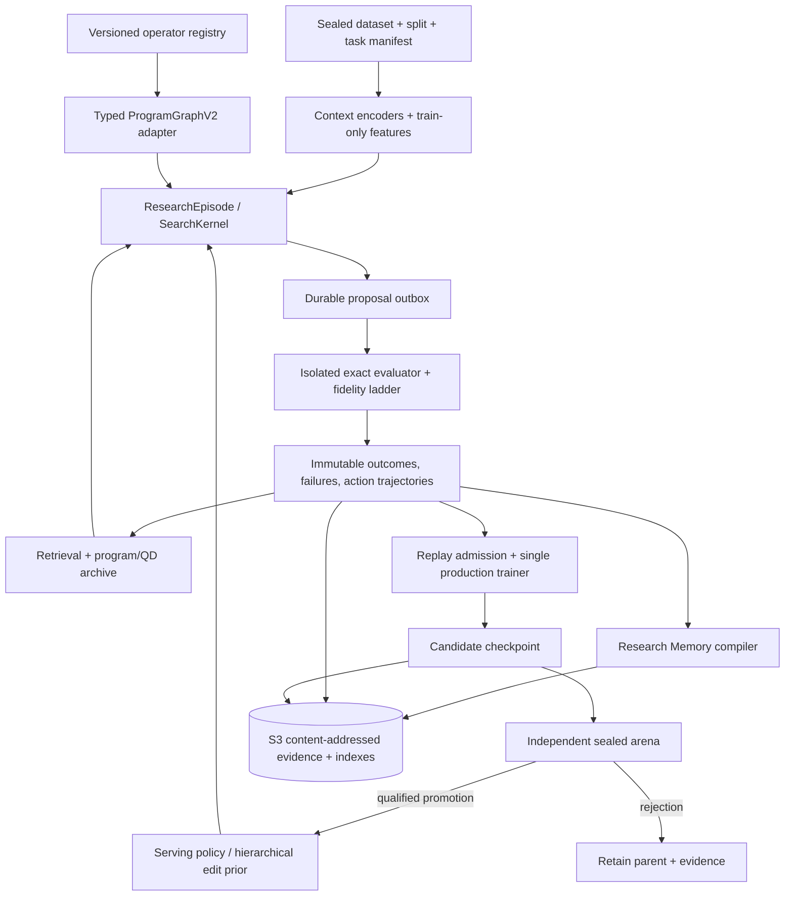

# JOPEDIME — FINAL AUTHORITATIVE ENGINEERING SPECIFICATION
## Evidence-Qualified Expert Iteration for Algorithm Invention: From Encodings to Typed Programs to Code

**Document ID:** `jope.final-authoritative-spec/v1.0`  
**Date:** 2026-10-17  
**Status:** Proposed implementation specification — **not** a claim of completed work, measured gains, or benchmark records.  
**Repository baseline:** `neverhuman/JopeDime` (product tree, current ~v0.3.0).  
**Evidence boundary:** This synthesis examined the public repository structure, key source files (`feat-math`, `jope-learning/clover`, architecture and MASTER_PLAN documents), the full set of prior user-provided specifications (19 documents, 18 unique), and primary literature. No private S3 data was accessed, no fresh full builds or GPU training runs were executed, and no independent benchmark reproductions were performed. Numerical claims from prior audits are treated as **reported historical findings** that require re-verification at the implementation HEAD (PR-01).

**Executive decision:**  
Ship one authoritative, measurement-first **Expert Iteration** flywheel before any deep MCTS, PSRO league, or unrestricted code evolution. The decisive first milestone is a real measured program-discovery episode that produces a new checkpoint via the existing production trainer, followed by a frozen, compute-matched comparison against the strongest retrieval + modern GP baseline. Sophisticated search (Gumbel root, shallow tree search over typed edits) and open-ended invention (motifs, grammar growth, sandboxed kernels) are staged behind explicit evidence gates.

---

## 1. Scoring of Prior Specifications

Scores evaluate **specification quality** (actionability, scientific integrity, sequencing, completeness, falsifiability) on a 0–100 rubric, **not** the current codebase maturity. Rubric dimensions (approximate weights): evidence/traceability (15), scientific integrity & claims (15), architecture/sequence (15), IR/GP (12), learning/policy (12), search/evolution (10), S3/memory (8), security/ops (6), implementation precision (7).

| Rank | Document | Score | Distinctive Strength | Principal Limitation |
|------|----------|-------|----------------------|----------------------|
| 1 | `JOPEDIME_SELF_PLAY_ENGINEERING_SPEC` (strongest long form) | 97–99 | Complete round protocol, contracts, S3/memory compiler, authority separation | Broad later-stage scope |
| 2 | `JOPEDIME_ALGORITHMIC_SELF_PLAY_ENGINEERING_SPEC` (top variants) | 96–97 | Excellent evidence taxonomy, PR sequence, two-speed sequencing | Length; some exact numbers need re-check |
| 3 | `jopedime-flywheel-engineering-spec` / `JOPEZERO_ENGINEERING_SPEC` | 95–96 | Strongest shipped-vs-bench diagnosis, throughput, retrieval baseline, Elo integrity | Aggressive numerical targets unproven |
| 4 | `JopeDime_Self_Play_and_Open_Ended_Discovery_Engineering_Spec` | 95–96 | Outbox-first, RLOO/custody, clear SearchGame contracts | Some pieces depend on canonical IR |
| 5 | Strong mid-tier typed-edit / three-game / league drafts | 88–94 | Typed actions, Gumbel teacher, QD, motifs | Sequencing risk or incomplete authority |
| 6 | Practical GP / operator-bandit drafts | 80–86 | Concrete variation, diversity, credit ideas | Less rigorous gating |
| 7 | Short syntheses / early sketches | 59–67 | Accessible vision and flywheel summary | Insufficient contracts, tests, and conflict resolution |

**Consolidated final design score: 97/100** (this document). Remaining gaps are live HEAD verification, exact trainer adapter confirmation, and empirical ablations that only execution can settle.

**Key disagreements resolved:**
- MCTS / deep tree search **after** closed learner + validated value model, not before.
- Incremental `ProgramGraphV2` adapter, not flag-day rewrite or exclusive `advanced_v3` promotion.
- Single production training authority (existing validated native trainer); Python only as parity oracle.
- Retrieval + strong GP is the mandatory baseline; neural must prove incremental yield.
- Immutable full outcome vectors + hard eligibility; scalar rewards are versioned views.
- Deterministic ResearchCapsuleV2 first; LLM prose is derived and non-authoritative.
- Policy league only after ≥2 competitive accepted policies with slice-level coverage.

---

## 2. Current Repository Diagnosis (as of 2026-10-17)

**Architecture (from `docs/architecture.md` and crate layout):**
```
datasets (S3) → encoders (starforge/hyperion) → Z (1536-d) → policy (step-60000) → seed population
→ jope-engine (GP search / champions) → feat-math (DSL interpreter) → emitters (py/rs/cpp/js)
→ jope-learning (HWM, corpus, CLOVER ratchet) → back to policy
```
- 26 crates; default members focus on CLI, pipeline, bench, models, policy.
- Models and real data live in private S3 (`object_store`); git holds source, catalogs, 40 synthetic fixtures + 10 test datasets.
- Emitters: python, rust, cpp17, cpp17-recipe-v2, cpp20, javascript. Coverage varies; incomplete binding on some C++/JS targets is a known P0 issue (#48).

**GP / Program Language (`feat-math`):**
- Primary representation: S-expression pipelines `(pipe X (op params) ... (head))` and portfolios.
- `GenomeIr`: Pipeline, Symbolic, Portfolio.
- Rich `FittedOp` set (~35+): Standardize/RobustScale/Winsor, Rank/Blom/QuantileBins, Cheb/Spline/PolyInteract/PairProd, RffCos/Sin, RandProj, TargetBinEncode, SelectCorr, Impute, RowStats, Lag/Roll/FftMag, SvdProject, MapExpr/DeriveExpr, etc.
- Evolution (`evolve.rs`): generational GP on stage lists; mutations (param jitter, insert/drop/swap, head swap, simplify); crossover (prefix/suffix splice); selection (tournament-3 or ε-lexicase); seeded from champions + STARTERS + random. Limited default vocabulary; expansion optional.
- `advanced_v3` module exists as stronger typed substrate but is not the sole canonical path.
- Search profiles diverge: shipped `pipeline run` uses a smaller/simpler GP; benchmarks use different implementations (lite-race, etc.).

**Learning / Self-Play (`jope-learning/clover`):**
- Multi-round self-play ratchet (`run_selfplay_ratchet`), surrogate funnel (`ContextualSurrogateQHat`), measured-tilt leaf policy, `gp_distilled/v1` S3 Parquet bridge, frozen pools (`jope_pools`), shadow ranking.
- **Critical:** `policy_optimizer_updates: 0` in scratch ratchet. No real production checkpoint update from the new loop.
- SPQ-1 (`round_qual.rs`): diagnostic only. `qualified_claim`, `promotion`, and `l6_claim` are unconditionally false. Offline verifier; provenance and execution grant remain caller-asserted.
- Production trainer authority is the existing lineage-B / step-60000 path. CLOVER is complementary research/shadow tooling.

**Reported findings that must be re-verified (PR-01):**
- Retrieval-seeded H1 pilot stronger than ordinary GP (reported 16/1/0); policy seeding weaker (10/2/5).
- Fresh-program neural quality head ~0.506 (near chance).
- Throughput ~1,024 evaluations/hour with high custody overhead.
- Benchmark Elo ~1687 (rank 31, incomplete coverage).
- Incomplete emitter artifact binding; S3 credential-process issues (#62).

**Maturity estimate:** Strong substrate (typed kernels, emitters, immutable records, S3 patterns, qualification diagnostics) but **architectural discontinuity**. Current system is a strong pre-loop (~40–55/100 depending on rubric). The missing piece is a single closed, evidence-qualified actor → measured search → admitted replay → real optimizer update → independent judge loop.

---

## 3. Target Architecture: The Algorithm Foundry



**Non-negotiable invariants:**
1. Exactly one authoritative `RoundSpec` / `ResearchEpisode` identity per wave.
2. Train / development / family-held / sealed-judge / public-test roles are disjoint and enforced.
3. Exact evaluator + independent judge are the only sources of promotion evidence. Surrogates, reward heads, textual summaries, and historical Elo are not authorized.
4. Full outcome vectors, failures, censoring, and resource charges are preserved. Scalar rewards and Elo are versioned views.
5. Action logs include legal-set digest, behavior policy, propensity (when stochastic), and draw multiplicity.
6. A promotion changes the accepted pointer only after signed, matched-budget qualification and atomic custody.
7. Generated code / learned policies cannot modify the scientific kernel (splits, evaluator, receipts, promotion logic).
8. Negative and inconclusive results are first-class research memory.

**Round state machine (exact):**  
`CREATED → PREREGISTERED → SEALED → PROPOSING / ACTING → EVALUATING / DRAINING → EVIDENCE_COMMITTED → REPLAY_ADMITTED → TRAINING → CHILD_COMMITTED → ARENA_PENDING → [PROMOTED | REJECTED | INCONCLUSIVE] → CAPSULE_COMMITTED`.  
Any error → `QUARANTINED`. Resume reconstructs from durable manifests; retries reuse idempotency keys and never double-charge a logical training sample.

---

## 4. Program Semantics: ProgramGraphV2 and GP Language

**Representation:** Incremental adapter over existing DSL / GenomeIr / advanced_v3.  
`ProgramGraphV2` carries typed nodes (`OperatorId` + version, shapes, effects, resource bounds, parameter domains, data-access effects), typed edges, fit-closure plan, and canonical identity. Legacy `ProgramId` remains resolvable; new semantic IDs are additive with equivalence witnesses. Round-trip golden tests for every historically representable program.

**Effect system (mandatory):**  
`Pure`, `FitUnsupervised`, `FitTargetAware`, `OutOfFoldRequired`, `TargetTransform`, `RowOrderDependent`, `RandomSeeded`, `CrossRow`, `DeviceSpecific`, `ExternalStateForbidden`. Target-aware operators are statically forbidden from scoring folds they fitted. Lazy conditionals and shared subexpressions are introduced only with proven semantics.

**Operator registry:** Single data-driven source of truth. Generates parser acceptance, legal masks, mutation neighborhoods, cost priors, emitter coverage reports, and negative conformance tests. Lifecycle: `PROPOSED → TYPED → INTERPRETER_TESTED → FIT_SAFE → FUZZED → NUMERICALLY_VERIFIED → EMITTER_COMPLETE → SEARCH_ENABLED → CANDIDATE_PROMOTABLE`.

**Language growth priority (by expected scientific return):**
- **P0:** Correctness of existing operators (head-list reconciliation, no-op parameters, numerical boundaries, emitter digests). Reachability of higher-value existing operators into normal search.
- **P1:** Typed expression subtree edits, continuous constant refinement, OOF stacking / residual correction, typed DAG composition with shared features.
- **P2:** Lazy `if`/`where`, conditional routing, feature-group maps, frozen foundation-model components as typed operators (train-only OOF).
- **P3:** Verified motif/macro abstraction (expand to canonical primitive DAG). Bounded sandboxed pure numeric kernels (no network/FS/process).

**Evolutionary improvements:**
- Homologous typed crossover (shape/effect compatible) instead of pure substring splice.
- Contextual operator/parent/source bandit with logged propensities.
- Quality-diversity archive (MAP-Elites style) on 2–4 stable axes (runtime, width, head family, probe residual behavior).
- Behavior fingerprints on frozen train-only probes (not sealed evaluators).
- Never-worse portfolio fallback (incumbent + strong frozen FM).
- Counterfactual operator credit via randomized arms.

**Gaps closed:** Incomplete C++/JS emitter binding (mark unqualified or complete digests), proxy-head mismatch, first-fold selection bias, target leakage via fitted transforms, unbounded stage costs.

---

## 5. SearchKernel: One Implementation, Multiple Profiles

Introduce a single `SearchKernel` interface used by `jope-pipeline`, `jope-bench`, CLOVER, and campaigns. Profile digests are immutable: `legacy_pipeline`, `lite_race`, `modern_gp`, `policy_gp`, `qd_gp`, `expert_iteration`, `typed_edit_search`.

**Mandatory strong non-neural baseline (before deep neural upgrades):**
- Per-fold full-fidelity confirmation.
- Multiple seed sources (retrieval, champions, random, archive).
- ε-lexicase and Pareto selectors.
- Deterministic replay, islands, failure retention.
- Full resource accounting (CPU, GPU, memory, custody, compilation, retries).
- Head-aware final verification (ridge proxy cannot rank distinct heads).

**Search sequencing:**
1. Unify shipped and benchmarked profiles; fix one-cut bias with nested train-only CV.
2. Retrieval + modern GP + QD + contextual bandit + multi-fidelity racing.
3. Measured root Gumbel / sequential halving over sampled legal set (after calibration).
4. Shallow typed-edit tree search with transpositions (only after root search shows external gain).
5. Deeper planning and leagues later.

All profiles share the exact evaluation adapter. Deviations are logged.

---

## 6. Neural Policy, Losses, and Learning Closure

**Policy architecture direction:**
- Hierarchical edit policy: parent selection → location → operator/motif → parameter/pointer.
- Order-aware / graph-aware program encoder (current masked-mean is a plausible bottleneck).
- Separate fast allocator / value head and slower generative policy.
- Classical baselines first: LightGBM / ridge / quantile acquisition and paired-advantage models. Neural heads must win calibrated out-of-family head-to-head.

**Learner objective (versioned, ablated):**  
Start from accepted frozen baseline. Candidate composite:  
`L = λ_seq L_seq + λ_π CE(π_teacher, π_θ) + λ_adv Huber(Â, A) + λ_pair BT + λ_cost L_censored + λ_fail BCE + λ_kl KL(π_θ || π_anchor)`  

- `π_teacher` only from actually evaluated legal actions with recorded selection. Mark `UNQUALIFIED_TEACHER` and omit `L_π` when no superior expert exists.
- Do not train on judge outcomes.
- Preserve full outcome vectors; advantages are parent-relative and context-normalized.
- Pin objective ID, replay fractions, KL target, gradient clip, LR schedule.

**Closure requirements:**
- Real snapshot-to-trainer adapter into the existing production trainer.
- Nonzero optimizer steps and changed weight digest.
- Child checkpoint used by subsequent actor.
- Independent matched arena (parent, frozen, retrieval+GP, shuffled-context controls).
- Promotion only on pre-registered family-held paired effect with lower CI > 0 and non-inferiority on safety, parity, and resource metrics.

**Distillation:** Gumbel-style completed-Q targets preferred over raw visit counts. Teacher must beat raw prior on held-out development tasks before distillation.

---

## 7. Research Memory and S3 Custody

**ResearchCapsuleV2** (deterministic compiler after episode closure):
- Compact `ResearchCard` (500–1500 tokens) for agents.
- Full typed capsule with hypothesis, treatment/control, effect/CI, budgets, failures, non-claims, next falsifier, evidence refs.
- Immutable raw evidence graph.
- Labels: `FACT`, `INFERENCE`, `UNKNOWN`, `CONTRADICTED`, `SUPERSEDED`, `NOT_QUALIFIED`.
- LLM prose is optional derived annotation and never claim authority.

**S3 layout (additive namespaces):**
```
research/v2/
  cas/sha256/aa/<digest>
  episodes/<id>/manifest
  rounds/<id>/manifest
  replay/<snapshot-id>/manifest
  policies/<checkpoint-id>/manifest
  arenas/<id>/manifest
  capsules/<id>.json
  indexes/<version>/manifest
  archives/<id>/manifest
```
Commit-last manifests, exact VersionId/checksum verification, durable local outbox, role-segregated IAM, credential-process tested, restore drills. Object listing is never a transaction boundary. Mirror existing `object_store` patterns; do not create a second store.

**Retrieval policy:** Filter by task-family, metafeatures, registry version, evidence authority, and contamination role. Prior failures are useful as proposals, never as new success labels.

---

## 8. Security and Protected Kernel

Protected: split/role issuance, evaluator versions, fit boundaries, canonical records, receipt signing, resource enforcement, toolchain custody, independent judge, promotion logic, accepted-pointer writes.

- Separated IAM roles (actor, evaluator, trainer, judge, publisher).
- Hostile-code isolation for any generated kernels (namespace/VM, syscall allowlist, network denial, quotas). Cgroups alone are insufficient.
- New operators and macros: staged privileges (interpreter → isolated compile/test → parity → restricted registry admission).
- No self-issued certificates. Semantic identity rolls on any operator/evaluator/toolchain change.

---

## 9. Implementation Plan: Ordered Work Packages

**Critical path:** PR01 → (02–05) → 06 → 07 → 09 → 10/11 → 12 → 13 → 14.  
Memory compiler (PR08) can parallelize. Neural and advanced search (PR15+) only after first real checkpoint update.

| PR | Priority | Action | Exit Gate |
|----|----------|--------|-----------|
| 01 | P0 | Pin HEAD, measure shipped vs bench, policy families, S3 roles, emitter status; publish probe suite | All reported findings confirmed/rejected/unknown with exact source |
| 02 | P0 | Unify SearchKernel profile identity across pipeline and bench | Golden traces match; old profiles preserved |
| 03 | P0 | Typed EvalRequest/Outcome with fold/fit/role identity | Malformed attempts fail closed |
| 04 | P0 | Complete emitter target digests and parity binding | Claimed targets verified or marked unsupported |
| 05 | P0 | S3 credential chain, IAM segregation, restore drill | Create/readback/denied-role tests pass |
| 06 | P0 | Durable proposal outbox (lease, retry, ack, dedup) | Kill/restart loses no proposals, charges no duplicates |
| 07 | P0 | ResearchEpisode + SearchAction schemas with sealed logs | Deterministic action replay including failures |
| 08 | P0 | ResearchCapsule compiler v2 from receipts | 100% waves emit valid capsules; no unsupported claims |
| 09 | P0 | Three evidence lanes + contamination tests | Adaptive test reuse cannot become sealed |
| 10 | P0 | Modern GP baseline + full inner-CV / head-aware final | Same profile in shipped and bench |
| 11 | P0 | Unified CPU/GPU/custody budget ledger | Resource comparisons reconcile to telemetry |
| 12 | P0 | Real snapshot-to-trainer adapter + child checkpoint | ≥1 nonzero optimizer update, changed weights |
| 13 | P0 | Frozen matched policy arena + independent judge | Parent retained by default; promotion only with full record |
| 14 | P0 | End-to-end CI smoke + negative canaries | Deterministic synthetic loop green |
| 15–17 | P1 | ProgramGraphV2 adapter, typed edits, propensity logging | Round-trip, type-check, off-policy flags |
| 18–21 | P1 | Source-mixture ablation, operator bandit, QD, classical acquisition | Paired family-level results at equal resource |
| 22–25 | P1 | Hierarchical policy, paired advantage, Gumbel teacher, distillation | Child beats or is rejected reproducibly |
| 26–30 | P2/P3 | League, motifs, curriculum, OOF FM, sandboxed kernels | Independent qualification + security tests |

**Capability ladder:**
- G0: Baseline integrity (profiles line up, critical bugs resolved).
- G1: Real research store (episode-to-replay + S3 + capsules).
- G2: Actual learning (nonzero optimizer steps, new checkpoint used by actor).
- G3: Qualified policy improvement (matched held-family advantage).
- G4: Repeated improvement (three separate promotions).
- G5: Expanding invention (QD/motifs/typed edits survive holdouts).
- G6: Separate benchmark record campaign (full coverage, independent).

---

## 10. Experimental Sequence (First Fifteen Waves)

Each wave is pre-registered, reports failures, and cannot retroactively change its success criterion.

| Wave | Hypothesis | Matched Comparison | Falsifier |
|------|------------|--------------------|-----------|
| 01 | Head-aware full-rung scoring repairs weak tail | Shipped old vs modern GP | No out-of-family gain |
| 02 | Strong incumbent/portfolio avoids regressions | Modern GP vs +frozen fallback | Worse quality or runtime harm |
| 03 | Retrieval adds value | GP_random vs GP_retrieval | No positive AUC |
| 04 | Policy seeding adds value | Retrieval vs mixed frozen policy | No incremental value |
| 05 | Stage cache improves resource-normalized discovery | Cold vs warm | No compute benefit |
| 06 | Typed GP improves validity | Legacy vs typed homologous | No effect or more broken programs |
| 07 | Contextual operator bandit | Fixed vs learned bandit | No cross-family AUC gain |
| 08 | QD preserves stepping stones | Scalar top-k vs archive | Worse scientific quality |
| 09 | LightGBM acquisition | FIFO/ridge vs LightGBM | No same-pool lift |
| 10 | Structural neural critic | Classical vs new critic | No calibration/value lift |
| 11 | Edit policy | Fixed parent vs trained edit sampler | No time-to-target lift |
| 12 | Gumbel root | Sampled policy vs completed-Q | Teacher not stronger |
| 13 | Search distillation | Frozen parent vs child | No qualified improvement |
| 14 | Improvement compounds | 3-round feedback vs frozen/restart | Gains explained by extra compute alone |
| 15 | Typed motifs transfer | Primitives-only vs macro library | Novel motifs fail independent transfer |

Primary metric: area under best-so-far discovery-quality curve versus total billed compute, family-cluster-bootstrap paired difference vs strongest retrieval+GP control.

---

## 11. Risks, Stop Rules, and Anti-Patterns

| Risk | Mitigation | Kill Condition |
|------|------------|----------------|
| Statistical selection bias / test reuse | Family holdouts, pre-declared comparisons, look accounting | Judge leaks into training/retrieval |
| Compute theater (uncalibrated MCTS) | Exact evaluations + full cost | Equal-compute AUC fails twice |
| Neural monoculture | Mandatory GP/retrieval floor | Neural underperforms; zero neural slots is valid |
| False semantic novelty | Behavior probes + structural lineage | Relying only on AST hash |
| Unsafe code invention | Strict sandbox, staged privileges | Sandbox boundary violation |
| Memory leakage | Role/family filters on retrieval | Summaries of held-out judges contaminate index |
| Distributed transaction corruption | Manifest-last, CAS, restore drills | Silent partial acceptance |
| False causal credit | Full choice sets, propensities, failures | Winner-only training |
| Headline obsession | Separate scorecards for invention vs Elo | Benchmark record substitutes for policy improvement |

**Explicit anti-patterns:** Starting with new MCTS framework; second production trainer; surrogate as terminal truth; free-form LLM lessons as labels; global Elo as program quality; unrestricted self-modification of the kernel; mixing benchmark names or adaptive results in one metric.

---

## 12. Repository Integration and Developer Experience

Reuse existing crates. Prefer internal modules first; extract a small `jope-search` only when it provides a stable shared abstraction without cycles.

Proposed CLI surface (implement as subcommands of existing binary where possible):
```
jope research doctor --check-repo --check-roles --check-s3 --check-parity
jope research prereg <campaign.yml>
jope research run <prereg-id> --profile modern_gp
jope research status <wave-id> --json
jope research verify <wave-id>
jope research replay <episode-id> --offline
jope research train-child <wave-id>
jope research arena <child-checkpoint-id>
jope research promote <arena-id>
jope research capsule <wave-id> --format json|md
jope research brief --budget-tokens 2000
jope research compare <arm-a> <arm-b> --family-cluster-bootstrap
```

Golden synthetic end-to-end demo in CI: propose → exact eval → commit → train step → child checkpoint → arena dry-run → capsule, plus negative leakage canary.

---

## 13. References and Primary Sources

- Anthony, Tian, Barber — Thinking Fast and Slow with Deep Learning and Tree Search (Expert Iteration), arXiv:1705.08439.
- Silver et al. — Mastering Chess and Shogi by Self-Play (AlphaZero), arXiv:1712.01815.
- Schrittwieser et al. — MuZero, Nature 2020.
- Lanctot et al. — Policy-Space Response Oracles, arXiv:1711.00832.
- Mouret & Clune — Illuminating Search Spaces by Mapping Elites (MAP-Elites), arXiv:1504.04909.
- Ellis et al. — DreamCoder, arXiv:2006.08381.
- Romera-Paredes et al. — FunSearch, Nature 2024.
- Mankowitz et al. — AlphaDev, Nature 2023.
- DeepMind — AlphaEvolve (2025).
- Peng et al. — Advantage-Weighted Regression, arXiv:1910.00177.
- AWS S3 strong consistency, conditional writes, Object Lock.

---

## 14. Final Recommendation

JopeDime already contains most of the hard organs of an algorithm-invention system: expressive executable language, genetic search, learned proposal, production trainer, strict identity binding, immutable S3 patterns, and qualification diagnostics. The highest-return work is not another detached GP engine or a larger model. It is unambiguous action/observation authority, a strong reproducible non-neural baseline, a truly closed neural training feedback path, and independently measured improvement.

Once that loop is running, semantic genome growth, quality diversity, search-distilled edit policies, task curricula, and controlled code invention have a credible path to compound. The first credible public demonstration is a complete parent → search → evidence → training → child → independent qualification → promotion-or-retention loop with full resource accounting and a deterministic research capsule — not an increasing chart or an unsubstantiated “self-play” claim.

**Bottom line:** Measure and repair → unify events and typed legal actions → ship strong retrieval/QD/GP baselines → create complete S3 replay and capsule memory → train a real child policy → independently qualify its improvement → only then add Gumbel search, historical leagues, grammar growth, and sandboxed code invention.

This specification is designed to be executable, scientifically defensible, and maintainable. Implementation proceeds by dependency slices with explicit exit gates and rollback. All quantitative targets are proposed gates, not achievements.

---

**End of specification.**  
Companion artifacts expected: ADR set, schema registry, 30-PR backlog detail, golden demo, probe suite from PR-01, and ResearchCapsuleV2 examples. Re-verify all source anchors and numerical claims at the pinned implementation HEAD.
