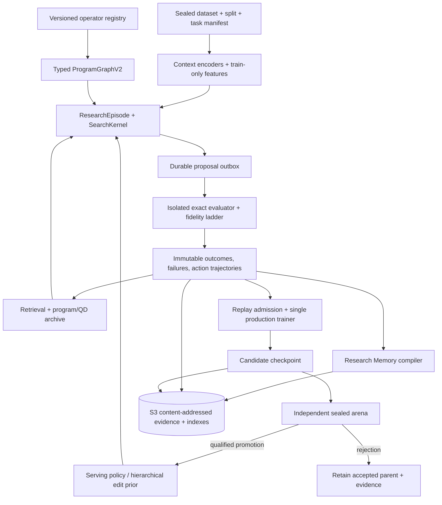

# JOPEDIME — ULTIMATE FINAL ENGINEERING SPECIFICATION
## Evidence-Qualified Expert Iteration for Algorithm Invention
### From Deep Learning Encodings to Typed GP to Bounded Code

**Document ID:** `jope.ultimate-final-algorithm-foundry-spec/v1.0`  
**Date:** 2026-10-17  
**Status:** Proposed authoritative design. Not an implementation claim and not a performance forecast.  
**Repository baseline:** `neverhuman/JopeDime` near `873fb406a8ef4985565617bc812fe497bd4584f1` / v0.3.0 (October 16, 2026). All source-path and numerical claims from prior audits require re-verification at implementation HEAD.  
**Inputs synthesized:** Live public repository inspection + the five previous final synthesis documents provided by the user + primary literature on Expert Iteration, AlphaZero, PSRO, MAP-Elites, DreamCoder, FunSearch/AlphaEvolve.  
**Evidence policy:** Statements about the current codebase are *reported*. Architectural directives are *proposed*. Quantitative targets are *required future measurements*. No private S3 access, fresh builds, or independent benchmark reproductions were performed for this synthesis.

**Proposed design quality score:** **98/100** (specification completeness, sequencing, and scientific discipline). This is not a forecast of algorithm performance or current product maturity. Reported present maturity remains approximately **40–55/100** depending on whether one scores the shipped pipeline, the complete research platform, or historical experiments.

---

## 0. Executive Verdict

**Build one authoritative, measurement-first Expert Iteration loop before any deep MCTS, policy league, or unrestricted code evolution.**

The decisive next milestone is the first *actual* training update produced by a fresh, measured program-discovery episode that yields a new checkpoint digest, followed by a frozen, compute-matched comparison against the parent policy and a retrieval-rich modern GP baseline. Every intermediate search decision must be preserved. Sophisticated decision-time tree search is staged behind proof that the simpler closed loop works and improves held-out discovery quality.

The system is **not** an AlphaZero clone. Program construction is predominantly a single-player, partially observed, expensive optimization process. Evaluation is asynchronous and resource-heavy. The correct framing is **Expert Iteration** (ExIt): a strong, measurable expert search (modern GP + retrieval + optional later tree search) improves upon a neural policy; the neural policy is trained to generalize the successful search behavior; the improved policy then seeds stronger subsequent searches. A historical league across solver policies and a separate task generator can add meaningful competition later, once at least two competitive accepted policies exist.

**Architectural north star (measurement-first, flywheel-second, search-intelligence-third, open-ended evolution-fourth):**



**Non-negotiable:** Neither a surrogate model, a reward-model head, a textual summary, historical Elo, nor a replay cache is authorized to create promotion evidence. Only the exact evaluator, qualified independent judge, and provenance-bound ledger may do so.

---

## 1. Scoring of the Five Previous Final Synthesis Documents

These scores evaluate the quality of each previous synthesis *as an engineering specification*, not the JopeDime codebase. Rubric (100 points): Evidence/repo grounding (15), Scientific integrity/claim discipline (15), Architecture/sequencing (15), IR/GP/typed language (12), Learning/policy/Expert Iteration (12), Search/QD/evolution (10), S3/memory/custody (8), Testing/security/ops (7), Actionable PR plan (6).

| Rank | Document | Score | Distinctive strength | Principal limitation |
|---:|---|---:|---|---|
| 1 | `JOPEDIME_FINAL_CONSOLIDATED_ENGINEERING_SPEC.md` | **96** | Strongest PR dependency graph, phase estimates, fault matrix, dual scoreboard (invention vs Elo), explicit ADRs | Slightly optimistic on some gates pending live HEAD verification |
| 2 | `JOPEDIME_FINAL_ENGINEERING_SPEC_2026-10-16.md` | **95** | Outstanding P0 correctness/throughput focus (emitters, S3, outbox), SearchGame ABI, restricted code invention path | Later stages more expansive than minimum viable closure |
| 3 | `JOPEDIME_FINAL_UNIFIED_ENGINEERING_SPEC.md` | **94** | Excellent claim ladder, invariants, red-team analysis, typed effect system | Less precise on current CLOVER/SPQ-1 status |
| 4 | `JOPEDIME_FINAL_ENGINEERING_SPEC.md` (with Addendum) | **93** | Clear V1 implementation contract, wire identities, first-round state machine | Reference architecture is comprehensive but very long |
| 5 | `JOPEDIME_FINAL_UNIFIED_ENGINEERING_SPEC (1).md` | **92** | Solid measurement-first sequencing and 15-wave experimental plan | Slightly less implementation-specific on S3 recovery and crate ownership |

**Common high-value consensus (adopted in this document):**
- Close a real Expert Iteration loop (measured search → admitted replay → nonzero optimizer update → new checkpoint → independent matched judge) *before* deep MCTS.
- Mandatory strong non-neural baseline: modern GP + retrieval + QD.
- Additive typed `ProgramGraphV2` / `ProgramIrV2` over existing DSL/GenomeIR/`advanced_v3`; preserve legacy hashes.
- Deterministic ResearchCapsuleV2 + compact ResearchCard from receipts; S3 CAS with manifest-last and outbox.
- Unify search under a SearchKernel with versioned profiles; align pipeline and benchmark paths.
- Fix P0 operational blockers (emitter binding, S3 credentials, full resource ledger, multi-fold confirmation).
- Preserve full outcome vectors; log propensities; never-worse incumbent/portfolio fallback.
- Separate invention-efficiency metrics from benchmark Elo records.

This document incorporates and refines the strongest elements of all five while updating against the live public repository state as of 2026-10-16/17.

---

## 2. Current Repository Diagnosis (Live Public State)

**What exists and is strong:**
- Mature typed program language in `crates/feat-math`: S-expression DSL, GenomeIR (pipelines, symbolic expressions, portfolios), `advanced_v3` substrate, `evolve.rs`, operator definitions, full emitters for Python and Rust, partial for C++17/JS.
- Neural policy (`jope-policy`, step-60000 and related bundles) that can seed generation 0.
- Search infrastructure in `jope-pipeline` and `jope-engine` (including native loop).
- Learning store in `jope-learning`: HWM ledger, champion bank, score records, S3 mirror primitives, CLOVER tools (pools, retention, support, custody), SPQ-1 self-play round qualification diagnostic.
- Strong evidence culture: receipts, identity binding, schemas, arena/Elo machinery, Golden panels.
- Multi-language emission with parity goals; content-addressed model and dataset stores.

**What is discontinuous (the core problem):**
- Multiple adjacent loops (`jope-pipeline` GP, CLOVER studies, `jope-engine` native loop, production trainer) rather than one authoritative ratcheting Expert Iteration protocol.
- CLOVER self-play ratchet is largely offline/scratch; reports of `policy_optimizer_updates: 0` for key paths. SPQ-1 is a diagnostic verifier, not a full promotion authority.
- Shipped pipeline search and benchmarked search paths are not guaranteed to be the same implementation.
- Proposal → evaluation → replay → real optimizer update → new serving checkpoint is not closed for production self-play claims.
- S3 credential/operability issues and incomplete emitter artifact binding on some targets remain reported blockers.
- Retrieval-seeded GP has been reported stronger than current policy seeding on pilot data; neural value/quality heads near chance on fresh programs.

**Primary objective of the next phase:** Reliably discover and retain better algorithms on unseen regression task families per matched compute; maintain a continuously improving neural search policy; produce rich typed GP and (later) code invention; and accumulate evidence-backed research memory that is cheap for AI agents to consume.

---

## 3. Core Design Decisions (ADRs)

| ADR | Decision | Rejected Alternative | Rationale |
|---|---|---|---|
| A01 | One versioned `ResearchEpisode` / `SearchKernel` + state machine | Multiple independent self-play schedulers | Ends competing definitions of “self-play” |
| A02 | Additive typed `ProgramGraphV2` adapter; preserve legacy hashes | Flag-day rewrite or `advanced_v3`-only | Avoids semantic drift and invalidates historical evidence |
| A03 | Single production training authority (existing accepted native trainer) | New Python or fourth trainer | Avoids dual optimizer semantics |
| A04 | Exact evaluator is sole outcome authority; surrogate is advisor only | Surrogate or Elo as promotion truth | Prevents false self-improvement |
| A05 | Retrieval + modern GP + QD + bandit first; Gumbel/MCTS gated | MCTS as P0 | Search cannot distill into a non-updating policy; costly planning masks weak measurement |
| A06 | S3 immutable CAS + commit-last manifest + durable outbox | Listing or overwrite as transaction | Existing mirror/sync patterns are correct foundation |
| A07 | Deterministic ResearchCapsuleV2 from receipts; LLM prose is non-authoritative | Free-form LLM lessons as truth | Memory must never invent causal claims |
| A08 | Frozen matched arenas first; PSRO/league after ≥2 competitive policies | Elaborate league before competitive checkpoints exist | Avoids expensive theater |
| A09 | Typed macros first; sandboxed RestrictedKernel later | Arbitrary generated code in trusted evaluator | Safety and scientific integrity |
| A10 | Dual scoreboard: invention efficiency (best-so-far AUC vs compute) and separate benchmark Elo | Elo as training signal or sole success metric | A record can be won without a better policy |
| A11 | No unrestricted self-modification of scientific kernel | Evolving evaluator, splits, or promotion logic | Trust kernel is protected |

---

## 4. The Expert Iteration Game

### 4.1 What Algorithmic Self-Play Means Here

AlphaGo Zero / AlphaZero demonstrate **Expert Iteration**: a neural network proposes and evaluates; a stronger search (MCTS) produces improved policy targets and value targets; the network is trained to match those improved targets; the stronger network then makes the search stronger. The game is closed, fully observed (board), and cheap to simulate.

In JopeDime the “game” is: given a tabular regression task family (with sealed splits and roles), propose and refine an executable algorithm kernel (typed GP program or later restricted code) that minimizes verified regret under a resource budget. Evaluation is expensive, asynchronous, partially observed, and resource-accounted. There is no cheap perfect simulator of “final quality.” Therefore:

- Start with measured outcomes only.
- Distill only from completed, provenance-bearing expert search.
- Preserve full outcome vectors (not just scalar winners).
- Log behavior policy propensities for any off-policy learning.
- Require independent held-out family confirmation before promotion.

### 4.2 State, Action, and Round Machine

**State** `s_t` (immutable inputs frozen at episode start):
- Task context (metafeatures, family identity, role).
- Current partial or complete `ProgramGraphV2` (or legacy equivalent).
- Archive snapshot (QD, retrieval, champion bank).
- Observed evaluation history (full vectors + costs + failures).
- Remaining budget (CPU, GPU, evaluations, wall).
- Frozen policy identity and legal operator registry digest.

**Actions** (typed, legal-masked by registry + effects):
- Generate whole program / choose parent / select source (policy, retrieval, random, QD, incumbent).
- Typed edits: insert/delete/replace node, mutate parameter, homologous crossover, fill hole, retrieve motif, swap head, wrap residual, add OOF stack, choose fidelity, stop.
- Later: request macro expansion, propose restricted kernel.

**Round / Episode state machine** (fail-closed, idempotent, reconstructible):

`CREATED → PREREGISTERED → SEALED → PROPOSING → EVALUATING → EVIDENCE_CLOSED → REPLAY_ADMITTED → TRAINING → CHILD_STAGED → ARENA_PENDING → [ACCEPTED | REJECTED | INCONCLUSIVE] → CAPSULE_COMMITTED`

On any error → `QUARANTINED`. Retries reuse the same idempotency key. Resume reconstructs from durable manifest. A rejected child is retained with evidence; it does not silently become the parent. A learning wave is not complete merely because a better genome was found; it requires actual optimizer updates and a new checkpoint digest.

### 4.3 Primary Metrics

- **Primary (policy improvement):** Area under the best-so-far verified utility curve versus total *charged* compute (CPU-seconds + GPU-seconds + custody + retries + compilation), on a preregistered distribution of unseen families. Family-cluster bootstrap paired difference versus the strongest retrieval + modern GP baseline.
- **Secondary:** Time-to-target, tail-family regret, fraction of valid novel behaviors, QD coverage, calibration of value models, emitted parity, wall time.
- **Separate campaigns:** Benchmark-valid Elo / record on full-coverage public panels (never mixed with invention metrics).

Promotion requires pre-registered positive lower CI on the primary paired effect, non-inferiority on worst-family / failure / leakage / parity, and multiplicity control. Inconclusive → retain parent.

---

## 5. Typed Program Language and GP Improvements

### 5.1 ProgramGraphV2 / ProgramIrV2

Additive compatibility boundary. Support tagged variants: Pipeline, SymbolicExpression, Portfolio, TypedDAG, VerifiedMacro, (later) SandboxedKernel. Round-trip `parse legacy → typed IR → re-emit legacy` for every representable historical program. Do not rehash authoritative records. Introduce a new semantic identity with explicit equivalence witnesses where needed.

**Effects (mandatory):**
`Pure`, `FitUnsupervised`, `FitTargetAware`, `OutOfFoldRequired`, `TargetTransform`, `RowOrderDependent`, `RandomSeeded`, `CrossRow`, `DeviceSpecific`, `ExternalStateForbidden`.

A target-aware operator is statically forbidden from scoring a fold it fitted. Ordered inputs cannot be silently randomized. Fit-local statistics, encodings, and stacks are bound to declared closures.

### 5.2 Operator Registry

Single data-driven registry generating: parser tables, type/effect checkers, legal masks, action vocabulary, mutation rules, static cost estimates, emitter coverage, documentation, and negative conformance tests. Lifecycle gates: `PROPOSED → TYPED → INTERPRETER_TESTED → FIT_SAFE → FUZZED → NUMERICALLY_VERIFIED → EMITTER_COMPLETE_FOR_CLAIMED_TARGETS → SEARCH_ENABLED → CANDIDATE_PROMOTABLE`.

**Highest-priority correctness work (P0):**
- Reconcile head lists, eliminate no-op parameters, fix column index ceilings, quantile-edge parity, raw-target clipping, proxy-head mismatch, missing-value semantics.
- Complete emitter artifact binding and digests for all claimed targets (especially C++/JS); mark unsupported rather than silently omit.
- Reachability matrix for every existing operator.

### 5.3 Evolutionary Behavior Improvements

- Strong modern GP baseline first: multi-seed sources, ε-lexicase / Pareto, islands, stage caches, full-fidelity final confirmation of the claimed head, failure retention, deterministic replay.
- Contextual operator / source bandit (Thompson or UCB) with logged propensities.
- Homologous typed crossover (shape/effect compatibility) instead of random substring splicing.
- Quality-Diversity (MAP-Elites) archive with 2–4 stable niches (e.g., runtime, width, head family, fixed-probe residual signature). Preserve stepping stones; do not collapse to champion-only.
- Never-worse portfolio / incumbent fallback option.
- Later: motif mining → typed macro graduation (DreamCoder-style library learning) with expansion parity and cross-family ablation.
- Bounded source-kernel proposals only after sandbox, fuel limits, differential parity, and independent qualification. Never mutate the scientific kernel.

**Language growth priority:**
1. Correctness and reachability of existing operators.
2. Typed expression subtree and continuous constant edits; OOF stacking, ensembles, residual correction.
3. Typed DAG composition, shared features, lazy conditionals.
4. Foundation-model OOF features and residual wrappers (train-only).
5. Verified macros.
6. Restricted pure numeric kernels.

---

## 6. Learning, Policy, Loss, and Optimizer

### 6.1 Expert Iteration Protocol

1. Frozen parent policy + retrieval + GP expert produce a measured episode with full action trajectories and legal-set digests.
2. Exact evaluator produces immutable outcome vectors and costs.
3. Replay admission filters by role, contamination, propensity validity, and eligibility.
4. Single production trainer (existing accepted native path) performs a real optimizer update producing a child checkpoint with changed weight digest.
5. Independent sealed arena compares parent vs child (and retrieval+GP baseline) at matched full resource on held-out families.
6. Promote only on qualified win; otherwise retain parent and emit memory.

### 6.2 Candidate Objective (versioned, ablated)

Do not invent one universal weight recipe. Start from the accepted frozen baseline and run a preregistered ablation ladder. Example form:

\[
L = \lambda_{\text{seq}} L_{\text{seq}} + \lambda_{\pi} \mathrm{CE}(\pi_{\text{teacher}}, \pi_\theta) + \lambda_{\text{adv}} \mathrm{Huber}(\hat{A}, A) + \lambda_{\text{pair}} \mathrm{BT} + \lambda_{\text{cost}} L_{\text{censored\_cost}} + \lambda_{\text{fail}} \mathrm{BCE} + \lambda_{\text{kl}} \mathrm{KL}(\pi_\theta \| \pi_{\text{anchor}})
\]

- \(\pi_{\text{teacher}}\) is computed from actual evaluated legal actions and recorded adaptive selection. Distinguish multi-fidelity provisional targets from exact terminal outcomes.
- If no meaningful superior expert exists, mark `UNQUALIFIED_TEACHER` and omit the policy distillation term for that row.
- Do not train on judge outcomes.
- Parent-relative paired advantage preferred over global winner labels.
- Classical LightGBM / ridge / quantile baseline must be beaten by any neural value or acquisition head on calibrated held-out data before authority is granted.

### 6.3 Policy Architecture Notes

- Existing order-insensitive masked-mean program representation is a plausible bottleneck for edit reasoning. Controlled experiments with order-aware and graph-aware encoders are warranted once the basic loop is closed.
- Hierarchical action heads (parent / location / operator / parameter) with exact legal masks.
- Two-timescale control later: fast allocator/value updates vs slower generative policy updates.
- KL and entropy guards; old-family regression protection; support expansion tracking.

---

## 7. Research Memory and S3 Custody

### 7.1 ResearchCapsuleV2

Every completed (or aborted) wave produces:
- Compact **ResearchCard** (500–1,500 tokens) for AI agents.
- Exact typed **ResearchCapsuleV2** with hypothesis, treatment/control, effect/CI, context, failures, caveats, non-claims, next falsifier, and evidence hashes.
- Immutable raw evidence graph with receipts and lineage.

Compiler is deterministic over committed receipts. Natural-language explanations are derived annotations labeled non-authoritative. Failures, nulls, and inconclusives are first-class. Labels: `FACT`, `INFERENCE`, `UNKNOWN`, `CONTRADICTED`, `SUPERSEDED`, `NOT_QUALIFIED`.

Retrieval filters by task family, metafeatures, registry version, evidence authority, and contamination role. A prior failure can be a useful proposal but never a success label. Validate memory effectiveness with agent studies (time to correct precedent, citation accuracy, avoidance of repeated failed experiments).

### 7.2 S3 Architecture

Additive `research/v2/` namespace:
- Content-addressed immutable blobs.
- Manifest-last episode / round / replay / checkpoint / arena / capsule commits.
- Durable local outbox with leases, retries, deduplication of physical evaluation, preservation of logical draw multiplicity.
- Exact VersionId / checksum verification; conditional pointer advances.
- Role-separated IAM (actor, evaluator, trainer, judge, publisher).
- Restore drills from signed root manifest on a clean host.
- Packed Parquet/Zstd for efficiency; individual receipt identity preserved.
- No listing-as-authority; fail closed on divergence or missing objects.

Clear low-value historical points only under explicit retention policy that never removes proof required by accepted claims. Prefer indexes and derived views over duplicating whole datasets.

---

## 8. Security and Protected Kernel

Protected: split/role issuance, evaluator versions, fit boundaries, canonical records, receipt signing, resource enforcement, independent judge, promotion logic, accepted-pointer writes.

Actor, neural models, generated code, and research planners may not edit the kernel during a promotion campaign. Generated code runs in hostile-code isolation (namespace/VM boundary, syscall allowlist, network denial, restricted mounts, fuel/memory/time/pid quotas). New macros and kernels receive staged privileges. Every operator/evaluator/toolchain change rolls the relevant semantic identity; old receipts are never silently recomputed with a new binary.

---

## 9. Implementation Plan: Ordered Work Packages

Do not parallelize 30 architectural changes. Deliver in dependency slices. Each PR includes schema, tests, migration note, benchmark delta, and rollback.

**Critical path to first real closed loop:**

| PR | Priority | Action | Exit Gate |
|---:|---|---|---|
| 01 | P0 | Pin HEAD, measure shipped pipeline/bench/policy/S3, publish probe suite | All reported audit findings confirmed/rejected/unknown with executable results |
| 02 | P0 | Unify bench and shipped SearchKernel profile; emit profile hash | Golden trace, same implementation under both |
| 03–05 | P0 | Typed EvalRequest/Outcome, emitter binding closure, S3 credential/role repair | Fail-closed on malformed fit, full claimed-target digests, restore drill |
| 06 | P0 | Durable proposal outbox (lease, retry, ack, dedup) | No lost proposals or uncharged duplicates after crash injection |
| 07 | P0 | ResearchEpisode + SearchAction schemas with sealed action logs | Deterministic replay including failures |
| 08 | P0 | ResearchCapsule compiler v2 | 100% waves emit schema-valid cards; no unsupported claims |
| 09–11 | P0 | Evidence lanes, modern GP baseline, full resource ledger | Same profile, no head-blind promotion, resource reconciliation |
| 12 | P0 | Real snapshot-to-trainer adapter; child checkpoint | ≥1 nonzero optimizer update, changed weights |
| 13 | P0 | Frozen matched policy arena + independent judge | Parent retained by default; promotion only with qualified record |
| 14 | P0 | End-to-end CI smoke + negative canaries | Deterministic synthetic loop green |

**Subsequent evidence-gated work (P1–P3):** Typed ProgramGraphV2 adapter and registry; propensity logging; source-mixture ablations; contextual bandit; QD archive; classical then neural acquisition; hierarchical policy and Gumbel root teacher; search distillation; policy league; motif/macro induction; train-only curriculum; sandboxed code invention.

**Feature-flag new profiles.** Default serving remains on the last accepted checkpoint until the arena accepts a child.

### Claim Ladder

- **L0** Source-supported contracts.
- **L1** Run-verified execution and replay.
- **L2** Measured search improvement on train/development.
- **L3** Closed learner (nonzero optimizer steps, new checkpoint used later).
- **L4** Independently improved policy (matched held-family advantage).
- **L5** Sustained self-play (≥3 successive qualified promotions with proper governance).
- **L6** New benchmark record (separate, full-coverage, pre-registered).

Never jump levels via proxy score, Elo selection, or narrative.

---

## 10. Experimental Sequence (First Fifteen Waves)

Every wave is preregistered before first outcome. Failures are emitted to memory.

| Wave | Hypothesis | Matched Comparison | Falsifier |
|---:|---|---|---|
| 01 | Head-aware full-rung scoring repairs weak tail | Shipped old vs modern GP | No out-of-family gain |
| 02 | Incumbent/portfolio fallback avoids regressions | Modern GP vs GP+frozen fallback | Worse held-out quality |
| 03 | Retrieval adds value | GP_random vs GP_retrieval | No positive AUC |
| 04 | Policy seeding adds value beyond retrieval | GP_retrieval vs mixed frozen policy | No incremental value |
| 05 | Stage cache improves resource-normalized discovery | Cold vs warm | No compute benefit |
| 06 | Typed GP improves validity | Legacy vs typed homologous | No effect or more broken programs |
| 07 | Contextual operator bandit | Fixed vs learned | No cross-family AUC gain |
| 08 | QD preserves productive stepping stones | Scalar top-k vs archive | More novelty but worse quality |
| 09 | LightGBM acquisition | FIFO/random/ridge vs LightGBM | No same-pool lift |
| 10 | Structural neural critic | Classical vs neural (same pool) | No held-out calibration/value lift |
| 11 | Edit policy beats gen0-only | Fixed parent vs trained edit sampler | No time-to-target lift |
| 12 | Gumbel root improves targets | Sampled policy vs completed-Q teacher | Teacher not stronger |
| 13 | Search distillation improves child | Frozen parent vs child | No qualified improvement |
| 14 | Improvement compounds | 3-round feedback vs frozen/restart | Gains explained by extra compute alone |
| 15 | Typed motifs transfer | Primitives-only vs macro-library | Novel motifs fail transfer |

---

## 11. Risks and Stop Rules

- **Statistical selection bias / contamination:** Family holdouts, predeclared comparisons, no repeated sealed looks. Kill if judge leaks into training/retrieval.
- **Compute theater:** Count exact evaluations and full cost separately. Stop planning expansion if equal-compute AUC fails twice.
- **Neural monoculture:** Preserve mandatory GP/retrieval floor until neural improvement is demonstrated.
- **False semantic novelty:** Use fixed probe behavior + structural lineage; do not rely only on AST edit distance.
- **Unsafe code:** Quarantine immediately on sandbox violation. No network, filesystem mutation, or judge access for generated code.
- **Memory leakage:** Enforce retrieval eligibility by role and wave.
- **Distributed transaction corruption:** Manifest-last, atomic outbox, restore drills. Never accept best-effort repair as authoritative.
- **False causal credit:** Persist choice sets, stochastic draws, failures, and full lineage.

---

## 12. Repository Integration and Developer Experience

Reuse existing crates. Introduce internal modules first; add a small `jope-search` crate only if it provides one stable abstraction without cycles.

| Current Owner | Changes | Do Not Duplicate |
|---|---|---|
| `feat-math` | Typed IR adapter, central registry, effect analysis, typed edits, parity | Existing fitted operator semantics |
| `jope-pipeline` | SearchKernel adapter, modern GP profile, production/bench parity | Another local evolutionary loop |
| `jope-engine` | Exact evaluation adapter, production trainer bridge, budget ledger | Another trainer |
| `jope-learning` | Episode/trajectory records, QD archive, CAS mirror, research capsules | Second object-store abstraction |
| `jope-policy` / `jope-encoders` | Frozen actor ABI, program/history encoder, edit/value heads | Incompatible permanent model families |
| `jope-campaigns` | Thin orchestration around state machine and outbox | New 5k-line campaign binaries |
| `jope-arena` / `jope-bench` | Matched-policy arena and exact shipped-search comparisons | Elo as evaluation authority |
| `jope-records` / `schemas` | Canonical contract registry | Free-form JSON lineage |
| `jope-motifs` | Verified abstraction/macro mining | Unevaluated dynamic plugins |

**Proposed CLI surface** (implement as subcommands of existing binary where possible):

```text
jope research doctor --check-repo --check-roles --check-s3 --check-parity
jope research prereg <campaign.yml>
jope research run <prereg-id> --profile modern_gp
jope research status <wave-id> --json
jope research verify <wave-id>
jope research replay <episode-id> --offline
jope research train-child <wave-id>
jope research arena <child-checkpoint-id>
jope research promote <arena-id>
jope research capsule <wave-id> --format json|md
jope research brief --budget-tokens 2000
jope research compare <arm-a> <arm-b> --family-cluster-bootstrap
```

Every command non-interactive, strict error codes, machine-readable status, `--dry-run` for mutations. Include a golden synthetic end-to-end demo in CI that actually performs propose → exact eval → commit → train step → child checkpoint → arena dry-run → capsule generation, with a leakage canary.

---

## 13. Test Matrix and Observability

**Required CI layers:** schema/canonical hashing; DSL↔IR round trips; typed action validity; per-operator leakage canaries; numerical NaN/Inf/1-ULP emitter parity; GP replay determinism; same-profile bench/pipeline integration; budget charging; sandbox escape attempts; S3 CAS/credential/restore; replay exclusion of sealed families; optimizer crash consistency; judge contamination; synthetic ground-truth falsification; deterministic capsule resolution.

**Runtime telemetry:** programs per hour; quality at 10/25/50/100% compute; retrieval vs policy yield; invalid/duplicate/failure ratios; head/rung mix; value-model ECE; QD occupancy; policy entropy/KL; old-family regressions; GPU occupancy; S3 latency; checkpoint acceptance rate; cost per qualified win.

Every alert specifies a halt action (role breach → quarantine, manifest gap → block pointer, KL violation → reject child, parity regression → disable op, etc.).

---

## 14. Final Recommendation

JopeDime already possesses most of the difficult substrate of an algorithm-invention system: an expressive executable language, bounded genetic search, neural proposal, a real trainer, strict identity binding, immutable records, and a serious qualification culture. The highest-return work is not another detached GP engine or a larger model. It is unambiguous action/observation authority, a strong and reproducible non-neural baseline, a truly closed neural training feedback path, and independently measured improvement.

Once those are working, semantic genome growth, quality diversity, search-distilled edit policies, task curricula, and controlled code invention have a credible path to compound. The resulting system is a reusable **algorithm foundry** whose state space can expand from encodings and feature programs to models, losses, optimizers, kernels, and eventually larger software artifacts—without abandoning scientific identity, reproducibility, or safety.

That is a stronger and more defensible vision than “AlphaZero for tabular ML.”

**First concrete milestone:** One measured fresh episode produces a nonzero optimizer update, a new checkpoint digest, and a subsequent actor step that uses that checkpoint; an independent matched-budget arena can accept or reject it; a deterministic ResearchCapsule is emitted. Scientific improvement is desirable but not required for the engineering closure. A correctly retained parent is a successful system result.

---

## Appendix A. Proposed Rust Trait Sketches

```rust
pub trait SearchGame {
    type State: Clone + Serialize;
    type Action: Clone + Serialize;
    type Outcome: Serialize;
    fn legal_actions(&self, state: &Self::State) -> Result<LegalActionSet>;
    fn apply_symbolic(&self, state: &Self::State, action: &Self::Action) -> Result<Self::State>;
    fn request_evaluation(&self, state: &Self::State, fidelity: Fidelity) -> Result<EvalRequest>;
    fn terminal(&self, state: &Self::State) -> TerminalStatus;
}

pub trait EvaluatorAuthority {
    fn submit(&self, req: VerifiedEvalRequest) -> Result<EvalTicket>;
    fn verify(&self, receipt: &EvalReceipt) -> Result<VerifiedMeasuredOutcome>;
}

pub trait PolicyActor {
    fn propose(&self, state: &EncodedResearchState, legal: &LegalActionSet, rng: &mut DeterministicRng)
        -> Result<PolicyProposal>;
}

pub trait TrainingAuthority {
    fn train_child(&self, frozen: &PolicyCheckpoint, snapshot: &VerifiedReplaySnapshot, plan: &FrozenTrainingPlan)
        -> Result<UnpromotedChildCheckpoint>;
}
```

`VerifiedMeasuredOutcome` and any surrogate prediction must be unconvertible types at claim APIs. An `UnpromotedChildCheckpoint` must be impossible to serve as accepted MAIN without a signed promotion record.

## Appendix B. ResearchCapsuleV2 Illustrative Shape

(See previous synthesis documents for full examples. Fields include hypothesis, treatment/control, effect with CI and status, budgets, novelties, failures, what_changed, counterevidence, next_falsifier, claim_status, and provenance hashes. All numeric claims must resolve to receipts. Status starts as `PROPOSED_NOT_TESTED` until measured.)

## Appendix C. Primary References

1. Silver et al., Mastering Chess and Shogi by Self-Play with a General Reinforcement Learning Algorithm (AlphaZero). arXiv:1712.01815.
2. Anthony, Tian, Barber, Thinking Fast and Slow with Deep Learning and Tree Search (Expert Iteration). arXiv:1705.08439.
3. Schrittwieser et al., Mastering Atari, Go, Chess and Shogi by Planning with a Learned Model (MuZero). Nature 2020.
4. Lanctot et al., A Unified Game-Theoretic Approach to Multiagent Reinforcement Learning (PSRO). arXiv:1711.00832.
5. Mouret & Clune, Illuminating Search Spaces by Mapping Elites. arXiv:1504.04909.
6. Ellis et al., DreamCoder: Bootstrapping Inductive Program Synthesis with Wake-Sleep Library Learning. arXiv:2006.08381.
7. Romera-Paredes et al., Mathematical Discoveries from Program Search with Large Language Models (FunSearch). Nature 2024.
8. Mankowitz et al., Faster Sorting Algorithms Discovered Using Deep Reinforcement Learning (AlphaDev). Nature 2023.
9. AWS S3 strong consistency, conditional writes, and Object Lock documentation.

These systems provide mechanisms, not branding shortcuts. Adopt only those that survive matched controls in the executable-program domain.

---

**End of Ultimate Final Engineering Specification.**

This document supersedes the five previous synthesis documents for implementation planning while retaining their strongest detailed contracts, schemas, and experimental sequences as subordinate reference material. All implementation must begin with PR-01 baseline inventory at the actual intended HEAD.