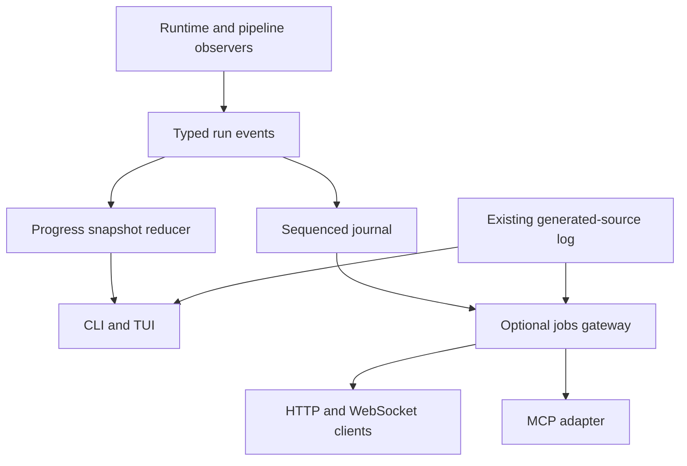

# Terminal experience and cloud interface delivery plan

**Status: proposed implementation workplan, 2026-10-21.** This PR supplies the
plan, a reproducible animated design preview and a runnable current CLI guide.
It does not implement the proposed flags, event API, TUI, HTTP service or MCP
server. Source review is pinned to `45490f2ce33075a355e08844351db197001beb90`.
Acceptance limits below are engineering targets, not measured performance.

## Product decision

Make the manual workflow `jopedime fit`, `predict` and `fit-predict` excellent
first: a restrained, colorful dashboard that updates a small region on stderr,
with meaningful phase progress and honest ETA. Add an explicit full-screen TUI
for users who want generated source, history and diagnostics. Reuse one typed
run/event model across CLI presentation, an optional cloud jobs service and an
MCP adapter. Keep the offline native appliance small and usable without any
server, browser, weights download or network connection.

Use the existing `jope pipeline invent` and all-language source stream for program
generation. Native appliance fitting and program generation have different semantics;
present that distinction in help and receipts rather than hiding it behind a
new ambiguous `train` verb. A future appliance source-generating method can join this UI only
after its runtime integration and artifact contract exist.

The default should answer five questions immediately: what input is being used,
what phase is running, how much work is complete, what resources it can use,
and where the result will be written. A source-heavy run adds which occurrence
is visible and whether its compiler checks passed, failed or remain pending.

## Source review and gaps

Paths are relative to the repository root. These are implementation observations
at the pinned source, rather than a fresh run of the expensive build or audits.

| Current surface | Evidence | Consequence for this plan |
| --- | --- | --- |
| CSV fit/predict, explicit target/task, candidates/folds, threads, size limits, receipts and exit taxonomy exist | `crates/jope-appliance/src/cli.rs`, `src/main.rs`; `tests/single_file.rs` | Extend these commands. Retain existing spellings and `--json` output. |
| Appliance is packaged and authenticated; fixture/native-only profiles exist, production publication pending | `deploy/appliance/README.md`, `build.sh`; `crates/jope-assets` | Give a truthful development quick start; preserve integrity checks and dependency fences. |
| Public native fitting API already owns fitting and prediction | `crates/jope-runtime/src/api.rs` | Add observation hooks here, with a no-op default; do not create another fitting engine in a server. |
| Automatic selection is bounded; chosen model's full-data refit always runs afterward | `crates/jope-runtime/src/automl.rs`, `api.rs`; `budget.rs` | Selection budget is not total completion percent. Refit gets a new phase and potentially unknown ETA. |
| Human output is a final stderr summary; JSON is a final stdout receipt | `crates/jope-appliance/src/main.rs` | Live UI needs structured events, not scraping human output. |
| Research `jope train` is private policy training, while pipeline invention accepts numeric CSV and an explicit target | `crates/jope-cli/src/main.rs`; `crates/jope-pipeline/src/cli.rs`, `invent.rs` | Avoid telling users that `jope train --train train.csv` fits the appliance. |
| Complete source capture, four-language payloads, checked events, durable sequence replay and metrics already exist | `docs/program-source-stream.md`; `crates/jope-observatory/src/gp_source.rs`, `src/bin/gp-source-stream.rs` | Build a terminal client and shared adapter; preserve `jope.gp-source/v1`. |
| Source server requires loopback and checks client origin/host; compiler checks run separately | `gp-source-stream.rs` | Keep local defaults. Cloud authentication and run isolation need an explicit gateway, not a public bind flag. |
| Search-event wire records carry exact identities and physical-attempt cost evidence | `crates/jope-pipeline/src/search_events.rs` | Keep scientific evidence unchanged; a UI projection must not redefine or overwrite it. |
| README leads with research and extensive evidence; CSV appliance path is hard to find | `README.md`, `deploy/appliance/README.md` | Put a short terminal entry near the top and move detail into linked guides. Preserve generated result blocks. |

Open HPC/audit PRs #395–398 must be reconciled before changing shared numerical,
threading, workflow or audit paths. This plan does not adopt their unmerged
behavior as mainline capability. Their benchmarks and Jankurai findings are
inputs to a new baseline once a single source revision is selected.

## Manual experience

### Default progress view

On an interactive stderr, reserve at most eight lines for a summary and active
phase. Print persistent warnings above it through the same writer. Repaint only
changed lines, at most ten frames/second; normal updates should be 2–4/second.
Never clear the user's screen or overwrite pre-existing scrollback. A small job
should finish without briefly flashing a dashboard: defer drawing by 150 ms.

Show task/method, feature and row counts, requested/effective threads, device,
elapsed time and output locations. During selection show completed/total folds,
active method, incumbent **training-CV** metric and failed/skipped counts.
Use explicit `minimize`/`maximize` labels and a named metric. A completed fold
is work progress, not a claim of convergence or a held-out test score.

The phases are package verification → read/validate → encode → select → refit
→ predict → commit outputs → finish. Skip inapplicable phases visibly. Give
determinate bars only to phases with measured denominators, such as CSV bytes
or a fixed fold schedule. Unknown work uses a static activity label or a modest
spinner. Completion means outputs have been committed and the receipt outcome
is final, not merely that the last fit returned.

ETA uses a monotonic clock and work-specific service times. Require at least
three comparable completions, smooth with an EWMA, and show a range when
variance is high. Reset the estimator when method/work scale changes; hide it
when there is insufficient data or a long in-flight task. Show `selection
budget left` separately. Do not extrapolate a selection rate through an unknown
refit, or turn a configured seconds budget into a promised finish time.

When the selection budget expires, say `selection budget reached; refitting
best eligible model` if that is what the runtime does. On failure, retain the
last phase, actionable error, exit code and receipt location. Do not print a
green success line until the output writer succeeds.

### Color, logging and terminal behavior

Use cyan for activity, muted gray for metadata, green for successful outcomes,
amber for actionable warnings and red for failures. Pair every color with a
word or symbol; no information may depend on red/green discrimination. Support
16-color and monochrome terminals, light and dark backgrounds, ASCII glyphs,
reduced motion and narrow layouts. No blinking text, decorative banners or
per-candidate INFO spam. Debug diagnostics remain opt-in.

One renderer owns stderr, including warnings and terminal restoration. Format
events as `time level phase message` in plain mode, with run/candidate IDs when
useful. Emit bounded diagnostic excerpts plus a file reference for full detail.
Sanitize dataset column names, paths, generated source and compiler diagnostics
before terminal display: escape ESC/CSI/OSC, BEL and other control sequences.
Do not interpret hyperlinks or clipboard sequences from untrusted text. Count
display columns correctly for Unicode and truncate only on valid boundaries.

Honor `NO_COLOR`, `TERM=dumb` and non-TTY stderr. `--color always` enables color
only, never cursor movement. Auto mode uses plain logs when redirected; do not
guess an interactive terminal from stdout when stderr is a pipe. Explicit TUI
requires input/output terminals and a usable size, otherwise fail clearly or
use documented progress fallback. Restore cursor, raw mode and alternate
screen on normal completion, error, panic and handled signals; document that
SIGKILL cannot run a restoration handler.

### Proposed flags and compatibility

All new spellings in this table are proposed. Existing fit/predict arguments
remain the source of truth until each implementation PR lands.

| Flag or command | Intended contract |
| --- | --- |
| `--ui auto\|plain\|progress\|tui` | Auto chooses inline progress on interactive stderr, plain otherwise. TUI is explicit. |
| `--color auto\|always\|never` | Resolve explicit option before environment; define precedence in help. |
| `--motion auto\|none`, `--ascii` | Accessibility and conservative terminal support. |
| `--quiet`, `-v` / `--verbose` | Quiet suppresses routine human output, retains failures; verbose adds diagnostics, never raw data. |
| `--json` | Existing one-final-receipt stdout contract stays intact. |
| `--output-format json\|ndjson` | New explicit machine stream; `--json` aliases json. Reject conflicting modes. Default remains human output. |
| `--events PATH` | Opt-in versioned event journal, distinct from the authoritative final receipt; reject input/output aliases. |
| `--show-code off\|latest\|all` | Source-generation workflow only. Latest updates visible source; all appends every occurrence in plain mode. Native methods without source reject this flag. |
| `--source-url URL` | Explicit terminal source client endpoint; loopback default and safe remote connection rules. |
| `jope source watch ...` | Proposed standalone terminal client for existing WebSocket and durable cursor; can attach after producer startup. |

Do not use `--output` for an output format: it already names model/prediction
files. Do not add `--test` as an alias implying test-set evaluation: retain
`--input` and explain its prediction semantics. Add an explicit scoring workflow
later only with a separate target-access and evaluation protocol.

Candidate future invocation, **not runnable in this PR**:

```sh
jopedime fit-predict --train train.csv --target y --task regression \
  --input test.csv --output predictions.csv --threads 8 \
  --receipt run.json --ui progress --color auto
jope source watch --source-url ws://127.0.0.1:9876/api/v1/gp/source \
  --ui tui --show-code latest
```

## Source view and the meaning of all output

The TUI has an overview strip, a source pane and a bounded diagnostics pane.
Keys 1–4 switch Rust/Python/C++17/JavaScript; tab changes focus, arrows scroll,
`f` follows newest source, space pauses **display only**, and `q` detaches the
viewer. Show occurrence ID, source hash, language and pending/pass/fail status
above the source. A paused display must not pause search or acknowledge unseen
events. Local pause may continue journaling only within its configured quota;
once its buffer is full, disconnect and resume from the last processed cursor.

Show the newest occurrence rather than overwriting journal entries. Every
complete source occurrence, including repeats and emission errors, remains in
the existing durable protocol. Token totals must continue charging repeated
occurrences; a hash cache saves rendering/compilation work, not token credit.
An unsupported artifact has no fabricated source or successful compiler state.
Compiler success is not execution correctness or numerical parity.

The visible viewport is bounded, not a promise that the screen contains the
entire history. Offer export/read-artifact by cursor and content hash. A client
acknowledges an event only after processing it (or committing its local cache),
reconnects using `after`, detects gaps and expired cursors, and reports an
explicit resynchronization requirement. It must never silently jump to the
latest event. Native fitting can show phase events without pretending it is a
program generator.

The current producer flushes complete journal lines without per-occurrence
fsync; the collector publishes durable events with its own serialization cost.
Preserve and document that durability boundary. Strict capture failure remains
visible; a UI must not convert it into sampled capture or a successful run.
Separate viewer overhead from opt-in capture/compiler overhead in benchmarks.

## Event and library architecture



Add a small `jope-events` crate for owned, serializable presentation records
and pure reducers, and `jope-terminal` for terminal policy/rendering. Neither
depends on learning/model backends. `jope-runtime` accepts an optional observer
without terminal, Tokio, WebSocket or TUI dependencies. Preserve `api::fit` as
a compatibility wrapper; introduce `fit_with_observer` or an explicit observer
context rather than adding a required argument to existing callers. Check
`predict` and pipeline boundaries in the same way. Avoid serializing full
tables, programs or model weights in a presentation event.

Proposed `jope.run-event/v1` envelope: schema, run ID, per-run sequence, wall
timestamp for correlation, monotonic elapsed nanoseconds, event kind and typed
payload. Kinds include run started, phase started/progress/finished, fold
started/finished, incumbent changed, warning, artifact committed and terminal
outcome. Optional denominators and ETA fields are null when unknown; units and
metric direction are explicit. A final outcome references the actual receipt
and committed artifact hashes. Do not rewrite search audit records or let UI
events grant fitting, scoring or dataset authority.

Use two delivery rules. Phase snapshots may coalesce in a bounded latest-value
slot; the renderer can skip frames without losing the current state. Artifact,
error, source-occurrence and terminal-outcome records need a sequenced durable
path with explicit storage errors. UI detachment must not change search order,
RNG, candidate admission or numerical results. A requested strict evidence
journal may backpressure at a documented record boundary; surface that cost
instead of quietly dropping records. Disabled observation should be a cheap
branch with no formatting, allocation or clock read in inner numerical loops.

## HPC, memory and scheduling work

Measure the chosen merged baseline first. Improvements must preserve source
identities, evaluation order requirements, frozen numeric contracts and test
selection rules. Do not combine cosmetic UI changes with a broad evaluator
rewrite. Land independently benchmarked improvements through the owning paths.

| Area | Implementation direction | Proof before acceptance |
| --- | --- | --- |
| Threads | Reuse the runtime budget's dedicated numerical pool. Resolve effective CPU affinity/cgroup limits once per run; report requested and effective counts. Coordinate across concurrent cloud jobs with admission tokens. Avoid nested outer-fold × inner-method × BLAS pools. | Concurrent jobs never exceed configured global numerical budget; 1/2/8-thread runs finish without starvation; report auxiliary UI/I/O/compiler threads separately. |
| UI scheduling | One renderer thread or task; no thread per progress bar, candidate or source language. Poll only while active; no busy spin. | Idle and active process CPU, thread count and wakeups measured with UI off/plain/progress/TUI. |
| CSV ingress | Byte and row bounds before large allocations; buffered parsing and incremental hashing where consistent with existing identity. Encode once, release raw cells when ownership permits. | Peak RSS across numeric, categorical, wide and near-limit inputs; unchanged parsing errors and input hashes. |
| CV memory | Reuse immutable encoded columns and deterministic fold indices where existing method contracts allow; avoid cloning a whole table per candidate. Bound simultaneously live folds. | Allocation profile and peak RSS; exact predictions/selection receipts where parity is required; no cross-fold fitting leakage. |
| Source rendering | Cache highlighted lines by source hash and language, render only visible lines, use bounded LRU. Avoid four full lex/format passes each frame. | Repeated 1 MiB artifacts cause bounded resident growth and no unresponsive redraw; repeated events remain counted. |
| Event transport | No source strings in progress snapshots; immutable blobs/hash references for internal fan-out, bounded queues by bytes as well as count. Keep the existing full-source wire contract. | Slow/disconnected client soak test; producer queue depth, peak RSS and reconnect completeness. |
| Compiler checks | Reuse existing successful-check cache; separate bounded compiler concurrency and process limits from numerical work. Keep failures pending/failed, never cached pass. | Flood and restart tests, no process leak, source-before-checked ordering and unchanged token accounting. |
| Output commit | Buffered writers, atomic artifact replacement and receipt completion after output success; avoid rehashing solely for a UI display. | Disk-full/closed-pipe/permission tests preserve existing failure codes and no false success. |

Resource targets to validate on a named host and fixed input: default progress
adds at most 2% median wall time versus observation disabled on workloads longer
than ten seconds; p95 overhead is reported separately. Presentation state adds
at most 16 MiB RSS, excluding explicitly configured source cache/journal
buffers. Target source cache 8 MiB, event queue 4 MiB and diagnostics 256 KiB,
with both byte and item limits. These are initial budgets, not new input size
limits or an excuse to drop durable evidence. Renderer work should use less
than 10 ms per frame at 120×40; time spent in the numerical pool is measured
separately. If the thresholds fail, reduce observation/redraw work before
raising limits. Treat tiny jobs separately from throughput benchmarks.

Cancellation is cooperative at safe method/fold boundaries first. First Ctrl-C
requests cancellation and restores a readable summary; repeated Ctrl-C forces
termination with explicit partial-output status. A detached **remote** viewer
does not cancel a job. Hard deadlines, memory isolation and unresponsive-method
termination require a worker process and a versioned cancellation/receipt
contract; they must not be advertised merely because a UI has a stop button.
Choose and document a cancellation status in a versioned extension; do not
silently reuse the current 2–7 failure meanings.

## Cloud API and MCP

Keep local CLI and Rust API first-class. Add a separate optional `jope-service`
host around the same runtime/pipeline adapters. It owns durable jobs, request
validation, admission, workers and artifact custody; terminal rendering is a
client. The default appliance's dependency and offline-install fences stay
intact. Add a TUI feature or companion binary only after measuring package size
and startup impact; do not pull the server into every manual invocation.

Proposed HTTP resources:

| Operation | Contract |
| --- | --- |
| `POST /v1/runs` | Validate a typed fit/predict/invent request; reference uploaded immutable input IDs, return 202 and run ID. Bind an idempotency key to tenant plus canonical request hash; conflicting reuse returns 409. |
| `GET /v1/runs/{id}` | State, phase snapshot, resource budget, artifact IDs and final receipt. Explicit queued/running/cancelling/succeeded/failed/cancelled transitions. |
| `GET /v1/runs/{id}/events?after=N` | WebSocket upgrade with sequenced events/replay; expose retention floor and reconnect cursor. Keep existing local source protocol available through a documented adapter. |
| `GET /v1/artifacts/{id}` | Authorized immutable model, prediction, receipt or source download with byte count and digest; support large downloads without loading the whole file into RAM. |
| `POST /v1/runs/{id}/cancel` | Idempotent authorized cancellation request, separate from observer disconnect. Final status reports what actually stopped and what was committed. |

Authenticate before upgrade or artifact access; authorize every cursor, run and
artifact within a tenant. No bearer tokens in query strings. Browser clients
need a documented short-lived session/ticket flow and origin policy; CLI uses
supported headers. Limit uploads, concurrency, queued jobs, source retention,
compiler work and per-client send time. Slow clients resume from disk instead
of holding unbounded memory. Storage exhaustion stops admission and reports a
recoverable failure; retention never deletes data still required by an active
cursor without explicit expiry semantics. Keep raw CSV cells out of telemetry.

MCP is an optional adapter over these same job actions, not another execution
engine. Proposed tools: `inspect_dataset`, `submit_fit`, `submit_predict`,
`submit_invent`, `get_run`, `read_events`, `get_artifact`, `cancel_run`. Return
run IDs immediately for long jobs; page events by cursor and bytes. Expose
artifact resources rather than inserting megabytes of source into tool results.
Cloud tools accept scoped artifact IDs, never arbitrary host paths. A local
stdio mode may accept paths only within explicit configured roots. Protocol
stdout must contain only MCP framing; all diagnostics go to stderr with human
UI disabled. Select and pin a maintained protocol implementation during the
adapter phase; verify its official protocol/version compatibility then.

Generate JSON schemas and CLI/HTTP/MCP request mappings from shared Rust types
where practical. Version external contracts, validate unknown enums and numeric
limits, and publish examples for success, input error, budget exhaustion,
partial output, cancellation, duplicate submit and expired cursor. Do not claim
an HTTP endpoint or MCP tool exists until its conformance tests run.

## Delivery sequence and estimates

Estimates are engineering days for one experienced contributor, excluding
review queues and infrastructure provisioning. Work packages produce focused
PRs in order; the table does not authorize concurrent unclaimed lanes.

| ID | Dependencies | Deliverable and likely paths | Estimate | Acceptance |
| --- | --- | --- | ---: | --- |
| T00 | None | Rebase on the selected merged HPC fixes; inventory current CLI/API/stream contracts and audit baseline in `docs/terminal/`. | 1–2 | Pin source, input hashes, hardware, thread limits, Jankurai version/config and full uncapped findings. |
| T01 | T00 | Final UX/event contract, terminal policy matrix and cancellation decision; convert this proposal into tracked acceptance items. | 1–2 | Review examples for native fit versus program generation, JSON/pipes and unavailable capabilities. |
| T02 | T01 | `jope-events` schema/reducer with clock injection and byte-bounded snapshots. | 2–3 | Serialize/replay compatibility, unknown ETA, terminal-state monotonicity and malformed-event tests. |
| T03 | T02 | Observer wrappers in `jope-runtime/src/api.rs`, `automl.rs`, CSV ingress and appliance output boundary. | 2–4 | Existing API callers compile; UI off/on produces identical model/prediction bytes and equivalent receipts excluding timing/presentation fields. |
| T04 | T02 | Pipeline observer adapter in `jope-pipeline` without changing canonical search evidence or RNG. | 2–3 | Fixed-evaluation same-seed runs preserve results and attempt identities; document time-budget sensitivity. |
| T05 | T03 | `jope-terminal` inline/plain renderer and appliance flags/help. | 3–4 | PTY, pipe, color, narrow terminal and broken-pipe matrix; clean machine stdout. |
| T06 | T05 | Phase-aware rates/ETA, diagnostic grouping, resource display and error summaries. | 2–3 | Injected-clock tests cover cold start, stalled fold, phase transition, variance, budget expiry and write failure. |
| T07 | T04 | `jope source watch` client, cursor persistence, replay and bounded source cache using existing stream. | 2–4 | Disconnect/reconnect/restart preserves every expected occurrence and checked event without double-credit. |
| T08 | T05, T07 | Optional source TUI, language tabs, scrolling, display pause, follow and detach. | 3–5 | PTY resize/Unicode/signal tests, source/diagnostic escape tests, terminal restoration and no worker pause. |
| T09 | T03, T05 | Cooperative cancellation and durable outcome contract across runtime/CLI. | 2–4 | Cancel queued/in-flight/between-fold/output-commit cases; no successful receipt after failed output or forced termination. |
| T10 | T00, T03 | Profile and implement bounded CSV/CV allocation improvements through owning runtime paths. | 3–5 | Before/after peak RSS and allocation evidence; meaningful parity and data-leakage tests. |
| T11 | T00, T04 | Resolve per-job/cgroup thread budgets, nested parallelism and compiler admission. | 2–4 | Contended multi-job tests and no numerical oversubscription or indefinite queue starvation. |
| T12 | T06, T08–T11 | UI/capture/compute benchmark matrix and full Jankurai rerun; targeted fixes. | 2–3 | Publish raw measurements and all audit caps; no blanket exclusions or invented speed-up claims. |
| T13 | T02, T09, T11 | Optional `jope-service` durable job manager and worker-process isolation. | 4–7 | Crash/restart/idempotency/deadline/resource-limit tests; default appliance dependency fence stays green. |
| T14 | T07, T13 | HTTP/WebSocket routes, authenticated run-scoped replay and artifact endpoints. | 3–5 | Tenant isolation, upload/retention/backpressure/error contract and reconnect tests. |
| T15 | T13, T14 | MCP stdio adapter and shared schemas/examples. | 2–4 | Protocol conformance, clean stdout, tool cancellation/paging and same outcomes as CLI/API. |
| T16 | T12 | Replace concept animation with a real captured run; release terminal guide/help/examples. | 1–2 | Fresh-host quick start, accessible transcript/still and hash-bound recording source. |
| T17 | T14–T16 | End-to-end cloud adapter acceptance, operations docs and release checklist. | 2–3 | Same fixture through CLI, Rust API, HTTP and MCP; comparable artifact hashes and explicit unsupported capabilities. |

Total estimate: 39–67 engineering days; terminal/source milestone T00–T12 and
T16 is 28–48 days, followed by cloud/MCP. Re-estimate after T00 and the observer
spike; do not compress uncertain compiler/process-isolation work into a UI task.
Ship useful increments: native progress first, source viewer second, optional
TUI third, service then MCP. Every milestone can use the existing plain CLI.

## Validation and evidence gates

1. **Contract:** current help snapshots and real CSV smoke tests for fit,
   predict and fit-predict; same source fixtures via the Rust API. Test absent
   target, unsupported task/device, malformed CSV, input/output alias, budget
   overflow and unavailable package/method paths. Preserve exit meanings.
2. **Terminal:** PTYs at 40×12, 80×24 and 120×40; resize during updates; redirected
   stdout/stderr separately; `NO_COLOR`, `TERM=dumb`, light/16-color, ASCII,
   Unicode/CJK, control sequences, closed pipes and cancellation. Machine
   stdout must parse with no ANSI or human text in JSON/NDJSON/MCP modes.
3. **Progress:** fake monotonic clock, unknown denominator, zero work, failed
   folds, no eligible incumbent, long refit, selection timeout, delayed compiler
   checks and failed final write. No backwards completed counts or false 100%.
4. **Streaming:** repeated source, all four languages, emitter refusal, partial
   journal tail, duplicate delivery, disconnect, stale cursor, service restart,
   slow consumer, oversized record, disk full and compiler timeout. Compare
   exported occurrence IDs/hashes to the durable log, not just visible frames.
5. **Performance:** release builds on the same host with fixed CPU affinity and
   effective thread limits; numeric/categorical/wide CSV, tiny and >10s jobs,
   1/2/8 threads and concurrent runs. Compare off/plain/progress/TUI and source
   capture off/on separately; report median/p95 wall time, peak RSS, allocation
   bytes, CPU, threads, wakeups, disk bytes and journal throughput. Warm/cold
   runs and exact sample counts are recorded; no benchmark assertions from GIFs.
6. **Parity:** fixed-evaluation seeds for search; exact model/prediction hashes
   where required. Compare receipts after excluding only named observational
   fields. Time-budget runs may evaluate fewer candidates with capture enabled;
   report that rather than mislabeling it as a deterministic parity failure.
7. **Audit:** use the repository's pinned Jankurai installer and workflow on the
   exact candidate; retain JSON/text reports and cap reasons. Resolve applicable
   findings with reproducing evidence. An unrelated cap needs a named owning
   follow-up and a truthful score, not an exclusion to make the audit green.
8. **Release:** default offline/dependency/size gates, format/clippy, mapped
   affected tests and complete exact-head CI; reconcile overlapping PRs, review
   final diff, then follow `AGENTS.md`. A path-skipped lane is not a passed test.

Candidate implementation checks include `cargo fmt --all --check`, affected
`jope-runtime`/`jope-appliance` integration tests, pipeline/search and source
stream tests, `just ci-pr` and the owning audit lane. Add new event/terminal
tests to the existing coverage inventory when those crates land. Do not add
phantom inventory counts for this documentation PR.

## Rollout, rollback and repository hygiene

Keep progress opt-in for the first implementation release; collect the declared
performance and PTY evidence before making auto progress the default. Existing
plain behavior remains `--ui plain`; TUI and network adapters stay explicit.
Schema changes need a new version and documented migration. A failing UI can
fall back to plain logs only with a visible diagnostic and preserved job state;
it cannot mask runtime failure or discard a requested evidence journal.

Keep this one terminal guide and one current plan as navigation points. Put
generated outputs, source histories and user CSVs outside Git. Commit only the
small README animation, its deterministic generator and readable transcript;
do not introduce another dashboard web app or a parallel test harness. Preserve
historical scientific evidence under its existing custody rules. Regenerate
README result blocks through their owning tools, never manually.

The initial GIF is visibly marked `DESIGN PREVIEW / SYNTHETIC DATA` on every
frame, and its static transcript is in [the preview notes](../terminal/preview.md).
T16 must replace the concept with a reproducible real recording, retain a
source/command/fixture manifest and remove proposed-only flags from runnable
instructions only after those flags ship.
