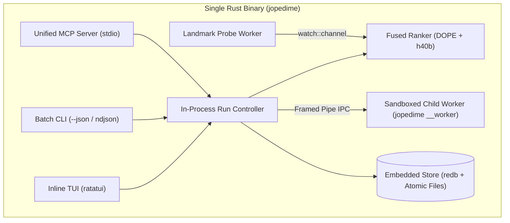

# JopeDime Production Release Engineering Specification (Enterprise MVP)

**Pinned DOPE inference, progressive landmark conditioning, native algorithm search, inline terminal experience, MCP, telemetry, and reproducible exports in a single Rust binary**

**Prepared for:** Jepson Taylor / VEOX  
**Audit date:** October 29, 2026  
**Document status:** Authoritative Enterprise MVP Implementation Specification grounded in the audited repository revisions below.  
**Design Philosophy:** *Brilliantly Simple, Enterprise-Solid.* 100% single-binary Rust runtime, zero external runtime dependencies, strict numerical and data-scope integrity, without distributed-systems bloat.  
**Intended readers:** Product owner, Rust and ML engineers, release engineers, and implementation agents.

---

## 1. Release Decision & Highest Priority Work

Build the production product around the existing `jopedime` Rust appliance and its native fitting, model-object, signing, objective, and prediction infrastructure. Add one shared, in-process **Run Controller** supported by transactional local persistence (`redb`) and same-executable worker sandboxes that serves the interactive terminal, batch CLI, and MCP. Preserve the existing typed program kernel and evidence machinery, while publishing a deliberately smaller, strongly-typed public description of each experiment.

### 1.1 The Immediate Engineering Blocker
The immediate blocker is the broken connection between the trained fused model and the actual algorithm search. The repository contains a new frozen-DOPE research flywheel (`h40b`), an older Rust policy architecture, optional landmark encodings, and an appliance with several unimplemented neural adapters. Currently, `crates/jope-pipeline/src/landmark_encoding.rs` writes companion encodings while preserving the original candidates and seeds. Changing a landmark receipt therefore does not yet change the proposed or ranked algorithms. [J03] [J05] [J07] [J18]

### 1.2 Production Dependency Order
Do not make the terminal UI the first integration project. A polished interface around disconnected paths conceals the core engineering risk. Execute in this strict order:

1. **Freeze the Serving Contract:** Select the exact trained `h40b` candidate-cost ranker architecture and package every weight, buffer, preprocessing rule, and landmark recipe into a signed, self-contained SafeTensors bundle.
2. **Execute the Ranker in Pure Rust:** Implement the exact `h40b` forward pass in Rust, establish layer-level numerical parity ($atol = 10^{-5}, rtol = 10^{-4}$), and prove zero Python/C++ runtime dependencies.
3. **Wire Landmarks to Live Search:** Connect progressive landmark snapshots via a lock-free watch channel directly into candidate slate ranking, proving causally that landmark updates shift candidate selection without altering fitness comparability.
4. **Unify Execution, Sandboxing & Persistence:** Build a single state machine backed by an embedded transactional store (`redb`), same-executable bounded worker processes for untrusted estimator evaluation, and atomic artifact publication.
5. **Expose the Product Surfaces:** Attach the inline `ratatui` terminal (`Viewport::Inline`), deterministic batch CLI (`--json` / `--events ndjson`), and unified MCP server (`2026-07-28` + `2025-11-25` handshake compatibility) to the Run Controller.
6. **Qualify the Single Binary:** Verify tasks, mask patterns, objectives, standalone code exports (Rust, Python, JS/TS), OS platforms, crash recovery, and clean-host offline execution.

### 1.3 Resolve the Meaning of "Inference-Only"
The distributed `jopedime` binary is **inference-only for the learned DOPE and Jope neural weights**. Those neural parameters are immutable during every user run. During discovery mode, the binary *does* search algorithm structures and fit candidate native estimators (e.g., linear/tree/kernel heads, calibration transforms) on the user's training split—this local fitting is required to evaluate algorithms and export a fitted predictor. [J16] [J20]

| Capability | Production Behavior |
| :--- | :--- |
| **DOPE neural parameter training** | Excluded from distributed runtime; weights are frozen and SHA-256 verified |
| **Jope fused ranker model training** | Excluded from distributed runtime; trained only in the offline flywheel |
| **Neural inference from verified SafeTensors** | Required in discovery mode; executes in-process in Rust |
| **Algorithm search & objective evaluation** | Required in discovery mode; strictly bounded by effort policy |
| **Native candidate fitting & calibration** | Allowed in discovery mode on FIT split only; strictly resource-bounded |
| **Prediction with a fitted `.jope` model** | Pure prediction mode (`jopedime predict`); never searches or refits |
| **Offline flywheel training** | Separate controlled research system consuming opt-in evidence records |

---

## 2. Audited Revisions & Architectural Findings

### 2.1 Audited Source Identities

| Item | Observed Identity | Architectural Meaning |
| :--- | :--- | :--- |
| **DOPE repository `main`** | `5c2e8df8e424c31087a4d8284231f17157319399` | DOPE source inspected for this specification [D00] |
| **JopeDime repository `main`** | `c1318a7b09b62ce12b78b4da892106c6f2d22b18` | JopeDime source inspected; includes frozen-DOPE fused flywheel merge [J00] |
| **Selected `dope-core` dependency** | `15e12aa3dc33851655580f6aa7c9c66353143f23` | Exact Git pin in `crates/jope-encoders/Cargo.toml` [J01] |
| **Expected DOPE weight SHA-256** | `d0b6960328d1955386632ff78b512e3add53a9b0256db7bbf067e2e0be5f0c6c` | Declared checkpoint hash in Rust loader (`dope_encoder.rs`) [J34] |
| **Latest public release** | `v0.4.1` (Oct 23, 2026) | Ships `jope` binary; does not yet ship the unified `jopedime` appliance [J15] |

### 2.2 Ten Critical Findings That Must Become Engineering Fixes

*   **F01 — Research and serving models are different architectures:** The new research loop (`h40b`) operates on frozen DOPE-derived $10 \times 32$ tokens with a downstream candidate-cost ranker (`adapter_10tok.predict_costs`). The existing Rust policy path (`jope_policy.rs`) uses an older Dope512/foundation1024/target512 assembly. We must implement the exact `h40b` ranker graph in Rust and reject mismatched bundles. [J05] [J07] [J17]
*   **F02 — Landmark sidecars do not condition search:** `crates/jope-pipeline/src/landmark_encoding.rs` runs companion workers but leaves search candidates and seeds unchanged. We must wire the live landmark snapshot directly into candidate slate ranking. [J03]
*   **F03 — Legacy `full` packaging profile is blocked:** `deploy/appliance/models.lock.json` records unavailable legacy neural adapters and un-redistributable foundation assets. We must create new, legally cleared `fused-cpu` and `fused-cuda` profiles. [J06] [J18]
*   **F04 — Research narration leaks GP internals:** Current narrator inspect/render paths (`v3.rs`, `facts.rs`) can expose generations, parent lineage, and GP trees. We must enforce redaction-by-construction using dedicated public DTOs. [J10] [J11] [J23]
*   **F05 — Fragmented MCP servers:** `jope-runtime/src/service.rs`, `jope-appliance/src/model.rs`, and `jope-observatory/src/narration/mcp.rs` maintain separate hand-written JSON-RPC loops with inconsistent initialization lifecycles. We must unify them into a single MCP server over the shared Run Controller. [J08] [J09] [J23]
*   **F06 — Process CPU utilization is miscalculated and clipped:** `crates/jope-telemetry/src/collectors.rs` divides process tick deltas by a single-core denominator and clips at `100.0`, causing 1 saturated thread on an 8-core machine to report `100%` node utilization instead of `12.5%` (`1.0` core equivalent). [J12]
*   **F07 — Custom fitness is not uniform across search modes:** Multi-round/kernel profiles currently reject custom objectives or fall back to default ranking. The Run Controller must enforce a single resolved `ObjectiveSpec` across all discovery stages. [J20]
*   **F08 — GPU presence does not mean all-GPU execution:** Candidate fitting and decoding remain on CPU even when DOPE runs on CUDA. Telemetry and preflight plans must report exact stage placement and host-device transfer overhead. [J02] [J07]
*   **F09 — Python freeze guard skips missing buffers:** `dope_freeze_guard.py` iterates over found buffers without asserting that all required normalization/SVD buffers exist before training starts. The exporter must enforce a strict, complete tensor manifest. [J04]
*   **F10 — Exported code drops calibration transforms:** Current source export (`fitted.rs`, `fitted_js.rs`) refuses or omits fitted output calibration transforms. Every advertised export target must emit the complete prediction function (preprocessing + estimator + calibration) or be excluded during preflight capability negotiation. [J14] [J24]

---

## 3. Core Architecture & Simplification Mandate

To deliver an **Enterprise MVP** without distributed-systems bloat, the architecture adheres to five structural simplifications:



### 3.1 Five-Digest Identity Model
Instead of tracking 12+ overlapping provenance hashes across every struct, all reproducibility and cache invalidation is governed by **five immutable digests**:

| Identity | Scope & Contents | Changes When |
| :--- | :--- | :--- |
| **`BundleDigest`** | Canonical SHA-256 of unsigned `manifest.json`, `dope.safetensors`, `jope.safetensors`, and normalization/SVD buffers. | Any neural weight, buffer, or graph hyperparameter changes. |
| **`ProblemDigest`** | Canonical SHA-256 of input dataset bytes, physical FIT/VAL/TEST split rosters, column roles, and `ObjectiveSpec`. | Input data, split boundaries, target column, or fitness formula changes. |
| **`ConditioningDigest`** | Canonical SHA-256 of the 23 landmark values, 23 validity mask bits, and recipe level (`none`, `observed`, `full`). | Progressive landmark probes complete and update the active conditioning tensor. |
| **`ModelDigest`** | Canonical SHA-256 of the executable algorithm structure, fitted parameter bytes, preprocessing state, and calibration transform. | A new candidate is fitted and validated. |
| **`RunId`** | ULID (lexicographically sortable, timestamp-encoded unique identifier) paired with a monotonic `u64` `revision` counter. | A new run is started or forked (`\restart`). |

### 3.2 Storage & Crash Consistency via `redb`
Do not build a custom filesystem transaction log or spawn background OS daemons (`serve --local`). All run state lives in a workspace directory (`.jopedime/` by default):
*   **Transactional Metadata (`state.redb`):** Pure-Rust, ACID-compliant embedded key-value store (`redb` is already in the workspace closure). Stores three tables:
    *   `runs`: `RunId -> RunRecord` (current state, resolved budget, RNG state, active `ConditioningDigest`, best `ModelDigest`, `revision`).
    *   `events`: `(RunId, u64_sequence) -> PublicEvent` (append-only durable event log for TUI/MCP replay).
    *   `idempotency`: `(RunId, String_Key) -> CommandOutcome` (prevents duplicate mutations on agent retries).
*   **Content-Addressed Artifacts (`artifacts/<sha256>.jope`):** Fitted models and exported source bundles are written to `.jopedime/tmp/<uuid>`, `fsync`ed, hash-verified, and atomically renamed (`std::fs::rename`) into `artifacts/` **before** the `redb` transaction updating `best_model` commits.

### 3.3 Same-Executable Worker Sandboxing
Candidate algorithms and matrix decompositions on malformed tables can trigger OOMs, panics, or non-cooperative infinite loops inside third-party math kernels. However, we must preserve the **single-binary** user experience.
*   The main `jopedime` process spawns a bounded pool of worker subprocesses using a hidden internal subcommand of its own binary: `jopedime __worker`.
*   Communication uses a simple length-prefixed `bincode`/`serde_json` pipe over `stdin`/`stdout`.
*   The parent enforces hard wall-clock timeouts and RSS memory caps per candidate batch. If a worker hangs or exceeds memory, the parent kills the process (`SIGKILL` / `TerminateProcess`), logs `CandidateFailed { reason: TimeoutOrOom }`, and spawns a fresh replacement worker without crashing the TUI or MCP server.

### 3.4 Cycle-Safe Crate Topology
Currently, `starforge` depends on `jope-runtime`. Putting neural inference directly inside `jope-runtime` while depending on `jope-encoders` would create a circular dependency. [J01]
*   **Resolution:** Define a lightweight trait `CandidateRanker` inside `jope-runtime`. Implement the concrete neural graph in `jope-encoders` (or `jope-inference`) and inject it into `jope-runtime::RunController` at startup in `jope-appliance/src/main.rs`.

---

## 4. Frozen DOPE & Fused Ranker Contract (`h40b`)

### 4.1 Exact Serving Architecture (`dope-fused-ranker/v1`)
The production v1.0 release standardizes on the **`h40b` frozen-DOPE candidate-cost ranker** (`adapter_10tok.predict_costs`). [J05]
1. **Input Preparation:** Fixed table preparation recipe (`dope-core` at `15e12aa3...`) extracts base dataset descriptors plus the 23-value / 23-mask landmark bundle from the authorized FIT scope. [J01] [D01]
2. **Frozen DOPE Encoder:** Produces the exact $10 \times 32$ token representation using frozen DOPE weights, stage1b projections, frozen anchor, SVD bases, and normalizers.
3. **Downstream Jope Ranker (`adapter_10tok`):** Consumes the $10 \times 32$ dataset context tokens alongside a batch of typed candidate structural feature vectors and outputs predicted scalar cost scores per candidate.
4. **Output Semantics:** The model outputs **candidate ranks/costs**, not autoregressive program tokens. Telemetry and UI must report `candidate_scores/sec` and never fabricate a neural token generation rate.

### 4.2 Self-Contained Fused Bundle Format
A model bundle is a signed directory or embedded archive containing:
*   `manifest.json`: Schema version, `BundleDigest`, architecture ID (`dope-fused-ranker/v1`), supported tasks, landmark recipe IDs, and redistribution license (`redistributable`).
*   `dope.safetensors`: Frozen DOPE encoder parameters and required normalization/SVD buffers.
*   `jope.safetensors`: Trained downstream `adapter_10tok` weights and candidate feature normalizers.
*   `golden_parity.safetensors`: Reference test fixture containing `{sample_table_features, sample_landmarks, sample_mask, sample_candidate_slate, expected_dope_tokens, expected_candidate_costs}`.

```json
{
  "schema": "jope.fused-bundle/v1",
  "bundle_digest": "<sha256-of-unsigned-manifest-and-safetensors>",
  "architecture": "dope-fused-ranker/v1",
  "dope_source_rev": "15e12aa3dc33851655580f6aa7c9c66353143f23",
  "dope_weights_sha256": "d0b6960328d1955386632ff78b512e3add53a9b0256db7bbf067e2e0be5f0c6c",
  "jope_weights_sha256": "<64-hex>",
  "surrogate_target_recipe": "normalized_validation_loss_v1",
  "trained_objectives": ["rmse", "mae", "huber", "pinball", "r2", "logloss", "brier"],
  "qualified_tasks": ["regression", "binary", "multiclass"],
  "qualified_backends": ["cpu-f32", "cuda-f32"],
  "asset_policy": "redistributable"
}
```

### 4.3 Hardened Freeze Guard & Loader Verification
*   **Python Export Gate (Fixes F09):** Update `dope_freeze_guard.py` so baseline capture explicitly asserts the presence, exact shape, and `dtype` of every required parameter *and* buffer in a mandatory manifest list before training starts. Missing buffers fail immediately. [J04]
*   **Rust Loader Gate:** Before allocating tensor memory, the Rust loader validates file byte caps, verifies SHA-256 digests against `manifest.json`, checks every tensor name/shape/dtype, and scans loaded floats to reject any `NaN` or `Inf` weight/buffer values. [E01]

### 4.4 Numerical Parity & Residency Gates
*   **CPU FP32 Parity:** Against `golden_parity.safetensors`, intermediate DOPE $10 \times 32$ tokens and final candidate cost scores must agree within $atol = 10^{-5}$ and $rtol = 10^{-4}$.
*   **Decision Parity:** Candidate slate ordering must match 100% outside a preregistered near-tie band ($\Delta \text{cost} < 10^{-6}$).
*   **Residency:** Load the bundle once per process into an immutable `Arc<FusedRankerSession>`. Base dataset descriptors remain cached in memory across landmark updates.

---

## 5. Progressive Landmark Conditioning & Live Search Bridge

### 5.1 Explicit Missingness Contract
Preserve the `dope-core` `LandmarkBundle` representation: 23 finite `f32` values paired with 23 boolean validity bits (`mask`). [D01]
*   A measured `0.0` (`value = 0.0, mask = true`) is strictly distinct from an unmeasured/failed probe (`value = 0.0, mask = false`).
*   No `NaN` or `Inf` values may enter conditioning tensors or JSON payloads.
*   Distinguish `observed` partial conditioning (subsets of the 23 probes) from the `full` native report recipe; "all 23 mask bits true" has a distinct `ConditioningDigest` from the `full` report recipe. [D02] [J02]

### 5.2 Lock-Free Watch Channel Architecture (Fixes F02)
Replace the disconnected companion sidecars in `crates/jope-pipeline/src/landmark_encoding.rs` with a live `tokio::sync::watch::channel<Arc<ConditioningSnapshot>>`:

```rust
pub struct ConditioningSnapshot {
    pub conditioning_digest: String,
    pub revision: u32,
    pub mode: LandmarkMode, // None, Progressive, Full
    pub values: [f32; 23],
    pub mask: [bool; 23],
    pub dope_tokens_10x32: Tensor, // Pre-computed for this snapshot
}
```

1. **Immediate Start (`revision = 0`):** On run start, the controller computes the base table descriptors (`mask = [false; 23]`), runs the fast DOPE forward pass to get initial `dope_tokens_10x32`, publishes `revision = 0` to the watch channel, and immediately begins Batch 1 candidate ranking and evaluation.
2. **Progressive Probes (`revision = 1..K`):** A single background landmark worker thread (capped at 1 CPU core so it never starves candidate evaluation) executes staged probes on the authorized FIT sample (default 300 rows, deterministic seed). [J02]
3. **Atomic Batch Binding:** At the start of each search batch, the `RunController` clones the latest `Arc<ConditioningSnapshot>` from the watch channel. The `CandidateRanker` scores the proposed slate using that snapshot's `dope_tokens_10x32`. Every candidate evaluated in that batch records `proposed_under_conditioning_digest` in its audit record.
4. **Score Comparability Invariant:** Landmark updates only change **which candidates are proposed/ranked next**. They never interrupt an in-flight candidate fit and never alter the validation objective score. Candidate A (proposed under `rev 0`) and Candidate B (proposed under `rev 2`) are compared strictly on their measured validation loss on the identical validation split.

---

## 6. Run Lifecycle, Effort Policies & Custom Objectives

### 6.1 Discovery Effort Policies
Effort is a deterministic, conjunctive resource cap (stops when the first limit is hit):

| Effort | Discovery Behavior | Wall Budget | Max Evaluations | Default Landmarks |
| :--- | :--- | :--- | :--- | :--- |
| **`fast`** | Single fused slate ranking; deterministic top-K fit; no iterative mutation | 5 s | 4 candidates | `none` |
| **`medium`** | Bounded iterative search over ranked slates | 60 s | 64 candidates | `progressive` |
| **`high`** | Multi-stage search with cross-validation finalist verification | 300 s | 512 candidates | `progressive` |
| **`ultra`** | Extended search with full conditioning and ensemble/calibration checks | 1,800 s | 4,096 candidates | `full` |

*   **Live Effort Adjustments:** Executing `\effort high` (or MCP `run_control`) updates the active budget ceiling in `state.redb` and increments `run.revision` without aborting in-flight worker evaluations. Reducing effort below already-consumed work stops new batch scheduling and finalizes the current best validated model.

### 6.2 Streamlined 6-State Machine
Every run in `state.redb` exists in one of six durable states:

| State | Meaning | Valid Transitions |
| :--- | :--- | :--- |
| **`Validating`** | Preflight checks on dataset, split, objective, bundle, and target languages | `Running`, `Failed`, `Cancelled` |
| **`Running`** | Active discovery; carries `phase` (`Preparing`, `Ranking`, `Evaluating`, `Finalizing`) | `Pausing`, `Completed`, `Failed`, `Cancelled` |
| **`Pausing`** | Drain signal sent; waiting for current bounded worker evaluation to finish and commit | `Paused`, `Cancelled`, `Failed` |
| **`Paused`** | Quiescent; RNG state, completed observations, and remaining budget committed to `redb` | `Running`, `Cancelled` |
| **`Completed`** | Budget reached or converged; carries `completion_reason` and `best_model: Option<ModelDigest>` | Terminal (use `\restart` to fork) |
| **`Cancelled` / `Failed`** | User stopped or unrecoverable error; retains last valid `best_model` if one was committed | Terminal (use `\restart` to fork) |

*   **Crash Recovery:** If the binary starts and sees a run in `Validating`, `Running`, or `Pausing` with no active OS file lock on `.jopedime/lock`, it automatically rolls back any uncommitted temp files, transitions the run to `Paused` (with `interrupted_recovery = true`), and allows immediate `\continue`.

### 6.3 Unified Custom Objectives & Surrogate Compatibility (Fixes F07)
Reuse the bounded JSON expression DSL in `crates/jope-runtime/src/fitness.rs` across **all** discovery modes: [J20] [J26]
*   **Supported Tasks & Built-ins:**
    *   *Regression:* `rmse`, `mae`, `medae`, `huber`, `pinball` (quantile), `r2`, `mape`, plus custom row expressions.
    *   *Binary & Multiclass Classification:* `logloss` (cross-entropy), `brier`, `roc_auc`, `pr_auc`, `f1`, `balanced_accuracy`, and cost-matrix weighted loss (operating on calibrated probabilities, never raw uncalibrated logits).
*   **Selection vs. Fitting Loss Disclosure:** Preflight (`run_plan`) explicitly labels whether an estimator natively optimizes the objective during fitting or uses standard fitting followed by objective-guided selection and post-hoc output calibration (`crates/jope-runtime/src/calibration.rs`).
*   **Surrogate Mismatch Guard:** The `h40b` cost head is trained on `surrogate_target_recipe`. If a user supplies a custom objective outside `trained_objectives` (e.g., an asymmetric domain-specific financial penalty), the ranker is used strictly as a structural diversity prior (top-K slate admission), while actual selection and elitism are driven 100% by the user's measured custom objective.
*   **Leakage & Temporal Guards:** Preprocessing and output calibration are fit strictly inside each inner training fold. Grouped splits never cross group boundaries; temporal splits enforce chronological forward validation. The sealed `TEST` split is never touched by landmark probes, ranking, or calibration.

---

## 7. Faithful Target Languages & Atomic Exports (Fixes F10)

### 7.1 Three Distinct Export Artifacts
1. **`model` (`.jope` object):** Content-addressed portable binary containing preprocessing state, fitted estimator parameters, output calibration transform, class maps, and schema metadata.
2. **`source` (Standalone Predictor Code):** Zero-dependency source code containing the complete mathematical prediction function: **feature normalization/encoding + fitted estimator math + output calibration transform**.
3. **`bundle` (Directory Package):** Atomic directory containing `manifest.json`, `model.jope`, standalone source files for all requested languages, and a `parity_receipt.json` verification report.

### 7.2 Production Language Matrix (v1.0)
Rather than advertising 11 partially implemented targets, v1.0 qualifies **four faithful standalone source targets**:

| Target | Output Artifact | Qualification Requirement |
| :--- | :--- | :--- |
| **`rust`** | `predictor.rs` (zero external crates required for pure math inference) | Compiles with `rustc` in CI; predictions match `.jope` within $10^{-5}$ |
| **`python`** | `predictor.py` (stdlib `math` + optional `numpy` vectorization) | Executes in Python 3.11+; predictions match `.jope` within $10^{-5}$ |
| **`javascript`** | `predictor.mjs` (ES2022 module, IEEE-754 finite math) | Executes in Node/V8; predictions match `.jope` within $10^{-5}$ |
| **`typescript`** | `predictor.ts` + `.d.ts` (strictly typed input record and output interfaces) | Passes `tsc --strict`; runtime matches `javascript` |

*(C++17, Go, Wasm, and CUDA kernel exports remain gated behind `--experimental-languages` until their calibration and categorical-encoding emitters pass full numerical parity).*

### 7.3 Preflight Capability Intersection & Retained-Data Disclosure
*   **Constraint Before Search:** When a user specifies `--languages rust,python,typescript --require-all-languages`, the `RunController` filters the candidate estimator space *before search begins* to the exact intersection of operators, heads, and calibration transforms supported by all requested emitters.
*   **Self-Verification Before Publish:** During `\export`, the Rust runtime runs its internal AST/bytecode verifier (evaluating the generated source representation on 32 synthetic boundary/validation rows—including missing values, unknown categories, and extreme floats) and asserts numerical parity against the native `.jope` model before atomically renaming the export directory into place.
*   **Retained Support Data Warning:** Estimators that retain training rows (e.g., Gaussian Processes, Nadaraya-Watson kernel smoothers) set `"retains_training_data": true` in `manifest.json` and print a preflight notice in `export_plan`. [J14]

---

## 8. Public Reasoning, Telemetry & Resource Governance

### 8.1 Redaction-by-Construction Reasoning (`jope.reasoning/v1`)
Maintain the rich internal `jope-narrator` fact/delta journal for offline analysis, but project all user- and agent-visible commentary through a dedicated `PublicReasoningEvent` Rust struct that physically lacks fields for GP trees, parent node IDs, crossover/mutation names, or population indices. [J10] [J11]

```json
{
  "schema": "jope.reasoning/v1",
  "run_id": "01JBD8...",
  "sequence": "42",
  "algorithm_id": "alg_0012",
  "stage": "measured_comparison",
  "summary": "Added L2 regularization and switched to a Huber loss calibration; validation RMSE improved from 0.4210 to 0.4082 across all 5 folds.",
  "evidence": {
    "metric": "rmse",
    "before": 0.4210,
    "after": 0.4082,
    "split_scope": "validation_5fold",
    "conditioning_digest": "a8f9...",
    "comparable": true
  }
}
```
*   **Strict Claim Honesty:** Hypotheses ("Testing feature interaction terms...") are emitted before evaluation; comparative claims ("Validation error decreased...") are emitted *only* when `ProblemDigest` and `ObjectiveSpec` match.

### 8.2 Accurate Telemetry & Corrected CPU Math (Fixes F06)
Fix `crates/jope-telemetry/src/collectors.rs` so CPU utilization is never mislabeled or artificially clipped at 100%: [J12]
$$\text{cpu\_core\_equivalents} = \frac{\Delta \text{CPU\_seconds}_{\text{main} + \text{workers}}}{\Delta \text{monotonic\_wall\_seconds}}$$
$$\text{cpu\_host\_percent} = 100.0 \times \frac{\text{cpu\_core\_equivalents}}{\text{logical\_host\_cores}}$$
$$\text{cpu\_quota\_percent} = 100.0 \times \frac{\text{cpu\_core\_equivalents}}{\text{cgroup\_or\_affinity\_allowed\_cores}}$$
*   On an 8-core host, 1 saturated thread reports `1.00 cores` and `12.5% host`. 4 saturated threads report `4.00 cores` and `50.0% host`.
*   **Honest Throughput Units:** Report `candidate_scores/sec` (neural ranker throughput), `evaluations/sec` (fitted models validated per second), `code_tokens/sec` (lexical tokens emitted in source previews), and `predict_rows/sec`. Never report `neural_tokens/sec` for a non-autoregressive ranker. [J05] [J13]
*   **GPU Sensor Scope:** Bind NVML metrics by device UUID, distinguish device-wide utilization from process VRAM allocation, and report `availability: "unavailable"` (`null`, never `0.0`) when sensors are absent or permissions are denied. [E02]

### 8.3 Proactive Resource Governor
Enforce preflight and continuous caps on RAM, VRAM, worker thread pools (initializing Rayon/BLAS pools once at startup), and disk space. Reserve a 50 MiB emergency disk buffer; if available space drops below the reserve (`DISK_LOW`), pause optional landmark probes and halt new candidate generation while preserving the last committed `state.redb` transaction.

---

## 9. Human Terminal Experience (`Viewport::Inline`)

### 9.1 Inline Agentic CLI Design
Launching `jopedime` in an interactive TTY opens a `ratatui` inline session (`Viewport::Inline`, 8–12 lines high at the bottom of the terminal). [E03]
*   **Preserves Native Scrollback:** Accepted algorithms, reasoning summaries, preflight plans, and warnings scroll naturally into the terminal's native scrollback buffer above the viewport so the user can scroll, copy-paste code, and use standard terminal search.
*   **Live Bottom Viewport:** Contains a 1-line status bar (State, Effort, Elapsed/Remaining, Best Metric, CPU Cores, RAM/VRAM, Evals/s), a collapsible 4-line live candidate/code preview, and a multi-line grapheme-aware command composer with tab-completion.
*   **Accessibility & Fallbacks:** Respects `NO_COLOR`, `TERM=dumb`, and narrow widths (down to 40 columns). Restores raw mode and cursor visibility on normal exit, errors, panics (`std::panic::set_hook`), and `SIGINT`/`SIGTERM`.

### 9.2 Canonical Backslash Command Grammar
Support literal backslash commands (`\command`) with `/` accepted as a silent alias. Tab completion is driven directly from the shared command schema registry:

| Command | Action |
| :--- | :--- |
| `\open <PATH> --target <COL> [--task <TASK>]` | Register dataset, validate schema, and display preflight plan |
| `\objective <BUILTIN_OR_JSON>` | Set or preview fitness objective (`\fitness` alias supported) |
| `\effort <fast\|medium\|high\|ultra>` | Set discovery budget before or during a run |
| `\landmarks <none\|progressive\|full>` | Set landmark conditioning policy |
| `\language <rust,python,javascript,typescript>` | Set required export languages (constrains search admission) |
| `\run` | Start discovery using the current preflight plan |
| `\pause` / `\continue` / `\cancel` | Pause at safe boundary, resume from `redb`, or stop and keep best |
| `\restart [--same-seed\|--new-seed]` | Fork a new run from the current plan |
| `\status` / `\metrics` / `\reasoning <off\|concise\|detailed>` | Inspect run state, hardware sensors, or toggle commentary |
| `\code [LANG] [--revision <ALG_ID>]` / `\diff` | Print full standalone code or diff between accepted revisions |
| `\export --kind <model\|source\|bundle> --out <DIR>` | Verify and atomically export the best (or specified) model |
| `\predict --model <PATH> --input <CSV> --out <CSV>` | Execute pure batch prediction |
| `\runs` / `\resume <RUN_ID>` | List historical workspace runs in `state.redb` or attach to one |
| `\doctor` / `\help` / `\quit` | Run system/bundle diagnostics, show help, or checkpoint and exit |

*   **Ctrl-C Semantics:** If composer text is non-empty, `Ctrl-C` clears the input line. If composer is empty during an active run, first `Ctrl-C` requests a safe `\pause`; a second `Ctrl-C` within 2 seconds triggers immediate `\cancel` and terminates child workers.

---

## 10. Batch CLI & Unified MCP Server

### 10.1 Deterministic Batch CLI
Non-interactive automation (`--json` or `--events ndjson`) never initializes `ratatui` and never prompts on `stdin`.

```bash
# Full discovery run streaming newline-delimited PublicEvents
jopedime run \
  --train data/train.csv --target price --task regression \
  --effort medium --landmarks progressive \
  --objective rmse --languages rust,python \
  --events ndjson

# Export verified multi-language bundle
jopedime export --run 01JBD8... --kind bundle --out ./dist_model --json

# Pure prediction mode
jopedime predict --model ./dist_model/model.jope --input data/test.csv --output preds.csv
```
*   **Preserved Exit Codes:** `0` Success, `2` Invalid Input/Schema, `3` Integrity/Bundle Mismatch, `4` Backend Unavailable, `5` Budget Exhausted with No Valid Model, `6` Numerical Domain Failure, `7` I/O or Export Failure. [J16]

### 10.2 Unified MCP Server (`jopedime mcp`) (Fixes F05)
Replace the three fragmented MCP dispatchers with **one asynchronous `stdio` server** built on the official Rust MCP SDK (`rmcp`) talking directly to the `RunController`. [E05] [E06]
*   **Dual Handshake Compatibility:** Supports the stateless `2026-07-28` specification (`server/discover` and per-request `_meta`) *and* the `2025-11-25` `initialize` / `notifications/initialized` handshake so existing hosts (Claude Desktop, Claude Code, Cursor, Gemini CLI, Zed) connect out-of-the-box. [E04]
*   **Strict `stdio` Purity:** Only valid UTF-8 JSON-RPC 2.0 messages are written to `stdout`. All diagnostics go to bounded logs or `stderr`. The JSON-RPC reader/writer runs on an independent async task so long candidate fits never block `run_status` or `run_control(cancel)`.

### 10.3 Consolidated 10-Tool MCP Catalog
Instead of 22 micro-tools, expose **10 strongly-typed, high-leverage tools** with JSON Schema validation and `structuredContent` responses:

| Tool Name | Input Summary | Output / Behavior |
| :--- | :--- | :--- |
| **`system_capabilities`** | `{ include_health?: bool }` | Supported tasks, languages, bundles, hardware sensors, and active warnings (`\doctor` parity) |
| **`dataset_register`** | `{ path, target, task?, roles? }` | Validates file within workspace scope; returns immutable `ProblemDigest` & column summary |
| **`objective_validate`** | `{ spec, problem_digest }` | Validates built-in or custom JSON DSL formula; returns `ObjectiveSpec` digest & capabilities |
| **`run_plan`** | `{ problem_digest, effort, languages, landmarks?, objective? }` | Returns preflight plan, resource estimates, and language capability intersection |
| **`run_start`** | `{ plan_digest, idempotency_key }` | Commits new run in `state.redb` and starts non-blocking execution; returns `run_id` & snapshot |
| **`run_control`** | `{ run_id, action: "pause"\|"resume"\|"cancel"\|"restart"\|"set_effort", effort?, expected_revision?, idempotency_key }` | Mutates run lifecycle atomically; returns updated snapshot and `revision` |
| **`run_status`** | `{ run_id?, list_all?: bool }` | Returns current `RunSnapshot` (or list of runs), active warnings, and `event_watermark` (`u64`) |
| **`run_events_read`** | `{ run_id, after_sequence: string, limit?: u32 }` | Cursor-paginated replay of `PublicEvent`s (reasoning, improvements, metrics) from `state.redb` |
| **`model_export`** | `{ run_id, algorithm_id?, kind: "model"\|"source"\|"bundle", languages, out_dir, idempotency_key }` | Verifies parity and atomically writes artifacts; returns manifest and file hashes (never dumps MBs of raw weights into JSON) |
| **`model_predict`** | `{ model_path, input_path, output_path, idempotency_key }` | Runs bounded streaming prediction; returns row count, timing, and output file hash |

*   **MCP Resources:** Expose `jope://runs/{run_id}/status`, `jope://runs/{run_id}/code/{language}`, and `jope://artifacts/{model_digest}/manifest` for direct host inspection.

---

## 11. Single-Binary Packaging, Distribution & Offline Flywheel

### 11.1 Cleared Release Profiles (Fixes F03)
Retire the blocked legacy `full` profile and ship two clean, redistributable appliance profiles: [J06]
1. **`fused-cpu` (Default Single Binary):** Embeds the verified `dope.safetensors` and `jope.safetensors` (`h40b`) directly into the compiled binary payload via `deploy/appliance/build.sh` (using aligned read-only section mapping). Zero external runtime dependencies beyond standard OS libc (`glibc >= 2.31` on Linux, macOS `13+` arm64, Windows 10+ x86_64).
2. **`fused-cuda` (Optional Accelerator Binary):** Same public contract with CUDA graph execution enabled; requires host NVIDIA driver and declared CUDA runtime libraries, verified by `jopedime doctor`. Automatically falls back to `cpu-f32` in `--device auto` mode if no compatible GPU is present.
*   **Strict Dependency Hygiene:** Remove unused C/C++ transitive dependencies (such as `onig_sys` from legacy tokenizers) from the appliance build closure so `fused-cpu` is 100% pure Rust. [J29]

### 11.2 Offline Flywheel Boundary
*   Local runs record candidate evaluations in `state.redb`. Remote telemetry/upload is **strictly off by default**.
*   Users who wish to contribute to offline flywheel training can explicitly run `jopedime export-feedback --run <ID> --out feedback.jsonl` (which exports dataset family hashes, conditioning masks, candidate structures, and validation losses—including failed/rejected trials to prevent selection bias—without exporting raw user data rows).
*   Offline Python training updates `jope.safetensors` while keeping `dope.safetensors` frozen, passes the paired bootstrap promotion ratchet on held-out dataset cohorts, and publishes a new signed `BundleDigest` in the next release.

---

## 12. Comprehensive Qualification & Release Test Matrix

Every release candidate must produce a signed `qualification_receipt.json` proving that the **exact compiled binary** passes these 28 integration gates:

| ID | Category | Test Case & Failure Mode Covered | Pass Criterion |
| :--- | :--- | :--- | :--- |
| **M01** | Model & Parity | Python freeze guard & missing buffer check (F09) | Exporter fails immediately if any required DOPE weight or SVD/norm buffer is absent or mutated |
| **M02** | Model & Parity | Rust `h40b` layer & cost parity (F01) | CPU FP32 matches `golden_parity.safetensors` within $atol=10^{-5}, rtol=10^{-4}$; 100% rank agreement outside $10^{-6}$ tie band |
| **M03** | Model & Parity | Corrupt / NaN / oversized SafeTensors bundle | Loader rejects corrupt headers, mismatched SHA-256, or injected `NaN` weights before allocation with exit code `3` |
| **L01** | Landmarks | Measured zero (`0.0, true`) vs. missing (`0.0, false`) | Distinct `ConditioningDigest`s and distinct DOPE $10 \times 32$ token outputs |
| **L02** | Landmarks | Causal search conditioning proof (F02) | Updating a single landmark value in the controlled test fixture changes the top-ranked candidate admitted to evaluation |
| **L03** | Landmarks | Mid-run progressive update comparability | Landmark update from `rev 0` to `rev 2` reranks next slate without interrupting active evaluation or altering validation scores |
| **L04** | Landmarks | Strict FIT-scope isolation | Landmark probes fail hard if passed validation or sealed test row indices |
| **F01** | Objectives | Cross-surface objective parity (F07) | Built-in and custom JSON DSL objectives produce identical losses and candidate selections across TUI, CLI, and MCP |
| **F02** | Objectives | Surrogate mismatch protection | Custom objective outside `trained_objectives` disables cost-head elitism and selects strictly by measured custom fitness |
| **F03** | Objectives | Temporal & grouped split leakage check | Preprocessing, landmarks, and calibration fit strictly within inner training folds; zero group/time bleed |
| **R01** | Lifecycle | Pause, persist, process exit, and `\continue` | Resumed run in a new OS process restores `state.redb` RNG and budget, finishing with the exact same champion as an uninterrupted run |
| **R02** | Lifecycle | Crash consistency at artifact publish boundary | `SIGKILL` injected before/after `fsync` leaves zero partial artifacts; next startup recovers cleanly to `Paused` |
| **R03** | Lifecycle | Worker sandbox timeout & OOM recovery | Synthetic infinite-loop/OOM candidate is killed by parent within 2s; run logs candidate failure and completes normally |
| **R04** | Lifecycle | Idempotent command retry & `expected_revision` | Repeating `run_start` or `run_control` with the same `idempotency_key` returns cached outcome; stale revision returns conflict error |
| **E01** | Exports | Multi-language preflight intersection | Requesting `--languages rust,python,typescript` excludes unsupported heads before search begins |
| **E02** | Exports | End-to-end prediction & calibration parity (F10) | Exported Rust, Python, JS, and TS standalone predictors match native `.jope` predictions within $10^{-5}$ on boundary/missing/calibrated test rows |
| **E03** | Exports | Path traversal & atomic bundle publication | Symlink escapes and `../` paths are rejected; simulated single-language emitter failure aborts bundle publication atomically |
| **N01** | Narration | GP abstraction & sentinel redaction (F04) | Public events and errors contain zero GP terms (`mutation`, `crossover`, `genome`, parent IDs); enforced via distinct Rust DTOs |
| **N02** | Narration | Evidence-grounded claim check | Improvement summary is emitted only when `ProblemDigest`, split, and `ObjectiveSpec` match |
| **T01** | Telemetry | CPU denominator & cgroup quota math (F06) | Synthetic 1-thread load on 8-core fixture reports `1.0` core equivalent and `12.5%` host CPU (never clipped at 100%) |
| **T02** | Telemetry | Honest ranker throughput & null GPU sensors | Reports `candidate_scores/sec` (`neural_tokens/sec` is null/absent); missing NVML reports `null` availability without crashing |
| **T03** | Telemetry | Fixed-work observer overhead | Default telemetry and narration add $< 2\%$ wall-time overhead and zero perturbation to search RNG |
| **U01** | Terminal UI | Live typing under high-frequency event load | PTY test: typing a backslash command while 50 events/s stream in preserves cursor position, draft text, and tab completion |
| **U02** | Terminal UI | Panic & signal terminal restoration | Simulated panic and `SIGINT` restore raw mode and cursor visibility cleanly in Linux, macOS, and Windows ConPTY |
| **P01** | MCP | Dual-version handshake & `stdio` purity (F05) | Passes `2026-07-28` (`server/discover`) and `2025-11-25` (`initialize`) conformance; zero non-JSON bytes on `stdout` |
| **P02** | MCP | Non-blocking control & cursor replay | Calling `run_status`, `run_events_read`, and `run_control(cancel)` responds in $< 100\text{ ms}$ p95 while worker is fitting |
| **D01** | Distribution | Clean-host offline execution | Single `jopedime` binary executes discovery, export, and prediction inside a network-disabled container with no Python, `rustc`, or C++ compiler installed |
| **Q01** | Quality | Equal-budget benchmark vs. unguided baseline | On held-out regression/classification cohort, `h40b` conditioned ranking achieves superior validation utility or faster time-to-quality at equal wall budget |

---

## 13. Consolidated 6-PR Execution Plan & File Map

To respect the repository's **one-implementation-PR-at-a-time** rule without suffering 20 separate handoff cycles, execution is structured into **6 vertical, self-contained PRs**. [J30]

| PR | Title & Scope | Primary Files Modified / Added | Exit Gate Tests |
| :--- | :--- | :--- | :--- |
| **PR 1** | **Golden Exporter & Pure-Rust `h40b` Ranker**<br>Fix `dope_freeze_guard.py`, export `h40b` bundle + `golden_parity.safetensors`, implement cycle-safe `FusedRanker` in Rust, and add strict loader verification. | `python/src/jope/north_star/dope_freeze_guard.py`<br>`research/flywheel_selfplay/export_fused_bundle.py` *(new)*<br>`crates/jope-encoders/src/fused_ranker.rs` *(new)*<br>`crates/jope-runtime/src/ranker_trait.rs` *(new)* | **M01, M02, M03** |
| **PR 2** | **Live Landmark Conditioning & Unified Objective Bridge**<br>Replace companion-only sidecar with `watch::channel<Arc<ConditioningSnapshot>>`, connect to candidate slate ranking, and enforce `ObjectiveSpec` + surrogate mismatch guard across all search rounds. | `crates/jope-pipeline/src/landmark_encoding.rs`<br>`crates/jope-pipeline/src/run.rs`<br>`crates/jope-runtime/src/fitness.rs`<br>`crates/jope-runtime/src/calibration.rs` | **L01, L02, L03, L04, F01, F02, F03, Q01** |
| **PR 3** | **Transactional Run Controller, Worker Sandbox & Telemetry**<br>Implement 6-state `RunController` backed by `state.redb`, `jopedime __worker` subprocess sandbox, Public Reasoning DTOs, and fixed CPU/GPU telemetry math. | `crates/jope-runtime/src/controller/` *(new)*<br>`crates/jope-runtime/src/store_redb.rs` *(new)*<br>`crates/jope-runtime/src/public_events.rs` *(new)*<br>`crates/jope-telemetry/src/collectors.rs`<br>`crates/jope-narrator/src/public_projection.rs` *(new)* | **R01, R02, R03, R04, N01, N02, T01, T02, T03** |
| **PR 4** | **Faithful Standalone Code Exports (Rust, Python, JS/TS)**<br>Add language capability registry, preflight search constraint, calibration-preserving code emitters, and internal numerical parity self-check on export. | `crates/jope-runtime/src/fitted.rs`<br>`crates/jope-runtime/src/fitted_js.rs`<br>`crates/jope-runtime/src/export_bundle.rs` *(new)* | **E01, E02, E03** |
| **PR 5** | **Inline Terminal (`Viewport::Inline`) & Deterministic Batch CLI**<br>Build `ratatui` inline session, backslash command parser/completer, terminal panic/signal restoration hooks, and `--json` / `--events ndjson` batch output. | `crates/jope-appliance/src/terminal/` *(new)*<br>`crates/jope-appliance/src/cli.rs`<br>`crates/jope-appliance/src/main.rs` | **U01, U02** |
| **PR 6** | **Unified MCP Server & Single-Binary Release Qualification**<br>Consolidate MCP into one `rmcp` `stdio` server (10 tools, dual handshake), create `fused-cpu` / `fused-cuda` profiles, strip `onig_sys`, and run clean-host container gates. | `crates/jope-appliance/src/mcp.rs` *(new)*<br>`deploy/appliance/models.lock.json`<br>`deploy/appliance/profiles/fused-cpu.toml` *(new)*<br>`deploy/appliance/build.sh` | **P01, P02, D01** + Final `qualification_receipt.json` |

---

## 14. References & Pinned Source Map

*   **D00–D05 (DOPE):** [Audited DOPE Revision `5c2e8df8`](https://github.com/neverhuman/dope/tree/5c2e8df8e424c31087a4d8284231f17157319399) | [LandmarkBundle Contract](https://github.com/neverhuman/dope/blob/5c2e8df8e424c31087a4d8284231f17157319399/engine/dope-core/src/landmark/bundle.rs) | [Conditioning Recipes](https://github.com/neverhuman/dope/blob/5c2e8df8e424c31087a4d8284231f17157319399/engine/dope-core/src/prepare/conditioning.rs) | [Data Contract](https://github.com/neverhuman/dope/blob/5c2e8df8e424c31087a4d8284231f17157319399/docs/data-contract.md)
*   **J00–J34 (JopeDime):** [Audited JopeDime Revision `c1318a7b`](https://github.com/neverhuman/JopeDime/tree/c1318a7b09b62ce12b78b4da892106c6f2d22b18) | [Encoder Cargo Pin (`J01`)](https://github.com/neverhuman/JopeDime/blob/c1318a7b09b62ce12b78b4da892106c6f2d22b18/crates/jope-encoders/Cargo.toml) | [Landmark Sidecar (`J03`)](https://github.com/neverhuman/JopeDime/blob/c1318a7b09b62ce12b78b4da892106c6f2d22b18/crates/jope-pipeline/src/landmark_encoding.rs) | [Freeze Guard (`J04`)](https://github.com/neverhuman/JopeDime/blob/c1318a7b09b62ce12b78b4da892106c6f2d22b18/python/src/jope/north_star/dope_freeze_guard.py) | [Fused Closed-Loop (`J05`)](https://github.com/neverhuman/JopeDime/blob/c1318a7b09b62ce12b78b4da892106c6f2d22b18/research/flywheel_selfplay/run_fused_closed_loop.py) | [Models Lock (`J06`)](https://github.com/neverhuman/JopeDime/blob/c1318a7b09b62ce12b78b4da892106c6f2d22b18/deploy/appliance/models.lock.json) | [Telemetry Collectors (`J12`)](https://github.com/neverhuman/JopeDime/blob/c1318a7b09b62ce12b78b4da892106c6f2d22b18/crates/jope-telemetry/src/collectors.rs) | [Fitted Export (`J14`)](https://github.com/neverhuman/JopeDime/blob/c1318a7b09b62ce12b78b4da892106c6f2d22b18/crates/jope-runtime/src/fitted.rs) | [Agent Coordination (`J30`)](https://github.com/neverhuman/JopeDime/blob/c1318a7b09b62ce12b78b4da892106c6f2d22b18/AGENTS.md)
*   **E01–E11 (External Standards):** [SafeTensors Spec](https://github.com/safetensors/safetensors) | [NVML Utilization API](https://docs.nvidia.com/deploy/nvml-api/latest/api/structnvmlUtilization__t.html) | [Ratatui Inline Viewport](https://ratatui.rs/examples/apps/inline/) | [MCP 2026-07-28 Spec](https://modelcontextprotocol.io/specification/2026-07-28/basic/versioning) | [Official MCP Rust SDK (`rmcp`)](https://github.com/modelcontextprotocol/rust-sdk)