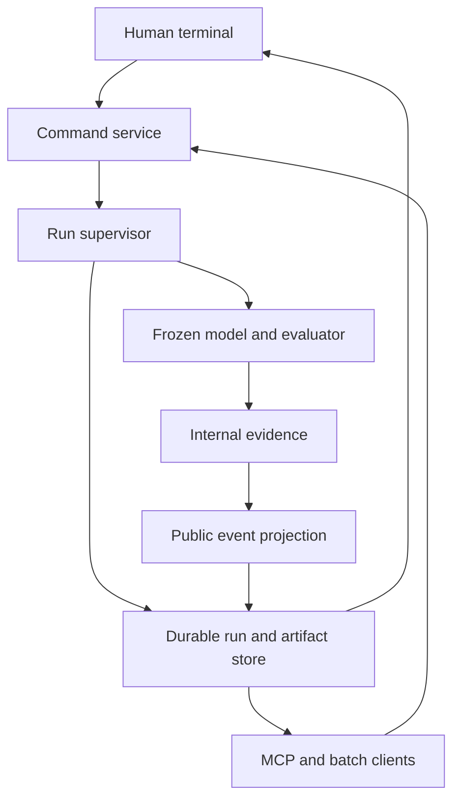
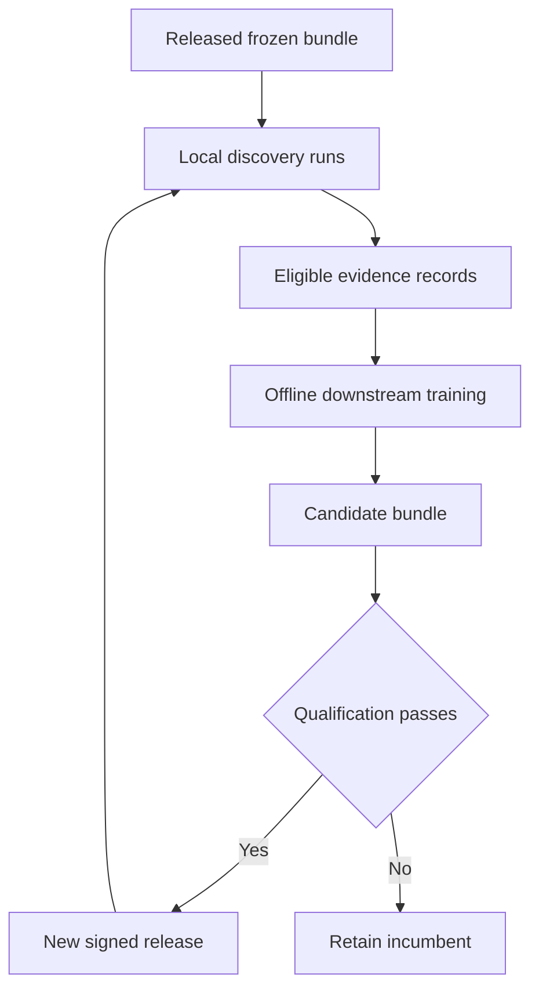

# JopeDime Production Release Engineering Specification

**Pinned DOPE inference, progressive landmark conditioning, native algorithm search, terminal experience, MCP, telemetry, and reproducible exports**

**Prepared for:** Jepson Taylor / VEOX  
**Audit date:** October 29, 2026  
**Document status:** Implementation specification grounded in the repository revisions below. Requirements and numerical release gates in this document are proposed release criteria, not claims that the current binaries pass them.  
**Intended readers:** Product owner, Rust and ML engineers, release engineers, and implementation agents.

## 1. Release decision and highest priority work

Build the production product around the existing `jopedime` Rust appliance and its native fitting, model-object, signing, objective, and prediction infrastructure. Add one shared run controller that serves the terminal, batch CLI, and MCP. Preserve the existing typed program kernel and evidence machinery, while publishing a deliberately smaller, user-facing description of each experiment.

The immediate blocker is the connection between the trained fused model and the actual algorithm search. The repository contains a new frozen-DOPE research flywheel, a different Rust policy architecture, optional landmark encodings, and an appliance with several unimplemented neural adapters. Those are valuable components, but they do not establish a released, end-to-end fused inference product. In particular, the current pipeline landmark integration writes companion encodings while preserving the original candidates and seeds. Changing a landmark receipt therefore does not yet prove that the proposed algorithms change. [J03] [J05] [J07] [J18]

The production dependency order is:

1. **Freeze the serving contract:** choose the actual trained architecture and identify every weight, buffer, preprocessing rule, vocabulary, and landmark recipe it needs.
2. **Export and execute that architecture in Rust:** establish layer-level numerical parity, decision parity, and a clean-host dependency proof.
3. **Connect each encoding revision to the live proposal/ranking path:** demonstrate that the model influences the selected algorithm.
4. **Unify execution and persistence:** one state machine, cancellation contract, checkpoint format, event log, and artifact store.
5. **Expose the product:** an inline terminal interface, versioned machine CLI, and a complete MCP adapter.
6. **Qualify the exact downloadable artifact:** tasks, mask patterns, objectives, languages, platforms, integrity, performance, and recovery.

Do not make the terminal the first integration project. A polished interface around disconnected paths would conceal the most important engineering risk.

### 1.1 The intended experience

A human launches `jopedime`, opens a dataset, chooses a target, objective, effort, and output languages, then sees a useful algorithm appear quickly. The algorithm can improve while the process runs. Optional commentary explains the proposed change, the evaluation being performed, and the measured outcome. Resource pressure is visible and actionable. The user can pause, continue, restart, export, detach, or reconnect without losing the current best result.

An agent performs the same actions through typed tools or JSON commands. It gets durable run IDs, capability discovery, bounded results, machine-readable errors, stable event cursors, and reproducible artifacts. It does not scrape terminal colors or parse prose to determine whether a command succeeded.

### 1.2 Resolve the meaning of inference only

This specification interprets the requested binary as **inference-only for the learned DOPE and Jope neural weights**. Those parameters are immutable during every user run. The binary may still search algorithm structures and fit the selected native estimators on the user's training data. That local fitting is necessary to evaluate new algorithms and export a fitted model. It is already part of the appliance's purpose. [J16] [J20]

Make the distinction explicit in the capability schema:

| Capability | Production behavior |
| --- | --- |
| DOPE neural parameter training | Excluded from distributed runtime |
| Jope fused proposal/ranking model training | Excluded from distributed runtime |
| Neural inference from verified SafeTensors | Required |
| Algorithm search and objective evaluation | Required in discovery mode |
| Native candidate fitting and calibration | Allowed in discovery mode; resource bounded |
| Prediction with a previously fitted model | Pure prediction mode; never refits |
| Offline flywheel training | Separate controlled training system |

Also support a strict `predict` deployment profile in which no fitting or search capability is compiled or enabled. If “cannot train” is intended to prohibit even native estimator fitting, only prediction and proposals without measured local fitting are possible; that profile must refuse discovery rather than pretend to validate or export a newly fitted algorithm.

### 1.3 Release scope

The complete product target includes regression, binary classification, and multiclass classification. Enable each task only after the actual selected fused model, objective, output adapter, and export combination passes its qualification matrix. An initial regression-qualified release is acceptable if labeled as such; an experimental multiclass context forward pass is not sufficient to advertise multiclass algorithm discovery.

The release must work offline after the binary and permitted model assets have been downloaded. No cloud account, external language model, Python environment, Rust compiler, package manager, or network connection may be required for ordinary inference, discovery, prediction, commentary, or source export.

## 2. Audited revisions and evidence boundaries

### 2.1 Exact source identities

| Item | Observed identity | Meaning |
| --- | --- | --- |
| DOPE repository main | `5c2e8df8e424c31087a4d8284231f17157319399` | DOPE source inspected for this specification |
| JopeDime repository main | `c1318a7b09b62ce12b78b4da892106c6f2d22b18` | JopeDime source inspected; includes the frozen-DOPE fused flywheel merge |
| DOPE dependency actually selected by JopeDime | `15e12aa3dc33851655580f6aa7c9c66353143f23` | The `dope-core` source revision in the encoder crate; distinct from DOPE main |
| Expected released DOPE checkpoint in the Rust loader | `d0b6960328d1955386632ff78b512e3add53a9b0256db7bbf067e2e0be5f0c6c` | Declared file SHA-256; does not by itself prove equality with the new research model's frozen tensor closure [J34] |
| Latest observed public release | `v0.4.1`, published October 23, 2026 at 9:16:38 p.m. America/Denver | Contains `jope-v0.4.1-x86_64-unknown-linux-gnu` and supporting release records |
| Public `jopedime` appliance asset | Not present in the inspected releases v0.2.0 through v0.4.1 | Existing `jope` release does not establish distribution of the requested appliance |

Source identities are recorded from GitHub repository/branch metadata and the actual dependency declaration. The dependency file controls the code used by the build; older narrative documentation contains a different DOPE pin. Model **weight** identities require separate content hashes and must never be inferred from the source revision. [D00] [J00] [J01] [J15]

This audit inspected source, manifests, documentation, schemas, and committed tests through GitHub. It did not build the repositories, execute the private research environment, qualify a GPU, or rerun performance or model-quality experiments. Any existing test or benchmark result discussed below is scoped to its recorded evidence. The work packages specify the executions needed for release.

### 2.2 Current capability and gap matrix

| Area | What exists | Production work remaining | Priority |
| --- | --- | --- | --- |
| Native executable | `jope-appliance`, `jope-runtime`, signed packaged assets, doctor, native fit/predict | Integrate the selected fused inference model and unified discovery run | P0 |
| DOPE pinning | Immutable Git dependency and verified checkpoint machinery | Bind the entire serving closure; qualify any dependency repin | P0 |
| Landmark missingness | Explicit finite values and validity masks; none/fast/progressive/full sessions | End-to-end policy qualification across masks and actual search consumption | P0 |
| Fused flywheel | Frozen-DOPE development loop with trainable downstream components | Self-contained export contract, Rust implementation, sealed promotion evidence | P0 |
| Progressive integration | Per-cut companion snapshots and receipts | Feed versioned snapshots into actual proposals/ranking without changing fitness comparability | P0 |
| Neural product adapters | Registry records proposed methods and unavailable reasons | Implement the chosen new adapter; do not select a legacy blocked profile | P0 |
| Objectives | Built-ins, bounded custom expression grammar, calibration, CLI/API/MCP entry points | Carry the same objective through the requested iterative search; extend classification contracts | P0 |
| Narration | Exact typed changes, evidence, rendering, replay, journals | Public abstraction with no GP vocabulary, trees, or lineage leakage | P0 |
| Source output | Multi-language emitters and a source stream | Tie the stream to accepted run artifacts; distinguish draft source from fitted executable export | P0 |
| MCP | Separate objective/model/narration surfaces | One protocol implementation, async run tools, subscriptions, cursors, cancellation, scopes | P0 |
| Telemetry | CPU/GPU collectors, metrics, alarms, JSONL/Parquet sinks | Fix CPU accounting semantics; unify device/time/token definitions and portability | P0 |
| Terminal UI | Existing research dashboards and ordinary command parsers | Inline transcript, editable composer, backslash commands, completion, accessibility | P1 release requirement |
| Model export | Content-addressed fitted objects and partial language coverage | Preserve calibration, preprocessing, class maps, and complete target-language semantics | P0 |
| Distribution | Release signing/SBOM infrastructure; appliance profiles | Publish qualified appliance variants with clean-host tests and recovery procedures | P0 |

Evidence: [J02] [J03] [J06] [J08] [J09] [J10] [J12] [J13] [J14] [J16] [J18] [J20].

### 2.3 Findings that must become engineering issues

**F01 — The research and serving models are different architectures.** The new research loop operates on frozen DOPE-derived tokens with a downstream adapter. The existing Rust policy path uses a Dope512/component/context assembly and an older policy bundle. A file extension does not make those graphs compatible. The exporter must identify one precise graph and the loader must reject all others. [J05] [J07] [J17]

**F02 — Landmark sidecars do not establish conditioning of search.** `crates/jope-pipeline/src/landmark_encoding.rs` retains handles for companion workers and their cancellation. Its source describes the original search candidates/seeds as unchanged. Add an explicit data dependency from the current encoding snapshot to proposal/ranking. [J03]

**F03 — Current full packaging is blocked.** The asset lock records unavailable legacy neural adapters and unresolved redistribution conditions for part of the older foundation bundle. A development DOPE GPU package is a different capability. Create a new cleared fused profile; do not treat the existing `full` profile as the release target. [J06] [J18]

**F04 — Existing public research narration conflicts with the requested abstraction.** Exact change records are useful internally, but current rendering and inspect responses can expose generations, parents, and program details. Build public data types rather than removing a few words from a shared JSON object. [J10] [J11] [J23]

**F05 — MCP implementations have different lifecycle behavior.** The regression service and model-object session have separate hand-written dispatch paths. The latter accepts operations without a completed legacy initialization lifecycle. Their synchronous request loops do not provide the proposed persistent run controller. Replace protocol duplication while retaining compatible tool aliases. [J08] [J09]

**F06 — Process CPU utilization is mislabeled and clipped.** The collector divides process tick deltas by an average per-core denominator, then clips to 100 although its comment promises node-normalized accounting. A single saturated thread on eight cores can appear as 100% instead of 12.5% of the node; multicore use loses information. Publish node percentage and core equivalents separately. [J12]

**F07 — Custom fitness does not cover every search mode.** Existing documentation distinguishes native selection/calibration, single-run pipeline objectives, and multi-round/kernel profiles that refuse the option or retain different ranking. The new discovery controller must enforce one objective identity throughout a run. [J20]

**F08 — GPU presence does not imply an all-GPU fused path.** The existing context MLP can share a CUDA device with DOPE, while current decoder/reward operations remain on CPU. Report stage placement and measured transfer cost. Either implement the selected graph on the intended accelerator or qualify and label the mixed path. [J02] [J07]

**F09 — Frozen-state checks need a complete baseline.** The Python freeze guard's named-buffer capture skips absent names. A complete export contract must require its expected parameters and buffers to exist before training starts; detecting changes in whatever happened to be found is weaker. [J04]

**F10 — Export support must include decision transforms.** Current model export has explicit limitations, including calibrated-model restrictions. Returning source that silently omits a fitted calibration transform is unacceptable. Implement it or return a structured unsupported-capability result before the run promises that language. [J14] [J24]

## 3. Product contracts and invariants

These invariants apply to every frontend and every execution mode.

1. A run has immutable dataset/split, objective, model-bundle, preprocessing, and randomness identities.
2. Frozen neural parameters and required buffers cannot change during runtime execution.
3. An accepted candidate is linked to the precise encoding revision and model bundle that proposed or ranked it.
4. Landmark updates affect future proposal/ranking decisions. They do not rewrite completed measurements or redefine the comparison score.
5. Search uses fit and validation scopes. A sealed test scope remains inaccessible to the search and offline training workers.
6. A best-result update is published only after its model, score evidence, source bundle, and manifest have been committed.
7. Every supported export preserves the same prediction function, including preprocessing, head parameters, calibration, class mapping, and missing-value rules.
8. Public events contain algorithm behavior, evidence summaries, metrics, and permitted artifacts. They do not expose GP operations or internal search lineage.
9. Metrics state their unit, scope, measurement window, provenance, and availability.
10. CLI, TUI, MCP, and recovery consume the same command and event types.
11. Retries cannot create duplicate runs, duplicate exports, or repeated restart actions.
12. A missing capability fails explicitly. It never causes a silent change of backend, objective, model, task, or output language.

### 3.1 Public naming

Use “algorithm,” “candidate,” “experiment,” “evaluation,” “improvement,” “model,” and “reasoning summary” in user output. Keep “mutation,” “crossover,” “population,” “island,” “genome,” “GP,” internal node IDs, and parent lineage out of public text, paths, JSON keys, error messages, and ordinary support bundles.

Generated source will naturally expose the mathematics of the algorithm. That is compatible with hiding the search machinery that discovered it. The interface must not claim that the algorithm itself is secret while simultaneously exporting its code.

“Reasoning summary” means a faithful account of observable algorithm choices and tests. It is not a fabricated private chain of thought, a claim that a language model was involved, or evidence that an improvement will generalize.

### 3.2 Product and compatibility identities

Keep these independent:

| Identity | Changes when |
| --- | --- |
| Binary release | Executable code/dependency closure changes |
| Runtime ABI | Serialized/runtime execution compatibility changes |
| Fused bundle | Any graph config, tensor, vocabulary, normalization, or required asset changes |
| DOPE source pin | Dependency revision changes |
| DOPE weight digest | Frozen encoder parameter bytes change |
| Preparation recipe | Table construction, target mapping, sampling, or feature treatment changes |
| Landmark conditioning digest | Recipe, level, or exact tensors consumed by inference change |
| Landmark evidence digest | Observations, masks, provenance, coverage, or lifecycle state changes |
| Objective digest | Fitness specification or its interpretation changes |
| Candidate/model digest | Canonical executable semantics or fitted parameter bytes change |
| Run revision | A control action or durable state transition is accepted |
| Public event sequence | A durable visible event is appended |

Do not reuse the same digest to represent a source checkout, a numerical graph, and a fitted artifact.

## 4. Runtime architecture

### 4.1 One service core

Implement a Rust application service under the existing runtime boundary, or a narrowly scoped new crate if needed to avoid a dependency cycle. The terminal must not own the search loop. It submits typed commands and displays public events.



The shared service owns:

- Input registration and scope validation.
- Model verification, resident model sessions, and backend admission.
- Budget resolution, candidate scheduling, landmark scheduling, and fitting.
- Checkpoints, run revision changes, best-result acceptance, and recovery.
- Safe artifact publication and export jobs.
- Internal-to-public event projection.
- Resource supervision and typed failures.

Use bounded queues between numerical workers, the supervisor, persistence, and frontends. No worker writes directly to terminal stdout or an MCP socket.

### 4.2 Proposed module boundaries

| Boundary | Responsibility | Must not depend on |
| --- | --- | --- |
| `jope-runtime::run` | Commands, states, budgets, scheduling interfaces | Terminal widgets or MCP wire types |
| `jope-runtime::inference` or dedicated `jope-inference` | Verified fused graph, resident sessions, proposal/rank API | Offline training, optimizer, Python |
| `jope-runtime::public` | Public snapshots, events, errors, redaction by construction | Serialization of internal program lineage |
| `jope-runtime::store` | Durable run/event/artifact persistence and recovery | Terminal state |
| `jope-narrator` | Typed internal change/evidence planning | Terminal rendering policy |
| `jope-telemetry` | Counters, collectors, health warnings | Model selection policy |
| `jope-appliance::terminal` | Inline terminal and command completion | Direct mutation of run internals |
| `jope-appliance::mcp` or new `jope-mcp` | Protocol translation and authorization | Separate evaluation implementation |
| `jope-dist` / appliance build | Signed distribution and dependency qualification | Runtime neural training |

Before adding a crate, inspect the current `starforge` → `jope-runtime` dependency. A reverse runtime → encoder dependency would create a cycle. Prefer a small inference-trait crate or move common immutable API types below both. Do not solve the cycle by copying model code. [J01]

### 4.3 Deployment modes

**Foreground embedded mode:** `jopedime` owns the supervisor and terminal in one process. Default for ordinary use. Closing a client does not imply that a committed run completed.

**Managed local service mode:** `jopedime serve --local` owns durable runs; `jopedime attach RUN` and an MCP child process connect through an owner-restricted local socket or named pipe. Use this for detached work and multiple observers. Starting a service must be explicit or an observable consequence of `--detach`, not an invisible permanent daemon.

**MCP child mode:** `jopedime mcp` serves stdio with no terminal initialization. It can host isolated runs or attach to a configured local service. Its capabilities report which lifecycle applies. An EOF stops request handling; detached runs survive only if owned by the service.

**Prediction deployment mode:** `jopedime predict` loads a fitted object and streams predictions with fixed schema. It never refits or retrains any component and never runs discovery. A declared frozen preprocessing encoder may execute as part of the fitted inference graph; it cannot acquire new label-dependent landmarks from prediction inputs.

### 4.4 Concurrency ownership

Use a single serialized command mailbox per run. Numerical work runs outside that mailbox in bounded workers. Every completion carries the run revision, objective digest, candidate identity, and encoding revision it belongs to.

Keep a separate `execution_epoch` and evaluation `attempt_id` for worker fencing. The control revision can change when effort changes without invalidating active work. Reject completions from revoked epochs/attempts after cancellation/restart, while accepting an otherwise-valid in-flight candidate after an effort change. An objective, target, split, or training table change creates a new run lineage.

Multiple clients may observe. Mutating commands use optimistic `expected_revision` plus an authorization identity; optionally grant a short control lease for coordinated agents. A TUI connection is not a universal write lock. Report conflicts with the current revision and a safe retry instruction.

## 5. Frozen DOPE and fused model contract

### 5.1 Select the serving graph before implementation

The new research loop and the older Rust policy path must be represented as separate architecture IDs until one is deliberately replaced or ported:

| Path | Observed shape/role | Release implication |
| --- | --- | --- |
| DOPE direct product | Exact first 512 DOPE629 coordinates: descriptor256 + task128 + distribution128 | A dataset encoding, not a learned projection or a complete algorithm proposer |
| Existing Rust Jope context | Dope512 plus supplied foundation1024/target512 components; context512 downstream | Governed components and an older policy graph; cannot be assumed equivalent to the new experiment |
| New fused research loop | Frozen DOPE-derived 10 × 32 representation and trainable downstream adapter path | Must export the exact selected proposal/ranking computation into a new graph contract |

Treat dimensions as schema fields checked against tensor shapes; do not hard-code a new 2048→512 model merely because that was the previous path. Read the authoritative trained configuration and required tensors before writing the Rust adapter. [J02] [J05] [J07] [J17]

The newly merged h40b path calls `adapter_10tok.predict_costs` over a typed candidate slate. Its established output is candidate costs/ranks, not autoregressive tokens. Export this ranker faithfully and connect it to the actual slate generator. Treat token generation as a separate optional graph capability with its own training/export evidence. [J05]

Resolve the external `JopeDimeMicro` and custody `cpu_exact_fused.py` dependencies into a source-pinned, clean-checkout reference/export closure. Include stage1b projections, frozen anchor, SVD bases, normalizers, token roles, and the candidate-feature recipe. Do not reconstruct the missing external network from call signatures or guess an architecture that merely has matching dimensions.

Default recommendation: release a **DOPE-plus-cleared-Jope fused bundle** that does not depend on prohibited foundation assets. If the selected trained checkpoint requires additional components, all of them must be both legally distributable and technically qualified before that checkpoint is eligible.

### 5.2 Bundle format

Extend the current verified package/model machinery rather than introducing an unrelated loader. A new fused bundle must contain:

- `manifest.json` with schema and architecture version.
- Frozen `dope.safetensors` or an immutable content-addressed reference to embedded DOPE tensor bytes.
- `jope.safetensors` with downstream inference parameters.
- `tensor-index.json` with every required parameter and buffer name, shape, dtype, logical owner, and digest.
- Exact graph configuration, including normalization epsilons, activation functions, pooling, masking semantics, attention shape/order, output heads, and positional conventions.
- Preparation and landmark recipe IDs, feature order, normalization statistics, task map, vocabulary/grammar IDs, and any operator capability table.
- A model card covering supported tasks, masks, devices, sizes, objectives, and languages.
- Redistribution notices and origin/ancestry records for every shipped asset.
- Signed hashes and the qualification receipt for this exact bundle.

SafeTensors stores tensor data and metadata; it does not supply the executable graph or prove that the numerical interpretation matches the trainer. Its parser also does not guarantee finite tensor values, so the product must perform its own finite-value and shape checks where required. [E01]

Illustrative manifest fields below are a schema design, not a ready-to-install manifest:

```json
{
  "schema": "jope.fused-bundle/v1",
  "bundle_id": "<content-addressed-id>",
  "architecture": "dope-fused-ranker/<qualified-version>",
  "runtime_abi": "jope.inference/v1",
  "dope": {
    "source_rev": "15e12aa3dc33851655580f6aa7c9c66353143f23",
    "weights_sha256": "<64-hex>",
    "tensor_index_sha256": "<64-hex>",
    "frozen": true
  },
  "jope": {
    "weights_sha256": "<64-hex>",
    "graph_sha256": "<64-hex>"
  },
  "preparation_recipe": "<qualified-recipe>",
  "outputs": ["candidate_costs"],
  "surrogate_target_recipe": "<training-utility-recipe>",
  "trained_objectives": ["<qualified-objective-id>"],
  "landmark_recipes": ["<qualified-none>", "<qualified-observed>", "<qualified-full>"],
  "qualified_tasks": ["regression"],
  "qualified_backends": ["cpu-f32"],
  "qualification_receipt_sha256": "<64-hex>",
  "asset_policy": "redistributable"
}
```

Required loader behavior: verify byte limits before allocation; verify signatures and hashes before tensor use; reject unknown required fields/architecture versions, missing or extra required tensor sets, incompatible dtype/shape, invalid finite-value rules, or unapproved component ancestry. Never download a missing asset implicitly. Fail with an actionable bundle-compatibility error.

Define hash preimages explicitly. Compute `bundle_id` from a canonical unsigned core manifest plus asset digests, excluding its own ID, signatures, and qualification attachments. A separate qualification envelope binds that ID, exact executable/model hashes, and test receipts. This avoids circular bundle/qualification hashes.

### 5.3 What pinning means in training

The offline trainer must freeze all DOPE parameters and inference-relevant buffers, put DOPE in evaluation mode, and exclude its tensors from optimizer groups. Freeze learned/global normalization assets, landmark layout, vocabulary, and preprocessing recipes alongside weights. Per-dataset preprocessing state can still be fitted using that run's authorized FIT rows, then frozen for evaluation/prediction. Persist identities at run start and verify them at promotion/export boundaries.

Strengthen `dope_freeze_guard.py` so the baseline capture refuses missing required buffers. Compare tensor names, shapes, dtypes, values, and mode-sensitive behavior. Test a missing normalizer, an extra trainable DOPE parameter, buffer mutation, a running-statistics change, and accidental optimizer inclusion. A training job that changes the frozen closure cannot publish a bundle under the same identity. [J04]

Freezing DOPE parameters must not accidentally detach a separate trainable path that the learning objective needs. For a fixed dataset input, no gradient through DOPE is needed to train the downstream adapter. If a future trainable preprocessing component feeds DOPE, document the required gradient boundary explicitly and qualify it separately.

### 5.4 Rust graph implementation

Implement the selected graph using the already adopted Rust tensor stack where practical. Enumerate its operator closure first. For every operation record the PyTorch reference, Rust implementation, dtype, shape, broadcasting, rounding-sensitive behavior, and device support.

Test output at these checkpoints: prepared table; landmark feature tensor; frozen DOPE output; adapter/context output; program token logits or candidate scores; constraint mask; final deterministic proposal or ranked slate. Check cached and uncached execution.

Default numerical gates for initial CPU FP32 qualification:

- Shape/order and discrete metadata: exact equality.
- Floating layers: start with `atol=1e-5` and `rtol=1e-4`, then record tighter or justified operator-specific bounds.
- No unexpected NaN/Inf in any supported case.
- Constraint decisions: exact agreement. For graph families that actually generate tokens, greedy tokens also agree except a declared near-tie policy; this is not a claimed h40b capability.
- Candidate ranking: exact order outside a preregistered score tie band, with measured rank changes within the band.
- End prediction: numerical parity plus a task-metric tolerance that cannot hide a changed label map or calibration.

For BF16/FP16/quantized profiles, define independent tolerances and quality gates. Never loosen FP32 tolerances just to pass a lower-precision kernel. Use deterministic reference fixtures, seeded stochastic sampling, adversarial masks, wide/small tables, and boundary values. Numerical parity is necessary but does not establish predictive usefulness.

### 5.5 Residency and backend behavior

Load the bundle once per compatible resident session. Key caches by bundle, backend/device, dtype, preparation recipe, dataset/split identity, and conditioning digest. Keep immutable base encodings and reusable scratch allocations resident within bounded pools.

GPU inference must not silently copy every intermediate to the CPU. CPU landmark probes may run separately; explicitly measure their contention and transfer cost. The current Rust context path does not provide GPU decoder/reward execution, so any mixed device release must expose its actual stage placement and pass the same end-to-end latency gate. [J07]

`--device cuda:0` means use that device or fail. `--device auto` can choose a qualified CPU backend when GPU support is absent, and must announce the selected backend once. Do not market a GPU feature flag as universal GPU support.

## 6. Landmark features and progressive conditioning

### 6.1 Preserve the existing explicit missingness representation

The shared DOPE landmark bundle already separates 23 values from 23 validity bits. A measured zero is different from an absent observation. Keep all public JSON and serving tensors finite. Missing input at the ingestion boundary can be normalized into value zero plus a false mask, with an explicit reason; do not pass NaNs through JSON or expect NaN arithmetic to stand in for a masking design. [D01] [J02]

A landmark observation needs:

- Stable landmark ID and layout version.
- Value in the declared raw or squashed space; never squash twice.
- Validity and status: pending, measured, unavailable, failed, cancelled, or unsupported.
- Dataset, physical FIT rows, fold, task, preprocessing, and sample identity.
- Algorithm/configuration/version used to measure it.
- Measurement cost and completion time.
- Conditioning recipe and provenance digest.

All field ordering, normalization, masks, and supported values belong in the bundle contract, not only in comments.

### 6.2 Modes

| Mode | Required behavior |
| --- | --- |
| `none` / `fast` landmark mode | Keep the supported base descriptors; perform no optional native landmark probes |
| `progressive` | Produce a valid initial encoding promptly, then merge scoped observations and publish effective revisions |
| `full` | Use the required full-report conditioning and await its bounded completion or explicit failure |
| `supplied` | Validate externally measured evidence against the same FIT scope and recipe; no caller-supplied trust flag |

The existing progressive product starts from a no-probe snapshot and uses staged evidence; its default sampled size is 300 rows. That is an implementation default, not evidence that 300 is optimal for all tasks. Qualification must compare no landmarks, partial masks, sampled landmarks, and full conditioning under equal end-to-end budgets. [J02]

### 6.3 Conditioning identity and updates

The effective conditioning digest covers the recipe, level, and exact tensors consumed by inference, including masks wherever the graph consumes them. A separate evidence digest covers observations, masks, provenance, status, and coverage even when those fields do not change a numerical tensor. The current product distinguishes partial observed conditioning from the full native report; a completed 23-value bundle cannot recreate every confidence/spectrum/column field. Therefore “all mask bits true” is not equivalent to “full recipe.” [D02] [J02]

Rules:

1. Duplicate identical observations are idempotent.
2. A coverage/status update that changes no effective numerical input need not advance the encoding revision; it can advance an evidence receipt.
3. A recipe transition or changed effective numerical input advances the encoding revision.
4. An update from a different dataset/fold/physical row roster/checkpoint fails before admission.
5. Failed/cancelled probes preserve the last valid encoding and its coverage.
6. A stale update cannot replace a newer accepted value without an explicit versioned correction policy.
7. Bound the number of queued revisions; coalesce unconsumed intermediate snapshots, retaining their evidence records.

### 6.4 Connect landmarks to actual search

Introduce a `ConditioningSnapshot` consumed by `ProposalSession` / `CandidateRanker`. A new batch acquires one immutable snapshot. Bind each candidate proposal and any learned rank to that version. An update may rerank the pending queue or seed the next batch; it never interrupts a fitted candidate mid-score.

Keep raw validation measurements independent of the proposal encoding. If A was proposed under revision 2 and B under revision 5, their measured objective values remain comparable only because both use the same objective, split, budget rules, and evaluation recipe. A learned reward score is not interchangeable with a measured validation score.

Implement a causal integration test: use a controlled model/fixture where one specific landmark changes a known preference. Verify that the admitted candidate/rank changes, that the recorded encoding digest changes, and that unchanged candidates keep the same measured fitness. A test that only checks an additional event or receipt is insufficient.

### 6.5 Scheduling evidence by value and cost

Start with deterministic stage ordering to establish correctness. Then evaluate an optional cost-aware scheduler that buys a landmark only when its expected effect on proposal/ranking is worth its latency and CPU cost. The scheduler uses development data and is frozen for qualification.

Reserve CPU capacity so landmark workers cannot starve objective evaluation or the UI. Use one bounded evidence worker per shared preparation scope where possible. Cancel optional probes when their remaining budget is exhausted, the run completes, or they are unlikely to influence a future batch.

Checkpoint pending evidence identities and accepted observations. Resume only measurements whose scope remains valid. Never recompute all probes after every small update.

### 6.6 Qualification grid

Test regression, binary, and multiclass separately; include no-landmark, sparse random masks, each stage prefix, delayed arrivals, all-observed partial recipe, and genuine full recipe. Include task-specific small samples, singleton/rare classes, class imbalance, categorical/missing columns, constants, wide tables, and missing/failed probes.

Train downstream robustness with structured mask dropout and realistic arrival schedules, not only independent random coordinate dropout. DOPE MUST remain frozen for this requested release. A future mask-aware DOPE checkpoint would require a separately authorized encoder migration, new lineage, and qualification; it is not a fallback implementation agents may introduce into this pinned release.

Report **Jope end-task quality and time-to-quality**, not just a DOPE reconstruction/synthetic-transfer metric. “More landmarks” is an empirical opportunity, not a guarantee that every subsequent candidate or every dataset improves.

## 7. Offline flywheel and promotion

### 7.1 Boundary between discovery and learning

The user binary creates measured experiments and durable records. The controlled trainer consumes eligible records, updates the downstream Jope model while preserving the frozen DOPE closure, and emits a candidate bundle. A promotion process evaluates that bundle and creates a new signed release.



The existing research loop is development evidence and contains environment-specific dependencies; its presence does not establish a portable serving promotion. Convert those dependencies into versioned inputs and exported receipts. [J05]

### 7.2 Record schema

Each training-eligible record includes dataset-family/split identity, original physical FIT row scope, prepared table recipe, frozen bundle identities, effective landmark state, proposal context, candidate semantics, objective definition, measured outcomes, resource cost, failure reason, and the policy version that generated the sample.

Internally retain proposal probabilities or other selection information when the training objective needs to correct for selection bias. Keep rejected candidates and failures in addition to winners. Deduplicate structurally equivalent algorithms and repeated dataset/fold observations. A champion-only corpus can overrepresent successful outcomes and hide the cost of finding them.

Use a distinct privacy/export policy for these internal records. Operational local telemetry is available by default; uploading user datasets, candidate traces, or training records is opt-in and independently controllable.

### 7.3 Training objectives and tests

Require supervised/distilled proposal quality, measured rank quality, and downstream search utility to be reported separately. If using reinforcement learning, state the exact reward, baseline, advantage normalization, clipping/regularization, and behavior-policy provenance. Never use a proxy reward as the sole promotion criterion.

Retain a fixed incumbent and fixed evaluation protocol. Evaluate whether the new model reaches equal quality with fewer evaluations, achieves better quality at equal wall time, or improves a constrained quality/cost frontier. Report cost of failed trials and optional landmarks.

Validation must be separated by dataset families and time where appropriate, with no near-duplicate leakage across train/development/sealed evaluation. Do not repeatedly tune on the sealed set. After observing sealed outcomes, treat them as consumed evaluation evidence and use the predefined next evaluation cohort for further tuning.

### 7.4 Promotion ratchet

A promotion requires:

- Frozen DOPE encoder closure unchanged for this release; any future owner-authorized encoder migration is a separate release scope.
- Complete reproducible exporter and Rust parity receipt.
- No prohibited asset ancestry in the serving dependency closure.
- All declared tasks/masks/objectives/backends/languages pass.
- Preregistered quality and cost gates, with uncertainty estimates and subgroup results.
- No material regression hidden by a global mean.
- Rollback-ready previous bundle and compatible run/model-object readers.

Set numerical predictive-quality margins using a baseline study before candidate evaluation. Recommended decision rule: a paired, dataset-level bootstrap or other justified paired analysis must support the targeted improvement, while worst-case/task subgroup guardrails bound regressions. The exact margin is a product choice and must be frozen in the qualification manifest before the study. Do not promise a universal monotonic flywheel.

### 7.5 Fleet rollout

Make new models explicit versions. Existing runs retain their model pin. A new model is used only for new runs or an explicit fork. Rollout can progress from internal users to opt-in preview to general availability, each with a fixed stop/rollback rule. Local offline users retain the last verified bundle indefinitely.

## 8. Discovery effort and evaluation semantics

### 8.1 Effort is a resource policy

Effort controls bounded work, not a different hidden definition of correctness. Keep independent fields for total wall time, evaluation count, candidate fitting time, landmark CPU budget, parallel workers, memory, accelerator memory, disk, and maximum exported source size.

Initial **product defaults to validate**, not benchmarked promises:

| Effort | Discovery behavior | Initial wall budget | Maximum candidate evaluations | Default landmarks |
| --- | --- | --- | --- | --- |
| `fast` | One fused proposal/routed slate; deterministic bounded fit and validation; no iterative refinement | 5 s | Up to 4 qualified candidates | None |
| `medium` | Bounded iterative improvement | 60 s | 64 | Progressive, small evidence budget |
| `high` | Broader iterative search with stronger validation allocation | 300 s | 512 | Progressive, cost-aware |
| `ultra` | Extended bounded search and stronger finalist checks | 1,800 s | 4,096 | Progressive/full when useful and affordable |

These caps are conjunctive: stop when the first is reached. A large dataset may exhaust the wall budget before the first candidate completes. Distinguish time-to-proposal from time-to-first-validated-model; never display an unvalidated candidate as a fitted winner. Allow explicit user budgets and print the resolved values before starting.

For prediction-only runs, effort does not trigger search. If the chosen model has an explicit inference-quality knob, expose it as a separate capability; otherwise report that effort is inapplicable.

### 8.2 Comparison correctness

All candidate scoring must use the resolved objective and validation design. Store raw metric, canonical minimization loss, any complexity/resource constraints, and the deterministic tie-break rule. Hard constraints are feasibility predicates; they must not disappear into an arbitrary weighted average.

Additional validation at higher effort must use predeclared stages applied consistently to comparable finalists. Changing folds, splits, or validation semantics creates a new protocol/run identity or requires re-evaluation of all compared candidates; never mix old/new scores as if directly comparable.

Cross-validation folds, preprocessing fitting, output calibration, and class mapping must be scoped correctly. Search validation is selection evidence; a sealed test score is a separate final measurement and does not feed candidate improvement. For time-ordered/grouped data, require an appropriate split design and record it.

Caching requires a key containing candidate semantics, fitted parameters where relevant, data/split/preparation, objective, backend numerical recipe, and seed. A structure hash alone cannot safely reuse a score.

### 8.3 Live effort changes

`\effort high` changes the allowed future budget at a safe boundary and emits `run.config_changed` with old/new policy. Increasing effort is permitted within the operator's overall limits. Reducing it below already-consumed work stops scheduling and finalizes the best valid result; it does not delete previous evidence.

Changing objective, target, task, dataset, validation split, or neural bundle forks a new run. Language additions are allowed only if the existing champion can be exported faithfully; otherwise a new constrained search or an explicit unsupported result is required.

## 9. Run lifecycle and recovery

### 9.1 States

Use explicit durable states, with phases inside `running`:

| State | Meaning | Allowed transitions |
| --- | --- | --- |
| `created` | Intent and immutable identities recorded | validating, cancelled |
| `validating` | Inputs, bundle, languages, budget, and objective checked | ready, failed, cancelled |
| `ready` | Run can begin without additional user input | running, cancelled |
| `running` | Preparing, encoding, proposing, fitting, evaluating, or publishing | pausing, finalizing, cancelling, interrupted, failed |
| `pausing` | No new work admitted; active safe unit draining/checkpointing | paused, cancelling, failed |
| `paused` | Durable consistent checkpoint; no candidate work executing | running, cancelling |
| `cancelling` | Active work stopping; best valid result retained | cancelled, failed |
| `finalizing` | Final artifact/receipt publication | completed, failed |
| `completed` | Terminal result and artifact commitments durable | No in-place restart |
| `cancelled` | Explicit cancellation completed | Resume only through a defined continuation/fork policy |
| `interrupted` | Process/device failure left resumable work | paused after recovery, or failed |
| `failed` | Terminal failure with reason and any recoverable artifacts | New run or explicit recovery operation |

Store `terminal_reason` independently: budget exhausted, converged, user stopped, invalid input, numerical failure, device lost, storage failure, or unrecoverable corruption. A budget-limited run with a valid published model can complete successfully with `completion_reason=budget`. A run with no valid model must not report equivalent success.

Any nonterminal durable state can become `interrupted` after a crash, including validation, readiness, pausing, cancellation, and finalization. Recovery reads the last commit record and classifies the interrupted action before retrying, resuming, or failing it.

### 9.2 Pause, continue, cancel, restart

**Pause:** acknowledge command acceptance quickly, stop scheduling, finish or cooperatively interrupt the current bounded evaluation, settle landmark updates, checkpoint, then emit `run.paused`. “Pausing” is not “paused.” A long GPU kernel cannot necessarily be preempted safely from the Rust process; report the active unit and expected boundary.

**Continue:** reopen the same verified snapshot, same neural bundle, same objective and split, same RNG state, same completed observations, and remaining budget. Pause time does not count as active-compute budget but does count in wall-clock history. Any absolute deadline continues to expire while paused.

**Cancel:** stop admission, request cancellation, retain committed best artifacts, and record a terminal result. On deadline, terminate and reap the isolated worker process tree where supported, fence its epoch/attempt, and mark its evaluation incomplete. Report cancellation complete only after work is quiescent and terminal state is durable; an unkillable OS/device operation remains visibly pending/failed. Never expose a half-written artifact.

**Restart:** create a new run ID with `parent_run_id` and an explicit seed policy: same seed for reproducibility or new seed for another search. Preserve the prior run. A restart does not mutate old measurements, delete artifacts, or reset an authorized global spending/resource limit.

### 9.3 Checkpoint contents

Include the frozen bundle digest, input/split/objective/preparation identities, accepted conditioning snapshots, candidate queue and completed observations, exact random generator/version/state, completed budget accounting, validation/calibration state needed for continuation, best artifact references, last committed event sequence, and schema version.

A checkpoint must not contain a Python pickle, opaque external process object, or unbounded training-table duplication. Store referenced immutable datasets once. Encrypt at rest when required by the deployment, with keys supplied through the configured OS mechanism rather than embedded in the binary.

Checkpoint at safe phase boundaries and on explicit pause; use a time/size policy for long runs. If a mid-estimator checkpoint is not supported, restart that bounded evaluation on resume with its original seed and a new attempt ID. Discard the old attempt's eventual result.

For prediction streams, persist immutable input identity, seek position or spool offset, committed output batch/row watermark, and chunk hashes. Nonseekable stdin requires a persisted spool for exact continuation; without it, advertise no exact resume. Recovery tests must show no duplicated or omitted prediction rows.

### 9.4 Durable command acceptance

Commands that change state carry `idempotency_key` and `expected_revision` where applicable. Persist command intent, operation ID, and deduplication mapping before execution and before acknowledging acceptance. Track `accepted`, `applied`, and `completed` separately; completion is a later durable result. A retry during execution attaches to the existing operation. Repeating the same key and normalized arguments returns its current/original outcome; different arguments return `IDEMPOTENCY_CONFLICT`.

Scope idempotency to principal + workspace + operation. Retain it at least as long as the run/artifact it creates. JSON-RPC request IDs are transport correlation IDs; they are not durable idempotency keys.

### 9.5 Crash consistency

Extend the existing immutable object/session design with an authoritative filesystem commit-record protocol, or deliberately qualify a pure-Rust transactional store such as the already available redb. Do not import SQLite or the engine's broader dependency closure implicitly. For artifacts, write to a unique temporary sibling, flush, verify hashes, and atomically publish within the same filesystem. The final durable commit record binds state revision, accepted-operation result, event sequence, and readable artifact references. Acknowledge only after its OS-specific durability barrier.

Recovery must handle: truncated journal tail, crash between file write and metadata commit, orphan temporary files, incomplete multi-language export, stale worker completion, model-bundle mismatch, missing dataset, and storage loss. Corruption in the middle of an authoritative journal is an integrity error; do not quietly skip it.

### 9.6 Same-executable worker isolation

Run expensive/failure-prone candidate evaluation in bounded worker processes invoked through a hidden internal subcommand of the same signed executable. This preserves the single-download experience and permits hard wall-time/memory enforcement when an estimator cannot yield cooperatively.

Define a private versioned framed protocol with length caps, worker identity, attempt ID, dataset handles, objective digest, seed, limits, and result/evidence hashes. Worker stdout is private IPC, not public output. Capture stderr into bounded diagnostic storage. An external command callback is not a fitness function.

Workers inherit only the necessary environment and file capabilities. No Python, compiler, shell, or network is required. Reuse workers when safe; recycle after memory growth or a bounded number of tasks. Test child cleanup on parent crash and parent-death behavior on every supported OS.

## 10. Dataset and validation interface

### 10.1 Intake contract

Reuse the existing CSV/table validation and explicit-target rules. A user names the target; the system does not infer it from the last source column. The normalized internal target-last representation is an internal contract. Preserve original column identities and physical row IDs. [D03] [J25]

Required release intake:

- CSV with documented delimiter, encoding, quoting, missing tokens, and header behavior.
- Registered immutable dataset handle, reusable by CLI and MCP.
- Explicit task override with safe auto-detection; ambiguous tasks require a structured resolution.
- Column roles: feature, target, group/time key, sample weight, objective auxiliary, excluded.
- Strict duplicate-header and schema-drift handling.
- Limits for file bytes, expanded bytes, rows, columns, categorical cardinality, and individual cell length.
- Deterministic categorical mapping with defined unknown-category behavior.

Parquet is a valuable second format if the selected pure-Rust dependency closure and streaming reader qualify. Do not claim it merely because Arrow/Parquet crates exist elsewhere in the workspace.

### 10.2 User-visible preflight

Before starting, show a compact plan: task, target, row/feature counts, split strategy, objective, effort and resolved limits, backend, model version, landmark policy, output languages, and estimated disk/memory needs.

Return the same plan through `run_plan`. It must disclose whether local candidate fitting occurs. Inputs already fully specified by a CLI/agent command do not trigger additional interactive prompts.

Diagnostics should explain remedies: missing target, unsupported categorical input, too few examples per class/fold, objective auxiliary column missing, incompatible temporal split, target in features, unavailable backend, or unsupported export operator. Avoid printing source values in errors by default.

### 10.3 Validation and leakage

Fit preprocessing inside the allowed training scope. Do not normalize on the whole dataset before validation. Grouped samples must not cross group boundaries. Temporal features, targets, and auxiliary cost data must follow a documented timestamp/availability contract.

Keep the final holdout sealed from landmarks, proposal scoring, objective calibration, surrogate training, explanation synthesis that influences search, and finalist selection. If a user requests the test score repeatedly during search, return the policy reason and offer validation metrics; do not quietly turn test into another validation set.

Where nested selection is required, distinguish inner candidate fitting, outer selection validation, and final test. Record all split recipes and row memberships as hashes with protected exact rosters available to authorized audit code.

## 11. Custom fitness and constraints

### 11.1 Extend the existing objective engine

The current runtime already has a bounded JSON fitness grammar, built-in regression metrics, weighted/composite objectives, objective auxiliary columns, and cross-fitted output calibration. Preserve its semantics and reuse its validation/scoring code. Do not add arbitrary Python expressions, shell callbacks, or unrestricted dynamic-library loading to satisfy “custom fitness.” [J20] [J26]

For release, every discovery evaluation accepts the same resolved `ObjectiveSpec`. Bridge pipeline/native evaluator differences deliberately. The existing multi-round search restrictions must either be removed with parity tests or surfaced as unsupported before a run begins.

### 11.2 Required contract

The objective carries schema version, stable name, direction, raw metric definition, canonical loss transformation, domain requirements, auxiliary column roles, aggregation, weight semantics, undefined-value policy, and digest.

Support:

- Built-in metric selection and numeric overrides.
- The existing bounded row expression and aggregation grammar.
- Weighted objectives with explicit allowed combinations.
- Composite objectives with declared units/scales and directions.
- Hard feasibility constraints for latency, fitted model size, memory, language coverage, or specified numeric behavior.
- Classification-specific losses using clearly typed probabilities/logits/labels, with explicit class order and multiclass aggregation.

Classification objectives are new product work unless the actual selected evaluator already supports them. Do not evaluate class labels as though they were calibrated probabilities.

### 11.3 Invalid and adversarial inputs

Reject unknown fields, excessive expression depth/node count/bytes, NaN/Inf constants, illegal domains, negative prohibited weights, missing columns, and aggregation misuse. A numerical-domain failure fails that candidate with a reason. It does not assign an artificial perfect score or silently fall back to RMSE.

Keep objective-only columns out of model features unless the schema explicitly declares a separate legitimate feature role and the leakage policy allows it. Columns needed only for training-time fitness must not become required prediction-time inputs.

### 11.4 Selection versus fitting loss

Show the difference between “used to rank algorithms” and “used to fit a model's parameters.” A custom pinball loss does not turn a least-squares estimator into a quantile estimator by itself. Calibrated output transforms can change the fitted prediction function; those transforms must remain in the model object and every export. [J20] [J24]

Expose `objective_capabilities` per estimator: selection-only, native objective training, and supported calibration. A user can require genuine objective-aware fitting; the candidate space must then exclude selection-only estimators.

Bind learned ranker scores to `surrogate_target_recipe` and `trained_objectives` in the bundle and ranking record. A user's arbitrary custom objective does not change the meaning of a cost head trained for another utility. For incompatible objectives, use the model only as a declared proposal prior, or disable its objective-specific ranking; actual requested-objective measurements control selection and promotion. Qualify against unguided/native search at equal budgets.

### 11.5 Temporal and portfolio objectives

Use chronological/forward validation with documented gaps and available-at-prediction features for order-dependent objectives. Do not reuse IID fold semantics. Separate mathematical objective computation from any claim of economic validity.

Until pipeline discovery can carry order and auxiliary columns correctly, return a clear unsupported capability or route to the already supported native mode under an explicit plan. No silent downgrade is permitted.

### 11.6 Custom plugin escape hatch

Defer arbitrary user code from the initial production release. If a later plugin system is needed, use a separate optional sandboxed ABI with bounded memory, deterministic time/fuel, no network or ambient filesystem, declared inputs/outputs, and a signature/hash. It must not weaken the default no-extra-runtime or pure-Rust product dependency contract. A Wasm implementation is an option to assess, not a requirement for the initial DSL.

## 12. Target languages and exports

### 12.1 Separate three products

| Export | Content | Intended use |
| --- | --- | --- |
| Algorithm source | Structural algorithm/preprocessing logic; may require fitting | Inspection or development |
| Fitted predictor source | Complete prediction function and fitted constants | Deployment without refitting |
| Fitted model object | Versioned portable executable semantics plus parameter data and metadata | Load in JopeDime or an approved runtime |

The user-facing `\export` defaults to a fitted predictor/model object for a completed accepted model. If only a proposal exists, say that clearly and require the explicit source/proposal export kind.

The neural DOPE/Jope bundle is a fourth artifact class. Exporting a user's fitted algorithm does not require re-exporting proprietary or restricted neural proposer weights. The fitted model should usually run independently of the discovery model.

### 12.2 Current support is not one uniform language matrix

Recipe emission and fitted inference export have different coverage today. The appliance currently has a conservative Python/Rust/JavaScript fitted-source subset and refuses several pipeline, calibration, target-transform, and ordered-state cases. Other emitters can expose C++ recipes, C ABI artifacts, or language wrappers with different dependencies. [J14] [J24] [J27]

Document the distinctions:

| Target | Required labeling |
| --- | --- |
| Rust | Standalone source versus crate dependency versus precompiled library |
| Python | Standalone prediction code versus source that needs fitting/imports |
| JavaScript | Standalone arithmetic versus Wasm-backed package |
| TypeScript | Typed JavaScript or typed Wasm facade; do not imply independent native arithmetic |
| C++17 | Full fitted implementation only for qualified operators/heads |
| C++20 | Potentially the same source under a different standard; qualify explicitly |
| CUDA | Separate accelerator target with its own operator and GPU-architecture coverage |
| C17 | C source or a C header linked to a Rust static library; state which |
| Go | Native Go or Go wrapper around Wasm; state which |
| Wasm | Runtime/host requirements, supported memory model and numeric behavior |
| ONNX | Explicitly unsupported until a complete tested mapping exists |

These are target capability categories, not a claim that all are ready in the appliance.

### 12.3 Capability negotiation before search

Implement `languages list --json` and `export plan`. The capability registry maps operator/head/preprocessing/task/calibration/numerical dtype to each target and artifact kind.

`--languages rust,python,javascript --require-all-languages` constrains candidate admission to the intersection of supported semantics. Fail preflight if the intersection is empty. A language that cannot execute an operator must not receive a placeholder, an approximation, or code with a comment saying to implement it.

Support two explicit policies:

- `require-all`: all selected targets must be faithful; incomplete multi-target export fails atomically.
- `best-effort`: a requested convenience mode with a complete per-target success/failure manifest; the user must choose it explicitly.

Do not reinterpret the existing `all` alias silently. Introduce a versioned `all-supported` expansion and print the resolved targets. Existing aliases retain their documented behavior until a normal compatibility change.

### 12.4 Export manifest

An export captures a fixed accepted model revision and includes: run ID, fitted-model digest, source/evidence digests, objective identity, task/class order, input schema, preprocessing, calibration, language and emitter version, standalone/runtime requirements, precision, compiler/runtime qualification, source file hashes, and license notices.

Use a flat or safe relative file layout; reject absolute paths, `..` traversal, duplicate names, symlink escapes, case-colliding names on relevant platforms, and invalid UTF-8 where unsupported. Materialize only under an authorized export root.

Include `retains_training_data` and a description of retained support data in export metadata. Existing kernel/smoother/Gaussian-process heads can retain training/support rows. Their fitted objects or generated constants can contain user data even without a CSV. Expose this in export planning and apply data-access policy to artifacts and source. [J14]

For large weights/constants, use a declared companion data file and loader rather than generating gigabytes of literal source. That is still a faithful export if requirements are explicit. Provide an option for embedded constants within a defined size cap.

### 12.5 Atomic language bundle

Generate every requested target into staging, verify schema and manifests, and publish the export directory only after all required targets pass. A new champion arriving during export does not alter the selected revision. Use artifact IDs and content hashes rather than the mutable word “best” after the request is accepted.

For MCP, return resource links/handles and bounded metadata. Do not hex-encode an entire large model into an 8 MiB tool result. For batch CLI, print a JSON manifest and write bytes to the requested path. [J09]

### 12.6 Numerical acceptance

Compile/execute exported artifacts in release CI with pinned toolchains for each advertised target. Compare predictions against the native fitted model across ordinary and adversarial inputs: NaNs according to policy, missing columns, unknown categories, categorical order, extreme values, signed zero, constant features, label ordering, calibration, transforms, and stateful/ordered cases.

Use exact checks for schemas, class labels, shapes, and structural metadata. Use explicit numerical tolerances for floating predictions. Score parity alone is insufficient: two different prediction vectors can have similar aggregate RMSE.

Compiler success establishes syntax/type correctness, not prediction parity. The downloadable binary must export without local compilers; optional local verification can invoke user-installed toolchains only through an explicit command and must report their provenance. [J13]

### 12.7 Real-time algorithm output

Publish immutable source revisions tied to public algorithm IDs. The UI can display the latest complete algorithm and its diff against the previous published revision. An optional live draft stream can show source fragments, but fragments are labeled draft and are never advertised as executable until the end marker and digest arrive.

Default transcript behavior: summarize a new accepted algorithm, show a compact code excerpt in the selected primary language, and provide a command to inspect the full source. Avoid printing hundreds of full rejected variants into scrollback. Agents request the selected artifact or a bounded diff directly.

## 13. Evidence-based reasoning output

### 13.1 Preserve exact internal analysis

The narrator already provides typed facts, exact changes, replayable journals, evidence-bound claims, and deterministic wording variants. Retain those capabilities. Add a separate public planner/renderer that translates meaningful algorithm effects into ordinary language and has no serializable access to internal search ancestry. [J10] [J11] [J21]

Do not replace exact internal changes with a static sentence attached only to a whole tree or model family. The useful abstraction is the semantic consequence of the actual change: regularization strength, feature interaction, robustness to outliers, scale handling, model complexity, missing-data strategy, or another supported property.

### 13.2 Public event schema

Proposed fields:

```json
{
  "schema": "jope.reasoning/v1",
  "run_id": "run_01",
  "log_epoch": "log_01",
  "sequence": "142",
  "algorithm_id": "alg_07",
  "kind": "observation",
  "summary": "Validation error decreased on the same three splits.",
  "evidence": {
    "receipt_id": "evidence_12",
    "metric": "rmse",
    "before": 0.421,
    "after": 0.408,
    "split_scope": "validation",
    "comparable": true
  },
  "coverage": "supported",
  "renderer_version": "public-reasoning/v1"
}
```

The numeric example is illustrative. Actual numbers must come from matched evidence. Public IDs need not encode internal genetic structure.

Encode 64-bit sequences, revisions, and large counters as canonical decimal strings where JavaScript clients could lose precision. Scope event order by run ID and log epoch. Evidence IDs resolve only to a public-safe evidence view, never indirectly to the internal fact/delta journal.

### 13.3 Claim levels

| Stage | Permitted style | Evidence required |
| --- | --- | --- |
| Proposed change | “Testing stronger regularization to reduce sensitivity to noise.” | Known parameter/effect change; stated as hypothesis |
| Active evaluation | “Evaluating the candidate on three validation splits.” | Actual scheduler state |
| Measured comparison | “Validation RMSE changed from A to B on the same splits.” | Same data/objective/evaluator identities |
| Selection | “This is the current best validated algorithm.” | Committed selection/publication event |
| Deployment readiness | “Python and Rust exports passed prediction-parity checks.” | Exact artifact qualification |
| Unsupported semantic analysis | “Evaluating a new algorithm; a detailed explanation is unavailable.” | Coverage flag, with no invented mechanism |

Do not infer “reduces overfitting,” “learned the causal relationship,” “will generalize,” or “understands the data” from a parameter change or a favorable validation fold.

### 13.4 Variety without changing meaning

Choose from short, semantically equivalent phrasing keyed by public event digest and renderer version. Use a randomness source independent of search/training RNG. Vary emphasis according to the real change and evidence: efficiency, quality, stability, coverage, or complexity. Avoid repeated narration for deduplicated equivalent candidates.

Keep a fixed verbosity control: `off`, `concise`, `detailed`. Detailed remains a public explanation, not a raw GP inspector. No external LLM is required. If an optional language model paraphraser is added later, it may only paraphrase a bounded public evidence record, with a deterministic fallback and no authority to invent claims.

### 13.5 Privacy and abstraction tests

Create separate Rust types for public snapshots/events/errors. Never serialize an internal envelope and delete selected fields afterward. Audit TUI, JSON, MCP, API, WebSocket compatibility adapters, source manifests, saved transcripts, diagnostic bundles, and warnings.

Inject sentinel GP names, parent IDs, canonical trees, protected dataset fields, path values, and terminal escapes into every internal source field. Assert that no public channel exposes them outside explicitly permitted source code or authorized data export. Field-name tests alone are insufficient because free-text summaries/errors can leak the same content.

Permitted source means deployable generated code. Canonical GP DSL, private operator traces, and search ancestry are not source-export exceptions.

Internal evidence can remain available to maintainers through a separate protected build/tool and explicit access policy. Ordinary “detailed reasoning” must not unlock it.

### 13.6 Event loss and liveness

Critical events—run transitions, command outcomes, accepted algorithms, export completion, terminal errors—must be durable. High-rate measurements may be coalesced, with loss accounting. A gap returns a resumable cursor or an explicit resynchronization response.

A retained journal is historical evidence, not a heartbeat. Report producer state and last activity separately. A crashed producer cannot appear alive simply because a viewer can still read its previous output.

## 14. Telemetry and real-time performance

### 14.1 Metric definitions

Every sample includes `name`, `unit`, `value` or null, `availability`, `scope`, `window_ms`, monotonic interval, wall timestamp, `run_id` when applicable, `device_id`/backend, and whether the value is measured or estimated.

| Metric | Definition | Display rule |
| --- | --- | --- |
| Neural proposal tokens/s | Actual emitted discrete neural tokens divided by active decode duration | N/A if the graph ranks a slate and emits no tokens |
| Candidate scores/s | Completed learned candidate scores divided by scoring duration | Primary metric for a ranking model |
| Code lexical tokens/s | New lexical source tokens under a pinned tokenizer divided by emission duration | Label “code tokens/s”; do not call it LLM/BPE throughput |
| Documentation words/s | New documentation/comment words under a pinned counting rule | Separate from code tokens and neural inference |
| Unique source tokens | Tokens for unique published source artifacts | Separate from repeated re-rendering or multiple-language duplication |
| Algorithms evaluated/s | Completed valid/invalid evaluations per elapsed interval | Show failures separately |
| Prediction rows/s | Completed rows per prediction interval | Separate end-to-end and kernel-only |
| Encoding latency | Preparation, landmark, DOPE, adapter, and transfer timings | Separate cold/warm/cache hit paths |
| Input GB/s | Bytes actually read / read interval / 10^9 | Not GPU bandwidth |
| H2D/D2H GB/s | Actual copied bytes / transfer completion interval / 10^9 | Async enqueue time is not completion time |
| GPU DRAM GB/s | Hardware-counter measurement, or a specifically labeled estimate | N/A when unavailable; never infer from GPU busy percentage |
| GPU utilization % | Defined sensor activity over its sampling window | Label device-wide or process-attributed |
| CPU core equivalents | CPU seconds / monotonic wall seconds | Can exceed one |
| CPU allocated % | Worker/process aggregate divided by permitted CPU capacity | State quota/affinity denominator |
| RAM/VRAM bytes | Measured resident/allocation usage with scope | Main process, worker sum, and device total are distinct |
| Storage bytes | Available filesystem space and run-owned usage | Separate from raw disk capacity |
| Time to first proposal/model | Wall time from accepted start to that event | Distinguish proposal from validated fitted model |
| Time to best score | Time at the accepted incumbent revision | Compare at equal budgets |
| Event age / dropped samples | Observation delay and best-effort losses | Never hide stale data as current |

The existing source stream already labels its lexical token accounting separately from model tokens. Preserve that honesty. The new research adapter appears to rank costs over a candidate slate; do not invent a neural token rate for that operation. [J05] [J13]

NVML's GPU and memory utilization fields describe activity during a sampling interval. Its memory-utilization percentage is not measured bytes per second. Sensor scope and sampling cadence must accompany the displayed value. [E02]

### 14.2 Correct CPU calculation

Define:

```text
core_equivalents = delta_process_and_worker_cpu_seconds / delta_monotonic_seconds
host_fraction = delta_cpu_seconds / delta_host_capacity_seconds
allocated_fraction = delta_cpu_seconds / delta_allocated_capacity_seconds
```

For an eight-core machine, one saturated thread should be approximately one core equivalent and 12.5% of total host CPU. Four saturated threads should be four core equivalents and 50% of host CPU. A 1.5-core container quota is a different denominator and must be visible.

Fix the existing collector's per-core denominator plus 100% clipping, with synthetic counter tests and worker aggregation. Handle counter reset, CPU hotplug, process replacement, zero time, platform clock resolution, cgroup/affinity changes, and unavailable readings. [J12]

### 14.3 GPU identity and availability

Bind measurements to stable device UUID/PCI identity and the backend's selected device, not only an index that can change. Report MIG/partition/container scope where available. A device-wide 90% reading does not prove JopeDime is using 90%; other processes may contribute.

Use typed unavailable reasons: unsupported platform/device, driver absent, permission denied, initialization failed, device lost, or stale sample. Null is not zero. Allow collector reinitialization after recoverable failures with bounded backoff. Inference must continue when a nonessential sensor fails.

Initial backend plan: qualified CPU on all released platforms; qualified CUDA on specific Linux/NVIDIA combinations; Metal/other accelerators only after their graph and metrics paths pass. Hardware presence alone does not qualify inference or sensors.

### 14.4 Timing and sampling

Use monotonic clocks for durations. Keep cold start, model verification/load, preparation, optional probes, model forward, candidate evaluation, export, and total wall time separate. Use device events where needed for asynchronous accelerator timing, sampled at a rate that does not destroy overlap.

Initial targets to validate: hardware sampling at 1 Hz, public progress coalesced up to 10 Hz, terminal redraw capped around 20 Hz while active and much lower while idle. Show a recent 1–5 second window and a separately labeled lifetime average.

Do not synchronize the GPU after every row or callback to produce visually smooth numbers. Measure observer overhead with fixed work and identical random streams; timing-based search outcomes otherwise confound the experiment.

### 14.5 Storage and export of telemetry

Local run telemetry is part of the product. Remote telemetry/upload defaults off. Provide bounded JSONL plus compact summary export; use Parquet for larger optional archives only within the qualified dependency closure.

Metric labels must have bounded cardinality. Do not put raw dataset rows, arbitrary user strings, full source, model IDs for every ephemeral candidate, or credentials into a monitoring label. Keep detailed identifiers in bounded trace/event fields.

Add adapters for OpenTelemetry/Prometheus only where useful to operators; they must subscribe to the same typed metrics and must not be mandatory runtime services.

### 14.6 Proposed observer acceptance gates

- Less than 2% fixed-work wall-time overhead for default telemetry and commentary on each benchmark class.
- Public progress visibility p95 below 250 ms under normal local load.
- Hardware readings marked stale after two missed sampling periods.
- Bounded memory with slow/disconnected readers and a long-running run.
- No change to search RNG, candidate sequence, or fixed-work results when telemetry/reasoning presentation is toggled.
- No loss of acknowledged durable command outcomes or terminal run state; work never committed before power loss remains explicitly uncommitted.

The existing narration documentation explicitly separates similar targets from representative benchmark qualification. Treat these as new gates to measure. [J21]

## 15. Resource budgets and operational warnings

### 15.1 Preflight and continuous supervision

Resolve limits from explicit command flags, workspace configuration, and product defaults; report precedence. Include memory, VRAM, CPU concurrency, input size, cached data, run disk, journal disk, export disk, and total wall/active time.

Estimate peak memory as model tensors + scratch + table/feature buffers + candidate workers + queues + export staging. Estimate disk for existing cache, pending artifacts, checkpoint/journal growth, and atomic export staging. These estimates carry confidence/assumptions and do not replace actual measurements.

Use per-run and process-wide limits. All concurrent clients share the same physical resource governor. A second agent must not accidentally allocate a full separate GPU budget just because it uses another MCP connection.

This shared guarantee requires one service or host-level resource leases. Independent MCP-child supervisors must coordinate GPU/RAM reservations through owner-scoped locks/leases, or explicitly report isolated budgets and the absence of a host-wide quota guarantee.

### 15.2 Required warning catalog

| Code | Condition | Default action |
| --- | --- | --- |
| `GPU_NOT_DETECTED` | Auto mode has no qualified accelerator | Select qualified CPU, state it once |
| `BACKEND_UNAVAILABLE` | Explicit accelerator cannot execute | Refuse start or fail the stage; preserve artifacts |
| `GPU_SENSOR_UNAVAILABLE` | Inference works but metrics do not | Continue, show N/A |
| `DISK_LOW` | Available space approaches declared reserve | Stop optional growth; offer owned-cache cleanup |
| `DISK_QUOTA_EXCEEDED` | Run cannot safely publish/checkpoint | Stop new work; preserve last durable state |
| `MEMORY_PRESSURE` | Approaching allowed RAM | Reduce concurrency at safe boundary |
| `VRAM_PRESSURE` | Approaching device allowance | Reduce compatible batch size; otherwise pause/fail explicitly |
| `DEVICE_LOST` | Accelerator fails mid-run | Preserve last committed model; controlled recovery policy |
| `MODEL_INTEGRITY_FAILED` | Signature/hash/tensor inventory mismatch | Refuse model use |
| `LANGUAGE_UNSUPPORTED` | Requested faithful target unavailable | Fail plan/export before publishing partial required bundle |
| `EVENT_READER_LAGGING` | Observer cannot keep up | Coalesce metrics; retain durable cursor |
| `FITNESS_UNDEFINED` | Candidate objective domain failure | Fail candidate; retain reason |
| `NO_VALID_MODEL` | Budget ends without a valid candidate | Return incomplete/failure result with proposed source if allowed |
| `CHECKPOINT_INCOMPATIBLE` | Resume bundle/ABI/data differs | Refuse exact continuation; offer explicit fork/migration |

Each warning has severity, first/last observed time, current value/limit, affected run, recovery state, and a concrete suggested command. Use hysteresis and cooldowns. A warning that has cleared should emit a recovery event.

### 15.3 Disk safety

Never auto-delete input datasets, source repositories, accepted models, or authoritative evidence. Cache cleanup operates on known owned cache entries with reference counts, active-handle checks, and a dry-run report. Do not use broad directory deletion as a resource policy.

Reserve a small preallocated emergency state area for recording storage exhaustion where feasible. If durable state cannot be written, do not report successful pause/export. Report the last known committed checkpoint and the incomplete operation.

### 15.4 Performance admission

Predictable resource use matters more than keeping every core busy. Cap global thread pools before first use, including decompression and preparation. Coordinate Rayon/BLAS/tensor worker counts and avoid nested oversubscription. Existing appliance work already includes a bounded-thread regression check around DOPE asset loading; retain and extend it to the fused profile. [J02]

## 16. Human terminal experience

### 16.1 Interaction model

Launching `jopedime` without a subcommand in a capable TTY opens an inline session. Keep normal terminal scrollback and an input composer at the bottom. The transcript grows upward; the composer and a small status area redraw in place. Reserve full alternate-screen mode for an explicit optional dashboard.

Use Ratatui's inline viewport and controlled transcript insertion, with crossterm input and terminal restoration. The official example demonstrates this rendering pattern. The repository's research dashboard is an alternate-screen application with a different data model; extract small reusable pieces rather than extending that dashboard into the product shell. [E03] [J28]

The terminal is a client of the run service. A TUI render failure must not corrupt run state, change random draws, or suppress the completion of a previously accepted command.

### 16.2 Information hierarchy

The normal view contains:

1. A brief session header: product version, selected model bundle, backend, and workspace.
2. A transcript of commands, accepted changes, useful result summaries, and actionable warnings.
3. An optional reasoning stream, collapsed or off by default.
4. A latest-algorithm preview with language, validated/draft status, model revision, and export availability.
5. A compact status line: phase, elapsed/remaining budget, best validation metric, active evaluations, selected device, RAM/VRAM, and throughput with precise units.
6. An editable composer with command suggestions and contextual help.

For small terminals, reduce optional metrics and code preview before compromising input editing. Do not fill the screen with a live dashboard by default. Long source and metric tables open through explicit commands with paging.

### 16.3 Color and readability

Use a restrained semantic palette with truecolor, 256-color, 16-color, and plain-text fallbacks. Suggested meaning: neutral text for narration, cyan for actions/links, green for validated improvement, amber for pressure/limited coverage, red for failed operations, and muted labels for timestamps. Never encode success/failure only through color.

Syntax highlighting applies to generated source; measured numbers remain readable and aligned. Keep animations subtle and bounded. Respect `NO_COLOR`, `TERM=dumb`, reduced-motion/plain mode, screen-reader mode, and redirected streams.

Do not add simulated token-by-token typing to non-token outputs. Display source when it becomes available; the product's speed should reflect actual work.

### 16.4 Backslash commands

Support the literal backslash prefix requested by the product owner. Slash-prefixed aliases may be supplied for familiarity, but documentation and completion must show the canonical backslash syntax.

| Command | Behavior |
| --- | --- |
| `\help [command]` | Contextual command reference and keyboard help |
| `\open PATH --target NAME` | Register/inspect dataset; show preflight plan |
| `\target NAME` | Set target before a run; create a new plan if already running |
| `\task regression\|binary\|multiclass` | Set explicit task with validation |
| `\objective SPEC` | Resolve/preview objective; a live change creates a fork |
| `\fitness SPEC` | Alias for objective; reuse existing naming |
| `\effort fast\|medium\|high\|ultra` | Change permitted future effort at safe boundary |
| `\budget` | Inspect or set explicit time/evaluation/resource limits |
| `\landmarks none\|progressive\|full` | Select evidence policy; show qualified support |
| `\language rust,python,javascript` | Set one or multiple required target languages |
| `\run` | Start the resolved plan |
| `\pause` | Request safe pause; report when checkpoint is committed |
| `\continue` | Continue the same paused run with remaining budget |
| `\resume RUN` | Attach/recover a selected run under compatibility rules |
| `\cancel` | End active work while preserving committed artifacts |
| `\restart [--same-seed\|--new-seed]` | Create a new run lineage |
| `\status` | Current state, budgets, results, warnings, and pending command |
| `\reasoning off\|concise\|detailed` | Change presentation only |
| `\code [LANGUAGE] [--revision ID]` | Inspect source from a fixed algorithm revision |
| `\diff [REV_A REV_B]` | Compare published algorithm source/behavior |
| `\metrics [--detailed]` | Precise measurements, units, availability, and age |
| `\export --kind model\|source\|bundle --out PATH` | Plan and publish a fixed fitted artifact revision |
| `\predict --model ID --input PATH` | Run fixed-model prediction |
| `\bundle list\|select\|verify` | Manage verified neural bundles for future runs |
| `\runs` | List resumable/completed runs |
| `\attach RUN` / `\detach` | Attach to or leave a managed run |
| `\doctor` | Package, permissions, backend, sensor, and resource diagnostics |
| `\config` | Show resolved configuration and origin of each setting |
| `\quit` | Exit the client with active-run ownership made explicit |

These commands are proposed new product UX. Preserve the existing noninteractive `fit`, `predict`, `model`, `fitness`, `doctor`, `mcp`, and `api` entry points as compatibility surfaces. [J16]

### 16.5 Completion and editor behavior

Derive completions from the same typed command registry used by CLI parsing and tool schemas. Tab completes command names first, then allowed arguments, enum values, registered runs/models, and authorized paths. Shift-Tab cycles backward. Enter executes only the selected complete command; a suggestion never executes merely because it is displayed.

Support quoted paths, spaces, Unicode, multiline input, bracketed paste, command history, reverse search, word navigation, undo, and grapheme-correct cursor movement. Windows drive paths must not be interpreted as backslash commands except in the command position. Completion performs no shell expansion or code execution.

When events arrive during typing, preserve the draft, selection, cursor, and completion menu. History must avoid persisting secrets or raw inline datasets; allow history off and clear. Large pasted text should require an explicit command interpretation and remain bounded.

### 16.6 Keyboard and process semantics

- Ctrl-C with a nonempty draft clears the draft.
- Ctrl-C while work is active and the draft is empty requests cooperative interruption/pause; the status line explains the pending action.
- A second interrupt within a short documented window requests cancellation and bounded worker termination.
- Ctrl-D with an empty composer requests client exit; show the configured foreground/detached outcome.
- Esc closes completion/help overlays without changing the run.
- Resize preserves transcript/input and can reduce the layout to plain mode.
- Handled SIGTERM requests bounded checkpoint/shutdown; SIGKILL remains unrecoverable until journal-based recovery.

Exit defaults: foreground `\quit`/empty Ctrl-D requests bounded pause/checkpoint and then exits; managed-service client exit detaches and leaves the service-owned run active. If the checkpoint fails, report the failure and last durable recovery point. Stdio EOF stops input, performs bounded teardown/checkpoint of child-owned work, marks interrupted attempts, reaps workers, and exits promptly; service-owned runs survive. Request cancellation is distinct from shutdown of the process hosting a run.

The exact first-interrupt policy may be set to cancel for conventional batch mode; interactive and batch behavior must be documented separately. Terminal raw mode, cursor visibility, colors, mouse settings, and alternate-screen state must be restored on normal exit, errors, panics, and handled signals. A process killed with SIGKILL cannot execute cleanup; provide documented shell recovery and test next-launch detection.

### 16.7 Natural-language input

The core product does not need a bundled conversational LLM. Accept typed commands reliably. If plain-language requests are added, an optional host agent can translate them into a reviewable command plan using MCP. Do not imply arbitrary free text is understood when the runtime only implements command parsing.

A lightweight deterministic local intent parser is acceptable for a small documented set of phrases, provided it echoes the resolved action and never guesses a target column, objective, or file destination that changes the result materially.

### 16.8 Terminal acceptance scenarios

Use real pseudoterminal tests: type half a command while thousands of progress events arrive; resize to 40 columns; paste Unicode and a quoted path; reconnect to a running service; export while a new best model arrives; disable color; run inside tmux/SSH; simulate Windows terminal behavior; trigger a panic during initialization; and confirm clean shell state on exit.

Screenshots are useful for visual review, but the core tests assert text, cursor stability, editing behavior, command results, and terminal restoration. Test accessibility through plain mode as a first-class interface.

## 17. Batch CLI and machine contract

### 17.1 Output modes

| Invocation | stdout | stderr | Interactivity |
| --- | --- | --- | --- |
| `jopedime` in TTY | Inline terminal surface | Structured/limited diagnostics handled by UI | Interactive |
| `jopedime run ... --json` | One bounded result/receipt object | Human diagnostics unless `--quiet` | Never prompts |
| `jopedime run ... --events ndjson` | One public event per line | Diagnostics only | Never prompts |
| `jopedime mcp` | MCP JSON-RPC only | Bounded logs | Never starts TUI |
| `jopedime predict ... --output -` | Prediction data in declared format | Progress/errors | Never mixes JSON receipts with rows |

If stdin/stdout is not a terminal and no explicit command was supplied, show concise usage and fail with the existing usage code. Do not start an invisible TUI in a pipeline.

### 17.2 Example workflows

All commands in this subsection describe the target product interface:

```bash
jopedime doctor --json

jopedime run \
  --train training.csv --target outcome --task regression \
  --effort high --landmark-mode progressive \
  --fitness @objective.json \
  --languages rust,python,javascript --require-all-languages \
  --device auto --time-limit-seconds 300 \
  --events ndjson

jopedime runs list --json
jopedime run pause --id run_01 --expected-revision 12 --json
jopedime run resume --id run_01 --json
jopedime export --run run_01 --revision alg_07 --kind bundle --out exports/model_07 --json

jopedime predict --model exports/model_07/model.jope \
  --input scoring.csv --output predictions.csv

jopedime mcp
```

Resolve any ambiguity between the proposed `run` command group and current clap structure in the command-schema work package; publish one stable grammar, not parallel incompatible forms. Prefer `run start` if subcommand grouping makes the implementation clearer, with a documented shorthand alias for `run --train ...`.

### 17.3 Errors and exit compatibility

Keep current exit meanings for existing commands: 0 success, 2 invalid input, 3 integrity/compatibility, 4 backend unavailable, 5 time-budget exhaustion where no successful result contract applies, 6 numerical failure, and 7 output failure. Do not repurpose them when adding new commands. [J16]

Add named error codes inside JSON for state conflict, unauthorized path, idempotency conflict, unsupported capability, interrupted run, missing artifact, expired cursor, and resource exhaustion. Map new errors to documented exit values or a versioned extension table. Use 130 for user interrupt only where the shell contract calls for it; a detached run ID must remain discoverable.

Every machine error contains schema version, stable code, concise message, retriable flag, run/request ID where available, affected field/path capability, and safe remediation. Do not expose stack traces or internal GP payloads by default.

### 17.4 Configuration

Precedence: explicit invocation → named workspace/project config → user config → bundled defaults. Environment overrides are explicit and allowlisted. `config show --resolved --json` reports the origin of each nonsecret setting.

Use OS-standard config/cache/state locations with a documented override. Treat project config as untrusted input: no arbitrary startup commands, executable hooks, automatic downloads, or silent grants to external agents. File locations can be selected without inheriting ambient access to an entire home directory.

Version configuration and provide migration diagnostics. Never rewrite configuration silently during a read-only command.

## 18. MCP architecture and interoperability

### 18.1 Use the current protocol and a deliberate compatibility adapter

As inspected on October 29, 2026, the official latest MCP specification is **2026-07-28**. It uses stateless per-request protocol metadata and mandatory `server/discover` support. The earlier **2025-11-25** family uses an initialization handshake. The official Rust SDK describes support for both. Pin a reviewed SDK version/commit and its dependency lock; do not implement the new product by copying another manual dispatch loop. [E04] [E05]

Keep application run IDs and state in the Jope service. A stateless MCP request does not mean a discovery run is stateless.

| Concern | 2026-07-28 adapter | 2025-11-25 compatibility adapter |
| --- | --- | --- |
| Startup/discovery | `server/discover`; requests carry protocol version/capabilities | `initialize` then `notifications/initialized` |
| Request validation | Required per-request `_meta`; HTTP metadata consistency | Negotiated version and lifecycle state |
| Change subscriptions | `subscriptions/listen` with accepted-filter acknowledgment | Resource subscription semantics for negotiated revision |
| HTTP stream | Request-scoped POST response/SSE | Legacy Streamable HTTP behavior of the selected profile |
| Session identity | No modern protocol session | Adapter-managed where required; not a run ID |
| Long tasks | Optional named Tasks extension | Optional capability appropriate to that revision |
| Recovery | Application event cursor + snapshot | Same application contract |

Do not use legacy initialization rules to reject valid modern requests. Conversely, a legacy adapter must not execute tools before completing its required lifecycle. Advertise only versions actually covered by conformance tests. Preserve older compatibility only when supported by the SDK and tested; do not claim 2024 behavior merely by echoing its version string.

### 18.2 Transport plan

**P0: stdio.** One UTF-8 JSON-RPC message per line, bounded framing, no banners/ANSI/code/progress text outside the protocol. Protocol logs go to stderr or permitted structured notification channels. Reader, writer, and application execution must be independent so a long fit cannot block cancellation/status. [E06]

**Production local service: Streamable HTTP or a private local IPC bridge.** A modern MCP HTTP endpoint uses POST and may return JSON or request-scoped SSE. The 2026-07-28 transport removes the standalone GET stream and protocol sessions, and does not provide `Last-Event-ID` stream resumption. Use the application's event cursor for reliable replay. Validate Origin, bind locally by default, and configure authentication before remote exposure. [E07]

An existing narration WebSocket can remain a documented optional compatibility interface, but MCP clients must not need it for run control or current-state access. Do not label an arbitrary WebSocket feed “MCP.”

### 18.3 Tool catalog

Expose a compact, deterministic catalog with JSON input/output schemas, bounded results, and accurate annotations. The following tools share the same runtime commands as the CLI:

| Tool | Input summary | Output / effect |
| --- | --- | --- |
| `capabilities_get` | Optional task/bundle filter | Tasks, devices, modes, languages, limits, protocol versions |
| `system_health` | Optional run/device | Package health, resource/sensor state, warnings |
| `dataset_register` | Authorized path or existing artifact handle, schema/target roles | Immutable dataset handle and validation summary |
| `dataset_inspect` | Dataset handle, bounded projection | Schema/shape/roles and permitted quality summary |
| `fitness_list` | Optional task | Supported objective catalog |
| `fitness_validate` | Objective spec + task/schema | Resolved identity, required columns, constraints |
| `fitness_evaluate` | Bounded target/prediction artifacts | Raw metric/loss and domain diagnostics |
| `run_plan` | Dataset, bundle, objective, effort, languages, limits | Validated plan without starting computation |
| `run_start` | Plan ID/digest, idempotency key | Durable run ID and initial snapshot |
| `run_list` | Cursor/filter/limit | Bounded run summaries |
| `run_status` | Run ID | Consistent snapshot with revision and event watermark |
| `run_pause` | Run, expected revision, idempotency key | Accepted pause command; eventual paused event |
| `run_resume` | Run, expected revision, idempotency key | Continue compatible checkpoint |
| `run_cancel` | Run, expected revision, idempotency key | Accepted cancellation; eventual terminal event |
| `run_restart` | Run, seed policy, idempotency key | New run identity |
| `run_set_effort` | Run, effort/budget, expected revision, idempotency key | Safe-boundary config change |
| `run_events_read` | Run, after cursor, kinds, limit | Ordered public events and next cursor |
| `algorithm_get` | Run + algorithm revision | Public behavior, score, constraints, artifact references |
| `source_get` | Artifact/language/revision, bounded range | Complete bounded source or resource reference |
| `model_predict` | Fitted object + input artifact + output destination capability | Prediction job or bounded prediction result |
| `export_plan` | Model revision, targets, kind | Exact coverage, sizes, dependencies, conflicts |
| `export_create` | Plan digest, destination capability, idempotency key | Export job/artifact manifest |
| `artifact_read` | Artifact ID, bounded offset/length | Authorized chunk or resource link |
| `bundle_list` | Filter/cursor | Verified model bundles and qualified capabilities |
| `run_feedback_export` | Run + explicit permitted fields | Local training-feedback package for user-controlled transfer |

All durable mutations and asynchronous job creation require an idempotency key, including dataset registration, prediction/export jobs, and effort changes. Apply `expected_revision` when changing an existing mutable target. Content-addressed deduplication can supplement this rule but does not replace the lost-response contract. A bounded synchronous read-only prediction call can be classified separately.

Group related tools in client documentation, but do not hide required run controls behind a tool that accepts an untyped free-form command string. Discovery can use a small stable catalog; datasets and artifacts belong in resources, not thousands of dynamically generated tools.

### 18.4 Resources

Provide templates such as:

```text
jope://capabilities
jope://runs/{run_id}/status
jope://runs/{run_id}/metrics
jope://runs/{run_id}/reasoning
jope://runs/{run_id}/algorithms/{algorithm_id}
jope://artifacts/{artifact_id}/manifest
jope://artifacts/{artifact_id}/source/{language}
jope://bundles/{bundle_id}/card
```

URIs resolve through authorized handles. They are not arbitrary filesystem URLs. Support pagination and resource templates. For large content, return an artifact reference plus range/chunk support rather than copying an entire dataset/model into a tool result.

MCP gives the agent complete **authorized product state**: runs, metrics, warnings, public explanations, algorithm source, predictions, and artifacts. It does not grant unrestricted access to raw training rows, private search lineage, credentials, or every local file.

### 18.5 Real-time subscription and replay

Modern clients use `subscriptions/listen` with selected resource subscriptions; the server acknowledges the honored filter and sends only the requested classes of updates. A resource-update notification is a signal to read the bounded current resource or event page, not a reason to send all tensor/data bytes. [E08]

Use `run_events_read` as the universal durable fallback. A `run_status` response contains a coherent snapshot and `event_watermark`. To avoid a snapshot/subscription race, a client:

1. Reads status and its watermark.
2. Starts the subscription and waits for acknowledgment: modern `notifications/subscriptions/acknowledged` with the honored filter, or a successful legacy subscribe response. The server installs the subscription before acknowledging it.
3. Reads events after the watermark.
4. Deduplicates by `(run_id, log_epoch, sequence)`, the same tuple used by the status watermark and replay cursor.
5. Continues bounded reads after each notification or polling interval.

The public `log_epoch` is independent of the worker-fencing `execution_epoch`; a worker restart must not reset observer ordering. The retained event cursor is independent of the transport connection. Expired retention returns `CURSOR_EXPIRED` with a current snapshot URI and earliest retained sequence. Never silently skip a gap.

### 18.6 Long operations and Tasks

Core compatibility path: `run_start` durably creates the run and returns immediately. The client polls status or watches resources. This works without an optional Tasks capability.

When the client and server support the 2026-07-28 Tasks extension, long tool operations may return its durable task form and support `tasks/get`, `tasks/update`, and `tasks/cancel`. Advertise the extension explicitly and use the SDK's version-specific result types. Do not return an extension task to a client that did not declare it. [E09]

Define the mapping between task and run/job IDs. An export-task cancellation requests cancellation of that export job; stopping a subscription only stops observation. Durable run creation commits before the response is sent. After that commit, a lost/cancelled transport request does not revoke the run; explicit `run_cancel` controls cancellation and an idempotent retry resolves the committed outcome. Before commit, request cancellation may abort creation.

Map task outcomes explicitly: a domain failure becomes `completed` with a tool result carrying `isError:true`; `failed` is reserved for JSON-RPC execution errors. `tasks/cancel` acknowledges intent and is not proof of quiescence. `tasks/update` supplies responses to outstanding input requests; it does not edit run settings. Test each mapping. [E09]

### 18.7 Schemas and error handling

Generate schemas from shared public Rust types and validate them in CI. Keep unknown required properties, enum versions, byte/row/limit constraints, numeric domains, and allowed combinations explicit. Tool results include `structuredContent` with a stable object schema for broad client compatibility, even where newer protocol versions permit other JSON types.

Use protocol errors for malformed JSON-RPC, unsupported methods/versions, and invalid framing. Use tool error results for valid tool invocations that fail domain execution, with stable product error codes. Never send a response to a notification. Test IDs of supported JSON-RPC types, concurrent/out-of-order responses, partial lines, and client EOF.

Tool annotations such as read-only, destructive, idempotent, and open-world describe behavior to the host; they are not enforcement mechanisms. Actual permission checks live in the service. A requested idempotent mutation must still provide a durable operation key.

### 18.8 Example modern request

Illustrative wire request; the plan ID is assumed to have been returned by `run_plan`:

```json
{
  "jsonrpc": "2.0",
  "id": 17,
  "method": "tools/call",
  "params": {
    "_meta": {
      "io.modelcontextprotocol/protocolVersion": "2026-07-28",
      "io.modelcontextprotocol/clientCapabilities": {}
    },
    "name": "run_start",
    "arguments": {
      "plan_id": "plan_01",
      "plan_digest": "<64-hex>",
      "idempotency_key": "client-job-20261029-001"
    }
  }
}
```

The adapter returns the protocol-appropriate result envelope containing a small public run snapshot, run ID, resource URIs, and schema version. Do not hand-code one response shape and assume it is valid for both protocol eras.

### 18.9 Claude, Gemini, Grok, and other agents

The binary serves a protocol; a model name alone does not determine the host application's integration support. Support standard MCP stdio and the qualified HTTP profile, plus a stable JSON/NDJSON CLI for hosts that can invoke a subprocess but do not expose MCP.

Provide a generic client registration example:

```json
{
  "mcpServers": {
    "jopedime": {
      "command": "/absolute/path/to/jopedime",
      "args": ["mcp"]
    }
  }
}
```

Treat this as a common configuration pattern, not a promise that every provider uses that exact configuration file. Ship current, tested instructions for named clients with their client versions, supported protocol, transport, and authentication method. Do not claim “works with all agents” based on one inspector session.

Agent acceptance scenario: discover capabilities → register data → validate objective → plan → start → read progress → change effort → pause → reconnect/resume → export two languages → verify artifact hashes → predict. No terminal scraping, unsolicited prompt, duplicated run, or unbounded response is allowed.

### 18.10 Authorization and data boundaries

Stdio runs under the user's OS identity with a constrained workspace/path policy. Local socket/pipe access is owner-restricted. Remote HTTP uses the current MCP authorization design with suitable token audience/scope validation and protected-resource metadata; localhost also requires Origin validation and an explicit credential/access policy. The MCP HTTP authorization specification and stdio credential model differ. [E07] [E10]

Define scopes such as `runs:read`, `runs:control`, `datasets:register`, `predictions:create`, `artifacts:read`, `artifacts:write`, and a separately granted raw-data scope. Never authorize by trusting a client-supplied “approved” Boolean or file root.

Use capability-relative file access and verify the opened descriptor/handle, not only a path checked before opening. Prevent traversal, symlink races, unauthorized ancestor changes, and writes outside the granted export root. Protect against terminal-control sequences and treat dataset/source strings as data rather than agent instructions.

Normal authorized actions should not repeatedly prompt. Require a concrete plan/explicit grant only for new access scopes, overwriting existing user files, remote exposure, external uploads, or other operations outside the established request.

## 19. Rust dependency and binary distribution contract

### 19.1 Define 100 percent Rust precisely

The production application, model graph execution, native candidate evaluation, command service, terminal, MCP adapter, serialization, verification, and public reasoning implementation must be Rust. The installed product requires no Python interpreter, Python package, LibTorch/PyTorch, training optimizer service, shell helper, compiler, or Node process.

Operating-system ABIs and vendor accelerator drivers are declared platform dependencies, not hidden application runtimes. GPU kernels and CUDA/Metal interfaces must be inventoried. A CPU build can use a stricter all-Rust application dependency closure. A CUDA build cannot honestly claim that the NVIDIA driver and device toolchain are themselves Rust.

Audit **the shipped binary's actual feature/dependency/link closure**, not the workspace's file extensions. Existing workspace training/legacy crates can remain outside the appliance. The current GPU dependency policy also permits native-code dependencies such as `onig_sys` from tokenizer-related closure; remove unused dependencies from the new ranker-only runtime or explicitly classify them. Do not call a closure literally all-Rust while it links unacknowledged C/C++ libraries. [J29]

### 19.2 New release profiles

Create new profiles rather than reusing the blocked legacy `full` profile:

| Profile | Purpose | Release condition |
| --- | --- | --- |
| `fused-cpu` | Frozen DOPE + selected fused graph + native discovery, terminal, MCP | Mandatory baseline after numerical/quality qualification |
| `fused-cuda` | Same public contract with qualified CUDA stages | Clean-host driver/library closure and parity/performance proof |
| `predict-only` | Fitted object prediction with no discovery or fit capability | Small deployment option |
| `native-only` | Existing native bounded selection/fit fallback | Distinct capability label; never impersonates fused inference or GP discovery |
| `development` | Candidate models/incomplete backends | Explicit nonproduction status and separate channel |

The public package can be a self-contained executable with embedded permitted assets, extending existing appliance packing. If weights become too large, offer a small executable plus signed content-addressed model pack as an additional distribution option. Both preserve offline execution; neither can silently fetch code or weights on first inference.

### 19.3 Platform matrix

| Platform | Required first qualification | Later accelerator option |
| --- | --- | --- |
| Linux x86-64 | CPU, terminal, MCP, prediction/export | CUDA on explicit driver/device matrix |
| macOS arm64 | CPU, terminal, MCP, prediction/export | Metal only after graph qualification |
| Windows x86-64 | CPU, ConPTY/terminal, named-pipe/service behavior, MCP | CUDA if separately qualified |
| Linux arm64 | CPU if demand justifies a release artifact | Device-specific, separately declared |
| macOS x86-64 | Optional CPU compatibility release | No untested accelerator promise |

Do not manufacture a universal binary by hiding downloads. Publish only platforms with clean-host and end-to-end evidence. If staged, list upcoming platforms as planned and distribute no “production” artifact for them until their gates pass.

Set minimum OS/glibc/CPU instruction requirements explicitly. Avoid building the only x86 artifact with the developer host's `target-cpu=native`. Use baseline code plus runtime dispatch or clearly labeled variants. Unknown CPU features must fail before executing unsupported instructions.

### 19.4 CUDA packaging

The current development GPU profile requires compatible host CUDA libraries in addition to a driver. The new release must choose and document one support model: driver-only host with permitted redistributable libraries packaged, or driver plus specified CUDA runtime installation. Test exactly that environment. Do not claim “single binary, driver only” without the dynamic-link and clean-container evidence. [J02] [J06]

Precompile/package kernels as needed; do not require `nvcc` on the user's machine for ordinary use. Report device compute compatibility, driver/runtime versions, and selected stage placement in `doctor`. An unsupported architecture yields a precise remediation or an explicit CPU selection in auto mode.

### 19.5 Integrity and trusted installation

Extend existing signed checksums, manifests, build receipts, SBOMs, licenses, and appliance verification. Verify the downloaded binary externally before execution; self-verification is useful after startup but cannot establish trust in arbitrary executable bytes that already ran. [J15] [J16]

Release artifacts include:

- Executable and any separate model pack.
- SHA-256 checksums and signatures.
- Provenance identifying source commit, locked dependencies, toolchain, build profile, and build environment.
- SPDX or CycloneDX SBOM for the actual artifact.
- Bundle model card, licenses, and qualified capability matrix.
- Machine-readable release manifest and compatibility constraints.
- Exact qualification receipts and benchmark summary.
- Upgrade/rollback instructions and release notes.

Use a pinned trusted signing identity and a documented key rotation/revocation procedure. Publish source and model licenses separately. A source repository's Apache/MIT license does not automatically clear every embedded model asset.

### 19.6 Upgrade and uninstall

Default to explicit update checks, with offline support. Download to staging, verify before activation, and atomically switch executable/model references where the OS permits it. Keep the previous verified version for rollback. Do not change a live run's bundle.

Migrate state schemas through versioned, reversible readers/writers or a copied migration with integrity verification. Test newer readers on old model objects and old readers rejecting incompatible new formats. Uninstall preserves user datasets/models unless the user explicitly requests their deletion.

## 20. Qualification, performance, and release SLOs

### 20.1 Qualification manifest

Every release candidate produces one machine-readable manifest binding:

- Exact source and executable hashes.
- DOPE code/weight identity, fused graph identity, tensor inventory, and preparation recipes.
- Hardware/OS/backend/toolchain identities.
- Dataset cohort and split hashes, random seeds, task/mask/objective/language grids.
- Executed test IDs, commands, attempts, counts, outcomes, and artifact hashes.
- Benchmarks with raw measurements, summary statistics, and documented exclusions.
- Known unsupported combinations and any approved release-limiting issue.

A fixture pass, source review, historical benchmark, and release qualification are different statuses. “Skipped” and “zero tests” cannot be counted as passed. Never reuse a result produced by different executable bytes as proof of the final artifact.

### 20.2 Proposed measurable service targets

These are initial acceptance budgets to freeze on reference machines before implementation optimization:

| Surface | Initial target | Conditions |
| --- | --- | --- |
| Shell ready | p95 under 750 ms | Warm OS cache, no model inference needed to edit a command |
| Local command acknowledgment | p95 under 100 ms | Durable acceptance of bounded control command; work completes later |
| Status/health read | p95 under 100 ms | Small local snapshot, normal load |
| Public progress visibility | p95 under 250 ms | Local producer → durable/public observer |
| Pause acknowledgment | p95 under 100 ms | `pausing` response, not falsely claiming quiescence |
| Actual pause completion | Within current bounded unit + checkpoint budget | Bound must be visible and tested per evaluator |
| Normal cancellation | Within 2 s of cooperative boundary | Hard isolation timeout separately configured/tested |
| Default observer overhead | Under 2% fixed-work runtime | Same seeds/workload, both CPU and GPU paths |
| Idle CPU | Below 1% of one reference core | No active run; terminal/service at steady state |
| Crash recovery | Under 5 s for a bounded recent checkpoint | Excludes restoring a large input from slow storage |
| Memory growth | No unbounded growth over an 8-hour run | Includes observer queues and cache caps |

If measured data makes a target unsuitable, change it through the release criteria record before evaluating the candidate. Do not silently relax a threshold after seeing a failure.

### 20.3 Benchmark design

Use at least these benchmark classes:

1. Tiny data: tens to hundreds of rows, low feature count; exposes startup/serialization overhead.
2. Moderate tabular data: thousands of rows and tens of columns; tests normal interactive discovery.
3. Wide data: hundreds/thousands of columns within declared limits; tests preparation and memory.
4. Large row count: streaming prediction and bounded search subsampling.
5. Categorical/missing data: encoding and export semantics.
6. Binary/multiclass imbalance and rare classes.
7. Time/grouped data with the supported validation recipe.
8. Adversarial numerical/domain cases.

For each, record cold start, warm resident execution, cache hits, no/partial/full landmarks, candidate score rate, complete evaluation rate, source bytes/tokens, prediction rows/s, peak RAM/VRAM, disk growth, and time-to-first-validated-model. Report percentiles and variability, not only peak throughput.

For GPU comparisons, separate preparation, host-to-device, device compute, device-to-host, synchronization, and CPU evaluation. A faster DOPE forward pass can be irrelevant if CPU fitting dominates. Optimize the measured critical path.

### 20.4 Model usefulness gates

Compare the new fused release against:

- Existing native baseline.
- Same candidate generator with learned ranking disabled.
- Frozen incumbent learned model, if one is qualified.
- No-landmark and full/progressive versions under equal end-to-end budgets.
- Custom-objective runs with and without potentially incompatible surrogate guidance.

Use held-out dataset families, paired seeds, identical feasibility/language constraints, and measured wall-time budgets. Track valid candidate rate, best validation and sealed-test utility, regret/rank quality, worst subgroup regression, failure rate, and cost to achieve a quality level.

A causal wiring test proves the model affects execution. A held-out equal-budget comparison proves whether that influence helps. Both are required.

### 20.5 Clean-host proof

Run the exact downloadable artifact on clean machines/containers with no Python, compiler, Node, development checkout, home-directory model cache, or undisclosed libraries. Deny network after installation. Test paths with spaces, read-only input, restricted output roots, low disk, memory limits, missing GPU, unavailable sensors, and corrupted model packs.

For CPU, inspect dynamic dependencies and exercise all advertised operations. For GPU, use the declared driver/runtime support matrix. A successful `--help` is not a clean-host inference proof.

## 21. Test plan with release evidence

The following tests cover failure modes that can materially invalidate the product. Keep existing relevant narrator, runtime, package, objective, and landmark tests; add these at the new integration boundaries.

| ID | Test | Required evidence |
| --- | --- | --- |
| M01 | Frozen parameter and required-buffer completeness | Missing buffer, wrong dtype/shape, optimizer inclusion, post-load mutation all refused |
| M02 | Tensor/export graph parity | Layer outputs and exact tensor inventory against pinned reference |
| M03 | Candidate-cost rank parity | Stable slate order outside declared ties; no claim of nonexistent token generation |
| M04 | Backend parity | CPU and each advertised GPU/precision profile separately qualified |
| M05 | Corrupt/oversized bundle | Refused before unsafe allocation/use; useful error |
| M06 | Unsupported task/mask/backend | Preflight refusal; no hidden fallback |
| L01 | Measured zero versus missing | Distinct valid inputs and recorded evidence |
| L02 | Duplicate/out-of-order observations | Idempotent updates and defined correction behavior |
| L03 | Full-report versus all-observed mask | Correct recipe/digest distinction |
| L04 | Wrong FIT/fold/sample scope | Rejected before contamination |
| L05 | Actual landmark influence | Controlled update changes proposals/ranks, not only sidecars |
| L06 | Encoding-version consistency | Every batch uses one snapshot; completed scores remain comparable |
| L07 | None/progressive/full quality | Task-stratified downstream benchmark at equal total cost |
| F01 | Objective parity across frontends | CLI/TUI/API/MCP produce same identity/score/selection |
| F02 | Bounded custom DSL | Domain/depth/size/unknown-field failures correctly handled |
| F03 | Temporal/auxiliary objective routing | Correct forward data scope or explicit unsupported |
| F04 | Surrogate/objective mismatch | Incompatible learned cost cannot masquerade as requested fitness |
| F05 | Calibration retained | Native/object/source predictions agree including output transform |
| R01 | Pause during each phase | Accepted versus completed pause correctly distinguished |
| R02 | Effort change during evaluation | Valid active result survives control-revision change |
| R03 | Lost start/restart response | Idempotent retry returns same operation/run |
| R04 | Cancel worker tree | Quiescence, reap, late-result fencing, durable terminal event |
| R05 | Crash at each publish boundary | No partial visible artifact; recover last committed state |
| R06 | Resume with changed data/model/ABI | Exact resume refused; explicit compatible migration/fork only |
| R07 | Streamed prediction crash | No duplicate or missing committed rows |
| R08 | Multiple writers | Expected-revision conflict and authorized controller behavior |
| R09 | Counter/sequence width | Values beyond 2^53 round-trip through JavaScript clients |
| E01 | Multi-language intersection | Search admits only faithful required-target semantics |
| E02 | Export predictions | All advertised target artifacts match native predictions |
| E03 | Atomic required-language export | One target failure publishes no misleading complete bundle |
| E04 | Retained training data | Metadata and artifact access policy reflect support rows |
| E05 | Traversal/symlink/race | Opened-handle validation prevents root escape |
| N01 | Public GP abstraction | Internal sentinels absent from every public text/JSON/error channel |
| N02 | Evidence-grounded claims | Mismatched folds/objectives cannot generate improvement claims |
| N03 | Rendering determinism | Stable public phrasing; no search RNG changes |
| N04 | Unknown semantics | Honest limited-coverage fallback |
| T01 | CPU denominator semantics | Synthetic 1/8-core, quota, hotplug, counter-reset cases |
| T02 | GPU sensor scope | UUID mapping, null availability, device/process distinction |
| T03 | Token/byte semantics | No neural tokens for ranker; doc words and multi-target copies separated |
| T04 | Slow observers | Bounded queues, metrics coalescing, critical-event recovery |
| T05 | Telemetry overhead | Fixed-work paired benchmark and no RNG perturbation |
| U01 | Live editing under event load | Draft/cursor/selection/completion preserved |
| U02 | Resize/plain/accessibility | Useful at narrow width, no color, dumb terminal |
| U03 | Terminal restoration | Normal/error/panic/signal cleanup |
| U04 | Completion grammar | Literal backslash, aliases, paths, quotes, Windows/Unicode |
| P01 | Modern MCP profile | Discovery, metadata, subscriptions, errors, result schemas |
| P02 | Legacy MCP profile | Initialization state and version-specific behavior |
| P03 | Async protocol responsiveness | Fit/export does not block status/cancel or bounded writer |
| P04 | MCP reconnect/replay | Snapshot watermark and application cursor avoid gaps/duplicates |
| P05 | No Tasks support | Core run-handle workflow still completes |
| P06 | Tasks-enabled client | Correct extension mapping and cancellation scope |
| P07 | Transport cancellation | Request/subscription cancellation does not accidentally kill committed detached run |
| P08 | Named client interoperability | Full workflow with pinned client versions, not only Inspector |
| S01 | Disk full during checkpoint/export | Last durable state retained; no false success |
| S02 | OOM/device loss | Bounded isolation and clear recoverability |
| S03 | Independent clients | Resource leases or explicit isolated-budget limitation |
| D01 | Clean-host offline execution | Actual package completes supported discovery/prediction/export |
| D02 | Dependency/link closure | No prohibited runtime/libraries; documented host dependencies |
| D03 | Signed install/update/rollback | Corruption/revocation/version handling works |
| D04 | Eight-hour soak | Bounded RAM/disk, correct event retention and active-run liveness |
| Q01 | Equal-budget usefulness | Learned path improves declared quality/cost target without hidden regressions |
| Q02 | Final artifact identity | All final gates bind the exact shipped binary and bundle |

Do not substitute a large count of unit tests for these integration proofs. Conversely, keep fast targeted tests for arithmetic/contracts and run expensive GPU/soak work only in the relevant qualification lanes.

## 22. File-level implementation map

Paths below are either **existing targets** to change or **proposed additions**. Proposed paths are intentionally not claims that files already exist. Confirm the current tree and owner map before writing.

| Area | Existing target | Proposed additions |
| --- | --- | --- |
| Fused graph | `crates/jope-encoders/src/jope_policy.rs`; `src/dope_encoder/` | `crates/jope-inference/` or cycle-safe equivalent; `fused/{manifest,loader,graph,ranker,parity}.rs` |
| Export reference | `research/flywheel_selfplay/run_fused_closed_loop.py`; `python/src/jope/north_star/dope_freeze_guard.py` | `research/flywheel_selfplay/export_fused_bundle.py`; pinned reference closure and golden exporter |
| Model contracts | `crates/jope-encoders/artifacts/model-bundle.v1.json` | `schemas/jope.fused-bundle.v1.schema.json`; tensor/qualification schemas |
| Real conditioning | `crates/jope-pipeline/src/landmark_encoding.rs`; `src/run.rs`; appliance `src/landmarks.rs` and `src/main.rs` | `conditioning_bridge.rs`; proposal/ranker traits; batch lineage records |
| Controller | `crates/jope-runtime/src/api.rs`; `budget.rs`; `limits.rs` | `run/{command,state,supervisor,checkpoint,events,worker}.rs` |
| Public types | Runtime and narrator public APIs | `public/{snapshot,event,reasoning,error}.rs`; versioned JSON schemas |
| Persistence | `model_object.rs`; `model_session.rs`; narrator `journal.rs` | `store/{commit,run,artifact,retention,recovery}.rs` |
| Objectives | `crates/jope-runtime/src/fitness.rs`; `automl.rs`; `calibration.rs` | Shared search objective adapter; classification objective contract |
| Fitted exports | `fitted.rs`; `fitted_js.rs`; `model_object.rs`; `crates/feat-math/src/` emitters | Capability registry, export plan/manifest, target parity harness |
| Narration | `crates/jope-narrator/src/facts.rs`; `render/`; `journal.rs` | Public projection/renderer and complete product producer hooks |
| Metrics | `crates/jope-telemetry/src/collectors.rs`; `event.rs`; `core.rs` | `inference.rs`; `collectors/{cpu,nvml,macos,windows}.rs`; resource warnings |
| Terminal | `crates/jope-appliance/src/cli.rs` and `main.rs` | `terminal/{app,composer,commands,completion,render,theme,restore}.rs` |
| MCP | `crates/jope-runtime/src/service.rs`; appliance `src/model.rs` dispatcher; runtime `model_session.rs` storage; observatory `narration/mcp.rs` | `crates/jope-mcp/` or appliance module; modern/legacy adapters; tool/resource handlers |
| Source stream | `crates/jope-observatory/src/gp_source.rs` | Public algorithm revision/source stream adapter |
| Profiles | `deploy/appliance/models.lock.json`; `profiles/`; dependency fences | `profiles/fused-cpu.toml`; `profiles/fused-cuda.toml`; qualified model lock |
| CI/release | `deploy/appliance/build.sh`; clean-host scripts; `deploy/release/release.sh`; `.github/workflows/` | Extend existing host release authority; add qualification manifests/platform/PTY/protocol jobs. Workflow publication stays disabled unless authority is deliberately redesigned. |
| User docs | `docs/optional-landmarks.md`; `docs/regression-objectives.md`; `docs/search-narration.md` | `docs/product/{quickstart,terminal,mcp,models,exports,troubleshooting}.md` |

Do not move existing research files gratuitously. Keep historical protocols/renderers/model identities readable and add versioned adapters at product seams.

## 23. Agent work packages and merge order

### 23.1 Working rules

Before implementation, agents read current `AGENTS.md`, the relevant ownership/boundary records, open PR queue, and current source state. This document uses the audited revision, not a guarantee that main will remain unchanged. Refresh evidence before writing.

Follow JopeDime's existing coordination and reviewed PR lifecycle, including its one-implementation-PR-at-a-time delivery rule. Parallelize read-only investigation, reference design, and independent review where useful; do not open overlapping implementation lanes merely because multiple agents are available. Each package below has a clear handoff and can become a focused PR or a small reviewed sequence. [J30]

Every handoff records: full source SHA, exact files changed, implemented contract, executed commands/results, test counts, benchmark conditions, evidence/artifact hashes, known limitations, and next owner. Never mark a package done because its API compiles while its real path remains disconnected.

### 23.2 Work package roster

| ID | Owner role | Depends on | Concrete implementation and completion evidence |
| --- | --- | --- | --- |
| A01 | Architecture/model owner | Audit | Select exact fused ranker/proposer family, output semantics, task scope, and complete external source closure. Produce operator/tensor/input inventory; no guessed graph. |
| A02 | ML export engineer | A01 | Build deterministic export from reference checkpoint to SafeTensors/core manifest. Fix missing-buffer baseline checks. Produce tamper tests and layer golden fixtures. |
| A03 | Rust inference engineer | A02 | Implement cycle-safe CPU fused ranker graph, verified loader, cache/session API. Pass M01–M03/M05–M06 on real exporter fixtures. |
| A04 | GPU engineer | A03 | Implement/qualify intended CUDA graph stages and transfer boundaries. Pass M04 with recorded kernel/dtype/device matrix; mixed CPU stages explicitly visible. |
| A05 | Search integration engineer | A03 | Feed model ranker into actual typed slate and candidate admission. Bind batch/conditioning/objective identities. Pass causal L05; ordinary path no longer only writes sidecars for this mode. |
| A06 | Landmark engineer | A05 | None/progressive/full update scheduling and scoped caching. Pass L01–L04/L06; no duplicated probes or hidden fit/test leakage. |
| A07 | ML evaluation owner | A03/A05/A06 | Mask-robust downstream training with DOPE frozen; equal-budget task-stratified quality study. Produce preregistered criteria and Q01/L07 reports. |
| A08 | Runtime engineer | A05 | Typed command/state/supervisor core, budgets, control revision and execution fencing. Pass R01–R04/R08; no UI/protocol dependencies. |
| A09 | Storage/recovery engineer | A08 | Commit records, checkpoint/resume, idempotency, artifact transactions, retention. Pass R03/R05–R07/R09 and S01. |
| A10 | Evaluation/objective engineer | A08 | Reuse objective DSL across the actual iterative evaluator; classification/time/auxiliary capability contracts; surrogate target compatibility. Pass F01–F05. |
| A11 | Export engineer | A10 | Capability registry, required-language intersection, fitted preprocessing/calibration exports, atomic multi-target bundles. Pass E01–E05. |
| A12 | Narration engineer | A08 | Public DTOs, semantic explanation planner, evidence views, GP-hidden errors and transcripts. Pass N01–N04. |
| A13 | Telemetry engineer | A08 | Correct CPU math, typed inference/ranker/code metrics, device mapping, resource warnings, sensor recovery. Pass T01–T03 and S02. |
| A14 | MCP engineer | A08/A09/A11/A12 | Official SDK adapters, unified tool/resource catalog, scopes, async request handling, event replay, optional Tasks. Pass P01–P07. |
| A15 | Terminal engineer | A08/A11/A12/A13 | Inline transcript/composer, command registry, backslash completion, theming/accessibility, recovery UI. Pass U01–U04. |
| A16 | Binary/security engineer | A03/A08/A14/A15 | New fused profiles, minimal dependency closure, workers/filesystem hardening, signing/SBOM/provenance. Pass D01–D03/E05. |
| A17 | Interoperability/QA engineer | A14/A15/A16 | Named-client workflows, PTY matrix, reconnect/retry/slow-reader tests. Pass P08/T04/S03. |
| A18 | Performance engineer | A06/A13/A16; A04 when CUDA is advertised | Cold/warm latency, resident memory, CPU/GPU bottlenecks, fixed-work telemetry overhead and soak. Pass T05/D04 and published SLO grid. |
| A19 | Release/product owner | A07/A11/A16–A18; A20 before publication | Final capability matrix, exact-artifact gate review, staged rollout, rollback rehearsal. Pass Q02 and all final integration gates. |
| A20 | Documentation owner | A14–A18 release candidate | Quickstart, command reference, supported-model/task/mask/language matrix, client configs, troubleshooting, migration notes, offline instructions. Verify all examples against candidate artifact. |

Package completion distinguishes local contract proofs from final cross-package gates. A08 establishes in-memory state/fencing tests; full durable lost-response R03 follows A09. A10 proves the shared objective core; F01 frontend parity is rerun after A14/A15, and F05 source parity after A11. A11 tests export safety locally; full E05 filesystem hardening follows A16. A17/A19 rerun R03/F01/F05/E05 against the integrated final candidate. No downstream dependency may be waived because an earlier package used a test double.

### 23.3 Detailed handoff requirements for the critical packages

**A01/A02 — reference and export.** Inputs are the selected actual checkpoint and all code/constants used by it. Outputs are a reproducible exporter, core manifest, tensor index, graph/operator map, and golden fixtures. Preserve the exact frozen DOPE bytes. Include candidate feature order and surrogate training objective. Run the exporter twice and show identical logical tensor/manifest identities. No live serving loader may depend on a maintainer's home directory.

**A03/A05 — functional bridge.** Add a public Rust inference trait with explicit `rank_candidates` and optional `propose` capabilities; return typed score semantics rather than an unlabelled vector. A fixture intentionally changes a landmark and verifies the selected candidate changes. An integration test must fail if the model output is disconnected and the old native route simply runs unchanged.

**A08/A09 — controller and recovery.** Start with a deterministic fake evaluator that blocks at controllable boundaries. Prove state/command durability and failure injection before adding the heavy model. Then run the real evaluator through the same API. Inject process termination before/after each commit barrier. The accepted operation is retrievable after a lost response.

**A10 — objective correctness.** Use hand-computable fixtures and existing objective reference cases. Verify that changing the objective can change the winner for mathematically justified data while unchanged objectives preserve legacy ranking. Carry auxiliary columns and temporal order only through authorized fit/scoring scopes. Disable incompatible learned cost interpretations.

**A11 — complete exports.** Begin with Rust/Python/JavaScript fitted predictors supported by the release's actual candidate subset, including calibration and preprocessing. Add C++/other targets only after true prediction parity. Run a “required targets constrain search” test before adding optional best-effort exports. Surface data-retaining model metadata.

**A12/A13 — public evidence and measurements.** Build public types before wiring transports. Check GP-hidden output using internal sentinel payloads. Correct CPU denominators independently of UI formatting. Add a ranker benchmark with neural token rate unavailable to prove the interface does not invent metrics.

**A14 — MCP.** Replace duplicated protocol lifecycle logic, retaining safe tool aliases that call the same core. Test modern and legacy paths separately, cancellation while fitting, malformed input caps, concurrent requests, stdout purity, resource replay, and no-Tasks fallback. A disconnected observer must not create or restart a run.

**A15 — terminal.** Build against recorded public event fixtures and the command service, then connect to real execution. First delivery must already preserve normal scrollback and edit state. A visually attractive full-screen dashboard does not satisfy the interaction requirement.

**A16/A19 — release.** Build from a pinned clean source state, seal and sign the final candidate (including OS signing), then qualify those exact final bytes and verify install/rollback on clean hosts. Publish the qualified bytes unchanged. Detached qualification attestations bind the final artifact hash without mutating it. A package with intentionally unavailable advertised neural methods fails `doctor` and cannot be released as the fused product.

### 23.4 Milestones

| Milestone | User-visible result | Exit condition |
| --- | --- | --- |
| M0 Contract frozen | A reviewable exact serving model and capability plan | A01/A02 accepted |
| M1 Functional Rust inference | Selected fused ranker executes from exported SafeTensors | A03 + real parity, permitted closure |
| M2 Useful conditioned discovery | Encodings affect the actual run; objectives remain correct | A05–A10 + causal and quality evidence |
| M3 Human and agent preview | Terminal, MCP, metrics, public reasoning, two faithful languages | A11–A15 + recovery/protocol/PTY acceptance |
| M4 Release candidate | Signed offline binaries on declared platforms | A16–A18 + complete qualification |
| M5 Production | Verified download, docs, rollback, staged rollout | A19/A20 + Q02 |

Estimate dates after M0 identifies the actual external graph/export closure. A calendar promise made before resolving that dependency would obscure the largest uncertainty.

## 24. Release acceptance and owner decisions

### 24.1 Definition of done

Production release requires all of the following:

1. The intended frozen DOPE and downstream model run in the distributed Rust binary from verified assets.
2. The actual fused ranker/proposer influences discovery; no companion-only integration is presented as learned guidance.
3. None/partial/full landmarks have an explicit supported matrix and downstream qualification.
4. User objectives control real selection; calibration and surrogate compatibility are handled correctly.
5. Runs pause/resume/cancel/restart durably and survive the tested failures without corrupting best artifacts.
6. Human terminal and MCP/batch clients share one command/state/evidence contract.
7. Public reasoning is useful and evidence-bound; public channels do not expose GP internals.
8. Metrics are correctly defined and measured; unsupported values remain unavailable.
9. Each advertised language exports the complete fitted prediction semantics or is constrained out before search.
10. The exact downloadable package passes offline, clean-host, integrity, platform, performance, recovery, and quality gates.
11. Documentation describes real capability and limits; no development profile or historical result is mislabeled production.

### 24.2 Decisions to freeze during implementation

Recommended defaults are provided so agents can advance concrete work:

| Decision | Recommended default | Why it matters |
| --- | --- | --- |
| First fused graph | Faithful port of selected h40b candidate-cost ranker, if its closure/rights qualify | Minimizes invented architecture and gives a concrete parity target |
| DOPE version | Preserve current selected weight pin; treat source repin as separate compatibility work | Maintains user's freeze requirement |
| Runtime training scope | No neural training; native candidate fit allowed in discovery | Satisfies measured search and fitted export |
| First task promise | Regression until broader tasks pass | Current research/legacy policy evidence is not a universal task qualification |
| First required export targets | Rust and Python, then JavaScript with complete parity | Practical deployment coverage with explicit semantics |
| Terminal mode | Inline transcript by default | Matches the requested terminal-app feel |
| MCP support | 2026-07-28 plus qualified 2025-11-25 adapter | Current standard with practical compatibility |
| Remote uploads | Off by default | Keeps local data/control separate from offline learning |
| Public reasoning | Concise evidence summaries; no GP inspection switch | Preserves abstraction consistently |
| GPU fallback | Auto may select qualified CPU; explicit GPU selection fails if unavailable | Predictable backend semantics |
| Release packaging | New fused profile, permitted embedded weights, signed exact artifact | Avoids the legacy blocked full closure |

Additional languages/platforms/tasks become released capabilities through the same matrix, not through a marketing switch. The implementation plan should remain ambitious about quality and precise about what has been demonstrated.

## 25. References and source map

Repository links below are pinned to the audited commits. External protocol/library documentation was checked on October 29, 2026; implementation agents must pin the selected dependency release and recheck compatibility when they execute the plan.

### 25.1 DOPE

- **D00:** [Audited DOPE revision][D00].
- **D01:** [LandmarkBundle numeric/mask and scope contract][D01].
- **D02:** [Conditioning recipes][D02] and [effective conditioning builder][D04].
- **D03:** [Explicit target and data contract][D03].
- **D05:** [DOPE-to-JopeDime integration and tested dependency pin][D05].

### 25.2 JopeDime

- **J00:** [Audited JopeDime revision][J00].
- **J01:** [Encoder Cargo dependency and DOPE source pin][J01].
- **J02:** [Optional and progressive landmark product contract][J02].
- **J03:** [Companion-only pipeline encoding integration][J03]; [ordinary run call site][J31].
- **J04:** [Frozen DOPE guard][J04].
- **J05:** [Fused closed-loop runner][J05]; [development loop scope/results][J32].
- **J06:** [Appliance asset lock and profile readiness][J06].
- **J07:** [Rust policy architecture and backend boundaries][J07].
- **J08:** [Regression/fitness MCP service][J08].
- **J09:** [Model-object MCP dispatcher][J09].
- **J10:** [Existing narration renderer][J10].
- **J11:** [Typed narration facts][J11].
- **J12:** [CPU and GPU collectors][J12].
- **J13:** [Live source and token accounting][J13].
- **J14:** [Fitted model conversion and retained-data boundaries][J14].
- **J15:** [Published v0.4.1 release and assets][J15].
- **J16:** [Current appliance commands and exit contract][J16].
- **J17:** [Legacy governed model-bundle manifest][J17].
- **J18:** [Declared but uncompiled neural methods][J18].
- **J19:** [Appliance implementation/release specification][J19].
- **J20:** [Regression objectives and search limitations][J20].
- **J21:** [Narration coverage and unqualified performance targets][J21].
- **J22:** [Exact program-difference representation][J22].
- **J23:** [Narration MCP data surface][J23].
- **J24:** [Model-object export contract][J24].
- **J25:** [Native table preparation][J25].
- **J26:** [Fitness grammar and evaluator][J26].
- **J27:** [Emitter coverage][J27].
- **J28:** [Existing research terminal dashboard][J28].
- **J29:** [Appliance GPU dependency policy][J29].
- **J30:** [Repository agent coordination and review contract][J30].
- **J33:** [Appliance fit/landmark call sequence][J33].
- **J34:** [DOPE checkpoint digest and exact Dope512 prefix][J34].

### 25.3 External primary references

- **E01:** [SafeTensors official format specification][E01].
- **E02:** [NVIDIA NVML utilization semantics][E02].
- **E03:** [Ratatui inline viewport example][E03].
- **E04:** [MCP 2026-07-28 versioning and compatibility][E04].
- **E05:** [Official MCP Rust SDK][E05].
- **E06:** [MCP stdio binding][E06].
- **E07:** [MCP Streamable HTTP binding][E07].
- **E08:** [MCP subscriptions][E08].
- **E09:** [MCP Tasks extension][E09].
- **E10:** [MCP HTTP authorization][E10].
- **E11:** [MCP tools and schemas][E11].

[D00]: https://github.com/neverhuman/dope/tree/5c2e8df8e424c31087a4d8284231f17157319399
[D01]: https://github.com/neverhuman/dope/blob/5c2e8df8e424c31087a4d8284231f17157319399/engine/dope-core/src/landmark/bundle.rs
[D02]: https://github.com/neverhuman/dope/blob/5c2e8df8e424c31087a4d8284231f17157319399/engine/dope-core/src/prepare/conditioning.rs
[D03]: https://github.com/neverhuman/dope/blob/5c2e8df8e424c31087a4d8284231f17157319399/docs/data-contract.md
[D04]: https://github.com/neverhuman/dope/blob/5c2e8df8e424c31087a4d8284231f17157319399/engine/dope-core/src/prepare/conditioning_builder.rs
[D05]: https://github.com/neverhuman/dope/blob/5c2e8df8e424c31087a4d8284231f17157319399/docs/jopedime-integration.md
[J00]: https://github.com/neverhuman/JopeDime/tree/c1318a7b09b62ce12b78b4da892106c6f2d22b18
[J01]: https://github.com/neverhuman/JopeDime/blob/c1318a7b09b62ce12b78b4da892106c6f2d22b18/crates/jope-encoders/Cargo.toml
[J02]: https://github.com/neverhuman/JopeDime/blob/c1318a7b09b62ce12b78b4da892106c6f2d22b18/docs/optional-landmarks.md
[J03]: https://github.com/neverhuman/JopeDime/blob/c1318a7b09b62ce12b78b4da892106c6f2d22b18/crates/jope-pipeline/src/landmark_encoding.rs
[J04]: https://github.com/neverhuman/JopeDime/blob/c1318a7b09b62ce12b78b4da892106c6f2d22b18/python/src/jope/north_star/dope_freeze_guard.py
[J05]: https://github.com/neverhuman/JopeDime/blob/c1318a7b09b62ce12b78b4da892106c6f2d22b18/research/flywheel_selfplay/run_fused_closed_loop.py
[J06]: https://github.com/neverhuman/JopeDime/blob/c1318a7b09b62ce12b78b4da892106c6f2d22b18/deploy/appliance/models.lock.json
[J07]: https://github.com/neverhuman/JopeDime/blob/c1318a7b09b62ce12b78b4da892106c6f2d22b18/crates/jope-encoders/src/jope_policy.rs
[J08]: https://github.com/neverhuman/JopeDime/blob/c1318a7b09b62ce12b78b4da892106c6f2d22b18/crates/jope-runtime/src/service.rs
[J09]: https://github.com/neverhuman/JopeDime/blob/c1318a7b09b62ce12b78b4da892106c6f2d22b18/crates/jope-appliance/src/model.rs
[J10]: https://github.com/neverhuman/JopeDime/blob/c1318a7b09b62ce12b78b4da892106c6f2d22b18/crates/jope-narrator/src/render/v3.rs
[J11]: https://github.com/neverhuman/JopeDime/blob/c1318a7b09b62ce12b78b4da892106c6f2d22b18/crates/jope-narrator/src/facts.rs
[J12]: https://github.com/neverhuman/JopeDime/blob/c1318a7b09b62ce12b78b4da892106c6f2d22b18/crates/jope-telemetry/src/collectors.rs
[J13]: https://github.com/neverhuman/JopeDime/blob/c1318a7b09b62ce12b78b4da892106c6f2d22b18/crates/jope-observatory/src/gp_source.rs
[J14]: https://github.com/neverhuman/JopeDime/blob/c1318a7b09b62ce12b78b4da892106c6f2d22b18/crates/jope-runtime/src/fitted.rs
[J15]: https://github.com/neverhuman/JopeDime/releases/tag/v0.4.1
[J16]: https://github.com/neverhuman/JopeDime/blob/c1318a7b09b62ce12b78b4da892106c6f2d22b18/crates/jope-appliance/src/cli.rs
[J17]: https://github.com/neverhuman/JopeDime/blob/c1318a7b09b62ce12b78b4da892106c6f2d22b18/crates/jope-encoders/artifacts/model-bundle.v1.json
[J18]: https://github.com/neverhuman/JopeDime/blob/c1318a7b09b62ce12b78b4da892106c6f2d22b18/crates/jope-runtime/src/methods/neural.rs
[J19]: https://github.com/neverhuman/JopeDime/blob/c1318a7b09b62ce12b78b4da892106c6f2d22b18/deploy/appliance/SPECIFICATION.md
[J20]: https://github.com/neverhuman/JopeDime/blob/c1318a7b09b62ce12b78b4da892106c6f2d22b18/docs/regression-objectives.md
[J21]: https://github.com/neverhuman/JopeDime/blob/c1318a7b09b62ce12b78b4da892106c6f2d22b18/docs/search-narration.md
[J22]: https://github.com/neverhuman/JopeDime/blob/c1318a7b09b62ce12b78b4da892106c6f2d22b18/crates/jope-narrator/src/program.rs
[J23]: https://github.com/neverhuman/JopeDime/blob/c1318a7b09b62ce12b78b4da892106c6f2d22b18/crates/jope-observatory/src/narration/mcp.rs
[J24]: https://github.com/neverhuman/JopeDime/blob/c1318a7b09b62ce12b78b4da892106c6f2d22b18/crates/jope-runtime/src/model_object.rs
[J25]: https://github.com/neverhuman/JopeDime/blob/c1318a7b09b62ce12b78b4da892106c6f2d22b18/crates/jope-runtime/src/table.rs
[J26]: https://github.com/neverhuman/JopeDime/blob/c1318a7b09b62ce12b78b4da892106c6f2d22b18/crates/jope-runtime/src/fitness.rs
[J27]: https://github.com/neverhuman/JopeDime/blob/c1318a7b09b62ce12b78b4da892106c6f2d22b18/docs/emitters.md
[J28]: https://github.com/neverhuman/JopeDime/blob/c1318a7b09b62ce12b78b4da892106c6f2d22b18/crates/jope-campaigns/src/bin/jope_selfplay_tui.rs
[J29]: https://github.com/neverhuman/JopeDime/blob/c1318a7b09b62ce12b78b4da892106c6f2d22b18/deploy/appliance/dependencies-dope-gpu.toml
[J30]: https://github.com/neverhuman/JopeDime/blob/c1318a7b09b62ce12b78b4da892106c6f2d22b18/AGENTS.md
[J31]: https://github.com/neverhuman/JopeDime/blob/c1318a7b09b62ce12b78b4da892106c6f2d22b18/crates/jope-pipeline/src/run.rs
[J32]: https://github.com/neverhuman/JopeDime/blob/c1318a7b09b62ce12b78b4da892106c6f2d22b18/research/flywheel_selfplay/FLYWHEEL_LOOP.md
[J33]: https://github.com/neverhuman/JopeDime/blob/c1318a7b09b62ce12b78b4da892106c6f2d22b18/crates/jope-appliance/src/main.rs
[J34]: https://github.com/neverhuman/JopeDime/blob/c1318a7b09b62ce12b78b4da892106c6f2d22b18/crates/jope-encoders/src/dope_encoder.rs
[E01]: https://github.com/safetensors/safetensors
[E02]: https://docs.nvidia.com/deploy/nvml-api/latest/api/structnvmlUtilization__t.html
[E03]: https://ratatui.rs/examples/apps/inline/
[E04]: https://modelcontextprotocol.io/specification/2026-07-28/basic/versioning
[E05]: https://github.com/modelcontextprotocol/rust-sdk
[E06]: https://modelcontextprotocol.io/specification/2026-07-28/basic/transports/stdio
[E07]: https://modelcontextprotocol.io/specification/2026-07-28/basic/transports/streamable-http
[E08]: https://modelcontextprotocol.io/specification/2026-07-28/basic/patterns/subscriptions
[E09]: https://tasks.extensions.modelcontextprotocol.io/specification/2026-07-28/tasks
[E10]: https://modelcontextprotocol.io/specification/2026-07-28/basic/authorization
[E11]: https://modelcontextprotocol.io/specification/2026-07-28/server/tools


