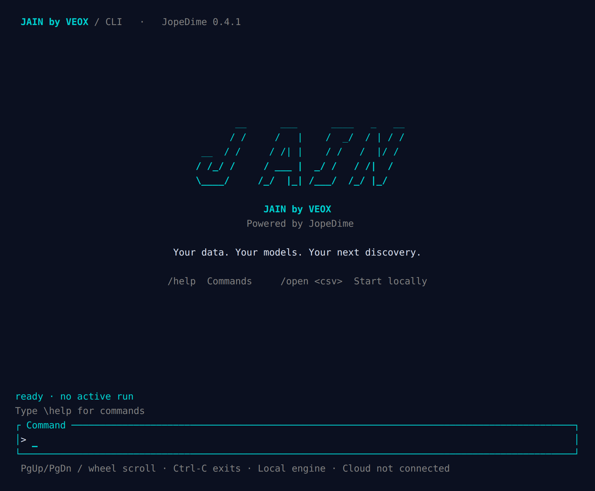
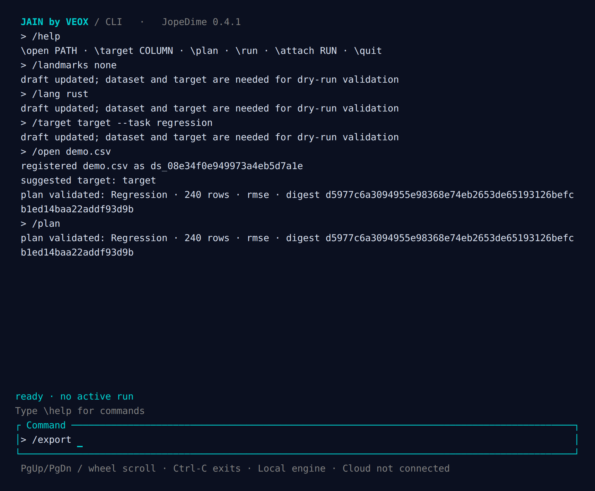

# CLI screen captures

These are reconstructions of actual 100 × 32 terminal states captured from the running development client, using pyte 0.8.2 and Chromium. They are not concept mockups. Font, palette, and cell spacing depend on the terminal emulator. The session uses a synthetic 240-row CSV; it does not show an invented training result.

[capture.json](capture.json) records source blob identities and image checksums. The landing view and the transcript share a bottom composer. The footer accurately reports that cloud account sync is not connected.

