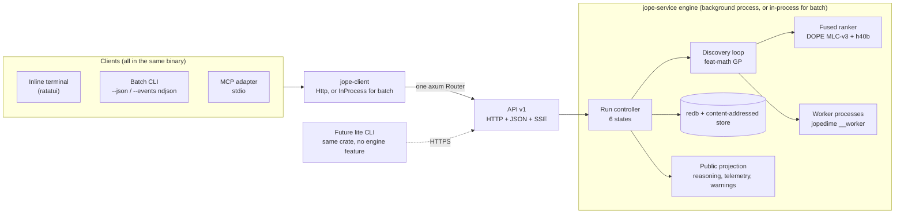
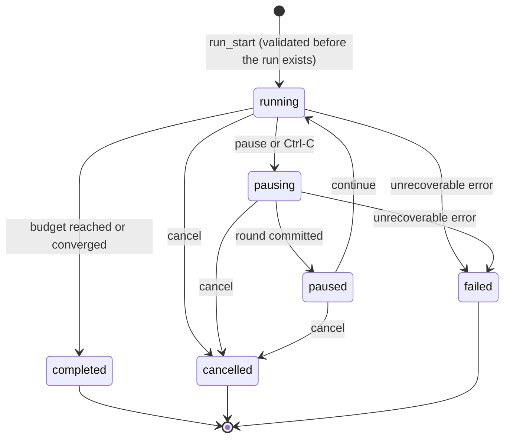
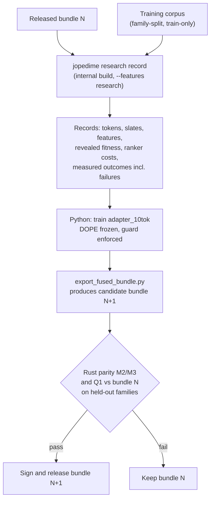

# JopeDime v1 — Enterprise MVP Engineering Specification (Final)

**One engine, one API, three faces: pinned-DOPE fused discovery in a single Rust binary**

| | |
| --- | --- |
| **Prepared for** | Jepson Taylor / VEOX |
| **Date** | October 29, 2026 |
| **Supersedes** | `docs/product/drafts/spec-a-enterprise-mvp.md` (Spec A) and `docs/product/drafts/spec-b-production.md` (Spec B). The review is in `docs/product/spec-v1-review.md`. |
| **Grounded in** | JopeDime `main` `58f2bfb093a8ea30034a0e5a0297bc3e66054e35` (telemetry naming re-checked at `ba34a884`, #457); DOPE `main` `5c2e8df8e424c31087a4d8284231f17157319399`; `dope-core` build pin `15e12aa3dc33851655580f6aa7c9c66353143f23` (tag `dope-engine-v1.1.0`); DOPE MLC-v3 weights SHA-256 `d0b6960328d1955386632ff78b512e3add53a9b0256db7bbf067e2e0be5f0c6c` |
| **Review** | Every file:line citation in §2.1 was checked against the revisions above, and the whole document was independently reviewed for contradictions. |
| **Normative language** | MUST / MUST NOT / SHOULD as in RFC 2119. Numeric thresholds are release criteria, not claims about current binaries. Values marked *(validate)* are starting defaults to be confirmed by measurement in the PR that implements them. |
| **Audience** | Product owner, Rust and ML engineers, release engineers, implementation agents (Claude, Codex, Grok, Gemini). |

---

## 0. The design on one page



**Five rules that keep this simple**

1. **The API is the product.** The terminal, the batch CLI and MCP are clients of one versioned HTTP+JSON+SSE API. Interactive clients (terminal, MCP) share one background engine on the machine, started automatically and stopped when idle, so runs survive a closed terminal and a human and an agent can watch the same run. Batch commands use that engine if it is running; otherwise they host the engine in-process for the command's lifetime by calling the *same* `axum::Router` without a socket. A cloud endpoint later uses the same client code, and the lightweight CLI is the same crate compiled without the `engine` feature.
2. **Train/serve parity: tested now, structural after the first retrain.** v1 ports the trained head's proposer, featurizer and evaluator faithfully and proves it with parity gates (M3). From the first retrain onward, the flywheel generates its training data by running the shipped Rust engine, so everything except gradient descent is the same code in training and serving.
3. **Faithful before clever.** v1 serves the trained h40b ranker the way it was trained: full landmarks, four measured programs as in-context evidence, eight proposals ranked and four evaluated per round (sixteen with exploration when stalled). Progressive landmarks, more tasks and more languages come later through the same flags and API, behind capability checks.
4. **Honest by type.** Public types physically cannot carry GP internals; every metric carries a unit, scope and availability; an unsupported capability is refused before work starts, never silently degraded.
5. **Small surface.** 17 API operations, 12 MCP tools, 24 terminal commands, 6 run states, 4 content digests plus a run identity, 1 research track plus 8 implementation PRs, 28 release gates plus 1 capability gate.

**What ships in v1.0**

| Area | v1.0 | Not in v1.0 (roadmap, §17) |
| --- | --- | --- |
| Binary | One signed executable per platform with embedded, verified SafeTensors; CPU builds for Linux x86-64, macOS arm64, Windows x86-64; optional Linux CUDA build | Package-manager installers, auto-update |
| Topology | Shared background engine for terminal and agents (auto-start, idle exit); in-process engine for batch commands | Hosted cloud endpoint, multi-tenant auth |
| Discovery | GP discovery over the `(pipe X …)` DSL on `feat-math`, guided by the h40b ranker | Progressive landmark conditioning |
| Tasks | Regression with learned guidance; binary with heuristic guidance (learned once qualified); multiclass through native method selection | Learned guidance for binary and multiclass |
| Landmarks | `full` recipe on a bounded FIT subsample | `progressive`, and `none` with learned guidance (both need a mask-aware head) |
| Objectives | Regression built-ins and the existing bounded JSON grammar; new binary objectives; one objective per run on every surface | User plugin code |
| Exports | `.jope` model object; standalone Rust, Python and JavaScript predictors (+ TypeScript declarations); bundles with parity receipts | C++, Go, Wasm, CUDA, ONNX |
| Agents | MCP over stdio: `2025-11-25`, `2025-06-18`, `2024-11-05`; `2026-07-28` if the SDK passes conformance (OD9); JSON/NDJSON CLI | MCP over HTTP, Tasks extension, `subscriptions/listen` |
| Telemetry | CPU, RAM, GPU, disk, ranker and evaluation throughput, tok/s (Rust-only and all-languages, labeled), I/O GB/s, latencies; local only | Remote telemetry, OpenTelemetry export |

---

## 1. Product definition

### 1.1 Users and their jobs

| User | Job | Primary surface |
| --- | --- | --- |
| Data scientist or engineer | Point at a CSV, get a strong validated model quickly, watch it improve, export code in their language | Inline terminal |
| Coding agent (Claude Code, Gemini CLI, Codex CLI, Grok CLI, Cursor) | Discover and export a model as one step of a larger task, without a human at the keyboard | MCP tools, or the CLI with `--json` |
| CI pipeline | Reproducibly retrain and export on a schedule | Batch CLI |
| Future VEOX cloud customer | Same experience against a hosted engine | Lite CLI against a remote endpoint |

### 1.2 Golden paths (each is an acceptance scenario)

**H1 — First run (human).**
`jopedime` → `\open data/housing.csv` → the engine profiles the file and suggests a target → `\target median_house_value` → a plan card appears → `\run` → a first validated model is shown within seconds → improvements stream in with optional reasoning → `\export --lang python,rust --out ./model` → files appear, each with a parity receipt.

**H2 — One-shot batch (human or CI).**
`jopedime run data/train.csv --target y --effort high --lang rust,python --out ./model --json` → one JSON receipt on stdout, exit code 0, the export written to `./model`. No background process is left behind when none was running.

**H3 — Long run survives the terminal.**
Start a `high` run → close the terminal (or `\quit`) → the run continues in the background engine → later `jopedime attach` replays everything that happened and resumes the live view.

**AG1 — Agent over MCP.**
`system_info` → `dataset_register` → `run_start{dry_run:true}` (plan) → `run_start` → `run_status{wait_seconds:30, after_event}` in a loop, reading `run_events` pages as needed → `model_export` → `model_predict`. No prompt, no terminal scraping, no duplicated run on retry.

**AG2 — Agent over the shell.**
The same flow with `jopedime run … --events ndjson`, `jopedime status RUN --wait 30 --json`, `jopedime export RUN --json`.

### 1.3 Expectations contract

What a **human** should be able to rely on:

1. Typing `jopedime` in a terminal opens a session that feels like a modern agent CLI: normal scrollback, a composer at the bottom, backslash commands with Tab completion.
2. A useful model appears fast: at `fast` effort on a small table (≤ 10k rows × 50 columns), the first validated model appears in under 5 seconds on a reference laptop.
3. Every improvement is shown with its measured metric and a short, plain-language explanation of *what changed in the algorithm*, never how the search works internally.
4. Pause, continue, cancel, restart and effort changes take effect at a safe boundary, and the status line says what is pending.
5. Nothing is lost on Ctrl-C, a crash or a closed terminal: runs live in the background engine and the best model so far is always recoverable.
6. Warnings are specific and actionable: what is wrong, the current value against the limit, and the command that fixes it.
7. Exported code runs without JopeDime installed and predicts the same numbers the engine does, within the published tolerance.
8. Nothing leaves the machine unless explicitly requested.

What an **agent** should be able to rely on:

1. Every operation has a typed JSON schema; every result is structured JSON; every error has a stable code, a message and a remedy.
2. Long work never blocks: starting a run returns immediately with a `run_id`; status supports a bounded long-poll that wakes on any new event.
3. Retrying a mutating call with the same idempotency key is safe and returns the original outcome.
4. Events are replayable from a cursor; a reconnect never silently skips or duplicates events.
5. The same request produces the same result whether issued through MCP, CLI, HTTP or the terminal.
6. Large payloads (datasets, models, code) are passed by handle or file, never inlined as megabytes of JSON.
7. stdout carries only protocol or requested output; diagnostics go to stderr.
8. Capabilities are discoverable up front (`system_info`), including what is *not* available and why.

### 1.4 "Inference-only" defined

The distributed binary never changes learned neural parameters. It does fit candidate algorithms to the user's data, because measuring and exporting a fitted predictor requires it.

| Capability | v1 behavior |
| --- | --- |
| Training DOPE parameters | Never. DOPE weights are embedded, hash-verified and read-only. |
| Training the Jope ranker (`adapter_10tok`) | Never in the product. Only the offline flywheel trains it. |
| Neural inference from verified SafeTensors | Yes, in-process, CPU or CUDA. |
| Searching algorithm structures and fitting candidates | Yes, in discovery runs, on FIT rows only, resource-bounded. |
| Prediction with an exported model | Yes; never searches or refits. |

---

## 2. Ground truth

### 2.1 Verified current state

F01–F10 were identified by the drafts and re-verified; F11–F24 are new.

| ID | Finding | Evidence | v1 consequence | Fixed in |
| --- | --- | --- | --- | --- |
| F01 | The h40b research ranker and the Rust `jope_policy` path are different graphs | `research/flywheel_selfplay/run_fused_closed_loop.py:237`; `crates/jope-encoders/src/jope_policy.rs` | Port h40b exactly; never load a mismatched bundle | PR3 |
| F02 | Landmark sidecars do not influence search | `crates/jope-pipeline/src/landmark_encoding.rs:1` | Conditioning becomes a ranker input in the product loop | PR3 |
| F03 | The legacy `full` appliance profile is blocked | `deploy/appliance/models.lock.json` (`internal-restricted`, `blocked`) | New `fused-cpu`/`fused-cuda` profiles | PR8 |
| F04 | Narration uses GP vocabulary ("generations") | `crates/jope-narrator/src/render/v3.rs:57` | Separate public types and phrasing | PR4 |
| F05 | Three hand-written MCP servers; one skips the init lifecycle | `crates/jope-runtime/src/service.rs`; `crates/jope-appliance/src/model.rs:476`; `crates/jope-observatory/src/narration/mcp.rs` | One MCP adapter over the API; old tool names kept as aliases | PR7 |
| F06 | Process CPU % divides by per-core ticks and clamps to 100 | `crates/jope-telemetry/src/collectors.rs:149–155` | Report core-equivalents and host % separately | PR4 |
| F07 | Custom objectives are not uniform across search modes | `docs/regression-objectives.md` | One `ObjectiveSpec` per run in the new loop | PR2 |
| F08 | GPU presence does not mean every stage runs on the GPU | `docs/optional-landmarks.md` | Plan and telemetry report stage placement | PR3/PR4 |
| F09 | The DOPE freeze guard silently skips missing normalizer buffers | `python/src/jope/north_star/dope_freeze_guard.py:183–193` | Require a complete tensor manifest | R0 |
| F10 | Portable source export refuses or drops calibration | `crates/feat-math/src/advanced_v3/fitted_portable.rs:55–62`; `crates/jope-runtime/src/model_object.rs:350` | Emit calibration in every language | PR5 |
| **F11** | **h40b's serving path depends on host-custody files in neither repo:** `/home/ubuntu/JopeDimeMicro` (network source, landmark workspace), `cpu_exact_fused.py` (SHA `b9f1468a…`), the DSL→412 featurizer `rank_prepare.py` and `program-feature-names.json`, the CV evaluator binary `bootstrap.s1main` (SHA `e3be9386…`), and `champions.json`. The loop inserts `JopeDimeMicro/python` ahead of the repo directory before `import rust_evaluator`, so the proposer and featurizer that actually ran may be Micro's copies rather than the in-repo file | `run_fused_closed_loop.py:36–40, 222–237`; `research/flywheel_selfplay/rust_evaluator.py:49–51, 190–200` | **Critical path.** R0 brings the exact closure that ran into a pinned repository before any port starts | R0 |
| **F12** | **h40b is an in-context ranker.** `predict_costs` consumes per-candidate `prog_412` and `proj_16`, DOPE `mm_tokens_10x32` and `mm_mask_10`, and the measured fitness and gates of four revealed programs; constants `scale = 0.4208`, zero `ctx_feat[584]`, `base_prior_cost`, `sos_prior`. Training slates are 192 wide with the best 48 first (`training_indices`), so the revealed four are the top four. At proposal time the loop ranks `4 + n` candidates, prepending the pool's first four entries in storage order. Normally 8 proposals are ranked and 4 evaluated; after a promotion drought, 16 are generated and 2 of the 4 picks are random. Candidates are measured with full-training-table CV (`evaluation_scope: full_train_cv`) | `run_fused_closed_loop.py:178, 320–365, 900–920, 948–970`; `automatic_promotion.py:160–170`; `dev_incumbent.py:165–182` | The serving loop ranks `4 + 8` (or `4 + 16`) candidates and evaluates 4; R0 settles which four programs are revealed (OD13); rung 0 reproduces the training measurement | PR2/PR3 |
| **F13** | **The appliance already links a pure-Rust GP engine:** `feat-math::evolve` (same `(pipe X …)` DSL; `ParameterJitter`, `Insert`, `Delete`, `AdjacentSwap`, `HeadReplacement`, `Simplify` arms; splice crossover; honest k-fold CV; rayon; memo; curated starters) | `crates/feat-math/src/evolve.rs:1–9, 96, 1872–1879`; `crates/jope-runtime/Cargo.toml:17` | Build discovery on `feat-math`; do not port the Python loop | PR2 |
| **F14** | **`jope-pipeline` is not product-safe.** It is outside the appliance graph and launches `docker`, `systemctl`, `sudo`, `/bin/sh` and `git` | `crates/jope-pipeline/src/execution.rs:1423, 1774, 2241`; `supervisor.rs:129–131`; `run.rs:712` | The product MUST NOT link `jope-pipeline` | — |
| **F15** | **h40b was trained only on full ("high") landmark extraction.** A mask-aware DOPE candidate exists but is unqualified; repo docs record an owner addendum requiring one | `run_fused_closed_loop.py:270–283`; `docs/optional-landmarks.md:73–77, 145` | v1 serves `full` only with learned guidance; owner decision OD1 | PR3 |
| **F16** | **Export glue, not emitters, is the gap.** `feat-math` already emits Python, Rust, JavaScript, C++, Go and a Rust-backed TypeScript bridge (`transpile.rs`, `EMITTER_VERSION 2.2.0`), but fitted GP math-pipeline objects export only JavaScript because only `fitted_js.rs` glue exists. Native portable export refuses feature operations, calibration, target mapping, row order and most missing-aware heads | `crates/feat-math/src/transpile.rs:53, 216`; `crates/jope-runtime/src/model_object.rs:376–386`; `fitted_portable.rs:48–62` | Write Python and Rust fitted-state glue mirroring `fitted_js.rs`, plus calibration | PR5 |
| **F17** | **The CPU appliance links C code** through vendored `candle-core` 0.11 → `tokenizers` (`onig`) → `onig_sys`, plus `esaxx-rs`; used only by `candle-core/src/quantized/tokenizer.rs` | `cargo tree -p jope-appliance --features dope-encoding -i tokenizers`; `vendor/security/candle-core-0.11.0/Cargo.toml:273–276` | Make `tokenizers` optional and off in the vendored manifest | PR3 |
| **F18** | **The DOPE encoder is already in Rust.** `dope_core::mlc_v3::MlcV3Model` maps `([B,256],[B,64,17]) → [B,629]` on CPU and CUDA. The DOPE MLC-v3 bundle is 1.78 MB | DOPE `docs/jopedime-integration.md:236–262`; `deploy/appliance/dope-bundles/dope-mlc-v3.json` | Port only `lm48`, stage-1B tokens, `adapter_10tok` and the featurizer; embedding weights is trivial | PR3 |
| **F19** | **No network API exists.** `jopedime api` is JSON-RPC over stdin/stdout through the MCP dispatcher ("one dispatcher, two framings"); the appliance has no `tokio` or `axum` | `crates/jope-appliance/src/cli.rs:77–80`; `crates/jope-runtime/src/service.rs:1–6` | Generalize the pattern: one operation registry, several framings | PR1 |
| **F20** | `jope-telemetry` depends on `arrow`/`parquet` unconditionally; its CPU collector reads Linux `/proc` only | `crates/jope-telemetry/Cargo.toml`; `collectors.rs:185–242` | Parquet sink becomes an optional feature; cross-platform process sampling | PR4 |
| **F21** | A crate cycle (`starforge` → `jope-runtime`) blocks putting inference in `jope-runtime` | `crates/jope-encoders/Cargo.toml` | Inference lives in the new `jope-service` crate, which depends on both | PR1 |
| **F22** | `main` moved after both drafts' audit (#454–#456, telemetry ports); `collectors.rs` is unchanged | `git log c1318a7..58f2bfb0` | Each PR re-anchors on current `main` and re-runs the cited checks | all |
| **F23** | Fitted math pipelines predict through an `f32` cast and map non-finite predictions to `0.0`; JavaScript transcendental parity with the interpreter is not guaranteed under the default `PlatformLibm` kernel | `crates/jope-runtime/src/math_pipeline.rs:202–207`; `crates/feat-math/src/transpile.rs:56–68` | `f64` output path; a non-finite prediction fails the candidate; per-language tolerances | PR2/PR5 |
| **F24** | The objective engine is regression-only (`jope.regression-fitness/v1`): no `logloss`, `brier` or AUC | `crates/jope-runtime/src/fitness.rs:3, 19` | Binary objectives and probability calibration are new work | PR2 |

### 2.2 Gap register

| Capability | Exists today | v1 work | PR |
| --- | --- | --- | --- |
| Signed single executable with embedded assets, doctor, verify-self | Yes (`jope-appliance`, `jope-assets`, `jope-dist`) | New fused profiles; candle patch | PR3, PR8 |
| Native fit/predict/model objects/regression objectives/calibration | Yes (`jope-runtime`) | Reused by the engine | — |
| Binary objectives, probability calibration | No (F24) | New `jope.classification-fitness/v1`, Platt scaling | PR2 |
| GP over the pipeline DSL with CV | Yes (`feat-math::evolve`) | Expose per-candidate operations; product loop with workers | PR2 |
| DOPE MLC-v3 encoder in Rust | Yes (`dope-core`) | Reused | — |
| h40b ranker, featurizer, champion bank in Rust | No; Python plus host custody | Custody closure (R0), exporter, Rust port, parity | R0, PR3 |
| Network API, run controller, durable store | No | New `jope-api`, `jope-service`, `jope-client` | PR1–PR2 |
| Public reasoning without GP terms | Partial (narrator) | Public projection and phrasing catalog | PR4 |
| Correct, cross-platform telemetry | Partial (Linux, CPU bug) | Fix and cross-platform sampling; warnings | PR4 |
| Python/Rust export of fitted GP pipelines; calibration in exports | Recipe emitters yes; fitted glue JS only | Fitted glue, calibration, `f64` path, capability registry | PR5 |
| Inline terminal with backslash commands | No (alternate-screen research dashboards only) | New terminal client | PR6 |
| Unified MCP | Partial (three servers) | One adapter, 12 tools | PR7 |

---

## 3. Architecture

### 3.1 Topology: one shared engine, one in-process fallback

| Mode | Used by | Engine host | Transport |
| --- | --- | --- | --- |
| **Shared background engine** | `jopedime` (terminal), `jopedime mcp`, and batch commands when an engine is already running | `jopedime serve`, started automatically on first interactive use | Loopback HTTP + bearer token from `daemon.json` |
| **In-process** | Batch commands (`run`, `predict`, `export`, …) when no engine is running — the CI case | The command's own process, for its lifetime only; no listener | The same `axum::Router` called through `tower::ServiceExt::oneshot` |
| **Remote** (roadmap; designed in v1) | Any client with `--endpoint https://…` or `JOPEDIME_ENDPOINT` | A hosted engine | HTTPS + bearer token; `local_paths: false` forces uploads |

**Engine discovery (client side, in order):**
1. `--endpoint URL` or `JOPEDIME_ENDPOINT` → use it.
2. `$JOPEDIME_HOME/daemon.json` exists, its PID is alive and `GET /v1/system` succeeds with its token → attach.
3. Interactive command (terminal or MCP) → start `jopedime serve --idle-exit 30m` detached (`setsid` on Unix, `DETACHED_PROCESS` on Windows), wait up to 5 s for `daemon.json`, attach. If another process wins the race for the store lock, go back to step 2.
4. Batch command → host an in-process engine for the command's duration.
5. Lite build (no `engine` feature) → exit 9: "no engine found; run `jopedime serve` or pass `--endpoint`".

**One engine owns a store** through an OS advisory lock on `$JOPEDIME_HOME/lock`. While an in-process batch engine holds it, other clients receive `ENGINE_BUSY` with that process's PID and command; they can wait, or use a different `JOPEDIME_HOME`.

**The background engine is never invisible.** The terminal's header shows `engine: background (pid 4182, idle exit 30m)`; `system_info` reports the mode; `jopedime serve --status` and `jopedime serve --stop` manage it. It exits after 30 minutes *(validate)* with no active runs and no connected clients. On start it recovers interrupted runs (§5.2).

### 3.2 Process model

- **Engine process** (background or in-process): HTTP router, run controller, ranker inference (DOPE + h40b), landmark extraction, the store, telemetry and the public projection.
- **Worker processes** (`jopedime __worker`, the same executable): fit and score candidates. Stateless; memory-map the prepared dataset matrix from the store; exit when their stdin closes. Parent-death safety: `PR_SET_PDEATHSIG` on Linux, stdin EOF everywhere, a Job Object with kill-on-close on Windows.
- **Client processes:** the terminal and the MCP adapter. They hold no run state, so closing them never affects a run.
- **Why workers:** a pathological candidate can loop forever inside a math kernel or exhaust memory. The parent enforces wall-clock and RSS limits by killing the worker, so the engine and every client stay responsive. This is the only isolation mechanism in v1.

### 3.3 Crates

| Crate | Status | Responsibility | Depends on | MUST NOT depend on |
| --- | --- | --- | --- | --- |
| `jope-api` | **new** | Request, response, event and error types; IDs; JSON Schemas; OpenAPI generation | `serde`, `serde_json`, `schemars` | Any engine crate |
| `jope-service` | **new** | The engine: controller, store, discovery loop, ranker, workers, exports, public projection, telemetry, axum router | `jope-api`, `jope-runtime`, `feat-math` (no default features), `starforge` (`dope`), `jope-narrator`, `jope-telemetry` (no `sink-parquet`), `redb`, `tokio`, `axum`, `candle-core/nn` | `jope-pipeline`, `tch`, `rusqlite`, `pyo3` |
| `jope-client` | **new** | `Transport` trait with `Http` (`ureq`) and `InProcess` (feature `engine`); SSE reader; engine discovery and auto-start | `jope-api`, `ureq`; `jope-service` only under `engine` | `tokio` when `engine` is off |
| `jope-appliance` (bin `jopedime`) | existing | CLI parsing, terminal client, MCP adapter, `serve`, `__worker`, existing commands | `jope-client`; `jope-service` under feature `engine` (default) | — |
| `feat-math` | existing | DSL, mutations, crossover, CV, fitting, emitters | — | Its `fitted-cpp` feature in the appliance |
| `starforge` (`jope-encoders`) | existing | `dope-core` integration (MLC-v3) | `dope-core`, `jope-runtime` | — |

**The lite client is a build flag.** `cargo build -p jope-appliance --no-default-features --features client` produces a `jopedime` with the terminal, batch CLI and MCP adapter but no engine, no candle, no tokio and no weights. In v1 it is compiled and contract-tested in CI (gate A1) but not published.

**Existing commands are preserved:** `fit`, `fit-predict`, `predict`, `model`, `fitness`, `methods`, `doctor`, `mcp`, `api`, `version`, `verify-self`, `licenses`. `jopedime mcp` changes implementation (§7) but keeps the existing tool names as aliases. `jopedime api` (stdio JSON-RPC) remains as a compatibility surface and is not extended.

### 3.4 Dependency policy

- **CPU build:** application code is Rust; the only native linkage is the OS C runtime. Enforced by `deploy/appliance/dependencies-deny.toml` (cargo-deny) and a link audit (`ldd`/`otool -L`/`dumpbin /dependents`) in PR8.
- **New dependencies:** `tokio` (rt-multi-thread, net, sync, time, signal), `axum` (already in the workspace via `jope-observatory`), `redb`, `ureq` (already in the workspace). The terminal uses the vendored `ratatui` 0.29 and **its re-exported `ratatui::crossterm`** (crossterm 0.28.1); it does not add the workspace's crossterm 0.29 to the appliance graph.
- **Banned from the appliance graph:** `tch`, `torch-sys`, `rusqlite`/`libsqlite3-sys`, `pyo3`, `onig`/`onig_sys`, `esaxx-rs`, `openssl-sys`, `aws-lc-sys`, and `syntect` with its default `onig` backend.
- **CUDA build:** additionally links the NVIDIA driver and the declared CUDA runtime libraries through `cudarc`; kernels are precompiled. These are declared platform dependencies, not hidden runtimes.
- **TLS (roadmap only):** the lite client needs TLS for a cloud endpoint (`rustls` with `ring`, which contains C and assembly). The engine never needs TLS in v1 because it binds to loopback only.

### 3.5 Decisions and the alternatives rejected

| Decision | Chosen | Rejected and why |
| --- | --- | --- |
| API style | HTTP/1.1 + JSON, resource-oriented, SSE for live events | gRPC (protoc toolchain, poor proxy story, heavier client); WebSocket (bidirectional is unnecessary; commands are POSTs); extending stdio JSON-RPC (not network-addressable) |
| Engine hosting | Shared background engine for interactive use; in-process for batch | Always in-process (runs die with the terminal; a human and an agent cannot share a run); in-process plus listener plus detach handoff (three mechanisms instead of one); always-daemon including batch (leaves processes behind in CI) |
| In-process calls | The same `axum::Router` via `tower::ServiceExt::oneshot` | A separate in-process implementation (two code paths that drift) |
| Persistence | `redb` + content-addressed files | SQLite (C code); a hand-written journal (more code, same guarantees) |
| Local IPC | Loopback TCP + bearer token | Unix sockets + Windows named pipes (two code paths, and unlike the cloud path) |
| Search engine | `feat-math::evolve` primitives in a small product loop | Linking `jope-pipeline` (host orchestration); porting the Python flywheel loop |
| Progressive landmarks in v1 | No; `full` only with learned guidance | Shipping a mode the head was not trained on |

---

## 4. API v1 (normative)

### 4.1 Conventions

| Topic | Rule |
| --- | --- |
| Base path | `/v1`. Additive changes only within v1; a breaking change creates `/v2`. |
| Encoding | UTF-8 JSON; `Content-Type: application/json`. CSV uploads and prediction downloads use `text/csv`. |
| IDs | `run_<ULID>`, `ds_<24 hex of SHA-256>`, `alg_<4+ digits>` (per run, sequential), `art_<24 hex of SHA-256>`. Clients treat IDs as opaque. |
| Large integers | Event sequences, revisions and byte counts are **decimal strings** (JavaScript-safe). |
| Mutations | Every request that creates or changes state requires an `Idempotency-Key` header (1–128 printable ASCII). The key, the request digest and the outcome are committed **in the same `redb` transaction** as the effect. Run mutations also accept `If-Match: "<revision>"`. |
| Errors | RFC 9457 `application/problem+json` with `type`, `title`, `status`, `detail` and the extensions `code` (Appendix D), `retriable`, `remedy`, optional `field`. |
| Limits | JSON bodies ≤ 8 MiB; uploads streamed, ≤ `limits.max_dataset_bytes` (default 4 GiB); list pages ≤ 256 items. |
| Versioning header | Every response carries `Jope-Api-Version: 1.<minor>`. |
| Schemas | Generated from `jope-api` types with `schemars`; served at `GET /v1/openapi.json`; committed at `schemas/jope.api.v1.openapi.json`; CI fails if they differ. |

### 4.2 The operation registry

One table defines every engine operation and its name on every surface. Help text, tab completion and tool listings are generated from it.

| # | Operation | HTTP | MCP tool | Terminal | Batch CLI |
| --- | --- | --- | --- | --- | --- |
| 1 | System info, capabilities, health, warnings, telemetry snapshot | `GET /v1/system` | `system_info` | `\doctor`, `\metrics` | `jopedime doctor` |
| 2 | Register dataset | `POST /v1/datasets` | `dataset_register` | `\open` | `jopedime dataset add` |
| 3 | List or inspect datasets | `GET /v1/datasets[/{id}]` | `dataset_inspect` | (card after `\open`) | `jopedime dataset list\|show` |
| 4 | Delete dataset | `DELETE /v1/datasets/{id}` | — | — | `jopedime dataset delete` |
| 5 | Validate objective | `POST /v1/objectives/validate` | `objective_validate` | `\objective` | `jopedime objective validate` |
| 6 | Plan or start a run | `POST /v1/runs` (`dry_run`) | `run_start` | `\plan`, `\run` | `jopedime run [--dry-run]` |
| 7 | List runs, or one snapshot with long-poll | `GET /v1/runs[/{id}]` | `run_status` | `\runs`, `\status` | `jopedime runs`, `jopedime status` |
| 8 | Control a run | `POST /v1/runs/{id}/control` | `run_control` | `\pause`, `\continue`, `\cancel`, `\effort` (during a run) | `jopedime control` |
| 9 | Fork (restart) a run, optionally warm | `POST /v1/runs/{id}/fork` | `run_fork` | `\restart` | `jopedime restart` |
| 10 | Delete a run | `DELETE /v1/runs/{id}` | — | — | `jopedime runs delete` |
| 11 | Events (page or live stream) | `GET /v1/runs/{id}/events` | `run_events` | live transcript | `jopedime events [--follow]` |
| 12 | Algorithms, source, diff | `GET /v1/runs/{id}/algorithms[/{alg}]` | `algorithm_get` | `\code`, `\diff` | `jopedime code` |
| 13 | Export | `POST /v1/runs/{id}/exports` | `model_export` | `\export` | `jopedime export` |
| 14 | Download artifact | `GET /v1/artifacts/{id}` | (resource) | (inside `\export`) | (inside `export`) |
| 15 | Predict | `POST /v1/predictions` | `model_predict` | `\predict` | `jopedime predict` |
| 16 | Export training feedback | `GET /v1/runs/{id}/feedback` | — | — | `jopedime runs export-feedback` |
| 17 | Collect unreferenced store blobs | `POST /v1/store/gc` (`dry_run`) | — | — | `jopedime gc` |

- Destructive and administrative operations (4, 10, 16, 17) are deliberately not MCP tools in v1.
- **Terminal commands that are not engine operations:** `\help`, `\reasoning` and `\quit` are client-only. `\target`, `\lang`, `\landmarks`, and `\effort`/`\objective` before a run edit the terminal's **draft `RunSpec`**; each edit is validated immediately with operation 6 in dry-run mode, which prints the updated plan.
- Plan and start share **one request schema** (`RunSpec`). `dry_run: true` validates everything and returns the resolved `Plan` without creating a run. If `plan_digest` is supplied on the real start and the resolved plan differs, the start fails with `PLAN_CHANGED`, so the plan an agent reviewed is the plan that runs.

### 4.3 Core schemas (abbreviated; full schemas are generated; values illustrative)

**`RunSpec`** (request body of operation 6)

```json
{
  "dataset": "ds_7f3a9c0e1b2d4a5f6e7d8c9b",
  "target": "median_house_value",
  "task": "auto",
  "ignore_columns": ["row_id"],
  "test_dataset": null,
  "split": { "kind": "random", "holdout_fraction": 0.2, "group_column": null, "time_column": null },
  "objective": "rmse",
  "effort": "medium",
  "budget": { "evaluations": null, "wall_seconds": null },
  "landmarks": "full",
  "guidance": "auto",
  "languages": ["python", "rust"],
  "require_all_languages": true,
  "device": "auto",
  "seed": "20261029",
  "dry_run": false,
  "plan_digest": null
}
```

- `task`: `auto | regression | binary | multiclass`. `auto` infers and the plan states why; ambiguity returns `TASK_AMBIGUOUS` with candidates.
- `ignore_columns`: identifiers and leakage columns excluded from features.
- `objective`: a built-in name, `name:param=value`, or a JSON specification in the regression grammar (`crates/jope-runtime/src/fitness.rs`) or the new classification grammar (§5.10).
- `guidance`: `auto | learned | heuristic`. `auto` uses the learned ranker when the bundle is qualified for the task, landmark mode and device (and Q1 passed); otherwise heuristic ordering. The plan states the result and the reason.
- `landmarks`: `full | none | progressive`. v1 accepts `none` only with heuristic guidance and refuses `progressive` with `CAPABILITY_UNAVAILABLE` and a roadmap pointer.

**`Plan`** (response to `dry_run`)

```json
{
  "plan_digest": "sha256:9c1e…",
  "task": { "value": "regression", "inferred": true, "reason": "numeric target with 3,842 distinct values" },
  "objective": { "name": "rmse", "digest": "sha256:…", "direction": "minimize", "fitting": "selection_only" },
  "rows": { "total": "20640", "fit": "16512", "holdout": "4128", "test": null },
  "effort": { "name": "medium", "evaluations": "128", "wall_seconds": "60", "cv_folds": 5, "rounds_in_flight": 1 },
  "guidance": { "value": "learned", "prior_only": false, "reason": "bundle qualified for regression with full landmarks on cpu-f32" },
  "landmarks": { "mode": "full", "sample_rows": 1024 },
  "languages": { "requested": ["python", "rust"], "excluded_operations": ["<op names>"], "intersection_empty": false },
  "placement": { "dope": "cpu", "ranker": "cpu", "evaluation": "cpu", "workers": 7 },
  "limits": { "eval_timeout_s": 30, "worker_rss_bytes": "2147483648" },
  "estimates": { "peak_ram_bytes": "1181116006", "disk_bytes": "52428800" },
  "warnings": []
}
```

`guidance.prior_only` is `true` when the user's objective is outside the bundle's trained set (§5.8).

**`RunSnapshot`** (operation 7)

```json
{
  "run_id": "run_01JBD8Q6N4V2T5Y8K3M7P9R1S0",
  "revision": "17",
  "state": "running",
  "phase": "searching",
  "pending": null,
  "effort": "medium",
  "budget_used": { "evaluations": "41", "wall_seconds": "23.4" },
  "budget_total": { "evaluations": "128", "wall_seconds": "60" },
  "best": { "algorithm_id": "alg_0007", "metric": "rmse", "cv_value": 0.4871, "model_artifact": "art_3be1…" },
  "event_watermark": "212",
  "warnings": [],
  "completion_reason": null
}
```

- `revision` increments on every accepted state or configuration change and is what `If-Match` checks.
- **Long-poll wakes on events, not revisions:** `GET /v1/runs/{id}?wait_seconds=30&after_event=212` returns as soon as `event_watermark > 212` (which includes every new champion, warning and state change) or after 30 seconds (maximum 60). This is the agent's main loop primitive.

**`PublicEvent`** (operation 11) — see §8 and Appendix B. Every durable event has `run_id`, `sequence` (decimal string, strictly increasing, never reused), `time`, `kind` and a kind-specific body.

### 4.4 Live events

- `GET /v1/runs/{id}/events?after=212&limit=100` → a JSON page of durable events with `next_after`.
- The same URL with `Accept: text/event-stream` → Server-Sent Events. Durable events carry `id: <sequence>`; ephemeral `telemetry` frames (1 Hz) carry no `id` and are never stored. The stream starts after `after` (or the `Last-Event-ID` header).
- **Events are published only after the transaction that records them commits.** A crash therefore can never cause a sequence number to be re-issued with different content.
- **Race-free attach** (used by the terminal and documented for agents): read the snapshot → note `event_watermark` → open the stream with `after=event_watermark`. Every event with a higher sequence is delivered.
- Retention: durable events live as long as the run. Telemetry history is summarized into the run record (min/mean/max per metric) at completion.

### 4.5 Data movement

| Need | Local engine (`local_paths: true`) | Remote engine (`local_paths: false`) |
| --- | --- | --- |
| Register a dataset | `POST /v1/datasets {"path": "/abs/train.csv"}`; the engine reads the file | `POST /v1/datasets?name=train.csv` with a `text/csv` body |
| Get an export | Client downloads `GET /v1/artifacts/{id}` and extracts into `--out` | Same |
| Predictions | `POST /v1/predictions` streams CSV back; the client writes `--output` | Same |

Rules:
1. On registration the engine copies the CSV into the content-addressed store **and** parses it once into a binary column-major matrix (encoded features, target, row IDs) stored next to it. Workers memory-map that matrix; no evaluation re-reads CSV. Registering the same bytes twice returns the same `ds_` ID.
2. **The engine never writes outside `$JOPEDIME_HOME`.** Clients write user-chosen paths. This removes a class of path-authorization bugs and behaves identically locally and remotely.
3. `local_paths` is `true` for a loopback engine and for in-process engines. Only processes that can read the owner-only `daemon.json` hold the token, so a path request always comes from the engine owner's account.
4. `jope-client` picks path or upload automatically; callers never decide.

### 4.6 Security for the local engine

- Bind `127.0.0.1` on a random port; never `0.0.0.0` in v1.
- `daemon.json` contains `{url, token, pid, version, api_version, started_at}`, mode `0600` (owner-only ACL on Windows). The token is 256 random bits, regenerated on every engine start.
- Every request needs `Authorization: Bearer <token>`. In-process calls bypass the network entirely.
- Reject requests whose `Host` is not `127.0.0.1:<port>` or `localhost:<port>`; send no CORS headers. With the token, this blocks DNS-rebinding and browser cross-origin attacks.

---

## 5. The engine

### 5.1 Identity

Four content digests plus a run identity:

| Identity | Canonical SHA-256 over | Changes when |
| --- | --- | --- |
| `BundleDigest` | Unsigned bundle manifest + every tensor file + featurizer spec + champion bank | Any weight, buffer, constant, vocabulary or bank entry changes |
| `ProblemDigest` | Dataset bytes, target, task, `ignore_columns`, split recipe and row rosters, objective digest | Data, split, target or objective changes (requires a new run) |
| `ConditioningDigest` | Landmark recipe ID, sample rows, the `v256` and `col[64×17]` inputs, and the resulting 10×32 tokens + mask | Recipe or data changes; constant within a v1 run |
| `ModelDigest` | Canonical DSL, fitted parameters, preprocessing state, calibration, class map | A new fitted model is produced |
| `RunId` + `revision` (not a digest) | ULID; `revision` increments on every accepted state or config change | Start or fork; each control action |

Derived digests: the **objective digest** (part of `ProblemDigest`) and the **`plan_digest`** (the resolved `Plan`, used to confirm that a reviewed plan is the one that runs). Every accepted algorithm records its `ModelDigest`, `ConditioningDigest`, `BundleDigest` and the `revision` under which it was proposed.

### 5.2 Run state machine (six states)



| State | Meaning | Notes |
| --- | --- | --- |
| `running` | Work is scheduled. `phase` ∈ `preparing`, `encoding`, `seeding`, `searching`, `finalizing`. | Validation happens before the run exists (dry-run logic), so there is no validating state. |
| `pausing` | No new evaluations are admitted; commit fully completed rounds in order. At the deadline, revoke outstanding attempts and roll back all uncommitted rounds to the last committed checkpoint, then pause. On continue, replay those rounds with the same seeds and captured round effort. | `pending` in the snapshot says what is awaited. |
| `paused` | Quiescent and checkpointed. `interrupted: true` if reached through crash recovery. | `continue` resumes with remaining budget. |
| `completed` | Terminal. `completion_reason` ∈ `budget_evaluations`, `budget_time`, `converged`, `effort_reduced`. `best` is null only with `NO_VALID_MODEL`. | `\restart` forks (optionally warm, §5.7). |
| `cancelled` | Terminal. The best committed model stays available. | |
| `failed` | Terminal. `failure` carries a catalog code; the best committed model stays available. | |

**Crash recovery.** On engine start, any run in `running` or `pausing` is moved to `paused{interrupted:true}` at its last committed round; `tmp/` is emptied; every artifact referenced by a committed record is verified. `\continue` resumes. Uncommitted work did not happen and is recomputed with the same seeds (§5.6). Continue retains the original plan, binary identity and remaining budget; its state change and retry response commit together. An interrupted finalization attempt retains an unknown outcome. Automatic replay cannot reread its assessment rows; an explicit Continue can authorize a new finalization attempt after durably retaining the prior unknown attempt.

**Fencing.** Each evaluation dispatch carries `(run_id, round, slot, attempt)`. A result for a revoked `attempt` (cancel, pause deadline, crash) is discarded. An effort change does not revoke in-flight attempts.

### 5.3 Store

`$JOPEDIME_HOME` defaults to the OS data directory (`~/.local/share/jopedime`, `~/Library/Application Support/jopedime`, `%LOCALAPPDATA%\jopedime`).

```
$JOPEDIME_HOME/
  state.redb            # all metadata, ACID
  cas/sha256/ab/cd…     # immutable blobs: dataset CSVs and matrices, model objects, export archives
  tmp/                  # staging; emptied on start
  lock                  # held by the owning engine
  daemon.json           # 0600; present while a background engine listens
  config.toml           # optional user configuration (Appendix C)
  history               # terminal command history (0600)
  logs/                 # bounded rolling logs; never raw cell values
```

`state.redb` tables:

| Table | Key → value | Committed |
| --- | --- | --- |
| `runs` | `RunId` → `RunRecord` (state, spec, plan, budget counters, RNG state, elite pool, champion, revision) | With each round or control action |
| `events` | `(RunId, u64 seq)` → `PublicEvent` | In the same transaction as the state it describes |
| `evaluations` | `(RunId, u64 n)` → internal `EvaluationRecord` (DSL, features, scores, timings, failure) | With each round; **never served publicly** |
| `commands` | `(principal, idempotency key)` → `{request digest, operation id, outcome}` | In the same transaction as the command's effect |
| `datasets` | `DatasetId` → schema, profile, CAS references (CSV and matrix) | On registration |
| `artifacts` | `ArtifactId` → kind, size, references | On publication |
| `meta` | Schema version, store ID | On creation and migration |

**Publish order (crash-safe):** write the blob to `tmp/<uuid>` → `fsync` → verify its hash → atomic rename into `cas/` → `fsync` the directory → commit the `redb` transaction that references it. A record never points at a missing file; an orphan blob is harmless and collected by operation 17.

**Retention:** completed runs keep their record, events, best artifact and exports. Nothing is deleted automatically except `tmp/`; input datasets and accepted models are removed only by operations 4 and 10.

### 5.4 Splits and leakage rules

| Scope | Default | Used for | Never used for |
| --- | --- | --- | --- |
| **FIT** | 80% of the training file (stratified for classification, grouped when `group_column` is set, earliest rows when `time_column` is set) | Landmarks; every search evaluation (rung 0 and rung 1); preprocessing and calibration fitting inside each fold | — |
| **HOLDOUT** | The remaining 20% | One reported score for the final model and for each export | Any search decision, landmark, ranking or calibration |
| **TEST** | Only if `test_dataset` is supplied | One sealed score at completion, reported separately | Anything during the run |

- **Every CV in the run inherits the split constraints:** grouped folds never cross groups; time-ordered folds are forward-chaining with a configurable gap. This applies to rung 0, rung 1 and calibration.
- Order-dependent objectives (returns, drawdown, MASE) require `time_column` and are refused otherwise (`OBJECTIVE_REQUIRES_ORDER`).
- **Final model:** the champion is refit on FIT to produce the HOLDOUT score, then refit on FIT+HOLDOUT to produce the exported model (`--refit fit` keeps the FIT-only model). The export manifest states which refit it contains and which score describes it.

### 5.5 Discovery loop (the core algorithm)

The loop reproduces how h40b was trained and evaluated (F12) using `feat-math` primitives and the ranker.

**Evaluation rungs**

| Rung | Data and folds | Scores | Purpose |
| --- | --- | --- | --- |
| 0 | 2-fold CV on FIT (capped at `rung0_max_rows`, default 20,000 *(validate)*), respecting split constraints | The bundle's `surrogate_recipe` **and** the user objective | Screening, and the ranker's revealed evidence. It MUST reproduce the training measurement (`full_train_cv` through the evaluator R0 identifies) — gate M3 |
| 1 | k-fold CV on FIT (capped at `rung1_max_rows`, default 100,000 *(validate)*), k from the effort table, respecting split constraints | The user objective | Promotion |

**Elite pool.** Up to 48 evaluated algorithms, kept in two orders over the same set: by rung-0 surrogate fitness (for revealed context) and by rung-0 user objective (for parents and promotion candidates).

**Revealed context.** Four measured algorithms whose surrogate fitness and gates are passed to the ranker. Default: the top four by surrogate fitness, which is the distribution of every training slate. R0 checks whether the research loop's proposal-time choice (pool storage order) differs in practice; owner decision OD13 fixes the rule. Revealing already-measured algorithms costs no extra evaluations.

**Pseudocode**

```text
prepare(dataset, split, ignore_columns) -> FIT, HOLDOUT, TEST?   # matrix memory-mapped by workers
conditioning = landmarks_full(FIT sample ≤ 1,024 rows) -> v256, col[64×17]
tokens, mask = stage1b(lm48(v256), dope_mlc_v3(v256, col))        # once per run

seeds = curated_starters(task)          # feat-math STARTERS + CHAMPION_GENOME, filtered by language capability
      + bank_nearest(lm48, k = 4)       # champion-bank retrieval
results = evaluate(seeds, rung 0); commit; emit
champion = rung1(best of seeds by user objective); commit; emit algorithm.accepted ("first model")

while budget remains and not converged:
    for each of R rounds in flight (R fixed in the plan):
        rng       = ChaCha(sha256(seed ‖ round))
        explore   = rounds_since_promotion ≥ stall_rounds
        n         = explore ? 16 : 8
        parents   = select_parents(elites by user objective, rng)
        proposals = propose(parents, elites, bank, lm48, n, allowed_ops, rng)  # typed edits, crossover,
                                                                                # bank retrieval, landmark-preferred stages
        proposals = dedupe(proposals, memo)
        if guidance == learned:
            costs    = ranker(tokens, mask, featurize(revealed(elites) + proposals), revealed fitness/gates)
            admitted = explore ? 2 lowest-cost + 2 sampled by rng from the rest
                               : 4 lowest-cost
        else:
            admitted = first 4 (or 2 + 2 random when exploring) in proposer order
        results = evaluate(admitted, rung 0)                  # parallel workers
    apply all results in (round, slot) order:
        update elites
        best_new = best result of each round by user objective
        if best_new ranks in the top 4 of the elite pool by user objective:
            c = evaluate(best_new, rung 1)
            if c is finite and strictly better than the champion's rung-1 score:
                champion = c; publish model artifact
    commit (elites, champion, rng positions, counters, evaluations, events) in one transaction
    then publish the committed events

finalize: refit champion on FIT -> HOLDOUT score; refit on FIT+HOLDOUT -> exported model; TEST score if given
```

- **Slate shape.** Each ranker call scores `4 + n` candidates (4 revealed, 8 or 16 proposals), the shape the research loop used at proposal time (`np.arange(4 + len(proposals))`), not the 192-wide training slates. M5 and Q1 use serving-shaped slates.
- **Promotion** compares a round's best new candidate against the elite pool rather than against the champion's own rung-0 score, so one lucky rung-0 score cannot block later promotions.
- **Rounds in flight.** `R = max(1, floor(W_planned / 4))` is fixed in the plan. If the governor removes workers, rounds run slower; `R` never changes.
- **Convergence.** A run completes early with `converged` after `patience` consecutive rounds without promotion (effort table), never on wall-clock alone. `stall_rounds = ceil(patience / 2)`.
- **Proposer parity.** The proposer MUST reproduce the operator families, mix and exploration behavior of the proposer that actually generated h40b's training data (R0 identifies which copy, F11), using `feat-math` arms plus crossover, bank retrieval and landmark-preferred stage selection (`select_landmark_preferred_pools`). M3 checks operator-family frequencies; Q1 measures whether guidance helps.

### 5.6 Determinism contract

- **Guarantee.** Given the same `ProblemDigest`, `BundleDigest`, seed, `budget.evaluations`, planned `R`, plan limits and binary version, the champion, its `ModelDigest` and the **deterministic projection** of the durable event log are bit-identical regardless of how many workers are alive, pauses, crashes, recoveries and client reconnects.
- **Deterministic projection (owner ruling `rulings_t1900` R2, 2026-10-31):** every durable event with top-level `run_id` and `time`, and `body.budget_used.wall_seconds`, removed, and without warnings marked `host: true` (warnings caused by the host, such as memory pressure or disk space). Experiment IDs derive from `ProblemDigest` plus evaluation ordinal; public discovery attempt receipts use that stable logical evaluation ordinal, while worker restart epochs remain in private evaluation records. `ModelDigest` derives from predictor semantics. Per-run provenance and measured operational accounting remain in the original events, snapshots and run receipts, outside the canonical digest.
- **Why it holds:** evaluations are pure functions of `(DSL, data matrix, folds, seed)`; budget is counted at admission; RNG streams are derived as `sha256(seed ‖ round)`; results are applied in `(round, slot)` order; per-worker memory limits are fixed in the plan, not derived from the live worker count; fits use a fixed per-worker thread count.
- **Explicit exception:** an evaluation that hits its wall-clock or memory limit is inherently machine-dependent. Every such evaluation is recorded in the run receipt under `nondeterminism` (count and experiment IDs), so a reader knows exactly when the guarantee was not in force.
- A wall-clock budget (`budget.wall_seconds` or an effort time cap) stops at a round boundary that can differ between machines; the receipt records `budget_bound_by: time | evaluations`.

### 5.7 Effort

Effort sets conjunctive caps; the first cap reached ends the search. Values are *(validate)* defaults; explicit `budget` fields override them.

| Effort | Rung-0 evaluations | Wall cap | Rung-1 CV | Patience (rounds) | Intended experience |
| --- | --- | --- | --- | --- | --- |
| `fast` | 24 | 10 s | 3-fold | 2 | A strong model in seconds: up to 13 seeds plus two or three rounds |
| `medium` | 128 | 60 s | 5-fold | 8 | Default; a good model within a minute |
| `high` | 512 | 300 s | 5-fold | 24 | Thorough search |
| `ultra` | 4,096 | 1,800 s | 5-fold × 2 repeats for promotions | 64 | Best effort; long runs |

- `\effort` during a run changes future caps at the next round boundary and increments `revision`. Lowering effort below what was already consumed ends the search with `completion_reason: effort_reduced` and finalizes the champion.
- Changing objective, target, task, dataset, columns or split during a run is refused (`IMMUTABLE_FIELD`) with a suggested `\restart`.
- **Warm restart:** `run_fork{warm_start: true}` (terminal `\restart --warm`) seeds the new run with the parent's elite pool and champion instead of the starters, for "keep going with a higher effort" after completion. Allowed only when the `ProblemDigest` is unchanged.

### 5.8 Fused ranker serving contract

**Bundle contents** (`jope.fused-bundle/v1`; embedded in the binary; loadable from a directory with `--bundle DIR` in development builds only):

| File | Contents |
| --- | --- |
| `manifest.json` | Schema, architecture (`dope-fused-ranker/h40b`), `BundleDigest`, source pins, weight hashes, constants, the qualified `{task × landmark mode × backend}` matrix, `surrogate_recipe`, trained objectives, redistribution policy |
| `dope.safetensors` | DOPE MLC-v3 weights exactly as frozen during h40b training (expected SHA-256 `d0b69603…`; OD1 if not) |
| `jope.safetensors` | `lm48` projection (`step2_lm_mean`, `step2_lm_std`, `step2_svd_basis_48`, `mu_lm48`, `sd_lm48`), stage-1B token projection, `adapter_10tok` (including its frozen anchor) |
| `featurizer.json` | The 412 program-feature names in order, the DSL feature-extraction recipe version, and the `proj16` sign-matrix domain string `jope-context-cross-v1` |
| `bank.jsonl.zst` | Champion bank: canonical DSL, `feat412`, `proj16`, `lm48` summary, family hash. No data rows. |
| `golden/*.safetensors` | Parity fixtures: inputs and expected outputs at every stage for ≥ 50 contexts, including serving-shaped slates |

**Manifest example (abbreviated)**

```json
{
  "schema": "jope.fused-bundle/v1",
  "architecture": "dope-fused-ranker/h40b",
  "bundle_digest": "sha256:<64 hex>",
  "dope_core_rev": "15e12aa3dc33851655580f6aa7c9c66353143f23",
  "dope_weights_sha256": "d0b6960328d1955386632ff78b512e3add53a9b0256db7bbf067e2e0be5f0c6c",
  "jope_weights_sha256": "<64 hex>",
  "reference_source_sha256": { "cpu_exact_fused.py": "b9f1468a61aa4dc888c8f2931f9c759f7d4f057793a77ccb05eed6300fb4f9ab" },
  "constants": { "scale": 0.4208, "ctx_feat_dim": 584, "revealed": 4, "proposals": 8, "proposals_explore": 16, "admit": 4, "elite_pool": 48 },
  "surrogate_recipe": "<declared by the exporter from the training code>",
  "trained_objectives": ["<from training>"],
  "landmark_recipe": "full-high/v1",
  "landmark_sample_rows": 1024,
  "qualified": [ { "task": "regression", "landmarks": "full", "backend": "cpu-f32" } ],
  "asset_policy": "redistributable"
}
```

**Rust modules** in `jope-service::ranker`: `bundle` (load and verify), `landmarks` (full recipe), `lm48`, `stage1b`, `adapter` (`predict_costs`), `featurizer` (`feat412`, `proj16`), `bank`. DOPE MLC-v3 runs through the existing `dope_core::mlc_v3::MlcV3Model` (F18). All tensors use the candle stack already in the closure.

**Loader rules (before any tensor is used):** verify byte caps; verify every file hash against the manifest and the manifest against the embedded signature; check every tensor's name, shape and dtype; reject NaN/Inf in any weight or buffer; refuse unknown architectures. On failure the engine raises `MODEL_INTEGRITY_FAILED` (severity error) and `jopedime doctor` fails. A run that explicitly requests `guidance: learned` is refused (exit 3); with `guidance: auto` the plan resolves to `heuristic` and shows the warning. A partially verified bundle is never loaded.

**Numerical gates (CPU FP32):** every intermediate (`v256`, `col`, DOPE 629, `lm48`, tokens, mask, costs) within `atol 1e-5`, `rtol 1e-4` of the goldens; the admitted set identical whenever the cost gap at the admission boundary exceeds `2 × (atol + rtol × |cost|)` (decisions inside that band are counted and reported, not failed); `feat412` exactly equal for count/flag features and within `1e-6` otherwise on 100% of the historical program corpus; `proj16` within `1e-12`. The CUDA build has its own gate at the same tolerances.

**Residency:** loaded once per engine into an immutable `Arc<FusedRanker>`; conditioning tensors are computed once per run.

**Surrogate versus user objective.** The ranker always receives the surrogate values it was trained on, computed at rung 0 for the revealed algorithms, whatever the user's objective. The user's objective alone decides parents, promotion and the champion. When the objective is outside `trained_objectives`, the plan reports `guidance.prior_only: true` with an `OBJECTIVE_SURROGATE_MISMATCH` info warning; if Q1 shows no benefit in that regime, `auto` resolves to `heuristic` for such objectives.

**RNK-08/RNK-10 evidence and acceptance caveats.** H46–H49 are negative qualification evidence: none met its recorded strict win rule. Keep each wave's family-bootstrap confidence interval and selection procedure with its result; do not promote exploratory checkpoint or inner-CV maxima as validation gains. H46/H47 full-batch seeds are near-pseudoreplicates (effective seed count about one per arm); H47 includes bit-identical final utilities across seeds. H48 repeatedly selected fold 3 for its 0/PF arms, and H49 selected fold 1 for every 0/SAM/SWA seed. H49's three distinct control adapters had identical DL-Val utility (1.135439), so those seeds provide one effective validation replicate. Seed count alone is not independent replication; report the seed identity/dependence and use the family-level interval recorded by each wave.

For RNK-08, M2's numerical parity and admitted-set checks remain required, but they establish implementation parity only, not learned-guidance benefit. Preserve the serving-slate KL-to-base readout and flag any maximum conditional base KL above 0.35. For RNK-10 and Q1, require a preregistered comparison against unguided/heuristic guidance, median final family-mean Δ > 0, the applicable family-bootstrap lower bound > 0, and Elo > 1500 where the H48/H49 strict rule applies; ties fail. H46–H49 do not qualify learned guidance, so it stays disabled by default until a qualifying result exists. PR #511 is open with H49-SEL margin calibration pending; do not treat its deployment margin as established until that calibration is recorded.

The “validation-pool fixed-8-program” item cited by FUP-04 assignment has no source in #528 or H46–H49 records; omit it pending evidence.

### 5.9 Landmarks in v1

- `full`: the landmark recipe used in h40b training (`fit_transform_and_extract_bundle_high`), ported to Rust (or proven identical to `dope-core`'s conditioning builder) and computed once per run on a deterministic FIT subsample of at most 1,024 rows *(validate against full-table extraction in M3)*. PR3 measures the cost and reports it in the plan as `landmarks.ms`. (For reference only: DOPE's resident release check, available from `dope-core` `bbba9863` (#351) onward rather than at the `15e12aa3` pin, bounds `dope-core`'s complete recipe at a ≤ 30 ms median on 1–1,024 fit rows with 8 threads on one fixture.)
- `none`: allowed only with heuristic guidance.
- `progressive`: refused in v1. The types keep `dope-core`'s 23 values + 23 mask bits, so a mask-aware head can be added without an API change (§17).
- Landmarks use FIT rows only; gate S3 audits row IDs.

### 5.10 Objectives

- **Regression:** reuse `crates/jope-runtime/src/fitness.rs` (built-ins and the bounded JSON grammar, `jope.regression-fitness/v1`) without semantic changes. Calibration uses the existing cross-fitted transform `max(a + b·pred, floor)`.
- **Binary (new work, F24):** `jope.classification-fitness/v1` with `logloss`, `brier`, `roc_auc`, `pr_auc`, `f1@threshold`, `balanced_accuracy` and a cost-matrix loss, operating on probabilities with explicit class order. Probabilities come from **Platt scaling** (cross-fitted logistic calibration of the head's score), which becomes part of the model and every export.
- **Multiclass:** v1 runs the existing native method selection (`--method auto`) and labels the run `discovery: native`.
- The plan discloses whether each head optimizes the objective during fitting or is selected by it (`fitting: native | selection_only`).
- Invalid specifications fail at plan time. A candidate whose objective value is undefined or whose predictions are non-finite fails that candidate only (`FITNESS_UNDEFINED`, reported in `experiment.finished`), never the run, and never receives a placeholder score. Fitted pipelines predict through an `f64` path (F23).

### 5.11 Workers

| Aspect | Rule |
| --- | --- |
| Launch | `jopedime __worker --protocol 1`; hidden; refuses to run when stdin is a TTY |
| Protocol | Length-prefixed (u32 LE) JSON frames over stdin/stdout; max frame 8 MiB; versioned. Request: `{attempt, matrix_path, fold_spec, dsl, objective, seed, limits}`. Response: `{attempt, scores, predictions_digest, wall_ms, failure?}` |
| Data | Workers memory-map the prepared matrix read-only and keep it mapped across evaluations; nothing large crosses the pipe |
| Limits | Per-evaluation wall timeout (default 30 s *(validate)*, scaled by effort) and an RSS cap fixed in the plan (default `min(4 GiB, 75% of RAM / W_planned)`). The parent samples each worker's CPU time and RSS every 100 ms through OS APIs and kills on breach; Windows also sets a Job Object memory limit |
| Failure | Timeout, OOM, panic or non-finite output → `experiment.finished{outcome: failed, reason}`; the worker is replaced; the run continues |
| Recycling | After 500 evaluations, or when RSS exceeds 2× its post-load baseline |
| Count | `auto` = `min(physical cores − 1, available RAM / per-worker estimate)`, at least 1, resolved in the plan |

---

## 6. Human experience: the inline terminal

### 6.1 Launch rules

| Invocation | Behavior |
| --- | --- |
| `jopedime` in an interactive TTY | Inline session connected to the background engine (started if needed) |
| `jopedime data.csv` in a TTY | Inline session with `\open data.csv` already run |
| `jopedime attach [RUN]` | Inline session showing `RUN` (or the most recent active run), replaying from its start |
| `jopedime` with stdin or stdout not a TTY | Prints usage to stderr and exits 2; never starts an invisible TUI |
| `--plain`, `NO_COLOR`, `TERM=dumb`, or width < 40 columns | Line-mode session: same commands and transcript, no viewport redraws, no color |

### 6.2 Layout

Ratatui `Viewport::Inline` with a 6–10 line live region at the bottom; everything else is printed into the terminal's native scrollback with `insert_before`, so users scroll, search and copy with their normal terminal.

```text
 JopeDime 1.0.0 · bundle h40b (cpu) · engine background (pid 4182, idle exit 30m)
 Type \help for commands, or \open a CSV to begin.

› \open data/housing.csv
 ✓ housing.csv   20,640 rows × 9 columns · 1.4 MB · ds_7f3a9c0e…
   Suggested target: median_house_value (numeric). Press Tab after \target to choose.

› \target median_house_value
 Plan   regression · RMSE · effort medium (≤128 experiments, ≤60 s) · guidance learned
        landmarks full (1,024-row sample) · languages python
        FIT 16,512 rows · HOLDOUT 4,128 rows · 7 workers · est. peak RAM 1.1 GB
        \run to start · \effort, \objective, \lang to change

› \run
 ● run_01JBD8Q6… started
 ✓ First model    linear baseline (ridge)           CV RMSE 0.742
 ✓ Improved       gradient-boosted trees            CV RMSE 0.512   −31.0%
   Testing a log transform on skewed income features…
 ✓ Improved       + log-scaled income, deeper trees CV RMSE 0.487   −4.9%
   ┌ python · alg_0007 ────────────────────────────────────────────
   │ def predict(row):
   │     x_income = math.log1p(row["median_income"])
   │     …  (\code python for the full source)
   └────────────────────────────────────────────────────────────────
─────────────────────────────────────────────────────────────────────────────
 running · medium · 00:23/01:00 · best 0.487 · 41 exp · 3.2 exp/s · CPU 6.8 cores (85%) · RAM 0.9 GB · GPU n/a
 › \export --lang python,rust --out ./model▌
```

*(All names and numbers above are illustrative.)*

**Live region, top to bottom:**
1. One status line: state, effort, elapsed/cap, best metric, experiments and rate, CPU cores and host %, RAM, GPU (or `n/a`), and a warning badge when a warning is active.
2. One activity line: the current public hypothesis (reasoning on) or the current phase.
3. The composer (1–4 lines, grows with multi-line input), with an inline completion menu above it when open.

**Transcript cards** (printed once, never redrawn): plan; first model; improvement (metric, delta, one-line description, optional 4–6 line excerpt in the primary language); warnings raised and cleared; reasoning lines; exports (path, files, parity status); run finished (reason, champion, HOLDOUT and TEST scores). Experiments that did not improve are summarized at most every 10 seconds ("12 experiments in the last 10 s, no improvement") rather than printed one per line.

### 6.3 Commands (24)

Backslash is canonical; `/` is accepted as a silent alias. Engine-backed commands map to the operations in §4.2 and accept `--json` to print the raw API response.

| Command | Arguments | Kind | Effect |
| --- | --- | --- | --- |
| `\help` | `[command]` | client | Command reference and key bindings |
| `\open` | `PATH [--name N]` | engine (op 2) | Register a CSV; show its profile and a suggested target |
| `\target` | `COLUMN [--task regression\|binary\|multiclass] [--ignore COL,…] [--group COL] [--time COL]` | draft | Set target, task and column roles; prints the plan |
| `\objective` (alias `\fitness`) | `NAME \| NAME:k=v \| @file.json \| {json}` | engine (op 5) / draft | Validate and set the objective; prints its description and direction |
| `\effort` | `fast\|medium\|high\|ultra [--evals N] [--time DURATION]` | draft before a run; engine (op 8) during one | Set or change caps |
| `\landmarks` | `full\|none` | draft | Set landmark mode (and shows why other modes are unavailable) |
| `\lang` (alias `\language`) | `rust,python,javascript[,typescript] [--best-effort]` | draft | Set required export languages; reprints excluded operations |
| `\plan` | — | engine (op 6, dry run) | Re-resolve and print the plan |
| `\run` | `[--seed S]` | engine (op 6) | Start the run |
| `\pause` / `\continue` / `\cancel` | — | engine (op 8) | Control the current run |
| `\restart` | `[--same-seed\|--new-seed] [--warm] [overrides…]` | engine (op 9) | Fork a new run, optionally from the parent's elites |
| `\status` | `[RUN]` | engine (op 7) | Snapshot: state, budgets, best, warnings, pending action |
| `\metrics` | `[--detailed]` | engine (op 1) | Telemetry table with units, scope and sample age |
| `\reasoning` | `off\|concise\|detailed` | client | Presentation filter only |
| `\code` | `[LANG] [ALG]` | engine (op 12) | Full source of the best (or given) algorithm |
| `\diff` | `[ALG_A] [ALG_B]` | engine (op 12) | Source diff between two accepted algorithms (default: last two) |
| `\export` | `[--kind bundle\|model\|source] [--lang …] [--alg ALG] --out DIR [--force]` | engine (ops 13, 14) | Export; prints files and parity status |
| `\predict` | `--input PATH --output PATH [--model ALG\|PATH]` | engine (op 15) | Predict with the best (or given) model |
| `\runs` | `[--all]` | engine (op 7) | List runs in this store |
| `\attach` | `RUN` | engine (ops 7, 11) | Switch the view to another run |
| `\doctor` | — | engine (op 1) | Binary, bundle, backend, sensors, disk, engine mode |
| `\quit` | `[--pause]` | client | Leave the session (§6.5) |

### 6.4 Completion and editing

- **Tab** completes, in order: command names; flags; enum values; column names after `\target`, `--ignore`, `--group`, `--time`; run and algorithm IDs; file paths after `\open`, `--input`, `--output`, `--out` and `@` (relative to the working directory, quoting spaces). **Shift-Tab** cycles backward. A completion never executes on its own.
- Completion data comes from the same registry as the parser, so help, completion and validation never disagree.
- Editing: grapheme-correct cursor; Ctrl-A/E, Alt-B/F, Ctrl-W, Ctrl-U, Ctrl-K; Alt-Enter or Shift-Enter for a newline; bracketed paste (pasted text never executes until Enter); ↑/↓ history; Ctrl-R reverse search; Ctrl-L redraw.
- Windows paths such as `C:\data\x.csv` are arguments; only a backslash in command position starts a command.
- History lives in `$JOPEDIME_HOME/history` (0600, 1,000 entries); inline JSON objectives longer than 1 KB are not stored; `\help history` explains how to clear it.
- Incoming events never disturb the draft, cursor or completion menu (gate U1).

### 6.5 Interrupts and exit

| Input | Composer has text | Composer empty, run active | Composer empty, nothing active |
| --- | --- | --- | --- |
| Ctrl-C | Clear the draft | Request `\pause`; status shows "pausing — Ctrl-C again within 2 s cancels" | Hint: "\quit or Ctrl-D to exit" |
| Ctrl-C twice within 2 s | — | `\cancel` (best model kept) | — |
| Ctrl-D | Delete char | Same as `\quit` | Exit |
| `\quit` | — | Leave; the run continues in the background engine. Prints `jopedime attach RUN` and `jopedime control RUN pause`. `\quit --pause` pauses first | Exit |
| SIGHUP (terminal closed), SIGTERM | — | Client exits; the run continues | Exit |

- Raw mode, cursor visibility and colors are restored on normal exit, error, panic (`std::panic::set_hook`) and handled signals on Linux, macOS and Windows ConPTY (gate U2).
- **Batch commands with an in-process engine:** the first Ctrl-C pauses at the next safe boundary, commits and exits 130 (the run can be continued later by any client); a second Ctrl-C cancels.

### 6.6 Color and accessibility

| Token | Use | 16-color fallback |
| --- | --- | --- |
| `fg` | Body text | default |
| `muted` | Labels, timestamps, IDs | bright black |
| `accent` | Commands, links, the prompt | cyan |
| `good` | Improvements, success marks | green |
| `warn` | Warnings, pending actions | yellow |
| `bad` | Failures, errors | red |
| `code.*` | Keywords, strings, numbers, comments | blue, green, magenta, bright black |

- Truecolor → 256 → 16 → none, detected from `COLORTERM`/`TERM`; `NO_COLOR` disables color; `--theme light|dark|auto`.
- Meaning is never carried by color alone: every status has a symbol (`✓ ● ⚠ ✗`) with ASCII fallbacks (`+ * ! x`) when the locale is not UTF-8.
- Syntax highlighting uses a small built-in lexer for the three export languages (no `syntect`/`onig`).
- User-supplied strings (column names, paths) are stripped of control and escape sequences before display.
- Redraws are capped at 20 Hz while active and 1 Hz while idle; there is no simulated typing.

---

## 7. Agent experience

### 7.1 MCP adapter

- `jopedime mcp` is a **client** of the API. It attaches to the background engine and starts it if needed (§3.1), so runs survive the agent session and a human can watch them with `jopedime attach`.
- **Protocols (stdio):** MUST support `2025-11-25`, `2025-06-18` and `2024-11-05` with the `initialize` / `notifications/initialized` lifecycle, as the current server does (`service.rs:17–21`); `2025-03-26` stays excluded because it requires batch support. SHOULD support `2026-07-28` (stateless: per-request `_meta`, `server/discover`) — shipped in v1 if the chosen implementation passes its conformance suite, otherwise in v1.1 (OD9).
- **Implementation (OD9):** the official Rust SDK (`rmcp` 3.x) if it passes conformance for every version above; otherwise generalize the existing dispatcher in `crates/jope-runtime/src/service.rs`, which already implements the lifecycle and error framing. Either way there is exactly one MCP implementation and it calls `jope-client`.
- **stdio purity:** stdout carries only JSON-RPC messages; logs go to stderr (bounded). Reading, dispatch and writing are independent, so `run_status` and `run_control{cancel}` answer in < 100 ms p95 while candidates are fitting (gate A4).
- **Compatibility:** the existing tool names (`fitness_list`, `fitness_validate`, `fitness_evaluate`, `regression_fit_predict`, `model_session_*`, `narration_read`, `narration_inspect`) remain callable as aliases for one minor version, then are listed as deprecated.

### 7.2 Tool catalog (12)

All tools return `structuredContent` matching a published output schema plus a short text summary. Mutating tools require `idempotency_key`; run mutations accept `expected_revision`.

| Tool | Input (summary) | Output | Annotations |
| --- | --- | --- | --- |
| `system_info` | `{}` | Version, engine mode, bundle and digests, qualified matrix, languages, devices, sensors, limits, active warnings, `local_paths`, telemetry snapshot | read-only, idempotent |
| `dataset_register` | `{path?, csv_text?, name?, idempotency_key}` (exactly one of `path` or a small `csv_text` ≤ 1 MiB) | `dataset_id`, rows, columns with types and missing rates, suggested targets | idempotent |
| `dataset_inspect` | `{dataset_id?, columns?}` (omit `dataset_id` to list) | Bounded profile, or the dataset list; never raw rows | read-only |
| `objective_validate` | `{spec, task?}` | Resolved spec, digest, direction, required columns, errors | read-only |
| `run_start` | `RunSpec` + `idempotency_key` (`dry_run` supported) | `Plan` or `RunSnapshot` | idempotent by key |
| `run_status` | `{run_id?, wait_seconds? ≤ 60, after_event?}` | `RunSnapshot`, or the run list when `run_id` is omitted | read-only |
| `run_control` | `{run_id, action: pause\|continue\|cancel\|set_effort, effort?, budget?, expected_revision?, idempotency_key}` | Updated snapshot and `revision` | destructive for `cancel` |
| `run_fork` | `{run_id, seed: same\|new, warm_start?, overrides?, idempotency_key}` | New `RunSnapshot` | — |
| `run_events` | `{run_id, after?, kinds?, limit? ≤ 256}` | Ordered events and `next_after` | read-only |
| `algorithm_get` | `{run_id, algorithm_id?, language?, diff_from?, max_lines?}` | Public description, scores, source or diff (bounded; larger content as a resource link) | read-only |
| `model_export` | `{run_id, algorithm_id?, kind, languages, out_dir?, idempotency_key}` | Manifest, file list with hashes, parity status; files written to `out_dir` by the adapter if given | — |
| `model_predict` | `{model: {run_id, algorithm_id?} \| {artifact_id} \| {path}, input: {dataset_id} \| {path}, out_path?, idempotency_key}` | Row count, output hash, timing; output written to `out_path` or returned as a resource link | — |

**Resources:** `jope://runs/{run_id}`, `jope://runs/{run_id}/algorithms/{algorithm_id}/source/{language}`, `jope://artifacts/{artifact_id}/manifest`, `jope://datasets/{dataset_id}/profile`.

**Server instructions** (sent at initialize or discover):

> JopeDime discovers and exports predictive algorithms for tabular data. Typical flow: dataset_register → run_start with dry_run:true to review the plan → run_start → run_status with wait_seconds and after_event to follow progress (read run_events for details) → model_export → model_predict. Runs continue in the background; poll rather than wait inside one call. Always pass idempotency_key on mutating calls and reuse it when retrying. Results describe algorithms and measured scores; search internals are not exposed.

### 7.3 Batch CLI

| Command | Purpose |
| --- | --- |
| `jopedime run TRAIN.csv --target COL [flags]` | Plan (`--dry-run`) or run to completion; flags mirror `RunSpec`; `--detach` returns immediately with the run ID (requires the background engine; starts it if needed); `--out DIR` exports on completion |
| `jopedime runs [list\|delete RUN\|export-feedback RUN --out FILE]` | List, delete, feedback export |
| `jopedime status RUN [--wait SECONDS] [--after-event SEQ] [--json]` | Snapshot or long-poll |
| `jopedime events RUN [--after SEQ] [--follow] [--kinds …]` | NDJSON events |
| `jopedime control RUN pause\|continue\|cancel\|effort LEVEL` | Run control |
| `jopedime restart RUN [--new-seed] [--warm]` | Fork |
| `jopedime code RUN [--alg ALG] [--lang L]` | Source to stdout |
| `jopedime export RUN [--alg ALG] --kind K --lang L --out DIR [--force]` | Export |
| `jopedime predict --model RUN[:ALG]\|PATH --input CSV --output CSV\|-` | Predict (existing command, extended to accept runs) |
| `jopedime dataset add\|list\|show\|delete`, `jopedime objective validate`, `jopedime doctor`, `jopedime serve [--status\|--stop\|--idle-exit D]`, `jopedime attach`, `jopedime mcp`, `jopedime gc [--dry-run]` | As named |

- **Idempotency from the shell:** every mutating command accepts `--idempotency-key KEY`. Without it, the CLI generates a random key and prints it in `--json` output and on stderr, so a wrapper can retry the same operation safely.
- **Output modes:** default human text; `--json` prints exactly one JSON object on stdout; `--events ndjson` prints one event per line until the run ends, then the receipt as the last line with `"kind":"receipt"`. Nothing ever prompts when stdin is not a TTY; missing required input is an error.
- **Exit codes:** existing meanings are preserved (`crates/jope-appliance/src/cli.rs`): `0` success; `2` invalid input; `3` integrity or compatibility; `4` backend unavailable; `5` budget exhausted with no valid model; `6` numerical failure; `7` output/IO failure. New: `8` conflict (revision, idempotency, plan changed); `9` engine unreachable or busy; `130` interrupted. A detached or interrupted run's ID is always printed to stderr.

### 7.4 Client setup (documented and tested in gate A5)

Claude Code:

```bash
claude mcp add --transport stdio --scope user jopedime -- /absolute/path/to/jopedime mcp
```

Generic `mcpServers` JSON (Claude Desktop, Cursor, Gemini CLI and others that use this shape; each client's file location is documented with its tested version):

```json
{ "mcpServers": { "jopedime": { "command": "/absolute/path/to/jopedime", "args": ["mcp"] } } }
```

Agents that cannot use MCP call the batch CLI with `--json`; the operations and payloads are identical.

---

## 8. Public reasoning and the GP abstraction

### 8.1 Rules

1. Internal evaluation records (DSL, operators, parents, rounds) stay in the `evaluations` table and the narrator journal. They are never serialized to any public channel.
2. Public output is produced only through `jope-api` types that have **no fields** for programs in DSL form, operator names, parent or lineage IDs, rounds, population or elite indices.
3. Generated source in the export languages is public; the DSL is not.
4. A comparative claim is emitted only when both values come from the same `ProblemDigest`, folds and objective; otherwise the event says the comparison is unavailable.
5. Reasoning is presentation only: turning it off or changing its level never changes the search (gate T3).

### 8.2 Claim levels

| Stage | Example | Requires |
| --- | --- | --- |
| Hypothesis | "Testing a log transform on skewed income features." | A proposal admitted for evaluation |
| Measured | "Cross-validated RMSE 0.493 vs best 0.487 on the same 5 folds; keeping the current algorithm." | A completed rung-1 evaluation |
| Accepted | "New best: gradient-boosted trees with log-scaled income (CV RMSE 0.487, −4.9%)." | A committed champion |
| Final | "Holdout RMSE 0.491 on 4,128 rows not used during search." | Finalization |
| Export | "Python and Rust predictors match the engine within the release tolerance on 64 check rows." | A parity receipt |
| Unknown | "Evaluating a new algorithm variant." | A gap in the phrasing catalog — never an invented mechanism |

### 8.3 From internal change to public sentence

The phrasing catalog is data: each `feat-math` operation, parameter and head carries a `public_name` and a `purpose` string (one reviewed table in `feat-math`). Templates choose among 2–4 equivalent phrasings by hashing the event digest (deterministic and independent of the search RNG). No language model is involved.

| Internal change | Public template (example) |
| --- | --- |
| Seed algorithm | "Established a {head.public_name} baseline." |
| Head replacement | "Switched the model to {head.public_name} to {head.purpose}." |
| Stage insert | "Added {op.public_name} to {op.purpose}." |
| Stage delete or simplify | "Removed {op.public_name} to simplify the algorithm." |
| Parameter change | "Adjusted {param.public_name} from {a} to {b}." |
| Crossover | "Combined the feature processing of one strong algorithm with the model of another." |
| Bank retrieval | "Tried an algorithm that performed well on datasets with similar structure." |
| Failure | "That variant failed ({reason.public}); continuing." |

Levels: `off` (no reasoning lines), `concise` (accepted improvements plus at most one hypothesis line per 3 seconds; default), `detailed` (every admitted experiment's hypothesis and outcome). **The level is a client view setting, not a run property:** the engine always records the full set of public events, and the level only filters what the terminal shows and what `--events ndjson` prints.

### 8.4 Event body

```json
{
  "run_id": "run_01JBD8Q6N4V2T5Y8K3M7P9R1S0",
  "sequence": "214",
  "time": "2026-10-29T18:31:07.412Z",
  "kind": "reasoning",
  "body": {
    "stage": "accepted",
    "algorithm_id": "alg_0007",
    "summary": "New best: gradient-boosted trees with log-scaled income (CV RMSE 0.487, −4.9%).",
    "evidence": { "metric": "rmse", "scope": "cv_fit_5fold", "before": 0.512, "after": 0.487, "comparable": true }
  }
}
```

---

## 9. Telemetry, resources and warnings

### 9.1 Metric catalog

Every sample carries `name`, `value` (or `null`), `unit`, `scope` (`engine`, `workers`, `device:<uuid>`, `host`, `store`), `window_ms`, `age_ms` and `availability` (`measured | unavailable:<reason>`). `null` is never displayed as zero.

| Metric | Definition | Unit |
| --- | --- | --- |
| `cpu.cores` | Δ(engine + worker CPU seconds) ÷ Δ(monotonic seconds) | core-equivalents |
| `cpu.host_pct` | `100 × cpu.cores ÷ logical CPUs` | % |
| `cpu.allowed_pct` | `100 × cpu.cores ÷ allowed CPUs` (cgroup quota or affinity) | % |
| `mem.rss` | Engine RSS + Σ worker RSS | bytes |
| `mem.available` | Host available memory | bytes |
| `gpu.util_pct` | NVML device utilization over its sampling window (device-wide) | % |
| `gpu.mem_used` | Device memory used (device-wide), plus this process's allocation where NVML reports it | bytes |
| `ranker.scores_per_s` | Candidates scored by the neural ranker ÷ ranker busy time | candidates/s |
| `ranker.latency_ms` | p50 per ranker call | ms |
| `dope.encode_ms`, `landmarks.ms` | One-time conditioning cost per run | ms |
| `eval.per_s` | Completed rung-0 evaluations ÷ wall time (window) | evals/s |
| `eval.failed` | Failed evaluations by reason | count |
| `throughput.tokens_per_s.rust` | **Headline.** Lexical tokens of newly published algorithm source in Rust (pinned lexer) ÷ the time spent producing the Rust output (timed alone when possible) | tokens/s |
| `throughput.tokens_per_s.all_languages` | The same over every requested export language | tokens/s |
| `throughput.tokens_per_s.rust_timed_alone` | Whether the Rust rate was timed on the Rust output alone | bool |
| `io.read_gb_s` | Bytes read during dataset ingestion or prediction ÷ read time | GB/s (10⁹) |
| `predict.rows_per_s` | Rows predicted ÷ prediction wall time | rows/s |
| `time.first_model_s`, `time.best_s` | From run start to the first and to the current champion | s |
| `disk.free`, `store.bytes` | Free bytes on the store volume; bytes owned by the store | bytes |

- **tok/s is always two labeled metrics** (owner ruling 2026-10-29, implemented in `jope-telemetry` #457 as registry rows `0x012a`/`0x012b`/`0x012c`, constants in `crates/jope-telemetry/src/summary.rs:86–88`): Rust-only is the headline and all-languages is shown beside it, both labeled. Reuse those names. There is **no neural tokens/s metric**: the h40b model scores candidates and does not generate tokens; producers without a text path report both tok/s metrics as `unavailable:no_text_token_path`.
- **CPU math fix (F06):** one saturated thread on an 8-logical-CPU host reports `cpu.cores = 1.00` and `cpu.host_pct = 12.5`; four saturated threads report `4.00` and `50.0`. No clamping.
- **Sampling:** the engine samples itself and each worker by PID through OS APIs — Linux `/proc/<pid>/stat` and `statm`; macOS `proc_pid_rusage`; Windows `GetProcessTimes` and `GetProcessMemoryInfo` on the worker handles. The same samples drive worker limits (§5.11), so there is one mechanism. GPU via NVML loaded dynamically (`nvml-wrapper`); a missing driver or permission yields `unavailable:<reason>`.
- **Rates:** hardware at 1 Hz; status line ≤ 10 Hz; no GPU synchronization for telemetry. `jope-telemetry` gains a `sink-parquet` feature (off in the appliance), removing `arrow`/`parquet` from the product graph (F20).

### 9.2 Resource governor

- **Preflight** (in the plan): estimated peak RAM (bundle + dataset matrix + `W` × per-worker estimate), disk needed (dataset copy + matrix + artifacts) and the worker count; refuse with a remedy if registration or the run would breach the disk reserve.
- **Continuous:** if `mem.available` falls below 10% of RAM, retire one worker at the next round (down to 1) and raise `MEMORY_PRESSURE` (`host: true`); restore when it recovers above 20%. If store-volume free space falls below the reserve (default 1 GiB *(validate)*), stop admitting work, commit, and pause with `DISK_LOW`.
- Thread pools are sized once at startup (rayon in the engine; a fixed thread count per worker for fits), avoiding nested oversubscription.

### 9.3 Warning catalog

Each warning has `code`, `severity` (`info | warn | error`), `state` (`raised | cleared`), `host` (true when caused by the machine rather than the run's inputs), `value`, `limit`, `message` and `remedy` (a command). Warnings are events and appear in snapshots.

| Code | Severity | `host` | Condition | Default action and remedy |
| --- | --- | --- | --- | --- |
| `GPU_NOT_DETECTED` | info | yes | `device: auto`, no usable GPU | Uses CPU; "install the CUDA build and driver for acceleration" |
| `BACKEND_UNAVAILABLE` | error | yes | Explicit `device: cuda:N` unusable | Refuse at plan; "use --device auto or cpu" |
| `GPU_SENSOR_UNAVAILABLE` | info | yes | GPU works, NVML does not | Show `n/a` |
| `MEMORY_PRESSURE` | warn | yes | Available RAM < 10% | Fewer workers; "lower effort or close other programs" |
| `DISK_LOW` | warn → error | yes | Store free space below the reserve | Pause; "free space or run `jopedime gc`" |
| `DATASET_LARGE` | info | no | Rows exceed the rung caps | Subsample for search; full refit at the end |
| `WORKER_LIMIT` | info | yes | An evaluation hit its time or memory limit | Candidate failed; listed under `nondeterminism` |
| `LANGUAGE_CONSTRAINT` | info | no | Requested languages exclude operations | Shown in plan; "--best-effort or drop a language" |
| `GUIDANCE_HEURISTIC` | info | no | Learned guidance unavailable for this task, mode or device | Shows the reason |
| `OBJECTIVE_SURROGATE_MISMATCH` | info | no | Objective outside the bundle's trained set | Ranker used as a prior only |
| `MODEL_INTEGRITY_FAILED` | error | no | Bundle verification failed | No learned guidance; `doctor` fails |
| `NO_VALID_MODEL` | error | no | Budget ended without a valid model | Exit 5; suggests more effort or another objective |
| `EVENT_LAG` | warn | yes | A client stream is > 1,000 events behind | Telemetry frames dropped for that client; durable events kept |

---

## 10. Exports and target languages

### 10.1 Artifact kinds

| Kind | Contents | Use |
| --- | --- | --- |
| `model` | `model.jope`: the existing content-addressed model object (preprocessing, fitted parameters, calibration, class map, input schema) | `jopedime predict` anywhere |
| `source` | One standalone predictor file in one language | Embed in an application |
| `bundle` (default) | `manifest.json`, `model.jope`, `src/<lang>/…`, `parity_receipt.json`, `README.md` with usage per language | Hand-off to a team |

Exports are built in the engine store, then downloaded and extracted by the client into a temporary sibling of `--out` and renamed atomically. If any required language fails, nothing appears at `--out`. If `--out` exists and is not empty, the export fails with `OUTPUT_EXISTS` unless `--force` is given, in which case the existing directory is first renamed to `<out>.bak-<timestamp>`; nothing is deleted.

### 10.2 v1 languages

| Language | Output | Runtime requirement | Notes |
| --- | --- | --- | --- |
| `rust` | `predictor.rs` (single module) | `std` only | Recipe emitter exists (`feat-math` `emit_rs`); fitted glue is new |
| `python` | `predictor.py` | Python ≥ 3.9, standard library only | Recipe emitter exists (`emit_py`); fitted glue is new |
| `javascript` | `predictor.mjs` (ES2020 module) | Any modern JS runtime | Fitted glue exists (`crates/jope-runtime/src/fitted_js.rs`) |
| `typescript` | `predictor.mjs` + `predictor.d.ts` | As JavaScript | Typed declarations over the JS module, labeled as such. `feat-math`'s Rust-backed TypeScript bridge is not used in v1 |

C++, Go, Wasm and CUDA emitters exist in parts of `feat-math` but stay behind `--experimental-languages` until they pass the same parity gate.

### 10.3 Work required (F10, F16, F23)

1. **Fitted-state glue for Python and Rust**, mirroring `fitted_js.rs`: write the fitted constants into the existing recipe emitters' output for every operation and head reachable by the v1 proposer.
2. **Calibration** in all three languages: the regression transform `max(a + b·pred, floor)` and binary Platt scaling.
3. **An `f64` prediction path** end to end (the engine's `math_pipeline` currently casts to `f32` and maps non-finite values to `0.0`); non-finite predictions fail rather than becoming zero.
4. **Missing values and categorical encoding** with exactly the engine's semantics (unknown categories, NaN handling, column order).
5. **A capability registry** in `feat-math`: `(operation | head | calibration | encoding) × language → supported`. It is the single source for the proposer filter, the plan's `excluded_operations` and export refusal.

### 10.4 Languages constrain search

With `require_all_languages: true` (default), the proposer only generates operations and heads in the intersection of the requested languages' capabilities, and seeds are filtered the same way. If the intersection cannot form a valid pipeline for the task, the plan fails with `LANGUAGE_INTERSECTION_EMPTY`. With `--best-effort`, the search is unconstrained and the export manifest reports, per language, `exported` or `unsupported: <operations>`.

### 10.5 Parity

- **In CI, not in the binary.** For every entry in the capability registry, CI emits code for golden models and runs it with pinned toolchains (`rustc`, `python3`, `node`) against the engine's `f64` predictions on fixed rows that include missing values, unknown categories, extremes, signed zero, constant columns and calibrated outputs.
- **Tolerances** *(validate per operation; any looser bound needs a written reason):*

| Language | Numeric tolerance | Why |
| --- | --- | --- |
| Rust, Python | `abs 1e-12 + rel 1e-10` | Same `PlatformLibm` transcendentals as the engine on the CI host |
| JavaScript | `abs 1e-9 + rel 1e-7` | V8's math library differs from the platform's (`transpile.rs:56–68`) |
| All (tree and threshold heads) | Report the per-row **decision flip rate**: 0 flips on golden rows constructed away from split thresholds; ≤ 0.1% on randomized rows | A last-bit difference can flip a split, which no numeric tolerance captures |

- Class labels, shapes and column order must match exactly.
- The binary embeds the list of operations qualified for this release and refuses to export anything outside it. `parity_receipt.json` records the emitter version, the qualified-set ID and 64 check rows with the engine's outputs; every emitted file includes a `self_check()` entry point that replays them (`python predictor.py --self-check`, `node predictor.mjs --self-check`, a `#[test]` in Rust).
- `jopedime export --verify` additionally runs locally installed toolchains if present and reports their versions; it is optional.
- **Retained training data:** heads that store training rows (kernel smoothers, Gaussian processes, nearest neighbors) set `retains_training_data: true` in the manifest and plan; the export prints a notice.
- **Determinism:** the same model and emitter version produce byte-identical source.

---

## 11. Packaging and distribution

### 11.1 Release artifacts

| Artifact | Profile | Platforms | Contents |
| --- | --- | --- | --- |
| `jopedime-<ver>-<target>` | `fused-cpu` (new) | `x86_64-unknown-linux-gnu`, `aarch64-apple-darwin`, `x86_64-pc-windows-msvc` | Engine + terminal + CLI + MCP + embedded verified bundle |
| `jopedime-cuda-<ver>-x86_64-unknown-linux-gnu` | `fused-cuda` (new) | Linux x86-64 on a declared NVIDIA driver/CUDA runtime matrix | As above with CUDA for DOPE and the ranker; evaluation stays on CPU |
| `jopedime-lite-<ver>-<target>` | `client` | Compiled and tested in CI; **not published in v1** | Terminal, CLI, MCP adapter; no engine, no weights |

- **Retire** the blocked `full` profile; keep `native-only` (heuristic guidance, no neural bundle) as the fallback distribution.
- **Embedding:** reuse the existing signed appliance package mechanism (`jope-assets`, `deploy/appliance/build.sh`, `embedded` feature). Weights are stored as zstd-compressed SafeTensors and decompressed in memory with `ruzstd` (already used by `starforge`). The DOPE bundle is 1.78 MB; the size budget is set from the PR3 measurement (target ≤ 40 MB for `fused-cpu`) and enforced by `jope-dist size-report --budget`.
- **C code removal (F17):** in `vendor/security/candle-core-0.11.0/Cargo.toml`, make the non-wasm `tokenizers` dependency optional and disabled (it serves only `quantized/tokenizer.rs`), and record the change in `vendor/security/PROVENANCE.json`.
- **CPU baseline:** no `target-cpu=native`; x86-64 builds target the existing baseline with runtime feature detection in `gemm`. Unsupported CPU features fail before use.
- **Verification:** SHA-256 checksums, signatures, SBOM and provenance from the existing release tooling (`jope-dist`). Users verify downloads with `jope-dist verify`; `jopedime verify-self` remains a post-start diagnostic, and `jopedime --version --json` reports the bundle and DOPE digests.
- **Install:** a tarball or zip containing the single executable, licenses and a README. No installer, no auto-update and no network access in v1; `jopedime doctor --check-updates` is the only networked command and is opt-in.

### 11.2 Supported platforms (v1)

| Platform | Minimum | Qualified |
| --- | --- | --- |
| Linux x86-64 | The existing appliance glibc baseline | CPU; CUDA build on the declared driver/GPU matrix |
| macOS arm64 | macOS 13 | CPU (Metal is roadmap) |
| Windows x86-64 | Windows 10 | CPU; ConPTY terminal; Job Object worker isolation |

A platform ships only after gate D1 passes on it.

---

## 12. Security and privacy

| Concern | v1 rule |
| --- | --- |
| Network | The engine makes no outbound connections and listens only on loopback (§4.6). |
| Data residency | Datasets, models and runs stay in `$JOPEDIME_HOME`. Nothing is uploaded. |
| Untrusted CSV | Limits on bytes, rows, columns, cell length and categorical cardinality; strict UTF-8 and quoting; values never appear in logs or error messages by default. |
| Untrusted programs | Candidates are the engine's own DSL interpreted by `feat-math`; no user code executes. Workers isolate numerical failures, not malicious code. |
| File writes | The engine writes only inside `$JOPEDIME_HOME`. Clients write user-chosen paths, refuse `..` and absolute paths inside archives and symlinked targets, and never overwrite without `--force` (§10.1). |
| Terminal output | User strings are stripped of control and escape sequences before display. |
| Model artifacts | Exports from heads that retain training rows are flagged (§10.5). |
| Training feedback | Only through operation 16, explicitly invoked (§13.4). |

---

## 13. Offline flywheel boundary

### 13.1 Invariants

1. **DOPE is frozen.** The shipped bundle's `dope.safetensors` is byte-identical to the DOPE weights loaded and guarded during training of the shipped `jope.safetensors`; the Rust loader asserts this through `dope_weights_sha256`. Changing DOPE weights (for example to a mask-aware checkpoint) creates a new bundle lineage that requires retraining the head and re-passing every model gate.
2. **One proposer, featurizer and evaluator — after the first retrain.** h40b was trained on data produced by Python code and the `s1main` evaluator (F11, F12); v1 relies on gate M3 to show the Rust port matches them. Every later bundle is trained on records produced by the shipped Rust engine (§13.2), so the parity becomes structural.
3. **Python trains only `adapter_10tok`.** Everything else in the training loop calls the Rust engine.

### 13.2 Loop



- `jopedime research record` runs discovery on corpus datasets and writes one record per round: context family hash, conditioning tokens and mask, the proposals (`feat412`, `proj16`, operator family), the revealed values and gates, the ranker's costs and admission decisions (behavior policy), and measured rung-0 outcomes for every evaluated proposal including failures.
- For training data, `--evaluate-all-proposals` evaluates every proposal rather than the admitted 4, so labels are not biased by the current ranker's choices.
- Training validation is split by dataset family; the sealed evaluation cohort is never used for tuning and is consumed once per candidate bundle.

### 13.3 Promotion rule

A candidate bundle replaces the incumbent only if, on the held-out family cohort at an equal rung-0 evaluation budget, the paired dataset-level bootstrap 95% interval of the normalized loss improvement excludes zero in its favor **and** no task subgroup regresses beyond the preregistered margin (OD7). The margin and cohort are frozen in the qualification manifest before the comparison runs.

### 13.4 User feedback (opt-in)

`jopedime runs export-feedback RUN --out feedback.jsonl` (operation 16) writes the run's internal evaluation records (algorithm descriptions, features, scores, failures, conditioning tokens) without any data rows, after printing exactly what it contains; non-interactive use requires `--yes`. There is no upload command in v1.

---

## 14. Release gates (28) and the capability gate (Q1)

Each gate runs against the exact signed release candidate, records its command, inputs, outputs and hashes in `qualification_receipt.json`, and treats "skipped" or "zero tests" as failure.

| ID | Gate | Pass criterion |
| --- | --- | --- |
| **M1** | Bundle reproducibility | `export_fused_bundle.py` run twice from clean checkouts of the pinned sources yields the same `BundleDigest`; the freeze guard fails on any missing, extra, reshaped or mutated DOPE parameter or normalizer buffer |
| **M2** | Ranker parity | Rust CPU FP32 matches goldens within `atol 1e-5`, `rtol 1e-4` at every stage (`v256`, `col`, DOPE 629, `lm48`, tokens, mask, costs); admitted set identical outside the §5.8 tie band on ≥ 50 contexts; CUDA build separately |
| **M3** | Featurizer, landmark, evaluator and proposer parity | `feat412` exact for count/flag features and ≤ `1e-6` otherwise on 100% of historical corpus programs; `proj16` ≤ `1e-12`; full-recipe landmarks on the sample match the training extraction within tolerance; rung-0 surrogate values match the training measurement (`full_train_cv`, evaluator identified in R0) within `1e-9` relative; proposer operator-family frequencies, including exploration mode, within ±2 percentage points of the proposer R0 identifies |
| **M4** | Bundle integrity | Corrupt headers, wrong hashes, NaN/Inf weights, wrong shapes and oversized files are refused before use with `MODEL_INTEGRITY_FAILED` and exit 3 |
| **M5** | Causal wiring | On serving-shaped slates (`4 + 8`), changing landmark inputs or revealed fitness in a controlled fixture changes the admitted set; a build with the ranker output disconnected fails this test |
| **S1** | Surface equivalence | The same `RunSpec` with an evaluation budget yields the identical champion, scores and deterministic event projection via terminal, batch CLI, MCP, loopback HTTP and in-process calls |
| **S2** | Determinism | Identical deterministic projection for 1 and 8 live workers at the same planned `R`, and across pause and `SIGKILL` + recovery; evaluations that hit limits are excluded and listed |
| **S3** | Leakage | Row-ID audit shows landmarks, rung 0, rung 1 and calibration use FIT rows only; HOLDOUT and TEST are touched only at finalization; grouped and time splits hold in every CV |
| **S4** | Objective authority | With a custom objective outside the trained set, every promotion decision follows the user objective; the ranker's inputs are unchanged |
| **R1** | Crash consistency | `SIGKILL` injected at each publish/commit boundary leaves no visible partial artifact and no re-issued event sequence; restart recovers to `paused{interrupted}` and completes |
| **R2** | Worker isolation | Synthetic infinite-loop and memory-bomb candidates are killed within limit + 2 s; the run completes; engine RSS stays within 10% of baseline |
| **R3** | Idempotency and conflicts | Replayed mutations with the same key return the original outcome, including after a crash between commit and response; different arguments → `IDEMPOTENCY_CONFLICT` (409, exit 8); stale `If-Match` → `REVISION_CONFLICT` |
| **R4** | Reconnect | Closing the terminal mid-run leaves the run running; `jopedime attach` replays from the watermark with no gaps or duplicates; a terminal and an MCP client attached to the same run see identical events |
| **A1** | Transport equivalence | The API contract suite passes identically in-process and over loopback HTTP, and from the lite build against a background engine |
| **A2** | API contract | Generated OpenAPI and JSON Schemas equal the committed files; every error is `problem+json` with a catalog code; 64-bit values are strings |
| **A3** | Local security | Missing or wrong token, a non-loopback `Host` and cross-origin requests are rejected; `daemon.json` is owner-only |
| **A4** | MCP conformance | Every protocol version listed in §7.1 as shipped passes its lifecycle and tool tests over stdio; stdout contains only JSON-RPC; `run_status` and `run_control{cancel}` p95 < 100 ms during fitting |
| **A5** | Named clients | Claude Code, Gemini CLI and Codex CLI (pinned versions) complete golden path AG1 end to end, including a forced retry |
| **E1** | Language constraint | Requested languages restrict proposals and seeds; the plan lists excluded operations; an empty intersection fails at plan time |
| **E2** | Export parity | Rust, Python and JavaScript predictors meet the §10.5 tolerances and flip-rate limits with real toolchains in CI; `self_check()` passes in every language |
| **E3** | Export safety | A single-language emitter failure leaves nothing at `--out`; an existing `--out` is never overwritten without `--force`; archive traversal and symlinked targets are refused; `retains_training_data` is correct |
| **U1** | Editing under load | PTY test: typing, Tab completion and paste while 50 events/s arrive keep the draft, cursor and menu intact; resizing below 40 columns switches to line mode cleanly |
| **U2** | Terminal restoration | Normal exit, error, panic, SIGINT, SIGTERM and SIGHUP restore the terminal on Linux, macOS and Windows ConPTY; `NO_COLOR`/`TERM=dumb` output contains no escape sequences |
| **T1** | CPU math | One saturated thread on 8 logical CPUs → `1.00` cores and `12.5%` host; workers included; `null` (not 0) when a sensor is missing |
| **T2** | No GP leakage | Sentinel strings injected into internal DSL, operator, lineage and round fields never appear in HTTP, SSE, MCP, CLI output, the terminal transcript, errors, export manifests or logs |
| **T3** | Observer neutrality | Reasoning off vs detailed and telemetry on vs off produce identical champions and evaluation sequences; wall-time overhead < 2% on the fixed-work benchmark |
| **D1** | Clean-host offline | On each platform, the signed binary in a network-disabled environment without Python, rustc or Node runs discovery, all three exports and prediction; the link audit shows only OS libraries (plus declared CUDA libraries for the CUDA build) |
| **D2** | Size and speed | Binary within the size budget; shell ready p95 < 500 ms (engine already running) and < 1.5 s (engine auto-start); first validated model at `fast` on the reference dataset (≤ 10k × 50) < 5 s on the reference laptop |

**Capability gate Q1 — learned guidance.** On ≥ 40 held-out regression dataset families at an equal rung-0 budget, learned guidance beats heuristic guidance: the paired bootstrap 95% interval of median normalized loss improvement excludes 0, and no subgroup regresses beyond the OD7 margin. **Q1 does not block the release; it decides the default.** Pass → `guidance: auto` resolves to `learned` for regression. Fail → v1 ships with `auto` resolving to `heuristic`, release notes say so, and the retrain path in §15.2 starts.

Also required for every PR: `just required`, no Jankurai score regression (the `justfile` already wires Jankurai), `cargo deny check` with the appliance ban list, and the size report.

---

## 15. Execution plan

### 15.1 Working rules for agents

- Follow `AGENTS.md`: one implementation PR in review at a time; resolve an open PR before opening another lane; at most 8 lanes; worktrees under `.agent/worktrees/`; never clone into `/tmp`.
- **R0 and the product PRs:** R0 is research and custody work and is the critical path. Running it alongside PR1–PR2 needs an owner exception to the one-PR rule (OD12, recommended). Without it, R0 goes first.
- Before starting, re-anchor on current `main`, re-run the evidence commands cited in §2.1 for the files you touch, and update this spec in the same PR if a finding changed.
- Each PR states the behavior it changes, its acceptance commands and the gates it closes, and attaches evidence (test output, hashes, measurements). A PR is done when its gates pass on real inputs, not when it compiles.

### 15.2 The plan

| Step | Title | Scope | Key files (new unless noted) | Gates closed | Unblocks |
| --- | --- | --- | --- | --- | --- |
| **R0** | **Custody closure and bundle exporter** (research track) | Bring every h40b dependency (F11) that actually ran into a pinned repository: network source and `cpu_exact_fused.py`, landmark workspace recipe, featurizer and feature names, the `s1main` evaluator source, champion bank, trained checkpoint and its DOPE weights. Determine which proposer copy generated the training data, its operator mix and exploration rule, the surrogate recipe, and the revealed-slot rule (OD13). Fix the freeze guard. Write the exporter and golden fixtures, including serving-shaped slates. | `research/flywheel_selfplay/export_fused_bundle.py`; `research/flywheel_selfplay/custody/…` or a pinned private repo referenced by SHA; `python/src/jope/north_star/dope_freeze_guard.py` (existing) | M1 (exporter half) | PR3 |
| **PR1** | **API contract and engine skeleton** | `jope-api` types, errors, schemas, OpenAPI; `jope-service` with the store (`redb` + CAS + recovery + atomic idempotency), the six-state controller driven by a fake evaluator, the axum router, auth, SSE publish-after-commit; `jope-client` with InProcess and Http transports; contract harness running every operation through both | `crates/jope-api/`, `crates/jope-service/{http,store,run}/`, `crates/jope-client/`, `schemas/jope.api.v1.openapi.json` | A1 (in-process ↔ HTTP), A2, A3, R3 | Everything |
| **PR2** | **Native discovery (heuristic guidance)** | Discovery loop on `feat-math` (seeds, proposer with the R0-documented operator mix and exploration, rungs, elites, promotion, finalization); splits with constraint-preserving CV; dataset matrix; workers (`__worker`) with sampled limits; regression objectives; binary objectives with Platt scaling; `f64` prediction path; artifacts; events; determinism; minimal `jopedime run --json`. Expose the per-candidate operations `feat-math::evolve` already uses internally. | `crates/jope-service/{discover,worker,dataset}/`; `crates/jope-appliance/src/worker.rs`; `crates/feat-math/src/evolve.rs` (existing; public API only); `crates/jope-runtime/src/{math_pipeline.rs, fitness.rs}` (existing) | S2, S3, R1, R2 | **Internal alpha:** a working product with heuristic guidance |
| **PR3** | **Fused ranker in Rust** | Bundle loader, full landmarks, `lm48`, stage 1B, `adapter_10tok`, featurizer, bank; parity against R0 goldens; `guidance: learned` and `prior_only`; capability matrix; candle `tokenizers` patch; `fused-cpu` profile skeleton | `crates/jope-service/src/ranker/`; `vendor/security/candle-core-0.11.0/Cargo.toml`; `deploy/appliance/profiles/fused-cpu.toml` | M1 (loader half), M2, M3, M4, M5, S4 | Q1 study can begin |
| **PR4** | **Public reasoning, telemetry, warnings** | `PublicEvent` projection and phrasing catalog (`public_name`/`purpose` in `feat-math`); CPU fix; cross-platform process sampling; NVML; governor; warning catalog with `host`; `jope-telemetry` `sink-parquet` feature | `crates/jope-service/src/{public,telemetry,governor,warnings}.rs`; `crates/jope-telemetry/{Cargo.toml,src/collectors.rs}` (existing); `crates/feat-math/src/ops.rs` (existing; metadata) | T1, T2, T3 | Terminal and MCP content |
| **PR5** | **Exports** | Capability registry; proposer filter; Python and Rust fitted-state glue over the existing recipe emitters; calibration (regression and Platt) in all three languages; missing/categorical semantics; `.d.ts`; bundle assembly; `--out`/`--force` rules; CI parity harness with real toolchains; `self_check()` | `crates/feat-math/src/capability.rs`; `crates/jope-runtime/src/{fitted_py.rs, fitted_rs.rs}` (mirroring `fitted_js.rs`); `crates/jope-service/src/export/`; CI parity job (existing workflow conventions) | E1, E2, E3 | Golden paths H1/H2 complete |
| **PR6** | **Terminal, batch CLI, background engine** | Inline terminal (layout, commands, completion, editing, interrupts, themes, line mode); background engine auto-start, `serve --status/--stop/--idle-exit`, `attach`; remaining batch subcommands and output modes; `--idempotency-key`; exit codes; lite build in CI | `crates/jope-appliance/src/terminal/{app,composer,commands,complete,render,theme,restore}.rs`; `crates/jope-appliance/src/{cli.rs (existing), serve.rs}`; `crates/jope-client/src/discover.rs` | U1, U2, R4, A1 (lite build leg), S1 (non-MCP surfaces), S2 rerun across reconnect | **Human beta** |
| **PR7** | **MCP** | One stdio adapter, 12 tools, resources, the protocol versions in §7.1, aliases for old tool names, client setup docs | `crates/jope-appliance/src/mcp/`; `crates/jope-runtime/src/service.rs` (existing; generalized or retired into aliases per OD9) | A4, A5, S1 (MCP) | **Agent beta** |
| **PR8** | **Release** | `fused-cpu`/`fused-cuda` profiles; retire `full`; ban list; link audit; size budget; signing; clean-host matrix on three OSes; product docs; Q1 recorded; full gate rerun | `deploy/appliance/{models.lock.json, profiles/, dependencies-deny.toml, build.sh, size-budgets.toml}` (existing); `docs/product/{quickstart,terminal,agents,api,exports,troubleshooting}.md` | D1, D2, Q1 recorded, all gates rerun | **v1.0** |

**Critical path:** R0 → PR3 → Q1. Everything else proceeds in order without waiting on the model; PR2 produces a usable native-discovery product even if R0 slips.

**If Q1 fails** with h40b as trained: run the flywheel once on Rust-recorded data (§13.2) to train `h40b-r1` against the product's own proposer, featurizer and evaluator, then repeat M2, M3 and Q1. Release with heuristic guidance in the meantime if the date matters more than learned guidance.

### 15.3 Handoff template (every PR)

```text
Source: main@<sha> → branch@<sha>
Behavior changed: <one paragraph>
Gates closed: <IDs> — commands and results attached
Evidence: <files, hashes, measurements (machine, OS, dataset, seed)>
Spec updates: <sections edited in this file, or "none">
Known limits: <what is still unsupported, and the warning or error a user will see>
Next owner: <PR id and role>
```

---

## 16. Owner decisions (with recommended defaults)

| ID | Decision | Recommended default | Why it matters |
| --- | --- | --- | --- |
| **OD1** | Which DOPE weights are the v1 pin | **DECIDED 2026-10-31 by owner (Jepson):** Pin v1 to exactly the weights h40b was trained against (frozen DOPE `c51a56d0`; expected weights `d0b69603…`). The mask-aware candidate is v1.x and requires a retrained head | The repo records an owner addendum requiring a mask-aware checkpoint; the shipped head was trained without one. Both cannot hold for v1.0 without retraining |
| **OD2** | Tasks with learned guidance in v1 | **DECIDED 2026-10-31 by owner (Jepson):** Regression only; binary with heuristic guidance; multiclass via native selection | Only regression has training evidence for h40b |
| **OD3** | v1 export languages | **DECIDED 2026-10-31 by owner (Jepson):** Rust, Python, JavaScript (+ TypeScript declarations) | Python and Rust fitted glue is new work |
| **OD4** | Store location | User-level OS data directory, overridable with `JOPEDIME_HOME` | One store lets the terminal and agents share runs |
| **OD5** | Interactive engine hosting | **DECIDED 2026-10-31 by owner (Jepson):** Shared background engine, auto-started, 30-minute idle exit | Runs survive closed terminals and agent sessions without a permanent background process |
| **OD6** | Remote telemetry or uploads | **DECIDED 2026-10-31 by owner (Jepson):** None in v1 | Enterprise data residency |
| **OD7** | Q1 cohort and margin | ≥ 40 held-out regression families; subgroup regression margin 2% of normalized loss | Must be frozen before the study |
| **OD8** | Ship the champion bank in the binary | **DECIDED 2026-10-31 by owner (Jepson):** Ship only programs and features, never rows; shipping is gated on a rights receipt clearing the rights | It is part of the trained serving contract |
| **OD9** | MCP implementation and `2026-07-28` | `rmcp` 3.x if it passes conformance for every listed version; ship `2026-07-28` in v1 only if conformance passes, otherwise v1.1 | One implementation either way |
| **OD10** | Name of the lite client | `jopedime` (same name; `--version` shows `engine: absent`) | One command to learn |
| **OD11** | Cloud auth (post-v1) | API keys first; OAuth later | Shapes the remote client, not v1 code |
| **OD12** | Run R0 concurrently with PR1–PR2 | Yes, as a research-lane exception to the one-PR rule | R0 is the critical path |
| **OD13** | Revealed-context rule | Top four by surrogate fitness (the training-slate distribution), unless R0 shows the research loop's proposal-time storage order differs materially and Q1 favors it | It changes the ranker's input distribution |

---

## 17. Roadmap after v1.0

| Item | What changes | What stays the same |
| --- | --- | --- |
| Cloud engine | `jopedime serve --public` behind a TLS-terminating proxy, API-key auth, per-tenant stores; publish the lite client; MCP over Streamable HTTP | API v1, all clients, `local_paths: false` handling |
| Progressive landmarks | A mask-aware DOPE checkpoint and a head trained on the DOPE view schedule (`none`, `full`, `macro`, `macro+larger`, `random_sparse`, `random_dense`); conditioning updates bind per round | `--landmarks` flag, `ConditioningDigest`, the round loop |
| Learned guidance for binary and multiclass | Retrained head with per-task qualification | Discovery loop and API |
| Bit-reproducible JavaScript | Route transcendentals through `feat-math`'s `Portable` math kernel | Export API and manifest |
| More languages | C++, Go, Wasm, then CUDA, each through the capability registry and parity CI | Export API and manifest |
| MCP Tasks and subscriptions | `io.modelcontextprotocol/tasks` mapped to run IDs; `subscriptions/listen` for live events | Tool catalog and cursors |
| Parquet input, Metal backend, package-manager installers | Additive | Everything else |

---

## Appendix A. Example API exchanges (background engine)

```bash
TOKEN=$(jq -r .token ~/.local/share/jopedime/daemon.json)
URL=$(jq -r .url ~/.local/share/jopedime/daemon.json)
H=(-H "Authorization: Bearer $TOKEN" -H "Content-Type: application/json")

# Register a dataset by path (local engine)
curl -s "${H[@]}" -H "Idempotency-Key: ds-housing-1" \
  -d '{"path":"/home/me/data/housing.csv"}' "$URL/v1/datasets"

# Plan, then start
curl -s "${H[@]}" -H "Idempotency-Key: plan-1" \
  -d '{"dataset":"ds_7f3a9c0e1b2d4a5f6e7d8c9b","target":"median_house_value","effort":"medium","languages":["python"],"dry_run":true}' \
  "$URL/v1/runs"
curl -s "${H[@]}" -H "Idempotency-Key: run-1" \
  -d '{"dataset":"ds_7f3a9c0e1b2d4a5f6e7d8c9b","target":"median_house_value","effort":"medium","languages":["python"]}' \
  "$URL/v1/runs"

# Long-poll until something new happens, then follow events live
curl -s "${H[@]}" "$URL/v1/runs/run_01JBD8Q6N4V2T5Y8K3M7P9R1S0?wait_seconds=30&after_event=212"
curl -sN "${H[@]}" -H "Accept: text/event-stream" "$URL/v1/runs/run_01JBD8Q6N4V2T5Y8K3M7P9R1S0/events?after=212"

# Pause with optimistic concurrency
curl -s "${H[@]}" -H "Idempotency-Key: pause-1" -H 'If-Match: "17"' \
  -d '{"action":"pause"}' "$URL/v1/runs/run_01JBD8Q6N4V2T5Y8K3M7P9R1S0/control"

# Export and download
curl -s "${H[@]}" -H "Idempotency-Key: export-1" \
  -d '{"kind":"bundle","languages":["python","rust"]}' \
  "$URL/v1/runs/run_01JBD8Q6N4V2T5Y8K3M7P9R1S0/exports"
curl -s -H "Authorization: Bearer $TOKEN" -o model.zip "$URL/v1/artifacts/art_3be1c0d2e4f5a6b7c8d9e0f1"
```

## Appendix B. Event kinds

All durable events are published only after their transaction commits.

| Kind | Durable | Body (summary) |
| --- | --- | --- |
| `run.state` | yes | `state`, `phase`, `pending`, `reason` |
| `run.config` | yes | `revision`, `effort`, `budget` before and after |
| `plan` | yes | The resolved `Plan` |
| `experiment.started` | yes | `experiment_id`, public hypothesis |
| `experiment.finished` | yes | `experiment_id`, `outcome` (`improved`, `not_improved`, `failed`), metric, value, `failure` (catalog code and public reason) |
| `algorithm.accepted` | yes | `algorithm_id`, metric, CV value, previous value, summary, `model_artifact`, primary-language excerpt (≤ 12 lines) |
| `reasoning` | yes | §8.4 |
| `warning` | yes | §9.3 fields, including `host` |
| `export.completed` | yes | `artifact_id`, kind, languages, parity status |
| `run.finished` | yes | `completion_reason`, champion, CV, HOLDOUT and TEST scores, budget used, `nondeterminism` |
| `telemetry` | no (SSE only) | Metric samples (§9.1) |

## Appendix C. Configuration (`$JOPEDIME_HOME/config.toml`)

Precedence: command flags → environment (`JOPEDIME_*`) → `config.toml` → built-in defaults. `jopedime doctor --json` reports each effective setting and its origin. The engine never rewrites this file.

```toml
[defaults]
effort = "medium"
languages = ["python"]
reasoning = "concise"   # terminal and --events ndjson display filter
workers = "auto"
device = "auto"

[limits]
max_dataset_bytes = "4GiB"
disk_reserve = "1GiB"
rung0_max_rows = 20000
rung1_max_rows = 100000
eval_timeout = "30s"

[engine]
idle_exit = "30m"

[ui]
color = "auto"          # auto | always | never
theme = "auto"          # auto | dark | light
```

## Appendix D. Error codes

| Code | HTTP | Exit | Retriable | Meaning |
| --- | --- | --- | --- | --- |
| `INVALID_INPUT` | 400 | 2 | no | Malformed request or argument |
| `DATASET_INVALID` | 422 | 2 | no | CSV parse, schema or limit failure |
| `TASK_AMBIGUOUS` | 422 | 2 | no | Task could not be inferred; candidates listed |
| `OBJECTIVE_INVALID` | 422 | 2 | no | Objective grammar or domain error |
| `OBJECTIVE_REQUIRES_ORDER` | 422 | 2 | no | Order-dependent objective without `time_column` |
| `LANGUAGE_INTERSECTION_EMPTY` | 422 | 2 | no | Requested languages cannot express any valid pipeline |
| `CAPABILITY_UNAVAILABLE` | 422 | 2 | no | Mode not qualified in this build (for example `progressive`) |
| `NOT_FOUND` | 404 | 2 | no | Unknown run, dataset, algorithm or artifact |
| `IMMUTABLE_FIELD` | 409 | 8 | no | Tried to change the objective, target, columns or split of a run |
| `REVISION_CONFLICT` | 409 | 8 | yes, after re-reading | `If-Match` did not match |
| `IDEMPOTENCY_CONFLICT` | 409 | 8 | no | Same key, different request |
| `PLAN_CHANGED` | 409 | 8 | yes, after re-planning | `plan_digest` no longer matches the resolved plan |
| `MODEL_INTEGRITY_FAILED` | 500 | 3 | no | Bundle verification failed |
| `BACKEND_UNAVAILABLE` | 503 | 4 | no | Requested device unusable |
| `NO_VALID_MODEL` | 200 (in receipt) | 5 | no | Budget ended without a valid model |
| `NUMERICAL_FAILURE` | 500 | 6 | no | Unrecoverable numerical error during finalization |
| `IO_FAILURE` | 500 | 7 | maybe | Store or output write failed |
| `OUTPUT_EXISTS` | — | 7 | no | `--out` exists and is not empty; use `--force` |
| `DISK_LOW` | 507 | 7 | after freeing space | Below the disk reserve |
| `UNAUTHORIZED` | 401 | 9 | no | Missing or wrong token |
| `ENGINE_UNREACHABLE` | — | 9 | yes | No engine reachable |
| `ENGINE_BUSY` | — | 9 | yes | The store is held by an in-process batch engine (PID and command reported) |
| `FITNESS_UNDEFINED` | (event only) | — | — | A candidate's objective value or prediction was undefined or non-finite; that candidate failed |

## Appendix E. How this spec resolves the drafts

| Topic | Spec A | Spec B | Final |
| --- | --- | --- | --- |
| Topology | In-process only; no daemon | Three modes, including a local service | API-first; shared background engine for interactive use; in-process for batch; remote-ready |
| Search engine | Edit `jope-pipeline` | Edit `jope-pipeline` | Build on `feat-math::evolve`; never link `jope-pipeline` |
| Ranker inputs | Tokens + candidate features | Tokens + candidate features | Plus four revealed measured programs; `4 + 8` slates, 4 evaluated, exploration when stalled |
| Landmarks | Progressive from revision 0 | Progressive with mask-dropout training | `full` only in v1 (the training distribution); progressive later |
| External closure | Not addressed | JopeDimeMicro, `cpu_exact_fused.py` | Plus featurizer, evaluator, bank and proposer copy; research track R0 |
| Identities | 5 digests | 12+ | 4 content digests + run identity |
| States | 6 | 12 | 6 |
| MCP tools | 10 | 25 | 12 (+ resources) |
| Languages | 4 "faithful" incl. TS | Uneven matrix, honest | 3 + `.d.ts`; CI parity with real toolchains and flip rates; no in-binary verifier |
| Gates | 28 | ~50 | 28 release gates + 1 capability gate |
| Plan | 6 PRs | 20 work packages | R0 + 8 PRs; usable product after PR2 |
