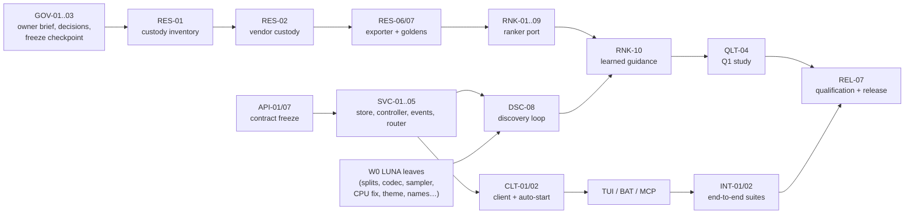

# JopeDime v1 — Parallel Work Plan

**Task breakdown, agent tiers and success criteria for building `docs/product/spec-v1.md`**

| | |
| --- | --- |
| **Prepared for** | Jepson Taylor / VEOX |
| **Date** | October 29, 2026 |
| **Implements** | `docs/product/spec-v1.md` (cited below as "spec §N") |
| **Repo state** | JopeDime `main` `ba34a884` (#457). Re-anchor on current `main` when claiming any task. |
| **Size** | 129 tasks in 18 tracks: 72 LUNA (one is a fan-out template), 54 COMPLEX, 3 OWNER (one shared with a COMPLEX helper) |

---

## 1. How this plan works

### 1.1 Tiers

| Tier | Who | What a task of this tier looks like | Size |
| --- | --- | --- | --- |
| **LUNA** | `gpt-6-luna` (medium), or any agent | Fully specified. One crate or one directory. 1–4 files it owns. No public API or format design. The acceptance tests are listed in the card. ≲ 400 changed lines. | **S** = one agent session (≈ 2–6 h) |
| **COMPLEX** | Frontier agent at high effort (Claude Opus, Codex high, GPT-6 high) | Designs within the spec. Crosses crates, or involves numerical parity, concurrency, crash safety, protocols or security. Writes a ≤ 1-page design note in the PR. May spawn LUNA follow-ups. | **M** = 1–2 agent-days · **L** = 3–5 agent-days |
| **OWNER** | Jepson | Decisions and approvals only | — |

### 1.2 Rules for LUNA tasks

1. Read only the spec sections named in the card, plus the files it owns.
2. Change only the paths listed under **Owns**. If the work needs another path, stop.
3. Make no design choices. If the spec or the card is ambiguous, stop and post the question in `AGENT_CHAT.md` with the task ID. Do not guess.
4. Every **Done when** item must pass, and its output must be pasted into the PR.
5. On a `Cargo.lock` conflict: take `main`'s lockfile, then run `cargo check -p <your crate>` so only your additions are re-added. Never run a bare `cargo update`.
6. If a test fails because of code outside the task's ownership, stop and hand back. Do not fix it.

### 1.3 Rules for COMPLEX tasks

1. The PR description starts with a short design note: approach, alternatives rejected, risks, and which spec clauses it implements.
2. Where the work fans out naturally, file LUNA follow-ups as task cards in the same format (for example, RNK-04 is generated by RNK-03).
3. Any change to a frozen contract (`jope-api` types, the worker protocol, the bundle format, the `.jmat` format, the capability registry schema) needs a second COMPLEX reviewer, and an OWNER approval after M0.
4. Update the spec in the same PR if the implementation reveals that the spec is wrong.

### 1.4 Definition of done (every task)

- [ ] `just required` passes. That recipe runs `hygiene`, `fmt`, `clippy`, `test-pr` and `python-check`.
- [ ] No Jankurai score regression (`just audit`).
- [ ] `cargo deny check` passes. For any task that adds a dependency, `cargo tree -p jope-appliance -e normal` shows no banned crate (spec §3.4).
- [ ] The card's **Done when** items are met, with evidence in the PR.
- [ ] The commit carries the repo's trailers: `Agent-Session`, `Agent-Model`, `Agent-Task: v1/<TASK-ID>`.
- [ ] The task's status is updated in `docs/product/workplan-v1.md` (created by GOV-04).

### 1.5 Claiming, lanes and merging

- **Claiming** follows `AGENTS.md`. Hold `flock` on `AGENT_CHAT.md.lock`, re-read the claims, then append the task ID, checkout, branch, full HEAD, owned paths and intended verification. Overlapping **Owns** paths wait.
- **Parallelism requires an owner brief.** `AGENTS.md` says the delivery plan uses one implementation PR at a time and that you resolve an open PR before opening another lane. Tonight's fused-flywheel lane already ran under an explicit owner brief. GOV-01 issues the same kind of brief for this program; §2 has a draft.
- **Merging:** small PRs (one task each) go through a serial merge queue, rebased on `main` in queue order. A PR that touches a frozen contract merges alone.
- **Hot files** are touched by exactly one task each. Workspace `Cargo.toml` members, `deploy/ci/rust-test-scope.sh` and `deploy/ci/check.sh` belong to API-06. `deploy/appliance/dependencies-deny.toml` belongs to RNK-11. `schemas/jope.api.v1.openapi.json` belongs to API-05, and after that only to its regenerator.
- **Recommended lane mix at the 8-lane cap:** 3 COMPLEX + 5 LUNA during W0, which is dominated by LUNA leaf tasks; then 5 COMPLEX + 3 LUNA from W1 on. COMPLEX capacity, not the critical path, is the binding constraint (§5.1). If the cap is raised, add COMPLEX lanes first.

### 1.6 Waves and milestones

| Wave | Starts when | Purpose |
| --- | --- | --- |
| **W0** | Immediately | Owner decisions, contract freeze, custody inventory, and self-contained leaf tasks |
| **W1** | `jope-api` contract frozen (API-01 merged) | Engine core, client, terminal against fakes, objectives, worker pool |
| **W2** | Engine core + custody outputs | Discovery loop, ranker port, exports glue, telemetry service, MCP adapter, background engine |
| **W3** | Discovery loop + ranker | Integration: learned guidance, finalization, terminal on the real engine, export assembly, end-to-end suites |
| **W4** | Feature-complete | Qualification: Q1 study, CUDA, named-client runs, clean-host matrix |
| **W5** | All gates green on a release candidate | Release |

| Milestone | Meaning | Exit tasks | Spec gates closed |
| --- | --- | --- | --- |
| **M0 Contracts frozen** | Every parallel lane can build against stable types and fakes | API-01, API-07, WRK-02, RES-08, SVC-11 (format section), EXP-01 (schema) | — |
| **M1 Internal alpha** | `jopedime run data.csv --target y --json` performs native discovery and writes a model | SVC-01..05, CLT-01, DSC-08, DSC-09, WRK-01, OBJ-01, BAT-02 | A1 (first leg), A2, A3, R1, R2, R3, S2, S3 |
| **M2 Fused discovery** | Learned guidance works with bundle parity proven | RES-06, RES-07, RNK-01..10 | M1–M5, S4 |
| **M3 Human beta** | The terminal golden path H1 works end to end | TUI-*, BAT-*, PUB-*, TEL-*, EXP-* | U1, U2, R4, T1–T3, E1–E3 |
| **M4 Agent beta** | Golden path AG1 works from Claude Code, Gemini CLI and Codex CLI | MCP-*, INT-01 | A4, A5, S1 |
| **M5 v1.0** | Signed release qualified | QLT-04, REL-*, INT-02 | D1, D2, Q1 recorded, full rerun |

**How the spec's PR groups (spec §15.2) map to tasks.** The spec groups the work into R0 plus 8 PRs. This plan splits each group into small tasks and PRs so lanes can run in parallel.

| Spec group | Tasks |
| --- | --- |
| R0 | GOV-03, RES-01..09 |
| PR1 Contract and skeleton | API-01..08, SVC-01..08, SVC-10, CLT-01, CLT-04 |
| PR2 Native discovery | DSC-01..11, WRK-01..04, OBJ-01..05, SVC-11..13 |
| PR3 Fused ranker | RNK-01..12 |
| PR4 Reasoning, telemetry, warnings | PUB-01..06, TEL-01..07 |
| PR5 Exports | EXP-01..09, CLT-03 |
| PR6 Terminal, batch CLI, background engine | TUI-01..11, BAT-01..07, SVC-09, CLT-02, INT-02 |
| PR7 MCP | MCP-01..05, INT-01 |
| PR8 Release | REL-01..07, QLT-01..05, GOV-04 |

**Critical path:** GOV-03 (S) → RES-01 (L) → RES-02 (S) → RES-06 (L) → RES-07 (M) → RNK-08 (L) → RNK-10 (M) → QLT-04 (M) → REL-07 (M).
Everything else runs beside it. M1 (native discovery) does not depend on the custody work, so the product is usable even if R0 slips.

---

## 2. Draft owner brief for GOV-01

> **Owner brief — JopeDime v1 program lanes (draft for Jepson to edit and sign)**
>
> 1. This brief authorizes up to **8 concurrent v1 program lanes** in JopeDime, each working on one task from `docs/product/workplan-v1.md`, alongside the existing queue. Each lane claims through `AGENT_CHAT.md` as `AGENTS.md` requires.
> 2. Each task produces one small PR. PRs merge through a serial queue, rebased in order. The "one implementation PR at a time" rule is waived **for v1 program PRs only**, for the duration of this brief.
> 3. **LUNA** PRs need one COMPLEX reviewer. **COMPLEX** PRs need a second COMPLEX reviewer. Contract changes after M0 also need owner approval.
> 4. The live fused-flywheel lane continues independently. v1 uses only the checkpoint frozen by GOV-03.
> 5. The brief expires at v1.0 or on revocation.
>
> Signed: ________ Date: ________

---

## 3. Master index

| ID | Tier | Size | Wave | Depends on | Task | Gates | Status |
| --- | --- | --- | --- | --- | --- | --- | --- |
| GOV-01 | OWNER | — | W0 | — | Sign the program owner brief | — | todo |
| GOV-02 | OWNER | — | W0 | — | Decide OD1–OD3, OD5, OD6, OD8 | — | todo |
| GOV-03 | OWNER + COMPLEX | S | W0 | — | ★ Freeze the v1 h40b checkpoint | M1 | merged |
| GOV-04 | LUNA | S | W0 | — | Put spec, review and plan in `docs/product/` with a status table | — | merged |
| RES-01 | COMPLEX | L | W0 | GOV-03 | ★ Inventory the exact custody closure that produced the checkpoint | M1 | claimed |
| RES-02 | LUNA | S | W1 | RES-01 | ★ Vendor custody files and write a hash verifier | M1 | todo |
| RES-03 | LUNA | S | W0 | — | Freeze guard: refuse missing buffers (F09) | M1 | merged |
| RES-04 | COMPLEX | M | W1 | RES-02 | Document the training proposer and its operator frequencies | M3 | todo |
| RES-05 | COMPLEX | M | W1 | RES-02 | Surrogate recipe, rung-0 measurement and revealed-slot analysis (OD13) | M3 | todo |
| RES-06 | COMPLEX | L | W2 | RES-02, RES-03, RES-08 | ★ Deterministic fused-bundle exporter | M1 | todo |
| RES-07 | COMPLEX | M | W2 | RES-06 | ★ Golden parity fixtures | M2, M3, M5 | claimed |
| RES-08 | LUNA | S | W0 | — | Fused-bundle JSON Schema | M4 | merged |
| RES-09 | LUNA | S | W2 | RES-07 | Rust golden-fixture loader for tests | M2, M3 | todo |
| API-01 | COMPLEX | M | W0 | — | ★ `jope-api` crate and core types (contract freeze) | A2 | merged |
| API-02 | LUNA | S | W0 | API-01 skeleton | Error catalog and RFC 9457 problem type | A2 | merged |
| API-03 | LUNA | S | W0 | API-01 skeleton | ID newtypes | A2 | merged |
| API-04 | LUNA | S | W0 | API-01 skeleton | Decimal-string `u64` serde | A2 | merged |
| API-05 | LUNA | S | W1 | API-01 | OpenAPI generator and CI drift check | A2 | claimed |
| API-06 | LUNA | S | W0 | — | Register new crates in the workspace and CI scope | — | merged |
| API-07 | COMPLEX | M | W1 | API-01 | Operation registry (17 ops, 12 tools, 24 commands) | A1 | merged |
| API-08 | LUNA | S | W1 | API-07 | Registry consistency tests | A1 | merged |
| SVC-01 | COMPLEX | L | W1 | API-01, API-06 | Store: `redb`, content-addressed blobs, publish order, recovery | R1 | merged |
| SVC-02 | COMPLEX | M | W1 | SVC-01 | Idempotency committed atomically with effects | R3 | merged |
| SVC-03 | COMPLEX | M | W1 | API-01 | Run controller: six states, revisions, fencing | S2 | merged |
| SVC-04 | COMPLEX | M | W1 | SVC-01, SVC-03 | Event log, publish-after-commit, SSE, long-poll | R1, R4 | merged |
| SVC-05 | COMPLEX | M | W1 | API-07 | axum router, bearer auth, Host check, stubs | A3 | merged |
| SVC-06 | LUNA | S | W1 | SVC-08 | `daemon.json` writer and reader with owner-only permissions | A3 | merged |
| SVC-07 | LUNA | S | W0 | — | `config.toml` loader with precedence and origins | — | merged |
| SVC-08 | LUNA | S | W0 | — | `jopedime_home()` resolver in `jope-paths` | — | merged |
| SVC-09 | COMPLEX | M | W2 | SVC-05, SVC-06 | Engine lock, idle exit, `serve --status/--stop` | R4 | claimed |
| SVC-10 | LUNA | S | W1 | SVC-05 | `GET /v1/system` handler | A1 | merged |
| SVC-11 | COMPLEX | M | W1 | SVC-01 | Dataset registration and the `.jmat` matrix format | S3 | merged |
| SVC-12 | LUNA | S | W1 | SVC-11 | Dataset profile and target suggestion | — | blocked |
| SVC-13 | LUNA | S | W2 | SVC-01, SVC-11 | Delete operations and store GC | — | merged |
| CLT-01 | COMPLEX | M | W1 | API-07, SVC-05 | Client transports: InProcess (oneshot) and Http (ureq), SSE reader | A1 | merged |
| CLT-02 | COMPLEX | M | W2 | CLT-01, SVC-09 | Engine discovery and cross-platform auto-start | R4 | claimed |
| CLT-03 | LUNA | S | W2 | CLT-01 | Upload/download and safe atomic extraction to `--out` | E3 | claimed |
| CLT-04 | LUNA | S | W2 | CLT-01 | Contract test harness across transports | A1 | merged |
| DSC-01 | COMPLEX | M | W0 | — | Public per-candidate API in `feat-math` | S2 | merged |
| DSC-02 | LUNA | S | W0 | — | Random/stratified splits, k-fold, rung-0 subsample | S3 | merged |
| DSC-03 | COMPLEX | M | W1 | DSC-02 | Grouped and time-ordered folds; leakage audit hooks | S3 | merged |
| DSC-04 | LUNA | S | W0 | — | Elite pool data structure | S2 | merged |
| DSC-05 | LUNA | S | W0 | — | Effort table, budget accounting, patience | S2 | merged |
| DSC-06 | COMPLEX | L | W2 | DSC-01, RES-04, EXP-01 | Proposer with training-matched operator mix | M3 | todo |
| DSC-07 | LUNA | S | W2 | RES-07 | Port `select_landmark_preferred_pools` | M3 | todo |
| DSC-08 | COMPLEX | L | W2 | SVC-03, SVC-04, SVC-11, WRK-01, DSC-01..05, OBJ-01 | ★ Discovery loop (heuristic admission) | S2, R1 | claimed |
| DSC-09 | COMPLEX | M | W3 | DSC-08 | Finalization, refits and model artifact | S3 | todo |
| DSC-10 | LUNA | S | W3 | DSC-08 | Warm-start fork | — | todo |
| DSC-11 | COMPLEX | M | W1 | — | `f64` prediction path and non-finite failure (F23) | E2 | merged |
| WRK-01 | COMPLEX | L | W1 | WRK-02, WRK-03 | Worker pool, limits, fencing, parent-death safety | R2 | merged |
| WRK-02 | LUNA | S | W0 | — | Length-prefixed frame codec | R2 | merged |
| WRK-03 | LUNA | S | W0 | — | Cross-platform per-PID CPU and RSS sampler | R2, T1 | merged |
| WRK-04 | COMPLEX | M | W2 | WRK-03, TEL-06 | Resource governor | — | claimed |
| OBJ-01 | LUNA | S | W1 | DSC-01 | Wire regression objectives into evaluation | S4 | merged |
| OBJ-02 | COMPLEX | M | W0 | — | `jope.classification-fitness/v1` schema, framework, logloss, Brier | — | merged |
| OBJ-03 | LUNA | S | W1 | OBJ-02 | Remaining binary metrics against golden values | — | merged |
| OBJ-04 | COMPLEX | M | W2 | OBJ-02 | Cross-fitted Platt calibration in the model object | E2 | merged |
| OBJ-05 | LUNA | S | W1 | OBJ-01 | Order-dependent refusal and fitting disclosure | — | merged |
| RNK-01 | COMPLEX | M | W1 | RES-08 | Bundle loader and verification | M4 | merged |
| RNK-02 | LUNA | S | W1 | RES-01 | Port `proj16` | M3 | todo |
| RNK-03 | COMPLEX | L | W2 | RES-02 | `feat412` featurizer skeleton and first feature family | M3 | todo |
| RNK-04 | LUNA ×N | S each | W2 | RNK-03 | One task per remaining feature family | M3 | todo |
| RNK-05 | COMPLEX | L | W2 | RES-02, RES-09 | Full landmark recipe port | M3 | todo |
| RNK-06 | LUNA | S | W2 | RES-09 | `lm48` projection | M2 | todo |
| RNK-07 | COMPLEX | M | W2 | RES-09 | Stage-1B token projection | M2 | todo |
| RNK-08 | COMPLEX | L | W2 | RES-09 | ★ `adapter_10tok.predict_costs` | M2 | claimed |
| RNK-09 | LUNA | S | W2 | RES-06 | Champion bank loader and nearest retrieval | — | todo |
| RNK-10 | COMPLEX | M | W3 | DSC-08, RNK-01..09 | ★ Learned guidance in the loop | M5, S4 | claimed |
| RNK-11 | LUNA | S | W0 | — | Remove C from the CPU closure (candle patch, ban list) | D1 | merged |
| RNK-12 | COMPLEX | M | W4 | RNK-10 | CUDA parity and placement | M2 | todo |
| PUB-01 | COMPLEX | M | W2 | API-01, SVC-04 | Public projection and claim levels | T2 | claimed |
| PUB-02 | LUNA | S | W0 | — | Public names for stage operations | T2 | merged |
| PUB-03 | LUNA | S | W0 | — | Public names for heads | T2 | merged |
| PUB-04 | LUNA | S | W0 | — | Public names for parameters | T2 | merged |
| PUB-05 | LUNA | S | W1 | PUB-02..04 | Phrase renderer and banned-word lint | T2, T3 | merged |
| PUB-06 | LUNA | S | W3 | PUB-01, BAT-02, MCP-02, TUI-09 | T2 sentinel harness across every surface | T2 | todo |
| TEL-01 | LUNA | S | W0 | — | Fix CPU math (F06) | T1 | merged |
| TEL-02 | LUNA | S | W0 | — | `sink-parquet` feature in `jope-telemetry` | D1 | merged |
| TEL-03 | LUNA | S | W0 | — | Allowed CPUs from cgroup and affinity | T1 | merged |
| TEL-04 | COMPLEX | M | W2 | WRK-03, SVC-04 | Engine telemetry service | T1, T3 | todo |
| TEL-05 | LUNA | S | W1 | — | NVML device mapping and unavailable reasons | T1 | merged |
| TEL-06 | LUNA | S | W1 | API-01 | Warning catalog | — | merged |
| TEL-07 | LUNA | S | W0 | — | Per-language lexical token counters for tok/s | — | merged |
| EXP-01 | COMPLEX | M | W1 | DSC-01 | Capability registry and proposer filter | E1 | merged |
| EXP-02 | COMPLEX | L | W2 | DSC-11, EXP-01 | Python fitted-state glue | E2 | merged |
| EXP-03 | COMPLEX | L | W2 | DSC-11, EXP-01 | Rust fitted-state glue | E2 | merged |
| EXP-04 | LUNA | S | W3 | EXP-02, EXP-03 | Regression calibration in all three emitters | E2 | claimed |
| EXP-05 | LUNA | S | W3 | OBJ-04, EXP-02, EXP-03 | Platt calibration in all three emitters | E2 | blocked |
| EXP-06 | LUNA | S | W3 | API-01 | TypeScript `.d.ts` generator | E2 | claimed |
| EXP-07 | LUNA | S | W3 | EXP-02, EXP-03 | `self_check()` and check rows | E2 | claimed |
| EXP-08 | COMPLEX | M | W3 | EXP-02, EXP-03 | Parity CI harness with real toolchains | E2 | todo |
| EXP-09 | LUNA | S | W3 | SVC-01, EXP-07 | Export bundle assembly | E3 | todo |
| TUI-01 | COMPLEX | M | W1 | API-01, TUI-11 | Terminal skeleton: inline viewport, event loop, restore | U2 | merged |
| TUI-02 | COMPLEX | M | W1 | TUI-01 | Composer and editing | U1 | claimed |
| TUI-03 | LUNA | S | W1 | API-07 | Command parser | U1 | merged |
| TUI-04 | LUNA | S | W1 | API-07 | Completion engine | U1 | merged |
| TUI-05 | LUNA | S | W0 | — | Theme tokens, color detection, sanitizer | U2 | merged |
| TUI-06 | LUNA | S | W1 | API-01 | Transcript card renderers | — | merged |
| TUI-07 | LUNA | S | W1 | API-01 | Status and activity lines | — | merged |
| TUI-08 | LUNA | S | W0 | — | Syntax highlighter for three languages | — | merged |
| TUI-09 | COMPLEX | M | W3 | TUI-01..08, CLT-02 | Draft run spec, interrupts, quit, attach replay | U1, R4 | todo |
| TUI-10 | LUNA | S | W0 | — | PTY test harness | U1, U2 | merged |
| TUI-11 | LUNA | S | W1 | API-01 | Recorded event fixtures and fake transport | — | merged |
| BAT-01 | LUNA | S | W2 | SVC-09 | `serve` CLI wiring | — | todo |
| BAT-02 | LUNA | S | W2 | CLT-01, BAT-05 | `run`, `status`, `events` | S1 | claimed |
| BAT-03 | LUNA | S | W2 | CLT-01, BAT-05 | `control`, `restart`, `runs`, `code` | S1 | blocked |
| BAT-04 | LUNA | S | W2 | CLT-03, BAT-05 | `export`, `predict`, `dataset`, `objective`, `gc` | S1 | todo |
| BAT-05 | LUNA | S | W1 | API-02 | Exit codes, `--idempotency-key`, receipt printing | R3 | merged |
| BAT-06 | COMPLEX | M | W3 | CLT-02, BAT-02 | In-process batch lifecycle and `ENGINE_BUSY` | — | todo |
| BAT-07 | LUNA | S | W2 | CLT-01 | Lite build features and CI job | A1 | claimed |
| MCP-01 | COMPLEX | M | W0 | — | Conformance spike: `rmcp` vs existing dispatcher (OD9) | A4 | merged |
| MCP-02 | COMPLEX | L | W2 | MCP-01, API-07, CLT-01 | MCP adapter with 12 tools | A4 | claimed |
| MCP-03 | LUNA | S | W3 | MCP-02 | Legacy tool aliases | A4 | claimed |
| MCP-04 | LUNA | S | W3 | MCP-02 | Client setup docs and scenario scripts | A5 | todo |
| MCP-05 | COMPLEX | M | W4 | MCP-02..04, INT-01 | Named-client runs | A5 | todo |
| QLT-01 | COMPLEX | M | W1 | — | Q1 preregistration and harness (OD7) | Q1 | merged |
| QLT-02 | LUNA | S | W1 | RES-01 | Held-out cohort manifest | Q1 | claimed |
| QLT-03 | COMPLEX | M | W3 | DSC-08, RNK-10 | `research record` mode | — | todo |
| QLT-04 | COMPLEX | M | W4 | RNK-10, QLT-01, QLT-02 | ★ Run Q1 and record the decision | Q1 | todo |
| QLT-05 | LUNA | S | W0 | — | Reference datasets for tests and D2 | D2 | merged |
| REL-01 | LUNA | S | W2 | RNK-11 | Link-audit script and CI job | D1 | merged |
| REL-02 | COMPLEX | M | W3 | RNK-01, RNK-11, TEL-02 | `fused-cpu`/`fused-cuda` profiles; retire `full` | D1 | todo |
| REL-03 | LUNA | S | W4 | REL-02 | Size budget entry | D2 | todo |
| REL-04 | COMPLEX | M | W4 | REL-02, INT-01 | Clean-host matrix on three OSes | D1 | done |
| REL-05 | LUNA | S | W4 | INT-01 | Product docs with executed examples | — | todo |
| REL-06 | LUNA | S | W4 | REL-02 | D2 startup and first-model benchmark | D2 | todo |
| REL-07 | COMPLEX | M | W5 | all | ★ Qualification receipt and final gate rerun | all | todo |
| INT-01 | COMPLEX | M | W3 | DSC-09, RNK-10, TUI-09, BAT-02..04, MCP-02, EXP-09 | Surface-equivalence and golden-path suites | S1 | done |
| INT-02 | COMPLEX | M | W3 | SVC-09, CLT-02, TUI-09 | Reconnect, determinism across reconnect, system crash matrix | R4, S2, R1 | done |

★ = on the critical path.

---
## 4. Task cards

Each card lists what to do, the paths the task owns, the spec sections to read, and testable success criteria. Unless a card says otherwise, the tests run with `cargo nextest run -P pr --locked -p <crate>`. Paths marked *new* do not exist yet.

### 4.1 GOV — Governance

#### GOV-01 · OWNER · W0
**Do:** Edit and sign the brief in §2. Record its path in `AGENT_CHAT.md`.
**Done when:** The brief exists and the first v1 claim in `AGENT_CHAT.md` cites it.

#### GOV-02 · OWNER · W0
**Do:** Decide spec §16 OD1 (DOPE pin), OD2 (learned-guidance tasks), OD3 (languages), OD5 (engine hosting), OD6 (no uploads) and OD8 (ship champion bank). OD7 comes with QLT-01, OD9 with MCP-01 and OD13 with RES-05.
**Done when:** `docs/product/spec-v1.md` §16 marks each as decided with a date.

#### GOV-03 · OWNER + COMPLEX · S · W0 · ★
**Do:** The live fused-flywheel lane is still changing h40b (drought escape, margin-aware selection, LR schedule). Pick the round/checkpoint that v1 will serve. The COMPLEX helper records its path, SHA-256, training round, optimizer state hash and the DOPE weights SHA-256 it loaded, from the lane's receipts.
**Owns:** `research/flywheel_selfplay/custody/CHECKPOINT.json` *(new)*
**Done when:** (1) `CHECKPOINT.json` names one checkpoint with all hashes. (2) The hashes are verified against the files on the custody host. (3) The flywheel lane owner acknowledges in `AGENT_CHAT.md`.

#### GOV-04 · LUNA · S · W0
**Do:** These files exist only as attachments from the planning session; OWNER supplies them to the lane. Commit them under `docs/product/`:

| Source file | Destination |
| --- | --- |
| `docs/product/spec-v1.md` | `docs/product/spec-v1.md` |
| `docs/product/spec-v1-review.md` (the rubric review of both drafts) | `docs/product/spec-v1-review.md` |
| `docs/product/workplan-v1.md` | `docs/product/workplan-v1.md` |
| `docs/product/drafts/spec-a-enterprise-mvp.md` (Spec A) | `docs/product/drafts/spec-a-enterprise-mvp.md` |
| `docs/product/drafts/spec-b-production.md` (Spec B) | `docs/product/drafts/spec-b-production.md` |

Then rewrite the cross-references inside the five files to the new paths; for example, the spec's "Supersedes" row and the plan's "Implements" row. Add a status column (`todo / claimed / in review / merged`) to the master index in `workplan-v1.md`.
**Owns:** `docs/product/` *(new)*
**Read:** none beyond the files.
**Done when:** (1) The five files are committed. A `diff` against the originals shows only cross-reference rewrites and the added status column. (2) No reference to an old filename remains (`grep` shown in the PR). (3) `just lint-paths` and `just hygiene` pass.

### 4.2 RES — Research custody and exporter (spec R0)

#### RES-01 · COMPLEX · L · W0 · ★ · deps GOV-03
**Do:** Produce the exact closure behind the frozen checkpoint:
- every Python module actually imported, captured from `sys.modules` during a dry run of `run_fused_closed_loop.py` with the frozen checkpoint, resolving whether `rust_evaluator` came from `JopeDimeMicro/python` or from the repo (F11);
- `cpu_exact_fused.py` (SHA `b9f1468a…`), the `FusedLandmarkWorkspace` source, `rank_prepare.py` and `program-feature-names.json`;
- the `s1main` evaluator: its source revision and build recipe, not only the binary SHA `e3be9386…`;
- `champions.json`, the DOPE weights and the checkpoint.

Record the training corpus family list that later becomes the exclusion list for QLT-02.
**Owns:** `research/flywheel_selfplay/custody/MANIFEST.json`, `custody/INVENTORY.md` *(new)*
**Read:** spec §2.1 F11, F12, §5.8; `research/flywheel_selfplay/FLYWHEEL_LOOP.md`
**Done when:** (1) `MANIFEST.json` lists every imported file with path, SHA-256 and origin repo/commit. (2) A dry run with `sys.path` restricted to the manifest's files imports successfully. (3) The evaluator source is identified and rebuilds bit-identically, or the gap is stated as a blocker for OWNER. (4) The family list is attached.

#### RES-02 · LUNA · S · W1 · ★ · deps RES-01
**Do:** Copy every file in `MANIFEST.json` into the custody location chosen in RES-01 (a directory in this repo, or a pinned private repo referenced by SHA), preserving bytes. Write `verify_custody.py` to check every hash.
**Owns:** `research/flywheel_selfplay/custody/files/`, `custody/verify_custody.py` *(new)*
**Done when:** (1) `python3 research/flywheel_selfplay/custody/verify_custody.py` exits 0. (2) Corrupting one byte of any file makes it exit non-zero (shown in the PR). (3) `just python-check` passes.

#### RES-03 · LUNA · S · W0
**Do:** In `snapshot_dope_weights`, raise `DopeFreezeViolationError` when any name in `DOPE_NORMALIZER_BUFFERS` is missing, instead of skipping it (`dope_freeze_guard.py:183–193`). Add tests for a missing buffer, an extra trainable DOPE parameter, a reshaped buffer and a mutated buffer.
**Owns:** `python/src/jope/north_star/dope_freeze_guard.py`, its test file
**Read:** spec §2.1 F09, §13.1
**Done when:** (1) The four new tests pass. (2) The existing self-test (`run_self_test`) still passes. (3) `just python-check` passes.

#### RES-04 · COMPLEX · M · W1 · deps RES-02
**Do:** Document the proposer that generated the frozen head's training data: the typed-edit families, their selection probabilities, crossover, family-excluded bank retrieval, `select_landmark_preferred_pools`, deduplication, and the exploration rule (16 proposals with 2 + 2 admission after a drought). Measure operator-family frequencies from at least 1,000 proposals in the real journal.
**Owns:** `research/flywheel_selfplay/custody/PROPOSER.md`, `custody/proposer_frequencies.json` *(new)*
**Done when:** (1) Every branch of the proposer source is described. (2) The frequency table carries counts and 95% intervals. (3) A COMPLEX reviewer confirms the description against the source.

#### RES-05 · COMPLEX · M · W1 · deps RES-02
**Do:**
- State the `surrogate_recipe` exactly: the units of `revealed_raw_f`, the meaning of `revealed_gate`, and its formula from the training code.
- Specify the rung-0 measurement (`full_train_cv`): folds, seeds, rows and caps.
- Analyze the revealed-slot rule: training slates use the top four, while proposal time uses the pool's first four in storage order. Measure on real pools whether those four differ, and how often.

Write recommendations for OD13.
**Owns:** `research/flywheel_selfplay/custody/SURROGATE.md`, `custody/surrogate_reference.py` *(new)*
**Done when:** (1) `surrogate_reference.py` reproduces the journal's recorded surrogate values for at least 500 evaluations to within `1e-12` relative. (2) The OD13 analysis includes a table of how often storage order and sorted order differ. (3) OWNER records the OD13 decision.

#### RES-06 · COMPLEX · L · W2 · ★ · deps RES-02, RES-03, RES-08
**Do:** Write `export_fused_bundle.py`. It produces `manifest.json`, `dope.safetensors`, `jope.safetensors` (`lm48` parameters, stage-1B, `adapter_10tok` with its anchor), `featurizer.json` and `bank.jsonl.zst` exactly as spec §5.8 lists. Hash canonically, and compute `BundleDigest` over the unsigned manifest plus every file. Enforce the full tensor manifest, and refuse a missing or extra tensor.
**Owns:** `research/flywheel_selfplay/export_fused_bundle.py` *(new)*, its tests
**Done when:** (1) Two runs from two clean checkouts produce the same `BundleDigest` (gate M1, exporter half). (2) The manifest validates against `schemas/jope.fused-bundle.v1.schema.json`. (3) A deliberately removed tensor makes the exporter fail.

#### RES-07 · COMPLEX · M · W2 · ★ · deps RES-06
**Do:** Generate golden fixtures from the custody reference code:
- every intermediate (`v256`, `col[64×17]`, DOPE 629, `lm48`, tokens, mask, costs) for at least 50 contexts on serving-shaped slates (`4 + 8` and `4 + 16`);
- `feat412`/`proj16` for 100% of the historical program corpus;
- landmark-extraction inputs and outputs;
- rung-0 surrogate values;
- `select_landmark_preferred_pools` inputs and outputs.

Document the file layout in `golden/README.md`.
**Owns:** `research/flywheel_selfplay/golden/` *(new)*, the generator script
**Done when:** (1) Regenerating produces byte-identical files. (2) Every RNK, DSC-07 and RES-09 consumer listed in the README has its fixture. (3) The total size is reported. If it exceeds 50 MB, the fixtures are stored by hash in custody and fetched by the test.

#### RES-08 · LUNA · S · W0
**Do:** Write `schemas/jope.fused-bundle.v1.schema.json` from the field list and manifest example in spec §5.8. `qualified` is an array of `{task, landmarks, backend}`; `constants` has the seven listed keys; all hashes are 64 lowercase hex characters.
**Owns:** `schemas/jope.fused-bundle.v1.schema.json` *(new)*, a schema test in `crates/jope-datasets/tests/`
**Read:** spec §5.8
**Done when:** (1) The spec's example manifest (with hex placeholders filled in) validates using the repo's JSON Schema validator (`jope-datasets`). (2) Five invalid variants (missing field, bad hash, unknown task, extra top-level key, wrong type) are rejected.

#### RES-09 · LUNA · S · W2 · deps RES-07
**Do:** Add a test-support module that loads golden SafeTensors fixtures by name into candle tensors and `Vec<f32>`, resolving the fixture directory through an environment variable or the in-repo path.
**Owns:** `crates/jope-service/tests/support/golden.rs` *(new)*
**Done when:** (1) A smoke test loads every fixture listed in `golden/README.md` and checks its shape. (2) A missing fixture produces a clear skip message, not a panic, in non-qualification test runs. (3) Under `JOPE_PARITY_STRICT=1`, a missing fixture fails.

### 4.3 API — Contract crate

#### API-01 · COMPLEX · M · W0 · ★
**Do:** Create `crates/jope-api` (deps: `serde`, `serde_json`, `schemars` only) with every type in spec §4.3 and Appendix B:
- `RunSpec`, `Plan`, `RunSnapshot`, `PublicEvent` and each event body;
- `Algorithm`, `ExportRequest`, `ExportManifest`, `PredictRequest`, `SystemInfo`, `DatasetProfile`, `Warning`, `MetricSample`.

Land a compiling skeleton with module stubs on day 1, so API-02..04 can start, then complete the types. Tag the merge commit `v1-contract-frozen` (M0).
**Owns:** `crates/jope-api/` *(new)* except the files owned by API-02..04
**Read:** spec §4, §8.4, Appendix B
**Done when:** (1) Every type round-trips through JSON in tests using the spec's examples. (2) The `schemars` schema for each top-level type is snapshot-tested. (3) A second COMPLEX reviewer and OWNER approve the freeze.

#### API-02 · LUNA · S · W0 · deps API-01 skeleton
**Do:** Write an `ErrorCode` enum with every row of spec Appendix D: code string, HTTP status, exit code and retriable flag. Add a `Problem` struct (RFC 9457 fields plus `code`, `retriable`, `remedy`, `field`).
**Owns:** `crates/jope-api/src/error.rs`
**Done when:** (1) A table-driven test asserts every Appendix D row exactly. (2) `Problem` serializes with `Content-Type` guidance documented in rustdoc. (3) Unknown codes cannot be constructed.

#### API-03 · LUNA · S · W0 · deps API-01 skeleton
**Do:** Write ID newtypes:
- `RunId` (`run_` + ULID, using the workspace `ulid` crate);
- `DatasetId` and `ArtifactId` (`ds_`/`art_` + 24 lowercase hex characters);
- `AlgorithmId` (`alg_` + at least 4 digits).

Give each parse, display, serde and ordering.
**Owns:** `crates/jope-api/src/ids.rs`
**Done when:** (1) Round-trip tests pass. (2) Rejection tests cover wrong prefix, wrong length and uppercase hex. (3) A `proptest` round-trip passes.

#### API-04 · LUNA · S · W0 · deps API-01 skeleton
**Do:** Write a `DecimalU64` serde wrapper that serializes as a decimal string and accepts only canonical decimal strings (no leading zeros, no sign).
**Owns:** `crates/jope-api/src/decimal.rs`
**Done when:** Tests cover `0`, `2^53+1` and `u64::MAX`, and reject `"01"`, `"-1"`, `"1e3"` and JSON numbers.

#### API-05 · LUNA · S · W1 · deps API-01
**Do:** Add a binary `jope-api-openapi` that writes `schemas/jope.api.v1.openapi.json` from the operation registry and `schemars` schemas. Add `deploy/ci/check-api-schema.sh`, which regenerates the file and fails on any diff, and wire it into `hygiene`.
**Owns:** `crates/jope-api/src/bin/jope-api-openapi.rs`, `schemas/jope.api.v1.openapi.json`, `deploy/ci/check-api-schema.sh` *(new)*, one line in the `justfile` `hygiene` recipe
**Done when:** (1) A clean tree passes the check. (2) Editing one field without regenerating fails `just hygiene` (shown in the PR, then reverted).

#### API-06 · LUNA · S · W0
**Do:** Register three new crates, `jope-api`, `jope-service` and `jope-client` (empty `lib.rs` for the last two), in the workspace `Cargo.toml` members and in the `product` array of `deploy/ci/rust-test-scope.sh`. This task owns those hot files for the program's first wave.
**Owns:** workspace `Cargo.toml` (members only), `deploy/ci/rust-test-scope.sh`, `crates/jope-service/Cargo.toml` and `crates/jope-client/Cargo.toml` skeletons
**Done when:** (1) `bash deploy/ci/check.sh` passes, including its check that product plus deferred equals the workspace. (2) `just test-pr` passes.

#### API-07 · COMPLEX · M · W1 · deps API-01
**Do:** Implement the single operation registry from spec §4.2 as one static table: operation ID, HTTP method and path template, MCP tool name or none, terminal commands, CLI subcommand, request and response types, `mutating`, `requires_idempotency_key`. Expose it for the router (SVC-05), the client (CLT-01), completion (TUI-04), MCP (MCP-02) and OpenAPI (API-05).
**Owns:** `crates/jope-api/src/registry.rs`
**Done when:** (1) The registry contains exactly 17 operations, 12 MCP tools and the 24 terminal commands in spec §6.3, including their kinds (engine / draft / client). (2) API-08's tests pass.

#### API-08 · LUNA · S · W1 · deps API-07
**Do:** Write consistency tests for the registry.
**Owns:** `crates/jope-api/tests/registry.rs`
**Done when:** Tests assert:
- operation, tool and command names are unique;
- every mutating operation requires an idempotency key;
- operations 4, 10, 16 and 17 have no MCP tool;
- every engine command maps to an existing operation;
- `\fitness` and `\language` are aliases of `\objective` and `\lang`.

### 4.4 SVC — Engine core

#### SVC-01 · COMPLEX · L · W1 · deps API-01, API-06
**Do:** Build the store (spec §5.3):
- the `redb` tables and the content-addressed blob store;
- the publish order (temp file → `fsync` → verify hash → rename → directory `fsync` → commit);
- recovery on open (empty `tmp/`, verify referenced blobs, move interrupted runs to `paused{interrupted}`);
- the schema version in `meta`.

Add a `failpoints` test feature that injects a crash at each boundary.
**Owns:** `crates/jope-service/src/store/` *(new)*
**Done when:** (1) A crash at every injected boundary leaves no record pointing at a missing blob, and recovery succeeds (gate R1, store part). (2) Reopening a store written by the same version is lossless. (3) An unknown future schema version is refused with a clear error.

#### SVC-02 · COMPLEX · M · W1 · deps SVC-01
**Do:** Commit idempotency atomically: the `(principal, key) → {request digest, operation id, outcome}` record goes in the **same** `redb` transaction as the effect. A replay with the same key and digest returns the stored outcome; a different digest returns `IDEMPOTENCY_CONFLICT`.
**Owns:** `crates/jope-service/src/store/commands.rs`, `crates/jope-service/src/idempotency.rs` *(new)*
**Done when:** (1) Replay returns the original outcome. (2) A crash after commit but before the response, followed by a retry, returns the original outcome. (3) A conflicting replay returns 409 (gate R3).

#### SVC-03 · COMPLEX · M · W1 · deps API-01
**Do:** Build the run controller: six states and their phases, `revision` increments, `If-Match`, the `IMMUTABLE_FIELD` refusal, and attempt fencing with `(run, round, slot, attempt)`. Drive it through an `Evaluator` trait with a `FakeEvaluator` that sleeps and returns seeded scores.
**Owns:** `crates/jope-service/src/run/` *(new)*
**Read:** spec §5.2, §5.6
**Done when:** (1) A `proptest` over random command sequences never reaches an invalid transition. (2) A revoked attempt's late result is discarded. (3) An effort change does not revoke in-flight attempts. (4) A transition-table test matches spec §5.2.

#### SVC-04 · COMPLEX · M · W1 · deps SVC-01, SVC-03
**Do:** Build the event log and its delivery:
- events are written in the round transaction and published only after commit;
- `GET /events` returns pages with `next_after`;
- SSE carries durable `id` lines, ephemeral telemetry frames without an id, and `Last-Event-ID` resume;
- long-poll on `GET /runs/{id}?wait_seconds&after_event`.

**Owns:** `crates/jope-service/src/events.rs`, `crates/jope-service/src/http/sse.rs` *(new)*
**Done when:**
1. No subscriber observes an event before its commit (a test holds the transaction open).
2. Reconnecting with `Last-Event-ID` produces no gap or duplicate.
3. Long-poll wakes within 50 ms of a new event and returns at the timeout otherwise.
4. A crash cannot re-issue a sequence number.

#### SVC-05 · COMPLEX · M · W1 · deps API-07
**Do:** Build the axum router from the registry. Unimplemented operations return `CAPABILITY_UNAVAILABLE`. Add bearer-token middleware, reject a non-loopback `Host`, send no CORS headers, bind to `127.0.0.1:0`, and use `problem+json` errors. Expose `router()` for in-process use.
**Owns:** `crates/jope-service/src/http/{router.rs,auth.rs}` *(new)*
**Done when:** Gate A3: tests reject a missing token, a wrong token, `Host: evil.example` and an `Origin` header with a browser method, while a correct request succeeds.

#### SVC-06 · LUNA · S · W1 · deps SVC-08
**Do:** Write and read `daemon.json` (`url`, `token`, `pid`, `version`, `api_version`, `started_at`). Generate the token from 32 random bytes as hex. Create the file with mode `0600` on Unix (`OpenOptions::mode`); on Windows, create it under the per-user data directory. Write atomically (temp file + rename). Remove it on clean shutdown.
**Owns:** `crates/jope-service/src/daemon_file.rs` *(new)*
**Done when:** (1) A Unix test checks permissions `0600`. (2) A round-trip test passes. (3) A stale file whose PID is not alive is reported as stale.

#### SVC-07 · LUNA · S · W0
**Do:** Write a `config.toml` loader for the keys in spec Appendix C. Precedence is flags → `JOPEDIME_*` environment → file → defaults. Every resolved value carries its origin. Unknown keys produce a warning, not an error.
**Owns:** `crates/jope-service/src/config.rs` *(new)*
**Done when:** (1) A test per key shows precedence and origin. (2) Byte sizes (`"4GiB"`) and durations (`"30m"`) parse. (3) Invalid values fail with the key name.

#### SVC-08 · LUNA · S · W0
**Do:** Add a `jopedime_home()` resolver to `jope-paths` in the style of ADR-0003 (environment first, resolved at call time): `JOPEDIME_HOME`, else `$XDG_DATA_HOME/jopedime` or `~/.local/share/jopedime` on Linux, `~/Library/Application Support/jopedime` on macOS, `%LOCALAPPDATA%\jopedime` on Windows.
**Owns:** `crates/jope-paths/src/lib.rs` (the new function and its row in the module table only), its tests
**Done when:** (1) Tests cover each OS branch through injected environment variables, serialized with the crate's existing mutex pattern. (2) `just lint-paths` passes.

#### SVC-09 · COMPLEX · M · W2 · deps SVC-05, SVC-06
**Do:** Build engine ownership:
- take the advisory lock on `$JOPEDIME_HOME/lock`;
- publish `daemon.json` after binding;
- run an idle-exit timer that fires only with no active runs and no connected clients;
- implement `serve --status` and `serve --stop` (authenticated shutdown);
- recover interrupted runs on start;
- in-process batch engines take the same lock but publish no `daemon.json`.

**Owns:** `crates/jope-service/src/engine.rs` *(new)*
**Done when:** (1) Two simultaneous `serve` starts yield exactly one engine; the loser exits cleanly. (2) Idle exit fires with a 2 s test setting and not while a run is active. (3) `--stop` ends a running engine. (4) The lock holder is reported in `ENGINE_BUSY`.

#### SVC-10 · LUNA · S · W1 · deps SVC-05
**Do:** Implement the `GET /v1/system` handler: version, engine mode, bundle digests (placeholder until RNK-01), the capability matrix (from a provider trait), limits from config, active warnings, `local_paths`, and a telemetry snapshot (empty until TEL-04).
**Owns:** `crates/jope-service/src/http/system.rs` *(new)*
**Done when:** A snapshot test of the JSON passes and it validates against the `SystemInfo` schema.

#### SVC-11 · COMPLEX · M · W1 · deps SVC-01
**Do:** Implement dataset registration (spec §4.5):
- stream the CSV into the store;
- parse it once with `jope-runtime`'s table code into a column-major `.jmat` matrix (header, column types and encodings, row IDs, 64-byte alignment, checksum);
- make it memory-mappable read-only;
- enforce the limits;
- derive a content-addressed ID.

Write the `.jmat` format as a documented section first (part of M0).
**Owns:** `crates/jope-service/src/dataset/{register.rs,jmat.rs}`, `docs/product/jmat-format.md` *(new)*
**Done when:** (1) Registering the same bytes twice returns the same ID. (2) The `.jmat` round trip is exact. (3) A memory-mapped read in a separate process returns identical values. (4) Each limit violation produces `DATASET_INVALID` with the limit's name.

#### SVC-12 · LUNA · S · W1 · deps SVC-11
**Do:** Write the dataset profile: per column type, missing rate, distinct count (capped), min/max for numeric columns. Suggest targets by ranking columns named `target`, `label`, `y`, `class`, `outcome` or `price`, then the last column; never auto-select one.
**Owns:** `crates/jope-service/src/dataset/profile.rs` *(new)*
**Done when:** Tests on the QLT-05 fixtures produce the expected profiles and suggestions.

#### SVC-13 · LUNA · S · W2 · deps SVC-01, SVC-11
**Do:** Implement `DELETE /v1/datasets/{id}` (refused while any run references it), `DELETE /v1/runs/{id}` (refused while running), and `POST /v1/store/gc` with `dry_run` (lists, then removes, blobs that no record references).
**Owns:** `crates/jope-service/src/http/admin.rs`, `crates/jope-service/src/store/gc.rs` *(new)*
**Done when:** Tests cover refusal while referenced, successful deletion, a GC dry-run listing that equals the actual removal, and accepted models never collected while their run exists.

### 4.5 CLT — Client

#### CLT-01 · COMPLEX · M · W1 · deps API-07, SVC-05
**Do:** Define a `Transport` trait with typed methods generated from the registry. Implement `InProcess` (calls the router through `tower::ServiceExt::oneshot`; feature `engine`) and `Http` (`ureq`; bearer token). Add an SSE reader that yields `PublicEvent` and telemetry frames. `jope-client` must compile without `tokio` when `engine` is off.
**Owns:** `crates/jope-client/src/{lib.rs,transport.rs,inproc.rs,http.rs,sse.rs}` *(new)*
**Done when:** (1) The same request through both transports returns identical JSON. (2) `cargo tree -p jope-client --no-default-features` shows no `tokio`. (3) The SSE reader handles reconnect with `Last-Event-ID`.

#### CLT-02 · COMPLEX · M · W2 · deps CLT-01, SVC-09
**Do:** Implement the engine discovery rules in spec §3.1, steps 1–5:
- auto-start `jopedime serve --idle-exit 30m` detached (`setsid` on Unix, `DETACHED_PROCESS | CREATE_NEW_PROCESS_GROUP` on Windows);
- wait up to 5 s for `daemon.json`;
- if the lock was lost in a race, return to step 2;
- interactive commands auto-start, batch commands use in-process.

**Owns:** `crates/jope-client/src/discover.rs` *(new)*
**Done when:**
1. Linux and macOS integration tests: ten concurrent client starts produce one engine and all ten attach.
2. The Windows variant of the same test passes in CI.
3. The lite build fails with exit 9 and the documented message.

#### CLT-03 · LUNA · S · W2 · deps CLT-01
**Do:**
- Stream a CSV upload when `local_paths` is false.
- Download artifacts with hash verification.
- Extract to a temporary sibling of `--out`, then rename atomically.
- If `--out` exists and is not empty, fail with `OUTPUT_EXISTS` unless `--force`, which first renames the old directory to `<out>.bak-<UTC timestamp>`.
- Refuse archive entries that are absolute or contain `..`, and symlinked targets.

**Owns:** `crates/jope-client/src/files.rs` *(new)*
**Read:** spec §4.5, §10.1, §12
**Done when:** Tests cover every rule listed, including a simulated interruption that leaves `--out` untouched (part of gate E3).

#### CLT-04 · LUNA · S · W2 · deps CLT-01
**Do:** Build a contract harness: for each operation, golden request fixtures run through `InProcess` and `Http`, comparing response JSON after removing `time`. Ship at least one fixture per operation and two per mutating operation (first call and idempotent replay).
**Owns:** `crates/jope-client/tests/contract/` *(new)*
**Done when:** All 17 operations are covered and pass (gate A1, first leg).

### 4.6 DSC — Discovery

#### DSC-01 · COMPLEX · M · W0
**Do:** Expose per-candidate primitives from `feat-math` without changing any existing RNG stream or frozen identity:
- parse and canonicalize a genome;
- `mutate_canonical_pipeline_with_arm` (already public) and `crossover_canonical_pipelines`;
- evaluate one genome with honest CV on a given matrix and fold specification (extracted from `evolve` internals);
- access to `STARTERS` and `CHAMPION_GENOME`;
- fit and predict for finalization.

**Owns:** `crates/feat-math/src/evolve/api.rs` *(new)*, minimal visibility changes in `evolve.rs`
**Done when:** (1) Every existing `feat-math` test and frozen-identity test passes unchanged. (2) New tests show that per-candidate CV equals `evolve`'s internal score for the same genome and folds.

#### DSC-02 · LUNA · S · W0
**Do:** Write pure functions over row indices: a seeded random split, a stratified split for classification, plain and stratified k-fold, and a capped rung-0 subsample. Seeds come from `sha256(seed ‖ label)`.
**Owns:** `crates/jope-service/src/discover/splits.rs` *(new)*
**Read:** spec §5.4, §5.5
**Done when:** Tests show deterministic output, class proportions within ±1 row per fold, disjoint folds that cover every row, and a subsample size equal to the cap.

#### DSC-03 · COMPLEX · M · W1 · deps DSC-02
**Do:** Add grouped k-fold (no group spans folds), forward-chaining time folds with a gap, and constraint inheritance so rung 0, rung 1 and calibration all use constraint-respecting folds. Add an audit hook that records the row IDs each phase touched (for gate S3).
**Owns:** `crates/jope-service/src/discover/{folds.rs,audit.rs}` *(new)*
**Done when:** Property tests show no group crossing folds, strictly increasing time between train and validation with the gap, and an audit log that contains FIT rows only before finalization.

#### DSC-04 · LUNA · S · W0
**Do:** Write an `ElitePool`: capacity 48, two orderings over the same set (surrogate and user objective), `insert`, `top_k_by_surrogate(4)`, `rank_by_objective(id)`, and deterministic tie-breaking by algorithm ID.
**Owns:** `crates/jope-service/src/discover/elites.rs` *(new)*
**Done when:** Tests cover insertion beyond capacity (the worst by user objective is evicted), both orders, ties, and serde round-trip.

#### DSC-05 · LUNA · S · W0
**Do:** Encode the effort table from spec §5.7 (`fast` 24 / 10 s / 3-fold / patience 2 … `ultra`). Count budget at **admission**. Patience and `stall_rounds = ceil(patience / 2)`. Explicit `budget` fields override effort.
**Owns:** `crates/jope-service/src/discover/effort.rs` *(new)*
**Done when:** Table-driven tests match spec §5.7, and admission counting is shown not to change when evaluations fail.

#### DSC-06 · COMPLEX · L · W2 · deps DSC-01, RES-04, EXP-01
**Do:** Build the proposer per spec §5.5:
- reproduce the operator families, mix and exploration rule documented in RES-04 using `feat-math` arms plus crossover;
- champion-bank retrieval (through a trait until RNK-09);
- landmark-preferred stage selection (DSC-07);
- the language capability filter (EXP-01);
- memo deduplication;
- per-round RNG `ChaCha(sha256(seed ‖ round))`.

**Owns:** `crates/jope-service/src/discover/propose.rs` *(new)*
**Done when:** (1) Operator-family frequencies over 10,000 proposals fall within ±2 percentage points of `proposer_frequencies.json` (gate M3, proposer part). (2) Output is deterministic per seed. (3) No proposal uses an operation excluded by the filter.

#### DSC-07 · LUNA · S · W2 · deps RES-07
**Do:** Port `select_landmark_preferred_pools(landmark_v2_48)` from `rust_evaluator.py:761` (or the custody copy RES-01 identifies) to Rust.
**Owns:** `crates/jope-service/src/discover/landmark_pools.rs` *(new)*
**Done when:** The output is identical on every golden input in RES-07.

#### DSC-08 · COMPLEX · L · W2 · ★ · deps SVC-03, SVC-04, SVC-11, WRK-01, DSC-01..05, OBJ-01
**Do:** Implement the discovery loop (spec §5.5) with an `Admission` trait (heuristic for now):
- seeds;
- `R` rounds in flight, fixed in the plan;
- rung 0 and rung 1;
- elites;
- promotion of each round's best if it ranks in the elite top four, replacing the champion only if strictly better at rung 1;
- convergence;
- one commit per round with events published after it.

Add a minimal `jopedime run --json` behind a hidden flag for M1.
**Owns:** `crates/jope-service/src/discover/loop.rs` *(new)*
**Done when:**
1. Gate S2 core: identical champion and deterministic projection with 1 and 8 workers at the same `R`, and across pause and `SIGKILL` + recovery.
2. On the QLT-05 regression fixture, `medium` beats the ridge baseline's CV score.
3. Limit hits are listed under `nondeterminism`.

#### DSC-09 · COMPLEX · M · W3 · deps DSC-08
**Do:** Implement finalization: refit the champion on FIT for the HOLDOUT score; refit on FIT+HOLDOUT (or FIT with `--refit fit`) into a `.jope` model object through `jope-runtime`; score TEST once if supplied; record the receipt fields.
**Owns:** `crates/jope-service/src/discover/finalize.rs` *(new)*
**Done when:** The S3 audit shows HOLDOUT and TEST rows touched only here, the model object loads in `jopedime predict`, and the manifest states the refit kind.

#### DSC-10 · LUNA · S · W3 · deps DSC-08
**Do:** Implement `run_fork{warm_start: true}`: copy the parent's elite pool and champion into the new run's initial state. This is allowed only when the `ProblemDigest` is equal; otherwise return `INVALID_INPUT` with a reason.
**Owns:** `crates/jope-service/src/discover/warm.rs` *(new)*
**Done when:** Tests show a warm fork starts with the parent's elites and never scores worse than the parent's champion, and a changed problem is refused.

#### DSC-11 · COMPLEX · M · W1
**Do:** Fix F23 in `crates/jope-runtime/src/math_pipeline.rs`: predict through `f64` end to end and turn non-finite predictions into a failure instead of `0.0`. Version the model-object section so existing objects keep their recorded behavior and identity, and new objects use the `f64` path.
**Owns:** `crates/jope-runtime/src/math_pipeline.rs`, related tests
**Done when:** (1) Existing model-object compatibility tests pass. (2) New objects predict in `f64`. (3) A non-finite prediction returns a failure. (4) A cross-version test loads an old object.

### 4.7 WRK — Workers and governor

#### WRK-01 · COMPLEX · L · W1 · deps WRK-02, WRK-03
**Do:** Implement the `jopedime __worker --protocol 1` subcommand and the parent pool:
- dispatch with `(run, round, slot, attempt)`;
- a wall timeout and an RSS cap sampled every 100 ms, killing on breach;
- a Job Object on Windows;
- `PR_SET_PDEATHSIG` on Linux and stdin-EOF exit everywhere;
- recycling after 500 evaluations or 2× RSS growth;
- the matrix memory-mapped once per worker.

**Owns:** `crates/jope-service/src/worker/` *(new)*, `crates/jope-appliance/src/worker.rs` *(new)*
**Done when:** Gate R2 on Linux, macOS and Windows: infinite-loop and memory-bomb candidates are killed within limit + 2 s, the run completes, engine RSS stays within 10% of baseline, and killing the parent leaves no worker processes.

#### WRK-02 · LUNA · S · W0
**Do:** Write a frame codec: a `u32` little-endian length followed by JSON, at most 8 MiB, with typed errors for oversize, truncation and invalid UTF-8.
**Owns:** `crates/jope-service/src/worker/frame.rs` *(new)*
**Done when:** Round-trip tests pass, `proptest` covers random payloads, and a truncated stream returns an error without panicking.

#### WRK-03 · LUNA · S · W0
**Do:** Write a per-PID sampler returning `(cpu_seconds, rss_bytes)`: Linux `/proc/<pid>/stat` and `statm`, macOS `proc_pid_rusage`, Windows `GetProcessTimes` and `GetProcessMemoryInfo`. Use `libc`/`windows-sys`, already in the workspace; add no new crate without a cargo-deny pass.
**Owns:** `crates/jope-service/src/sampler.rs` *(new)*
**Done when:** A test spawns a busy child for 2 s and measures 0.8–1.2 cores, and RSS grows after the child allocates 200 MB, on all three OSes in CI.

#### WRK-04 · COMPLEX · M · W2 · deps WRK-03, TEL-06
**Do:** Build the resource governor (spec §9.2): preflight estimates in the plan; retire one worker under memory pressure, with hysteresis; pause on the disk reserve; never change `R`.
**Owns:** `crates/jope-service/src/governor.rs` *(new)*
**Done when:** Tests with injected sensor values show retirement and restoration at the thresholds, a pause at the disk reserve with `DISK_LOW`, and unchanged determinism under retirement (S2 rerun).

### 4.8 OBJ — Objectives

#### OBJ-01 · LUNA · S · W1 · deps DSC-01
**Do:** Wrap `jope-runtime`'s regression fitness (`fitness.rs`) as the engine's `Objective` for evaluation. The objective digest becomes part of `ProblemDigest`.
**Owns:** `crates/jope-service/src/objective/regression.rs` *(new)*
**Done when:** On fixtures, `rmse`, `mae` and a JSON custom objective give the same values as `jopedime fitness evaluate`.

#### OBJ-02 · COMPLEX · M · W0
**Do:** Design `jope.classification-fitness/v1`: the JSON schema, the probability and label inputs with explicit class order, aggregation, and undefined-value policy. Implement the framework plus `logloss` and `brier`.
**Owns:** `schemas/jope.classification-fitness.v1.schema.json`, `crates/jope-runtime/src/fitness_classification.rs` *(new)*
**Done when:** Hand-computed golden values match to `1e-12`, invalid specifications are refused, and the schema validates the examples.

#### OBJ-03 · LUNA · S · W1 · deps OBJ-02
**Do:** Add `roc_auc`, `pr_auc` (average precision), `f1@threshold`, `balanced_accuracy` and a cost-matrix loss to the OBJ-02 framework. Use golden values produced by a one-off script with scikit-learn (commit the script and its output).
**Owns:** functions in `fitness_classification.rs` marked for OBJ-03, `research/tools/classification_golden.py` *(new)*
**Done when:** Every metric matches the golden values to `1e-12`, including ties in scores and a single-class fold (which returns `FITNESS_UNDEFINED`).

#### OBJ-04 · COMPLEX · M · W2 · deps OBJ-02
**Do:** Add cross-fitted Platt calibration (a logistic fit on the head's score) for binary tasks. Store it in the model object as a new versioned section and apply it at prediction.
**Owns:** `crates/jope-runtime/src/calibration_platt.rs` *(new)*, the model-object section
**Done when:** Calibrated probabilities lie in [0, 1] and are monotone in the score, `logloss` improves on a deliberately miscalibrated fixture, and the model object round-trips.

#### OBJ-05 · LUNA · S · W1 · deps OBJ-01
**Do:** Refuse order-dependent objectives without `time_column` (`OBJECTIVE_REQUIRES_ORDER`). Fill the plan's `fitting: native | selection_only` from a per-head table.
**Owns:** `crates/jope-service/src/objective/rules.rs` *(new)*
**Done when:** Tests cover each order-dependent objective and each head's disclosure value.

### 4.9 RNK — Ranker port

#### RNK-01 · COMPLEX · M · W1 · deps RES-08
**Do:** Load a bundle from embedded bytes or `--bundle DIR` (development builds). Check byte caps before allocation, file hashes against the manifest, the manifest signature, every tensor's name, shape and dtype, and NaN/Inf; refuse unknown architectures. Expose `BundleDigest` and the qualified matrix to SVC-10.
**Owns:** `crates/jope-service/src/ranker/bundle.rs` *(new)*
**Done when:** Gate M4: corrupt header, wrong hash, NaN weight, wrong shape and oversized file are each refused with `MODEL_INTEGRITY_FAILED`, and the CLI exits 3.

#### RNK-02 · LUNA · S · W1 · deps RES-01
**Do:** Port `proj16`: the 412×16 sign matrix (bit 0 of `sha256(b"jope-context-cross-v1\0" + pack("<II", i, k))[0]`, mapping 1 → +1 and 0 → −1), multiplied by `feat412` as `f64` and divided by `sqrt(412)`, as in `rust_evaluator.py:176–200`.
**Owns:** `crates/jope-service/src/ranker/proj16.rs` *(new)*
**Done when:** (1) The matrix equals the output of `get_w1_sign_matrix()` exactly; generate that fixture in this task from the custody copy RES-01 identifies. (2) `proj16` matches the Python function to `1e-12` on 1,000 seeded random `feat412` vectors, also generated here. (3) The check is re-run against the RES-07 goldens when they land (one extra test, no code change).

#### RNK-03 · COMPLEX · L · W2 · deps RES-02
**Do:** Port the DSL→412 featurizer skeleton from custody `rank_prepare.py`: DSL parsing (reusing `feat-math`'s genome parser where the grammars match), the feature-name order from `featurizer.json`, and the first feature family. Then file one RNK-04 card per remaining family, each listing its feature names, source function and fixture subset.
**Owns:** `crates/jope-service/src/ranker/featurizer/{mod.rs,parse.rs,<first family>.rs}` *(new)*
**Done when:** The first family matches the goldens on 100% of corpus programs, and the RNK-04 cards are filed.

#### RNK-04 · LUNA ×N · S each · W2 · deps RNK-03
**Do:** Port one feature family exactly as its card (filed by RNK-03) specifies.
**Owns:** `crates/jope-service/src/ranker/featurizer/<family>.rs`
**Done when:** That family's features match the goldens on 100% of corpus programs — exact for count/flag features, ≤ `1e-6` otherwise.

#### RNK-05 · COMPLEX · L · W2 · deps RES-02, RES-09
**Do:** Port the full landmark recipe used in training (`FusedLandmarkWorkspace.fit_transform_and_extract_bundle_high`), producing `v256` and `col[64×17]` from a FIT subsample of at most 1,024 rows. Alternatively, prove that `dope-core`'s conditioning builder produces identical tensors and use it. Measure and report `landmarks.ms`.
**Owns:** `crates/jope-service/src/ranker/landmarks.rs` *(new)*
**Done when:** Gate M3 landmark part: the goldens match within the tolerance stated in the PR; subsample versus full-table agreement is reported; the latency table is included.

#### RNK-06 · LUNA · S · W2 · deps RES-09
**Do:** Implement `lm48 = clamp((v256 − step2_lm_mean) / step2_lm_std, −6, 6) @ step2_svd_basis_48` and `lm48_z = clamp((lm48 − mu_lm48) / sd_lm48, −6, 6)`, reading the parameters from `jope.safetensors`.
**Owns:** `crates/jope-service/src/ranker/lm48.rs` *(new)*
**Done when:** The goldens match within `atol 1e-5`, `rtol 1e-4`.

#### RNK-07 · COMPLEX · M · W2 · deps RES-09
**Do:** Port the stage-1B token projection (`lm48` + DOPE 629 → `mm_tokens_10x32` + `mm_mask_10`) from the custody `cpu_exact_fused.py`, running DOPE MLC-v3 through `dope_core::mlc_v3::MlcV3Model`.
**Owns:** `crates/jope-service/src/ranker/stage1b.rs` *(new)*
**Done when:** Gate M2 for tokens and mask on ≥ 50 contexts.

#### RNK-08 · COMPLEX · L · W2 · ★ · deps RES-09
**Do:** Port `adapter_10tok.predict_costs` in candle with every input in spec F12: `prog_412`, `proj_16`, tokens and mask, revealed indices, fitness and gates, `scale = 0.4208`, and zero `ctx_feat[584]`, `base_prior_cost` and `sos_prior`. Return `total_cost`.
**Owns:** `crates/jope-service/src/ranker/adapter.rs` *(new)*
**Done when:** Gate M2: costs within `atol 1e-5`, `rtol 1e-4`; the admitted set is identical outside the spec §5.8 tie band on serving-shaped slates (`4 + 8` and `4 + 16`).

#### RNK-09 · LUNA · S · W2 · deps RES-06
**Do:** Load `bank.jsonl.zst` with `ruzstd` and implement `nearest(lm48, k)` with the distance metric RES-04 documents; ties broken by program hash.
**Owns:** `crates/jope-service/src/ranker/bank.rs` *(new)*
**Done when:** The loader rejects a malformed line with its line number, and nearest-k matches RES-07 retrieval fixtures exactly.

#### RNK-10 · COMPLEX · M · W3 · ★ · deps DSC-08, RNK-01..09
**Do:** Implement the learned `Admission`:
- revealed context per OD13;
- the 4 lowest costs, or 2 lowest + 2 random when exploring;
- guidance resolution (`auto` / `learned` / `heuristic`, `prior_only`);
- plan fields;
- the capability matrix;
- `GUIDANCE_HEURISTIC` and `OBJECTIVE_SURROGATE_MISMATCH` warnings.

**Owns:** `crates/jope-service/src/ranker/admission.rs`, `crates/jope-service/src/ranker/mod.rs` *(new)*
**Done when:** (1) Gate M5: on serving-shaped slates, perturbing landmarks or revealed fitness changes the admitted set, and a disconnected-ranker build fails the test. (2) Gate S4: a custom objective drives every promotion. (3) Determinism (S2) holds with learned guidance.

#### RNK-11 · LUNA · S · W0
**Do:** Remove C from the CPU closure.
- In `vendor/security/candle-core-0.11.0/Cargo.toml`, make the non-wasm `tokenizers` dependency `optional = true` and gate `src/quantized/tokenizer.rs` behind a new feature that is off by default.
- Record the change in `vendor/security/PROVENANCE.json`.
- Add the spec §3.4 ban list to `deploy/appliance/dependencies-deny.toml`.

**Owns:** those three files
**Done when:** (1) `cargo tree -p jope-appliance -e normal --features dope-encoding -i onig_sys` reports nothing, and likewise for `esaxx-rs`. (2) `cargo deny check` passes. (3) `starforge` and `dope-core` tests pass.

#### RNK-12 · COMPLEX · M · W4 · deps RNK-10
**Do:** Run DOPE and the ranker on CUDA in the `fused-cuda` build, report stage placement in the plan, and run the M2 gate on the qualified GPU host.
**Owns:** CUDA-specific modules under `crates/jope-service/src/ranker/`
**Done when:** CUDA M2 passes on the declared GPU and driver; the placement fields are correct; `--device cuda:0` without a GPU fails with `BACKEND_UNAVAILABLE`.

### 4.10 PUB — Public reasoning

#### PUB-01 · COMPLEX · M · W2 · deps API-01, SVC-04
**Do:** Project internal evaluation records into `PublicEvent`s (spec §8):
- the claim levels;
- comparisons only with matching digests and folds;
- a `ProblemDigest` check;
- public `experiment_id`s that never encode lineage.

**Owns:** `crates/jope-service/src/public/project.rs` *(new)*
**Done when:** Tests show that every claim level requires its evidence, a mismatched comparison emits "comparison unavailable", and no public type has a field that can hold a DSL string or lineage ID (a compile-time test via type inspection).

#### PUB-02 · LUNA · S · W0
**Do:** For every stage operation in `feat-math` (`ops.rs`), add a `public_name` and a `purpose` in plain language. Example: `log1p` → "a log transform" / "compress skewed features".
**Owns:** `crates/feat-math/src/public_names/ops.rs` *(new)*
**Done when:** A test iterates every operation in the registry and asserts a non-empty name and purpose with no banned words (PUB-05's list). A COMPLEX reviewer signs off the wording.

#### PUB-03 · LUNA · S · W0
**Do:** The same as PUB-02 for every model head (for example, "gradient-boosted trees" / "capture non-linear interactions").
**Owns:** `crates/feat-math/src/public_names/heads.rs` *(new)*
**Done when:** The same test passes for heads.

#### PUB-04 · LUNA · S · W0
**Do:** The same for every tunable parameter (for example, `alpha` → "regularization strength").
**Owns:** `crates/feat-math/src/public_names/params.rs` *(new)*
**Done when:** The same test passes for parameters.

#### PUB-05 · LUNA · S · W1 · deps PUB-02..04
**Do:** Implement the phrase renderer with the spec §8.3 templates, 2–4 variants each chosen by hashing the event digest. Add a banned-word lint: `mutation`, `mutate`, `crossover`, `genome`, `generation`, `population`, `island`, `parent`, `offspring`, `lineage`, `DSL`, `GP`.
**Owns:** `crates/jope-service/src/public/phrase.rs` *(new)*
**Done when:** Rendering is deterministic for a given digest, every template renders for every catalog entry, and the lint rejects each banned word.

#### PUB-06 · LUNA · S · W3 · deps PUB-01, BAT-02, MCP-02, TUI-09
**Do:** Build the gate T2 harness: inject sentinel strings into internal DSL, operator, lineage and round fields during a full run, then scan HTTP responses, SSE, MCP output, CLI stdout and stderr, the terminal transcript (via PTY), errors, export manifests and logs.
**Owns:** `crates/jope-service/tests/no_gp_leak.rs` *(new)*
**Done when:** No sentinel appears on any surface, and a deliberately leaking build fails the test.

### 4.11 TEL — Telemetry

#### TEL-01 · LUNA · S · W0
**Do:** In `crates/jope-telemetry/src/collectors.rs:145–158`, replace the clamped per-core percentage with `cpu.cores` (core-equivalents) and `cpu.host_pct`, without clamping. Fix the comment. Keep the old metric name registered for existing consumers, as #457 did for tok/s.
**Owns:** `crates/jope-telemetry/src/collectors.rs`, its tests
**Done when:** Gate T1 unit part: synthetic counters for 1 of 8 cores give `1.00` and `12.5`, and 4 of 8 give `4.00` and `50.0`.

#### TEL-02 · LUNA · S · W0
**Do:** Make `arrow-array`, `arrow-schema` and `parquet` optional behind a `sink-parquet` feature in `jope-telemetry`, enabled by default so existing users are unchanged. Gate the Parquet sink module on it.
**Owns:** `crates/jope-telemetry/Cargo.toml`, `crates/jope-telemetry/src/sink/` (the cfg gates only)
**Done when:** `cargo check -p jope-telemetry --no-default-features` passes; default-feature tests pass; `cargo tree -p jope-telemetry --no-default-features` shows no `arrow` or `parquet`.

#### TEL-03 · LUNA · S · W0
**Do:** Compute allowed CPUs on Linux from cgroup v2 `cpu.max`, falling back to cgroup v1 `cpu.cfs_quota_us`/`cfs_period_us`, intersected with `sched_getaffinity`. Elsewhere, use the logical CPU count.
**Owns:** `crates/jope-telemetry/src/cpu_quota.rs` *(new)*
**Done when:** Tests with fixture files cover v2 `max`, a v2 quota of 150000/100000 (1.5), v1 and affinity.

#### TEL-04 · COMPLEX · M · W2 · deps WRK-03, SVC-04
**Do:** Build the engine telemetry service: sample the engine and workers at 1 Hz, run NVML (TEL-05), compute the spec §9.1 metrics, send SSE telemetry frames, and summarize into the run record at completion. Report tok/s using the existing registry names `throughput.tokens_per_s.rust` (the headline), `.all_languages` and `.rust_timed_alone`, from TEL-07 counts.
**Owns:** `crates/jope-service/src/telemetry.rs` *(new)*
**Done when:** Gate T3: wall-time overhead below 2% on the fixed-work benchmark, and an identical champion with telemetry on or off. Missing sensors produce `null` values with a reason.

#### TEL-05 · LUNA · S · W1
**Do:** Map NVML devices by UUID; return `unavailable:<reason>` for a missing library, a missing driver, permission denied or a lost device; reinitialize after recoverable errors with backoff.
**Owns:** `crates/jope-telemetry/src/nvml_device.rs` *(new)*
**Done when:** Tests cover each error path with a mocked interface, and no path returns `0.0` in place of `null`.

#### TEL-06 · LUNA · S · W1 · deps API-01
**Do:** Implement the spec §9.3 warning catalog: codes, severity, the `host` flag, and raise/clear with a hysteresis helper (thresholds and cooldown).
**Owns:** `crates/jope-service/src/warnings.rs` *(new)*
**Done when:** A test per code covers raise, clear and hysteresis, and every code exists in `jope-api`.

#### TEL-07 · LUNA · S · W0
**Do:** Write simple pinned lexers for Rust, Python and JavaScript that count lexical tokens (identifiers, keywords, literals, operators, punctuation; comments and whitespace excluded). Version the lexer.
**Owns:** `crates/jope-service/src/lex.rs` *(new)*
**Done when:** Token counts on fixture files match hand-counted values, and the counts are stable across the version.

### 4.12 EXP — Exports

#### EXP-01 · COMPLEX · M · W1 · deps DSC-01
**Do:** Build a capability registry in `feat-math`: `(operation | head | calibration | encoding) × language → supported`, seeded from the existing emitters' coverage. Expose an `allowed_ops(languages)` filter for the proposer, and an `excluded_ops` list for the plan. The registry schema is part of M0.
**Owns:** `crates/feat-math/src/capability.rs` *(new)*
**Done when:** (1) Gate E1: a request for `rust,python,javascript` returns the intersection. (2) An impossible combination returns `LANGUAGE_INTERSECTION_EMPTY`. (3) The registry agrees with emitter coverage tests.

#### EXP-02 · COMPLEX · L · W2 · deps DSC-11, EXP-01
**Do:** Write Python fitted-state glue for math pipelines, mirroring `crates/jope-runtime/src/fitted_js.rs`: fitted constants, input scalers, categorical encodings and missing-value handling over `feat-math`'s `emit_py` recipe, using the `f64` path.
**Owns:** `crates/jope-runtime/src/fitted_py.rs` *(new)*
**Done when:** Gate E2 for Python on every registry-supported operation and head, at the spec §10.5 tolerance.

#### EXP-03 · COMPLEX · L · W2 · deps DSC-11, EXP-01
**Do:** The same for Rust over `emit_rs`, using only `std`.
**Owns:** `crates/jope-runtime/src/fitted_rs.rs` *(new)*
**Done when:** Gate E2 for Rust.

#### EXP-04 · LUNA · S · W3 · deps EXP-02, EXP-03
**Do:** Emit the regression calibration transform `max(a + b·pred, floor)` in the JavaScript, Python and Rust glue.
**Owns:** the calibration functions in `fitted_js.rs`, `fitted_py.rs` and `fitted_rs.rs`
**Done when:** Calibrated golden models match the engine in all three languages at the spec §10.5 tolerances.

#### EXP-05 · LUNA · S · W3 · deps OBJ-04, EXP-02, EXP-03
**Do:** Emit Platt calibration in all three languages.
**Owns:** the Platt functions in the three glue files
**Done when:** Binary golden models match the engine's probabilities in all three languages.

#### EXP-06 · LUNA · S · W3 · deps API-01
**Do:** Generate `predictor.d.ts` from the model input schema: a typed row interface with column names and types, plus `predict(row)` and `predictBatch(rows)` signatures matching the JS module.
**Owns:** `crates/jope-service/src/export/dts.rs` *(new)*
**Done when:** A sample TypeScript consumer compiles with `tsc --strict` in the existing `typescript.yml` workflow.

#### EXP-07 · LUNA · S · W3 · deps EXP-02, EXP-03
**Do:** Embed 64 check rows and the engine's outputs in each emitted file, with a `self_check()` entry point: `--self-check` for Python and JS, a `#[test]` for Rust.
**Owns:** the self-check templates in the three glue files
**Done when:** Self-check passes for each language on golden models, and fails when one constant is perturbed.

#### EXP-08 · COMPLEX · M · W3 · deps EXP-02, EXP-03
**Do:** Build a CI parity job: pinned `rustc`, `python3` and `node`; golden models covering every registry entry; numeric tolerances per spec §10.5; per-row decision-flip rates for tree and threshold heads; a report artifact.
**Owns:** `.github/workflows/export-parity.yml`, `deploy/ci/export-parity.sh` *(new)*
**Done when:** The job passes on `main`, and a deliberately broken emitter turns it red (shown in the PR).

#### EXP-09 · LUNA · S · W3 · deps SVC-01, EXP-07
**Do:** Assemble the bundle zip in the store: `manifest.json`, `model.jope`, `src/<lang>/…`, `parity_receipt.json`, and a per-language `README.md` with usage. Set `retains_training_data` from head metadata.
**Owns:** `crates/jope-service/src/export/bundle.rs` *(new)*
**Done when:** The manifest validates against `ExportManifest`; `retains_training_data` is true for kernel, Gaussian-process and nearest-neighbor heads and false otherwise; required-language failure produces no artifact.

### 4.13 TUI — Terminal

#### TUI-01 · COMPLEX · M · W1 · deps API-01, TUI-11
**Do:** Build the terminal skeleton:
- Ratatui `Viewport::Inline`, using `ratatui::crossterm`, not workspace crossterm 0.29;
- transcript lines printed with `insert_before`;
- an event loop merging input, the transport's event stream and a redraw tick (≤ 20 Hz active, 1 Hz idle);
- terminal restore on exit, error, panic and SIGINT/SIGTERM/SIGHUP;
- line mode for `--plain`, `TERM=dumb`, `NO_COLOR` or width below 40.

Develop against the TUI-11 fake transport.
**Owns:** `crates/jope-appliance/src/terminal/{app.rs,restore.rs,line_mode.rs}` *(new)*
**Done when:** Gate U2 on Linux via the TUI-10 harness; a recorded demo replays a fixture run; `NO_COLOR` output contains no escape sequences.

#### TUI-02 · COMPLEX · M · W1 · deps TUI-01
**Do:** Build the composer: multi-line input, grapheme-correct cursor (`unicode-segmentation`), the key bindings in spec §6.4, bracketed paste, history file (0600, 1,000 entries, no JSON objectives over 1 KB), and Ctrl-R search. Draft text survives event bursts.
**Owns:** `crates/jope-appliance/src/terminal/composer.rs` *(new)*
**Done when:** Gate U1: a PTY test types and pastes while 50 events/s arrive and the draft, cursor and completion menu stay intact; history permissions are verified.

#### TUI-03 · LUNA · S · W1 · deps API-07
**Do:** Parse the 24 commands from the registry: canonical `\`, alias `/`, quoted arguments, `--json`, and `@file` arguments. A backslash outside command position (for example `C:\data\x.csv`) is an argument.
**Owns:** `crates/jope-appliance/src/terminal/commands.rs` *(new)*
**Done when:** Table-driven tests cover every command, its aliases, quoting, Windows paths and error messages.

#### TUI-04 · LUNA · S · W1 · deps API-07
**Do:** Implement completion as pure functions: commands → flags → enum values → column names (from the draft dataset) → run and algorithm IDs → file paths (relative to the working directory, spaces quoted). Shift-Tab cycles backward.
**Owns:** `crates/jope-appliance/src/terminal/complete.rs` *(new)*
**Done when:** Tests cover each completion source, path completion in a temporary directory with spaces and Unicode, and no completion executes.

#### TUI-05 · LUNA · S · W0
**Do:** Implement the theme tokens in spec §6.6 with truecolor → 256 → 16 → none detection from `COLORTERM`/`TERM`, `NO_COLOR`, `--theme light|dark|auto`, ASCII symbol fallbacks when the locale is not UTF-8, and a sanitizer that strips control and escape sequences from user strings.
**Owns:** `crates/jope-appliance/src/terminal/theme.rs` *(new)*
**Done when:** Tests cover each detection branch, each fallback and sanitizer cases (ESC, CSI, OSC 8, BEL).

#### TUI-06 · LUNA · S · W1 · deps API-01
**Do:** Write pure render functions from `PublicEvent`s to transcript cards: plan, first model, improvement (with a 4–6 line excerpt), warning raised/cleared, reasoning, export, run finished, and a "no improvement" summary throttled to once per 10 s.
**Owns:** `crates/jope-appliance/src/terminal/cards.rs` *(new)*
**Done when:** Golden-string tests cover each card at 80 and 120 columns, with and without color.

#### TUI-07 · LUNA · S · W1 · deps API-01
**Do:** Render the status and activity lines from `RunSnapshot` and telemetry, dropping fields by priority as width shrinks: GPU, then RAM, then CPU, then rate.
**Owns:** `crates/jope-appliance/src/terminal/status.rs` *(new)*
**Done when:** Golden-string tests pass at 40, 80 and 120 columns, and `null` sensors show `n/a`.

#### TUI-08 · LUNA · S · W0
**Do:** Write a small syntax highlighter for Rust, Python and JavaScript (keywords, strings, numbers, comments) mapped to theme tokens. Do not use `syntect`.
**Owns:** `crates/jope-appliance/src/terminal/highlight.rs` *(new)*
**Done when:** Golden tests on sample snippets pass, including unterminated strings, which must not panic.

#### TUI-09 · COMPLEX · M · W3 · deps TUI-01..08, CLT-02
**Do:** Wire the terminal to the real client:
- the draft `RunSpec` edited by draft commands, each validated by a dry run;
- `\run`;
- immediate Ctrl-C exit and quit semantics from spec §6.5 (owner direction, 2026-11-01);
- `jopedime attach` replay from the watermark;
- the header showing the engine mode.

**Owns:** `crates/jope-appliance/src/terminal/{session.rs,draft.rs}` *(new)*
**Done when:** A PTY scenario for golden path H1 passes against a real engine, and gate R4's terminal part passes: close mid-run, attach, no gaps.

#### TUI-10 · LUNA · S · W0
**Do:** Add a PTY test harness (add `portable-pty` as a dev-dependency after a cargo-deny check) with helpers: spawn `jopedime`, type text, press keys, wait for text with a timeout, resize, and read the screen as plain text.
**Owns:** `crates/jope-appliance/tests/support/pty.rs` *(new)*, the dev-dependency line
**Done when:** A smoke test drives `jopedime --help` and a resize, on Linux and macOS (Windows ConPTY tracked separately in the test).

#### TUI-11 · LUNA · S · W1 · deps API-01
**Do:** Record five event fixtures as JSONL, following spec Appendix B: a short successful run, a run with warnings, a failed candidate burst, a paused and continued run, and a cancelled run. Write a `FakeTransport` that replays them with timing.
**Owns:** `crates/jope-appliance/tests/fixtures/events/*.jsonl`, `crates/jope-client/src/fake.rs` (test-only feature) *(new)*
**Done when:** Every fixture line validates against the `PublicEvent` schema, and the fake replays deterministically.

### 4.14 BAT — Batch CLI

#### BAT-01 · LUNA · S · W2 · deps SVC-09
**Do:** Add the `jopedime serve [--status | --stop | --idle-exit DURATION]` clap wiring around SVC-09.
**Owns:** `crates/jope-appliance/src/serve.rs` *(new)*, its entry in `cli.rs`
**Done when:** Integration tests cover start, status, stop and an idle exit with a short duration.

#### BAT-02 · LUNA · S · W2 · deps CLT-01, BAT-05
**Do:** Add the `run`, `status`, `events` subcommands with every `RunSpec` flag, `--dry-run`, `--detach`, `--out`, `--json`, `--events ndjson` (receipt as the last line), `--wait` and `--after-event`.
**Owns:** `crates/jope-appliance/src/cmd/{run.rs,status.rs,events.rs}` *(new)*
**Done when:** Golden-output tests cover each mode, nothing prompts when stdin is not a TTY, and the run ID goes to stderr on detach or interrupt.

#### BAT-03 · LUNA · S · W2 · deps CLT-01, BAT-05
**Do:** Add the `control`, `restart` (with `--warm` and `--new-seed`), `runs [list | delete | export-feedback]` and `code` subcommands.
**Owns:** `crates/jope-appliance/src/cmd/{control.rs,restart.rs,runs.rs,code.rs}` *(new)*
**Done when:** Golden-output tests cover each subcommand and the exit codes for conflict and not-found cases.

#### BAT-04 · LUNA · S · W2 · deps CLT-03, BAT-05
**Do:** Add `export`, `dataset [add | list | show | delete]`, `objective validate` (keeping `fitness validate` as an alias) and `gc [--dry-run]`. Extend the existing `predict` to accept `--model RUN[:ALG]`, keeping the existing `--output`.
**Owns:** `crates/jope-appliance/src/cmd/{export.rs,dataset.rs,objective.rs,gc.rs}` *(new)*, the `Predict` arm in `cli.rs`
**Done when:** Golden-output tests pass, and existing `predict` tests pass unchanged.

#### BAT-05 · LUNA · S · W1 · deps API-02
**Do:** Write the shared CLI helpers: map `ErrorCode` to an exit code (spec §7.3), add `--idempotency-key` (a random key when absent, printed in `--json` output and on stderr), and print receipts.
**Owns:** `crates/jope-appliance/src/cmd/common.rs` *(new)*
**Done when:** A table test covers every error code's exit code, and a generated key appears in both places.

#### BAT-06 · COMPLEX · M · W3 · deps CLT-02, BAT-02
**Do:** Implement the batch in-process lifecycle: host the engine for the command's duration; on the first Ctrl-C pause, commit and exit 130; on the second, cancel; report `ENGINE_BUSY` (PID and command) to other clients; never leave a process behind.
**Owns:** `crates/jope-appliance/src/cmd/inproc.rs` *(new)*
**Done when:** The golden path H2 scenario passes with no leftover process (checked with the process table), and the interrupted run continues later from another client.

#### BAT-07 · LUNA · S · W2 · deps CLT-01
**Do:** Add features `engine` (default) and `client` to `jope-appliance`. Make `jope-service` optional under `engine`. Add a CI job building `--no-default-features --features client` and running the contract suite against a background engine.
**Owns:** `crates/jope-appliance/Cargo.toml` (features only), `.github/workflows/lite-client.yml` *(new)*
**Done when:** Gate A1 lite leg passes, and `cargo tree` of the lite build shows no `candle-core`, `tokio` or `dope-core`.

### 4.15 MCP — Agent protocol

#### MCP-01 · COMPLEX · M · W0
**Do:** Build two minimal stdio servers with two tools each, one on `rmcp` 3.x and one generalized from `crates/jope-runtime/src/service.rs`. Run lifecycle and conformance checks for `2025-11-25`, `2025-06-18`, `2024-11-05` and `2026-07-28`. Compare dependency closures (`rmcp` needs `tokio`).
**Owns:** `research/mcp-spike/` *(new; not merged into product crates)*
**Done when:** A report gives per-version pass/fail for both implementations, the dependency trees and a recommendation, and OWNER records OD9.

#### MCP-02 · COMPLEX · L · W2 · deps MCP-01, API-07, CLT-01
**Do:** Build the MCP adapter per spec §7.1–7.2:
- the 12 tools generated from the registry, with input and output schemas from `jope-api`;
- `structuredContent`;
- resources;
- the instructions string;
- independent read, dispatch and write;
- stdout purity;
- the `run_status` long-poll capped at 60 s.

**Owns:** `crates/jope-appliance/src/mcp/` *(new)*
**Done when:** Gate A4: every shipped protocol version passes its lifecycle and tool tests; stdout contains only JSON-RPC (a test scans the bytes); `run_status` and `run_control{cancel}` have p95 below 100 ms during fitting.

#### MCP-03 · LUNA · S · W3 · deps MCP-02
**Do:** Make the old tool names callable on the new adapter: `fitness_list`, `fitness_validate`, `fitness_evaluate`, `regression_fit_predict`, `model_session_*`, `narration_read`, `narration_inspect`. Mark them deprecated in their descriptions.
**Owns:** `crates/jope-appliance/src/mcp/aliases.rs` *(new)*
**Done when:** The existing tests for those tools pass against the new adapter, and `tools/list` marks them deprecated.

#### MCP-04 · LUNA · S · W3 · deps MCP-02
**Do:** Write client setup docs: Claude Code (`claude mcp add --transport stdio --scope user jopedime -- /absolute/path/to/jopedime mcp`), the generic `mcpServers` JSON, Gemini CLI and Codex CLI, each with the tested client version. Add a scenario script per client implementing golden path AG1 with a forced retry.
**Owns:** `docs/product/agents.md`, `deploy/qualification/agents/*` *(new)*
**Done when:** The docs build, and each scenario script runs against a mock client harness.

#### MCP-05 · COMPLEX · M · W4 · deps MCP-02..04, INT-01
**Do:** Run AG1 with pinned versions of Claude Code, Gemini CLI and Codex CLI; capture transcripts; fix what breaks.
**Owns:** `deploy/qualification/agents/transcripts/` *(new)*
**Done when:** Gate A5: three transcripts show the full path, including a retried mutation that does not create a duplicate run.

### 4.16 QLT — Quality and flywheel

#### QLT-01 · COMPLEX · M · W1
**Do:** Write the Q1 preregistration (spec §14): the cohort rules (≥ 40 held-out regression families), equal rung-0 budget, paired dataset-level bootstrap with 10,000 resamples, the subgroup definitions and the OD7 margin. Build a harness that runs learned and heuristic guidance per dataset and seed.
**Owns:** `deploy/qualification/q1/PREREGISTRATION.md`, `deploy/qualification/q1/harness/` *(new)*
**Done when:** OWNER signs the preregistration before any learned run, and the harness runs end to end on three datasets with heuristic guidance.

#### QLT-02 · LUNA · S · W1 · deps RES-01
**Do:** Build the held-out cohort manifest from the dataset sources the repo already indexes (`catalogs/s3.json`, `datasets/manifest.json` and the `JOPE_REGISTRY` dataset registry resolved by `jope-paths`), excluding every family in RES-01's training-family list: dataset ID, family ID, rows, columns, SHA-256 and license. If fewer than 40 eligible regression families exist, stop and report the count to OWNER rather than relaxing the rule.
**Owns:** `deploy/qualification/q1/cohort.json` *(new)*
**Done when:** It lists ≥ 40 regression families, a script verifies zero overlap with training families, and every hash verifies.

#### QLT-03 · COMPLEX · M · W3 · deps DSC-08, RNK-10
**Do:** Add `jopedime research record` (cargo feature `research`, absent from release builds). It writes per-round training records per spec §13.2, including behavior-policy costs and `--evaluate-all-proposals`. Publish a schema and a Python reader.
**Owns:** `crates/jope-service/src/research/` *(new)*, `python/src/jope/north_star/record_reader.py` *(new)*
**Done when:** A recorded run reads back in Python with matching counts, and a release build has no `research` command (checked by a test).

#### QLT-04 · COMPLEX · M · W4 · ★ · deps RNK-10, QLT-01, QLT-02
**Do:** Run Q1 exactly as preregistered and write the report: effect estimate, interval, subgroup table, failures, compute used.
**Owns:** `deploy/qualification/q1/REPORT.md` *(new)*
**Done when:** The report is complete, OWNER records the guidance default, and the run receipt hashes are attached.

#### QLT-05 · LUNA · S · W0
**Do:** Add small, licensed reference datasets: regression (≤ 10k × 50; the D2 reference), binary, multiclass, grouped, time-ordered, a messy CSV (quotes, missing values, Unicode headers), and a tiny 30-row table. Each gets a README with source and license.
**Owns:** `test-support/datasets/v1/` *(new)*
**Done when:** Every file has a license entry and a SHA-256 in a manifest, and the total is below 20 MB.

### 4.17 REL — Release

#### REL-01 · LUNA · S · W2 · deps RNK-11
**Do:** Write `deploy/ci/link-audit.sh`: run `ldd` (Linux), `otool -L` (macOS) or `dumpbin /dependents` (Windows) on the built `jopedime` and compare with an allow-list per OS (CUDA libraries allowed only for `fused-cuda`). Add it to the release workflow.
**Owns:** `deploy/ci/link-audit.sh`, `deploy/ci/link-allowlist/*.txt` *(new)*, one step in `release.yml`
**Done when:** It passes on current builds, and adding a dummy C dependency makes it fail (shown in the PR, then reverted).

#### REL-02 · COMPLEX · M · W3 · deps RNK-01, RNK-11, TEL-02
**Do:** Create the `fused-cpu` and `fused-cuda` profiles in `deploy/appliance/profiles/` and their entries in `models.lock.json` with the exported bundle. Make `build.sh` embed the bundle (zstd SafeTensors, signed package). Retire `full`.
**Owns:** `deploy/appliance/{profiles/fused-cpu.toml,profiles/fused-cuda.toml,models.lock.json,build.sh}`
**Done when:** The build produces a signed binary; `jopedime doctor --json` shows the bundle and DOPE digests; `full` is no longer selectable; the profile lock test passes.

#### REL-03 · LUNA · S · W4 · deps REL-02
**Do:** Measure `fused-cpu` sizes and add a budget entry in `deploy/appliance/size-budgets.toml` (the measured size + 5%, target ≤ 40 MB).
**Owns:** `deploy/appliance/size-budgets.toml`
**Done when:** `jope-dist size-report --budget` passes on all three platforms.

#### REL-04 · COMPLEX · M · W4 · deps REL-02, INT-01
**Do:** Extend `deploy/appliance/test-clean-host.sh` into a three-OS clean-host matrix: network disabled; no Python, `rustc` or Node; discovery, three exports and prediction; the link audit.
**Owns:** `deploy/appliance/test-clean-host*.sh`, `.github/workflows/clean-host.yml` *(new)*
**Done when:** Gate D1 passes on Linux x86-64, macOS arm64 and Windows x86-64.

#### REL-05 · LUNA · S · W4 · deps INT-01
**Do:** Write `docs/product/{quickstart,terminal,api,exports,troubleshooting}.md` from the spec. Extract every shell example into a doc-test script that runs against the release candidate.
**Owns:** those docs and `deploy/ci/docs-examples.sh` *(new)*
**Done when:** Every example executes successfully against the release candidate, and `just docs` passes.

#### REL-06 · LUNA · S · W4 · deps REL-02
**Do:** Write the D2 benchmark script: shell-ready p95 with the engine running and with auto-start (20 runs each), and first validated model at `fast` on the QLT-05 reference dataset (10 runs). Print a JSON report.
**Owns:** `deploy/qualification/d2/bench.sh` *(new)*
**Done when:** The script runs on the reference laptop, and its report is attached to REL-07.

#### REL-07 · COMPLEX · M · W5 · ★ · deps all
**Do:** Build the signed release candidate, rerun all 28 release gates and record Q1, then assemble `qualification_receipt.json` (commands, inputs, outputs, hashes, machines). Write the release notes, including the guidance default and known limits.
**Owns:** `deploy/qualification/v1.0/` *(new)*
**Done when:** Every gate passes on the exact signed bytes, and OWNER approves the release.

### 4.18 INT — Integration

#### INT-01 · COMPLEX · M · W3 · deps DSC-09, RNK-10, TUI-09, BAT-02..04, MCP-02, EXP-09
**Do:** Build end-to-end suites for golden paths H1 (PTY), H2 (batch) and AG1 (MCP), and gate S1: the same `RunSpec` with an evaluation budget through the terminal, the batch CLI, MCP, loopback HTTP and in-process calls yields the identical champion, scores and deterministic event projection.
**Owns:** `crates/jope-appliance/tests/e2e/` *(new)*
**Done when:** All three golden paths and S1 pass in CI on Linux and macOS.

#### INT-02 · COMPLEX · M · W3 · deps SVC-09, CLT-02, TUI-09
**Do:** Build three system-level suites:
- gate R4: close the terminal mid-run, `attach`, and see no gap or duplicate; a terminal and an MCP client watching the same run see identical events;
- gate S2 rerun across reconnects;
- gate R1: `SIGKILL` of the background engine at each commit boundary, then automatic recovery on next use.

**Owns:** `crates/jope-appliance/tests/system/` *(new)*
**Done when:** All three suites pass on Linux and macOS, and on Windows where signals apply.

---

## 5. Where to start: lane assignments

### 5.1 Capacity

These figures are rough sizing from the task sizes, not a schedule.

| | Count | Effort |
| --- | --- | --- |
| COMPLEX tasks | 54 (42 M, 12 L, 1 S shared with OWNER) | ≈ 80–145 agent-days |
| LUNA tasks | 72 sessions (more if RNK-04 fans out further) | ≈ 72 sessions of 2–6 h |
| Critical path (GOV-03 → … → REL-07) | 9 tasks: 2 S, 4 M, 3 L | ≈ 14–24 agent-days if worked serially without waiting |

With 3 COMPLEX lanes, COMPLEX work alone takes roughly 27–48 lane-days, longer than the critical path. With 5 COMPLEX lanes it is roughly 16–29 lane-days, which brings it close to the critical path. LUNA work finishes well inside either window on 3–5 lanes. That is why the lane mix shifts toward COMPLEX after W0.

The largest uncertainty is RES-01: whether the custody closure (especially the `s1main` evaluator source) can be recovered as-is. Re-plan after RES-01 reports.

### 5.2 First assignment (W0, 3 COMPLEX + 5 LUNA)

| Lane | Tier | Tasks in order |
| --- | --- | --- |
| 1 | COMPLEX | GOV-03 → RES-01 → RES-04 → RES-05 → RES-06 → RES-07 |
| 2 | COMPLEX | API-01 → API-07 → SVC-05 → CLT-01 → SVC-09 → CLT-02 |
| 3 | COMPLEX | DSC-01 → SVC-03 → SVC-01 → SVC-02 → SVC-04 |
| 4 | LUNA | API-06 → API-02 → API-03 → API-04 → API-05 → API-08 |
| 5 | LUNA | RNK-11 → TEL-02 → TEL-01 → TEL-03 → TEL-07 |
| 6 | LUNA | RES-03 → RES-08 → QLT-05 → DSC-02 → DSC-04 → DSC-05 |
| 7 | LUNA | WRK-02 → WRK-03 → SVC-07 → SVC-08 → SVC-06 |
| 8 | LUNA | PUB-02 → PUB-03 → PUB-04 → TUI-05 → TUI-08 → TUI-10 |

### 5.3 From W1 (5 COMPLEX + 3 LUNA)

- **The two new COMPLEX lanes** take, in order: WRK-01, SVC-11, OBJ-02, DSC-11, EXP-01, MCP-01, QLT-01, DSC-03, TUI-01, TUI-02. When lane 3 finishes SVC-04, it moves to DSC-08, the M1 integration point.
- **The three LUNA lanes** take the W1 LUNA tasks as their dependencies merge: TUI-11, TUI-03, TUI-04, TUI-06, TUI-07, BAT-05, OBJ-01, OBJ-03, OBJ-05, SVC-10, SVC-12, TEL-05, TEL-06, PUB-05, QLT-02, RES-02 (as soon as RES-01 lands; it is on the critical path, so it jumps the queue), RNK-02.
- From W2 on, assign by the master index: critical-path (★) tasks first, then tasks that unblock the most others.

---

## 6. Risks to the plan

| Risk | Effect | Mitigation built into the plan |
| --- | --- | --- |
| The custody closure is incomplete (for example, the `s1main` source is not recoverable) | M2 slips; learned guidance is delayed | RES-01 reports gaps as OWNER blockers on day 1–3; M1 ships native discovery regardless; the fallback is the Rust-recorded retrain (spec §15.2) |
| The live flywheel keeps improving h40b during v1 | The serving target moves | GOV-03 freezes one checkpoint; later improvements ship as a new bundle through the §13 ratchet |
| The serial merge queue becomes the bottleneck | Lanes idle while waiting | Small PRs; LUNA PRs reviewed by any COMPLEX agent; contract changes batched |
| `Cargo.lock` and hot-file conflicts | Rebase churn | Single owners for hot files (§1.5); the lockfile rule in §1.2 |
| Featurizer families turn out larger than expected | RNK-04 fans out further | RNK-03 files one card per family; LUNA lanes absorb them |
| Q1 fails | No learned guidance by default | Q1 is a capability gate; v1 ships with heuristic guidance; QLT-03 enables the retrain |
