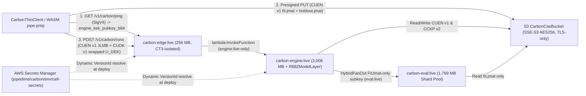

# Carbon AWS Lambda & Enterprise Deployment Runbook

End-to-end operator manual for packaging, deploying, promoting across 17 global regions, rolling back, red-teaming, benchmarking, and operating the Carbon zero-knowledge serverless program-synthesis and inference plane ([ADR-0007](../adr/ADR-0007-carbon-lambda-cells.md), [`deploy/carbon/cloudformation-cell.json`](../../deploy/carbon/cloudformation-cell.json)).

---

## 1. Architecture, Cell Topology, & Security Guarantees

Every regional Carbon cell is managed declaratively as a single 24-resource AWS CloudFormation stack (`jopedime-carbon-<env>`) defined in [`deploy/carbon/cloudformation-cell.json`](../../deploy/carbon/cloudformation-cell.json) and orchestrated by pure-Rust CLI subcommands (`carbon package`, `carbon deploy`, `carbon rollback`) in [`crates/jope-carbon/src/cli/deploy.rs`](../../crates/jope-carbon/src/cli/deploy.rs).



### Cell Function Roles & Trust Surface

| Cell Function | Binary & Build Flags | Default Memory | Timeout | Responsibilities & Isolation Boundary |
| --- | --- | ---: | ---: | --- |
| `carbon-edge` (`:live`) | `carbon-edge` (`--no-default-features --features edge`) | `256 MB` | `300 s` | Public Lambda Function URL (`AuthType: AWS_IAM`, `Qualifier: live`); `/v1/carbon/ping` RTT + `engine_kek_pubkey_b64` discovery; `POST /v1/carbon/auth/anonymous` Free token issuance; `ctk1.*` capability token verification (`x-carbon-capability-token`); Free/Pro tier admission; size-pinned S3 SigV4 `PUT` presigning (`Content-Length` + `x-amz-content-sha256`); sync/async (`Event` `202`) `lambda:InvokeFunction` strictly to `engine:live`; `DELETE /v1/carbon/runs/{id}` cryptographic blob & state shredding. Contains **zero** synthesis, fitting, or neural crates (`CT3` compile-time & binary gate) and **zero** decryption keys. |
| `carbon-engine` (`:live`) | `carbon` (`CARBON_ROLE=engine`) + `R882ModelLayer` | `3,008 MB` (`~1.7 vCPU`) | `600 s` | Private sealed orchestrator (no public URL). Holds `CARBON_ENGINE_KEK_HEX` (NIST P-256 `ECDH` private scalar) and `CARBON_SEAL_SECRET_HEX` via AWS Secrets Manager dynamic references, plus read-only `/opt/jope-models/r882` (`sha256:057e50a9...` cosign P-256 verified DOPE + JopeDime neural fusion bundle). Unwraps per-run `CUDK\x01` in `Zeroizing` RAM, strips `wrapped_u_dek_b64` before persisting `request.json`, decrypts `CUEN\x01` `JLMB` + `fit.jmat`, executes `Wave0SeedOnly` (`Free`) or `MultiWaveLearned` (`Pro`) program-synthesis waves (`SoloSingleLambda` or `HybridFanOut` to `eval:live`), writes domain-separated & `U_DEK`-double-bound `CCKP\x02` checkpoints/champions, scores `holdout.jmat` strictly post-selection, and returns E2E client-encrypted `/predict` (`CUEN\x01` + `CUDK\x01`). |
| `carbon-eval` (`:live`) | `carbon` (`CARBON_ROLE=eval`) | `1,769 MB` (`1 vCPU`) | `120 s` | Private stateless candidate shard worker (no public URL, no `r882` layer, no KEK, no `auth_secret_hex`). Receives a 60-second `FitJmat`-only HKDF subkey grant per wave, decrypts `fit.jmat` in `Zeroizing` RAM (`<= 2` cached entries, `<= 60 s` TTL), scores candidate program shards in parallel, and returns scalar validation losses only. |

### Production Security & Infrastructure Invariants

1. **Zero-Knowledge Per-User Envelope Encryption (`CUEN\x01` + `CUDK\x01`)**: For every upload/run, `CarbonThinClient` (and WASM `jope-prep`) generates a fresh 256-bit CSPRNG `U_DEK`, derives slot-scoped subkeys (`FitJmat`, `HoldoutJmat`, `LandmarkJlmb`, `PredictRows`, `PredictOutput`, `CheckpointSeal`) via `HKDF-SHA256`, encrypts payloads with length-prefixed AAD `(payload_kind, tenant_id, scope_id)`, and wraps `U_DEK` exclusively to `carbon-engine`'s P-256 KEK (`ECDH-ES + HKDF-SHA256 + AES-256-GCM`).
2. **Zero Plaintext Secrets in Templates, ChangeSets, or `argv`**: Cell secrets reside in AWS Secrets Manager (`jopedime/carbon/<env>/cell-secrets`) and resolve inside CloudFormation via version-pinned dynamic references (`{{resolve:secretsmanager:...:SecretString:key::VersionId}}`). Secrets never appear in Git, CloudFormation template parameters, ChangeSet diffs, process `argv`, or logs.
3. **Immutable Versions & `< 1 s` Atomic `:live` Aliases**: Every deployment publishes `CodeSha256`-verified `AWS::Lambda::Version` resources (`DeletionPolicy: Retain`) and atomically shifts the `live` `AWS::Lambda::Alias` across `eval`, `engine`, and `edge`. `$LATEST` never serves traffic and is never granted Function URL or cross-Lambda `InvokeFunction` permissions.
4. **Encrypted TLS-Only S3 CAS & Lifecycle Hygiene**: `CarbonCasBucket` enforces SSE-S3 `AES256`, all four `PublicAccessBlock` flags, `BucketOwnerEnforced`, `DenyInsecureTransport` (`aws:SecureTransport == false`), and automatic lifecycle expiration (`1` day `dev`, `7` days `prod` on `cell-v1/blobs/`, plus 1-day `AbortIncompleteMultipartUpload`).
5. **CloudWatch Observability & Alarms**: Managed `LogGroup`s (`14` days `dev`, `90` days `prod`) and `AWS::CloudWatch::Alarm` error monitors (`EdgeErrorsAlarm`, `EngineErrorsAlarm`, `EvalErrorsAlarm`) are provisioned automatically per cell.

---

## 2. Prerequisites & Cold-Host Bootstrap

### Build Host Toolchain

Packaging runs on an `x86_64` or `aarch64` Linux build host with:
1. Rust toolchain from [`rust-toolchain.toml`](../../rust-toolchain.toml) with the `aarch64-unknown-linux-musl` target installed:
   ```sh
   rustup target add aarch64-unknown-linux-musl
   ```
2. `zig` (`>= 0.13`) on `PATH` (or `$HOME/.local/zig/zig`), used by `carbon package` as a deterministic zero-glibc static `musl` cross-linker (`zig cc -target aarch64-linux-musl`).
3. Extracted `r882` neural model bundle (`models/bundles/r882.json`, 56 files, `10,538,398` bytes, `sha256:057e50a9a741d30d541ed8af8339cec84a5157af621100cb70857052ef14dacc`). Fetch and verify from the canonical model store if not already staged locally:
   ```sh
   AWS_PROFILE=veox-jepson-prod \
     cargo run --release --locked -p jope-cli --bin jope -- models fetch r882 \
     --out target/lambda-pkgs/layer-root/jope-models/r882
   ```

### AWS Credentials & Required Deployer Permissions

Resolve host credentials via `AWS_PROFILE=veox-jepson-prod` (or short-lived IAM role credentials exported into `AWS_ACCESS_KEY_ID` / `AWS_SECRET_ACCESS_KEY` / `AWS_SESSION_TOKEN`). The deploying principal requires scoped permissions on the target region(s):
- `sts:GetCallerIdentity`
- `secretsmanager:DescribeSecret`, `secretsmanager:GetSecretValue`, `secretsmanager:CreateSecret`, `secretsmanager:PutSecretValue` on `arn:aws:secretsmanager:*:*:secret:jopedime/carbon/*`
- `s3:CreateBucket`, `s3:PutBucket*`, `s3:PutObject`, `s3:GetObject`, `s3:ListBucket` on `jopedime-carbon-artifacts-*` and `jopedime-carbon-*-cas-*`
- `cloudformation:CreateChangeSet`, `cloudformation:DescribeChangeSet`, `cloudformation:ExecuteChangeSet`, `cloudformation:DeleteChangeSet`, `cloudformation:DescribeStacks`, `cloudformation:DescribeStackEvents` on `stack/jopedime-carbon-*/*`
- `lambda:*`, `iam:*Role*`, `iam:PassRole`, `logs:*LogGroup*`, `logs:PutRetentionPolicy`, `cloudwatch:PutMetricAlarm`, `cloudwatch:DeleteAlarms` for resources prefixed `jopedime-carbon-*`.

---

## 3. Deterministic ARM64 Packaging (`carbon package`)

`carbon package` builds the entire cell release in pure Rust with zero Python or shell packaging scripts:

1. **Cryptographically verifies** the extracted `r882` release directory against [`models/bundles/r882.json`](../../models/bundles/r882.json) (all 56 SHA-256 digests + detached cosign ECDSA P-256 `appliance-signature.bin` against the baked owner public key) via `verify_r882_release_dir` before compiling.
2. **Cross-compiles** static AWS Graviton (`aarch64-unknown-linux-musl`) binaries for `carbon-edge` (`--no-default-features --features edge`) and `carbon` (`engine` + `eval`), verifying ELF64 `EM_AARCH64` headers and enforcing the `CT3` symbol isolation gate on `carbon-edge`.
3. **Writes deterministic PKZIP (`2.0`) archives** (`mtime = 1980-01-01T00:00:00Z`, sorted entries, `0755` `bootstrap`) and emits `release-manifest.json` pinning `git_sha`, `release_id`, hex SHA-256 digests, and Base64 `CodeSha256` digests:

```sh
CARGO_INCREMENTAL=0 CARGO_PROFILE_DEV_DEBUG=line-tables-only \
  cargo run --release --locked -p jope-carbon --bin carbon -- package \
  --r882-dir target/lambda-pkgs/layer-root/jope-models/r882 \
  --out-dir target/carbon-release \
  --jobs 8
```

Packaging produces four deterministic files in `target/carbon-release/`:
- `carbon-edge.zip` (`~2.0 MB` — isolated `carbon-edge` `bootstrap`)
- `carbon-worker.zip` (`~5.8 MB` — unified `engine` + `eval` `bootstrap`)
- `r882-layer.zip` (`~7.2 MB` — `/opt/jope-models/r882` read-only Lambda Layer)
- `release-manifest.json` (`jope.carbon.release-manifest/v1`)

---

## 4. Declarative CloudFormation Rollout & Global Promotion (`carbon deploy`)

### CloudFormation Stack Resource Inventory (24 Resources)

Each regional stack `jopedime-carbon-<env>` provisions and owns:
- **Storage (2)**: `CarbonCasBucket` (SSE-S3 `AES256`, `PublicAccessBlock`, lifecycle expiration), `CarbonCasBucketPolicy` (`DenyInsecureTransport`).
- **Least-Privilege IAM Roles (3)**: `EvalRole` (read-only `cell-v1/blobs/*`), `EngineRole` (`cell-v1/*` R/W + `InvokeFunction` strictly on `eval:live`), `EdgeRole` (`cell-v1/*` presign/shred + `InvokeFunction` strictly on `engine:live`).
- **Model Layer (1)**: `R882ModelLayer` (`compatible_architectures: [arm64]`, attached **only** to `EngineFunction`).
- **Immutable Functions, Versions, & `:live` Aliases (9)**: `{Eval,Engine,Edge}Function` + `{Eval,Engine,Edge}Version<ReleaseId>` (`CodeSha256`-pinned, `DeletionPolicy: Retain`) + `{Eval,Engine,Edge}LiveAlias`.
- **Authenticated Ingress (3)**: `EdgeFunctionUrl` (`AuthType: AWS_IAM`, `Qualifier: live`), `EdgeLiveUrlPermission`, `EdgeLiveInvokePermission` (both bound strictly to `EdgeLiveAlias`).
- **Observability & Alarms (6)**: `{Eval,Engine,Edge}LogGroup` + `{Eval,Engine,Edge}ErrorsAlarm`.

### Stage 1 — Dry-Run ChangeSet Audit (Zero Live State Change)

Stages content-addressed artifacts to `s3://jopedime-carbon-artifacts-<account>-<region>/releases/<release_id>/`, ensures `jopedime/carbon/<env>/cell-secrets` exists in AWS Secrets Manager (when `--bootstrap-secrets` is passed), creates and validates the CloudFormation ChangeSet, prints the resource action count, and deletes the preview ChangeSet without mutating stack state:

```sh
AWS_PROFILE=veox-jepson-prod \
  ./target/release/carbon deploy \
  --manifest target/carbon-release/release-manifest.json \
  --env dev \
  --regions us-east-2 \
  --bootstrap-secrets \
  --dry-run
```

> [!NOTE]
> When migrating a legacy un-stacked prototype region for the first time, add `--decommission-unstacked-prototype` to cleanly remove pre-CloudFormation standalone Lambda functions/roles before ChangeSet `EarlyValidation` runs.

### Stage 2 — `dev` Cell Rollout + Automatic 16-Vector Red-Team Gate (`us-east-2`)

Executes the CloudFormation ChangeSet, atomically shifts `{eval,engine,edge}:live` aliases, verifies `/v1/carbon/ping` (`engine_kek_pubkey_b64` match against the Secrets Manager vault), and runs all **16 adversarial red-team vectors (`V-01`..`V-16`)** live. If any vector fails, `carbon deploy` automatically executes `< 1 s` alias rollback to the prior retained versions and exits non-zero:

```sh
AWS_PROFILE=veox-jepson-prod \
  ./target/release/carbon deploy \
  --manifest target/carbon-release/release-manifest.json \
  --env dev \
  --regions us-east-2 \
  --bootstrap-secrets \
  --json-out target/carbon-release/deploy-dev-receipt.json
```

### Stage 3 — `staging` Pre-Production Soak (`us-east-2`, `eu-central-1`)

```sh
AWS_PROFILE=veox-jepson-prod \
  ./target/release/carbon deploy \
  --manifest target/carbon-release/release-manifest.json \
  --env staging \
  --regions us-east-2,eu-central-1 \
  --bootstrap-secrets \
  --json-out target/carbon-release/deploy-staging-receipt.json
```

### Stage 4 — `prod` Progressive Promotion (`canary` -> `wave1` -> `all-17`)

Promote the **exact same `release-manifest.json`** progressively across region waves (`canary` = `us-east-2`; `wave1` = `us-east-2,us-east-1,us-west-2,eu-central-1,eu-west-1`; `all-17` = `us-east-2`, `us-east-1`, `us-west-2`, `us-west-1`, `ca-central-1`, `eu-central-1`, `eu-west-1`, `eu-west-2`, `eu-north-1`, `sa-east-1`, `il-central-1`, `ap-northeast-1`, `ap-northeast-2`, `ap-southeast-1`, `ap-southeast-2`, `ap-south-1`, `ap-east-1`):

```sh
# 1. Production canary (us-east-2)
AWS_PROFILE=veox-jepson-prod ./target/release/carbon deploy \
  --manifest target/carbon-release/release-manifest.json \
  --env prod --regions canary --bootstrap-secrets

# 2. Production Wave 1 (Americas + EU primary)
AWS_PROFILE=veox-jepson-prod ./target/release/carbon deploy \
  --manifest target/carbon-release/release-manifest.json \
  --env prod --regions wave1 --bootstrap-secrets

# 3. Production Global 17-Region Rollout
AWS_PROFILE=veox-jepson-prod ./target/release/carbon deploy \
  --manifest target/carbon-release/release-manifest.json \
  --env prod --regions all-17 --bootstrap-secrets
```

---

## 5. Emergency `< 1 s` Rollback & Secrets Rotation

### Sub-Second Alias Rollback (`carbon rollback`)

Because `deploy/carbon/cloudformation-cell.json` retains previous `AWS::Lambda::Version` resources (`DeletionPolicy: Retain`), `carbon rollback` repoints `{eval,engine,edge}:live` back to the immediately preceding version (or an explicit `--to-version <N>`) via `UpdateAlias` in `< 1 s` and verifies `/v1/carbon/ping` health:

```sh
AWS_PROFILE=veox-jepson-prod ./target/release/carbon rollback \
  --env prod \
  --region us-east-2
```

After emergency stabilization, re-run `carbon deploy` with the prior release's `release-manifest.json` so CloudFormation stack state converges cleanly to the rolled-back version.

### Zero-Downtime Secrets Rotation (`jopedime/carbon/<env>/cell-secrets`)

Each regional cell secret vault stores a JSON payload with four keys:
- `auth_secret_hex`: 256-bit HMAC key authenticating `ctk1.*` capability tokens (`edge` only).
- `seal_secret_hex`: 256-bit server secret mixed with client `U_DEK` subkeys for `CCKP\x02` state envelopes (`engine` only).
- `engine_kek_priv_hex`: 256-bit NIST P-256 `ECDH` private scalar (`engine` only).
- `engine_kek_pubkey_b64`: URL-safe Base64 SEC1 uncompressed P-256 public key advertised by `/v1/carbon/ping` (`edge` + `engine`).

To rotate cell secrets cleanly:
1. Drain or wait for active multi-wave runs in the target region (or schedule during a low-traffic window, since in-flight paused runs bind to the previous `seal_secret_hex`).
2. Write a new secret version to `jopedime/carbon/<env>/cell-secrets` via AWS Secrets Manager (`PutSecretValue`), generating a fresh CSPRNG `auth_secret_hex`, `seal_secret_hex`, and NIST P-256 scalar/public-key pair.
3. Run `carbon deploy --manifest <current-manifest> --env <env> --regions <region>` — `carbon deploy` automatically reads the new `SecretVersionId`, synthesizes a CloudFormation ChangeSet updating `SecretVersionId`, publishes fresh immutable Lambda versions bound to the new secret version, shifts `:live`, and validates all 16 red-team vectors against the rotated keys.

---

## 6. Operator CLI Usage, Red-Teaming, & Live Qualification Evidence

All operator CLI commands (`run`, `bench`, `redteam`, `token-mint`) accept `--env <dev|staging|prod> --region <region>`, automatically resolving `EdgeEndpointUrl` from CloudFormation stack outputs and minting ephemeral `ctk1.*` capability tokens directly in `Zeroizing` RAM from AWS Secrets Manager (zero secrets in shell history or environment variables).

### Run the 16-Vector Adversarial Red-Team Suite (`carbon redteam`)

```sh
# Against live AWS CloudFormation cell:
AWS_PROFILE=veox-jepson-prod ./target/release/carbon redteam \
  --env dev \
  --region us-east-2 \
  --markdown-out docs/plans/carbon-lambda-20261110/redteam-verification-20261111.md

# Credential-free local CI emulator:
cargo test --locked -p jope-carbon --test carbon_redteam
```

### Run Zero-Knowledge Free & Pro CSV Inference (`carbon run`)

```sh
# Free tier (anonymous capability auth, r882 Wave0SeedOnly, CUEN v1 + CUDK v1 + shred)
AWS_PROFILE=veox-jepson-prod ./target/release/carbon run \
  --env dev --region us-east-2 \
  --csv datasets/test/linear_signal.csv --target y \
  --tier free --effort fast --shred

# Pro tier (in-memory Secrets Manager token mint, r882 MultiWaveLearned, CUEN v1 + CUDK v1 + shred)
AWS_PROFILE=veox-jepson-prod ./target/release/carbon run \
  --env dev --region us-east-2 \
  --csv datasets/test/linear_signal.csv --target y \
  --tenant acme_pro --tier pro --effort medium --shred
```

### Run the 5-Scenario Free + Pro `r882` Benchmark Suite (`carbon bench`)

```sh
AWS_PROFILE=veox-jepson-prod ./target/release/carbon bench \
  --env dev \
  --region us-east-2 \
  --tier pro \
  --markdown-out docs/plans/carbon-lambda-20261110/live-lambda-benchmark-20261110.md
```

### Recorded Live `us-east-2` Qualification Receipts (`jopedime-carbon-dev`)

- **Live 16-Vector Adversarial Red-Team Receipt**: [`docs/plans/carbon-lambda-20261110/redteam-verification-20261111.md`](../plans/carbon-lambda-20261110/redteam-verification-20261111.md) — `16/16` PASS (`V-01`..`V-16`: anonymous abuse, capability token forgery, cross-tenant escalation, tier spoofing, path traversal, S3 presign tamper, plaintext & AAD rejection, wrong-KEK rejection, `eval` `HoldoutJmat` subkey refusal, `CCKP\x02` bit-flip detection, double-bound `U_DEK` verification, E2E encrypted `/predict`, and `DELETE` cryptographic shredding).
- **Live 5-Scenario Free + Pro `r882` Benchmark Receipt**: [`docs/plans/carbon-lambda-20261110/live-lambda-benchmark-20261110.md`](../plans/carbon-lambda-20261110/live-lambda-benchmark-20261110.md) — `5/5` PASS on AWS Graviton2 (`cold_ping_ms: 190.95`, `warm_ping_p50_ms: 71.70`, `Free` `wave0_seed_only` `5.60 s`, `Pro` `multi_wave_learned` warm `4.61 s`, `Pro` 4-wave async `20.95 s`, `Pro` 12-shard `HybridFanOut` + pause + encrypted `/predict` + cross-container `/resume` + `DELETE` shred, and `Free` `5,200`-row cap `HTTP 403` refusal in `151 ms`).

---

## 7. Enterprise Self-Hosted VPC Server (`carbon serve`) & Spot-Hybrid Gate

### Self-Hosted VPC / Air-Gapped Server (`CarbonProductTier::no_limit()`)

Enterprise customers run the single `carbon` binary inside their own VPC, Kubernetes cluster, or air-gapped enclave with zero row/feature/concurrency caps and full `CUEN\x01` + `CUDK\x01` user-envelope encryption:

```sh
CARBON_SEAL_SECRET_HEX="$(openssl rand -hex 32)" \
  ./target/release/carbon serve \
  --listen 0.0.0.0:8088 \
  --data-dir /var/lib/jopedime-carbon \
  --region vpc-local \
  --enable-user-envelope
```

### Monthly Spot-Hybrid Break-Even Gate Check (`S-1 && S-2 && S-3`)

Keep regional cells `100%` serverless AWS Lambda until all three conjunctive traffic gates hold for 2 consecutive months (`>= $12,000/mo` regional spend, steady-state `P20 >= 4` vCPUs with `P95 / mean <= 3.5`, or `> 2%` cold-start SLA impact):

```sh
./target/release/carbon spot-check \
  --region us-east-2 \
  --monthly-spend-usd 15800 \
  --p20-vcpus 6.4 \
  --mean-vcpus 9.2 \
  --p95-vcpus 18.0 \
  --cold-start-rate 0.01 \
  --consecutive-months 2
```

---

## 8. Troubleshooting Matrix

| Symptom / HTTP Status | Root Cause | Resolution |
| --- | --- | --- |
| `HTTP 403 Forbidden` before reaching `carbon-edge` (`x-amzn-errortype: AccessDeniedException`) | Caller lacks `lambda:InvokeFunctionUrl` + `lambda:InvokeFunction` on `EdgeLiveAlias`, SigV4 clock skew exceeds 5 minutes, or query string contains unencoded reserved characters. | Verify `AWS_PROFILE` / caller IAM identity, check host NTP sync (`timedatectl status`), and ensure URL query parameters are RFC 3986 percent-encoded. |
| `HTTP 401` / `HTTP 403` from `carbon-edge` with JSON `guidance` | Expired or forged `x-carbon-capability-token`, tenant mismatch (`tok.sub != req.tenant_id`), tier spoofing (`tok.tier < req.tier`), or Free tier dataset exceeding `5,000` rows x `100` features. | Re-mint token via `--env <env> --region <region>` (Pro) or `POST /v1/carbon/auth/anonymous` (Free); upgrade `--tier pro` for datasets above Free limits. |
| `HTTP 400` on `/v1/carbon/runs` or `/predict` (`CUEN` / `CUDK` refusal) | Payload missing `CUEN\x01` magic, AAD `(payload_kind, tenant_id, scope_id)` mismatch, or `CUDK\x01` wrapped to stale KEK public key. | Re-fetch `/v1/carbon/ping` to obtain the cell's active `engine_kek_pubkey_b64` and re-run `CarbonThinClient` conditioning. |
| CloudFormation ChangeSet fails in `EarlyValidation` (`ResourceExistenceCheck`) | Pre-existing un-stacked Lambda function, IAM role, or LogGroup shares a `jopedime-carbon-<env>-*` resource name in that region. | Inspect existing resources; if migrating an un-stacked prototype cell, pass `--decommission-unstacked-prototype` once during initial stack creation. |
| CloudWatch `EngineErrorsAlarm` or `EdgeErrorsAlarm` enters `ALARM` after deploy | Runtime regression or upstream dependency fault on newly promoted version. | Execute `carbon rollback --env <env> --region <region>` immediately (`< 1 s` `:live` alias restore), then inspect `/aws/lambda/jopedime-carbon-<env>-engine` logs. |
